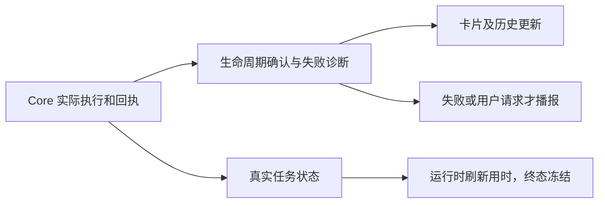

2026-11-12 按用户要求压缩配对 PR #11290 / #11292，合并本 PR 新建的四份记录：B_20261111_1745_state-announcements、B_20261111_1809_tool-failure-details、B_20261112_1030_task-round-settlement、B_20261112_1118_elapsed-clock。历史决策及验证限制保留如下。

| 问题 | 根因与修复决策 |
| --- | --- |
| 停止结果显示原话 | 名称按 title、question、query、默认值选择；原始指令与任务身份不变。 |
| 重复成功播报 | 初期提示词仅要求依据新状态播报；后续决定成功接收、操作、答案、取消及完成结果仅更新上下文，不生成额外 response.create。失败、卡片及主动查询仍回应。队列含写操作时引导查询不单独触发播报。 |
| 工具失败原因不全 | 识别 result/raw_output/data 的结构化或 JSON 失败，提取 error/message/code/error_code/exit_code/stderr，经公共 mask_sensitive 脱敏交给现有卡片与历史；保留原回执及 payload_refs。pending 不误判失败，语音摘要有界，不推测缺失原因或自动重试。 |
| 连续任务提前交接 | 调度器结束时外层轮次仍可占用 Agent。同时等待调度器与 _interaction_round_task，不绕过 busy 检查；关闭失败拒绝交接。对应 GitCode #6454 / GitHub #11274；无现场日志，未证明现场必定出现此时序。 |
| 卡片/取消额外期限 | 移除全双工 RPC、恢复确认、取消及收尾的额外期限，由 Core 实际状态结束等待；卡片替换、失效、关闭结束待答 future，并发回答拒绝重复处理。保留模型超时与连接发送保护。对应 #6446 / #11264。 |
| 任务用时跳秒 | 全双工不占普通 isProcessing，完成折叠条原只随进度刷新；复用 useNow 独立刷新，running/cancelling 计时，首次终态固定时刻，重复快照不延长。历史完成记录不伪造结束时刻，静态导出不接入活动时钟；计时不驱动任务状态或超时。按轮次时间边界及 full-duplex-core-<job>- 工具身份归属。对应 #6010 / #10178。 |

## 验证证据与限制

- 压缩前配对候选后端各 709 passed，任务前端 66、Qwen 145、子智能体 3 项通过。失败详情首次验证有 3 个旧成功通知断言失败，按后续静默契约更新后通过，不是当前遗留。
- 连续任务测试控制调度器先结束、外层轮次延后释放：修复前提前 settle，修复后等外层释放；真实绑定入口在此期间拒绝新请求。相关后端与 output handoff 当时 78 passed。
- #6010 配对候选各通过 turnElapsedAvatar 7、任务前端 66、时间线 27 项；实际组件无进度时 5s→6s，取消后冻结并清理 timer；覆盖轮次边界、非运行状态和历史恢复。0.2.9 Vite 构建通过。后台节流后按墙钟校正，不保证后台每秒渲染。
- 本次精简移出未改动的模式路由/Design 装配历史测试、Gateway 依赖自身的监听/派发测试和两个未修改的运行态测试；排序保留真实 SQLite 队列集成验证，移除重复 mocked 排序测试。关键修复回归保留；精简后 0.2.9 后端完整目录 680 passed，任务前端 66 passed，共享画面运行态 1 passed；develop 结果见 PR 验证记录。
- 未进行真实模型语音、桌面端到端或浏览器截图验证；不运行格式化/静态检查。pytest 旧临时目录的 WinError 5 清理提示不影响测试退出码。中英文用户说明沿用 docs/FullDuplex。
