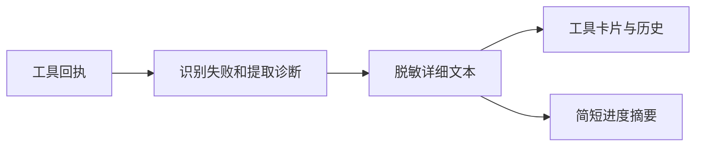

# 全双工工具失败详细信息

## 现象与根因

失败摘要优先于具体错误。结构化 result/raw_output/data 内的失败标记未被全双工进度识别；前端通用 normalizer 又可能优先选择 raw_output.result 的笼统文本。

## 修复与契约

从工具已有回执提取 error、message、code、error_code、exit_code、stderr，识别结构化失败和 JSON 兼容结果。详细信息经公共 mask_sensitive 脱敏后交给现有工具卡片；保留原始字段和 payload_refs，不新增原始请求、环境或堆栈采集。pending 回执不因等待原因而被改成失败。语音使用有界 detail，卡片使用详细文本。工具未提供原因时不推测原因。

## 验证

当前 0.2.9 补齐工作区：后端新增用例与子智能体转发共 7 项通过；前端 taskDuplexLifecycle 共 35 项通过，包含失败卡片显示与持久化。test:task-full-duplex 共 65 项中 62 项通过，voiceTaskPanel 的三个完成通知断言失败；该路径涉及工作区已有的独立通知修改，本次不覆盖。未执行真实模型调用及截图验证。

## English behavior note

Failed duplex tool cards show supplied diagnostic details instead of a generic summary. Existing receipts and artifact references are retained. Voice progress stays concise. Pending approval is not treated as a failed tool call.

## 遗留

本次不修改工具自身未提供原因的情况，不自动重试失败操作。未提交、推送或加入已有 PR。

## 2026-11-12 交付复验

成功通知改为静默后，voiceTaskPanel 的三个旧断言已按新契约更新，保持成功上下文投递与失败通知验证。当前候选全双工后端 709 passed；test:task-full-duplex 66 passed；test:qwen-barge-in 145 passed。此前 3 项失败不是当前候选遗留。按用户授权将本地相关修复补入 0.2.9 / develop 配对 PR；真实模型与浏览器截图未验证。
