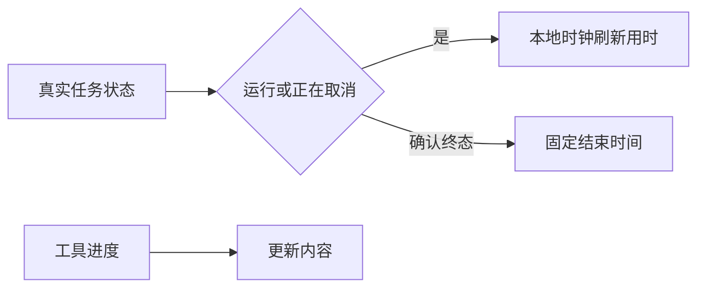

# 现象与依据

GitCode #6010 / GitHub #10178 的截图标出聊天区任务用时。全双工通过应用插件交付思考和工具事件，不占用普通聊天 isProcessing；时间线因而选择 CompletedWorkChip，其 duration 只随 workEndMs 更新。工具事件间隔不固定，任务用时便跳跃增长。

# 决策与契约

保留普通聊天处理状态。完成折叠条接入会话内应用任务的显示时钟：running/cancelling 使用现有 useNow 的本地定时刷新，显示整数秒；确认 terminal 时记录首个本地完成时刻并固定显示，不因重复快照延后。首次恢复的 terminal 任务不使用当前时间伪造结束时刻，仍采用历史工作跨度。任务按现有时间线的轮次时间边界归属，工具事件还使用 full-duplex-core-<job>- 的既有调用身份。静态导出不接入活动任务。计时不驱动任何任务状态与超时。

# 验证

0.2.9 当前候选：turnElapsedAvatar 7 passed，包含实际挂载 ChatTimelineList 后无新进度时 5s→6s、取消后十秒不增长与计时器清理；另测轮次边界、queued/unknown/terminal 不计为运行及恢复完成记录不伪造结束时刻。test:task-full-duplex 66 passed；test:build-turn-timeline 27 passed。未执行格式化或静态检查。尚未完成真实浏览器截图或 Qwen 语音端到端验证。

# 关联与交付

沿用配对 PR #11290 / #11292，关联 GitHub #10178（GitCode #6010）。中英文 FullDuplex 文档同步说明。浏览器后台节流时再次显示使用实际墙钟时间校正，不保证后台每秒渲染。
