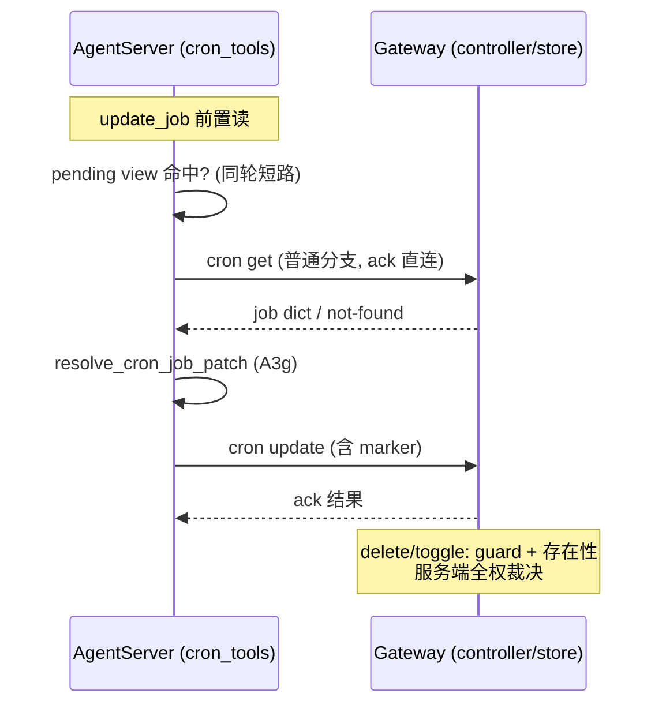

# cron 快照同步机制退役设计方案

## 1. 设计定位与阅读说明

本设计解决 Gateway 数据面时延问题：每个 `chat.send`/`command.goal` 轮次在发出前串行等待一次跨进程 `cron.jobs.sync` RPC 完整响应（`gateway/message_handler/message_handler.py:5150` `process_stream` 前置 `await self._sync_agentos_cron_jobs(env)`）。实测（2026-10-26/27 诊断，环境快照见 issue 附件 gateway-latency-20261027）：常规流量 p50 贡献 158~191ms、单发样本 425ms、50 并发轮 p50 3.4s 中的主要成分（cron 段 1.1s + 节拍器段 1.7s 的重要成因），且 web 渠道该 RPC 无 gateway 侧超时（`agent_request_timeout.py:80` 仅 TUI 渠道有上限）。

方案结论为**整体删除快照机制**（"删 + 收口"，非迁移）：生产 ack 直连模式下快照的读取主通道已不存在，剩余三处只读消费点改由已有的权威回环读与服务端校验承接。阅读顺序：§2 背景与现状核验 → §4 决策 → §5 详细设计 → §8 验证。

## 2. 背景、目标与范围

### 2.1 背景与问题

**机制现状**（均已在 develop `2b9cee84f6` 上核实）：

- 每个 `chat.send`/`command.goal` 流式轮次开始前，Gateway 将全量任务列表打包为 `CRON_JOBS_SYNC` 非流式 E2A 请求推给 AgentServer，`await` 完整响应后才放行 chat.send；`_CRON_SNAPSHOT_STREAM_METHODS` 硬编码无开关。
- 该前置包含 `controller.list_jobs(user_id=...)`（有任务时对每个去重 `(project_id, user_id)` 发准入 RPC，10s 超时）+ 一次全量序列化 E2A 往返。
- AgentServer 将任务列表整桶替换进模块级 `_gateway_jobs_snapshots[user_id]`（`cron_tools.py:76-91`），无 TTL 无驱逐。

**关键现状核验**（决定方案形态）：

1. 生产路径 ack 直连模式恒启用：`CronTools()` 无参构造 → `gateway_push is None` → `_uses_gateway_command_ack()` 恒 True（`cron_tools.py:289-300`，docstring 明示生产 AgentServer 走 host-services 路径）。因此 `list_jobs`/`get_job`/`preview_job`/`create_job`/`run_now` 在生产中**每次直读 Gateway 权威 store，从不读快照**。
2. 快照与 ack 直连分支为同一提交引入（`052044b759`，!4953"Gateway 去业务状态化"），快照从第一天就不是读取主通道；`_sync_agentos_cron_jobs` docstring 所述"重启后能 list 任务"的实际承担者是 ack 回环。
3. 快照在生产路径的全部剩余消费点是 `update_job`/`delete_job`/`toggle_job` 经 `_view_job` 取 `existing` 的前置读（`cron_tools.py:685/:724/:756`）。
4. 裸删（不收口）会产生**静默回归**而非报错：回环 update 分支在 Gateway 入口无条件打 `_agentos_project_binding_verified` marker（`message_handler.py` update action），AgentServer 侧 `resolve_cron_job_patch` 的三项校验（project_dir→project_id 重解析、单独 work_mode 拒绝、project_id 存在性）被跳过且 marker 仍在，Gateway 侧校验全部放行。`_sync_patch_payload`（`cron_tools.py:502-505`）还会剥掉未解析的 project_dir。

**伴随发现的既有缺陷**（本设计顺带修复）：

- ack 回投信封（`_push_cron_command_ack`/`_push_cron_run_now_ack`）不带 session_id：`agent_key_fields` 含 session_id 的部署（一等配置，见 `jiuwenswarm/resources/config.yaml:938`）下 ack 路由抛错被吞，全部 cron 工具调用 15s 超时。
- `controller.toggle_job` 无 proactive guard：TUI 入口（`tui_connect.py:2049-2072`）toggle proactive.tick 被 store 层白名单静默丢弃 `enabled` 返回假成功；E2A 工具路径同样裸奔（web 面板入口有 handler 级拒绝）。
- delete/toggle 在 ack 模式下的返回值瑕疵：delete 命中 existing 时无视服务端结果恒 True（`cron_tools.py:746-751`）；toggle 返回本地 merge + 陈旧 "submitted"（`:776-781`）。

### 2.2 目标与关键场景

| 场景 / 触发条件 | 当前行为 | 目标行为 / 可观察变化 |
| --- | --- | --- |
| web chat.send（任意负载） | 出北向前串行等 `cron.jobs.sync` 完整响应（单发 ~425ms） | 数据面零 cron RPC；日志中 chat.send 前不再出现 `cron-jobs-sync-*` 出向 |
| Agent turn 内 cron list/get/preview | ack 回环读权威（现状已如此） | 不变 |
| Agent turn 内 update（含项目字段） | 快照前置读 + AgentServer 重解析 + marker | pending view 优先，其次普通 get 权威前置读；重解析与 marker 语义不变 |
| Agent turn 内 delete/toggle | 快照前置读做 proactive/存在性预检 | 服务端全权裁决；proactive 拒绝为显式报错（delete 已有，toggle 新增 guard） |
| AgentServer 重启后首个 cron 工具调用 | 依赖下一次 chat.send 前的快照推送（重启到推送之间快照为空） | 直读权威，窗口不存在 |
| per-session key 部署下 cron mutation | ack 回投路由抛错 → 15s 超时 | 回投携带 session_id，正常送达 |

### 2.3 本次范围与非目标

- 本次包含：§6 所列五个实施项（ack 回投修复、update 前置读改造、toggle guard 与 delete/toggle 去前置读、快照机制删除与 tombstone、测试与文档同步）。
- 本次不包含：控制面 broadcaster（变更驱动推送 + 周期 sweep，作为后备路线留档，见 §4.3）；ack 模式 list 不带 `protected` 标记与工具描述不符的问题（独立观察项）；`controller.delete_job:558-559` 死路分支的简化（顺带可做，不强制）；AgentServer tombstone 分支的最终移除（下个 release）。

## 3. 设计约束、假设与待决问题

- 已确认约束与依赖：Gateway 是 cron 任务唯一持久存储所有者；执行调度在 Gateway 侧 `CronSchedulerService`；A3g 协议要求项目绑定字段由目标 AgentServer 解析并打 marker（`controller.py:509-517` 拒绝无 marker 的项目字段 patch）；`ReqMethod.CRON_JOBS_SYNC` 枚举定义在外部协议包 `openjiuwen-protocol`，本仓只删用法；本仓 Gateway 与 AgentServer 同包同版本发布。
- 关键假设：生产无自定义 gateway_push 传输（`CronTools()` 唯一无参实例化，`cron_runtime.py:990/:1100`）。已核实。
- 待决问题：无。非 ack 分支处置（`_agentos_snapshot_unavailable` 删除、幻觉 job_id 在非 ack 传输下从 False 变提交）已经用户确认接受 fire-and-forget 取舍（2026-10-28 对话确认）。

## 4. 总体方案与设计取舍

### 4.1 方案概览

删除数据面前的快照同步，将快照仅剩的三处只读消费点改由**已在现网运行**的机制承接：`update_job` 前置读改为 pending view 优先 + 普通 get 回环权威读；delete/toggle 的 proactive 与存在性裁决收口到 Gateway 服务端（delete guard 已存在，toggle 补 guard）；AgentServer 对 `CRON_JOBS_SYNC` 保留一个 release 的 tombstone 兼容分支。同 release 顺带修复 ack 回投 session_id 缺失与 toggle 假成功两个既有缺陷。

### 4.2 关键决策

#### D-01 快照机制整体退役（非控制面迁移）

- 选择与依据：生产 ack 模式下读路径已全回环，快照唯一消费是三处 mutation 前置读；控制面推送是在为被掏空的机制续命，且引入无序覆盖与冷启动振荡两个结构性风险（见 R-01）。
- 代价与成立条件：update/delete/toggle 多一次回环 get（仅 update）；接受非 ack 传输的 fire-and-forget 语义（D-05）。若实测回环延迟不可接受，按 R-01 重评估 broadcaster。
- 实现体现：I-04（删除）、I-02（update 前置读）。
- 相关候选：R-01、R-02。

#### D-02 update 前置读用普通 get 而非 authoritative get

- 选择与依据：前置读的本质是预演 Gateway 对本次 mutation 的可见性判定，mutation 全部走 `_get_owned_job`（含空属主放行，`message_handler.py:3577-3588`）；authoritative 的严格属主（`:3595-3612`）会在 legacy 空路由用户场景 FORBIDDEN 一个 mutation 路径本可接受的 update——语义错位而非更安全。普通 get 返回裸 job dict，形状更简单；生产 `cron_get_job` 工具已在该分支运行。
- 代价与成立条件：not-found 时普通 get 返回 `{"error": ...}` 形状，需归一为 `existing=None` 并保持"not-found 由服务端 mutation 裁决"契约。
- 实现体现：I-02。
- 相关候选：R-03。

#### D-03 前置读条件为合取：`_uses_gateway_command_ack() and route.user_id 非空`

- 选择与依据：单用前者会让 legacy（ack 亦为 True）多付一次回环；单用后者在"非 ack 传输 + 非空 user"组合下 D-04 的三条静默回归复活。合取下三场景全对：ack+user（AgentOS 生产）→ 直连；ack+无 user（legacy）→ 本地共享 store；非 ack → 本地路径。
- 实现体现：I-02（`update_job` 已有 `remote_gateway` 局部变量，近零成本）。

#### D-04 delete/toggle 去前置读 + toggle 服务端 guard 同 release

- 选择与依据：逐分支核对（两轮独立审查一致）：delete 的服务端 guard 已完整（`ensure_proactive_deletable` 在文件/etcd 两后端执行，`controller.py:558-559` 为必然抛错死路）；toggle 服务端无 guard 是既有洞，快照前置读是 E2A 路径唯一防线。guard 与去前置读**必须同 release**，否则 proactive toggle 从明确报错变假成功。
- 代价与成立条件：guard 文案沿用现客户端文案（`cron_tools.py:759-761`）保持 LLM 引导效果；顺带修正 delete 恒 True / toggle 假 submitted 两个返回值瑕疵。
- 实现体现：I-03。

#### D-05 非 ack 分支处置：删除 `_agentos_snapshot_unavailable`，接受 fire-and-forget

- 选择与依据：非 ack 传输仅为测试/自定义 transport（生产无实例化点）；保留该分支需为已退役的快照维护判定语义。用户已确认（2026-10-28）。
- 代价与成立条件：非 ack 传输下 delete/toggle 幻觉 job_id 从"本地判 False/KeyError"变为"提交并返回 True/结果以 Gateway 落库为准"，在本设计 §9.2 记录取舍。

#### D-06 AgentServer tombstone 兼容分支（保留一个 release）

- 选择与依据：AgentServer dispatch 链没有未知 method 拒绝墙——`_handle_gateway_cron_callback` 返回 False 后请求会穿过 lifecycle guard 与 adapter registry 落入**通用 chat 执行路径**（`_handle_unary` → `runtime.invoke`），旧 Gateway 发来的 `CRON_JOBS_SYNC` 帧最重会伪造一次空 agent turn。保留 method 识别、收到后不装快照直接回 ok（约 4 行），滚动升级窗口零风险。
- 实现体现：I-04。

#### D-07 ack 回投补 session_id（调用处传参）

- 选择与依据：`e2a_from_agent_fields` 本就支持 session_id 参数，`_handle_cron_push_payload` 签名已有；**不动协议包**。修复 per-session key 部署下全部 cron 工具 15s 超时。
- 实现体现：I-01。

### 4.3 替代方案与排除理由

| 候选 / 关联决策 | 候选目的与关键差异 | 拒绝或暂缓原因 | 重新评估条件 |
| --- | --- | --- | --- |
| R-01 / D-01 控制面 broadcaster（变更驱动推送 + runtime 生命周期推送 + 周期 sweep） | 保留快照机制，推送移至控制面 | 为已被 ack 掏空的机制续命；结构性缺陷：fire-and-forget fan-out 无完成序而 `install_gateway_jobs_snapshot` 整桶替换，并发变更旧盖新；复用 `send_request` 推送自带 get_or_create 冷启动副作用，与 idle reaper 形成振荡；准入 verdict 变化无 mutation 事件可挂 | P1 落地后实测回环权威读延迟不可接受 |
| R-02 / D-01 数据面 fire-and-forget 过渡（P0） | `create_task` 不等响应，最小止血 | 收口与删除同 release 落地时无存在必要；且不减 RPC 总量（只移出等待） | 删除被迫延后一个版本时作为过渡插入 |
| R-03 / D-02 前置读用 `get_authoritative_job` | 属主更严格、A4P 已用有测试 | 语义与 mutation 路径错位（空属主 FORBIDDEN）、返回 `{status, job}` 包装需二次校验 | 无（如 A4P 场景需要区分 forbidden/missing 时它仍是正确选择） |

## 5. 详细设计

### 5.1 模块责任与关键不变量

- Gateway（`gateway/cron/controller.py` + `gateway/message_handler/message_handler.py`）：cron 任务唯一持久权威；mutation 与读的属主裁决统一走 `_get_owned_job`；proactive.tick 保护在服务端完整（delete 既有、toggle 本设计补齐）。
- AgentServer 工具层（`cron_tools.py`）：`update_job` 保留 A3g 项目绑定解析职责（`resolve_cron_job_patch` + marker 由 Gateway 入口打）；delete/toggle 不再做本地预检，裁决权交服务端。
- 不变量：带 `project_id/project_dir/work_mode` 的 update patch 必须经 AgentServer 解析（marker 语义）；proactive.tick 任务只能由系统路径（`proactive_cron_sync`，force=True）增删；同轮 create→update 短路由 pending view 保证（request_id 隔离）。

### 5.2 关键函数设计

| 函数 / 所属模块 | 完整签名与变更类型 | 职责与调用方 | 输入输出及行为约束 |
| --- | --- | --- | --- |
| `cron_tools.CronTools.update_job` | 修改；前置读段重构 | Agent turn 内更新任务 | 读序：pending view → （合取条件）普通 get 直连 → 原本地路径；not-found 归一 None、由服务端 mutation 呈现；`resolve_cron_job_patch` 调用条件不变 |
| `cron_tools.CronTools._get_existing_via_gateway` | 新增；内部 | `update_job` 的权威前置读 | `_send("get", {"job_id": ...})`；data 非 dict 或含 error → None；`CronJob.from_dict` 失败 → None |
| `cron_tools.CronTools.delete_job` / `toggle_job` | 修改；去前置读 | Agent turn 内删除/启停 | ack 分支直接回环、返回服务端结果（delete 真实 deleted 布尔、toggle 服务端 job）；非 ack 分支保留本地视图预检但删除 `_agentos_snapshot_unavailable` 分支（幻觉 id 提交，fire-and-forget） |
| `gateway/cron/controller.py CronController.toggle_job` | 修改；补 guard | 全部 toggle 入口（web/TUI/E2A） | existing 为 proactive.tick 时 raise（文案沿用 `cron_tools.py:759-761`），先于 store 写入 |
| `gateway/message_handler/message_handler.py _push_cron_command_ack` / `_push_cron_run_now_ack` | 修改；加参 | cron 回执投递 | 签名加 `session_id: str \| None = None`，透传进 `e2a_from_agent_fields`；调用方传 `_handle_cron_push_payload` 已持有的 session_id |
| `jiuwenswarm/server/agent_ws_server.py _handle_gateway_cron_callback` | 修改；tombstone | AgentServer WS 入口 | method 集合保留 `CRON_JOBS_SYNC` 一个 release；分支体改为直接回 ok 不装快照；`install_gateway_jobs_snapshot` import 删除 |

### 5.3 删除清单（I-04）

`message_handler.py`：`process_stream` 前置调用（`:5150`）、`_CRON_SNAPSHOT_STREAM_METHODS`（`:137-139`）、`_sync_agentos_cron_jobs`（`:5339-5397`）；`:137-139` 设计意图注释迁移至 cron_tools 模块 docstring。`cron_tools.py`：`_gateway_jobs_snapshots`（`:73`）、`install_gateway_jobs_snapshot`（`:76-97`）、`_snapshot_for_route`（`:283-287`）、`_view_job`/`_view_jobs` 的 snapshot 层（fallback local store）、`_agentos_snapshot_unavailable`（`:783-785`）及其 delete/toggle 调用分支。

### 5.4 兼容与滚动窗口

同包一个 release。新 Gateway + 旧沙箱：handler 休眠，无害。旧 Gateway + 新沙箱：tombstone 吞掉 sync 帧回 ok，零噪音（无 tombstone 则帧落入通用 chat 路径伪造空 turn）。`ReqMethod.CRON_JOBS_SYNC` 枚举保留（协议包），tombstone 下个 release 移除。回滚干净：feature 为删除+收口，revert 即恢复原行为。

## 6. 影响面与实施设计

### 6.1 修改点与实施顺序

| 实施项 | 模块 / 文件或符号 | 修改内容与责任 | 必要前置 / 独立验证产物 |
| --- | --- | --- | --- |
| I-01 | `gateway/message_handler/message_handler.py` | ack 回投补 session_id（D-07） | 无前置；per-session key 路由测试 |
| I-02 | `jiuwenswarm/agents/harness/common/tools/cron/cron_tools.py` | update 前置读改造（D-02/D-03） | I-01（权威读通道送达） |
| I-03 | `gateway/cron/controller.py` + `cron_tools.py` | toggle guard + delete/toggle 去前置读（D-04/D-05） | **与 I-04 同 release**（硬顺序） |
| I-04 | `message_handler.py` + `agent_ws_server.py` + `cron_tools.py` | 删除快照机制 + tombstone（D-01/D-06） | I-02 已收口 |
| I-05 | tests + D 文档 + sync_documents.py | 测试清理与新增（§8）、索引同步 | 各项完成后 |

### 6.2 文档同步

- spec：无既有契约文档受影响（`.agents/agent-docs/` 全库无该机制描述，已核验）；本 D 文档为唯一方案资产。
- 架构 / 模块约定：`cron_tools.py` 模块 docstring 补"快照已退役、读走 ack 回环"的防再发明说明。
- 开发计划：无独立计划；实施与验证记录归档至 features（F 文档按 jw-dev 流程）。

## 7. 兼容与迁移

见 §5.4（滚动窗口、协议枚举、回滚边界）。无数据迁移。

## 8. 验证设计与通过条件

| 验证 ID | 场景 / 前置状态与输入 | 操作或验证入口 | 预期结果 / 通过条件 | 验证层级与环境 |
| --- | --- | --- | --- | --- |
| V-01 | 数据面回归：任意 chat.send | 日志断言 | chat.send 出向前无 `cron-jobs-sync-*` 出向；压测口径下 cron 段消除（单发 425ms→~0；50 并发 p50 3.4s→显著下降） | 集成/E2E + 压测复测 |
| V-02 | update 三条回归守卫（直连注入 existing）：project_dir 重绑定 / 单独 work_mode / 伪造 project_id | 单测（ack 模式 mock 回环） | 重绑定生效；单独 work_mode 报错；伪造 project_id 拒绝 | 单测 |
| V-03 | AgentServer 重启后不发 chat.send 直接调 cron 工具 | E2E | list/update/delete/toggle 全功能可用（快照缺失即新常态） | E2E |
| V-04 | toggle proactive.tick（TUI + E2A 路径） | 单测 + 手动 | 显式报错（非假成功）；delete 既有拒绝不变 | 单测/TUI |
| V-05 | per-session key 部署 cron mutation | 单测（session 入 key 配置） | ack 送达，无 15s 超时 | 单测 |
| V-06 | tombstone：旧 Gateway 发 CRON_JOBS_SYNC | 单测 | 新 AgentServer 回 ok、无快照写入、不落入 chat 路径 | 单测 |
| V-07 | 非 ack 自定义传输回归 | 单测（`_FakeGatewayPush`） | list/get/preview/update/delete/toggle 行为符合 §5.2 定义；fire-and-forget 取舍符合 §9.2 | 单测 |
| V-08 | A4P authoritative 路径 | 既有 `test_a4p_split_process.py` 保持通过 | 不回归 | 单测 |

测试清理（I-05，经两轮审查核验的精确清单）：`test_cron_snapshot_sync_scope.py` 整文件删；`test_adx_gateway_identity.py` 删 1 用例；`test_cron_runtime.py` 4 处快照用例改写为 ack 直连版（"重启后可管理"属性改由直连回环验证）；`test_gateway_normalize.py` 载体换 `CRON_COMMAND_ACK`；`test_session_input_forwarding.py:65` 与 `test_session_steering_sdk.py:442` 删 mock 行。

## 9. 设计风险与已知限制

### 9.1 设计风险

| 风险 / 触发条件 | 对本次方案的影响 | 已有应对措施 | 核实或验证方式 |
| --- | --- | --- | --- |
| 滚动窗口内旧 Gateway + 新沙箱组合 | tombstone 覆盖；遗漏则帧入 chat 路径 | I-04 tombstone（D-06） | V-06 |
| 回环权威读延迟劣化（网络/AgentServer 负载） | update 多一跳 | 工具调用路径毫秒级，非数据面 | V-01 压测 + 后备 R-01 |

### 9.2 已知设计限制

- 非 ack 传输下 delete/toggle 幻觉 job_id 从本地拒绝（False/KeyError）变为提交并返回成功（fire-and-forget，结果以 Gateway 落库为准）——用户确认取舍（2026-10-28）；非 ack 仅测试/自定义传输使用。
- ack 模式 list 不带 `protected` 标记（与工具描述宣称不符）为既有独立问题，本设计不处理。
- 每 turn 快照的"同轮新建 web 任务在 AgentServer 视图可见"窗口随机制删除而消失——该窗口本就是单向且不可靠的，权威语义由回环替代。

## 10. 按日期记录的评审与设计修订

| 日期 | 评审人 / 确认方 | 评审或修订主题 | 结论 | 修改与依据 |
| --- | --- | --- | --- | --- |
| 2026-10-27 | Yoggaboomin（对话）+ 子 agent 对抗性审查 | 根因方案（初版：控制面推送） | 推翻初版前提（ack 模式现状误判），转向删除+收口 | 审查发现 `gateway_push is None → True`，读路径生产已全回环 |
| 2026-10-28 | Yoggaboomin（对话）+ 外部 agent 论证 + 子 agent 交叉审查 | 删除合理性论证、五处分歧裁决（get 选择/tombstone/合取条件/去前置读/测试清单） | 采纳外部论证方向；修正三处（准入 RPC 归因、toggle 洞归因、测试 6 文件）；确认裸删为静默回归非断裂 | 全部 file:line 证据经两轮独立审查与主线亲验 |
| 2026-10-28 | Yoggaboomin（用户，对话确认） | 方案整体 + 非 ack 分支处置（直接删） | **确认通过，授权实施** | "方案确认了，按流程走" |

## 11. 参考与交接

- 开发交接：按 §6.1 顺序实施 I-01→I-05；I-03 与 I-04 同 release 为硬约束；验证按 §8 清单；F 文档记录实施偏差与验证结果。
- 关联实施归档：尚无。
