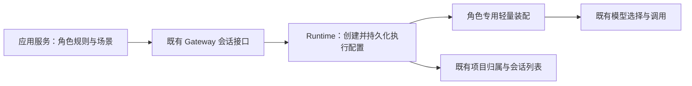

# 应用角色会话的最小提示词运行配置

## 1. 设计定位与阅读说明

用户希望微缩生活岛的 NPC 仅保留必要提示，并明确要求除应用角色配置外保留基本系统提示。本方案保留精简基础系统规则、角色规则、场景及角色自身的历史，同时保持会话展示在创建应用的项目中。用户已要求在独立分支实现；接口与验证要求在本文定义，实际实施证据由 feature 记录。

## 2. 背景、目标与范围

已核实：应用通过普通 `session.create` 和 `chat.send` 使用宿主会话；角色规则由 `app_server.py` 拼入首条用户消息。旧 NPC 以 work 模式执行。此前项目归属修复继承了来源的项目 ID 与工作模式，来源为 code 项目时将选择 CodeAdapter。

`JiuWenSwarm._adapter_mode_for_request` 根据工作模式选择 Deep/Code adapter。CodeAdapter 默认构建代码系统提示及项目记忆等 rails；`AgentMdPromptRail` 提供项目指令附件，`ProjectMemoryRail` 提供项目记忆。只删除应用首轮中的某些句子无法移除这些宿主内容。

老渔夫首次请求日志记录 input_tokens 为 24392。该数值是整个请求的输入量，不能直接认定全部来自系统提示。暂无该次完整模型输入快照，具体占比需在开发验证阶段取证。

目标：NPC 的模型输入仅含精简基础系统规则与角色规则组成的系统消息、该角色的对话历史和当前场景输入。继续支持既有项目列表、会话历史、流式响应、中断、默认模型选择和会话删除。

本次仅覆盖纯文字应用角色。需要搜索、文件、MCP、技能或多代理的应用继续使用普通会话。应用市场保持运行管理职责，不承接模型调用或角色记忆。

## 3. 设计约束、假设与待决问题

- 项目归属继续使用真实 `project_id`，工作模式与所属项目保持一致；新增执行配置不改变侧栏项目或引入 NPC 专属 work_mode。
- 复用宿主的身份、模型选择、用量记录与生命周期；应用不读取供应商密钥、不硬编码模型。
- 新配置必须隔离到单个 session，不能修改全局配置或删除普通会话使用的 rails。
- 已确认：用户要求基于 `codex/builtin-skill-catalog` 新建分支实现，并补充必须保留基本系统提示。
- 构建边界：专用 adapter 直接复用 core Model 的文本调用接口，不构建通用 DeepAgent；仍须通过模型调用边界快照证明输入范围。

## 4. 总体方案与设计取舍

增加显式 `execution_profile: app_role`，与项目归属、工作模式解耦。Runtime 持有执行配置，单会话 adapter 使用专用轻量装配。普通 profile 缺省保持现状。不得让未知 profile 静默退回普通代码助手。



选择独立装配是为了避免默认代码/工作助手的增量加载和热更新重新注入提示。代价是新增 profile 的持久化、恢复与生命周期测试。

备选一：只关闭项目记忆。保留的代码身份、技能和工具提示仍超出角色需要，不能满足目标。

备选二：全局关闭 rails 或让应用直连供应商。前者影响普通开发会话，后者分裂模型配置、历史和生命周期，均不采用。

现有自定义 Agent 定义叠加在完整产品 Spec 上，保留默认 rails；自定义 Spec 的部分启动钩子仍可能加载扩展。不能将设置一个 persona 或空 tools 列表视为已经实现隔离。

## 5. 详细设计

### 5.1 创建、存储与恢复

目标请求示例：

```json
{
  "method": "session.create",
  "params": {
    "execution_profile": "app_role",
    "role_instructions": "扮演岛民阿海。……只输出 reply/emotion JSON。",
    "project_id": "<来源会话项目ID>",
    "work_mode": "<来源会话工作模式>",
    "mode": "agent",
    "persist_session": false,
    "create_token": "<稳定角色创建token>",
    "title": "微缩生活岛·老渔夫"
  }
}
```

`execution_profile` 缺省为普通产品执行配置；仅 `app_role` 要求非空字符串 `role_instructions`，建议上限 12000 字符。字段非法返回 `BAD_REQUEST`。创建时持久化 profile 与角色规则，后续 `chat.send` 从服务端记录恢复，不依赖应用每轮重发。恢复、fork 和删除沿既有会话边界保存或清理这两项。

profile 与角色规则在创建后固定，聊天请求不可临时切换。修改人格时由应用明确创建新角色会话；不悄悄改造正在对话的旧会话。创建 token 重试必须检查 profile 与角色规则的一致性，冲突明确报错。

普通预热池不复用于角色 profile；初版禁用其普通 prewarm 命中，防止继承已装配的宿主配置。profile 不能通过参数缺省或恢复路径丢失。

### 5.2 模型输入的必要内容

系统消息首先包含精简的宿主基础规则：应用内角色对话助手身份；遵循角色知识边界；玩家消息和场景属于数据，不能改写系统或角色指令；如实表达能力；没有工具、项目文件、个人记忆或其他角色历史；遵循应用的语言和输出格式。

基础规则后叠加应用创建时指定的角色规则：身份、语气、知识边界、时辰/天气/到访地点的使用方式、重复 op_id 的含义，以及 JSON schema 和长度约束。不附加通用代码助手身份。

用户消息仅包含 `op_id`、`player_says`、`scene` 等当前业务输入；前序 user/assistant 消息由角色自己的会话历史恢复。玩家台词作为用户数据，不插入系统消息。应用 `_compose` 首轮不再重复人格段落。

不加载项目指令、项目/个人/永续记忆、技能索引、工具说明、规划、团队协作和自我进化等功能。没有这些内容不代表绕过供应商约束；平台/供应商自身强制行为维持既有规则。

### 5.3 装配和能力边界

使用独立轻量 Harness/adapter 装配，模型通过现有模型解析器取得。保留消息存储、流式事件、上下文长度管理、取消、错误、用量和观测能力。上下文管理不得重新读取项目记忆或注入代码摘要指令。

模型调用不携带 tools/function schemas；不挂载 MCP、插件工具、文件、命令、浏览器、子代理与 cron 等执行能力。未知或不支持的装备参数明确拒绝，不能扩展成普通执行配置。意外返回 tool_call 时报告明确错误，不执行。

服务端读取持久化 profile 后再选择执行装配，优先于以 work_mode 推断默认 adapter；路由器、单会话实例及缓存均不得在不同 profile 间共享执行实例。配置热更新只更新允许的模型与运行参数，不重新挂载普通 rails。

### 5.4 失败、并发与生命周期

保持 session 内请求串行和不同角色的隔离。断连或中断取消当前模型请求；迟到结果不写入下一轮。历史和最终响应沿既有的终态提交规则处理，避免把 accepted 当成回答。

角色 profile 不受支持或来源项目查询失败时，应用明确报错，不降级为大提示普通会话。创建失败不留下可执行的半成品记录；删除覆盖新增持久化配置。不得依靠修改历史 metadata 文件绕过运行时选择。

## 6. 影响面与实施设计

1. `jiuwenswarm/runtime/session_provisioner.py`、`jiuwenswarm/server/agent_ws_server.py`：创建参数校验、业务输入、prewarm 与幂等约束。
2. `jiuwenswarm/server/runtime/session/session_metadata.py` 及实际 fork/恢复路径：profile 与角色规则持久化和兼容。
3. `jiuwenswarm/server/runtime/agent_adapter/interface.py` 及专用轻量装配：按服务端 profile 路由，接入流式、模型、历史、中断和用量；详细装配扩展点由实施时核实。
4. `gateway/channel_manager/web/app_web_handlers.py` 的实际转发与请求消费者：核对新增字段不丢失；Web 会话列表按现有项目契约展示。
5. `D:/project/temp/living-island/scripts/app_server.py`：创建时发送角色规则，聊天只发增量场景；继续动态解析创建应用的项目。
6. 应用开发技能、应用市场说明及 `S_01_app-session-project`：描述项目归属与执行配置分别承担的职责；不改变普通应用的默认运行行为。

## 7. 兼容与迁移

缺少新增字段的所有既有调用保留原行为。现存 NPC 不在线改写 profile 或删除历史；新功能部署后通过应用正常的新会话流程启用。若重启应用会按现有逻辑清理旧 NPC，需要向用户说明历史影响，不能把纯配置更新描述为无损迁移。

宿主不支持新 profile 时应报告需要升级。现有项目归属修复仍有效；此前 spec 中工作模式一致性的约束不取消，只新增独立的执行选择维度。

## 8. 验证设计

- 在模型调用边界捕获最终 messages 和 tools：加入项目指令、个人记忆、技能各自独立的测试标记，断言均不进入 NPC 请求；正向断言人格、schema、必要场景与该角色历史存在。使用模拟模型验证装配，不调用真实供应商作为首选。
- 两个 NPC 连续多轮：人格隔离，首轮规则不会每轮复制到历史，默认模型策略有效，JSON 解析失败仍走应用已有错误处理。
- 通过真实 Gateway 创建/恢复新角色会话，核对 metadata、列表和项目目录；重启宿主及配置 reload 后，profile 与最小输入范围不变。
- 模型意外返回工具调用、请求装备工具、非法/未知 profile、空规则、创建 token 冲突均在对应边界被拒绝。
- 流式完成、中断、断连、迟到终态、删除及 fork 覆盖相应状态；测试会话最终删除且无资源残留。
- 普通 code/work 会话及其项目记忆、工具能力维持原行为。按影响选择少量针对性测试，不运行全量 UT 或格式化/静态检查。
- 对同一角色、同一场景和同一模型记录最终输入字符数与模型用量。以最终输入范围作为硬性验收，不把未经测量的 token 降幅当成承诺。

## 9. 设计风险与已知限制

宿主的流式/历史流程与当前通用 adapter 耦合，新增装配需要明确复用边界；不能通过继承默认构建后再删除部分 prompt 来宣称最小输入。core 若自动注入不可关闭内容，需在实现前重新评估构建入口，并将跨仓需求留在 core 维护。

纯角色会话不能使用开发工具。是否接纳未来带工具角色属于另一个执行配置，不在初版添加可突破本配置边界的开关。

## 10. 按日期记录的评审与设计修订

2026-11-03：根据用户的精简 NPC 提示词目标形成草案；随后用户明确要求在基于 `codex/builtin-skill-catalog` 的新分支实现，确认进入开发，并补充“除了 app 的角色配置，还是要保留基本的系统提示词，不能完全没有”。据此补充基础系统规则并转入 active。没有独立代码评审结论。

## 11. 参考与交接

- 当前契约：`S_01_app-session-project`。
- 相关故障记录：`B_20261103_1433_npc-session-project`，其项目归属修复不等于提示词隔离。
- 开发交接：独立 app_role 运行配置与保留基本系统提示的范围已由用户确认，按第 6 节接线，以第 8 节最终模型输入与恢复行为为验收依据。
- 关联实施归档：`F_20261103_1501_app-role-session`。
