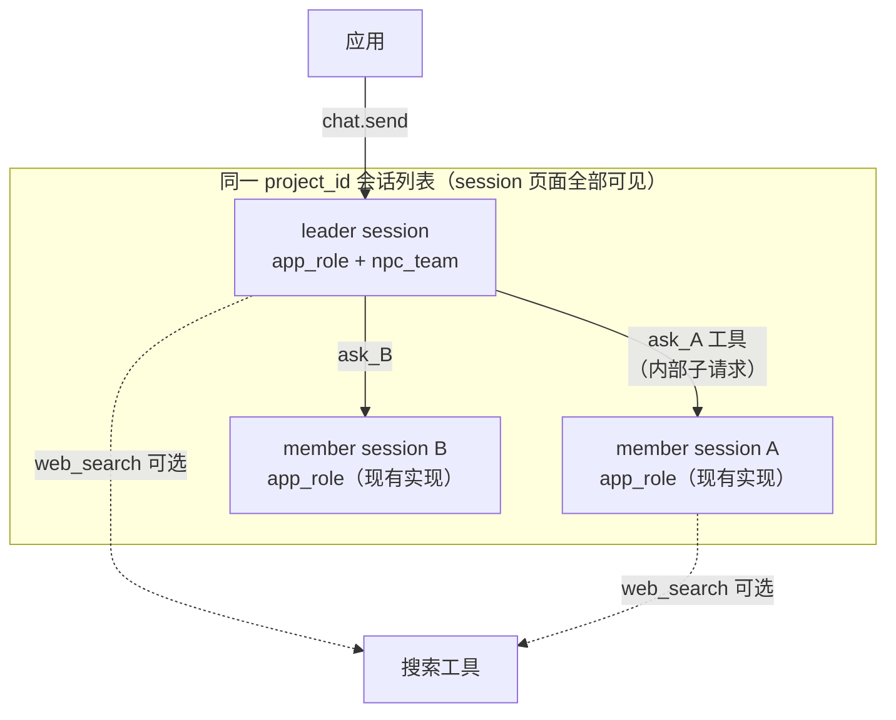

# NPC 主从会话与按需搜索工具

## 2026-11-04 范围修订

用户在代码检视后明确要求“撤销工具的注入”。当前方案取消宿主搜索工具与 `tools` 白名单扩展，保留 `npc_team`、真实成员会话与 `ask_<name>` 咨询。下文搜索工具、搜索预检、成员搜索子轮和工具白名单相关方案均被本次决定替代；其余主从会话设计继续有效。实际实现与验证记录在关联 feature，本文保留初版方案以追溯取舍。

## 1. 设计定位与阅读说明

本文是 `D-20261103-1444-app-role-session` 的续写：该设计第 9 节预留"是否接纳未来带工具角色属于另一个执行配置"，本方案新增该执行配置的两个维度——NPC 主从（team）形态与 `web_search` 工具按需注入。用户已确认三项决策：member 必须作为真实会话出现在 WorkSwarm session 页面（查看体验与普通 chat-session 一致）；member session 复用现有实现；宿主未配置搜索能力时创建请求直接报错。在独立分支 `codex/npc-team-members` 实施。

## 2. 背景、目标与范围

已核实（代码事实）：

- 产品 team 链路（`TEAM_CANONICAL_MODES` → TeamManager → team.db/team-workspace 物化 → 每成员完整 DeepAgent）成员装配含文件/shell 工具、AGENTS.md 项目指令、LSP、技能库、heartbeat、个人记忆 rails；用户消息只进 leader（`team_helpers.py:4524-4541`），member 输出仅以 `team.member`/`team.task` 事件旁路呈现。
- 现有 `AppRoleAdapter`（`interface_app_role.py`）`model.stream(tools=None)`，收到 tool_calls 即报错；`Model.stream` 的 `tools` 参数接受 `List[ToolInfo]`；`Tool.invoke(inputs)` 直接返回模型可读文本，可绕过 AbilityManager 使用。
- 搜索工具：付费（Bocha/Perplexity/Serper/Jina，环境变量 key 门控 `is_paid_search_enabled()`）与免费（DDG/Bing，默认禁用 `is_free_search_enabled()`）两套实现，均无本地状态。
- `session_provisioner.py:778` 现禁止 app_role×team 组合；member 无独立对外会话入口。

目标：

1. `session.create` 支持 NPC 主从形态：主 NPC = leader 会话（玩家对话入口，产生 chat.final），从 NPC = member 从属会话，数量一一对应、程序化指定，leader 不能动态增删成员。
2. member 会话复用现有 app_role 实现：真实 metadata、history、用量；出现在项目会话列表，点开可见完整咨询问答历史；拥有跨轮记忆。
3. `tools: ["web_search"]` 按需注入 leader 与 member，默认不注入；白名单外任何工具仍拒绝；宿主无搜索能力时创建报错。

非目标：不接入产品 team 看板、不物化 `.agent_teams/`、不提供任务板/计划审批；member 不直接面对玩家对话（其可见性即会话历史本身）；不做成员动态 spawn；不引入除 web_search 外的任何工具。

## 3. 设计约束、假设与已确认决策

- NPC 主从仍是 `app_role` 会话：`mode: "agent"`，`session_provisioner.py:778` 对 mode 层面的 team 检查保留不动。
- 全部成员的程序化定义（name、role_instructions）在 leader 创建时固定，创建后不可变；member 会话由宿主级联创建，应用无感知其 session_id 分配。
- member session = app_role 单 agent 会话（轻量装配），非完整 agent/DeepAgent——"复用现有实现"指复用 `AppRoleAdapter` 及既有创建/历史/删除链路。
- 已确认：宿主未配置任何搜索能力（无付费 key 且免费搜索禁用）时，携带 `tools:["web_search"]` 的创建请求返回 `BAD_REQUEST`，不静默降级、不推迟到调用期。
- 参数命名：`npc_team: {members: [{name, role_instructions, title?, desc?}]}`、`tools: ["web_search"]`。
- 隔离不变量继承 D-20261103-1444：无项目指令、无记忆、无技能；member 输入只含咨询问题与 member 自身历史。

## 4. 总体方案与设计取舍



member 即工具：leader 的工具列表注入 `ask_<name>`，调用触发向 member 会话的内部子请求；member 以标准 app_role 消息处理作答并落自身历史；回答作为 ToolMessage 回填 leader。选择该结构而非产品 team 链路的依据：第 2 节已核实的重装配会摧毁 app_role 的最小输入与隔离边界，而 NPC 场景不需要任务板；member 升级为真实会话（相对无状态工具）是用户决策的直接要求，且使历史、删除、查看全部复用现有实现。

备选一：复用产品 team（bootstrap_mode=framework + 程序化 predefined_members 再减重）。减重需在 rails 叠装旁开裸装分支，改动面大且易漏，member 仍带 team.db 物化，不采用。
备选二：member 保持无状态工具（上版草案）。不满足"session 页面可查看、复用现有实现"，已由用户决策替代。

## 5. 详细设计

### 5.1 创建协议与级联装配

请求示例（完整形态）：

```json
{
  "method": "session.create",
  "params": {
    "create_token": "<稳定token>",
    "execution_profile": "app_role",
    "role_instructions": "<主NPC规则>",
    "npc_team": {"members": [{"name": "fisherman", "role_instructions": "...", "title": "...", "desc": "..."}]},
    "tools": ["web_search"],
    "project_id": "<来源项目>", "work_mode": "<来源work_mode>",
    "mode": "agent", "persist_session": false, "title": "..."
  }
}
```

校验（`app_role.py` 新增 `normalize_npc_team()`，风格同 `normalize_execution_profile`，不静默降级）：

- `tools ⊆ {"web_search"}`；含 `web_search` 时创建即预检：`is_paid_search_enabled() or is_free_search_enabled()`，否则 `BAD_REQUEST: 宿主未配置搜索能力`。
- members 1–5 个；`name` 匹配 `^[a-z][a-z0-9_]{1,31}$` 且不重复；每人 `role_instructions` 1–12000 字符；`title`/`desc` 可选，`desc` 缺省取 role_instructions 前 200 字符。

级联创建（provisioner 在 leader metadata 落盘后、返回 lease 前）：为每个 member 生成 session_id，`init_session_metadata` 写入 `execution_profile="app_role"`、该 member 的 `role_instructions`、`npc_member={"leader_session_id", "name"}`、同 project/work_mode/channel/user、`title`（member.title 或 `<应用title>·<name>`）；leader metadata 的 `npc_team` 记录运行时绑定 `member_session_ids: {name: sid}`。member 不走 prewarm、不发 create_token；`persist_session` 恒 false。

幂等：create_token 重试命中已存在 leader 时不重复创建 member，并校验请求 `npc_team`/`tools` 与已存值一致，不一致报错（扩展 `session_provisioner.py:855-862` 现有 profile 冲突检查）。`agent_manager.py` `create_signature` 的 app_role 分支追加 `(role_tools, npc_team 定义摘要)`。

### 5.2 运行时：leader 工具循环与 member 咨询通道

leader 循环（`interface_app_role.py`）：受限 ReAct，上限 5 轮工具调用。`tool_infos = [web_search?] + [ask_<name> ...]`；为空时 `tools=None`，行为与现状逐字节一致。工具执行统一 `await tool.invoke(json.loads(arguments))`。工具中间消息（AssistantMessage(tool_calls)、ToolMessage）只在当轮内存，不写持久化历史——`build_role_messages` 的历史重建逻辑不变。

member 咨询通道（唯一全新组件，`interface_deep.py` 提供、构造时注入）：`AppRoleMemberExecutor.ask(member_session_id, name, question) -> str`：

1. 经现有 `_ensure_session_adapter` 路由获取 member 的 `AppRoleAdapter`（member 是标准 app_role 会话，天然命中现有分支）。
2. 构造内部 `AgentRequest(session_id=member_sid, request_id=新uuid)`，消费 `process_message_stream_impl` 流：delta 不外发；chat.final 即返回值；usage 记入 member。
3. 历史落盘与外部 chat.send 终态语义一致；实现层若耦合过深，允许复刻同一终态写入函数，不得发明第二套协议。

web_search 解析（创建已预检可用）：优先付费（`is_paid_search_enabled()` → `WebPaidSearchTool`），否则免费（`WebFreeSearchTool`）；运行时配置变化致均不可用则 invoke 返回错误文本，循环容错。leader 与 member 会话级共享同一白名单。

取消与并发：leader 取消级联取消 member 子请求（member 无 final 即无历史残留，沿用现有终态规则）；同一 member 并发 ask 由其 `_role_lock` 串行；member session 被单独删除或处理异常时 `ask` 返回错误文本，leader 容错继续，不自愈重建。

### 5.3 系统提示变体

| 形态 | 基座 |
|---|---|
| 无工具（默认） | 现状 `APP_ROLE_SYSTEM_PROMPT` 逐字节不变 |
| +web_search | 工具段改写为仅可用网络搜索 |
| +npc_team | leader 版追加成员名册（name+desc）与咨询规则；member 版强调只回答主 NPC 咨询、不见玩家完整对话 |

member 系统提示 = member 版基座 + 该 member 的 `role_instructions`，复用现有拼装函数。

### 5.4 持久化契约

| 会话 | 新增字段 | 首绑定保护 |
|---|---|---|
| leader | `role_tools`；`npc_team: {members[...], member_session_ids}` | 是（`_write_metadata_unfenced` 保护块字段扩展，整体不可变） |
| member | `npc_member: {leader_session_id, name}` | 是 |

fork：leader 的 `npc_team` 去掉 `member_session_ids` 后透传定义，fork 后级联创建全新 member sessions（空历史）；member 被单独 fork 时剥离 `npc_member` 成为独立 NPC 会话。`validate_app_role_request`：`tools` 改为必须等于创建时 `role_tools`；`npc_team` 不可变；其余装备字段维持拒绝。

### 5.5 生命周期

删除 leader 级联删除全部 member sessions（复用同一 delete 路径）；删除 member 为合法操作，leader 容错；应用退出清 NPC 沿用"删 leader 即全清"；配置热更新仅影响模型与搜索实现选择。

### 5.6 事件协议

leader 流上新增 `npc.member {"member", "member_session_id", "phase": started|finished, "usage"?}`（finished 可带回答摘要，应用可选渲染为从 NPC 插话）；chat.delta/final/usage_summary/error 不变。member 不发 delta。

## 6. 影响面与实施设计

1. `jiuwenswarm/runtime/app_role.py`：`normalize_npc_team`、`APP_ROLE_ALLOWED_TOOLS`、提示词变体、`validate_app_role_request` 调整。
2. `jiuwenswarm/runtime/session_provisioner.py`：输入/校验/级联创建/幂等冲突/删除级联。
3. `jiuwenswarm/server/agent_ws_server.py`：参数透传、事件透传。
4. `jiuwenswarm/server/runtime/session/session_metadata.py`：init 新字段、首绑定保护扩展。
5. `jiuwenswarm/agents/harness/common/session_ops_service.py`：fork 透传/剥离。
6. `jiuwenswarm/server/runtime/agent_adapter/interface_deep.py`：`AppRoleMemberExecutor`。
7. `jiuwenswarm/server/runtime/agent_adapter/interface_app_role.py`：工具循环、ask_* 动态工具、npc.member 事件。
8. `jiuwenswarm/server/runtime/agent_manager.py`：create_signature 扩展。
9. 文档：`docs/{zh,en}/AppRoleSessions.md`、`workswarm-app-builder/SKILL.md`、specs 新增 `S_02`。

## 7. 兼容与迁移

不带新参数的既有调用行为不变；无工具单 agent 的 messages/tools 与现状一致为回归基线。现存 NPC 不迁移，应用按新会话流程启用。宿主升级后旧宿主上创建带 `npc_team` 的请求会因未知字段报错，应用按现有约定提示升级。

## 8. 验证设计

- mock model 边界快照：默认形态与现状逐字节一致；带 tools 时恰含一个搜索；team 时 leader tools = N×ask_* + 搜索、member tools = 搜索；member 输入含自身历史、不含玩家原始历史与其他 member 内容。
- 编排：脚本化 mock 验证 leader→member→搜索全链路、迭代上限、并行 ask、取消级联。
- 真实 Gateway：leader 与 members 均出现于项目会话列表；member 历史可查看；删 leader 级联清理；单独删 member 后 leader 容错。
- 边界拒绝：非法 tools、member 超限/重名/非法 name、无搜索配置创建报错、create_token 携不同 npc_team 重试、中途改 npc_team。
- fork 语义、用量分账；只跑相关 UT，不跑全量。

## 9. 设计风险与已知限制

- 最大风险：member 子请求的历史落盘必须与外部 chat.send 完全等价（终态提交、取消无残留）；实施先取证外部落盘点再挂接。
- 用户可从 UI 直接向 member 发消息（人工引导），会改变 member 后续咨询上下文，属特性，文档写明。
- leader 上下文随工具轮增长：双层迭代上限（leader 5 / member 搜索 3）+ 工具消息不落历史封顶；member 历史由其 48000 字符预算管理。
- 供应商不支持 function calling 时模型自然不调用工具，无害但功能退化。

## 10. 按日期记录的评审与设计修订

2026-11-04：基于 D-20261103-1444 预留的执行配置边界形成草案；用户确认三项决策（member 真实会话且 session 页面可查看、复用现有实现、无搜索配置创建报错）与参数命名授权，确认在 `codex/npc-team-members` 分支实施。无独立代码评审结论。

## 11. 参考与交接

- 前置设计：`D-20261103-1444-app-role-session`（最小输入与隔离不变量继续有效）。
- 现行契约：`S_01_app-session-project`；本方案落地后新增 `S_02_app-role-npc-team`。
- 实施交接：按第 6 节清单开发，以第 8 节为验收依据；第 9 节风险点为开发阶段首要取证对象。
