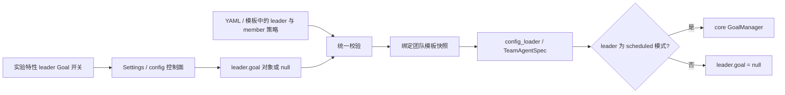

# Swarm 团队 Goal 配置接入方案

## 1. 方案范围与修订依据

2026-11-11 用户收敛本次范围：实验特性的调度模式下面新增一个开关，只在前端接入 leader Goal；
不考虑 token 预算，采用 core 默认最大续跑次数；其他前端配置暂缓，配置层可以先补齐。
本次续写同一设计，替代前稿的双开关、参数展开区和预算接入范围，保留配置快照、状态归属和依赖对齐决定。
后续用户明确该设置仅对调度模式生效；本次以此替代上一稿的独立开关与双模式生效设计。
2026-11-11 用户明确要求按本方案开始实施并完成测试、提交 PR 和 Issue，方案据此确认并进入开发阶段；未虚构 Maintainer 评审。

本次目标：

- 前端在调度模式下只增加「领导目标驱动」一个布尔子开关，默认关闭，只有 scheduled 模式允许启用。
- 不展示评估策略、次数、token 预算、成员 Goal 开关、GoalBar、暂停/恢复命令。
- 后端补齐 `leader.goal` 和 `member_goal` 的策略、最大续跑次数配置，成员字段仅供 YAML/模板使用，默认关闭。
- 不接入 token 预算；启用 leader 开关时使用 `hybrid` 和最大续跑次数 10。
- 已有团队继续使用绑定快照；配置变更只影响之后新建的团队。

“默认最大次数”按当前 core `TeamGoalSpec.max_attempts` 的默认值 **10** 处理，
不是无限制，也不是构造一个极大的整数。这里统计自驱续跑次数，不是 `max_iterations` 或任务重试次数。

## 2. 已核实的代码依据

依据本地 agent-core `4836fc281` 源码：

- `schema/team.py::TeamGoalSpec` 默认 `strategy=hybrid`、`max_attempts=10`、`token_budget=null`。
  strategy 支持 `agent_report/transcript/hybrid`；core 允许 `max_attempts=null` 表示无次数限制。
- `schema/blueprint.py`：leader 策略位于 `LeaderSpec.goal`，成员策略位于 `TeamAgentSpec.member_goal`，均默认 null。
- `goal.py::resolve_goal_spec`：CLI harness 不适用；本地 teammate 可通过成员 `goal=false` 退出团队默认策略。
- core 负责 leader 用户请求绑定、完成评估、安静看板上的继续组织工作、次数停止以及目标状态持久化。
  活动目标中的追加输入不重建目标，blocked 目标可随新输入恢复。
- member Goal 是另一项能力：与正在执行的任务绑定，提交评估在 reviewer 之前；任务是否完成仍以看板为准。
  配置层支持这项能力不代表前端 leader 开关会启用它。

Swarm 缺口与依赖：

| 位置 | 已核实事实 | 设计改动 |
| --- | --- | --- |
| `config_loader.py::_build_leader_spec` | 重建身份字段后丢弃 `leader.goal` | 显式保留并规范化 goal |
| `config_loader.py::load_team_spec_dict` | deepcopy 原配置，顶层 `member_goal` 已有透传可能 | 补统一校验与缺省处理，不重复实现成员执行循环 |
| `_build_predefined_members` | deepcopy 成员条目 | 保留并验证成员级 `goal=false` |
| Settings 契约 / config 控制面 | 无 Goal 键 | 只新增 `team_leader_goal_enabled` |
| `common/team_template_config.py` / TeamManager | 已有模板快照绑定与恢复链路 | 新策略沿用快照，不按每次请求重新读取全局设置 |
| `summary_org/spec.py` | 内部 Summary Team 独立构造 spec | 不继承实验开关，保持关闭 |

运行时 schema 检查确认当前安装包没有 `TeamGoalSpec`，也没有 `LeaderSpec.goal` 和 `TeamAgentSpec.member_goal`。
Swarm 依赖目前固定 core `f3f8f576...`；开发必须先对齐包含此能力的已验证固定提交，
更新直接依赖、uv source、各 extras override 与 uv.lock。不能只修改本地 core 然后宣称发布可用。

## 3. 前端：仅调度模式生效的子开关

在 `features/settings/modules/experimental/definition.ts` 的
`team-scheduled-dispatch-enabled.subItems.items` 中新增「领导目标驱动」，
与验收、成员通信、成员子任务开关同级，沿用父开关的联动规则：

- 调度模式关闭时，子项保持展示但禁用、取消选中。
- 关闭调度模式时，同一次保存将 leader.goal 清为 null。
- 再次开启调度模式时，Goal 不自动重新开启，需用户显式启用。
- 后端执行同样的 scheduled 限制，不能仅靠前端禁用防止自主模式误启用。

- 设置键：`team_leader_goal_enabled`。
- 中文标题：领导目标驱动；英文：Leader goal mode。
- 中文说明：调度模式下，团队任务暂时结束后，领导会继续检查原始目标并按需组织后续工作。默认最多自动续跑 10 次，仅对新建团队生效。
- 默认 false；既有配置缺失时显示关闭。
- 使用声明式设置项与 SettingItemRenderer，接入 Settings 契约、读取、保存、刷新、错误回显和中英文资源。
- 不新增自定义复杂表单，不添加 member Goal 控件或参数输入框。
- 适用于 core 本地 leader；CLI leader 不支持时不能给出已生效的反馈，配置加载应明确报告不支持组合。

## 4. 配置合同与开关映射

YAML 的开关只由对象是否为 null 决定，不另存 `enabled` 字段：

```yaml
modes:
  team:
    jiuwen_team:
      leader:
        member_name: team-leader
        display_name: 团队领导
        goal: null
      member_goal: null
```

开启调度模式及其 Goal 子开关后（以下为团队模板内片段）：

```yaml
dispatch_mode: scheduled
leader:
  goal:
    strategy: hybrid
    max_attempts: 10
member_goal: null
```

前端不读写 `member_goal`。配置层可先支持手写 YAML / 团队模板：

```yaml
member_goal:
  strategy: hybrid
  max_attempts: 10
```

配置规则：

1. goal 缺省或 null 表示关闭；`{}` 表示启用并补 `hybrid/10`。
2. 前端读取：仅当 `dispatch_mode=scheduled` 且 `leader.goal` 为对象时返回 true；
   `{}` 也是启用配置，不能用对象非空判断。autonomous 下显示 false。
3. 开关关闭写 null。开启时若原来已有有效对象，保留其中 strategy/max_attempts；
   原来缺省/null 时创建默认 `hybrid/10`。关闭后不保留一份停用配置，重新开启恢复默认值。
4. 通用设置保存和刷新不得重写已经启用的手工参数；只在开关状态改变时执行相应转换。
5. 本期不加入 token_budget 的配置控件、设置 DTO、默认模板或预算逻辑；交给 core 的预算保持 null。
6. 后端规范化规则复用于 leader/member：策略枚举；max_attempts 支持 core 的正整数/null 语义，
   禁止 bool、零、负数、小数和字符串强转。null 只能由用户在 YAML 中显式选择，前端开启时固定使用默认 10。
7. 明确拒绝当前未开放的键（包括 token_budget），不要静默忽略后声称已生效。
8. 生效门控：Swarm 装配 spec 时，只有 `dispatch_mode=scheduled` 才向 core 传入 leader.goal；
   autonomous 下强制 `spec.leader.goal=None`，即使手写 YAML 或历史模板包含对象也不执行。
   loader 不回写清除原始 YAML；前端关闭调度模式的显式保存则必须清除 leader.goal。
9. 设置 API 按整次提交后的模式与 Goal 值统一校验：最终为 autonomous 却显式开启 Goal 时拒绝，
   关闭调度模式并清除 Goal 时原子落盘，不能依赖两个字段处理顺序。
10. 旧依赖遇到实际生效的 Goal 明确报依赖不支持，不能由 Pydantic 默认忽略新字段；关闭状态保持兼容。
   该限制针对本次 leader 设置，不擅自更改独立 member_goal 配置在 core 中的模式适用范围。

## 5. 模块职责与生效链路



| 模块 | 修改责任 |
| --- | --- |
| `agents/harness/team/config_loader.py` | 内部函数（目标接口）`normalize_team_goal(raw: object, *, path: str) -> dict[str, object] | None`；leader 规范化后按 dispatch_mode 门控装配 goal；顶层 member_goal 统一规范化 |
| `common/config_panel/config_set_handlers.py` | 一个设置键的对称读写；关闭调度模式同步清除 leader.goal，按最终状态校验后原子落盘，保持无关字段和 member_goal |
| `server/control/config_service.py` | Front 读取/保存同步支持开关，不能只接旧面板处理器；复用相同对象与 bool 转换规则 |
| 前端 `features/settings` | Settings contract、experimental definition、读取/保存状态、中英文资源；复用既有开关组件 |
| `common/team_template_config.py` / `team_manager.py` | 复用完整快照；核对恢复及缓存失效，不因配置保存销毁活动 runner |
| `resources/config.yaml` 与中英文文档 | leader/member 默认 null；hybrid/10 配置示例；生效范围和次数语义 |

新建团队读取已选择模板并冻结策略；正在运行或已绑定团队继续使用原快照。
恢复时旧快照缺字段表示关闭，有字段保持原配置；core SessionGoalStore 恢复目标身份和次数，
Swarm 不额外 set goal 或重置轮数。设置保存仅更新默认值和待建团队缓存，不热切换活动目标。

core 仍是 Goal 记录的唯一写入者；Swarm 不增加续跑循环，也不因达到最大次数将任务强行标记完成。
leader blocked 时必须沿实际 runner 链路输出可读停止原因，避免 Web 请求永久等待。
不新增 GoalBar，但基础终态可见性属于本次验收；不能仅凭后台日志认定已交付。

内部 Summary Team 不继承用户模板开关。`swarmflow_budget` 与本期无关，不调整、抵扣或复用它。
成员 Goal 和 reviewer 仍由 core 处理，leader 开关不会改变成员任务交单和验收语义。

## 6. 取舍和后续范围

| 备选 | 结论 |
| --- | --- |
| 放到调度模式现有 subItems | 采用：用户明确仅调度模式生效，禁用与清除联动符合该边界 |
| 相邻独立开关、同时作用于 autonomous | 不采用：用户已明确收窄为 scheduled；core 支持不代表 Swarm 必须开放 |
| 同时增加成员开关和参数展开表单 | 按本次用户要求暂缓，前端只接 leader bool |
| token 预算及参数前端控件 | 本期不接；前端启用使用有限默认次数 10，配置层可显式调整次数 |
| 用 true/false 直接写到 core leader.goal | 不采用：core 要求策略对象，必须由配置适配层转换 |
| Swarm 新建 GoalManager 或 `/goal` 控制接口 | 不采用：重复状态权威；目标详情和暂停恢复留待后续方案 |
| 保存设置时更新所有已绑定团队 | 不采用：会改变恢复语义与活动目标的次数记录 |

## 7. 验证计划

设计阶段未执行模型行为测试；开发需覆盖：

1. 设置页仅有一个新子开关；关闭调度模式同步取消选中、禁用并清除 leader.goal；重新开启调度模式不自动开启 Goal。
2. 读取缺省/null/空对象、首次开启/关闭/重新开启、普通保存及刷新；手工 strategy/max_attempts 不被无关保存覆盖。
3. loader 在 scheduled 下保留 leader.goal，在 autonomous 下强制关闭，覆盖手写 YAML 和历史模板；
   设置 API 拒绝自主模式显式开启；调度模式关闭与 Goal 清除同次保存无顺序依赖。member_goal 仍由 YAML/模板控制。
4. 固定依赖的实际运行环境存在所需 core 字段；旧依赖启用失败、关闭兼容；全部 extras 约束一致。
5. 真实 Swarm 调度团队：看板清空而目标未达成时 leader 继续组织工作，完成后正常结束，追加输入不重复开目标；
   autonomous 即使配置 leader.goal 也不创建领导目标、不续跑。
6. 调度模式达到默认次数上限后阻塞并报告原因，Web 请求不悬挂；reviewer 行为不变，自主模式行为不变。
7. 已绑定团队不随配置保存改变；Worker 恢复不重置目标身份与轮数；旧会话仍关闭。
8. CLI leader 和内部 Summary Team 不误启用；默认 member_goal=null 时成员执行行为保持不变。
9. 配置层单独启用 member_goal 时覆盖自主认领和调度启动；这属于后端配置能力验证，不增加前端入口。

建议开发顺序：依赖对齐与规范化 → 设置 API 和单一开关 → Swarm 实际会话及恢复验收。
core 的 goal E2E 脚本可作为场景参考，不能替代 Swarm 入口验证。

## 8. 交接

用户于 2026-11-11 明确确认按此方案实施。确认范围为仅调度模式生效的 leader 开关、不接 token 预算、配置层支持策略与次数。
核心源码能力、运行时依赖差异和既有快照规则已核实。开发与验证事实在关联 feature 维护，不回填本文。
