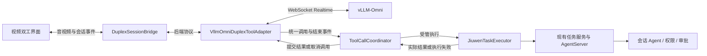
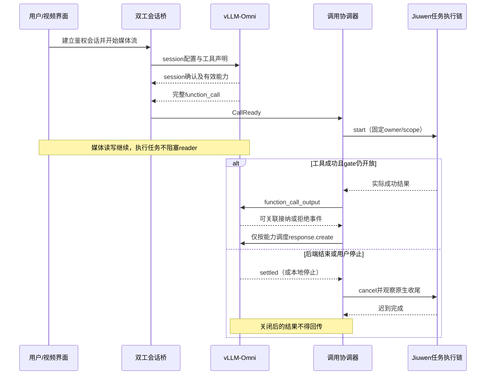

# 双工后端工具调用适配器设计方案

## 1. 设计定位与阅读说明

为 JiuwenSwarm 增加一个双工工具调用适配层：不同后端把模型调用转换成统一事件，JiuwenSwarm 负责授权和执行，再按后端协议回传结果。首期只提供 **vLLM-Omni duplex WebSocket** 实现。

用户已明确排除 HTTP API tool calling。本设计不包含 HTTP Chat Completions/SSE 工具循环，也不把它列为后续里程碑。vLLM-Omni 进程内 Python 推理 API 同样不属于本期；使用 Python 编写 WebSocket 客户端不等于接入其进程内 API。

本文定义目标方案和验收条件。用户在检视反馈后授权实现，实际开发与测试证据由关联 F 文档记录。

## 2. 背景、目标与范围

### 2.1 已核实的当前行为

本地基线为 `3eea3124015885d3b556d7832a561a958b7a6b62`，以下结论来自源码阅读，未执行运行时验证。

| 位置 | 当前行为及设计影响 |
| --- | --- |
| `jiuwenswarm/runtime/client_tools.py` | `ToolCard(execution="client")` 由 core 暂停，输出 `chat.client_tool_request`，通过携带 request/interrupt 身份的 `chat.send` 恢复。不能把这条中断路径直接解释成持续运行的双工调用。 |
| `extensions/video_duplex/backend/qwen_omni_gateway.py` | 当前 Qwen 云端 Realtime 入口负责凭据和双向转发，不承担统一工具生命周期。 |
| `extensions/video_duplex/frontend/VideoLivePanel/qwenOmniTools.ts`、`qwenOmniSession.ts` | 浏览器解析 Qwen function-call 事件，并参与结果回传与 `response.create`。这些策略不能直接套用于所有双工模型。 |
| `extensions/video_duplex/backend/task_adapter.py` | `VideoSearchManager` 承担 owner/scope 授权、任务委托与控制；`AgentTaskExecutor` 连接 AgentServer 执行。已有 `start`、`operate`、`manage_queue_call` 可作为业务复用点。 |
| `extensions/video_duplex/backend/tasks/service.py` | `TaskService` 管理持久任务、取消和执行事实不确定性。任务生命周期不能与一次模型工具调用的生命周期合并。 |
| `server/runtime/video_task/execution.py` | 现有托管任务绑定会话自己的 Agent，处理交互卡片与原生执行收尾，不能旁路直接执行工具函数。 |
| `server/runtime/agent_adapter/interface_deep.py::build_model_from_entry` | 普通模型由 core `Model` 构建；本设计不把双工长连接伪装成一次普通模型请求。 |

仓库已有 vLLM-Omni 图像、视频、语音生成接入，但不构成本设计所需的双工工具闭环。

参考 [vLLM-Omni PR #9909](https://github.com/vllm-project/vllm-omni/pull/9909)，其运行时发布调用并接受结果，工具由应用执行。调查时该 PR 为 open，head 为 `fbdf47bf2b400034987f380089b2bd83435fdb91`；此 SHA 是本设计的外部协议快照，不代表已进入发布版本。

参考 [JiuwenSwarm PR #10517](https://github.com/openJiuwen-ai/jiuwenswarm/pull/10517)，调查时为 closed，head 为 `41b7ed699daf79343e8752ad878ee51adab5f016`。该候选研究后台客户端工具，通过后续内部轮次投递结果；本地未发现其 `ClientToolAdapter` 实现或关联设计文件。本文只借鉴身份绑定、拒绝迟到结果和来源隔离，不依赖它先合入。其 `D-20261103-0410-client-tool-adapter` 是外部参考关系，本设计不宣告替代或批准旧方案。

### 2.2 目标与关键场景

- 用户在视频双工界面选择 vLLM-Omni WebSocket 后，模型能调用已注册的 Jiuwen 任务工具；工具运行期间音视频继续流动。
- 协议解析和后续生成策略集中在后端适配器，不把 Qwen、Nemotron 等模型名分支扩散到执行器和 UI。
- 一次调用只产生一个本地执行；重复事件、超时、取消和迟到结果不会再触发工具副作用。
- 业务任务继续经过现有 owner/scope、权限、审批及任务收尾链；模型文本和工具结果不能成为用户授权。

### 2.3 首期范围

首期交付抽象契约、vLLM-Omni duplex WebSocket 适配器、现有任务执行桥、最小设置与视频入口接入、契约及端到端验证。原 Qwen 云端和 JoyAI 路径继续使用现有实现；本期不要求它们迁移到抽象层。

首期工具目录使用现有实时任务工具，例如 `jiuwen_delegate`、`jiuwen_queue_manage` 及已允许的任务控制工具；不向实时模型直接公开 shell、文件、MCP 等全部底层能力。委托后的 Core Agent 仍可按原授权使用这些能力。抽象接口可接入其他受管执行器，但本期不增加任意工具执行 API。

不包含后台客户端工具注册、TUI 双工支持、完整双工媒体协议重写、跨进程恢复未完成调用、断线后自动重放外部副作用。

## 3. 设计约束、假设与待决问题

1. **已确认范围：** 用户允许首期只支持 duplex WebSocket，并明确不希望支持 HTTP API tool calling。
2. **外部依赖：** 运行端必须提供 #9909 对应的工具能力、逐调用取消及结束事件。部署需固定经验证的版本/commit；不得仅依赖 `latest`。不兼容端点在建会话时明确失败。
3. **执行链核实点：** 已读通现有任务授权和入口，但还未证明所有业务操作都能脱离旧浏览器 RPC 信封使用。开发第一步应抽出共享业务入口，用新旧路径的等价测试证明 owner、scope、审批和取消语义一致；不通过则不能通过直接调用工具函数绕开。
4. **模型验收基线：** 建议先用支持 `declared` 工具和 `client_response_create` 的 Qwen3-Omni 完成真实闭环。其他模型按实际握手能力与独立验收开放，不能从共同协议推断已支持。
5. **待确认产品选择：** 首期建议使用下述默认超时、工具白名单和禁止自动重连策略。这些是设计建议，不是用户已经批准的参数。

## 4. 总体方案与设计取舍

### 4.1 架构与责任



新增 `jiuwenswarm/runtime/tool_calls/` 放置无传输、无 UI 依赖的类型、接口及调用协调器；`extensions/video_duplex/backend/` 实现 WebSocket、媒体桥和现有任务服务的组合装配。runtime 不导入扩展模块。这里所有新路径和符号均为计划新增，frontmatter 的 files 只列已存在的相关文件。

| 组件 | 职责 | 状态权威 |
| --- | --- | --- |
| `ToolCallAdapter` | 描述后端能力、规范化调用/结束事件、提交结果、取消调用、执行后续生成策略 | 后端协议映射，不执行业务工具 |
| `ToolCallCoordinator` | 本地去重、预算、执行句柄、投递状态及资源收尾 | 当前 bridge generation 内的本地执行事实 |
| `JiuwenTaskExecutor` | 将明确注册的工具映射到现有任务业务入口，保留身份及授权 | 不另建任务状态，查询 `TaskService` |
| `DuplexSessionBridge` | 单个上游 reader、串行 writer、媒体路由、会话关闭与 UI 事件投影 | 本地双工连接及 generation |
| vLLM-Omni 会话 ledger | 判定原始调用是否仍 pending、结果是否 accepted、取消/超时及重复抑制 | 后端调用接纳事实 |

### 4.2 关键决策

**D-01：抽象面向有状态双工会话。** 不设计通吃 HTTP 请求和双工会话的统一模型接口。本次真实需求是持续输入、异步工具和异步后端结束；代价是普通模型循环不接入此抽象。

**D-02：协议适配与执行端口分离。** vLLM 事件没有直接调用宿主函数的权限。执行器复用已有任务服务，不重写 core 的工具执行、权限 rail 或中断恢复。代价是首期只开放明确支持的任务工具。

**D-03：新 vLLM 路径的工具生命周期归服务端。** 浏览器负责媒体与呈现，不能再次执行看到的 function-call 事件，也不能自行发送该路径的 `function_call_output` 或 `response.create`。代价是新增受控会话桥及前端分支；旧 provider 不在本期改造。

**D-04：后端接纳和业务执行分开记录。** 发送成功不等于 accepted；取消模型调用不等于任务副作用已撤销。代价是需要保留 delivery 和 execution 两组事实。

### 4.3 备选方案

| 方案 | 暂不采用的原因 | 重新评估条件 |
| --- | --- | --- |
| 直接使用 `DuplexToolRunner` 作为执行中心 | 它已有异步执行能力，但本项目还需要 owner/scope、权限、任务状态及生命周期收尾；同时运行两个 runner 会重复执行 | 可作为底层库复用，但须证明只保留一个执行和结算所有者 |
| 在旧 Qwen 浏览器实现上增加模型名分支 | 不能集中约束服务端生命周期，后续生成和失败结果语义也不同 | 仅作为迁移期旧路径，不能承载新 vLLM 工具执行 |
| 完整移植 #10517 | 其客户端注册及后续轮次投递解决另一边界，不能替代向同一 duplex 会话回传结果 | 产品明确需要 detached client tools 时另行设计 |
| 将所有 Core 工具 schema 直接交给实时模型 | 暴露范围和执行入口变化过大，也绕不开审批与发现目录约束 | 另行确认受管直接执行端口后扩展 |

## 5. 详细设计

### 5.1 统一接口与身份

以下为拟新增接口，不是现有 API。`ToolCallAdapter` 的实例绑定一个已建立的后端会话；由 bridge 在开始读流前装配，所有调用状态限定于该实例的 generation。

```python
class ToolCallAdapter(Protocol):
    def normalize(self, event: Mapping[str, object]) -> tuple[ToolEvent, ...]: ...
    async def submit_result(self, call: ToolCall, result: ToolResult) -> bool: ...
    async def cancel_call(self, call: ToolCall, reason: str) -> None: ...
    async def continue_after_result(self, call: ToolCall) -> None: ...
    async def close(self) -> None: ...

class ToolExecutor(Protocol):
    async def start(self, call: ToolCall, context: ToolExecutionContext) -> ToolExecution: ...

class ToolExecution(Protocol):
    async def wait(self) -> ToolResult: ...
    async def cancel(self, reason: str) -> None: ...
```

建连与配置由具体后端和 bridge 装配，不把 vLLM 的配置字段放入 runtime 端口。`normalize` 不执行 I/O；不相关媒体事件返回空元组。`submit_result` 等待可关联后端确认，返回是否接纳；没有确认时保持等待至调用预算结束，连接关闭时不宣称成功。`cancel_call` 提交逐调用取消，失败通过异常报告；`continue_after_result` 只管理已接纳结果的后续生成。`close` 幂等，释放等待者，不自行取消业务任务。

`start` 在执行器验证身份、live 工具绑定及参数后返回句柄；失败以受控错误结束调用。`cancel` 必须等待原生执行收尾，未结算时抛受控异常并保留任务 unknown 事实，不能以协程消失推断外部任务停止。取消后的 `wait` 结果仍经过 coordinator 的 generation/终态检查。

| 类型/字段 | 语义 |
| --- | --- |
| `ToolCall` | `backend_session_id, generation, call_id, response_id?, item_id?, epoch?, name, arguments, deadline?`；arguments 只接受合法 JSON object |
| `ToolExecutionContext` | 来自鉴权会话的 `owner_id, jiuwen_session_id, scope, request_id` 和执行租约；不能从模型 arguments 覆盖 |
| `ToolDefinition` | 真实注册名、描述、input schema、执行绑定标识与版本；同名不同版本不得偷偷替换在途调用 |
| `ToolResult` | 明确的 `success/failed`、成功文本/结构化内容、诊断引用；failed 不携带可回传的业务成功文本 |
| `ToolCapabilities` | 工具模式、工具数量限制、后续生成策略、逐调用取消能力及有效重试策略；未知值按不支持处理 |
| `ToolEvent` | `CallReady / BackendSettled / ResultAccepted / ResultRejected / CallSuppressed / BackendClosed`；后端未提供的事实不能伪造事件 |
| `Submission` | 本地 `event_id` 和 send 状态；用于关联异步 error/ack，不是 accepted 证明 |

去重键为 `(backend_session_id, generation, call_id)`。同键且内容不同是协议错误，不重新执行；同键重复完成事件忽略。新的 generation 不可消费旧调用的结果。向现有 TaskService 和队列管理器传递时，用该三元组派生固定长度的 `duplex:<sha256>` command id，所有子操作沿用该命名空间；向后端回传时保留原始 call id。

同名同参并不必然重复业务意图。本地对不同 call_id 不做跨用户轮次的永久内容去重；vLLM-Omni 的语义重复抑制以其 ledger 和有效 retry policy 为准。协调器保留 generation 内已经结束的 call-id 记录；达到会话调用上限时停止接纳并关闭会话，不能通过过早淘汰记录使旧事件重新执行。

### 5.2 vLLM-Omni 协议映射

首期使用 `ws(s)://<host>/v1/realtime?duplex=1`。服务端可用现有 `websockets` 依赖实现精简 transport，不强制给所有 WorkSwarm 安装 GPU 推理依赖。`DuplexClient` 仅作为协议实现参考；后续选用其轻量客户端包时仍须满足本契约。

映射依据为固定 SHA 的 [Realtime duplex 文档](https://github.com/vllm-project/vllm-omni/blob/fbdf47bf2b400034987f380089b2bd83435fdb91/docs/serving/realtime_duplex_api.md) 和 [客户端实现](https://github.com/vllm-project/vllm-omni/blob/fbdf47bf2b400034987f380089b2bd83435fdb91/vllm_omni/clients/duplex.py)。

| 后端事件/操作 | 适配行为 |
| --- | --- |
| `session.created` / `session.updated` | 记录真实 session id、有效配置和 capabilities；只有配置被确认后才允许工具执行 |
| `response.function_call_arguments.delta` | 仅作可选展示，不执行不完整参数 |
| `response.function_call_arguments.done` | 标准事件不包含工具名，因此等待完整 output item；仅对显式携带名字和完整参数的扩展投影生成 `CallReady` |
| `response.output_item.done` 的 function_call item | 以完整工具名、参数与 call id 生成 `CallReady`；与已接纳的同 call id 完整投影去重，不能触发第二次执行 |
| 成功结果 | 串行发送 `conversation.item.create`，item 为 `function_call_output`，带原 call id 和序列化文本 |
| 执行失败/取消 | 发送 `function_call.cancel`，reason 分别为 `failed` / `cancelled`；异常堆栈和失败工具原文不作为 output |
| `duplex.function_call.settled` | 从嵌套 `event` 读取 call id、state、reason、epoch，关闭结果出口并取消本地执行 |
| `duplex.function_call.suppressed` | 记录抑制事实，不创建执行任务 |
| `error` | 使用关联 event id 和错误码识别拒绝；未知 call-id 错误不能结算其他调用 |

`conversation.item.added/created/done` 只有在协议证实它对应本次提交的 output item、call id 与 generation 时才映射 `ResultAccepted`。为提交的 output 指定由调用命名空间派生的唯一 item id，要求回送匹配该 id 和 call id；显式 created=false 不接纳。后端内部事件的 created=true 不属于标准 Realtime wire 字段，不能以它作为客户端必须收到的字段。开发须用固定后端快照验证关联字段。若所用版本没有可关联正向确认，本地保留 `sent_unconfirmed`，不得自行宣布 accepted；该限制需在 UI 和验证记录中可见。后端 accepted 也不代表模型已经消费，更不代表已经播报。

### 5.3 能力协商与工具目录

收到初始 session 后读取能力，再声明工具并等待确认；若部署要求初始配置先带工具，只使用经过验证的启动配置，仍须在确认前禁止执行。建会话与配置期间的事件不能丢弃。

| 能力 | 首期策略 |
| --- | --- |
| `tool_mode=declared` | 使用服务端明确配置的实时任务白名单；超过 `max_tools` 则失败，不静默截断 |
| `tool_mode=none` | 拒绝启用工具调用，报告不支持 |
| `tool_mode=delegate_only` | 首期明确拒绝工具模式；不得把 `jiuwen_delegate` 自动改名并假定参数兼容 |
| `function_call_output_continuation=client_response_create` | 成功提交后由适配器按串行调度发一次 `response.create` |
| `automatic` | 不发送 `response.create`，等待模型自动处理结果 |
| `next_observation` / `none` / 未知值 | 首期拒绝工具会话；不伪造用户发言或摄像头 commit 促使模型继续 |

只支持 `tool_choice=auto`。握手展示实际能力，不按模型名称代替协商。配置 `function_call_interrupt_policy=keep`，允许新输入期间工具继续；显式用户停止仍取消本地调用。采用后端 `function_call_retry_policy=user_turn`，同时保存后端报告的有效值；不支持用户轮边界时不得声称重复阻止会自动解除。

首期默认最多一个在执行的模型工具调用；额外调用不进入无界队列，按可关联失败路径取消并提示本地并发限制。握手无法声明此限制时，在本地 admission 执行。仍须接受同一调用的重复终态表示。

`client_response_create` 使用单一 continuation 调度器：收到上述可关联的已提交 function_call_output item 后，同一 call id 最多调度一次；上游有活跃 response 或未播放音频时保留标记，待 `response.done` 且后端 playback.acknowledged cursor 已确认播放完成后发送；后端清空音频也释放该播放条件。如果 backend/session 已结束或 generation 改变则丢弃。失败或取消清除标记。成功接纳只封闭结果出口，不关闭成功 continuation 的发送资格。首期不对外承诺多工具并行 continuation 合并。

### 5.4 调用状态与结算

本地分别跟踪三个维度，避免使用一个 COMPLETED 覆盖全部事实。

| 维度 | 状态 |
| --- | --- |
| `execution` | admitted → running → succeeded / failed / cancelled / unsettled |
| `delivery` | none → queued → sent_unconfirmed → accepted / rejected / unknown |
| `call_gate` | open → closed，关闭后永不重新打开 |

`BackendSettled`、本地 deadline、显式停止、连接关闭都会在会话事件循环中原子关闭 gate，再取消执行及撤掉未发出的 output/continuation。业务完成只有在 gate 仍 open、generation 一致且 deadline 未过时才能提交。writer 发送前再次检查 gate；已经发出的消息不能撤回，最终由后端 ledger 判定。

成功结果 pending 期间，本地 `execution=succeeded` 并不关闭后端事实查询；收到 accepted 后关闭结果 gate，并移交独立的 continuation 调度器。发送后的超时或断线使 delivery 进入 unknown，而不是宣称取消成功。后端已 accepted 的结果还可能受其 epoch 退休规则影响，本地不承诺可撤销。



### 5.5 现有业务执行桥

从 `VideoSearchManager.handle_qwen_tool` 中抽出与 WebSocket RPC 回复无关的共享入口，显式接受认证 owner、会话 scope、规范化工具和受信输入上下文。旧 Qwen 入口与新的 `JiuwenTaskExecutor` 都调用该入口，避免伪造 ws 对象或复制授权逻辑。

受信上下文包含当前浏览器画面与登录模型的授权绑定。画面在接纳工具调用时捕获；授权引用通过原鉴权连接及既有 Gateway 刷新/解析函数取得，再传给共享任务入口。它们不能由模型 arguments 提供，不复制或持久化原始登录会话/令牌。

工具名先查当前注册表，再按现有 schema 校验，之后执行 owner/scope 检查、任务管理和 AgentServer 请求。审批仍通过原卡片机制完成；来自双工模型的“用户已同意”不能直接生成卡片回答。首期 `jiuwen_task_answer` 只有现有独立审批校验能证明授权时才开放，否则从白名单排除。

首期直接和间接回答均关闭：工具目录不包含 `jiuwen_task_answer`，执行 `jiuwen_queue_manage` 时显式传入 `allow_answers=False`。模型提及用户同意不能恢复回答能力，卡片继续由既有界面处理。

对于 `jiuwen_delegate`，已有 `start` 返回的是任务受理/任务身份，不代表任务完成。本设计默认等待 `TaskService` 的实际终态或交互状态：进度只投影到 UI，不当成工具成功结果。遇到待审批保持调用 pending 并展示既有卡片；超过调用 deadline 走取消，不虚构失败结果。成功终态再从现有 receipt 提取可回传内容，结构化结果采用确定性的 JSON 序列化。

取消模型调用时，执行器只对该调用新建且拥有的任务请求停止，并观察实际结算；查询/管理既存任务的调用被取消，不得顺便取消被查询任务。已经成功提交的任务修改、创建或外部副作用不能撤销；可见状态保留 committed/unknown 事实，不向用户承诺回滚。取消期间收尾超时标为 unsettled，保持业务任务证据供现有 reconcile 使用，绝不自动重做。

### 5.6 媒体、连接与资源

上游仅有一个 reader，依序处理 session/control/tool 事件，再将可展示媒体投影给浏览器；工具启动使用独立受管 task。writer 串行发送所有上游命令，control/tool 消息使用有界可靠队列；媒体允许按明确策略限流，但不得丢失调用或结算事件。可靠队列溢出时显式关闭会话并收尾，不能静默丢事件继续执行。

新增 provider 路径继续复用现有媒体采集、音频播放和任务展示。需新增 vLLM 会话映射，保留后端 audio format、采样率、用户 commit、playback ack 及 response 身份；不能原样复用 Qwen 云端固定语音配置。浏览器断开会触发会话关闭及调用取消。

首期不自动重连/恢复。上游断开、`session.resync_required`、控制事件丢失或进程退出后，所有未确认投递标 unknown，关闭结果出口。新连接生成新的 generation；历史轨迹可查看，但不恢复执行。浏览器重连不得自动重发工具调用。后续如果支持 session.resume，必须另行确认事件游标、后端 ledger 和业务执行三者的恢复协议。

## 6. 配置与实施影响

### 6.1 配置草案

沿用视频双工扩展设置持久化入口，新增独立配置键，不复用 Qwen 云端 URL/key。设置页字段与对应环境键如下；工具白名单及并行预算固定于装配代码，不开放任意工具注册配置：

```yaml
video_live_provider: vllm_omni_ws
vllm_omni_realtime_url: ws://127.0.0.1:8099/v1/realtime?duplex=1
vllm_omni_model: <deployment-model-id>
vllm_omni_api_key: <optional-secret>
vllm_omni_tool_timeout_s: 120
```

环境对应 `VIDEO_LIVE_MODE=realtime`、`VIDEO_REALTIME_PROVIDER=vllm_omni_ws`、`VLLM_OMNI_REALTIME_URL`、`VLLM_OMNI_MODEL_NAME`、`VLLM_OMNI_API_KEY` 和 `VLLM_OMNI_TOOL_TIMEOUT_S`。普通字段通过 Settings 声明式 renderer 与 duplex source 读写现有设置 RPC，避免另建一套保存状态。

扩展 `settings.py` 的显式字段白名单及默认值；凭据仅在服务端，公开配置只返回是否已配置。支持明确无认证的本地部署，不沿用 Qwen 必须有 API key 的校验。URL 只接受 ws/wss，不带用户名密码；地址由受信设置确定，不能由模型参数覆盖。原 provider 默认选择保持不变，新路径需显式启用。

后端 `tool_result_timeout_s` 与本地预算使用同一配置值；deadline 从调用暴露开始，本地收到时不能假定拥有完整剩余时间，后端始终有最终判定权。审批等待计入预算，120 秒不代表任意长任务都可完成；需要长任务的部署应显式增大该值。本期不通过另起内部用户轮次投递过期结果。

### 6.2 实施顺序与文件范围

| 步骤 | 计划位置与变更 | 完成条件 |
| --- | --- | --- |
| P1 契约及执行桥 | 新增 `runtime/tool_calls/{types,ports,coordinator}.py`；重构扩展 task_adapter 的共享业务入口 | 用受控 executor 验证身份、去重和取消；旧任务入口行为等价 |
| P2 WebSocket适配 | 新增扩展 `backend/tool_adapters/vllm_omni.py`、`backend/duplex_session_bridge.py` | 固定后端快照的握手、调用、接纳/拒绝、settled 和 continuation 闭环 |
| P3 产品入口 | 扩展 settings、extension 路由装配及 `frontend/VideoLivePanel/` 的 provider、媒体与设置 | 界面可启用新 provider，浏览器不执行或回传该路径工具 |
| P4 生命周期和交付 | 扩展 session/连接关闭钩子、端到端用例及中英文使用文档 | 停止、断开、归档/删除相关会话时可靠关闭调用；执行事实不确定时可见 |

归档/删除通过既有生命周期通知接入；会话桥在宿主进程时必须接收 AgentServer 的会话事件，而非假定同进程 runtime registry 能直接取消它。开发须证明该通知关联相同 owner/session/generation。普通文字新输入不会关闭双工工具；明确停止才关闭，避免把 request 完成等同于双工会话结束。

实现时新增当前有效 S 契约记录到对应 runtime/扩展模块，并在 F 记录实际偏差与验证。本设计不提前改写当前 specs，也不复制 core 的底层设计。文档与代码提交需沿用独立授权。

## 7. 兼容与迁移

- 默认关闭新 provider，普通 core 模型配置、Code/Work 工具循环和 `execution="client"` 中断恢复不变。
- 原 Qwen/JoyAI 使用原入口；只共享抽出的任务业务逻辑，不批量替换前端协议实现。
- 新路径内不允许前端和后端同时回传一个调用；通过 provider 会话绑定选择唯一所有者，拦截浏览器伪造的工具结果和会话工具目录更新。
- 不迁移 #10517 的 `client_tools.json`；本地调用记录为会话级内存状态，权威业务任务继续留在现有 store。
- 模型或 provider 切换先关闭旧 bridge、停止接纳并收尾，再启用新 generation；旧 call id 不能向新后端投递。
- 日志记录 backend/session/generation/call/event/request/task 的关联、状态、耗时和受控错误码；不默认保存原始音视频、参数敏感值、API key 或 resume token。诊断资料不作为恢复执行依据。

## 8. 验证设计与通过条件

以下均为开发后的计划，当前没有执行结果。使用可控时钟、可暂停的 executor、可编排 WebSocket 假后端及明确 barrier 构造竞态，观察业务 start 次数、writer 输出、TaskService 事实和用户事件，不只断言内部字段。

| ID | 入口及场景 | 通过条件 |
| --- | --- | --- |
| V-01 | 真实视频入口 + 假后端 + 真实任务执行桥 | 调用触达 owner/session 的 Agent；成功结果使用原 call id 回传；任务 pending 期间媒体仍持续流动 |
| V-02 | delta/done/output_item.done 重复及不同顺序 | 不执行半截 JSON；同键只启动一次；同 id 不同参数显式失败；非法参数不产生业务副作用 |
| V-03 | `declared/none/delegate_only`、超限/缺失能力 | 按能力表接纳或拒绝，不能静默删工具或按模型名放行 |
| V-04 | `client_response_create/automatic` 与活跃 response | 前者按串行调度恰好一次，后者零次；失败/取消不创建后续响应 |
| V-05 | 成功回传、相关 error、无可关联正向确认 | sent 不被误报 accepted；拒绝与 unknown 可观察；错误只影响对应调用 |
| V-06 | 完成与 deadline/settled/显式停止同时发生 | gate 单向关闭；关闭前未发出的结果和 continuation 被撤掉；迟到完成不能再发送；后端只接纳一个结果 |
| V-07 | 工具异常、业务取消未收尾、已经产生副作用 | 发送 failed/cancelled 控制消息；失败原文不进入模型 output；保留 unsettled/committed 证据，不自动重试 |
| V-08 | owner/scope 伪造、未注册工具、失效绑定、审批请求 | 不跨用户执行；不恢复已删除工具；保留现有审批；模型文本和结果不能成为用户确认 |
| V-09 | 持续新输入、显式停止、浏览器/上游断线及归档删除 | 新输入不误取消；其余按生命周期关闭；旧 generation 和重复事件不能触发新执行 |
| V-10 | `jiuwen_delegate` 返回受理后等待、审批及实际完成 | 受理不当作成功；进度不当作最终 output；取消只作用于本次拥有的执行 |
| V-11 | 音频格式/采样率、playback ack、队列压力 | 播放格式与握手一致；可靠工具事件不丢失；饱和时显式失败并清理 |
| V-12 | 原 Qwen/JoyAI、普通聊天、客户端工具中断 | 新 provider 关闭时原行为不变；共享任务入口权限及 receipt 行为等价 |
| V-13 | 固定 #9909 快照部署 + Qwen3-Omni 真实模型 | 视频入口完成真实工具闭环；工具运行期间可继续输入；失败取消和超时不回传迟到结果 |

建议单元/集成范围：新增 runtime 协调器及适配器用例，复用 `extensions/video_duplex/tests/backend/` 的任务、身份、审批和取消用例；前端按现有 Node 测试入口验证 provider 切换和禁止双重执行。真实后端契约测试固定 commit；真实权重验收单列模型、部署、能力和媒体条件，不能用假模型测试替代。

## 9. 设计风险与已知限制

主要风险是外部 PR 尚未合入或继续改协议、接纳确认字段不足、不同模型的媒体和 continuation 支持不同。通过固定快照、契约 fixture 和能力拒绝策略控制；未通过某模型的真实闭环前不宣称支持。

首期最多一个工具执行，不提供 delegate_only/next_observation、任意底层工具直调、无感恢复和跨进程 exactly-once。进程崩溃或断线后，任务可能继续或已产生副作用；只能保留任务事实并显式 reconcile，无法保证撤销。工具调用有有限预算，不能保证长任务都能在原模型调用内完成。

## 10. 按日期记录的评审与设计修订

| 日期 | 参与方 | 主题 | 实际结论及修改依据 |
| --- | --- | --- | --- |
| 2026-11-16 | 用户 | 接入范围 | 明确允许先只支持 duplex WebSocket；随后明确不希望支持 HTTP API tool calling，已据此收敛全文范围 |
| 2026-11-16 | Codex | 设计检视 | 识别成功 gate 与 continuation 冲突、队列管理的间接回答路径、业务幂等身份缺少后端命名空间；修订对应契约 |
| 2026-11-16 | 用户 | 开发授权 | 在上述检视反馈后要求实现，并在指定服务器执行单元测试、PR #9909 E2E 和实现/设计复查 |
| 2026-11-16 | Codex | 对外协议澄清 | 根据固定快照的 typed Realtime projection 明确 arguments.done 不带工具绑定、结果接纳关联 output item id，以及生成结束和播放完成的独立 gate；不把内部字段视作对外 API |

开发授权来自用户本轮明确要求；不把自动检视记作 Maintainer 审批。

## 11. 参考与交接

- 外部协议依据：[vLLM-Omni #9909](https://github.com/vllm-project/vllm-omni/pull/9909)、[固定快照工具 runner](https://github.com/vllm-project/vllm-omni/blob/fbdf47bf2b400034987f380089b2bd83435fdb91/vllm_omni/clients/tool_calls.py)。PR 的验证声明是上游报告，不是本任务执行证据。
- 相关但不依赖的候选：[JiuwenSwarm #10517](https://github.com/openJiuwen-ai/jiuwenswarm/pull/10517) 中的 `D-20261103-0410-client-tool-adapter`，其客户端注册/后续内部轮次决策不由本文替代。
- 当前工具目录契约：`S_01_tool-discovery-language`（`specs/jiuwenswarm/agents/harness/common/tools/`），live 工具绑定与授权版本约束继续有效。
- 开发交接：仅 duplex WebSocket；一个协议适配器、一个调用协调器、一个共享任务执行桥；优先核实业务入口抽取、接纳确认关联字段和跨进程会话停止通知，按 V-01 至 V-13 验收。
- 关联实施归档：`F_20261116_1142_duplex-tool-call-adapter`；实际结果与偏差在该处维护。
