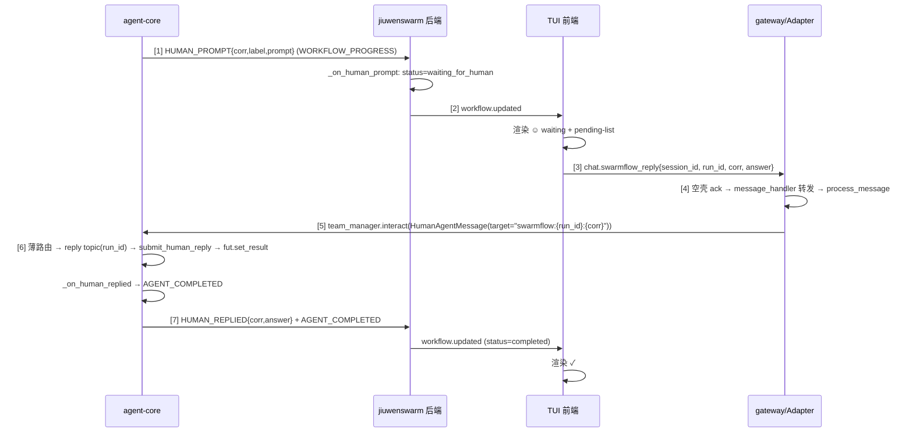

# jiuwen TUI 适配 SwarmFlow 三算子（human / human_session / agent_session）

## 1. 背景与问题 (Why)

agent-core（OpenJiuwen）已落地 SwarmFlow 四原语 `agent()` / `agent_session()` / `human_session()` / `human()`，后端事件、状态、人机会合机制部分就绪；但 jiuwenswarm TUI 前端无法正确展示与交互，存在三类缺口：

| 缺口 | 现状 | 后果 |
|---|---|---|
| 展示缺口 | `WorkflowRunState` 只处理 8 种 progress kind，缺 `human_prompt` / `human_replied`；`WorkflowAgentState` / TUI `WorkflowAgent` 无 `kind` / `correlation_id` | human 节点无法渲染、无法区分 human/agent |
| 回复闭环缺口 | agent-core 已实现 `interact_agent_team` + `HumanAgentMessage(target="swarmflow:<corr>")` 薄路由；TUI 无入口把用户回复送达该通道 | 用户无法在 TUI 内回复 human_session |
| 同名节点定位 bug | `_find_agent_in_phase` 返回首个匹配 label | for 循环 / session 多轮 / parallel 同名节点串扰：第 2+ 轮永远停在 running，第 1 轮 outcome 被反复覆盖 |

本设计在 **agent-core + jiuwenswarm 后端 + gateway + TUI** 四层补齐缺口，形成完整闭环：

```
human_prompt 弹出 → TUI 渲染 waiting → 用户输入 → 薄路由唤醒 future
→ human_replied → 结构化 → AGENT_COMPLETED → TUI 渲染 ✓
```

## 2. 目标与非目标

**目标**
- TUI 正确展示三算子状态生命周期，含 `waiting_for_human` 中间态。
- TUI 内采集用户输入并按 `correlation_id` + `run_id` 路由回 workflow 后端。
- 修复同名节点定位 bug，覆盖 for 循环 / `agent_session` 多轮 / `human_session` 多轮 / `parallel` 内同名四种场景。
- 严格复用 `interact_agent_team` 薄路由，不新增公共 API、不新增 messager 发布桥。
- 新增 `/swarmflow` 开关指令（复用 `enable_swarmflow` config + `config.set` toggle，不新增配置项 / RPC）。

**非目标**
- 不实现"部分命中续跑"（依赖 avatar 会话状态持久化）。
- 不改动 agent-core 后端**公共**接口签名（`send_turn` / `on_human_prompt` 不变；`on_human_replied` 是内部回调，签名由 2 参改 3 参，记偏差）。
- 不把真人做成正式团队成员。
- 本期不做全链路真实 LLM 系统测试（需 model endpoint，手动验证）。
- 不做会话 fork、会话内嵌套人机交互。

## 3. 术语与上下文

| 术语 | 含义 |
|---|---|
| 三算子 | `agent_session` / `human_session` / `human`（`agent()` 一次性算子也纳入展示范围） |
| correlation id | `{phase}:{label}:{turn}`，确定性人机问答标识，跨 resume 稳定 |
| 薄路由 | agent-core `runtime/manager.py` 在 leader 分发前识别 `target="swarmflow:<run_id>:<corr>"` 短路到专用 topic，绕过 leader round |
| agent_id | 节点唯一标识，复用 agent-core cache key `key_str(_path.get() + (("call", _next_ordinal()),))`，确定性、跨 resume 稳定 |
| node_type | 进度事件携带的算子类型字段，取值 `agent` / `agent_session` / `human` / `human_session`；消费方据此（而非布尔 `is_human`）推导节点 `kind` |
| waiting_for_human | agent 中间状态，标识 human_session / human 正等真人回复 |

**前置代码事实（落地后核对）**
- 后端出向：`HUMAN_PROMPT` / `HUMAN_REPLIED` 发到 `WORKFLOW_PROGRESS` topic（`runner.py:192-212`）。
- 后端入向：薄路由已实现（`runtime/manager.py`，`_as_swarmflow_human_reply` / `_route_swarmflow_human_reply`）；`AvatarSessionManager` 订阅 reply topic 并 `submit_human_reply` 唤醒 future（`avatar_session_backend.py`）。
- jiuwenswarm 入口：`Runner.interact_agent_team` 由 `TeamManager.interact`（`team_manager.py:1142`）内部调用。
- 现有展示链路：`WorkflowMonitorHandler` → `WorkflowRunState.apply` → `workflow.updated` 推 TUI；TUI `applyWorkflowUpdate` 合并快照。

## 4. 方案设计 (What / How)

### 4.1 总体架构

四层改动，遵循"事件带唯一标识 → 状态机精确匹配 → TUI 渲染 + 输入闭环 → 回复走既定薄路由"。

```
┌─ agent-core 层（事件源加 agent_id / node_type）─────────────────────────┐
│  WorkflowProgressEvent + agent_id + node_type + correlation_id + answer  │
│  _emit_agent_started/completed/failed 传 ks 作 agent_id                  │
│  HUMAN_PROMPT 不变；HUMAN_REPLIED 载荷加 answer（on_human_replied 改 3 参）│
│  swarmflow_human_reply_topic 加 run_id 维度（多 run 隔离，None fallback） │
└────────────────────────────┬────────────────────────────────────────────┘
                             ▼ messager.publish(WORKFLOW_PROGRESS)
┌─ jiuwenswarm 后端层（状态机精确匹配）───────────────────────────────────┐
│  WorkflowProgress + agent_id / node_type / correlation_id / answer 透传   │
│  WorkflowAgentState + kind / node_type / correlation_id / human_prompt   │
│  _resolve_agent 优先 agent_id → correlation_id → label fallback          │
│  _KIND_HANDLERS + human_prompt / human_replied                            │
│  _on_human_prompt: status=waiting_for_human                               │
│  finalize_if_running 收口 waiting_for_human → stopped                     │
└────────────────────────────┬────────────────────────────────────────────┘
                             ▼ workflow.updated
┌─ TUI 层（展示 + 输入闭环）──────────────────────────────────────────────┐
│  WorkflowAgent + kind + node_type + correlation_id / human_prompt/_reply │
│  WorkflowStatus + "waiting_for_human" + 图标 ☺                            │
│  PendingHumanPrompt Map（复合 key 支持并发 waiting）                      │
│  Agents 列表按 session 分组；runtime 横幅 A+C 结合                       │
│  pending-list 全屏 phase + h 键入口（主界面）                              │
│  handleSwarmflowHumanReplyInput: Tab/Enter → 提交                         │
└────────────────────────────┬────────────────────────────────────────────┘
                             ▼ wsClient.request("chat.swarmflow_reply", ...)
┌─ TUI channel local handler（空壳 ack）──────────────────────────────────┐
└────────────────────────────┬────────────────────────────────────────────┘
                             ▼ message_handler 标准转发（req_method 非 CHAT_SEND，
                               不取消现有流）
┌─ interface.py process_message → AgentAdapter.handle_swarmflow_reply ────┐
│  分派到 handle_swarmflow_reply（interface_deep.py）                      │
│  → team_manager.interact(session_id,                                     │
│      HumanAgentMessage(target=f"swarmflow:{run_id}:{corr}", body=ans))   │
└────────────────────────────┬────────────────────────────────────────────┘
                             ▼ agent-core runtime/manager.py 薄路由
                       → swarmflow_human_reply_topic(session, team, run_id)
                       → AvatarSessionManager.submit_human_reply
                       → fut.set_result(answer)
                       → _on_human_replied 回调
                       → avatar 结构化 → AGENT_COMPLETED
```

### 4.2 数据流与时序



### 4.3 接口与数据模型

#### 4.3.1 agent-core `WorkflowProgressEvent` 扩展

`progress.py:52-116`：

```python
@dataclass(frozen=True, slots=True)
class WorkflowProgressEvent:
    kind: str
    # ... 现有字段 ...
    correlation_id: str | None = None
    node_type: str | None = None    # "agent" | "agent_session" | "human" | "human_session"
    agent_id: str | None = None     # 确定性唯一标识，跨 resume 稳定
    answer: str | None = None        # HUMAN_REPLIED 时携带真人回复正文
```

- `agent_id`：复用 cache key `ks = key_str(_path.get() + (("call", _next_ordinal()),))`。单 scope 内执行顺序确定，ordinal 跨 resume 稳定，path + ordinal 全局唯一。
- `node_type`：携带算子类型，消费方据此推导节点 `kind`（`node_type in {"human","human_session"}` → `kind="human"`）。**实现用 `node_type` 字符串而非布尔 `is_human`**——一个字段同时表达"是否 human"与"哪种 session"，且能区分 `human()` 一次性与 `human_session`（前者不支持 Session History）。`is_human` 字段未落地。
- `correlation_id`：`AGENT_STARTED` 携带（`agent_session` / `human_session` / `human()` 均带），格式 `{phase}:{label}:{turn}`，供节点创建时存下、后续按 `correlation_id` 反查定位。普通 `agent()` 一次性**不带** `correlation_id`（仅以 `agent_id` 索引）。
- `answer`：`HUMAN_REPLIED` 携带真人回复正文，供 jiuwenswarm 持久化为 `human_reply`，Session History 的 Answer 列数据源。

> **Requirement:** 系统 SHALL 在 `AGENT_STARTED` 事件中携带确定性 `agent_id`。
> **Scenario:** WHEN 脚本 for 循环 `agent(label="x")` 3 次 THEN 3 个节点各自收到独立 `agent_id`，`AGENT_COMPLETED` 按 `agent_id` 精确匹配。

#### 4.3.2 agent-core `_emit_*` 签名与调用点

三个 emit 函数加 `agent_id` 参数（`_emit_agent_started` 另带 `node_type` / `correlation_id`），`primitives.py:214/237/257`：

```python
def _emit_agent_started(rt, opts, prompt, *, node_type, agent_id=None, correlation_id=None): ...
def _emit_agent_completed(rt, opts, outcome_text, *, agent_id=None): ...
def _emit_agent_failed(rt, opts, message, *, agent_id=None): ...
```

`agent()` 一次性算子（`primitives.py:359`，调用在 380）：

```python
ks = key_str(_path.get() + (("call", _next_ordinal()),))
_emit_agent_started(rt, opts, prompt, node_type="agent", agent_id=ks)
_emit_agent_completed(rt, opts, outcome_text, agent_id=ks)
```

`AgentSession.send()`（`primitives.py:633`，调用在 664）：`correlation_id` 计算提前到 emit 之前（L658），**移除 `if self._human else None` 守卫**——`agent_session` / `human_session` 都在 `AGENT_STARTED` 携带 `correlation_id`：

```python
ks = key_str(_path.get() + (("call", _next_ordinal()),))
correlation_id = self._correlation_id(opts)           # 提前；守卫已移除，agent_session 也带
_emit_agent_started(rt, opts, prompt,
    node_type=self._node_type, agent_id=ks, correlation_id=correlation_id)
_emit_agent_completed(rt, opts, outcome_text, agent_id=ks)
_emit_agent_failed(rt, opts, msg, agent_id=ks)        # 失败路径同样传
```

`self._node_type` 取值：`agent_session`（`primitives.py:811`）/ `human_session`（`primitives.py:829`）/ `human`（`primitives.py:874`）。

`HUMAN_PROMPT` 不改：`runner.py:192-212` 回调 `on_human_prompt(member_name, correlation_id, prompt)` 已有 `correlation_id`，公共 backend 接口 `send_turn` / `on_human_prompt` 签名不变。

`HUMAN_REPLIED` 载荷 + `on_human_replied` 回调签名变更（**内部回调**，记偏差 §12.2）：`runner.py:203` 闭包改 3 参 `_on_human_replied(member_name, correlation_id, answer)`，事件构造时写入 `answer=answer`（L205-212）。`answer` 来自 `submit_human_reply` 的 `fut.result()`。

#### 4.3.3 jiuwenswarm `WorkflowProgress` / `WorkflowAgentState` 扩展

`workflow_state.py`：

```python
class WorkflowProgress(BaseModel):
    # ... 现有字段 ...
    correlation_id: Optional[str] = None
    node_type: Optional[str] = None          # "agent"|"agent_session"|"human"|"human_session"
    agent_id: Optional[str] = None
    answer: Optional[str] = None            # HUMAN_REPLIED 载荷，回传 reply 正文

class WorkflowAgentState(BaseModel):
    # ... 现有字段 ...
    kind: str = "agent"                      # "agent" | "human"
    node_type: Optional[str] = None         # 透传算子类型，前端据此判断 session
    correlation_id: Optional[str] = None
    human_prompt: Optional[str] = None
    human_reply: Optional[str] = None        # HUMAN_REPLIED 时写入，Session History A 列数据源
```

`WorkflowAgentActivity` 类**保留**（agent 节点 `tool_call` / `tool_result` 流水仍记录），但 human 节点永不产 activity（见 §4.3.6）。新字段经 `model_dump(exclude_none=True)` 自动出现在 `command.workflows` 快照与 checkpoint 持久化（pydantic 自动往返），无需改 `to_workflow_run_dict` 或持久化层。

#### 4.3.4 jiuwenswarm `_resolve_agent` 重构（精确匹配 + fallback）

`workflow_state.py:433-474`：

```python
def _resolve_agent(self, phase_name, agent_label, *, agent_id=None, correlation_id=None):
    # 1. agent_id 精确匹配（AGENT_COMPLETED / AGENT_FAILED），跨所有 phase
    if agent_id:
        for phase in self.phases:
            for agent in phase.agents:
                if agent.id == agent_id:
                    return phase, agent
    # 2. correlation_id 匹配（HUMAN_PROMPT / HUMAN_REPLIED），跨所有 phase 扫描
    if correlation_id:
        for phase in self.phases:
            for agent in phase.agents:
                if agent.correlation_id == correlation_id:
                    return phase, agent
    # 3. Fallback: label + 最后一个非终态（先限单 phase，再扫所有 phase）
    ...
```

跨 phase 匹配是必需的：agent-core 的 `_on_human_prompt` / `_on_human_replied` 回调构造事件时只填 `label` / `prompt` / `correlation_id`，**不填 `phase`**，`progress.phase` 恒为 None，无法限定单 phase 查找。

#### 4.3.5 jiuwenswarm `_find_agent_in_phase` fallback 改"最后一个非终态"

`workflow_state.py:244-260`：

```python
@staticmethod
def _find_agent_in_phase(phase, agent_label):
    """主路径用 agent_id / correlation_id 精确匹配；此 fallback 仅用于旧事件。"""
    last_running = None
    for agent in phase.agents:
        if agent.name == agent_label and agent.status not in (
            "completed", "failed", "stopped", "waiting_for_human"):
            last_running = agent
    return last_running
```

#### 4.3.6 jiuwenswarm `_KIND_HANDLERS` + 两个新 handler

`workflow_state.py:701-737`，注册 `human_prompt` / `human_replied`：

```python
def _on_human_prompt(self, progress):
    phase, agent = self._resolve_agent(
        progress.phase or "?", progress.label or "",
        correlation_id=progress.correlation_id)
    if phase is None or agent is None:
        return None
    agent.status = "waiting_for_human"
    agent.correlation_id = progress.correlation_id
    agent.human_prompt = progress.prompt
    return self._build_phase_delta(phase)

def _on_human_replied(self, progress):
    phase, agent = self._resolve_agent(
        progress.phase or "?", progress.label or "",
        correlation_id=progress.correlation_id)
    if phase is None or agent is None:
        return None
    agent.status = "running"
    agent.human_reply = progress.answer          # reply 正文持久化
    return self._build_phase_delta(phase)
```

**不 append `WorkflowAgentActivity`**：`human_prompt` / `human_replied` 落到 `agent.human_prompt` / `agent.human_reply` 字段，activity 记录冗余且 `human_replied.content` 恒空无价值。

#### 4.3.7 jiuwenswarm `_on_agent_started` 用 `agent_id` 作节点 id + `node_type` 推导 kind

`workflow_state.py:641-683`：

```python
agent_id = progress.agent_id or self._generate_agent_id(agent_label)  # fallback 旧事件
agent_state = WorkflowAgentState(
    id=agent_id, name=agent_label, status="running",
    prompt=progress.prompt, model=progress.model,
    started_at=self._now_iso(),
    kind="human" if progress.node_type in ("human", "human_session") else "agent",
    node_type=progress.node_type,
    correlation_id=progress.correlation_id)
target_phase.agents.append(agent_state)
```

`WorkflowAgent.id` 值格式从 `slug-N`（如 `review-1`）变为 cache key 格式（如 `main/call:3`）。前端须将 id 视为 **opaque string**，不依赖格式。

`finalize_if_running`（`workflow_state.py:294-324`）把 `waiting_for_human` 纳入"未完成需收口为 stopped"的判定——runtime teardown 时还在等人的 human 节点必须标记 stopped，否则前端永远转圈。

#### 4.3.8 jiuwenswarm `_extract_progress` fallback 透传新字段

`workflow_monitor_handler.py:219-236`：手动 getattr fallback 补全字段（dict / `model_dump()` 路径走 `WorkflowProgress(**payload)` 自动覆盖）：

```python
return WorkflowProgress(
    # ... 现有字段 ...
    correlation_id=getattr(payload, "correlation_id", None),
    node_type=getattr(payload, "node_type", None),
    agent_id=getattr(payload, "agent_id", None),
    answer=getattr(payload, "answer", None),
)
```

#### 4.3.9 gateway `chat.swarmflow_reply` RPC（标准三层路由链）

走与 `chat.user_answer` 平行的**标准三层路由链**，不在 gateway 层直接调 `team_manager`：

| 层 | 处理 | 依据 |
|---|---|---|
| TUI channel local handler | 空壳 `{accepted: True, session_id}`（`tui_connect.py:2317`） | 与 `_chat_user_answer` 一致 |
| message_handler | 标准转发到 agent_ws_server（`message_handler.py:3374`） | 新增 `CHAT_SWARMFLOW_REPLY` 分支；req_method 非 `CHAT_SEND`，天然不取消现有流 |
| `interface.py` `process_message` | 路由到 `adapter.handle_swarmflow_reply`（`interface.py:1768`） | 与 `CHAT_ANSWER` 同组（分派在 Facade 层，非 `interface_deep.py`） |
| `AgentAdapter.process_message` | 分派到 `handle_swarmflow_reply`（`interface_deep.py:6232`） | 与 `handle_user_answer` 并列 |

**为何不在 gateway 层直接调 `team_manager`**：① 架构一致——所有团队 RPC 走三层链路，`team_manager` 仅在 `AgentAdapter` 层调用；② session 活跃性——`agent_ws_server` 同步 session 排序时间，越层调用会让 reply session 在列表"沉底"；③ 错误处理统一——`process_message` 有统一异常包装与 `AgentResponse` 构造。

`handle_swarmflow_reply`（`interface_deep.py:6232-6310`，与 `handle_user_answer` 并列）：

```python
async def handle_swarmflow_reply(self, request: AgentRequest) -> AgentResponse:
    params = request.params or {}
    session_id = params["session_id"]
    run_id = params["run_id"]
    corr = params["correlation_id"]
    answer = params["answer"]
    target = format_swarmflow_human_reply_target(corr, run_id)  # swarmflow:{run_id}:{corr} 或 legacy swarmflow:{corr}
    msg = HumanAgentMessage(
        sender=USER_PSEUDO_MEMBER_NAME,          # 必填字段，无默认值
        target=target,
        body=answer)
    ok, reason = await self.team_manager.interact(session_id, msg)
    return AgentResponse(ok=ok,
        data={"ok": True} if ok else {"ok": False, "error": reason})
```

**关键事实**：
- `HumanAgentMessage` 是 `@dataclass(frozen=True, slots=True)`（`openjiuwen/agent_teams/interaction/payload.py:55-67`），`sender: str` / `body: str` 无默认值，构造必传否则 `TypeError`。值用 `USER_PSEUDO_MEMBER_NAME`（`openjiuwen/agent_teams/constants.py:16`，即 `"user"`）。薄路由只检查 `target` 前缀，sender 值无影响。
- `TeamManager` 无 `interact_agent_team` 方法，只有 `interact(session_id, user_input: Any) -> tuple[bool, str|None]`（`team_manager.py:1142`），内部才调 `Runner.interact_agent_team`（`team_manager.py:1162`）。
- `Runner.interact_agent_team` 的 `payload: Any` 接受 `InteractPayload`（含 `HumanAgentMessage`）或裸 `str`，直接传结构化对象即可，**无需字符串解析**。
- `TeamManager.interact` 返回 `(bool, Optional[str])` 元组（非 `DeliverResult`）。
- `team_name` 不需 gateway 传入——`TeamManager.interact` 内部用 `self.get_active_team_name(session_id)` 解析。schema 保留 `team_name` 仅作日志参考。

`SwarmflowReplyParams` schema（`common/schema/swarmflow_reply.py:14`）：

```python
class SwarmflowReplyParams(TypedDict, total=False):
    session_id: str        # 团队 session_id
    team_name: str         # 仅日志/调试，handler 不消费
    run_id: str            # workflow run id（构造隔离 reply topic）
    correlation_id: str    # {phase}:{label}:{turn}
    answer: str            # 真人原始回复
```

`ReqMethod.CHAT_SWARMFLOW_REPLY = "chat.swarmflow_reply"`（`common/schema/message.py:18`）。

#### 4.3.10 后端 reply topic 加 `run_id`（多 run 并发隔离）

**问题**：原 `swarmflow_human_reply_topic(session_id, team_name)` 不含 `run_id`，同 session 下多 run 并发 + 撞相同 `correlation_id` 时，reply 广播到所有 run，各 run 字典都命中，**错误 resolve**。

**方案**（`events.py:44`，`run_id=None` fallback）：

```python
def swarmflow_human_reply_topic(session_id, team_name, run_id=None) -> str:
    if run_id:
        return f"session:{session_id}:team:{team_name}:run:{run_id}:swarmflow_human_reply"
    return f"session:{session_id}:team:{team_name}:swarmflow_human_reply"   # legacy scope
```

`run_id` 透传机制（target 编码，避免改公共数据类）：
- `target` 格式从 `swarmflow:<corr>` 扩展为 `swarmflow:<run_id>:<corr>`。
- 解析由 `events.parse_swarmflow_human_reply_target(rest)` 完成（按 `rest` 中冒号数判定）：1 个冒号（3 段 `swarmflow:<run_id>:<corr>`）→ `(run_id, corr)`；0 冒号（2 段 legacy `swarmflow:<corr>`）→ `(None, corr)`。
- `_as_swarmflow_human_reply`（`manager.py:449`）返回 `(run_id, corr, answer)` 三元组。
- `_route_swarmflow_human_reply`（`manager.py:477`）签名加 `run_id`，调 `swarmflow_human_reply_topic(session_id, team_name, run_id)`。

**改动点**：`events.py` / `avatar_session_backend.py`（`__init__` 加 `run_id` 字段 + 订阅/退订传 `self._run_id`）/ `manager.py` / `team_worker_backend.py`（`_sessions()` 构造时传 `run_id=self._run_id`）/ `runner.py`（`TeamWorkerBackend` 已有 `run_id`）。无外部第三方消费者，同步升级即可。

> **Requirement:** 系统 SHALL 在 reply topic 中包含 `run_id`，使同 session+team 下并发 run 各自只收自己的 human reply。
> **Scenario:** WHEN 同一脚本并发启动产生 run-1 / run-2 且两 run 同时有 `correlation_id="review:host:0"` 的 pending THEN run-1 的 reply 只 resolve run-1 的 pending future，run-2 不受影响。

**resume 稳定性**：journal path 用 `script META name + team_name + session_id` 命名（`runner.py:44` `_resolve_journal_path` → `paths.workflow_journal_path`），**不含 `run_id`**——`run_id` 的 resume 稳定性依赖 SDD-0003。`correlation_id` 基于确定性 cache key，resume 时稳定，不受 `run_id` 影响。`run_id` 为 None 时 fallback 到 session+team scope（旧行为，单 run 安全，多 run 并发有冲突风险，记为已知风险 §9）。

#### 4.3.11 TUI `WorkflowAgent` 模型扩展（全程 snake_case）

`workflows.ts`：

```typescript
export type WorkflowStatus = "planned" | "pending" | "running" | "completed"
  | "failed" | "stopped" | "waiting_for_human";

export interface WorkflowAgentActivity {
  timestamp: string;
  type: "tool_call" | "tool_result" | "human_prompt" | "human_replied";
  content: string;
  correlation_id?: string;
}

export interface WorkflowAgent {
  id: string; name: string; status: WorkflowStatus;
  model?: string; prompt?: string; activity?: WorkflowAgentActivity[];
  outcome?: string; error?: string;
  started_at?: string; completed_at?: string;
  token_count?: number | null; duration_ms?: number | null;
  kind?: "agent" | "human";
  node_type?: "agent" | "agent_session" | "human" | "human_session";
  correlation_id?: string;
  human_prompt?: string;
  human_reply?: string;                         // Session History A 列数据源
}
```

**全程 snake_case，零转换层**：后端 `model_dump(exclude_none=True)` 输出 snake_case，前端 `normalizeWorkflowRun` / `applyWorkflowUpdate` / `mergeWorkflowRun` / `mergeWorkflowAgent` 均无字段重命名。**不引入** camelCase（设计早期草案的 `correlationId` / `humanPrompt` 未落地）。

`workflowStatusIcon`（`workflows.ts`）：`waiting_for_human` → `WAITING_FOR_HUMAN_ICON`（值 `"☺"`）。注意：**等待图标是 ☺，不是 ⏸**（设计早期草案的 `⏸` 未落地）。

#### 4.3.12 TUI `PendingHumanPrompt` 状态（snake_case，复合 key）

`event-handlers.ts`：

```typescript
export interface PendingHumanPrompt {
  workflow_run_id: string;     // 区分多 run 并发
  workflow_id: string;
  workflow_name: string;       // pending-list 分组标题
  agent_id: string;
  correlation_id: string;
  prompt: string;
  label: string;
  is_session: boolean;         // 是否来自 human_session（一次性 human 为 false）
  turn: number;                // phase-local 轮次号（0-based）
  replied?: boolean;           // Map 层标记：刚回复的节点短暂置 true（dim them briefly），pending-list 视图不消费此字段
  answer?: string;             // Map 层：刚回复节点的 human_reply 摘要（同上，视图不渲染）
}
```

> **注意**：`replied`/`answer` 是 `pendingHumanPrompts` Map 的数据层字段（`app-state.ts:recomputePendingHumanPrompts` 为刚回复节点短暂保留），但 **pending-list 视图（`buildPendingListState`）不渲染灰显的已回复行**——视图只读 `workflowRuns` 中 `status === "waiting_for_human"` 的 agent，已回复节点从视图消失（见 §4.4.5 与 §12 条目 25 的修正）。

不复用 `PendingQuestion`（leader HITL 通道，走 `chat.send`+`answers`+`source`，语义 / 路由 / 生命周期都不同）。`AppEventDelegate` 加 `setPendingHumanPrompts(map)`，**Map key 用复合 key `${workflow_run_id}:${correlation_id}`**——多 run 并发 + 相同 `correlation_id` 时，单纯用 `correlation_id` 作 key 会导致 run-2 覆盖 run-1 的 pending。`app-state.ts` 在 `applyWorkflowUpdate` / `setWorkflowRuns` 后由 `recomputePendingHumanPrompts` 自动重算（Map 层为刚回复节点短暂保留 `replied`/`answer` 标记，但视图不渲染灰显行，见 §4.4.5），snapshot 暴露，`updateSession` 清空。

### 4.4 关键流程

#### 4.4.1 三算子状态生命周期

| 算子 | node_type | 节点 kind | 状态流转 |
|---|---|---|---|
| `agent()` 一次性 | `agent` | `agent` | `running → completed`（单节点，无 `correlation_id`） |
| `agent_session` 多轮 | `agent_session` | `agent` | 每轮独立节点 `running → completed`，phase-local turn 号 |
| `human_session` 多轮 | `human_session` | `human` | 每轮 `running → waiting_for_human → running → completed` |
| `human()` 一次性 | `human` | `human` | `human()` 是 `human_session` 的语法糖，但 node_type=`human`，单轮带 `correlation_id`，不聚合为 session 树 |

#### 4.4.2 节点匹配优先级

| 事件 | 主匹配键 | Fallback |
|---|---|---|
| `AGENT_STARTED` | —（创建新节点，用 `agent_id` 作 id） | — |
| `AGENT_COMPLETED` / `AGENT_FAILED` | `agent_id` 精确匹配 | label + 最后一个非终态 |
| `HUMAN_PROMPT` / `HUMAN_REPLIED` | `correlation_id` 精确匹配 | label + 最后一个非终态 |

#### 4.4.3 同名节点场景验证

| 场景 | agent_id | 匹配结果 |
|---|---|---|
| for 循环 `agent(label="x")` × 3 | `path/call:1`, `:2`, `:3` | 每个独立 ✓ |
| `agent_session(label="chat")` 多轮 | `path/call:N` + `correlation_id` | 每轮独立 ✓ |
| `human_session(label="host")` 多轮 | `path/call:N` + `correlation_id` 反查 | 每轮独立 ✓ |
| `parallel` 内同名 agent | 不同 path scope，不同 agent_id | 每个独立 ✓ |
| resume 重跑 | ordinal 确定性，agent_id 不变 | 状态正确 ✓ |
| 旧事件（无 agent_id） | fallback 到 label + 最后一个非终态 | 兼容 ✓ |

#### 4.4.4 runtime 主界面显示（含并发）

主 chat 视图 runtime 横幅由 `buildWorkflowRuntimeLines`（`app-screen.ts:6179`）生成，**仅在未打开 SwarmWorkflows 面板时渲染**（`app-screen.ts:3017`：`this.swarmWorkflowsViewState ? [] : this.buildWorkflowRuntimeLines(width)`）。逻辑：

- 无 running workflow 且无 pending → 不渲染横幅（返回空）。
- 无 pending → 现状横幅：首行 `◐ {N} workflows running`（N=1 时 `1 workflow running`），每行 `  {name} {started} · {running}`。
- 有 pending → pending 信息前置：首行 `☺ {M} inputs waiting · h to view human inputs · {N} workflows running`（N=0 时省略 running 后缀）；每个 running workflow 行 `  {name} {started} · {running}{ · K waiting}`。

```
无 pending（现状不变）：
◐ 2 workflows running
  wf-menu <started> · <running>    wf-plan <started> · <running>

有 pending（pending 信息前置，首行换 ☺ 图标）：
☺ 3 inputs waiting · h to view human inputs · 2 workflows running
  wf-menu <started> · <running> · 2 waiting    ← 有 pending 的 workflow 行仅追加 · K waiting 后缀
  wf-plan <started> · <running>                ← 无 pending 的 workflow 行不变
```

- 首行图标：有 pending → `workflowStatusIcon("waiting_for_human")` = `WAITING_FOR_HUMAN_ICON`（`☺`）；无 pending → 旋转 spinner `◐/◓/◑/◒`。
- 首行：`☺ {pendingInputsBannerText(M)} · {pendingHumanViewHint()}{ · {runningWorkflowsBannerText(N)}}`。`pendingInputsBannerText` = `1 input waiting` / `{N} inputs waiting`；`pendingHumanViewHint` = `h to view human inputs`；`runningWorkflowsBannerText` = `1 workflow running` / `{N} workflows running`。
- **workflow 行不带 `☺` 前缀**：`renderRow` 只在 `  {name} {formatWorkflowTimingText}` 之后追加 ` · K waiting` 后缀（`countWaitingForHuman(workflow) > 0` 时）。`☺` 图标只在首行出现。
- 窄屏：靠 `padToWidth` 截断，pending 信息前置保证关键信息保留。
- **并发显示**：多 workflow 并发 pending 时，首行总数 `M` 汇总所有 workflow 的 pending（`pendingHumanPrompts.size`），每个 workflow 行单独显示自己的 `K waiting`（`countWaitingForHuman`）。

> **SwarmWorkflows 面板内无独立 pending 横幅**：设计早期草案提到的 `buildPendingBannerLineForSwarmPanel` / "各 phase 首行插 pending 横幅" **未落地**——`pendingInputsBannerText`/`pendingHumanViewHint` 仅在 `buildWorkflowRuntimeLines`（主 chat 横幅）引用，`buildSwarmWorkflowsListLines` / `buildSwarmWorkflowDetailLines` / `buildSwarmWorkflowAgentLines` / `buildSessionDetailLines` / `buildPendingListLines` 各自的页头均无 pending 横幅插入。进入 SwarmWorkflows 面板后 pending 只能从面板内按 `h` 进入 pending-list 查看。

#### 4.4.5 主界面按 `h` 进入 pending-list 全屏视图

**核心**：`swarmWorkflowsViewState` 加 `pending-list` phase（`entries` 数组 + `selectedIndex` + `previous_phase`），全屏展示所有并发 pending。不新建双栏（TUI 无侧栏机制，窄屏不友好）。

**入口**（主 chat 视图，`app-screen.ts:2522`）：当 `pendingHumanPrompts.size > 0` 且无 overlay / 无 `PendingQuestion` / 非回复态时，按小写 `h` → `enterSwarmWorkflowsPendingList()` → `buildPendingListState("chat")`（previous_phase 记为 "chat"，Esc 回主 chat）。面板内各 phase（list / workflow detail / agent detail / session-detail）也支持 `h` 进入 pending-list（previous_phase 为当前 phase）。

**`SwarmWorkflowsViewState` 扩展**：加 `pending-list` + `session-detail` phase 分支 + `previous_phase` 字段。`pending-list` phase 持有 `entries: PendingListEntry[]`（自定义导航，不用 SelectList，避免 Esc 被吞）。

**`PendingListEntry` 类型**（`app-screen.ts:346`）——仅三种条目：

```typescript
type PendingListEntry =
  | { kind: "workflow-header"; workflowId: string; workflowName: string }
  | { kind: "session-parent"; sessionLabel: string; done: number; total: number }
  | { kind: "waiting"; workflowId; phaseId; agentId; sessionLabel; turn; isSessionChild; isSession };
```

**`buildPendingListState` 构建规则**（`app-screen.ts:6359`）：
- 遍历所有 workflow 的所有 phase，对每个 phase 取 `status === "waiting_for_human" && kind === "human"` 的 agent（`waitingAgents`）。
- 按 workflow 加 `workflow-header` 条目（workflow_name 作标题，`palette.text.accent`）；同一 workflow 只加一次 header。
- 对 `groupWorkflowAgentsByName` 得到的 `sessions`，凡含 waiting 成员的，加 `session-parent` 条目（`done`/`total` = 该 session 已完成/总数），随后逐个加 `waiting` 子条目（`turn` = `agentTurnNumber(member, turnIndex)`，phase-local 0-based）。
- 对 `oneShots` 中 status=waiting 的，加 `waiting` 条目（一次性 human()：`isSessionChild=false`、`isSession=isSessionNode(agent)`，单轮 session 也会显示 turn 号）。
- **已回复条目不保留**：`waitingAgents` 只取 `status === "waiting_for_human"` 的 agent；agent 收到 `human_replied` 后 status 变 `running`，**从 entries 中消失**，不做灰显保留。

**渲染**（`buildPendingListLines`，`app-screen.ts:6439`）：

```
Pending human replies
3 waiting

wf-menu                                                  ← workflow-header（accent 色）
  host · human · 1/2                                     ← session-parent（dim，不可选）
 ›  └ ☺ turn 1 · waiting                                 ← waiting 子行，›=选中标记
      Question
        这份菜单可以吗？                                   ← 选中项的 Question 预览（≤3 行，截断显示 … press q for full question）
    └ ☺ turn 0 · waiting                                 ← 另一个 waiting turn

wf-plan
  ☺ approver · waiting                                   ← 一次性 human()（无 session-parent，直接 waiting 行）

↑/↓ select · Enter detail · Tab reply · s session · q question · Esc/← back to chat
```

- 页头：`Pending human replies`（`palette.text.humanInput`）+ `{N} waiting`（或 `No pending replies`）。
- `workflow-header` 行：workflow_name（accent 色）。
- `session-parent` 行：`  {label} · human · {done}/{total}`（dim，不可选）。
- `waiting` 子行（session 子）：`  {›}  └ ☺ turn {N} · waiting`；选中项前缀 `›` + 空格，未选中前缀空格。`›` = `palette.text.accent("›")`。
- `waiting` 行（session 一次性 / 一次性 human）：`  {›} ☺ {label} · turn {N} · waiting`（session 单轮）或 `  {›} ☺ {label} · waiting`（普通 human()）。
- **选中项 Question 预览**：仅选中项显示 `Question` 标签 + `prepareHumanQuestionPreviewLines(question, width-10, 3)` 预览（≤3 行）；截断时追加 `… press q for full question`。Question 本地缺失时显示 `Question: (loading…)`，`prefetchPendingListQuestion` 异步 `ensureHumanPromptLoaded` 补拉后重渲。
- 帮助行：`↑/↓ select · Enter detail · Tab reply · s session · q question · Esc/← back to chat`（或 `... back` 当非 overlay）。

**pending-list 键位**（`handleSwarmWorkflowsInput` pending-list 分支，`app-screen.ts:6030`）：
- `↑`/`k`：`selectedIndex = Math.max(0, selectedIndex - 1)`。
- `↓`/`j`：`selectedIndex = Math.min(Math.max(waitingCount-1, 0), selectedIndex + 1)`，`waitingCount = countPendingListWaitingEntries`（仅 waiting 条目数）。
- `Tab`：`startReplyFromPendingListWaiting` → 聚焦当前选中 waiting 项的回复框（`replyingToHumanPrompt`）。
- `Enter`/`→`：`openAgentDetailFromPendingList(waiting, previous_phase)` → 进入该 human turn 的节点详情页。
- `q`：`ensureHumanPromptLoaded` 补拉 → `openSwarmWorkflowAgentText(..., "human_prompt")` 显示 Question 全文。
- `s`：`tryOpenSessionDetailFromAgent` → 进入 Session History（仅 `human_session`，一次性 `human()` 不支持）。
- `Esc`/`←`：`restoreFromPendingList(previous_phase)` → 回 `previous_phase`（chat / list / workflow / agent / session-detail），清空 `replyingToHumanPrompt` + editor。

> **`selectedIndex` 是 waiting-only 索引**：`getSelectedPendingListWaiting` 把 `entries` 按 `kind === "waiting"` 过滤后用 `selectedIndex` 直接索引——**不存在"跳过不可选"逻辑**，可选集本就只含 waiting 条目。`workflow-header` / `session-parent` 既不在可选集也不参与光标计数。

> **"已回复灰显不删除"未落地**：设计早期草案提的"已回复条目灰显（`palette.text.dim`）保留 + 显示回复摘要" **未实现**——`PendingListEntry` 无 `replied` kind，`buildPendingListState` 只保留 `waiting_for_human` 节点。`app-state.ts:recomputePendingHumanPrompts` 在 `pendingHumanPrompts` Map 层为刚回复的节点短暂保留 `replied:true / answer` 标记（"dim them briefly"），但 pending-list 视图（`buildPendingListState`）只读 `workflowRuns` 中 `status===waiting_for_human` 的 agent，**不消费 Map 的 replied 条目**，故 UI 上看不到灰显的已回复行。回复后该 waiting 条目直接从 pending-list 消失，光标因 `selectedIndex` clamp 到新的 `waitingCount` 停在原位（视觉上"下一个 waiting 顶上来"）。

#### 4.4.6 `/swarmflows` 进入 workflow 界面

`/swarmflows`（别名 `/swarmworkflows`，`swarmflows.ts`）打开工作流列表面板。数据分两次加载：`action=list` 轻量摘要（进入列表）→ `action=get` + `workflow_id` 单条完整详情（进入详情），见 §12 条目 29。`/swarmflows` 是斜杠命令（在主输入框输入），非键位。

**Agents 列表渲染**（`renderSwarmWorkflowAgentRows`，`app-screen.ts:6908`；`buildSwarmWorkflowDetailState` 的 `agentList` SelectList 同步按相同分组逻辑构建）：

标题保留 `Agents · {phase}`（**未改名 `Workers`**，见 §12 条目 9）。按 **session 分组**：`groupWorkflowAgentsByName` 按 `sessionGroupKey(agent)`（`${name}\0${node_type}`）分组——`node_type` 为 `agent_session` / `human_session` 的节点参与 session 聚合（含单轮，显示父汇总行 + `turn 0` 子行）；普通 `agent()` / `human()` 一次性平铺为独立行（**不按 name 计数聚合，for 循环同名也不合并**）。

```
Agents · review
  ◐ chat · 1/2 · gpt-4            ← agent_session 父汇总行（done/total · kindLabel）
    ├ ◐ turn 0 · running          ← turn 子行（branch ├/└ + icon + turn N · statusWord）
    └ ✓ turn 1 · completed
  ☺ host · 1/2 · human(模型)      ← human_session 父汇总行（有 waiting 聚合 ☺）
    ├ ✓ turn 0 · completed
    └ ☺ turn 1 · waiting          ← 当前要回复的轮次（formatWorkflowStatusWord: waiting_for_human→waiting）
  ✓ one-shot · gpt-4              ← agent() 一次性（icon name · kindLabel）
```

- **父汇总行**（`renderSwarmWorkflowAgentRows` L6947）：`  {aggregateIcon} {label} · {done}/{total} · {kindLabel}`。顺序是 **label · progress · kindLabel**。
  - `aggregateIcon` = `workflowStatusIcon(aggregateSessionStatus(members))`：任一 `running` → 立即 `running`（◐）；否则任一 `waiting_for_human` → `waiting_for_human`（☺）；否则任一 `failed` → `failed`（×）；否则 `completed`（✓）。
  - `progress` = `formatSessionProgress` = `{sessionDoneCount}/{sessionTotalCount}`（done = completed/failed/stopped 数，total = members.length）。
  - `kindLabel` = `formatWorkflowAgentKindLabel`：human 节点 → `human` 或 `human(模型)`（有 model 时）；agent 节点 → `model` 或空。
  - waiting_for_human 父行用 `palette.text.humanInput` 警告色。
- **turn 子行**（L6977）：`    {├/└} {turnIcon} turn {N} · {statusWord}{ · cached}`。`branch` = `├`（非末）/ `└`（末）；`turnIcon` = `workflowStatusIcon(member.status)`；`turn` = `agentTurnNumber(member, i)` = phase-local 0-based index（成员已 `sortWorkflowAgentsByTurn` 排序）；`statusWord` = `formatWorkflowStatusWord`（`waiting_for_human` → `waiting`，其余原样）；`cached` 后缀当 `isHumanTurnCached(member)` 时追加 `· cached`。
- **session 子树展开条件**（L6955）：`members.some(running|waiting_for_human|pending)` 或 `renderedRows < maxRows`——即含活跃轮次或未达行数上限就展开所有 turn 子行（不仅 waiting）。
- **one-shot 行**（L6997）：`  {icon} {name} · {kindLabel}`（有 kindLabel 时），无 turn 子行。
- **行数上限溢出**：组数超过 `maxRows` 时追加 `  ... N more - Enter/→ show agents`。
- **phases 预览**用 `renderSwarmWorkflowAgentRows`（含父汇总行 + 子行）；**agents focus SelectList** 用 `buildSwarmWorkflowDetailState` 的 `agentList`，**仅含 turn 子行和 one-shot**，父汇总行不可选（`selectedItem.value` 不以 `session:` 开头才进入 turn 详情，见 §12 条目 23）。

> **分组数据来源**：前端以 `sessionGroupKey(agent)`（`name` + `node_type`）作分组键。turn 号是 **phase-local 0-based**（`agentTurnNumber` = 成员在同 phase 内排序后的 index），而非 `correlation_id` 里的全局 turn——故跨 phase 同一 session 在新 phase 从 `turn 0` 重新显示。后端 `WorkflowAgent` 不加 `turn` / `session_id` 字段——避免模型膨胀。

**节点详情页**（`buildSwarmWorkflowAgentLines`，`app-screen.ts`）：

- 标题 `{label} · turn {N}`（session）或 `{label}`（一次性），不显示算子类型。
- **按节点类型差异化布局**：
  - **human 节点**：`Question`（`human_prompt` 正文）+ `Answer`（用户回复正文）。
  - **agent 节点**：`Prompt`（agent prompt 正文）+ `Outcome`（agent 输出正文）+ `Error`（失败时）。
- **不显示 Activity 流水**：human 节点的 `human_prompt` / `human_replied` 不产 activity，直接落 `human_prompt` / `human_reply` 字段。agent 节点的 `tool_call` / `tool_result` activity 后端仍记录，节点详情页暂不渲染。
- waiting 底部显示 action hint（`formatHumanAgentActionHint`：`Tab to reply · s session history · press q to see full question`）。
- session 节点详情页含 **Session History 预览段**：遍历同 phase 同 label 同 node_type 的 turn，按 turn 排序，每个 turn 渲染 Q/A 摘要（60 字符截断），当前 turn 用 `→` 标记；下方 "Turn {N} Details" 显示当前 turn 完整内容。

**键位**（`handleSwarmWorkflowsInput` agent phase，`app-screen.ts:5900`）：
- human 节点：`q` 看 Question 全文 / `a` 看 Answer 全文 / `Tab`（仅 waiting）回复 / `s`（仅 session）看历史。
- agent 节点：`p` 看 Prompt 全文 / `o` 看 Outcome 全文 / `e` 看 Error 全文。
- `Esc`/`←` 退回 Agents focus / phases。

**JSON pretty-print**（`openSwarmWorkflowAgentText`）：`JSON.parse` + `JSON.stringify(parsed, null, 2)` 缩进多行；解析失败保持原文。支持 `human_reply` 字段（A 键）。

#### 4.4.7 回复输入闭环 + Session History

回复输入 `handleSwarmflowHumanReplyInput`（`app-screen.ts:9263`，挂在主输入分发链，优先级高于普通 chat 输入、低于 `PendingQuestion`）挂载点：pending-list、workflow agents focus、agent 详情、回复编辑态。`replyingToHumanPrompt` 状态槽（`app-screen.ts:1565`）；进入回复态时 `hideMainEditor`（`app-screen.ts:2992`，条件含 `this.replyingToHumanPrompt !== null`）隐藏主聊天编辑器（仅保留 `buildSwarmflowHumanReplyInputLines` 渲染的回复框，见 §12 条目 13）。

**回复框**（`buildSwarmflowHumanReplyInputLines`，`app-screen.ts:9307`）：标题 `Reply to {label} · turn {turn}`（session）/ `Reply to {label}`（一次性，`palette.text.humanInput`）；Question 预览段（`prepareHumanQuestionPreviewLines`，≤6 行，截断显示 `…`，本地缺失时不显示）；`Your answer` 标签 + 编辑器（自动聚焦）+ `Enter submit · Esc cancel`。

**键位**（`handleSwarmflowHumanReplyInput`，`app-screen.ts:9263`，挂在主输入分发链）：
- `Tab`（pending-list / workflow agents focus / agent 详情 / Session History）：进入回复编辑模式（设 `replyingToHumanPrompt` + `editor.focused=true`）。
- `Enter`：`answer = editor.getText().trim()`；空 → 不提交（`return true` 吞键）；非空 → `state.sendEventOnly("chat.swarmflow_reply", {session_id, run_id, correlation_id, answer})`。`run_id` 即 `workflow_run_id`，后端据此构造隔离 reply topic。**提交后 `replyingToHumanPrompt=null` + editor 清空失焦**，回复框立即关闭，不等待 RPC 回执，后续靠 `human_replied` + `workflow.updated` 刷新。
- 空 Answer 按 Enter：不提交，回复框保持可编辑。
- `Esc`：`replyingToHumanPrompt=null` + editor 清空失焦，**不发送 RPC**，workflow 仍在等（pending 不清空）/ 退回上一级。
- 其余键：交 `editor.handleInput`（`←` 移动光标等）。

**入口（Session History）**：按 `s` 进入 `session-detail` phase（`openSessionDetail`），列出**当前 phase**同 label 同 node_type 的所有 turn（不跨 phase），human 显示 Q/A、agent 显示 Prompt/Outcome，按 phase-local turn 排序，可滚动（`↑/↓` / PgUp/PgDn / Home/End），固定头尾 + viewport。Esc 按 `returnTo` 回来源视图（pending-list / agent 详情 / workflow agents focus / 回复编辑态）。

**session-detail 进入门槛**（`canOpenSessionHistory`）：`isSessionNode(agent)`（`node_type` 为 `agent_session` / `human_session`）。一次性 `human()` / `agent()` 不支持 `s`。

**回复后**：`workflow.updated`（`human_replied` 把节点 status 改回 `running`，随后 `agent_completed`）触发 `refreshSwarmWorkflowsView` → 在 pending-list phase 重建 `buildPendingListState(previous_phase, selectedIndex)`。该节点不再 `waiting_for_human` → **从 entries 消失**（不灰显保留），`selectedIndex` 被 clamp 到新的 `waitingCount`（`Math.min(max(waitingCount-1,0), selectedIndex)`），光标停在原位，视觉上下一个 waiting 项顶上来。若该 phase 已无 waiting 项，pending-list 显示 `No pending replies`，Esc 回 `previous_phase`。

### 4.5 配置与开关

#### 4.5.1 人机超时

无新增配置项。沿用 agent-core `_DEFAULT_HUMAN_TIMEOUT=600.0`（`avatar_session_backend.py:76`，可按轮 `options.timeout` 覆盖）。超时后该轮返回 `None`、发 `AGENT_FAILED` 事件——节点进入 `failed`（**非 skipped**），TUI 显示 `× failed` + Error，保留 Question、无 Answer、不再提供正常回复入口。

#### 4.5.2 `/swarmflow` 开关指令

`enable_swarmflow` 配置已存在（`config.py:32` `SWARMFLOW_ENABLED_CONFIG_PATH = ("modes", "team", "jiuwen_team", "enable_swarmflow")`），由 `team_helpers.py` 在 team session 创建时读取——**配置只对新 team session 生效**（handler 已创建则不销毁，未创建则不补建）。

**决策**：底层复用 `/config set enable_swarmflow=<bool>`（**统一用 yaml 真实 key `enable_swarmflow`，不走 web channel 的 `swarmflow_enabled` 别名**，见 §12 条目 10），上层新增 `/swarmflow on|off` 快捷别名，组合 mode 切换 + config 写入 + 生效提示。不新增 RPC，不新增配置项。

```
/swarmflow            → 显示当前状态（swarmflow: on/off · mode: <mode>）
/swarmflow on         → 开 swarmflow + （非 team 时）切 team 模式
/swarmflow off        → 关 swarmflow（不自动切 mode）
```

`planSwarmflowToggle`（`swarmflow.ts`）状态矩阵：
- **`/swarmflow on`**：先 `config.get` 读 `enable_swarmflow`；若目标值未变则不写配置（仅提示）。写 `config.set { enable_swarmflow: "true" }`；若当前非 team → `ctx.setMode("team")` + `mode.set { mode: "team" }`（best-effort）。提示按是否跨模式切换分化（见下）。
- **`/swarmflow off`**：写 `config.set { enable_swarmflow: "false" }`；**不自动切回 mode**——提示用户用 `/mode <xxx>` 自行配置回退模式。

**提示文案分化**（`swarmflow.ts`）：
- 跨模式（非 team → team）：`swarmflow on. Switched to team mode — swarmflow activates on the next workflow run.`（**不提示 `/new`**，因下一条 `chat.send` 触发 team runtime 重建并读新配置）。
- 已在 team：`swarmflow on. The handler activates on the next new session — use /new to apply immediately.`（保留 `/new` 提示，因 mode 不变、当前 session 的 handler 不补建）。
- team + off：`swarmflow off. Takes effect on the next new session — use /new to apply immediately. Use /mode to switch away from team if needed.`
- 非 team + off：`swarmflow off. Takes effect on the next team session — when you switch to team mode via /mode, swarmflow will not start.`

**重复输入**（目标值未变，不写配置）：
- team + 重复 on：`SwarmFlow is already on in team mode. No changes were made.`
- team + 重复 off：`SwarmFlow is already off. Mode remains team. No changes were made.`
- 非 team + 重复 on：`SwarmFlow is already on. Switched to team mode — the next workflow run uses the enabled setting.`
- 非 team + 重复 off：`SwarmFlow is already off. Current mode unchanged. No changes were made.`

**无效参数**：`Unknown argument: <arg>. Use /swarmflow on|off`，不改 mode / 不改配置。

**config.set 失败**：`config.set enable_swarmflow failed: <msg>`，**不继续切换 mode**。

**配置生效时机**：

| 操作 | 当前 session | 新 session |
|---|---|---|
| `on`（原本 disabled） | 不创建 handler（mode 已切 team，但 handler 不补建） | 创建 handler ✓ |
| `off`（原本 enabled） | handler 不销毁（若已存在则继续工作） | 不创建 handler ✓ |

#### 4.5.3 TUI channel config 接入

TUI channel `_config_set`（`tui_connect.py:475`）注册 `enable_swarmflow → update_swarmflow_enabled_in_config`；`_config_get` payload 加 `enable_swarmflow`（从 `modes.team.jiuwen_team.enable_swarmflow` 读）。web channel 的 `swarmflow_enabled` 别名是历史遗留，本期不改（保持向后兼容），TUI 走真实 key。


## 5. 关键决策与权衡 (ADR)

### 5.1 范围：B1 全栈（后端 + gateway + TUI）

三层端到端闭环。仅 TUI 侧被否决——后端桥接不就绪时 TUI 无从测试。

### 5.2 human/agent 区分：事件带 `node_type` 字符串

无瞬态。进度事件携带 `node_type`（`agent`/`agent_session`/`human`/`human_session`），消费方在 `AGENT_STARTED` 时据 `node_type in {"human","human_session"}` 一次性确定 `kind="human"`。备选"HUMAN_PROMPT 回填 kind"被否决——会出现"先显示为 agent、收到 human_prompt 后切换为 human"的瞬态，体验差。

> 实现用 `node_type` 字符串而非设计早期草案的布尔 `is_human`：一个字段同时表达"是否 human"与"是否 session"，还能区分 `human()` 一次性（`node_type="human"`，不支持 Session History）与 `human_session`。详见 §12.1。

### 5.3 同名节点定位：事件带 `agent_id` 精确匹配

复用 cache key `ks`（已在 cache 系统验证过确定性 + 唯一性，零新增机制）。备选否决：
- "返回最后一个非终态"降级为 fallback——单独使用无法解决 `parallel` 内多个并发 running 同名节点。
- "按 correlation_id 反解 turn 号"——`correlation_id` 在 `agent_session` 多轮才有，普通 `agent()` 无。
- "新发明 uuid"——非确定性，跨 resume 不稳定。

### 5.4 回复通道：复用 `interact_agent_team` + 薄路由

TUI 回复经 `chat.swarmflow_reply` RPC → 标准三层路由链 → `handle_swarmflow_reply` → `team_manager.interact(session_id, HumanAgentMessage(...))` → agent-core 薄路由。`team_manager` 仅在 `AgentAdapter` 层调用（与 `chat.send` / `chat.user_answer` 对齐），gateway 层不持有 `team_manager`。

备选否决：
- "新建 messager 发布桥"——违背既定"给真人回复新开公共 API：否决"。
- 复用 `chat.send`（leader HITL 通道）——会触发 leader round，与 swarmflow 人机语义冲突。

### 5.5 TUI 不复用 `PendingQuestion`

`PendingQuestion` 是 leader HITL 通道，语义/路由/生命周期都不同，强行复用会造成 source 路由污染。

### 5.6 `waiting_for_human` 不进 `_TERMINAL_STATUSES` 但需 `finalize_if_running` 收口

中间态，但 runtime teardown 时必须收口为 `stopped`，否则前端永远转圈。

### 5.7 多 run 并发 reply 隔离：topic 加 `run_id`

各 run 只订阅/发布自己的 reply topic。`run_id=None` 时 fallback 旧 scope（单 run 安全，多 run 并发有冲突风险，记已知风险 §9）。备选否决：
- "correlation_id 加 run_id 前缀"——破坏确定性 resume 语义（run_id 可能变）。
- "payload 加 run_id 字段 + 各 run 过滤"——仍广播到所有 run，浪费。

### 5.8 并发 pending UI：pending-list 全屏视图

复用 `swarmWorkflowsViewState` 加 `pending-list` phase，全屏展示 + `↑/↓` `Tab`/`Enter` 直达。所有 phase 统一 `h` 键入口（主界面）。备选否决：全局队列 + 数字键（与现有快捷键冲突）、视图优先 + W 切换（跨 workflow 回复路径长）、分层面板 + 侧栏（TUI 无双栏机制）。

### 5.9 runtime 横幅：A+C 结合

首行合并 pending 总数（信息前置），workflow 行内嵌 `☺ · K waiting`。无 pending 时完全回退现状。备选否决：单 A（计数被淹没）、双横幅独立 B（占 3 行 + 高度跳变）、单 C（总数不直接可见）、编辑器上方提示条 D（空间割裂）、永久底栏 E（占用空间 + 需新建机制）。

### 5.10 Agents 标题 + session 分组 + 多回复入口

标题保留 `Agents · {phase}`（未改 `Workers`，见 §12.9）；按 `name + node_type` 聚合 session 多轮（含单轮 `turn 0`）。回复入口：pending-list `Tab`/`Enter`、Agents focus `Tab`、agent 详情 `Tab`。键位不冲突。

### 5.11 swarmflow 开关指令：`/swarmflow` 快捷别名

复用 `/config set enable_swarmflow=<bool>` 基础设施 + 快捷别名 + mode 联动 + 生效提示。备选否决：独立指令（与 `/config` 割裂）、扩展 `/swarmflows`（同一指令既打开视图又切开关，语义混淆）、扩展 `/mode` 加 `team.swarmflow`（swarmflow 不是模式，会让枚举膨胀）、`/swarm` toggle（toggle 隐式切 mode 不直观）、`/team`（与 `/mode team` 重叠）、`/collab`（新词需学习）、`/feature`（过度设计）。

### 5.12 被否决的备选（来自前置设计）

- 进程级全局人机注册表单例：生命周期不清、测试难隔离。
- 给真人回复新开公共 API：复用 `interact_agent_team` + 薄路由即可。
- 把真人做成完整团队成员：对一个瞬时问答点过度设计。
- 编排层存历史 + 无状态 backend 每轮重放：只是"看起来有记忆"。

## 6. 影响面与兼容性

**新增**
- agent-core：`WorkflowProgressEvent.node_type` / `agent_id` / `answer` 字段；`_emit_*` 参数；`swarmflow_human_reply_topic` 加 `run_id`；`AvatarSessionManager` 持有 `run_id`；`on_human_replied` 内部回调 3 参。
- jiuwenswarm 后端：`WorkflowProgress` / `WorkflowAgentState` 字段；`_on_human_prompt` / `_on_human_replied` handler；`_resolve_agent` 重构；`_find_agent_in_phase` fallback 改造；`_switch_to_phase` 同名复用。
- gateway：`chat.swarmflow_reply` RPC + `SwarmflowReplyParams` schema（含 `run_id`）+ `ReqMethod.CHAT_SWARMFLOW_REPLY` 枚举 + 三层路由。
- TUI：`WorkflowAgent` / `WorkflowAgentActivity` / `WorkflowStatus` 字段（全程 snake_case）；`PendingHumanPrompt`（复合 key Map）；`pending-list` / `session-detail` phase；Agents session 分组；runtime 横幅 A+C；`/swarmflows` 落地 + `h` 键入口；`/swarmflow on|off` 指令。
- agent_ws_server：`command.workflows` list/get 分拆 + `get_human_prompt` + 超大快照裁切。

**改动**
- agent-core `primitives.py`：`agent()` / `AgentSession.send()` 调用点传 `ks`；`AgentSession.send()` 移除 `self._human` 守卫，`agent_session` 也带 `correlation_id`。
- agent-core `events.py` / `avatar_session_backend.py` / `manager.py` / `team_worker_backend.py`：reply topic 加 `run_id`。
- jiuwenswarm `workflow_monitor_handler.py`：`_extract_progress` 透传新字段。
- jiuwenswarm `workflow_state.py`：`_on_agent_started` 用 `agent_id`；`_finalize_agent` 传 `agent_id`；`finalize_if_running` 收口 `waiting_for_human`；`_switch_to_phase` 同名复用 + 计数累加。
- TUI `app-screen.ts`：`renderSwarmWorkflowAgentRows` / `buildSwarmWorkflowAgentLines` / `buildWorkflowRuntimeLines` + 新 phase 渲染 + 键位。

**零回归保证**
- 无 `agent_id` 的旧事件走 fallback，行为与改造前等价。
- `agent()` 一次性算子签名不变，resume 行为逐字节不变（仅事件多带 `agent_id`）。
- agent-core 公共 backend 接口签名不变（`send_turn` / `on_human_prompt`；`on_human_replied` 是内部回调）。
- 新字段对旧消费者透明（默认值 / Optional）。

**BREAKING**：`swarmflow_human_reply_topic` 签名变更（加 `run_id` 参数）。仅 agent-core 内部调用，无外部消费者，同步升级即可。

## 7. 测试与验证

**单元测试（自动化，已通过）**
- agent-core：`test_session_primitives.py` `AGENT_STARTED` 带 `agent_id` / `node_type` / `correlation_id`；for 循环 + session 多轮 + parallel 同名 `agent_id` 唯一。`test_engine.py` for/parallel 同 label 唯一 id。`test_swarmflow_human_routing.py` 3 既有用例改写 + run-scoped 隔离用例。**127 passed**。
- jiuwenswarm：`test_workflow_state.py::TestAgentIdResolution`（同名定位 4 场景 / correlation_id 定位 / human 不产 activity / 旧事件 fallback / waiting_for_human 收口 / phase 复用跳变）；`test_workflow_monitor_handler.py::TestExtractProgressPassthrough`（dict / agent-core 事件 / answer 透传 / snapshot 含 `id="main/call:1"`）；`test_workflow_schema.py`（`SwarmflowReplyParams` / `ReqMethod.CHAT_SWARMFLOW_REPLY`）；`test_command_workflows_handler.py`（list/get 分拆）11 passed；`test_swarmflow_reply_rpc.py`（run-scoped target / sender=user / legacy fallback / 失败 `{ok:false,error}` / 缺字段短路）；`test_swarmflow_reply_forward.py`（cancel gate 对 reply 返 False / `_process_non_stream_request` 转发）。**agentserver + gateway 1583 passed / 3 skipped**（8 个既有失败在不相关模块）。
- TUI：`npm run typecheck && npm run build` 全净。

**端到端验证（手动，需 model endpoint）**——见转测文档 `testing/SDD-0009-jiuwen-tui-swarmflow-human-session-adaptation/testing.md`：
- 含 `human()` 的 workflow：TUI 显示 `☺` → h → Enter → 输入 → `✓`。
- 含 `human_session` 多轮：每轮独立节点，waiting 正确切换，Agents 分组展示。
- for 循环 `agent(label="x")` × 3：3 个节点各自 completed，无串扰。
- `agent_session` 多轮：父子树展示，turn 0 / turn 1。
- 超时：节点 failed + Error，无 Answer。

## 8. 可观测性

- `HUMAN_PROMPT` / `HUMAN_REPLIED` 已带 `correlation_id`，Leader 据此渲染"等你确认"提示。
- `agent_id` 进事件日志，便于追踪同名节点状态流转。
- 监控项：人机等待超时率、会话平均轮数、avatar harness 开启/释放是否配平（防泄漏）、`waiting_for_human` 节点在 workflow 结束时是否都被收口（未收口 = 状态机 bug）。

## 9. 风险与回滚

- **agent_id 跨 resume 稳定性**：依赖 `_next_ordinal()` 的确定性。若脚本用 raw `asyncio.gather` 绕过 `parallel()` / `pipeline()`，ordinal 会 race——agent-core 已有 `_warn_concurrent_session` 告警。
- **多 run reply 隔离**：依赖 `run_id` 在 resume 时稳定。journal path 不含 `run_id`，`run_id` 稳定性依赖 SDD-0003。`run_id=None` 时 fallback 到 session+team scope（旧行为，多 run 并发有冲突风险，记为已知风险，不阻塞本期）。
- **并发 waiting**：`parallel([human_session(...), human_session(...)])` 会同时多个 pending。TUI 复合 key Map + pending-list 全屏视图统一管理。
- **resume 全命中**：缓存命中时不发 `HUMAN_PROMPT`，节点直接 `running → completed`，`human_prompt` / `human_reply` 为空。TUI 显示占位文案 `HUMAN_TURN_CACHED_QUESTION` / `HUMAN_TURN_CACHED_ANSWER`（`(cached, prompt not replayed)` / `(cached, reply not replayed)`），不伪造 journal 正文（见 §12 条目 28）。
- **超时**：`_DEFAULT_HUMAN_TIMEOUT=600s`，超时该轮返回 None、发 `AGENT_FAILED`，节点 `failed`，TUI 渲染 `× failed` + Error，pending-list 中该条目移除。
- **回滚**：agent-core 新字段默认值对旧消费者透明；jiuwenswarm fallback 兼容旧事件；TUI 新字段可选。禁用人机闭环需移除 5 处：TUI local handler 空壳注册 + `ReqMethod.CHAT_SWARMFLOW_REPLY` 枚举 + message_handler 转发白名单 + `process_message` 分派分支 + `handle_swarmflow_reply` 方法。reply topic 加 `run_id` 是 BREAKING，回滚需同步还原调用点。展示层仍可独立工作。

## 10. 开放问题

- [x] `applyWorkflowUpdate` 的 snake→camel 转换层是否存在——**不存在，全程 snake_case**（§12.1）。
- [x] `is_human` 字段——**未落地，改用 `node_type` 字符串**（§12.1）。
- [x] `run_id=None` fallback 行为——**退化到旧 session+team scope**（单 run 安全，多 run 并发有冲突风险，记已知风险）。
- [x] 灰显 pending 清理策略——**pending-list 视图不保留已回复条目**：`buildPendingListState` 只取 `status === "waiting_for_human"` 的节点，已回复节点从 entries 消失（不灰显）。`pendingHumanPrompts` Map 层为刚回复节点短暂保留 `replied`/`answer` 标记但视图不渲染（§4.4.5）。
- [ ] 超大 workflow 单条 `get` 仍超预算时的字段级懒加载（`get_field`）——本期未做，`get_human_prompt` 已能补拉 Question（§12 条目 29 遗留）。
- [ ] `run_id` resume 稳定性依赖 SDD-0003 收敛后加固。

## 11. 评审记录

| 轮次 | 日期 | 版本 | 评审人 | 结论 | 主要修改/讨论 |
|---|---|---|---|---|---|
| 1 | 2026-07-17 | 1 | — | — | 初稿 |
| 2 | 2026-07-28 | 2 | @chenchunzhou | shipped | 落地后按实际代码校正（`node_type` 替代 `is_human`、`☺` 替代 `⏸`、超时→failed、snake_case、list/get 分拆等），填 §12 实现记录与偏差，归档冻结 |

## 12. 实现记录与偏差

### 实际实现

四层端到端闭环已全部落地，任务分解见 openspec `changes/archive/2026-07-20-swarmflow-human-session-adaptation/tasks.md`（A-E 五阶段）。测试结果：AgentCore 127 passed，jiuwenswarm 1583 passed / 3 skipped（8 个既有失败均在不相关模块），TUI typecheck + build 全净。

**A 阶段（agent-core）**：`WorkflowProgressEvent` 加 `node_type`/`agent_id`/`answer`；`_emit_agent_started/completed/failed` 透传 `agent_id`（started 另带 `node_type`/`correlation_id`）；`AgentSession.send()` corr 提前到 emit 前 + 移除 `self._human` 守卫（`agent_session` 也带 `correlation_id`）；`on_human_replied` 改 3 参透传 answer；`swarmflow_human_reply_topic` 加 `run_id`（None fallback）；`AvatarSessionManager` 持有并透传 `run_id`；`_as_swarmflow_human_reply` 解析 3 段 target 兼容 2 段；`_route_swarmflow_human_reply` 路由到 run-scoped topic；`WorkflowProgressTeamEvent` 桥接层补字段透传。

**B 阶段（jiuwenswarm 后端）**：`WorkflowProgress` + 字段；`WorkflowAgentState` +`kind`/`node_type`/`correlation_id`/`human_prompt`/`human_reply`（`WorkflowAgentActivity` 保留类，human 节点永不产 activity）；`_KIND_HANDLERS` +human handler；`_resolve_agent` 重构（agent_id→correlation_id→最后非终态 fallback）；`_find_agent_in_phase` 改最后非终态；`_on_agent_started` 用 `progress.agent_id` + 据 `node_type` 推导 kind；`_finalize_running_agents` 收口 `waiting_for_human`；`_extract_progress` 透传新字段；`SwarmflowReplyParams` schema；`ReqMethod.CHAT_SWARMFLOW_REPLY`；`_switch_to_phase` 同名 phase 复用 + 状态跳变 + 计数累加。

**C 阶段（gateway 三层路由）**：`tui_connect.py` 空壳 ack + 注册 + `enable_swarmflow` config 接入；`message_handler.py` `_forward_loop` 转发分支（不走 evolution-approval，不取消流）；`interface.py` `process_message` 分派；`agent_adapters.py` Protocol 声明；`interface_deep.py` `handle_swarmflow_reply` 实现（`HumanAgentMessage` + `team_manager.interact`）。cancel gate 对 `CHAT_SWARMFLOW_REPLY` 天然返 False。

**D 阶段（TUI 前端）**：`workflows.ts` 模型扩展（snake_case）+ helper（`parseTurnFromCorrelationId` / `pendingInputsBannerText` / `pendingHumanViewHint` / `countWaitingForHuman` / `collectWaitingForHuman` / `phaseLocalTurnNumber` / `isHumanTurnCached`）；`event-handlers.ts` `PendingHumanPrompt` 接口（snake_case）+ delegate；`app-state.ts` pending map 自动重算 + snapshot 暴露；`app-screen.ts` runtime 横幅 A+C + Agents 行 human 标注 + agent detail human/agent 分化布局 + Tab/P/h/Enter 键位 + `handleSwarmflowHumanReplyInput` + session-detail phase + pending-list phase；`/swarmflow on|off` 指令（复用 `config.set` + mode 联动）。

### 与设计的偏差（逐文件核对两仓库后确认，以代码为准）

> 设计早期草案 §4.3 引用的部分"前置代码事实"经代码核对后调整。以下偏差在校验阶段已确认，实现严格按此校正。

1. **全程 snake_case，不引入 camelCase；`is_human` 字段未落地，改用 `node_type` 字符串**。
   设计早期草案提 `correlationId`/`humanPrompt`/`is_human`，但 TUI 全树用 snake_case（`started_at`/`duration_ms`/…），且 `normalizeWorkflowRun`/`applyWorkflowUpdate`/`mergeWorkflowRun`/`mergeWorkflowAgent` 均无字段重命名（`workflows.ts:391-402`）。**决策**：后端 `WorkflowProgress`/`WorkflowAgentState` 新字段 `correlation_id`/`node_type`/`agent_id`/`answer`/`kind`/`human_prompt`/`human_reply` 全 snake_case，TUI `WorkflowAgent` 同名同形，零转换层。`is_human: bool` 字段**未落地**——改用 `node_type: str | None`（取值 `agent`/`agent_session`/`human`/`human_session`）：一个字段同时表达"是否 human"与"是否 session"，并能区分 `human()` 一次性（`node_type="human"`，不支持 Session History）与 `human_session`。消费方在 `_on_agent_started`（后端）据 `progress.node_type in ("human","human_session")` 推导 `kind="human"`，在 `isSessionNode`（前端）据 `node_type in ("agent_session","human_session")` 判断 session。`correlationId`/`humanPrompt`/`is_human` 三个设计期名称均以 `node_type` + snake_case 取代。

2. **`on_human_replied` 回调签名改为 3 参 `(member_name, correlation_id, answer)`（内部回调）**。
   `submit_human_reply(corr, answer)`（`avatar_session_backend.py`）内 `fut.set_result(answer)`；`_await_human_reply` 拿到 `raw`（=answer）调 `self._on_human_replied(state.member_name, corr, raw)`（透传 answer）。全链路（`runner.py` 闭包、`TeamWorkerBackend` 转发、`AvatarSessionManager` 调用点与 3 参类型注解）同步升级；`HUMAN_REPLIED` 事件 `answer` 字段由回调写入。属内部回调，无外部消费者，与 §5.4/§9"agent-core 公共 backend 接口签名不变"精神一致（`send_turn`/`on_human_prompt` 真不变）。

3. **`process_message` 分派开关在 `interface.py:1768`，非 `interface_deep.py`（设计早期草案误标）**。
   `handle_user_answer` 方法体在 `interface_deep.py`，但其分派分支 `if request.req_method == ReqMethod.CHAT_ANSWER` 在 Facade `interface.py`。**校正**：新 `CHAT_SWARMFLOW_REPLY` 分派分支加在 `interface.py:1768`；`handle_swarmflow_reply` 方法本身放 `interface_deep.py:6232`；`agent_adapters.py:85` 的 `AgentAdapter` Protocol 加 `handle_swarmflow_reply` 声明。

4. **`HumanAgentMessage`/`USER_PSEUDO_MEMBER_NAME` 从 `openjiuwen` 导入（jiuwenswarm 本地零存在）**。
   jiuwenswarm 全树 grep `HumanAgentMessage`/`USER_PSEUDO_MEMBER_NAME` 零匹配；定义位于 agent-core：`HumanAgentMessage`（`openjiuwen/agent_teams/interaction/payload.py:55-67`，`@dataclass(frozen=True, slots=True)`，`sender: str`/`body: str` 无默认值，构造必传否则 `TypeError`）、`USER_PSEUDO_MEMBER_NAME="user"`（`openjiuwen/agent_teams/constants.py:16`）。**校正**：`handle_swarmflow_reply` 导入两者，经 `self.team_manager`（adapter 已有属性）调用。target 构造经辅助函数 `format_swarmflow_human_reply_target(corr, run_id)`。

5. **`run_id=None` fallback（设计开放问题收敛）**。
   `run_id` 来自 `tool_swarmflow.py` 启动器，`TeamWorkerBackend._run_id` 已存，`_sessions()` 构造 `AvatarSessionManager` 时传 `run_id=self._run_id`。journal path 用 `script META name + team_name + session_id` 命名，**不含 `run_id`**（SDD-0003 范围）。`swarmflow_human_reply_topic(session_id, team_name, run_id=None)`：`run_id` 非 None → `...:run:{run_id}:swarmflow_human_reply`；`run_id is None` → fallback 旧 scope `...:team:{t}:swarmflow_human_reply`（单 run 安全，多 run 并发有冲突风险，诚实标注为已知风险 §9）。`ActiveTeam` 无 `run_id` 字段，routing 侧 `run_id` 唯一来源是 target 解析。

6. **`_as_swarmflow_human_reply` 兼容旧 2 段 target（委托 `parse_swarmflow_human_reply_target` 按冒号数判定）**。
   解析委托 `events.parse_swarmflow_human_reply_target(rest)`：按 `rest` 中冒号数判定——1 个冒号（3 段 `swarmflow:<run_id>:<corr>`）→ `(run_id, corr)`；0 冒号（2 段 legacy `swarmflow:<corr>`）→ `(None, corr)`。最终行为符合意图：3 段 → `(run_id, corr, answer)`；2 段 → `(None, corr, answer)`。

7. **取消现有流式（cancel-existing-stream）已自动满足，无需改 gate（校验确认）**。
   `message_handler.py` `_should_cancel_existing_stream_before_chat_send` 仅对 `CHAT_SEND` 返回 True，`CHAT_SWARMFLOW_REPLY` 天然不触发取消。**校正**：无需改该 gate；仅需确保新 `_forward_loop` `CHAT_SWARMFLOW_REPLY` 分支自身不调 `_cancel_stream_tasks_for_channel`。`_should_trigger_before_chat_request_hook` 与 `_non_stream_rpc_may_run_parallel` 均**不加** `CHAT_SWARMFLOW_REPLY`——swarmflow reply 非 leader HITL、可并行，保持默认。

8. **editable 联调临时改 `pyproject.toml`（实现期工程措施）**。
   本仓库 `openjiuwen` 依赖为 `git+https://...@develop`（非 editable）。联调 AgentCore 改动时本地临时改 `[tool.uv.sources]` 为 editable path，**提交前还原 `git+https`**，避免污染发布依赖。AgentCore 改动单独 commit/PR 到 `feat/swarmflow` 分支。

9. **Agents 标题未改名，保留 `Agents · {phase}`（实现期决策）**。
   设计早期草案提标题 `Agents · {phase}` → `Workers · {phase}`。实现期复核：`Workers` 与 `Agents · {phase}` 语义重叠，且 human 节点已通过 `· human` / `· human(模型)` 后缀 + `☺` 图标区分。**决策**：保留标题 `Agents · {phase}` 不改名（`app-screen.ts` `Agents · ${selectedPhase.name}`）。本文档出现的"Workers 列表/Workers 标题"应理解为指向同一 `Agents · {phase}` 列表的旧称呼。

10. **config key 统一用 `enable_swarmflow`，不用 `swarmflow_enabled` 别名（bug 修复）**。
    yaml 真实字段是 `modes.team.jiuwen_team.enable_swarmflow`（`config.py:32`），`swarmflow_enabled` 只是 web channel 注册的别名。TUI channel `_config_set`/`_config_get` 原本未注册该别名 → `/swarmflow on` 调 `config.set {swarmflow_enabled}` 被忽略。**决策（bug 修复）**：TUI channel 与 `/swarmflow` 命令**统一用 yaml 真实 key `enable_swarmflow`**：`_CLI_CONFIG_YAML_SETTERS` 加 `"enable_swarmflow": update_swarmflow_enabled_in_config`；`_config_get` payload 加 `enable_swarmflow`；`/swarmflow` 命令 `config.set { enable_swarmflow }` + 状态从 `config.get` payload 取。web channel 的 `swarmflow_enabled` 别名是历史遗留，本期不改（保持向后兼容）。

11. **`/swarmflow on` 提示文案按是否跨模式切换分化（实现期修正）**。
    `/mode team` session_id 不变，只取消任务 + 切 mode；team runtime 在下条 `chat.send` 时 lazy 创建并读新 `enable_swarmflow`。故跨模式切换后下一条消息即触发 team runtime 重建，**无需 `/new`**。**决策**：`/swarmflow on` 提示分化——① 跨模式（非 team → team）：`swarmflow on. Switched to team mode — swarmflow activates on the next workflow run.`；② 已在 team：`swarmflow on. The handler activates on the next new session — use /new to apply immediately.`。

### 后期 bug 修复与交互迭代

12. **Bug: P 键无法进入 pending-list（TUI 前端）→ 改为 `h` 键**。
    实现 `buildPendingListState`/`buildPendingListLines`，主界面按 `h` 进入 pending-list（previous_phase="chat"，Esc 回 chat）。详见 §4.4.5。

13. **Bug: Tab 回复时出现两个输入框**。
    `hideMainEditor` 加 `|| this.replyingToHumanPrompt !== null`，进入回复模式时隐藏主编辑器，只保留 `buildSwarmflowHumanReplyInputLines` 渲染的回复框。

14. **Bug: workflow 完成后快照无法显示 phases/agents（后端压缩逻辑）**。
    `_collapse_oversized_workflow_snapshot_item`（`wire_truncate.py`）保留 `phases` 字段压缩版本（phase 基本信息 + agents，**大文本字段截断到 512 字节**——非设计早期草案的 1024）；保留最后 10 条 logs @ 每条 512 字节；设 `truncated: True`；TUI 详情页顶部显示 `⚠ Large workflow — ...` 警告横幅（`workflow.truncated === true` 时）。后续由条目 29 list/get 分拆 + 条目 30 `detail_pending` 语义进一步解决。

15. **Agents session 分组树形展示**。
    `renderSwarmWorkflowAgentRows` + `buildSwarmWorkflowDetailState` 的 `agentList` 同步按分组逻辑构建。**最终实现**（条目 22/26/27 收敛后）：按 `sessionGroupKey`（`name + node_type`）分组，`node_type` 为 `agent_session`/`human_session` 的节点参与 session 聚合（含单轮 `turn 0`）；普通 `agent()`/`human()` 一次性平铺。turn 号用 `phaseLocalTurnNumber`（phase-local 0-based）。agents focus SelectList 仅含 turn 子行 + one-shot，父汇总行不可选。

16. **Bug: human 节点 phases/agents focus 显示不一致**。
    human 节点采用"双重显示"：`human(模型名)` 或 `human`（无模型）。agent 节点显示 `模型名`。

17. **回复入口实现**。
    入口 A（pending-list Enter/→ → agent 详情 + 聚焦 waiting turn + 弹回复框）、入口 B（workflow agents focus `Tab` → 选中 waiting human turn 快速回复）。**入口 C（Workers 汇总行 Enter → session-detail）未实现**——父汇总行不可选，改为按 `s` 进入 session-detail 查看历史（条目 24）。

18. **Agent 详情页显示 session 多轮历史**。
    `buildSwarmWorkflowAgentLines` 检测 session 节点，加 "Session History" 预览段（同 phase 同 label 同 node_type，按 turn 排序，Q/A 摘要 60 字符截断，当前 turn `→` 标记）+ "Turn {N} Details" 当前轮完整内容。one-shot 保持单节点布局。

19. **Bug: 主聊天视图按 P 键打开 workflow list 而非 pending-list**。
    主界面 P 键改为 `h` 键（条目 20），调 `enterSwarmWorkflowsPendingList()` 直接进 pending-list。

20. **键位调整：P→h（进入 pending-list）、agent 详情页按节点类型区分快捷键；SwarmWorkflows 面板各 phase 添加 pending banner（该子项最终未落地）**。
    主聊天视图 P 改 `h`（`handleKeyDown`），banner 文案 `h to view human inputs`。`h` 键在 SwarmWorkflows 面板内 list/workflow/agent/session-detail 四个 phase 均可用。Agent 详情页：human 节点用 `q` 键（Question）触发 viewPrompt，agent 节点保持 `p` 键（Prompt）。> 原计划的 pending banner 扩展至 SwarmWorkflows 面板内各 phase（`buildPendingBannerLineForSwarmPanel`）**最终未落地**——经代码核对，`pendingInputsBannerText`/`pendingHumanViewHint` 仅在主 chat 横幅 `buildWorkflowRuntimeLines` 引用，各面板 phase 页头无 pending 横幅（见 §4.4.4 修正）。

21. **Bug: JSON outcome/answer 单行显示无法查看**。
    `openSwarmWorkflowAgentText` 加 JSON pretty-print（`JSON.parse` + `JSON.stringify(parsed, null, 2)`），扩展支持 `human_reply` 字段（A 键），补 human 节点 A 键处理器。

22. **session 分组逻辑收敛（按 `node_type`，非 `correlation_id`）**。
    早期曾用 `correlation_id` 判断 session（但 `agent_session` 也带 corr 后此判断失效）→ 曾临时按同名 ≥2 分组（但 for 循环同名 `agent()` 也会被误聚合）→ **最终**：按 `sessionGroupKey`（`name + node_type`），`node_type` 为 `agent_session`/`human_session` 参与 session 聚合；普通 `agent()`/`human()` 平铺。turn 号优先 `parseTurnFromCorrelationId`，fallback `started_at` 排序后 phase-local index。

23. **Bug: session 父节点可选导致卡死，Esc 无法退出**。
    `agentList` 移除 session 汇总行（仅 turn 子行 + one-shot 可选）；Enter 直接进 `phase: "agent"` turn 详情；`swarm:back` 补 `session-detail` → 回 agents focus；`refreshSwarmWorkflowsView` 忽略 `session:` 前缀 stale selection。

24. **入口 C 不实现；入口 A/B 用 `S` 键查看 session 对话历史**。
    入口 C（Workers 汇总行 Enter → session-detail）明确不实现——无父节点可选路径。替代：入口 A（pending-list）和入口 B（workflow agents focus / agent 详情 / 回复编辑态）按 `s` 进入 `session-detail` 查看多轮 Q/A（human）或 Prompt/Outcome（agent）历史；Esc 按 `returnTo` 回来源视图。session 历史范围限定**当前 phase**（避免跨 phase 同名串扰）。`canOpenSessionHistory` 门槛：`isSessionNode`（`node_type` 为 `agent_session`/`human_session`）；一次性 `human()`/`agent()` 不支持 `s`。

25. **TUI 人机交互体验统一**。
    Chat 主界面：runtime 横幅 `☺` 与文字间加空格。`h` 键 pending-list（入口 A）：按 workflow 分组；`human()` 单节点平铺；`human_session` 父汇总行（不可选）+ waiting turn 子行（可选）；`Tab` 回复（非 Enter）；`s` 查看 session Q/A；Esc/`swarm:back` 从 chat 按 h 进入时回 chat。`/swarmflows`（入口 B）：session 类型父子树、父节点不可选；`agent_session` turn 详情与 agent 一致（p/o/e）；`human_session` waiting turn 与 h 入口一致（Tab 回复、s 看历史）；human 已完成 turn Enter 进详情页。Esc 全路径纳入 `swarm:back`；pending-list 自定义导航（不用 SelectList，避免 Esc 被吞）。**注意**：swarm 面板内 human 节点**保留** `q`/`a` 全文快捷键（`q` Question / `a` Answer，§4.4.6 键位），设计早期草案曾提"移除"未落地。> "主界面 h 直接进 /swarmflows 列表"的迭代（原条目 33 提及）未保留为最终行为——最终主界面 `h` 键进 pending-list，`/swarmflows` 列表由 `/swarmflows` 斜杠命令进入（见条目 33 修正）。

26. **session 分组仅聚合 session turn，不聚合 for 循环同名 agent（实现期复核后已由条目 22 取代）**。
    历史中间态：曾用"仅 `correlation_id` 非空参与聚合"规则。条目 27 agent-core 为 `agent_session` emit correlation_id 后，条目 22 的"`node_type` 判定"是最终实现。for 循环同名 `agent()` 始终平铺不合并。

27. **agent-core 为 `agent_session` emit `correlation_id`**。
    `AgentSession.send()` 移除 `if self._human else None`，`agent_session`/`human_session` 均在 `AGENT_STARTED` 携带 `{phase}:{label}:{turn}`。TUI 恢复按 `node_type` 分组（条目 22 最终实现）。

### 后期增强

28. **Journal cache 命中轮次 TUI 占位展示**。
    同 session 重跑同名 workflow 时 journal cache 全命中，跳过人机等待，`human_prompt`/`human_reply` 为空，但 `outcome` 可能来自 journal replay。`workflows.ts` 新增 `isHumanTurnCached()`（`kind==="human"` && `completed` && 无 `human_prompt`/`human_reply`）+ `HUMAN_TURN_CACHED_QUESTION`/`HUMAN_TURN_CACHED_ANSWER` 常量（`(cached, prompt not replayed)` / `(cached, reply not replayed)`）；agent 详情页 / session-detail 各 turn 显示灰色占位，不展示 journal outcome 冒充回复。

29. **超大 workflow 快照：list 摘要 + get 详情（`command.workflows` 分拆）**。
    workflow 跑完后重拉全量快照，单条超大或条数过多时整页被 wire 预算截断。**后端**（`agent_ws_server.py` + `wire_truncate.py`）：① `action=list`（默认）→ `_build_workflow_list_payload`：每条 workflow 仅含 id/name/status/counts/phase 骨架（**无 agent 正文、无 logs 大字段**），列表项标记 `detail_pending: true`；② `action=get` + `workflow_id` → `_build_workflow_detail_payload`：返回 `type: workflow_run_detail` 单条完整 workflow（受单条 sanitize/collapse 约束）；③ `get_human_prompt` + `workflow_id` + (`agent_id`|`correlation_id`) → 返回 `type: workflow_human_prompt` 原始 Question。**TUI**：`loadWorkflowSnapshot()` 发 `action=list`，进入详情 `loadWorkflowDetail(workflowId)` 发 `action=get`，`r` 刷新在详情/agent/session 视图下同时 refresh list + 当前 workflow get。

30. **`detail_pending` 与 `truncated` 语义分离**。
    列表摘要用 `detail_pending: true`（"详情未加载"），`truncated` 保留给**真实 wire 裁切**（collapse/minimal/id-only）。`mergeWorkflowRun`：详情加载成功（phases 含 agents）后清除 `detail_pending`，incoming 无 `truncated` 时清除误留的 `truncated`。详情页：loading 显示 `Loading workflow details…`，仅 `truncated === true` 时显示黄色裁切警告。

31. **`/swarmflows` 全页面键盘导航统一（`←`/`→`/`Esc`）**。

    | phase | `←` | `→` | `Esc` |
    |---|---|---|---|
    | list | 关闭面板 | 进入 workflow 详情 | 关闭 |
    | workflow · phases | 回列表 | 切 agents 焦点 | 回列表 |
    | workflow · agents | 回 phases | 进入 agent / S 会话详情 | 回列表 |
    | agent 详情 | 回 agents 列表 | — | 回 agents |
    | session-detail | 回来源视图 | — | 回来源 |
    | pending-list | 回来源 | — | 回来源 |

32. **human / human_session 操作提示与 agent 风格统一**。
    `formatHumanAgentActionHint()`：waiting → `Tab to reply · s session history · press q to see full question`；completed → `… · press q to see full question · a answer`。正文 waiting 态统一为 `(waiting for reply)`。`formatSwarmSessionDetailFooterHint()`：session-detail 底部统一 `↑/↓ scroll · … · r refresh · Esc/← back to agents`，waiting 加 `Tab to reply`，composing 加 `Enter submit`。

33. **Swarmflows 导航与中间态展示补强**。
    > 经代码核对，当前主界面 `h` 键（`app-screen.ts:2526`，条件 `pendingHumanPrompts.size > 0`）调 `enterSwarmWorkflowsPendingList()` → `buildPendingListState("chat")` 直接进 pending-list（previous_phase="chat"）；`/swarmflows` 斜杠命令（L3389）调 `enterSwarmWorkflowsView()` 进 list。两者独立入口。早期"主界面 h 直接进 /swarmflows 列表"的迭代未保留为最终行为。
    Session detail（`s` 键）支持 `↑/↓` / PgUp/PgDn / Home/End 滚动多轮 body；固定头尾 + 可滚动 viewport。Agents 列表中间态（`buildSwarmWorkflowDetailState` 的 agents-focus `SelectList`）：session 父行 progress 移入 description（`{done}/{total} · {kindLabel}`，如 `1/2 · human(model)`）防 label 截断；子行 `  {├/└} {icon} turn {N} · {statusWord}`（`formatSessionTurnSelectLabel`）紧凑格式。turn 号 = `agentTurnNumber(member, i)` = 排序后 0-based index（非"从 sibling 推断"）；session 总数 = `members.length`（`formatSessionProgress`），无 `maxTurn+1` 分母逻辑。导航提示符统一：各 swarmflows 页 `↑/↓`、`Enter/→` 前进、`Esc/←` 返回（含 FileViewer `←` 退出）。

### 链接

- openspec 变更：`D:/Code/Projects/JiuwenSwarm/jiuwenswarm/openspec/changes/archive/2026-07-20-swarmflow-human-session-adaptation/`（`proposal.md` / `tasks.md` / `design.md` / `specs/swarmflow-human-session/spec.md`）。
- 转测文档：`testing/SDD-0009-jiuwen-tui-swarmflow-human-session-adaptation/testing.md`。
- 单元测试：agent-core `tests/unit_tests/agent_teams/workflow/`；jiuwenswarm `tests/unit_tests/agentserver/`（`test_swarmflow_reply_rpc.py` / `test_swarmflow_reply_forward.py` / `test_workflow_state.py` / `test_workflow_monitor_handler.py` / `test_workflow_schema.py` / `test_command_workflows_handler.py`）。
- （PR / commit URL 待补：双仓联调，AgentCore 提交到 `feat/swarmflow` 分支，jiuwenswarm 提交到 `dev/jiuwenswarm` 分支。）

### 遗留与后续
- 部分命中续跑未实现（依赖 avatar 会话状态持久化）。
- 人机全链路真实 LLM 系统测试需 model endpoint，手动跑（转测文档覆盖）。
- 交互式 CLI 的 `$swarmflow:<corr> <answer>` 回复语法——gateway 直接构造结构化 `HumanAgentMessage` 传给 `TeamManager.interact`，`Runner.interact_agent_team` 的 `payload: Any` 接受 `InteractPayload`，无需字符串解析。
- 会话 `fork`、会话内嵌套人机交互，本期不做。
- `run_id` resume 稳定性依赖 SDD-0003（journal path 不含 run_id）；本期 `run_id=None` fallback 兜底，多 run 并发 + run_id 漂移场景待 SDD-0003 收敛后加固。
- 超大 workflow 单条 `get` 仍超预算时的字段级懒加载（`get_field`）本期未做，`get_human_prompt` 已能补拉 Question。
- 同名 phase 容器复用 + 状态跳变已实现（`_switch_to_phase` 复用单卡 + 计数累加，§4.3.4/§12 接管声明），`swarmflow-iter-phase-resolve` 策略 A 方向被取代。

### 接管声明（接管 `swarmflow-iter-phase-resolve`）

本变更接管同名节点定位 bug 的修复。原 `openspec/changes/swarmflow-iter-phase-resolve` 提案（纯 jiuwenswarm、明确"不加 agent_id 字段"、策略 B"最后一个 running 同名 agent" + 策略 A"同名 phase 新建实例"）被废弃 superseded。其策略 B 被吸收为本变更 `_resolve_agent` 的 fallback 第三层（agent_id → correlation_id → label + 最后非终态）。SDD-0009 的 `agent_id` 精确匹配是更稳健的修复（确定性、跨 resume 稳定、覆盖 parallel 内并发同名），且 fallback 保证旧事件零回归。`swarmflow-iter-phase-resolve` 变更目录已在 `/opsx:archive` 时归档为 `archive/superseded/`。

**phase 容器复用 + 状态跳变已实现**（超出原策略 A 范围）：`_switch_to_phase` 重构为"同名 phase 复用同一卡 + 状态无条件改回 running（completed/failed 可跳回），agent_count/completed_agent_count 在同一卡累加"。这与策略 A（"同名 phase 新建独立实例"）方向不同——本变更选择**复用单卡 + 计数累加**而非"多卡分轮"，更贴合"phase 是逻辑阶段、同阶段多轮迭代属于同一卡"的语义。

## 13. 参考与关联设计

- SDD-0002（SwarmFlow 有状态会话与人机交互编排）：三算子定义、薄路由规则、关联号约定出自此处。
- SDD-0003（中断恢复与崩溃可恢复状态持久化）：`agent_id` 的确定性依赖其 journal / ordinal 机制。
- openspec 变更 `2026-07-20-swarmflow-human-session-adaptation`：本设计的落地实现记录与偏差校正出处。
- agent-core 关键代码：`workflow/engine/primitives.py`、`workflow/engine/progress.py`、`workflow/backends/avatar_session_backend.py`、`runtime/manager.py`、`workflow/runner.py`、`schema/events.py`、`interaction/payload.py`、`constants.py`、`workflow/engine/facade.py`、`workflow/observer.py`。
- jiuwenswarm 关键代码：`agents/harness/team/handlers/workflow_state.py`、`agents/harness/team/handlers/workflow_monitor_handler.py`、`agents/harness/team/team_manager.py`、`common/schema/swarmflow_reply.py`、`common/schema/message.py`、`gateway/channel_manager/tui/tui_connect.py`、`gateway/message_handler/message_handler.py`、`server/runtime/agent_adapter/interface.py`、`server/runtime/agent_adapter/agent_adapters.py`、`server/runtime/agent_adapter/interface_deep.py`、`server/runtime/agent_adapter/team_helpers.py`、`server/agent_ws_server.py`、`server/wire_truncate.py`、`channels/tui/frontend/src/core/workflows.ts`、`channels/tui/frontend/src/core/event-handlers.ts`、`channels/tui/frontend/src/core/app-state.ts`、`channels/tui/frontend/src/ui/app-screen.ts`、`channels/tui/frontend/src/core/commands/builtins/swarmflow.ts`、`channels/tui/frontend/src/core/commands/builtins/swarmflows.ts`。
