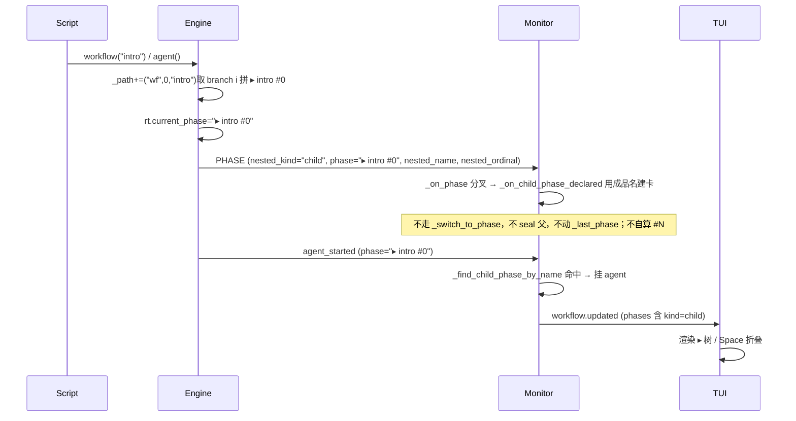
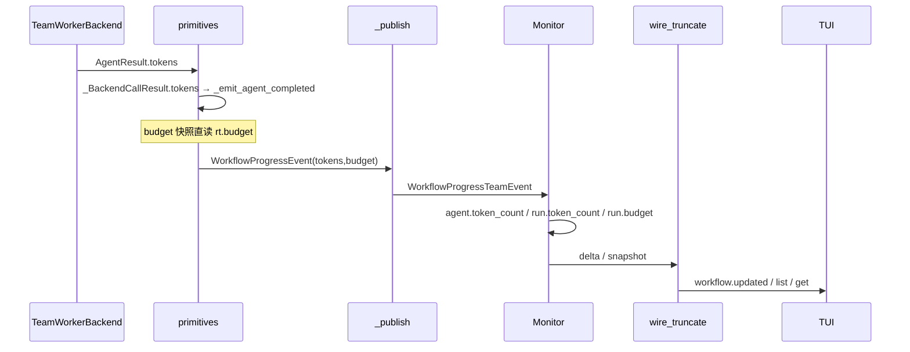

# jiuwen TUI 嵌套 Workflow 与 Budget 可观测性

## 1. 背景与问题 (Why)

SDD-0009 已让 TUI 在 `/swarmflows` 与主界面 `h` 路径上正确承接有状态算子（`human` /
`human_session` / `agent_session`）。与此同时，引擎侧早已具备两类能力，但**运行态在 TUI
里几乎不可见**：

1. **嵌套 `workflow()`**（SDD-0004 已加固「禁递归、放行同层并发」）：父脚本可内联调子脚本；
   子流内 agent 的 journal 路径带 `("wf", k, name)` 段。引擎**不在 `workflow()` 入口发 child
   phase 声明**，Monitor 也无独立路径建卡 → `/swarmflows` 把子流节点混在父 phase 里，并发同名子流无法区分。

2. **Leader 级 Token Budget**（`BudgetLedger` + `SwarmflowBudgetRail`）：按真实
   `usage_metadata` 记账，撞顶抛 `BudgetExhausted`（不可 resume）。但 progress 事件**没有**
   token/budget 字段；Monitor 侧 `token_count` 仅 reserved 未填；撞顶甚至发不出结构化
   `workflow_failed` → TUI 既看不到用量，也看不到「Team 还剩多少」，耗尽时还可能停在
   `running`。

**用户场景**：一次 onboarding 父流里 `parallel` 扇出三个同名 `workflow("intro")`，同时配了
`swarmflow_budget=500000`。运维打开 `/swarmflows` 期望看到：

- 三张 `▸ intro #0` / `#1` / `#2` 子卡，各自挂着子流 agent；
- 本 run 已烧多少 token，以及 Team 共享池 spent/total；
- 快撞顶时有预警，撞顶后明确「不可 resume」。

**现状**：只能看到扁平 phase 树与空的 `token_count`；Budget 完全缺席。Claude Code 同类产物
（`workflows/wf_*.json`）已用 child phase + per-agent `tokens` + run `totalTokens` 证明这套
呈现可行——本设计对齐其形态，并额外补上我们 Leader 共享账本的 Team budget 层。

**为何现在做**：有状态算子闭环已交付；嵌套与 Budget 是脚本作者与运维的下一块可观测缺口；
需求侧多轮审查后方案已收敛（嵌套 B′、Budget C），需固化为可评审的跨仓设计。

> **诚实边界（撰写时代码事实）**：本特性描述的 child PHASE 声明、token/budget 六跳上送、
> BudgetExhausted 终态补发**均未实现**。下文「须」均为落地目标，不是现状。

## 2. 目标与非目标

**目标**

- `/swarmflows` 能区分父 phase 与嵌套子流：引擎发 `▸ {name}` child phase 声明；并发同名用 `#0`/`#1`/`#2`。
- 子流节点按 `agent_id` 中的 `wf` / `par` / `pipe` 前缀挂到正确 child phase。
- run / agent 展示**真实** token 用量；已配置预算时同时展示 Leader 池 spent/total（文案标
  **Team budget**）。
- child phase 可本地折叠/展开；预算剩余 ≤20% 水位线预警；耗尽阻断且标明不可 resume。
- depth-cap skip（超深 `workflow()`）以 log 行可见。
- **不新增** RPC / `command.workflows` action / `ProgressKind`；推送与 list/get **同源字段**。

**非目标**

- 主聊天灌入整棵嵌套树（会话层 ≠ 运行层，对齐 Claude Code）。
- 独立 `subworkflows[]` 平行协议或 `subworkflow_*` 事件族。
- TUI 热改 `swarmflow_budget`；单 child cancel。
- 无 provider usage 时用文本长度估算充 token。
- 为零 agent 子流（仅 `phase()`/`log()`）补独立 child 卡片或子流 started/finished 信号。

## 3. 术语与上下文

| 术语 | 含义 |
|---|---|
| child phase | 引擎在 `workflow()` 入口发 `PHASE` 声明（`nested_kind="child"`）建的嵌套 phase；展示名 `▸ {name}` |
| branch 段 | `parallel` 的 `("par", k, i)` / `pipeline` 的 `("pipe", k, i, s)`；并发同名子流的真正区分位 |
| Team budget | Leader 单例 `BudgetLedger` 的 spent/total；多 run 共享，文案必须与 run 累加用量区分 |
| 六跳管线 | progress 新字段从引擎到 TUI 必须经过的 6 个拷贝/schema 点（§4.2）；缺一跳则静默丢字段 |
| 结果回路 | per-agent tokens 不能在 emit 时读 rail（已销毁），须经 `AgentResult.tokens` → 引擎内部结果结构 → `_emit_agent_completed` |
| reserved `token_count` | Monitor / wire 已有键但值恒 `None`；本特性负责填值，不新造 run 级用量键名 |

前置阅读：SDD-0004（引擎嵌套语义）、SDD-0009（TUI `/swarmflows` 与 HITL 基线）。

## 4. 方案设计 (What / How)

### 4.1 总体架构

三层分工：引擎发 child PHASE 声明与补字段；jiuwenswarm Monitor 据声明建卡并透传；TUI 渲染与交互。

```
agent-core (openjiuwen.agent_teams.workflow)
────────────────────────────────────────────
  workflow() 入口发 PHASE(child) + 设 rt.current_phase ──► child 声明直达 Monitor
  workflow() 写 _path += ("wf",k,name)     ──► agent_id = json.dumps(path)
  depth-cap → progress LOG（改路由）       ──► 可见 skip
  AgentResult.tokens + rt.budget 快照      ──► agent_completed 附带
  BudgetExhausted → 补发 WORKFLOW_FAILED   ──► 结构化 failed

           │ WorkflowProgressEvent / TeamEvent
           ▼
jiuwenswarm WorkflowMonitorHandler / WorkflowRunState
────────────────────────────────────────────────────
  _on_phase 分叉 → _on_child_phase_declared 建卡（不走 _switch_to_phase，不 seal）
  agent_started 先查 child 卡 → 命中直挂，未命中走 _switch_to_phase（author phase）
  写 agent/run token_count；写 run.budget
  delta / to_workflow_run_dict / wire KEEP_KEYS 同源 emit

           │ workflow.updated / command.workflows
           ▼
TUI (/swarmflows)
────────────────
  ▸ child 缩进树 + Space 折叠
  节点 … tok · run 累加 · team spent/total
  ≤20% warning · exhausted overlay · B 只读详情
```

**仓分工**

| 能力 | 主要改动 |
|---|---|
| child PHASE 声明 + 建卡（不 seal） | **agent-core** 发声明 + **jiuwenswarm** `_on_child_phase_declared`（+ TUI 渲染） |
| tokens / budget 上送 + depth-cap LOG + 耗尽终态 | **agent-core** + Monitor + wire_truncate + TUI |
| 折叠 / 水位线 / overlay / `B` | **TUI**（`B`/`Space` 注册可重绑 keymap） |

### 4.2 数据流与时序

#### 4.2.1 嵌套子流 → child phase

```
脚本                    引擎                                    Monitor                          TUI
────                    ────                                    ───────                          ───
phase("Team Intro")
  agent(A) ──────────► agent_started                          _switch_to_phase 挂父 "Team Intro"

workflow("intro")       _path += ("wf",0,"intro")
                        取 _path branch i=0 → 拼 "▸ intro #0"
                        rt.current_phase = "▸ intro #0"
  └─ 发 PHASE(child, phase="▸ intro #0") ──────────────────► _on_phase 分叉
                                                                 _on_child_phase_declared:
                                                                   用成品名建卡(kind=child, 空卡)
                                                                   不走 _switch_to_phase / 不 seal 父

  agent(G) ───────────► agent_started(phase="▸ intro #0") ─► _find_child_phase_by_name 命中 ▸ intro #0
                                                                 挂 G（直接挂已建 child 卡）

parallel×3 同名 intro   各 branch i=0/1/2 → 拼 "▸ intro #0/#1/#2"
  … ─────────────────► 三条 PHASE 声明                          建三张卡（直接 append，不复用同名片）
```



**引擎编号与 Monitor 登记**

| 主题 | 规则 |
|---|---|
| 作用域计数（`_seq`） | 同层 `agent` / `parallel` / `pipeline` / `workflow` 共用计数器，从 0 递增；进入并行支路、pipeline stage 或子 `workflow()` 时**重置为 0** |
| `agent_id` 路径段 | `("call", k)` agent；`("par", k_p, i)` 并行第 `i` 支（`k_p` 为父层 parallel 序号）；`("pipe", k_p, i, s)` pipeline；`("wf", k, name)` 子流（`k` 为**子作用域内**序号） |
| 并发同名子流 disambig | 各支 wf 段常同为 `("wf", 0, name)`（子作用域重置）；**引擎**在 `workflow()` 入口取当前 `_path` 的**最深一层** branch 段 `i`（`("par",k_p,i)` 的 `i` / `("pipe",k_p,i,s)` 的 `i`，丢 `s`——同一 item 各 stage 串行不并发撞 corr）作 `#N`，**直接拼成品名** `▸ {name} #{N}` 设入 `rt.current_phase` 与 PHASE 声明 `phase` 字段；同 run 内唯一、确定（不靠到达顺序）。子流成品名**只用纯 `#N`**（展示层，干净、对齐 §4.4 示意）；唯一性的彻底闭合由 `correlation_id` 侧的 `_branch_disambig` 负责（见 §4.2.4），二者分离。
| Monitor 建卡 | 收 child PHASE 声明即 `_append` 一张新卡，**不复用同名片**；**直接用引擎给定的成品名**（不再自算 `#N`）；身份由声明事件保证，不靠 agent_id 解析 |
| TUI 展示 | `▸ {name}`（无 branch / 直接嵌套）或 `▸ {name} #{N}`（并发）；`#N` 由引擎据 branch `i` 拼定，确定、不随到达顺序漂移 |

例：三路并行 `workflow("intro")` → 引擎各取 branch `i=0/1/2` → 三条 PHASE 声明成品名
`▸ intro #0` / `▸ intro #1` / `▸ intro #2`；Monitor 直接用此名建三张卡。

**覆盖口径**：子流范围内无论 `agent(phase=…)` 还是子脚本自调 `phase("x")`，对外只呈现
一张（或并发多张）`▸ {name} #{N}` 卡；子脚本自定 phase 名不泄漏。引擎在 `workflow()` 入口设
`rt.current_phase="▸ {name} #{N}"`（无 branch 时退化为 `▸ {name}`），子流内 agent / human 的
`progress.phase` 与 `correlation_id` 的 phase 段均自动取此值（→ 同 run 内 `correlation_id` 天然唯一，
`chat.swarmflow_reply` 路由不歧义），Monitor 直接挂 child 卡。
作者 `phase("x")`（非子流内）发的 PHASE 事件仍 `return None` 不建卡。

#### 4.2.2 Token / Budget 六跳上送

Monitor **不能**直读引擎账本，只能走 progress 通道。新字段必须逐跳同步：

```
H0  WorkflowProgressEvent (+tokens, +budget)
H1  tool_swarmflow._publish 显式逐字段拷贝
H2  WorkflowProgressTeamEvent schema 同步字段
H3  WorkflowMonitorHandler._extract_progress（fallback 逐字段 copy 须补）
H4  WorkflowProgress pydantic（否则 extra=ignore → 恒 None）
H5  WorkflowRunState 写入 + _build_*_delta / to_workflow_run_dict emit
    + wire_truncate 两套 KEEP_KEYS / collapse 字段表保留
```



**取数路径差异**

| 字段 | 取数 | 备注 |
|---|---|---|
| `tokens` | 结果回路：`AgentResult.tokens` ← rail `call_tokens` | emit 时 rail 已销毁；cache-hit / 旧 journal → `None`（接受） |
| `budget` | emit 时直读 `rt.budget` | `remaining` 须调 `remaining()` 方法固化为 wire 字段 |

#### 4.2.3 Budget 耗尽终态

```
rail force-finish → 下一 agent 入口 _check_budget
  → 抛 BudgetExhausted(BaseException)
  → 〔现状〕_exec_loaded 的 except Exception 抓不到
       → 无 WORKFLOW_FAILED → Monitor 停在 running
  → 〔目标〕补 except BudgetExhausted 分支发 WORKFLOW_FAILED
       + 该帧自带 budget=_budget_snapshot(rt.budget)
       + 末帧 budget.exhausted=true
       → Monitor: _on_workflow_failed 写 self.budget
       → TUI：status=failed && exhausted → 阻断 overlay
```

撞顶时正在跑的 agent 被 rail force-finish，**不走 `_emit_agent_completed`**，不产生
`agent_completed`/`agent_failed` 帧——故 `exhausted=true` **由 `WORKFLOW_FAILED` 帧自带**，
不依赖任何 agent 完成帧。该帧在 Monitor 写入后 `budget` **冻结**于撞顶瞬间：本 run 已终态，
不再有 agent 边界帧刷新 budget；兄弟 run 继续烧 token 不会回写到已终态 run 的卡片（
`spent` 停在撞顶那一刻，`exhausted` 仍 true）。

#### 4.2.4 correlation_id 唯一性修复（并发同名 human 回复路由）

**解决的场景问题**：`correlation_id = {phase}:{label}:{turn}`（`primitives.py:_correlation_id`）
是 `chat.swarmflow_reply` 的路由键，也是 backend `_pending_human` future 的注册 key
（`avatar_session_backend._await_human_reply`）。其唯一性在三种写法下成立/不成立：

| 脚本写法 | corr 唯一？ | 回复错位？ | 说明 |
|---|---|---|---|
| `human_session` 多轮 `send` | ✅ 唯一 | 否 | `turn = len(_history)//2` 随每轮 send 递增 |
| for 循环串行同名 `human()` | ❌ 重名 | 否 | 重名但串行互斥，`_pending_human` 同 key 串行注册/清除，不覆盖 |
| 并发同名 human **跨子流** | ✅ 唯一 | 否 | B1 让 `rt.current_phase` 含 `#N`（`▸ review #0` vs `▸ review #1`），phase 段不同 |
| 并发同名 human **同 phase 内**（`parallel` 扇出） | ❌ 重名 | **是** | 同 phase 同 label 同 turn（各 session history 空），三路同时注册 future → dict 同 key 覆盖 → 后两路永唤不醒 |

**盲区**：最后一行——同一 phase 内 `parallel`/`pipeline` 扇出多个同 label 一次性 `human()`
（或同 label 的多个 `human_session`），三路 corr 都是 `{phase}:{label}:0`，backend
`_pending_human[corr]` 被后注册者覆盖，回复只命中最后一个 future，前两路超时 `agent_failed`。

**修复方案**：corr 的 phase 段额外拼 branch disambig，`turn`/`label` 语义与显示不动。

```
老：{phase}:{label}:{turn}                  review:reviewer:0
新：{phase#disambig}:{label}:{turn}          review#p0:reviewer:0    (单层 parallel 并发 branch 内)
                                           review#i0s1:reviewer:0  (单层 pipeline 并发 branch 内)
                                           review#p0.i0s1:reviewer:0  (嵌套：par 内套 pipe)
                                           review:reviewer:0      (串行/无 branch，退回原值)
```

- `disambig` 由新增 `_branch_disambig(path)` **遍历 `_path` 全部 branch 段、逐段编码、用 `.` 串联**：
  `("par",k_p,i)` → `p{i}`；`("pipe",k_p,i,s)` → `i{i}s{s}`（保留 `s` 以定位 stage，虽对并发唯一性冗余——
  同一 item 各 stage 串行）；其他段（`call`/`wf`）跳过。引擎在 `_correlation_id` 算时直接读 `_path.get()`；
  **串联所有 branch 段**使唯一性闭合到任意嵌套深度（不仅单层扇出），同 run 内唯一、resume-stable
  （`_path` 由 journal 重放重建，见下）。
- **串行/无 branch**（顶层 author phase 内、或非 parallel 的 human）：`_path` 无 branch 段 →
  disambig 空 → corr 退回 `{phase}:{label}:{turn}`，**与老格式完全一致，向后兼容**。
- **与子流分工**：子流成品名 `rt.current_phase` 用纯 `#N`（`▸ review #0`，展示层，干净）；跨子流并发
  同名 human 已因 `#N` 唯一。corr 的 disambig（带前缀串联）补的是**同 phase 内**并发（非子流），且当
  human 处于子流内时，corr 的 phase 段先取 `opts["phase"]`=`▸ review #0`（成品名）再拼 `#p0` →
  `▸ review #0#p0:reviewer:0`（成品名 `#0` 区分子流、disambig `#p0` 区分同 phase 内 branch）。
- **不动 `rt.current_phase`/`opts["phase"]`**：`_correlation_id` 算 corr 时拼 disambig，但
  `rt.current_phase`/`opts["phase"]` 不变。即 **corr 的 phase 段 ≠ 展示名**——该不变量
  经核（见下）无别处依赖，破坏零副作用。
- **分隔符 `.` 安全性已核**（见下依赖面表）：无任何消费方按 `#` 或 `.` 切分 corr；corr 在两个仓里
  全程被当不透明整串存取/比对/作 dict key；冒号数恒为 2（`{phase}#{disambig}:{label}:{turn}`），
  `#` 与 `.` 不引入冒号 → 冒号计数与取最后段的逻辑不受影响。

**resume / cache 命中影响**（已核 `journal.py` / `primitives.py`）：

- **journal key 不含 corr**：`ks = key_str(_path + (("call",n),))`（agent_id），cache 走 `get_cached(ks, sig)`，
  与 corr 无关 → 改 corr 不影响命中。
- **`call_signature` 用 `opts["phase"]` 不用 corr**：`sig = sha256(prompt + {label,phase,model} + schema + history)`
  （`journal.py:call_signature`），`phase` 取 `opts["phase"]` = `rt.current_phase`（不含 disambig）→
  signature 不变 → 命中不变。
- **并发同名 human 三路 cache 不串**：三路 `agent_id`（`ks`）因 branch 段 `i` 不同而不同
  （`[["par",k,0],["call",0]]` vs `[["par",k,1],["call",0]]`），journal 按 `ks` 索引 → 各自独立命中。
- **resume 重建 disambig**：resume 重放时 `_correlation_id` 在 `get_cached` 前被重新调用（`send()` 入口），
  从重放重建的 `_path` 提取全部 branch 段 → 多段串联 disambig 与中断前逐字一致（`_path` 由 parallel/pipeline
  重放恢复，含所有嵌套 branch 段）。

**不变量依赖面（已核，破坏零副作用）**：

| 消费方 | 是否反解 corr phase 段 / 假设 = rt.current_phase | 影响 |
|---|---|---|
| 前端 `parseTurnFromCorrelationId`（`workflows.ts:426`） | 取 `split(":")` **最后一段**作 turn，不碰 phase 段 | 无 |
| `parse_swarmflow_human_reply_target`（`schema/events.py:76`） | 数冒号区分 legacy/run-scoped；`#` 非冒号，冒号数仍 2 | 无 |
| Monitor `_resolve_agent`（`workflow_state.py:460`） | 按 corr **整体字符串**比对，不反解 phase 段 | 无 |
| backend `_pending_human`（`avatar_session_backend.py:531`） | dict key 用 corr 整体字符串 | 无（corr 唯一即可） |
| `call_signature`（`journal.py:71`） | 读 `opts["phase"]`，**不读 corr** | 无 |

### 4.3 接口与数据模型

本节列出**将修改的结构与接口**（按仓）。不新增 RPC / `ProgressKind` /
`command.workflows` action；只做字段增量与既有函数行为修补。

#### 4.3.1 跨仓共用 wire 形状

**Budget 快照**（挂在 progress 事件与 `workflow.budget` 上，形状相同）：

```json
{
  "total": 500000,
  "spent": 412340,
  "remaining": 87660,
  "scope": "leader",
  "exhausted": false
}
```

| 字段 | 类型 | 来源 |
|---|---|---|
| `total` | `int \| null` | `BudgetLedger.total`（未配天花板为 `null`） |
| `spent` | `int` | `BudgetLedger.spent` |
| `remaining` | `int \| null` | **须调** `BudgetLedger.remaining()` 固化（不是属性） |
| `scope` | `"leader"` | 常量，标明共享池 |
| `exhausted` | `bool` | `BudgetLedger.exhausted` |

`total=null` 时 UI：`Team budget spent=… (unbounded)`；`exhausted` 恒 false。

**Phase child 元数据**（引擎 PHASE 声明事件携带，Monitor 建卡写入 / TUI 渲染）：

| 字段 | 类型 | 含义 |
|---|---|---|
| `kind` | `"child" \| null` | 引擎在 `workflow()` 入口发 PHASE 声明时标 `"child"`；缺省 = 脚本作者 `phase()` |
| `nested_ordinal` | `int \| null` | 引擎 wf 段 `k`（声明事件携带） |
| `nested_name` | `str \| null` | 子脚本 META name（声明事件携带） |

展示名仍用 `name`（含 `▸` / `#N`，由引擎据 branch `i` 拼定，Monitor 直接用，不自算）。

---

#### 4.3.2 agent-core（`openjiuwen/agent_teams`）— 将改结构 / 接口

##### A. 数据结构（schema / dataclass）

| 符号 | 路径 | 改动 |
|---|---|---|
| `WorkflowProgressEvent` | `workflow/engine/progress.py` | **新增**可选字段：`tokens: int \| None = None`、`budget: dict \| None = None`、`nested_kind: str \| None = None`（`"child"`）、`nested_ordinal: int \| None = None`、`nested_name: str \| None = None`。`ProgressKind` **不增** kind（child 声明复用 `PHASE`）。 |
| `WorkflowProgressTeamEvent` | `schema/events.py` | **同步新增** `tokens` / `budget` / `nested_kind` / `nested_ordinal` / `nested_name`（pydantic `Optional`），否则 `_publish` 构造时被 `extra=ignore` 丢掉。 |
| `_BackendCallResult` | `workflow/engine/primitives.py` | **新增** `tokens: int \| None = None`，承接 `AgentResult.tokens`。 |
| `AgentResult` | `workflow/engine/backends/base.py` | **不改签名**（已有 `tokens: int = 0`）；继续由 `TeamWorkerBackend` 从 `budget_rail.call_tokens` 填充。 |

落地后 `agent_completed` 事件字段示意：

```python
WorkflowProgressEvent(
    kind=ProgressKind.AGENT_COMPLETED,
    phase=...,
    label=...,
    outcome=...,
    agent_id=...,
    tokens=12700,           # 新增
    budget={                # 新增
        "total": 500000,
        "spent": 412340,
        "remaining": 87660,
        "scope": "leader",
        "exhausted": False,
    },
)
```

##### B. 函数 / 方法行为

| 符号 | 路径 | 改动 |
|---|---|---|
| `_emit_agent_completed(rt, opts, outcome_text, *, agent_id=...)` | `primitives.py` | 增参或内部读取：写入 `tokens`（结果回路）+ `_budget_snapshot(rt.budget)`；4 个调用点透传。 |
| `_emit_agent_failed(...)` | `primitives.py` | **建议对称**附带 `tokens`/`budget`（失败节点也可展示用量）。 |
| `_attempt_calls(...)` | `primitives.py` | 取消「忽略 `res.tokens`」；回填 `_BackendCallResult.tokens`。 |
| `workflow(name_or_path, args=None)` | `primitives.py` | ① 入口取当前 `_path` 的**最深一层** branch 段 `i`（`("par",k_p,i)` 的 `i` / `("pipe",k_p,i,s)` 的 `i`，丢 `s`；无 branch 则无 `#N`），拼成品名 `▸ {name} #{N}`（或 `▸ {name}`）；② 发 child PHASE 声明：`rt.progress_sink(WorkflowProgressEvent(kind=PHASE, phase=<成品名>, nested_kind="child", nested_name=name, nested_ordinal=k))`；③ 设 `rt.current_phase = <成品名>`，使子流内 agent / human 的 `progress.phase` 与 `correlation_id` 的 phase 段均自动取此值（→ corr 的 phase 段含成品名 `#N`，跨子流并发同名 human 已天然唯一；Monitor 直接挂 child 卡，不走 `_switch_to_phase`）。④ depth-cap 分支：`rt.log_sink(...)` → `rt.progress_sink(WorkflowProgressEvent(kind=LOG, ...))`。**注**：子流成品名只用纯 `#N`；同 phase 内并发（非子流）的唯一性由 `_correlation_id` 的 `_branch_disambig` 补（见下行 + §4.2.4）。 |
| `_correlation_id(opts)` | `primitives.py` | **改 phase 段拼 disambig**（见 §4.2.4）：phase 段从 `opts.get("phase")` 改为 `opts.get("phase") + ("#"+disambig if disambig else "")`，`disambig` 由新增 `_branch_disambig(_path.get())` **遍历 `_path` 全部 branch 段**（`("par",k_p,i)` → `p{i}`、`("pipe",k_p,i,s)` → `i{i}s{s}`，其他段跳过）**用 `.` 串联**（无 branch 则空）。`turn`/`label` 不动。**不动 `rt.current_phase`/`opts["phase"]`**（`call_signature` 仍读原值，cache 命中不变）。串行/无 branch 退回老格式。子流内 human 时 `opts["phase"]` 已是成品名 `▸ review #N`，corr 形如 `▸ review #N#p0:reviewer:0`（成品名 `#N` 区分子流、disambig `#p0` 区分同 phase 内 branch）。 |
| `_exec_loaded(...)` | `workflow/engine/runner.py` | **新增** `except BudgetExhausted`（或覆盖 BaseException 的预算分支）补发 `WORKFLOW_FAILED`，**该帧自带 `budget=_budget_snapshot(rt.budget)`**（`rt.budget` 此时点可达，`exhausted` 已 true）；现仅 `except Exception`，抓不到 `BudgetExhausted`。 |
| `SwarmflowTool._publish(progress)` | `workflow/tool_swarmflow.py` | 构造 `WorkflowProgressTeamEvent` 时**显式拷贝** `tokens`/`budget`/`nested_kind`/`nested_ordinal`/`nested_name`（现为逐字段列举，漏列即丢）；`phase` 字段照常透传（成品名在引擎已拼好）。 |
| `TeamWorkerBackend.run` | `workflow/backends/team_worker_backend.py` | **通常不改**（已写 `AgentResult.tokens=budget_rail.call_tokens`）；作为 tokens 数据源保持。 |
| `agent_configurator` 建 `BudgetLedger` | `agent/agent_configurator.py` | **不改接口**；继续按 `swarmflow_budget` 注入 Leader 单例。 |

> **Requirement:** 引擎 SHALL 在 `agent_completed`（及建议 `agent_failed`）携带
> `tokens` 与 `budget`；SHALL NOT 新增 `ProgressKind`。
> **Scenario:** WHEN agent 完成 THEN 下游 Monitor 同帧能读到两字段。

> **Requirement:** 引擎 SHALL 在 `workflow()` 入口取 `_path` 最深一层 branch 段 `i` 拼**成品名**
> `▸ {name} #{N}`（无 branch 则 `▸ {name}`），发 `PHASE` 声明（`nested_kind="child"` +
> `nested_name` + `nested_ordinal`，`phase` 字段带成品名），并设 `rt.current_phase` 为该成品名；
> SHALL NOT 新增 `ProgressKind`（复用 `PHASE`）；SHALL NOT 把 `#N` 拼接留给 Monitor。
> **Scenario:** WHEN 并发同名 `workflow("intro")` 三路 THEN 各自成品名 `▸ intro #0/#1/#2`、
> `correlation_id` 的 phase 段含该 `#N`（跨子流唯一），`chat.swarmflow_reply` 路由不歧义；
> Monitor 收声明直接用成品名建卡，不触发父 phase seal。

> **Requirement:** 引擎 SHALL 在 `_correlation_id` 的 phase 段拼 branch disambig
> （`{phase}#{disambig}`，`disambig` 为 `_path` 全部 branch 段的 `.` 串联，无 branch 退回 `{phase}`），
> 使同 phase 内并发同名 human 节点 `correlation_id` 唯一；SHALL NOT 改 `turn`/`label` 段语义；
> SHALL NOT 动 `rt.current_phase`
> 或 `opts["phase"]`（保 cache 命中）。
> **Scenario:** WHEN 同 phase 内 `parallel` 扇出三个同名 `human(label="reviewer")` THEN 三路
> `correlation_id` 分别含 `#p0/#p1/#p2`，`_pending_human` future 不覆盖，回复各达其路。

> **Requirement:** 引擎 SHALL 将 depth-cap skip 改走 `progress_sink` 的 `LOG`。
> **Scenario:** WHEN 嵌套深度 > 1 THEN run `logs` 出现 skip 文案。

> **Requirement:** 引擎 SHALL 在 `BudgetExhausted` 时发出结构化 `WORKFLOW_FAILED`。
> **Scenario:** WHEN 撞顶 THEN Monitor 能将 run 置 `failed`（而非停在 `running`）。

---

#### 4.3.3 jiuwenswarm — 将改结构 / 接口

##### A. Monitor 状态模型（`agents/harness/team/handlers/workflow_state.py`）

| 符号 | 改动 |
|---|---|
| `WorkflowProgress` | **新增** `tokens: Optional[int] = None`、`budget: Optional[dict] = None`、`nested_kind: Optional[str] = None`、`nested_ordinal: Optional[int] = None`、`nested_name: Optional[str] = None`（与 TeamEvent 对齐；否则 pydantic `extra=ignore` → 恒 None）。 |
| `WorkflowAgentState` | **填值**：已有 reserved `token_count`；`_finalize_agent` 从 `progress.tokens` 写入。结构字段不增。 |
| `WorkflowPhaseState` | **新增** `kind: Optional[str] = None`（`"child"`）、`nested_ordinal: Optional[int] = None`、`nested_name: Optional[str] = None`（由 PHASE 声明事件写入）；`to_dict()` 经 `model_dump(exclude_none=True)` 自然带出。 |
| `WorkflowRunState` | **新增** `budget: Optional[dict] = None`；**填值**已有 `token_count`（`= sum(agents)`）。私有态可增：child 卡查找辅助（实现细节，不进 wire）。 |

##### B. Monitor 方法

| 符号 | 改动 |
|---|---|
| `_on_phase(progress)` | **改：分叉**。`progress.nested_kind == "child"` → 调 `_on_child_phase_declared` 建卡；否则仍 `return None`（作者 `phase()` 不建卡，沿用现状）。 |
| `_on_child_phase_declared(progress)` | **新增**。直接用引擎给定的成品名 `progress.phase`（已含 `▸ {name}` / `▸ {name} #{n}`，见 §4.2.1）建卡，**Monitor 不再自算 `#N`**；`_append` 一张 `WorkflowPhaseState(name=progress.phase, kind="child", nested_ordinal=…, nested_name=…, status="running")`，**不复用同名片**；**不调 `_switch_to_phase`、不动 `_last_phase`、不 seal 任何前任**；推 delta（空 child 卡）。 |
| `_on_agent_started(progress)` | **改：先查 child 卡**。`_find_child_phase_by_name(progress.phase)` 命中 → 直接挂 agent，不走 `_switch_to_phase`；未命中 → 走 `_switch_to_phase`（普通 author phase，保留 seal 语义）。 |
| `_switch_to_phase(phase_name)` | **回归原语义**，只服务 author phase；不为 child 改 seal（child 经独立路径建卡，绕开本方法）。 |
| `_on_agent_completed` / `_finalize_agent` | 写 `agent.token_count`；累加 `self.token_count`；写 `self.budget = progress.budget`。 |
| `_on_agent_failed` | 若事件带 tokens/budget，对称写入。 |
| `_on_workflow_failed` | 写 `self.budget = progress.budget`（耗尽终态帧自带 budget，见 §4.2.3）；写入后冻结，不再随兄弟 run 更新。 |
| `_build_phase_delta` / `_build_phases_delta` / `_build_terminal_delta` | **emit** `token_count` + `budget`（现 phase/terminal delta **无**这两键；`to_workflow_run_dict` 已有 `token_count` 但无 `budget`）。 |
| `to_workflow_run_dict` | **新增** `result["budget"] = self.budget`。 |

##### C. Monitor Handler（`workflow_monitor_handler.py`）

| 符号 | 改动 |
|---|---|
| `_extract_progress(event)` | dict/`model_dump` 路径靠字段扩展即可；**object fallback 逐字段 copy** 须补 `tokens`/`budget`，否则稀有路径丢字段。 |
| `_build_updated_event(...)` | 无独立 schema；依赖 `WorkflowRunState` delta 已含新键。 |

##### D. Wire / RPC 载荷（`server/wire_truncate.py`；RPC 面不增 action）

| 符号 | 改动 |
|---|---|
| `_WORKFLOW_SNAPSHOT_KEEP_KEYS` | **加入** `"budget"`（已有 `token_count`）。 |
| `_WORKFLOW_LIST_SUMMARY_KEEP_KEYS` | **加入** `"budget"`（列表行 Team 水位依赖）。 |
| `_workflow_agent_for_collapse` | **保留** `token_count`（现 collapse 丢该键）。 |
| phase collapse 显式字段表（`_collapse_oversized_workflow_snapshot_item` 内） | **保留** `kind` / `nested_ordinal` / `nested_name`。 |
| `_build_workflow_list_payload` / `_build_workflow_detail_payload` | 行为随 KEEP_KEYS / snapshot 字段自动；须回归确认推/拉同源。 |

`command.workflows` 仍仅 `list` / `get` / `get_human_prompt`——**不新增** `get_budget`。

##### E. TUI（`channels/tui/frontend`）

| 符号 | 路径 | 改动 |
|---|---|---|
| `WorkflowPhase` | `src/core/workflows.ts` | **新增** `kind?: "child" \| null`、`nested_ordinal?`、`nested_name?`。 |
| `WorkflowRun` | 同上 | **新增** `budget?: { total, spent, remaining, scope, exhausted } \| null`；已有 `token_count`。 |
| `WorkflowAgent` | 同上 | 已有 `token_count`；渲染 completed 行 `… tok`。 |
| `mergeWorkflowRun` / `mergeWorkflowPhase` | 同上 | 合并时保留 child 三字段与 `budget`（勿被旧快照抹掉）。 |
| `SwarmWorkflows` keymap | `keybindings/actions.ts` + `defaultBindings.ts` | **注册**可重绑 `swarm:budget`（`B`）、折叠用 `Space`（若走 keymap 而非硬编码）。 |
| `/swarmflows` 渲染 | `app-screen` 等相关 | `▸` 树、水位线、exhausted overlay、Team 文案。 |

---

#### 4.3.4 三路径统一字段契约

> **Requirement:** 系统 SHALL 在 `workflow.updated`、`command.workflows list`、
> `command.workflows get` 三条路径上**同源**返回下表字段。
> **Scenario:** WHEN 任一路径缺失 `budget` / `token_count` / child 三字段
> THEN 前端渲染缺数或推拉不一致。

| wire 字段 | 写入点（落地后） |
|---|---|
| `phase.kind` / `nested_ordinal` / `nested_name` | `WorkflowPhaseState` ← `_on_child_phase_declared`（由 PHASE 声明事件） |
| `agents[*].token_count` | `WorkflowAgentState.token_count` ← `_finalize_agent` |
| `workflow.token_count` | `WorkflowRunState.token_count`（键已存在，填 `sum(agents)`） |
| `workflow.budget` | `WorkflowRunState.budget`（新字段 + delta/KEEP_KEYS emit） |

### 4.4 关键流程

> 下文各流程的 `workflow` delta 字段集与 §4.3.4 三路径统一契约一致：推送（`workflow.updated`）、
> `list`、`get` 同源返回 `phase.kind`/`nested_ordinal`/`nested_name`、`agents[*].token_count`、
> `workflow.token_count`、`workflow.budget`。报文以 `workflow.updated` 的 `workflow` 字段为例；
> `list` 行为 summary（+ `detail_pending`）、`get` 为全量，字段集对齐。

#### 流程 A：并发同名子流可观测

1. 用户打开 `/swarmflows` → list。
2. 父流 `parallel` 扇出三个 `workflow("intro")`。
3. 每个 `workflow()` 入口取 branch `i=0/1/2` 拼成品名 `▸ intro #0/#1/#2` → 发 child PHASE 声明 → Monitor 用成品名建三张 child 卡（先于首个 agent，空卡）。
4. 各子流 `agent_started` 到达（`phase="▸ intro #0"` 等）→ 命中已建 child 卡，直接挂 agent。
5. 详情树：

```
onboarding · running · …
▼ intro（父脚本 phase，kind=null）
▼ ▸ intro #0 · child
  ◐ greeter
▼ ▸ intro #1 · child
  ◐ greeter
▼ ▸ intro #2 · child
  …
```

6. `Space` 折叠选中 child（本地 flag，不回写）。

**时序差异（vs 旧合成方案）**：child 卡出现时机从「首个 agent 同帧」提前到「`workflow()` 入口」；
前端需能处理「先空 child 卡、后挂 agent」的增量序列（非「卡与首个 agent同帧」）。字段形状不变。
父 phase 不被 seal——child 经独立路径建卡，绕开 `_switch_to_phase`，无 §3.3.2 旧 seal 风险。
`#N` 由引擎据 branch `i` 拼定（确定、不随到达顺序漂移），Monitor 直接用成品名，不自算 `#N`。

**JSON 报文（child PHASE 声明先到 → 空卡；agent_started 后到 → 挂 agent）**：

child PHASE 声明帧（三条并发各一条，先于 agent；`agents: []` 空卡）：

```json
{
  "event_type": "workflow.updated",
  "session_id": "sess_7f3a2c1b9e0d",
  "workflow": {
    "id": "wf_a1b2c3d4e5f6", "name": "onboarding", "status": "running",
    "agent_count": 0, "completed_agent_count": 0,
    "started_at": "2026-08-01T10:00:00.000+08:00",
    "phases": [
      { "id": "intro-1", "name": "intro", "status": "running", "agent_count": 0, "completed_agent_count": 0, "kind": null, "nested_ordinal": null, "nested_name": null, "agents": [] },
      { "id": "intro-2", "name": "▸ intro #0", "status": "running", "agent_count": 0, "completed_agent_count": 0, "kind": "child", "nested_ordinal": 0, "nested_name": "intro", "agents": [] }
    ]
  }
}
```

agent_started 帧后到（命中 `▸ intro #0` 卡挂上 greeter；`phase` 已是引擎拼好的成品名）：

```json
{
  "event_type": "workflow.updated",
  "session_id": "sess_7f3a2c1b9e0d",
  "workflow": {
    "id": "wf_a1b2c3d4e5f6", "name": "onboarding", "status": "running",
    "agent_count": 1, "completed_agent_count": 0,
    "started_at": "2026-08-01T10:00:00.000+08:00",
    "phases": [
      { "id": "intro-2", "name": "▸ intro #0", "status": "running", "agent_count": 1, "completed_agent_count": 0, "kind": "child", "nested_ordinal": 0, "nested_name": "intro", "agents": [
        { "id": "[[\"par\",5,0],[\"wf\",0,\"intro\"],[\"call\",0]]", "name": "greeter", "status": "running", "kind": "agent", "node_type": "agent", "token_count": null, "started_at": "2026-08-01T10:00:01.000+08:00", "activity": [] }
      ]}
    ]
  }
}
```

> 三张 child 卡 `nested_ordinal` 均 `0`（`parallel` 每 branch 重置 `_seq`）——靠 branch `i`（成品名
> `#0/#1/#2`）区分，不靠 `nested_ordinal`。`token_count` 此时 `null`（agent 未完成）。

#### 流程 B：用量与 Team 预算

1. agent 完成后 delta 带 `agents[].token_count`、`workflow.token_count`、`workflow.budget`。
2. 列表行示例：`… · 180k tok · team 412k/500k`。
3. 详情头：`Run tokens 180k · Team budget 412k/500k (82%)`。
4. 节点行（完成后）：`credit-analyst · completed · 12.7k tok`。
5. `remaining/total ≤ 0.20` → 水位线 warning；`B` 打开只读预算详情。

**口径**：`workflow.token_count` 只含本 run；`budget.spent` 含兄弟 run（Leader 单例结构性
串扰）。文案必须写 **Team budget**。

**JSON 报文（agent 完成后 delta，带三层 token + budget）**：

```json
{
  "event_type": "workflow.updated",
  "session_id": "sess_7f3a2c1b9e0d",
  "workflow": {
    "id": "wf_a1b2c3d4e5f6", "name": "credit-review", "status": "running",
    "agent_count": 7, "completed_agent_count": 6,
    "started_at": "2026-08-01T10:00:00.000+08:00",
    "token_count": 399640,
    "budget": { "total": 500000, "spent": 412340, "remaining": 87660, "scope": "leader", "exhausted": false },
    "phases": [{
      "id": "review-1", "name": "review", "status": "running", "agent_count": 7, "completed_agent_count": 6, "kind": null, "nested_ordinal": null, "nested_name": null,
      "agents": [{
        "id": "[[\"call\", 6]]", "name": "credit-analyst", "status": "completed", "kind": "agent", "node_type": "agent_session", "correlation_id": "review:credit-analyst:3",
        "token_count": 12700, "outcome": "{\"risk\":\"medium\",\"score\":62}",
        "started_at": "2026-08-01T10:05:00.000+08:00", "completed_at": "2026-08-01T10:06:35.000+08:00", "duration_ms": 95000, "activity": []
      }]
    }]
  }
}
```

> 三层落点：`agent.token_count`=12700（per-agent）、`workflow.token_count`=399640（本 run 累加，
> `sum(agents)`，不串扰兄弟 run）、`workflow.budget.spent`=412340（Leader 共享池，含兄弟 run 烧量，
> 故 >399640）。两者口径不同，文案须区分。`remaining/total ≈ 17.5% ≤ 20%` → 前端转 warning。

#### 流程 C：预算耗尽

1. 撞顶 →（补发后）终态 delta：`status=failed`，`budget.exhausted=true`；budget 来自 `WORKFLOW_FAILED` 帧自带（见 §4.2.3），写入后冻结。
2. TUI 阻断 overlay：「预算耗尽，不可 resume」。
3. 降级兜底（补发未就绪时）：匹配 error 文案含 `budget exhausted`（有漂移风险，非主判据）。

**JSON 报文（`WORKFLOW_FAILED` 终态帧，budget 自带 + 冻结）**：

```json
{
  "event_type": "workflow.updated",
  "session_id": "sess_7f3a2c1b9e0d",
  "workflow": {
    "id": "wf_a1b2c3d4e5f6", "name": "credit-review", "summary": "征信复核编排",
    "status": "failed",
    "agent_count": 8, "completed_agent_count": 7,
    "started_at": "2026-08-01T10:00:00.000+08:00", "completed_at": "2026-08-01T10:12:30.000+08:00", "duration_ms": 750000,
    "token_count": 499980,
    "budget": { "total": 500000, "spent": 500000, "remaining": 0, "scope": "leader", "exhausted": true },
    "error": "token budget exhausted: 500000/500000",
    "phases": [{
      "id": "review-1", "name": "review", "status": "failed", "agent_count": 8, "completed_agent_count": 7, "kind": null, "nested_ordinal": null, "nested_name": null,
      "agents": [{
        "id": "[[\"call\", 7]]", "name": "credit-analyst", "status": "failed", "kind": "agent", "node_type": "agent_session", "correlation_id": "review:credit-analyst:3",
        "token_count": 0, "error": "agent session 'credit-analyst' failed after 3 attempts: token budget exhausted",
        "started_at": "2026-08-01T10:11:00.000+08:00", "completed_at": "2026-08-01T10:12:30.000+08:00", "duration_ms": 90000, "activity": []
      }]
    }],
    "logs": ["phase review entered", "[wf] nested workflow depth > 1 not allowed; skipping"]
  }
}
```

> 耗尽判据：`status=failed` && `budget.exhausted===true`（结构化主判据，要求 §4.2.3 终态补发 + §4.2.2
> 六跳都已落地）。`budget` 来自 `WORKFLOW_FAILED` 帧自带，写入后冻结——兄弟 run 继续烧不会回写本卡
> （`spent` 停在撞顶瞬间）。撞顶 agent 被 rail force-finish、不走 `_emit_agent_completed`，
> 故 `exhausted=true` 由终态帧自带，不依赖任何 agent 完成帧。

#### 流程 D：嵌套子工作流含 human / human_session 节点

**场景**：父流 `parallel` 扇出三个同名 `workflow("review")`，每个子流内有一个 `human_session`
节点（`label="reviewer"`），三路并发挂起等人回复。复用 B1 child phase + §4.2.4 corr disambig。

1. 三路 `workflow("review")` 入口各取 branch `i=0/1/2` 拼成品名 `▸ review #0/#1/#2` → 发 child PHASE 声明 → Monitor 建三张 child 卡。
2. 各子流 `human_session(label="reviewer")` 的 `send()` 到达 → `agent_started`（`node_type="human_session"`，`phase="▸ review #0"`，`correlation_id="▸ review #0#p0:reviewer:0"`）→ 命中 `▸ review #0` 卡，挂 human 节点（`kind="human"`）。corr 的 phase 段 = 成品名 `▸ review #0`（子流层 `#0`）+ disambig `#p0`（父层 branch `i=0`，`_branch_disambig` 始终拼，覆盖子流内嵌套并发）。
3. `human_prompt` 事件（带 `correlation_id`）→ Monitor `_on_human_prompt` 按 corr 跨 phase 扫 → 命中刚挂的节点 → 标 `waiting_for_human` + 写 `human_prompt`。
4. 三路 human 同时挂起（`_pending_human` future 各按唯一 corr 注册，不覆盖）；父流 `parallel` gather 等三路（全挂起）。
5. 运维在 `/swarmflows` 选某路回复 → `chat.swarmflow_reply`（带 `run_id` + `correlation_id`）→ 唤醒该路 future（另两路仍挂起）。
6. `human_replied` → 节点 `status=running` + 写 `human_reply`；子流继续往下跑，后续 agent 挂回同一 child 卡。
7. 三路都回复并完成 → 父流 `parallel` gather 返回 → 父流后续。

**详情树**：

```
onboarding · running · 3/6 · …
▼ review（父脚本 phase，kind=null）
▼ ▸ review #0 · child
  ◐ reviewer · waiting_for_human
▼ ▸ review #1 · child
  ◐ reviewer · waiting_for_human
▼ ▸ review #2 · child
  ◐ reviewer · waiting_for_human
```

**JSON 报文①（agent_started：子流内 human 节点建卡，corr 含成品名 `#N` + disambig `#pN` 双重唯一）**：

```json
{
  "event_type": "workflow.updated",
  "session_id": "sess_7f3a2c1b9e0d",
  "workflow": {
    "id": "wf_a1b2c3d4e5f6", "name": "onboarding", "status": "running",
    "agent_count": 3, "completed_agent_count": 0,
    "started_at": "2026-08-01T10:00:00.000+08:00",
    "phases": [
      { "id": "review-1", "name": "review", "status": "running", "agent_count": 0, "completed_agent_count": 0, "kind": null, "nested_ordinal": null, "nested_name": null, "agents": [] },
      { "id": "review-2", "name": "▸ review #0", "status": "running", "agent_count": 1, "completed_agent_count": 0, "kind": "child", "nested_ordinal": 0, "nested_name": "review", "agents": [
        { "id": "[[\"par\",5,0],[\"wf\",0,\"review\"],[\"call\",0]]", "name": "reviewer", "status": "running", "kind": "human", "node_type": "human_session", "correlation_id": "▸ review #0#p0:reviewer:0", "prompt": "请审核申请人征信是否可放行 L2？", "started_at": "2026-08-01T10:00:01.000+08:00", "activity": [] }
      ]},
      { "id": "review-3", "name": "▸ review #1", "status": "running", "agent_count": 1, "completed_agent_count": 0, "kind": "child", "nested_ordinal": 0, "nested_name": "review", "agents": [
        { "id": "[[\"par\",5,1],[\"wf\",0,\"review\"],[\"call\",0]]", "name": "reviewer", "status": "running", "kind": "human", "node_type": "human_session", "correlation_id": "▸ review #1#p1:reviewer:0", "prompt": "请审核申请人征信是否可放行 L2？", "started_at": "2026-08-01T10:00:01.000+08:00", "activity": [] }
      ]}
    ]
  }
}
```

> 三路 human 节点 `correlation_id` = 成品名 `▸ review #N`（子流层 `#N`）+ disambig `#pN`（`_branch_disambig`
> 始终拼），同 run 内唯一 → `chat.swarmflow_reply` 路由不歧义、`_pending_human` future 不覆盖。成品名 `#N`
> 区分跨子流、disambig `#pN` 覆盖子流内嵌套并发（如子流内再 `parallel` 扇出同名 human，disambig 串成 `#p0.p0`）。
> `agent_id` 的 branch 段 `["par",5,0]` vs `["par",5,1]` 亦唯一，双保险。

**JSON 报文②（human_prompt：节点转 `waiting_for_human` + 写 `human_prompt`）**：

```json
{
  "event_type": "workflow.updated",
  "session_id": "sess_7f3a2c1b9e0d",
  "workflow": {
    "id": "wf_a1b2c3d4e5f6", "name": "onboarding", "status": "running",
    "agent_count": 3, "completed_agent_count": 0,
    "started_at": "2026-08-01T10:00:00.000+08:00",
    "phases": [{
      "id": "review-2", "name": "▸ review #0", "status": "running", "agent_count": 1, "completed_agent_count": 0, "kind": "child", "nested_ordinal": 0, "nested_name": "review",
      "agents": [{
        "id": "[[\"par\",5,0],[\"wf\",0,\"review\"],[\"call\",0]]", "name": "reviewer", "status": "waiting_for_human", "kind": "human", "node_type": "human_session", "correlation_id": "▸ review #0#p0:reviewer:0",
        "prompt": "请审核申请人征信是否可放行 L2？", "human_prompt": "请审核申请人征信是否可放行 L2？",
        "started_at": "2026-08-01T10:00:01.000+08:00", "activity": []
      }]
    }]
  }
}
```

> `human_prompt` 事件只带 `correlation_id`，Monitor 按它跨 phase 扫定位（`_on_human_prompt`）。
> 节点 `status` 由 `running` → `waiting_for_human`。

**JSON 报文③（`chat.swarmflow_reply` 请求 + `human_replied` 后 delta）**：

TUI 回复请求（`sendEventOnly`，闭环以 `human_replied` → `workflow.updated` 为准）：

```json
{
  "type": "req",
  "id": "tui_66a1b2c6_r001",
  "method": "chat.swarmflow_reply",
  "params": {
    "session_id": "sess_7f3a2c1b9e0d",
    "run_id": "wf_a1b2c3d4e5f6",
    "correlation_id": "▸ review #0#p0:reviewer:0",
    "answer": "need_docs\n缺少近6个月流水"
  }
}
```

`human_replied` 后 delta（节点 `status` 回 `running` + 写 `human_reply`，`human_prompt` 经 merge 保留）：

```json
{
  "event_type": "workflow.updated",
  "session_id": "sess_7f3a2c1b9e0d",
  "workflow": {
    "id": "wf_a1b2c3d4e5f6", "name": "onboarding", "status": "running",
    "agent_count": 3, "completed_agent_count": 0,
    "started_at": "2026-08-01T10:00:00.000+08:00",
    "phases": [{
      "id": "review-2", "name": "▸ review #0", "status": "running", "agent_count": 1, "completed_agent_count": 0, "kind": "child", "nested_ordinal": 0, "nested_name": "review",
      "agents": [{
        "id": "[[\"par\",5,0],[\"wf\",0,\"review\"],[\"call\",0]]", "name": "reviewer", "status": "running", "kind": "human", "node_type": "human_session", "correlation_id": "▸ review #0#p0:reviewer:0",
        "prompt": "请审核申请人征信是否可放行 L2？", "human_prompt": "请审核申请人征信是否可放行 L2？", "human_reply": "need_docs\n缺少近6个月流水",
        "started_at": "2026-08-01T10:00:01.000+08:00", "activity": []
      }]
    }]
  }
}
```

> 回复经 `swarmflow:<run_id>:<corr>` 路由唤醒 `▸ review #0` 那一路 future；`▸ review #1/#2` 仍挂起。
> 待三路都回复并完成，父流 `parallel` gather 返回。`human()`（一次性）同构，仅 `node_type="human"`。

### 4.5 配置与开关

### 4.5 配置与开关

| 配置 | 位置 | 默认 | 说明 |
|---|---|---|---|
| `swarmflow_budget` | Leader / 团队规格（经 `agent_configurator` 构造 `BudgetLedger(total=…)`） | 未配 → `total=None`（unbounded） | TUI **只读**展示，不提供热改 |
| 水位线阈值 | TUI 常量 | `0.20` | `remaining/total ≤ 20%` 转 warning；本期不做远程配置 |
| `_MAX_WORKFLOW_DEPTH` | 引擎常量 | `1` | 本特性只改 skip 可见性，不改深度上限 |

无独立 Feature Flag：字段缺省/`exclude_none` 即兼容旧客户端；旧 Monitor 忽略未知字段。

## 5. 关键决策与权衡 (ADR)

### 5.1 嵌套呈现采用「引擎发 child PHASE 声明」（B1）

- **决策：** 引擎在 `workflow()` 入口发一条 `PHASE` 声明（`nested_kind="child"` + `nested_name`
  + `nested_ordinal`，复用 `ProgressKind.PHASE`，**不增 kind**），并设 `rt.current_phase` 为
  child 展示名；Monitor `_on_phase` 据声明建 `▸ {name} #{N}` child 卡，**不走
  `_switch_to_phase`**；子流 agent 的 `progress.phase` 已是 child 名，直接挂已建卡。
- **背景：** CC 产物（`workflowProgress`）证实 CC 引擎为子流发 `kind="child"` 的
  `workflow_phase` 事件；本设计对齐此形态。原前提「引擎对子流零事件」撤销。
- **收益：** ① child 经独立路径建卡，**绕开 `_switch_to_phase` 的 seal 链 → 父 phase 误 seal
  风险根除**（§3.3.2 旧 🔴 风险不再成立）；② 零 agent 子流（仅 `phase()`/`log()`）也有卡
  （声明即建卡，不依赖 agent_started）；③ 并发同名子流每条声明直接 `_append`，不复用同名片，
  天然 disambig；④ 引擎据 branch `i` 拼 `#N` 成品名设入 `rt.current_phase`，**子流内 human 节点
  `correlation_id` 同 run 内天然唯一**（`chat.swarmflow_reply` 路由不歧义），Monitor 不自算 `#N`。
- **代价：** 引擎 `workflow()` 加发一条 PHASE 事件 + 取 branch `i` 拼成品名 + `WorkflowProgressEvent`
  加 child 三字段（随 token/budget 同组六跳透传）；`_on_phase` 由「全 `return None`」改为分叉。
- **备选与理由：**
  - A Monitor 据 `agent_id` 的 wf 前缀**合成** child phase（旧 B′）：引擎零改动，但 child 复用
    `_switch_to_phase` → 父 phase 误 seal 风险须靠 `is_child` 豁免或嵌套栈防护（并发进出易错）；
    且零 agent 子流合成不出卡。seal 是整篇最大隐患，故弃。
  - B 仅前端解析 `agent_id` 缩进：无稳定 phase 身份，折叠/统计困难。
  - C 自造 `subworkflows[]`：双轨协议，TUI 多一套组件。
  - D 引擎新增 `subworkflow_*` kind：过重，且 CC 用 `PHASE`+`kind` 标记而非新 kind。

### 5.2 Budget 展示采用 C（run 用量 + Team 账本）

- **决策：** 同时展示本 run 累加 token 与 Leader 共享池；文案强制区分。
- **背景：** CC 只有 run/agent tokens；我们账本是 Leader 单例，运维需要看「整队还剩多少」。
- **备选：** 只显示 run（丢共享池真相）或只显示 Team（丢失本 run 贡献）。

### 5.3 tokens/budget 挂在既有 `agent_completed`，不新 ProgressKind

- **决策：** 附加字段 + 六跳透传；节流粒度 = agent 边界。
- **理由：** 无洪泛、无新 RPC；与现有 Monitor 完成路径同帧写入。
- **代价：** model-call 级实时性不可见；接受。

### 5.4 per-agent tokens 走结果回路

- **决策：** `AgentResult.tokens` → `_BackendCallResult` → `_emit_agent_completed`。
- **背景：** `SwarmflowBudgetRail` 是 backend `run` 局部变量，emit 时已销毁；`rt.budget` 只有
  run 级聚合。
- **接受：** journal cache-hit 路径 tokens 为 `None`。

### 5.5 depth-cap 改走 progress LOG

- **决策：** `log_sink` → `progress_sink` + `ProgressKind.LOG`。
- **否决：** 新增 skip kind（协议膨胀）；维持不可见（违背目标）。

### 5.6 correlation_id 唯一性：phase 段拼 branch disambig

- **决策：** `_correlation_id` 的 phase 段拼 branch disambig（`{phase}#{disambig}`，`disambig` 由
  `_branch_disambig(path)` 遍历 `_path` 全部 branch 段、逐段带类型前缀（`p{i}`/`i{i}s{s}`）、用 `.`
  串联；无 branch 退回 `{phase}`），使同 phase 内并发同名 human 节点 corr 唯一。`turn`/`label` 段不动；
  `rt.current_phase` 不动。详见 §4.2.4。
- **背景：** corr 是 `chat.swarmflow_reply` 路由键 + backend future key；其 `turn = len(_history)//2`
  在一次性 `human()` 同 label 时各 session 都 0 → 同 phase 并发同名 human corr 重名 → future 覆盖 →
  回复错位。
- **收益：** 闭环同 phase 内并发同名 human 盲区；串联全部 branch 段使唯一性闭合到任意嵌套深度（含
  嵌套扇出，如 pipe stage 内套 par），不仅单层；与 B1 子流成品名共用 `_branch_disambig`（phase 段带
  `#` + 段内 `.`）规则同构。分隔符 `.` 与 `#` 已核安全（无消费方按其切分 corr，冒号数恒 2）。
- **代价：** 破「corr phase 段 = `rt.current_phase`」不变量——经核（§4.2.4 依赖面表）前端取最后一段、
  路由数冒号、Monitor 整串比对、`call_signature` 读 `opts["phase"]`，均不反解 corr phase 段，零副作用。
- **备选与理由：**
  - A 改 `turn` 为 run 级 `(phase,label)` 计数：**弃**——`turn` 是「该 session 第几轮」语义，被前端
    `phaseLocalTurnNumber` 显示，改语义搅乱显示。
  - B 弃 corr 改用 `agent_id` 做路由键：**弃**——动 backend future key + PRD §2.3 路由 + TUI，跨仓改动大；
    且 corr 的 resume-stable + 自带 phase 上下文设计意义随之丧失。
  - C corr 加第四段 `{phase}:{label}:{turn}:{disambig}`：**弃**——前端 `parseTurnFromCorrelationId`
    取 `split(":")` 最后一段，disambig 在最后会被当 turn 解析。
  - D 仅加文档约束（不支持同 phase 并发同名 human）：**弃**——盲区真实存在，规则同构下可低成本根除。

### 5.7 被否决的备选与取舍理由

| 否决项 | 原因 |
|---|---|
| Monitor 据 `agent_id` 合成 child phase（旧 B′） | child 复用 `_switch_to_phase` → 父 phase 误 seal 风险须防护；零 agent 子流无卡；引擎零改动收益不足以抵上述隐患 |
| 独立 `subworkflows[]` / `subworkflow_*` RPC | 与 CC 不一致；双轨状态难同步 |
| 长度估算充 token | 与 rail「无 usage 则记 0」原则冲突，误导运维 |
| TUI 改预算上限 | 部署配置职责，非交互面 |
| 主聊天嵌套树 | 会话 transcript ≠ run 快照 |
| 字符串匹配作为耗尽主判据 | i18n / 文案漂移；仅作降级兜底 |
| 用 `(k,name)` 做并发登记键 | parallel 重置 `_seq`，三路 k 皆 0，卡片会合并 |

## 6. 影响面与兼容性

| 仓 / 模块 | 影响 |
|---|---|
| agent-core `progress.py` / `primitives.py` / `backends/*` / `runner.py` / `tool_swarmflow.py` / `schema/events.py` | child PHASE 声明、字段、结果回路、depth-cap 路由、耗尽终态 |
| jiuwenswarm `workflow_state.py` / `workflow_monitor_handler.py` | child 建卡（不 seal）、token/budget 写入与 emit |
| jiuwenswarm `wire_truncate.py` / `agent_ws_server.py` | KEEP_KEYS、list summary、collapse 保留字段 |
| TUI `workflows.ts` / `app-screen` / keybindings | 渲染、折叠、水位线、overlay、`B`/`Space` |

**兼容性**

- 旧字段集超集：新增可选字段，旧客户端可忽略。
- **非 BREAKING** wire 形状；但未同步六跳 / KEEP_KEYS 会导致**静默缺数**（比报错更危险）。
- `BudgetExhausted` 终态补发改变撞顶后 Monitor 状态（`running`→`failed`），属可观测性修正，
  不改变「不可 resume」语义。

## 7. 测试与验证

**验收（可观察）**

- 三并发同名 `workflow` → 引擎各取 branch `i` 拼成品名 → 三条 child PHASE 声明 → 三张 `▸ intro #0/#1/#2`；agent 不串卡；父 phase 不被 seal（child 走独立路径）；同 run 内子流 human 节点 `correlation_id` 唯一（成品名 `#N` + disambig `#pN`）。
- 无 wf 前缀节点仍按脚本 `phase` 归组。
- `sum(agent.token_count) == workflow.token_count`；与 provider usage 同量级（禁止估算）。
- 多 run 并行时各 run 的 `budget.spent` 相同（共享池），UI 文案含 Team。
- depth-cap → logs 可见 skip。
- 撞顶 → `failed` + `exhausted` → overlay 不可 resume。
- 同 phase 内 `parallel` 扇出三个同名 `human(label="reviewer")` → 三路 `correlation_id` 含 `#p0/#p1/#p2`，三路 future 不覆盖，回复各达其路（前两路不超时失败）。
- **嵌套同名 human**：子流内再 `parallel` 扇出同名 `human` → corr 的 disambig 串成多段（如 `#p0.p0` vs `#p0.p1`），同 run 内唯一，回复不错位（`#N` 单层不够，须串联全部 branch 段）。

**策略建议**

- 单元：child PHASE 声明分叉建卡 / 同名片不复用 / `agent_started` 命中已建 child 卡；六跳各层字段透传；KEEP_KEYS 回归；`_correlation_id` 并发同名 disambig + resume 重放重建 disambig。
- 集成：fixture progress 流 → Monitor delta → wire sanitize → TUI merge；并发同名 human 回复路由（三路 future 各自唤醒）。
- E2E：小预算撞顶；`parallel` 扇出同名子流（可 MockBackend）；`parallel` 扇出同 phase 同名 human。

## 8. 可观测性

| 信号 | 用途 |
|---|---|
| run / agent `token_count` | 用量排障、与 Team 池对比 |
| `workflow.budget.*` | 共享池水位、跨 run 串扰解释 |
| depth-cap LOG | 静默 skip 可审计 |
| `status=failed` + `exhausted` | 耗尽告警主信号 |
| child PHASE 声明漏发 → 子流 agent 退化归父 phase | UI 缺 child 卡；单测锁 `_on_child_phase_declared` 建卡 |

引擎侧保持现有 rail / ledger 日志；本特性重点是**把已有计量推到人眼可见面**。

## 9. 风险与回滚

| 风险 | 缓解 |
|---|---|
| 六跳漏改 → 静默无数 | 清单化改动 + 契约测试断言三路径同源 |
| child PHASE 声明漏发 → 子流 agent 退化归父 phase | 专测声明建卡；声明是 child 卡出现的唯一来源 |
| KEEP_KEYS 漏加 → 大 run collapse 丢 budget | 两套 KEEP_KEYS + collapse agent/phase 字段表同步 |
| 耗尽终态未补 → overlay 永不触发 | 引擎补发为硬前置；文案兜底仅临时 |
| 引擎取错 branch 段 → 子流成品名 `#N` 不唯一 → 跨子流 corr 重名 | 专测并发同名子流内 human 节点 `corr_id` 唯一；成品名 `#N` 取 `_path` 最深一层 branch `i` |
| 子流内嵌套同名 human → 成品名 `#N` 只编码一层 → corr 重名 | `_correlation_id` 的 `_branch_disambig` **始终拼**且串联 `_path` 全部 branch 段（`#p0.p0`），覆盖任意嵌套深度；专测子流内再扇出同名 human |
| 同 phase 并发同名 human → corr 重名 → future 覆盖 → 回复错位 | `_correlation_id` phase 段拼 branch disambig（§4.2.4）；串行退回原值不破坏兼容 |
| resume 重放重建 disambig 不一致 → 回复对不上 | 专测：中断-恢复并发同名 human，`_path` 重放后多段 disambig 与中断前逐字一致 |

**回滚**：字段可选，可关 TUI 渲染或停止填值；引擎 depth-cap / 终态补发 / corr disambig 可独立回退（串行无 branch 时 corr 退回老格式）。无需数据迁移。

## 10. 开放问题 (Open Questions)

- [x] ~~`_switch_to_phase` 豁免采用「is_child 不 seal 父」还是「独立嵌套栈」？~~ 已消解：B1 下 child 走独立建卡路径，不经过 `_switch_to_phase`（§5.1）。
- [ ] `agent_failed` 是否始终附带 `tokens`/`budget`（与 completed 对称）？建议对称，便于失败节点也有用量。
- [ ] list 行是否同时展示 `token_count` 与 `team spent/total`，或仅详情头展示 Team？PRD 倾向列表也带 team。
- [x] ~~零 agent 子流仅 log 可见是否长期接受？~~ 已消解：B1 下 `workflow()` 入口发声明即建卡，零 agent 子流也有卡（§5.1）。
- [ ] owner/reviewers 正式名单与跨仓落地顺序（建议：引擎声明+六跳+终态 → Monitor/wire → TUI）。

## 11. 评审记录 (Iteration Log)

| 轮次 | 日期 | 版本 | 评审人 | 结论 | 主要修改/讨论 |
|---|---|---|---|---|---|
| — | 2026-07-30 | 1 | — | draft | 由 PRD v2 与代码事实起草首版 |
| — | 2026-08-01 | 1 | — | draft | 基于代码事实与 CC 产物核实收敛：① child phase 由 Monitor 合成（A）改为引擎发 PHASE 声明（B1）+ 设 `rt.current_phase`，seal 风险根除、零 agent 子流覆盖；② `#N` 拼接移至引擎侧（据 `_path` branch `i` 拼 `▸ {name} #{N}`），子流内 human `correlation_id` 天然唯一；③ 闭合耗尽终态 `exhausted` 来源（`WORKFLOW_FAILED` 帧自带 budget，写入后冻结）；④ 新增 `correlation_id` 唯一性修复（§4.2.4，phase 段拼 branch disambig，闭合同 phase 内并发同名 human 回复错位盲区，不动 turn/label/cache）；⑤ §4.4 新增流程 D（嵌套子流含 human/human_session）并给流程 A-D 各补 JSON 报文 |
| — | 2026-08-03 | 1 | — | draft | disambig 规则细化分离：① **子流成品名**保持纯 `#N`（`▸ review #0`，展示层干净，仅区分跨子流）；② **`correlation_id` 的 disambig** 改 B 扩展——`_branch_disambig` 遍历 `_path` 全部 branch 段、逐段带类型前缀（`p{i}`/`i{i}s{s}`）、用 `.` 串联、**始终拼**（含子流内 human，覆盖子流内嵌套并发，`#N` 单层不够）；子流内 human corr 形如 `▸ review #0#p0:reviewer:0`；③ 分隔符 `.` 安全性已核（无消费方按 `#`/`.` 切分 corr，冒号数恒 2）；④ §7 补「子流内嵌套同名 human」验收，§9 补对应风险 |

## 12. 实现记录与偏差

### 12.1 总体实现状态

截至 2026-08-06，SDD-0010 的 7 个功能域（F1–F7）**均已实现**，功能行为与设计意图一致。
实现过程中存在三处与设计文档的**字段命名偏差**（§12.3）以及四处**功能实现偏差**（§12.4），
均为工程落地时的主动优化选择，不影响设计文档作为实现参考的权威性。

### 12.2 功能域实现详情

#### F1 — 嵌套 Workflow → Child PHASE 声明（已实现）

**引擎侧**（agent-core `workflow/engine/primitives.py`）：

- `workflow()` 入口发射 PHASE 声明（≈L1147）：`phase_type="child"`、`nested_phase=<display name>`、
  `parent_phase=<父 phase 名>`。`phase` 字段携带 raw META name，display name 走 `nested_phase`。
- `_path` 追加 `("wf", k, name)` 段，`_seq` 重置为新 scope，深度通过 `_wf_depth` ContextVar 跟踪。
- 分支序号 `#N` 取自 `_deepest_branch_i(_path.get())`（≈L240），仅用最深层 `i` 整数。
- 并发安全：当前子流 display name 写入 ContextVar `_wf_display_name`（≈L1159），agent/log 事件
  通过 `_resolved_nested_phase()`（≈L268）读取，避免并行分支竞态。

#### F2 — Monitor Child Card 创建（已实现）

**Monitor 侧**（jiuwenswarm `handlers/workflow_state.py`）：

- `_on_phase` 识别 `phase_type == "child"` 后调用 `_on_child_phase_declared`（L785），创建
  `WorkflowPhaseState` 子卡片，**不**调用 `_switch_to_phase`，**不** seal 父 phase。
- `_find_child_phase_by_name`（L740）按 `phase_type == "child"` + name 匹配，`_on_agent_started`
  优先查子卡片再 fallthrough 到 `_switch_to_phase`。
- `WorkflowPhaseState`（L159）携带 `phase_type: Optional[str]`（L169）与
  `parent_phase: Optional[str]`（L170）字段。

#### F3 — Token / Budget 六跳管道（已实现）

六跳全部接通：

| 跳 | 位置 | 状态 |
|---|---|---|
| H0 | agent-core `WorkflowProgressEvent`（`progress.py:117-118`）：`tokens: int \| None`, `budget: dict \| None` | ✅ |
| H1 | agent-core `tool_swarmflow._publish`（≈L347）：逐字段拷贝 `tokens`/`budget`/`phase_type`/`nested_phase`/`parent_phase` | ✅ |
| H2 | agent-core `WorkflowProgressTeamEvent`（`schema/events.py:450-459`）：字段同步 | ✅ |
| H3 | jiuwenswarm `WorkflowMonitorHandler._extract_progress`：对象 fallback 拷贝新字段 | ✅ |
| H4 | jiuwenswarm `WorkflowProgress`（`workflow_state.py:82-86`）：`tokens`/`budget`/`phase_type`/`nested_phase`/`parent_phase` | ✅ |
| H5 | `WorkflowAgentState.token_count`（L146）写入 + `WorkflowRunState` 写入 + 5 个 delta builder（`_build_log_delta` L989, `_build_top_level_delta` L1008, `_build_phases_delta` L1028, `_build_terminal_delta` L1042）全部携带 `token_count` + `budget` + `to_workflow_run_dict`（L1066） | ✅ |

Wire 截断（jiuwenswarm `server/wire_truncate.py`）：
- `_WORKFLOW_SNAPSHOT_KEEP_KEYS`（L85）含 `"budget"`（L96）
- `_WORKFLOW_LIST_SUMMARY_KEEP_KEYS`（L99）含 `"budget"`（L110）
- Phase collapse（L416）保留 `phase_type`/`nested_phase`/`parent_phase`

数据来源：
- `tokens`：`AgentResult.tokens` → `_BackendCallResult.tokens`（`primitives.py:99`）→ agent completed/failed，
  journal cache-hit 返回 `None`
- `budget`：emit 时读 `rt.budget`，`remaining` 调用 `.remaining()` 方法；snapshot 形状：
  `{ total, spent, remaining, scope: "leader", exhausted }`

#### F4 — Budget 展示（已实现）

**TUI 侧**（jiuwenswarm `channels/tui/frontend/src/core/workflows.ts`）：

- `WorkflowBudget` 接口（L18）：`total`, `spent`, `remaining`, `scope: "leader"`, `exhausted`
- `WorkflowRun`（L62）：`token_count`（L75）、`estimated_token_count`（L77）、`budget`（L79）
- `isWorkflowBudgetLow()`（L111）：`remaining / total <= 0.2` 触发 warning
- `formatWorkflowBudgetInline()`（L129）：行内显示 `"team 150k/500k"`
- `formatWorkflowBudgetDetail()`（L137）：详情 `"Team budget 150k/500k (30%)"`
- Exhausted overlay（`app-screen.ts` ≈L5643）：自动弹出 FileViewer，显示 `"Team budget exhausted"`；
  去重集合 `shownBudgetExhaustedWorkflowKeys` 防止重复弹出
- 键位：`Shift+B` 绑定 `swarm:budget`（`defaultBindings.ts:80`），查看 Team Budget 详情

#### F5 — BudgetExhausted 终端状态（已实现）

**引擎侧**（agent-core `workflow/engine/runner.py`）：

- `_exec_loaded` 捕获 `BudgetExhausted`（≈L90，`BaseException`，非 `Exception`），发射
  `WORKFLOW_FAILED` 事件，携带 `budget.exhausted=true` snapshot，然后 re-raise
- `_check_budget`（`primitives.py:205`）在 `agent()` 入口（L479）和 `AgentSession.send()` 入口（L785）
  做预算闸门检查，不在 pre-journal guard 处检查（已消费的调用必须落 journal）

**Monitor 侧**（jiuwenswarm `handlers/workflow_state.py`）：

- `_on_workflow_failed`（L962）：从 `progress.budget` 读取 snapshot 写入 `self.budget`，
  日志记录 `exhausted`/`spent`/`total`；run status 转为 `"failed"`

#### F6 — correlation_id 唯一性修复（已实现）

**引擎侧**（agent-core `workflow/engine/primitives.py`）：

- `_branch_disambig(path)`（L222）：遍历 `_path` 全部 branch 段，`par` 编码为 `p{i}`、
  `pipe` 编码为 `i{i}s{s}`，用 `.` 串联；非 branch 段（`call`/`wf`）跳过
- `AgentSession._correlation_id`（≈L885）：phase 段变为 `{phase}#{disambig}`（有 branch 时），
  格式 `{phase}#{disambig}:{label}:{turn}`；无 branch 时回退旧格式（向后兼容）
- 单元测试 `test_correlation_id.py`：10 个用例覆盖串行、并行、流水线、嵌套、子流场景

**兼容性验证**：`parseTurnFromCorrelationId` 取最后一个 `:` 段（不受 `#` 影响）；
`parse_swarmflow_human_reply_target` 仅数冒号（恒为 2）；Monitor 整体比对字符串；
backend 将 corr 当 opaque dict key 使用；`call_signature` 读 `opts["phase"]` 非 corr

#### F7 — Depth-cap Skip 可见性（已实现）

引擎 depth-cap skip 改为 `progress_sink` + `ProgressKind.LOG`（`_emit_log`），在运行日志中可见。
引擎常量 `_MAX_WORKFLOW_DEPTH` 仍为 `1`，本特性不改深度上限。

### 12.3 字段命名偏差（三层一致）

实现中统一使用了与设计文档不同的字段名，偏差在 agent-core、jiuwenswarm、TUI 三层保持一致：

| SDD-0010 设计字段 | 实际字段 | agent-core (`WorkflowProgressEvent`) | jiuwenswarm (`WorkflowProgress`) | TUI (`WorkflowPhase`) |
|---|---|---|---|---|
| `nested_kind="child"` | `phase_type="child"` | `progress.py:119` | `workflow_state.py:84` | `workflows.ts:57` |
| `nested_name` | `nested_phase` | `progress.py:120` | `workflow_state.py:85` | **不存在**（子卡片 name 携带 display name） |
| `nested_ordinal` | **不存在** | — | — | — |
| （无） | `parent_phase` | `progress.py:121` | `workflow_state.py:86` | `workflows.ts:59` |

**偏差原因**：

1. **`phase_type` 代 `nested_kind`**：`phase_type` 可承载 `"child"` 以外的值（如未来可能的
   `"generated"`），语义更通用；同时在 `WorkflowAgentState.kind`（`"agent"`/`"human"`）已有
   `kind` 字段的前提下，phase 用 `phase_type` 避免歧义
2. **`nested_phase` 代 `nested_name`**：实际携带的是 display name（`▸ intro #0`）而非 raw
   script name；raw name 已由 `phase` 字段承载（child PHASE 事件的 `phase` 即 raw name），
   Monitor 路由用 display name 直接匹配子卡片 name，无需额外 raw name 字段
3. **省略 `nested_ordinal`**：`k`（workflow 在父 scope 中的序号）仅对引擎内部有意义；
   Monitor/TUI 路由用 display name 中的 `#N`（分支 `i` 序号），`k` 无独立消费方

### 12.4 功能实现偏差

| 偏差项 | 设计文档预期 | 实际实现 | 影响与原因 |
|---|---|---|---|
| `rt.current_phase` 设置 | `workflow()` 设置 `rt.current_phase` 为 display name | ContextVar `_wf_display_name`（`primitives.py:73`），per-task 隔离，不触碰 `_current_phase` | **并发安全性更优**：并行分支中的子流不会相互覆盖 phase；agent/log 事件通过 `_resolved_nested_phase()` 读取 display name。功能等价 |
| Budget 详情键位 | `B` 键 | `Shift+B`（`defaultBindings.ts:80`）| 避免与 TUI 其他上下文中 `B` 的潜在冲突；UI 中显示为动态标签（`swarmActionKeyLabel`），用户可见实际绑定 |
| Child card 折叠 | `Space` 键折叠/展开 child card | 未实现 | Child card 通过两空格缩进（`app-screen.ts:6009`）与 `childPhasesOf()` 筛选实现视觉层级，但无可交互折叠。复杂度可控，暂未排期 |
| Budget 专用 RPC | 设计中未明确要求，但提到 `command.workflows` 三类 action | 仅 `list`/`get`/`get_human_prompt` 三种 action（`agent_ws_server.py:4471`），budget 数据走 inline 字段推送 | Budget 为只读展示，inline 推送已满足观测需求；独立的 `get_budget` action 无消费场景 |

### 12.5 链接

**agent-core**：

- `workflow/engine/progress.py` — `WorkflowProgressEvent` 定义（tokens/budget/phase_type/nested_phase/parent_phase）
- `workflow/engine/primitives.py` — `workflow()` child PHASE 发射、`_branch_disambig`、`_check_budget`、`_emit_agent_completed`
- `workflow/engine/runner.py` — `_exec_loaded` BudgetExhausted 捕获
- `workflow/tool_swarmflow.py` — `_publish` 字段拷贝
- `workflow/engine/budget.py` — `BudgetLedger`
- `workflow/engine/errors.py` — `BudgetExhausted(BaseException)`
- `workflow/backends/budget_rail.py` — `SwarmflowBudgetRail`
- `schema/events.py` — `WorkflowProgressTeamEvent`
- `tests/unit_tests/agent_teams/workflow/test_budget.py` — 21 个预算相关用例
- `tests/unit_tests/agent_teams/workflow/test_correlation_id.py` — 10 个 `_branch_disambig`/correlation_id 用例

**jiuwenswarm**：

- `handlers/workflow_state.py` — Monitor 状态模型与事件处理（child card、token/budget 传播、WORKFLOW_FAILED）
- `handlers/workflow_monitor_handler.py` — Monitor handler 入口
- `server/wire_truncate.py` — Wire 截断 KEEP_KEYS（`budget`）与 collapse 逻辑
- `channels/tui/frontend/src/core/workflows.ts` — TUI 数据模型（`WorkflowBudget`/`WorkflowPhase`/`WorkflowRun`）
- `channels/tui/frontend/src/ui/app-screen.ts` — Budget 渲染（warning/overlay/缩进）
- `channels/tui/frontend/src/core/keybindings/defaultBindings.ts` — `Shift+B` 键位

### 12.6 遗留与后续

- ~~有状态算子双路径基线见 SDD-0009，本设计不重复 HITL 协议。~~（已实现）
- ~~引擎嵌套深度语义见 SDD-0004；本设计只补可观测，不改深度上限。~~（已实现）
- **未实现**：Child card `Space` 折叠/展开交互（§4.1 TUI 渲染计划中的折叠功能），当前仅通过缩进表示层级
- **未实现**：`agent_failed` 事件的 token 对称携带（设计 §10 开放问题，当前 `_emit_agent_failed` 已携带 tokens，与设计一致）
- **待确认**：设计文档 §4.3.1 中定义的 `nested_kind`/`nested_name`/`nested_ordinal` 字段名应以实际实现（`phase_type`/`nested_phase`）为准；如后续修订设计文档，需同步更新 §4.2、§4.3、§4.4 中引用的字段名

## 13. 参考与关联设计

- SDD-0004 — 嵌套 `workflow()` 引擎语义与并发加固
- SDD-0009 — TUI HITL / `/swarmflows` 基线
- 代码锚点（agent-core）：`workflow/engine/primitives.py`、`progress.py`、`budget.py`、`backends/budget_rail.py`、`tool_swarmflow.py`、`agent/agent_configurator.py`
- 代码锚点（jiuwenswarm）：`handlers/workflow_state.py`、`workflow_monitor_handler.py`、`server/wire_truncate.py`、TUI `workflows.ts` / `defaultBindings.ts`
- Claude Code 参考产物：`workflows/wf_*.json`（`kind=child`、`tokens`/`totalTokens`）；会话 jsonl 仅启动/完成通知
- 需求输入（过程文档，非权威）：`jiuwenswarm/docs/local/tui-stateful-and-new-operators-frontend-prd_v2.md`
