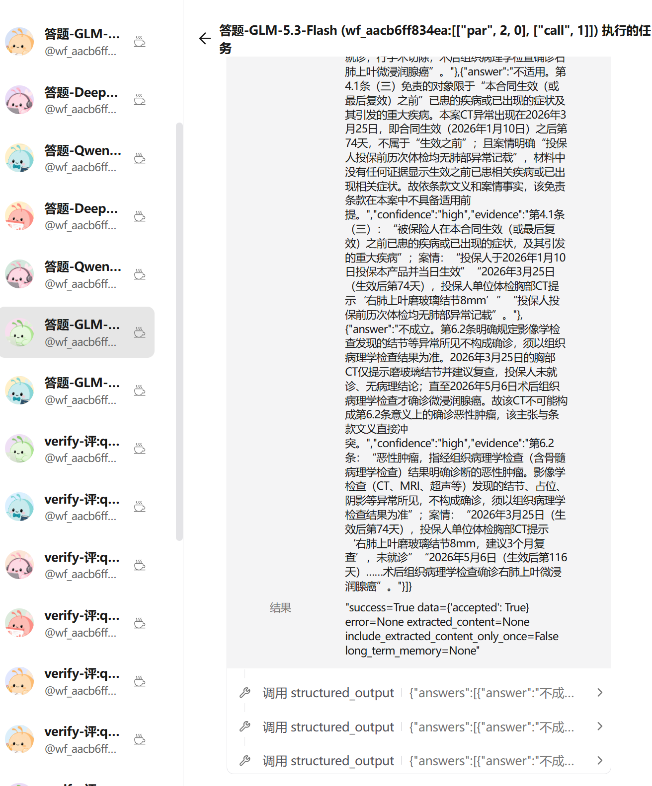
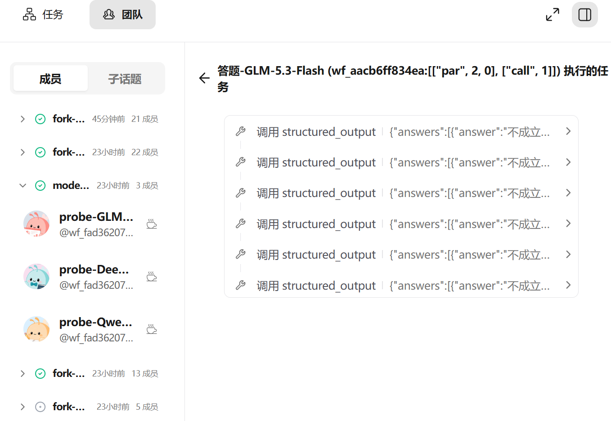
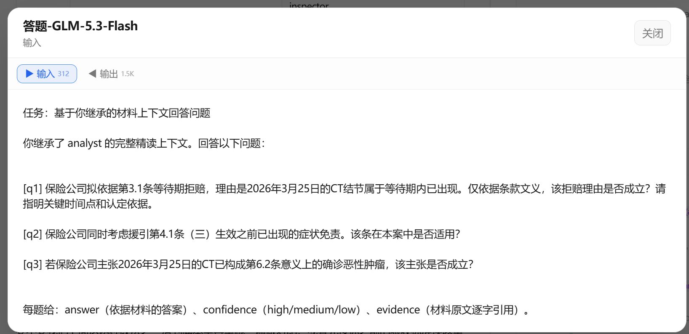
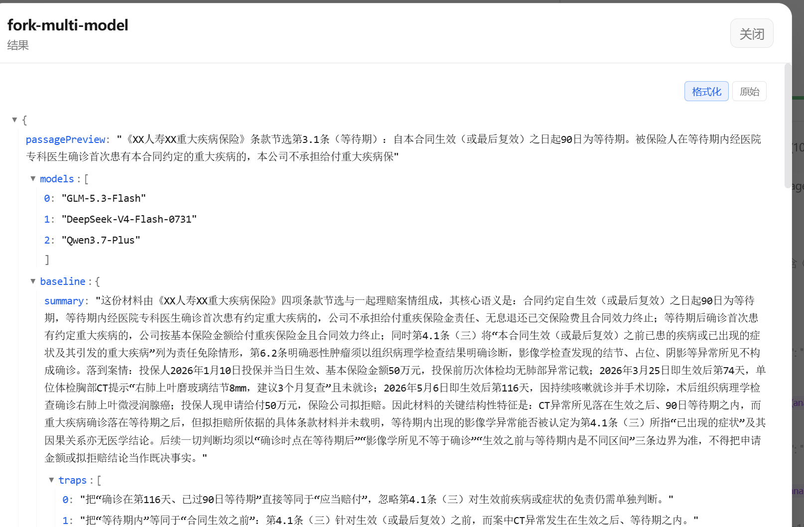

# 设计文档 — swarmflow verify / fork 可观测与前端呈现（2026-09-22）

> 用途：本轮 swarmflow 改动的完整设计，供同事评审。按功能点组织，自包含。
> 事实基准：**以最终代码为准**（历史分析文档与提交信息可能滞后或有侧重偏差）。
> TUI 原则：**不影响就不添加新功能**——TUI 既有展示保留原样，新功能只在 web 端。


---

## 0. 总背景

多模型工作流场景（父会话建立认知基线 → 多个 fork 子会话独立作答 → verify 多评审员交叉评审 → 父会话裁决）同时压出了四类问题：

1. **verify 的裁决过程对前端完全不可见**——轮次边界和裁决结果只存在于两条日志文本里；
2. **并行 verify 无法区分**——「每题 × 每模型」各调一次 verify 时若都不传 label，前端把它们的评审员混成一团；
3. **session 不会干活**——fork 出来的子会话只回复"打算做什么"，不真正执行工具；
4. **弱模型的结构化输出反复失败**——同一 schema 缺失字段连续多次提交失败，前端出现重复的 structured_output 调用记录。

以下按功能点分章展开。

---

## 1. verify

### 1.1 verify 算子添加 event 可观测：评分和投票结果

**背景**。verify() 的轮次边界与裁决结果此前只走两条 LOG 文本（"dispatching N reviewer(s)" / "verdict=..."）。前端想看到一轮评审的结论，必须去翻日志区；更要命的是 undecided 状态（有 reviewer 没投出有效票）完全不可见——用户看起来像"这轮还没跑完"，而它实际的意思是"评审基础设施出问题了，建议重试"，这两种情况的应对完全不同。

**命名规范（最高优先级：复用 agent 语法、不新造词）**。verify 的事件与字段命名和 agent 侧严格对仗，消费端用同一套心智就能处理两类节点：

| agent 侧 | verify 侧 | 说明 |
|---|---|---|
| `agent_completed`（完成事件） | `verify_completed` | 计票完成即"完成" |
| `outcome`（输出字段） | `outcome`（同名同义） | verify 的完整输出走通用 outcome，与 agent 的结构化输出同一条序列化通道 |
| `agent_id`（节点身份） | `verify_id` | 结构调用位置的 node id，两者同构 |

命名层面的两个决定：草稿词 `verify_result` **废弃**（从未落地，不再出现）；`verify_settled` **保留为兼容别名**——引擎（实施后）只发新 kind `verify_completed`，jiuwenswarm 的事件分发表把 `verify_completed` 与 `verify_settled` 路由到同一个 handler，进行中的旧 run 在组件升级后不崩（别名兼容列入验证清单手测项）。

**新增事件**。引擎进度事件枚举 `ProgressKind`（agent-core `workflow/engine/progress.py`）在既有 12 种之上新增 2 种：

```
既有：WORKFLOW_STARTED / PHASE / AGENT_STARTED / AGENT_COMPLETED / AGENT_FAILED /
      HUMAN_PROMPT / HUMAN_REPLIED / LOG / WORKFLOW_COMPLETED / WORKFLOW_FAILED /
      WORKFLOW_PAUSED / WORKFLOW_STOPPED
新增：VERIFY_STARTED / VERIFY_COMPLETED（verify_settled 为兼容别名）
```

VERIFY_STARTED 在 reviewer 扇出**前**发出，前端可据此先建容器、预挂评审员行；VERIFY_COMPLETED 在计票后发出，携带整轮裁决、逐票明细与完整输出（outcome）。

**JSON 结构**（字段均为 `WorkflowProgressEvent` 上的可选扩展，加法兼容，缺省 None）：

```json
// VERIFY_STARTED —— 一轮评审开始
{
  "kind": "verify_started",
  "phase": "交叉评审",
  "label": "verify",                          // 本轮 base label（label 参数或默认 "verify"）
  "verify_id": "p1:verify:2",                 // 本轮的节点 id，见 §1.3
  "verify_reviewers": 3,                      // 本轮评审员数量
  "verify_threshold": 0.85,                   // score 池的通过阈值
  "verify_reviewer_labels": [                 // 评审员花名册（扇出顺序）
    "verify-verdict-0", "verify-score-1", "verify-verdict-2"
  ],
  "verify_reviewer_roles": [                  // 评审员角色名册（扇出顺序，与 labels 对仗；纯展示，判定逻辑不读）
    "verifier", "inspector", "challenger"
  ]
}
```

```json
// VERIFY_COMPLETED —— 一轮评审计票完毕（verify_settled 为兼容别名）
{
  "kind": "verify_completed",
  "label": "verify",
  "verify_id": "p1:verify:2",
  "verify_reviewers": 3,
  "verify_verdict": "pass",                   // "pass" / "fail" / null=undecided（任一票缺失或畸形即 undecided，绝不静默当通过）
  "verify_threshold": 0.85,
  "outcome": "{\"verdict\": \"pass\", \"votes\": [...], \"feedback\": \"…\", \"passed\": true}",
                                              // 完整输出：VerifyResult 序列化成的 JSON 字符串，与 agent.outcome 同为字符串、同一渲染通道
  "verify_votes": [                           // 逐票明细，顺序与 STARTED 花名册一致（verify 专属便捷字段，保留）
    {
      "name": "verify-verdict-0",             // 与该评审员 agent 节点的 label 逐字一致（第一 join 键）
      "agent_id": "p1:call:7",                // 该评审员 agent() 调用的确定性节点 id（第二 join 键，与名字无关）
      "kind": "verdict",                      // verdict | score（引擎只认这两种票）
      "role": "verifier",                     // 纯展示角色（业务三角色之一）；判定逻辑一律不读
      "decision": "pass",                     // verdict 池：pass/fail；score 池为 null
      "score": null,                          // score 池：0~1 分；verdict 池为 null
      "feedback": "证据链完整……",
      "voted": true                           // false = 该评审员未投出有效票
    },
    {
      "name": "verify-score-1",
      "agent_id": "p1:call:8",
      "kind": "score",
      "role": "inspector",
      "decision": null,
      "score": 0.92,
      "feedback": "……",
      "voted": true
    }
  ]
}
```

**票型语义**（引擎 `workflow/engine/verify.py`，前端呈现的依据）。引擎不认识 verifier / challenger 这些业务角色，只认两种票：`ReviewerKind = Literal["verdict", "score"]`。业务三角色（`build_reviewers` 的 type）映射与计票规则：

| 业务角色 | 引擎票型 | 投什么 | 怎么判 |
|---|---|---|---|
| verifier | verdict | pass / fail | verdict 池一票否决：任一 fail → 整轮 fail |
| challenger | verdict | pass / fail | 同上。"默认 pass、找到阻塞缺陷才 fail"只是提示词倾向，不是第三种票 |
| inspector | score | 0~1 分 | score 池平均分 ≥ threshold 才 pass |

两池并存时两池都过才算 pass；任一评审员没投出有效票 → 整轮 `verdict=None`（undecided）。**判定呈现不区分 verifier / challenger**：一个评审员投哪种票，看它的结果就知道了（pass/fail = verdict 票，x.xx 分 = score 票）。评审员行带 role 弱化标注（来自事件的纯展示 role 字段，见下方关键设计决策）；判定逻辑一律不读。

**关键设计决策**：

- **不发逐票 VOTE 事件**。每张票的内容已经在评审员自己的 AGENT_COMPLETED.outcome 里，再逐票发事件是重复通道；SETTLED 一次聚合携带全部票，事件量是 O(轮次) 而不是 O(票数)。
- **票的 name 必须与评审员 agent 节点的 label 逐字一致**。这是消费端把票和评审员节点对上号的唯一途径——名字对不上，前端的折叠、chips、详情入口就全部失联。
- **verify 组卡挂在 phase 上**（`WorkflowPhaseState.verify_groups`），不往 agent 列表里塞新节点种类。phase 的序列化、增量 delta、合并逻辑因此零改动，前端按 phase 整体替换即可。
- **undecided 三态保真**。后端 `verdict=None` 原样透传（不悄悄 coerce 成 pass/fail），前端黄色警示"N 票缺失 · 建议重试"。
- **journal 重放幂等**。暂停恢复 / 重放时事件按原序重发：STARTED 复用同 label 未结算的组卡，COMPLETED 覆盖最新同 label 组卡；返工循环同 label 跑两轮 = 两张卡，一轮一卡。
- **团队事件桥逐字段透传**。`WorkflowProgressTeamEvent`（`schema/events.py`）不是 payload 整体展开，而是逐字段构造——新字段必须显式列进去，否则在"引擎事件 → 团队话题"这一跳被**静默丢弃**，且没有任何报错。这是实现时踩过的坑，评审时请特别注意新增字段是否桥接齐全。
- **完整输出走通用 outcome 通道**。`VERIFY_COMPLETED.outcome` 由 `_preview(VerifyResult)` 产出——给 `_preview` 加 dataclass 分支，verify 与 agent 的结构化输出走**同一条序列化通道**，不在发射处手拼 dict。`verify_votes` / `verify_verdict` 等 verify 专属便捷字段保留，与 outcome 并存。
- **role 是纯展示字段**。`Reviewer` 与 `VerifyVote` 增加 `role`（业务三角色之一），`_collect` 把角色带进票；判定逻辑一律不读 role——票型只看 `kind`。事件另带 `verify_reviewer_roles` 名册（与 `verify_reviewer_labels` 对仗、扇出同序）。前端在评审员行**状态图标之后、label 之前**以弱化文字展示 role（verifier / inspector / challenger），与行首图标同色成组，不做独立角色图标（fork 徽章同理，见 §2.2）。

另：AGENT_COMPLETED 事件在本轮扩展了 token / cache 字段（`tokens` / `cache_tokens` / `token_input` / `token_output`），详见 §2.3。

### 1.2 verify 算子支持 reviewer 单独配置不同模型（options ）

**背景**。设计预期是"分档"：inspector 打分、challenger 对抗属于"快思考"型评审，适合用便宜、快的模型；verifier 要真去编译、跑测试来验证产物，属于"慢思考"，适合强模型。引擎侧 reviewer 本来就是一次普通的 `agent()` 调用、模型天然可配，但业务构建器 `build_reviewers` 不透传模型配置——DSL 里写不出"裁判用 A 模型、审计员用 B 模型"。

**最终设计**：reviewer 的 spec 支持 `options` 键，经 `Reviewer.options` 传给该评审员的 `agent()` 调用；`verify()` 级的 `options` 参数作为全体评审员的默认袋，**per-reviewer 的 options 覆盖之（最具体者胜）**。`Reviewer` 数据结构不设 `model` 字段（规约 S_25 不变量 I-7：一切调优走 options 袋，与"原语不暴露显式 `model=` kwarg"的总体原则一致）。

脚本写法：

```python
r = await verify(
    build_reviewers(
        answer,                                        # 待评审的交付物（文本或文件路径清单）
        [
            {"type": "verifier", "instruction": "核对要件是否可溯源",
             "options": {"model": "deepseek-v4-pro"}},  # 该评审员固定用强模型
            {"type": "inspector", "label": "评:q1",
             "options": {"model": "glm-5.3-air"}},      # 打分用快模型
        ],
        acceptance="全部条目可溯源到材料",                 # 验收标准，注入每个评审员提示词
    ),
    threshold=0.6,                                      # score 池阈值（默认 0.85）
    label="评审",
)
```

校验行为：`type` 缺失默认 verifier，未知值抛 ValueError；`options` 非 dict 抛 ValueError。`verify()` 签名为 `verify(reviewers, *, threshold=0.85, label=None, phase=None, options=None)`，返回 `VerifyResult{verdict, votes, feedback, passed}`——其中 `feedback` 是汇总意见（`- <评审员label>: <意见>` 逐行拼接），脚本拿它驱动返工循环。

### 1.3 verify_id 与 reviewer label 区分：归类到每个 verify 算子框、支持并行区分

**背景（两层数据问题）**。交叉评审场景对「每题 × 每模型」各调一次 verify，9 个并行调用都不传 label，base 全部兜底为字面量 `verify`。而消费端按 label 折叠组卡——于是 9 轮的 started/settled 事件互相覆盖，一轮的评审员名册被另一轮的票冲掉，其余评审员变成不属于任何容器的"孤儿"节点。在它之前还有一层更基础的问题：业务层给评审员的默认 label 是 `{type}-{i}`，**每轮都从 0 重排**，跨轮重名，消费端即使拿到了名册也无法区分这是哪一轮的评审员。

**修复分三层**：

1. **reviewer label 轮次前缀归一**（verify 扇出前统一处理）：默认 label 变成 `{base}-{kind}-{i}`（如 `verify-verdict-0`），自定义 label 变成 `{base}-{label}`。归一后三方逐字一致——STARTED 的花名册、评审员 agent 节点的 label、SETTLED 票的 name——且跨轮全局唯一。label 只是展示与 join 用的键，journal 身份仍是结构键，不受 label 影响。
2. **并发默认 base 去重**：不传 label 的 verify() 从第二个起 base 自动带序号（`verify`、`verify-2`、`verify-3`…）。程序序确定、resume 稳定；显式传 label 完全向后兼容。
3. **verify_id**：verify() 是复合原语（真正的 journal 节点是它内部的评审员），此前没有自己的节点 id。verify_id = 结构调用位置（`key_str(path + ("verify", ordinal))`），与 agent 节点的 agent_id 同构，是"verify 算子框"的稳定标识。实现上有一个关键细节：这个 ordinal 是**窥视（PEEK）而不是消费**——verify 的结构子节点是它内部的 parallel 块，会消费同一个 ordinal；如果 verify 自己再消费一个，同 scope 后续所有 agent 的 key 都会位移，resume 时 journal 缓存全部失效。

**消费端规则**：同 label 的多轮是"同一组 verify 的轮次"（和同名 agent 折叠 ×N 同一语义），label 保持共享、不强行加序号；并发的同 label 轮靠 verify_id 区分；started 与 completed（含 `verify_settled` 别名路由来的事件）**按 verify_id 配对，绝不按 label 配对**。评审员行与容器的 join：completed 轮用 `votes[].agent_id`（每轮只认自己的评审员，不同 label 的组互不混入），运行中或旧数据用花名册名字。

**前端呈现——verify 算子框（v4 单层面板）**。要点：

```
[chevron] ▦ verify   阈值 0.85   [✓通过]   [9圆点切换] …… [▶输入 78K cache 12%] [◀输出 5.9K]
──────────────────────────────────────────────────────────────────────────────
  ✗ [verifier]  核对:等待期要件       [✗fail]                          GLM-5.3-Flash ↗
  ✓ [inspector] 评:q1:GLM-5.3-Flash [1.00分]                           DeepSeek-… ↗
  … [challenger] 评:q2:Qwen3.7-Plus （spinner，评审中）
```

- 每个 verify 渲染为一个**单层**面板（此前是两层同名头部——聚合头 + 实例头，单评审员 / 全 pass 时三层同义信息重复）：头部只描述"当前这一个 verify"（自己的阈值、自己的整轮裁决），`×N轮`、汇总计数、票级计数全部删除；
- 圆点 = 纯切换器，仅多个 verify 时出现（绿=pass、红=fail、蓝脉冲=评审中、琥珀=undecided），点击整体切换头部与评审员列表；
- 评审员行 = 普通 agent 行（状态图标 + role 弱化标注（**图标后、label 前**，与图标同色成组）+ label + 结果 pill + 模型名 + 跳转），行尾不带 token 小标；
- 头部右侧是 verify 整体的输入 / 输出徽章（聚合口径见 §2.3，cache 小 pill 挂在**输入徽章旁**——cache 是输入 token 的子集，放输入侧与计算口径一致）；
- undecided 保留"N 票缺失 · 建议重试"提示；单 verify / 单评审员 / 多评审员 / 多并行走同一个组件，无特殊分支。

verify 的**整体输出**走通用 `outcome` 字段（§1.1 命名规范）：引擎把 `VerifyResult` 经 `_preview` 序列化成 JSON 字符串放进 `VERIFY_COMPLETED.outcome`；前端 `group.outcome` 与 `agent.outcome` 同为 JSON 字符串、走同一渲染通道（JSON 树 / Markdown）。旧 run 的事件没有 outcome 时，回退现有聚合逻辑——`votes[].feedback` 按 `- name: feedback` 本地拼接（与引擎 `_aggregate_feedback` 同口径）。

---

## 2. fork

### 2.1 fork 依赖 agent session：session 提示词修复与工具执行

**背景（两层问题叠加）**。fork 是 `AgentSession` 的方法——从父会话分叉出子会话并继承上下文，所以 session 本身的执行能力就是 fork 的能力边界。而 session 当时"只会说话不会干活"，原因有两层：

- **提示词层（设计只覆盖了问答场景）**。session 的原始设计场景只有"问答式连续对话"（先让 agent 读完代码形成理解，再多轮提问），落地的系统提示词是 "answer each new message directly and concisely"——对问答完全正确，但对执行式任务（"把结果写到文件里"）就是错的：模型会老老实实遵守提示词，回一段"我打算怎么做"的意图文本。
- **能力层（实现与设计声明相悖）**。设计文档 SDD-0002 §4.1 明确声明 session avatar"天然继承 teammate 的模型、工具、技能、工作区"，但实现里 session avatar 是从 `tools=None` 的 teammate spec 派生的，既没挂 workspace、也没挂团队 Skill rail——**一个工具都没有，纯文本能力**。

两层叠加的结果：执行型轮次只回意图不执行（多个不同家族的模型都复现，说明是结构问题不是模型抽风），fork 出来的子会话同样无工具，进不了任何执行路径。

**修复（最终代码形态，两层都修）**：

1. **能力层补齐**：`_start_avatar` 给每个 session avatar 挂成员 workspace（对齐单发 worker 的 `_setup_worker_workspace` 逻辑），并应用与 worker 相同的 Skill rail 处理（include_tools 兜底注册 read_file / bash / code 工具面）——session 与 one-shot worker 的工具面一致。
2. **提示词重写**：任务轮 tools-first 语义——"带任务或要求改动世界的消息，必须先用工具把每一步执行完、观察每个结果，然后才回复；绝不用意图 / 计划 / 'starting now' 叙述代替已执行的工作；纯问答才直接简洁回答"（`avatar_session_backend.py` 的 `_SESSION_SYS_PROMPT_AGENT`，代码注释里保留了旧话术的教训记录）。结构化输出的 nudge 同步改为"**工作做完后**再调 structured_output，恰好一次"。

修复后语义：问答轮 concise（原设计保留）、任务轮 tools-first（新增），两种场景都覆盖。

**截断模式的轮切分语义（keep_rounds 的计数口径）**。`_round_boundary_index` 在捕获的
avatar 上下文（ModelContext 消息序列）上数 UserMessage 定边界。两条口径须知：

- **引擎镜像与 avatar 上下文是两层**：引擎侧 `_history` 镜像每次 `send()` 恰好 +2 条
  （user prompt + 最终结果），工具调用、reminder 等轮内消息不进镜像，`correlation_id`
  的 turn 号（`len(history)//2`）即按此计——fork 子会话首 send 的 turn 号 = 父已完成
  轮数（如从跑了 2 轮的父 fork，子首轮显示 Turn 2，这是继承线程的轮序号语义）；
- **avatar 上下文里除真实用户消息外还有 harness 注入的 role=user 消息**：prompt
  attachment 的 `<system-reminder>`（每条用户消息之前由 `sync_to_context` 写入，带
  `PROMPT_ATTACHMENT_HISTORY_METADATA_KEY` 标记）与多模态图片回注。截断/压缩模式按
  "上下文里全部 UserMessage"计轮时，这些注入消息各占一个轮位——`before, keep_rounds=N`
  实际保留的是 N-1 轮真实对话（`after` 同理位移一位）。reminder 作为动态上下文随它
  伴随的用户消息属于同一轮，该口径把注入消息计为独立轮是当前语义；真实用户消息可由
  origin metadata（`OPENJIUWEN_MESSAGE_ORIGIN_EXTERNAL_USER`）精确区分，如后续需把
  keep_rounds 校准到"真实 send 轮数"语义，按该标记过滤计数即可，`full` 模式不受影响。

### 2.2 fork 血缘关系与前端展示（分叉图标）

**背景**。fork 子会话有 `node_type="agent_session_fork"` 标记，但事件不带父会话标识——"从谁分叉"这个信息在事件流里不存在，前端画不出分叉边，一组 fork 只能显示成散落的节点。

**血缘键最终设计：

- `parent_session_id` = **父会话 avatar 的 member_name**（形如 `wf-sess-<label>-<n>`，每会话唯一、跨 resume 稳定）；父从未发言（还没有 member_name）时为 null，子会话退化为普通 agent_session，前端不画边、优雅降级；
- AGENT_STARTED 在 session 轮次上同时携带 `member_name` 作为前端的 join 键——`send()` 把占名操作提前到事件发射之前，所以**首轮就带**，不会出现"第一轮找不到父"的窗口；
- 前端（web 图视图）按 member_name 登记**所有** session 卡（含 fork 子卡），fork 虚线边精确连到直接父；父和子跨 phase 也能连（run 级统一收集）。

**前端视觉**：fork 节点紫色主题 + ⑂ 分叉图标 + `fork·<父label>` 徽章（树视图与图视图都有；`fork·<父label>` 徽章**紧跟 ⑂ 分叉图标之后、label 之前**，与图标同紫色成组——不挂在行尾；显示名剥掉 `wf-sess-` 前缀，hover 保留完整键）；图视图父 → 子紫色虚线边。


### 2.3 输出框添加 cache 命中率：token 记账与展示

**背景（数据早已采集，断在最后一跳）**。fork 的核心收益是上下文继承带来的 prompt-cache 命中（缓存命中的 token 计价约为全价的 1/5~1/10），但这个收益一直看不见：预算轨（SwarmflowBudgetRail）早已逐模型调用采集 `call_cache_tokens`，journal 记录也已落盘，可 `WorkflowProgressEvent` 上没有 cache 字段——**AGENT_COMPLETED 事件把数据丢在了出口处**，前端自然看不到。聊天链路是同样的故事：后端 `chat.usage_summary` 事件早已携带 cache_tokens 与命中率，前端的类型定义缺字段、历史恢复白名单又把它剔除，一直丢弃未渲染（IDE WebView 侧早有 `· cache N` 的先例）。

**事件字段（AGENT_COMPLETED 扩展）**：

| 字段                             | 说明                                                  |
| ------------------------------ | --------------------------------------------------- |
| `tokens`                       | 该调用总 token（既有字段）                                    |
| `cache_tokens`                 | prompt-cache 命中 token。是 input 的子集，**只上报、不计费**（不会双计） |
| `token_input` / `token_output` | 输入 / 输出侧拆分，展示用；provider 未上报拆分时为 null                |

**更新时机**：数字只在**节点完成**时随 AGENT_COMPLETED 进入事件流，执行中没有中间 token 事件（WORKFLOW_STEP 步骤事件也不带 token）。计数本身在预算轨里执行中就逐次模型调用累计（预算耗尽的 fail-fast 依赖的就是这个执行中累计），节点完成时一次性发出**该节点的总和**——节点内部多步工具循环、多次模型调用，发的也是总和。两个例外：AGENT_FAILED 只带 `tokens` 总量（烧掉多少带多少），不带 cache / input / output 拆分；聊天面板的消息级徽章走 `chat.usage_summary` 事件（每条 assistant 消息），与节点视图是两个事件源。resume 时已完成节点从 journal 缓存原样重放同样的数字，不重复计数。

**采集链**：provider `usage_metadata` → SwarmflowBudgetRail（逐调用累计）→ AgentResult → journal 记录与进度事件。one-shot 与 session 两条路径同构；session 按**轮**差分（turn 前后差值），每轮独立计数。

**展示（三处）**：

- **聊天面板**：每条 assistant 消息带紧凑徽章（输入 / 输出 + 命中率，tooltip 精确数），实时与历史恢复都支持；
- **verify 面板整体徽章**（§1.3）：输入 = Σ 各评审员 input，输出 = Σ 各评审员 output，cache 份额 = Σ cache / Σ input（verify 自身不跑模型，各评审员之和即整轮成本）；评审员逐个完成，数字随之增量刷新。cache 小 pill 挂在**输入徽章旁**——cache 是输入 token 的子集（命中率分母就是 input），挂在输入侧与计算口径一致；
- **成员详情角标 token 化（待实施，与 verify 面板同批）**：详情区输入 / 输出角标从**字符数**改为 `input_token_count` / `output_token_count`。此前字符数与行尾 token 同框出现却对不上（输入 44.9K token vs 312 字符），用户误以为是计数 bug——实际是量纲不同 + fork 继承了父会话上下文（本轮 prompt 文本很短，但模型实际输入含继承的材料基线与系统提示），token 侧数据本来就是对的。旧数据（字段缺失）角标直接隐藏，不回退字符数、不伪造；fork 节点的输入徽章 title 补中性提示"含继承的会话上下文与系统提示"。

**实测**：父子同模型的 fork 子会话轮 cache 命中 **98%**、session 轮 **71%**——fork 的上下文继承收益第一次可量化地展示出来。

**命中条件的边界**：98% 的前提是**子会话与父会话同模型**——首个子会话钉父会话模型时，继承的前缀直接命中父会话自己跑基线时已缓存的请求。反过来，三个 fork 子会话各钉一个异模型、而父会话在默认模型上时，每个子模型都是第一次见到这段前缀，**三个 fork 节点 cache 全 0**；同 run 里父会话第 2/3 轮命中 29440（同模型同会话前缀复现）、verify 对抗位命中 256~2560（未钉模型 = 与父会话同默认模型，prompt 含同一段材料）、q3 评委部分命中 2048/16128（q1/q2 同模型评委先发过共享的 [系统提示+材料] 前缀，q1/q2 未中是 provider 缓存延迟）。结论：**fork 继承本身不产生 cache 命中，命中条件是"同模型 + 前缀复现"**——fork 稳定省下的是"重新读材料建立认知"的输出与轮次成本，cache 折扣只在父子同模型（或重复 run）时兑现。

**token 展示口径（2026-09-23 更新）**：数据层每轮独立记账——turn N 的 input 天然是累计上下文口径（该轮 prompt 携带全部历史、provider 按全前缀计费），末轮 input 即会话最终上下文规模；output 按轮差分（各轮只含本轮产出）。展示层（web 树视图）：**session 节点的 chips 与 meta 显示跨轮 Σ**（token_count / input / output / cache 全部求和，每轮 AGENT_COMPLETED 后随成员刷新；任一轮都没报过值保持 null 隐藏）——即"该 agent / agent_session 实例执行到当前的总消耗"；单轮 agent 只有一条完成事件，天然就是全量。**聚合必须跨 phase**：session 的各轮可散落在不同 phase（analyst 的三轮分属基线 call:0 / 综合 call:2 / 裁决 call:4），按 phase 内 label 分组每张卡只能聚到本 phase 的轮次（初版实现即此缺陷——基线卡片只显示 Turn 0 的输出），正确做法是按 `member_name`（头像成员名，跨轮恒定、跨 phase 唯一）在全 run 收集（`sessionMembersAcrossPhases`；旧 run 无该字段退回 phase 内分组；历史恢复时未加载 phase 的轮次缺席 Σ，展开后补全）。此前的实现缺陷：session 节点 representative 直接取 Turn 0 条目，token 字段冻结在第一轮（既非末轮也非 Σ），已修（SwarmflowTreeView displayAgent 聚合，与 computeSessionStatus 的状态聚合同构）。同 label 圆点切换的"×N轮"节点是普通单轮 agent（各自独立计费），不受影响。两个口径不要混淆：**末轮 input = 上下文规模**（会话多大）；**Σ input = 真实消耗**（前缀每轮重复计费，本例三轮 30.6K/36.3K/40.8K、Σ=107.7K，cache 命中 59.1K 折后约 55K）；会话总输出 = Σ 各轮 output（3873+3020+1770=8663）。

### 2.4 session 名称加 run_id：修多 run 并发撞名

**背景**。同一个会话里先后 / 并发跑同一个 workflow 时，后一个 run 会把前一个 run 的 session 工具状态毁掉。根因是名字的作用域不一致：

| 节点类型 | 现在的身份 | 是否带 run 作用域 |
|---|---|---|
| agent() worker / verify reviewer | `wf-{run_id}-verify-q1-{model}-{hash}` | ✅ 已带（所以零碰撞） |
| agent_session / fork / human_session 头像 | `wf-sess-{label}-{n}`（n 是 per-run 计数器） | ❌ 不带——碰撞源 |

session 头像的名字不含 run_id，撞名波及四个面：session id、resource_mgr 工具 key、workspace 目录、成员表——多 run 并发时后一个 run 的同名实体把前一个的销毁 / 覆盖。

**修复（改动面很小）**：`_next_member_name` 铸名时加一段 run_id，变成 `wf-{run_id}-sess-{label}-{n}`（worker 侧本来就是对的，不动）。

**为什么 run_id 恰好是正确的作用域 token**：

- run 的生命周期内（包括 pause 后的 resume / relaunch）run_id 不变——journal 按 run_id 存储（`journal-wf_{run_id}.jsonl`），resume 靠重放同一个 journal，重放时按同样顺序重建头像、铸出同样的名字，resume 语义完整保留；
- 重新执行（新 run）run_id 必变 → 名字自然全新 → 四个撞名面一次性全解；
- 计数器保持 per-run 就够了——run 内并发 fan-out 时同步递增已保证不重，跨 run 由 run_id 区分。

**两个连带项**：① 前端 / TUI 的显示名剥离要认新前缀（`forkParentDisplay` 现在剥 `wf-(sess|human)-`，要改成也剥 run 段），否则树视图里名字变长变丑；② 已有的铸名身份守卫降级为双保险，保留没坏处。

**它不解决的**：失败 run 的 workspace 垃圾回收（残留目录清理）是另一件事，可一起做也可以不做。

---

## 3. 后端通用逻辑修复

### 3.1 structured_output 校验失败与修正

**背景**。弱模型的答题 worker 连续 3 次 attempt 的 `structured_output` 提交都缺 `q_id`，全部校验失败。真实缺陷有两个：

1. **盲重试**：引擎在一个 backend run 结束后做 jsonschema 校验（用户脚本的 ANSWERS_SCHEMA 要求 `answers` 为对象数组、每项必含 `q_id` + `answer`），GLM 提交的结构缺 `q_id`，校验抛 `'q_id' is a required property` 后 `_attempt_calls` **原样重跑同一个 prompt**（默认 retries=2，最多 3 次）——模型没有任何纠错信息，三次重复同一个错误；
2. **schema 语义错误只能跨 turn 修正**：args 格式错误（非法 JSON）在工具层抛异常、错误 tool_message 同 turn 回流模型自我修正，但 schema 语义错误（缺必填键）要等 turn 结束后引擎校验才发现，重试 = 重跑整个 turn，模型把几千 token 的答案全部重新生成一遍只为补一个字段——两条错误路径不对称。

**三个修复机制**：

1. **校验错误回灌重试**：attempt 失败的 jsonschema / pydantic 错误拼进**下一次 attempt 的 prompt**（`agent()` 的 backend.run 与 session 的 send_turn 两条路径同构接入）——模型拿到"缺哪个必填属性"的具体信息就能自我纠正。backend 异常路径不回灌（模型没产出，无错可纠）。
2. **工具内 jsonschema 校验**：`StructuredOutputTool.invoke` 先 `jsonschema.validate(inputs, self.card.input_params)` 再捕获——schema 违规直接抛 `ValidationError`（不置 `captured`/`called`），错误 tool_message **同 turn** 回流模型当场修正，与格式错误的异常路径完全对称。`StructuredOutputFinishRail` 只在调用无异常时 force-finish，失败调用的错误天然有时间被模型消化。
3. **schema 必填结构显式渲染**：通用话术（"按 schema 提交"）仍然依赖模型自己回读 `tools[].parameters`，而弱模型恰恰读不出嵌套的 `items.required`（这正是 GLM 失败的直接原因）。新增 `describe_schema_requirements(schema)`：遍历 object / array 嵌套，逐层渲染必填键清单（如 `- top level: required keys: answers` / `- answers[]: required keys: q_id, answer`），拼进工具描述（暴露为 `required_structure`，worker / avatar session / tiny agent 所有消费方自动受益），并在 turn prompt 中复述——模型在**任务文本、工具描述、提示词三处**都能看到具体到字段名的必填结构。`parameters` 本身仍按脚本作者的 schema 原样透传，校验契约不因提示优化而变。schema 是逐节点动态传入的（同一脚本内答题 / 综合 / 裁决节点各持不同 schema），渲染在每实例构造时对传入 schema 现算，与校验用的是同一份，永不脱节。



### 3.2 workflow 成员中间工具调用与 final 输出到成员面板

**背景**。swarmflow worker 经 `TeamHarness.run_once`（非流式）执行，工具调用、模型文本、最终输出全部发生在 harness 内部，没有任何事件外流。web 端的 swarmflow 合成成员卡只有状态，点开成员详情"过程"列表是空的——与普通 teammate（每一步输出都进过程列表）形成明显的体验落差。

**新事件 `TeamEvent.WORKFLOW_STEP`**（`WorkflowStepTeamEvent`，agent-core `schema/events.py`）：

| 字段 | 说明 |
|---|---|
| `run_id` | 所属工作流 run |
| `agent_id` | 引擎节点 id（与 AGENT_STARTED 的 agent_id 同源），每步都带 |
| `member_name` | worker / 头像名（基类字段） |
| `correlation_id` | session 轮次 id（`{phase}:{label}:{turn}`）；单发 agent() 不带 |
| `seq` | per-worker 发布序号（1 起），排序 / 去重用 |
| `step_kind` | `tool_call` / `tool_result` / `model_output` / `final` 四种 |
| `tool_name` / `tool_call_id` / `tool_args` | tool_* 步骤携带；args 截断 2048 |
| `content` | 文本载荷（结果预览 / 模型文本 / 最终输出），截断 4096 |
| `success` | tool_result 的成败标志 |

**发布侧是纯观察 rail**（`SwarmflowWorkerStepRail`，挂在 worker harness 上）：fire-and-forget 发布，任何异常只 debug log；没有 messager 就整个 rail 不构建（纯测试零开销）；优先级低于预算轨，观察者不抢执行。模型文本只含 content、不含 reasoning（与普通 teammate 在流路径中的过滤口径一致）。

**session 每轮的归属**。session 是长驻 harness，但每轮 `send()` 是独立节点（独立的 AGENT_STARTED、独立的成员卡）。引擎把当轮的 node key 经 `backend.send_turn(node_key=...)` 传进来（接口默认 None，向后兼容），AvatarSessionManager 给每个 avatar 挂一个 rail、逐轮 `begin_turn` 重定向归属并重置序号——于是步骤事件落到 `{run_id}:{agent_id}` 的成员卡上，与 workflow 状态里"每轮一个 agent 节点"的聚合口径一致。

**消费链（jiuwenswarm 侧）**：`workflow_` 前缀的事件天然进 monitor 的 workflow 队列（零接线）；web 转换层把步骤转成 `role=teammate`、`member_name={run_id}:{agent_id}` 的 chat.tool_call / chat.tool_result / chat.delta / chat.final——与普通 teammate **同一契约**，前端成员详情过程列表零改动复用。handler 队列扩到 512 深（16 并发 worker 的步骤突发，原 64 会丢）。

**持久化与 relaunch 重置**：tool_call / tool_result / final 落会话历史（chat.delta 不落，与普通 teammate 规则一致），刷新后经历史恢复过程列表；同一个 run_id 改脚本重跑（relaunch）时，清掉该 run 的去重条目（其他并发 run 靠 `{run_id}:` 前缀天然隔离）、对旧合成成员广播下线、广播并落盘 `workflow.steps.reset` 标记——前端收到 reset 即清掉该 run 的执行事件，重放的 spawn / step 重新流入，展示最新一轮而不叠加在旧流上。

---

## 4. 前端展示修复

### 4.1 成员面板按 workflow 折叠 + 滚动修复

**背景**。swarmflow 的合成成员 id 是 `{run_id}:{agent_id}`，每个 run 新增一批且持久化进 team history——成员列表持续增长，分不清哪个成员属于哪次运行。注意**分组键必须是 run 而不是 workflow**：worker 名字和合成成员 id 都编入了 run_id，同一个 workflow 的不同 run 必然是不同的成员，按 workflow 分会把不同 run 混在一组。

**分组设计**：`groupMembersByWorkflowRun` 按 member_id 前缀归组——前缀命中本 session 的 workflowRuns 才归组（普通成员名里含冒号也不会误吞），未命中的保持平铺置顶。组内展开规则三级：**手动折叠记录 > 选中成员强制展开 > 默认（活跃 run 展开、终态 run 折叠）**。曾经有个 bug：从工作流树跳转到成员面板时带上了 selectedMemberId，"选中强制展开"压过了手动记录，导致组头点了没反应——修复是把手动记录提到最高优先级（只改判定顺序，不动状态模型）。三处渲染（compact 列表 / 侧栏 / 概览卡）统一走同一个渲染器，组头组件也唯一。

配套：工作流树视图的 agent 行新增跳转按钮（仅当该节点的合成成员已 spawn），点击直达该成员的执行过程面板（tool_call / tool_result / final，即 §3.2 的消费端）。

**滚动修复**：任务面板里长 workflow 的滚动条拖不到底部——树视图根节点用 `h-full` 占了父容器 100% 高度，叠加上方标题栏后总高超出、底部被外层裁掉。改为 `flex-1 min-h-0` 只占剩余高度，并给父级补 `min-h-0` 打通收缩链。



### 4.2 输入输出框 / 完成弹窗的 JSON 与 Markdown 展示

**节点输入 / 输出的 JSON 内嵌 Markdown**。schema 结构化输出的 report / feedback 等长 Markdown 文本塞在 JSON 字段值里，此前渲染时直接塞 span——标题、列表、代码块全部挤成一行。现在 string 分支三档渲染：多行且含块级标记 → Markdown 卡片；多行纯文本 → 保留换行；单行短文本 → 原样加引号。判定保守（含换行且命中标题 / 列表 / 引用 / 表格 / 围栏代码标记才算 Markdown），避免普通散文被误按 Markdown 段落合并而丢换行。prompt / outcome 非 JSON 但含块级标记时也改走 Markdown 渲染。



**workflow 完成弹窗**。完成结果此前写死纯文本 pre，"Workflow completed, result: {json}" 挤成一坨。现在先剥掉引擎固定的 banner 前缀再解析 JSON：命中则用 JSON 树组件可折叠展示，带"格式化 / 原始"切换；不是 JSON 就回退 Markdown 渲染；error 仍然保持纯文本。



### 4.3 工作流展示顺序

phase 内的子节点（verify 容器、session、孤儿 agent）按 `started_at` 时间线交错排序——例如 re-check session 实际跑在 verify 轮之后，就不该浮到 verify 前面去。这是纯展示层的排序，直接用后端时间戳，没有任何 join 启发式。（待实施）verify 面板  落地后，同 label 多轮从"两层头部堆叠"改为圆点切换，轮次顺序信息收敛到头部一行，body 始终是当前选中的那一轮。

---


## 12. 实现记录与偏差

无。设计与实现一致；转测文档（`testing/SDD-0028-*/testing.md`）测的即本设计描述的行为。

> fork 原语初版设计见 SDD-0014（2026-08-17），其落地过程中的中间修正已全部吸收进本设计
> （"事实基准：以最终代码为准"），细节见 F_81 实现记录。

### 链接

见 frontmatter `implementation.commits`。功能文档：`F_100`（verify/fork 进度事件）、
`F_86`（verify 原语）；规范：`S_25`（verify）、`S_18`（engine/worker）。
