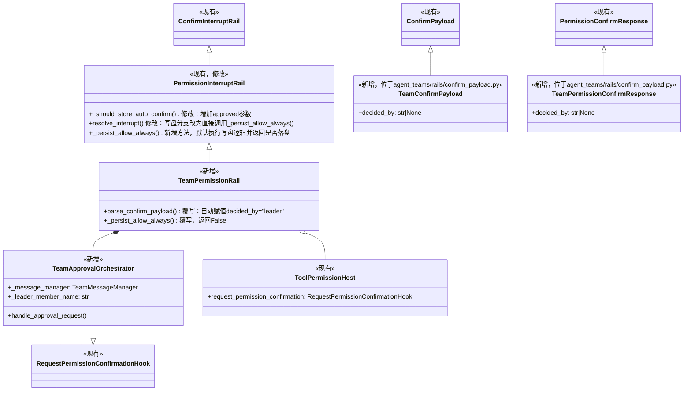
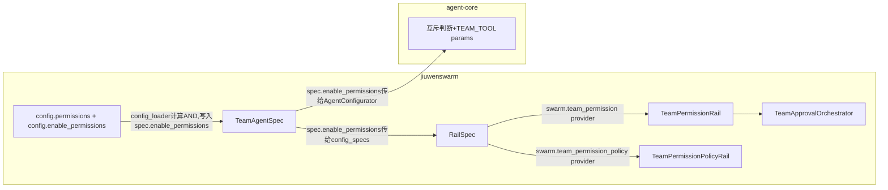
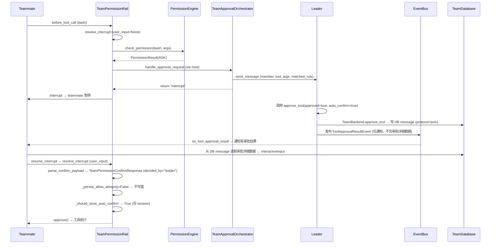
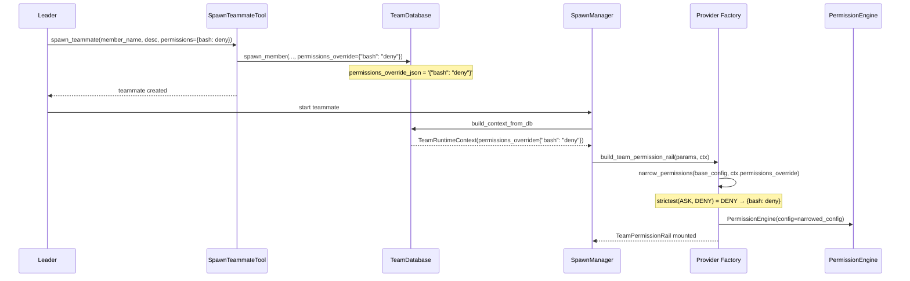
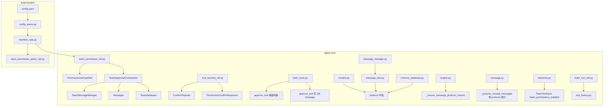

# Team 模式 Permissions 设计方案

## 1. 背景

当前 team 模式中 teammate 的工具调用没有任何权限管控。本方案复用现有 PermissionInterruptRail + ToolPermissionHost 的宿主注入模式，为 teammate 添加权限管控能力。

## 2. 用例视图

### UC-1：Leader 审批 ASK 工具

前置条件：`permissions.enabled=true`，`team.permissions.enabled=true`，`permissions.tools` 配置 `bash: ask`。

1. teammate 调用 `bash`
2. PermissionEngine 评估 → ASK
3. TeamApprovalOrchestrator 发消息给 leader，返回 `"interrupt"` → teammate 进入 interrupt 暂停（审批走 leader 内部通道，但 interrupt 本身仍按既有机制产生）
4. leader 调用 `approve_tool` 审批
5. TeamPermissionRail._parse_confirm_payload 覆写赋值 decided_by="leader"
6. 审批结果：approved=True + auto_confirm=True → session auto_confirm 生效、不写盘
7. teammate 恢复执行，后续同 session 同命令不再需审批

### UC-2：ALLOW 工具直接执行

前置条件：`permissions.tools` 配置 `todo_list: allow`。

1. teammate 调用 `todo_list`
2. PermissionEngine 评估 → ALLOW → 直接执行

### UC-3：DENY 工具直接拒绝

前置条件：`permissions.tools` 配置 `bash: deny`。

1. teammate 调用 `bash`
2. PermissionEngine 评估 → DENY → 返回 `[PERMISSION_DENIED]`

### UC-4：Leader 审批不跨 session

前置条件：UC-1 场景已完成审批。

1. session 结束，session auto_confirm 清除
2. 新 session teammate 再次调用 `bash`
3. 再次走 ASK → Leader 审批流程（TeamPermissionRail._persist_allow_always() 返回 False → 不写盘 → 不跨 session）

### UC-5：permissions 关闭时退回原有行为

前置条件：`permissions.enabled=false` 或 `team.permissions.enabled=false`。

**team 模式**：
1. TeamPermissionRail provider 返回 None（不挂载）
2. TeamToolApprovalRail provider 照常生效（如果 approval_required_tools 配置了）

**code.team / team.plan 模式**：
1. PermissionInterruptRail 从 code-profile rails 中移除（在 headless team 上下文中无法生效）
2. TeamPermissionRail / TeamPermissionPolicyRail 不追加
3. teammate 工具调用无权限管控，直接执行

### UC-6：单 Agent 行为不变

前置条件：单 Agent 路径（非 team）。

1. PermissionInterruptRail 照常，_persist_allow_always() 默认返回 True（写盘）
2. auto_confirm=True 时写盘，跨 session 生效

### UC-7：Leader 收窄 teammate bash 权限

前置条件：`permissions.enabled=true`，`team.permissions.enabled=true`，base `permissions.tools` 配置 `bash: ask`。

1. leader 在系统提示词中看到 TeamPermissionPolicyRail 注入的权限信息："当前 teammate 的基础权限规则：bash: ask..."
2. leader 调用 `spawn_teammate(member_name="dev1", permissions={bash: deny})`
3. SpawnTeammateTool 提取 `permissions_override={"bash": "deny"}`
4. DB row 存储 `permissions_override_json='{"bash": "deny"}'`
5. teammate 启动，provider factory 调用 `narrow_permissions(base={"bash": "ask"}, override={"bash": "deny"})`
6. 合并结果 `narrowed_config={"bash": "deny"}`
7. teammate 调用 `bash` → DENY

### UC-8：Override 尝试放宽被自动压回

前置条件：base `permissions.tools` 配置 `bash: deny`。

1. leader 调用 `spawn_teammate(member_name="dev2", permissions={bash: allow})`
2. provider factory 调用 `narrow_permissions(base={"bash": "deny"}, override={"bash": "allow"})`
3. `strictest(DENY, ALLOW) = DENY` → 合并结果仍为 `{bash: deny}`
4. teammate 调用 `bash` → DENY（override 的放宽企图被自动压回）

### UC-9：Override 不涉及的工具保留 base 原值

前置条件：base `permissions.tools` 配置 `{bash: ask, write_file: allow}`。

1. leader 调用 `spawn_teammate(member_name="dev3", permissions={bash: deny})`
2. `narrow_permissions` 只处理 `bash`，`write_file` 不在 override 中，保留 `allow`
3. teammate 调用 `bash` → DENY
4. teammate 调用 `write_file` → ALLOW

## 3. 逻辑视图

### 3.1 三层分离

| 层 | 组件 | 说明 |
|---|---|---|
| 策略层 | PermissionEngine | 现有，不改。评估 ALLOW/DENY/ASK |
| Rail 层 | TeamPermissionRail | 继承 PermissionInterruptRail，拦截所有工具调用 |
| 编排层 | TeamApprovalOrchestrator | 实现 RequestPermissionConfirmationHook 协议，路由 ASK 到 leader |

编排层通过 `ToolPermissionHost.request_permission_confirmation` 注入到 Rail 层，Rail 层不决定审批对象。

### 3.2 类继承与注入关系

注：仅列出本方案新增、修改或覆写的成员，不涉及的省略。



调用链：provider factory `build_team_permission_rail` 创建 TeamApprovalOrchestrator，然后构造 TeamPermissionRail 并注入 ToolPermissionHost（`request_permission_confirmation=self._orchestrator.handle_approval_request`）。PermissionInterruptRail.resolve_interrupt 在 ASK 分支走 hosted 确认路径时，调用 `host.request_permission_confirmation(...)`，触发 TeamApprovalOrchestrator.handle_approval_request。

### 3.3 decided_by 机制

- decided_by 不暴露给 LLM：approve_tool / ToolApprovalResultEvent / ApproveToolCallTool 均不新增此参数
- decided_by 不修改现有 ConfirmPayload / PermissionConfirmResponse，通过继承新增 TeamConfirmPayload（加 decided_by）和 TeamPermissionConfirmResponse（加 decided_by），定义在 agent_teams/rails/confirm_payload.py，原有消费方不受影响
- TeamPermissionRail.parse_confirm_payload 覆写自动设置 decided_by="leader"，返回 TeamPermissionConfirmResponse
- 写盘控制由 TeamPermissionRail 覆写 `_persist_allow_always()` 返回 `False` 实现（PermissionInterruptRail._persist_allow_always 默认执行写盘逻辑；TeamPermissionRail 直接跳过）
- 不能仅靠 `host.persist_allow_rule=None` 阻止写盘：PermissionInterruptRail._persist_allow_always 中，若 host.persist_allow_rule 未设置，会 fallback 到 `write_permissions_section_to_agent_config_yaml(host.permission_yaml_path, cfg)` 直接写 YAML。因此必须通过覆写 `_persist_allow_always()` 从源头跳过

### 3.4 双开关机制

Team permission rail 挂载需要**两个开关同时打开**：

1. **全局开关** `permissions.enabled`：控制 PermissionEngine 是否工作，是 PermissionInterruptRail / TeamPermissionRail 的前提条件
2. **Team 开关** `enable_permissions`：控制 team 模式下是否启用 TeamPermissionRail 替代 TeamToolApprovalRail

配置示例：

```yaml
permissions:
  enabled: true          # 全局开关
  schema: tiered_policy
  tools: {bash: ask, write_file: deny}

modes:
  team:
    jiuwen_team:
      team_name: jiuwen_team
      enable_permissions: true    # team 专属开关
```

互斥逻辑：
- 两个开关都开 → teammate 挂 TeamPermissionRail，leader 挂 TeamPermissionPolicyRail（注入权限描述 prompt section），leader 保留 approve_tool
- 全局开关关 → TeamPermissionRail 不挂载，退回 TeamToolApprovalRail（如果配置了 approval_required_tools）
- Team 开关关 → TeamPermissionRail 不挂载，退回 TeamToolApprovalRail

### 3.5 配置范围

**base 配置**：完整传递给 PermissionEngine，包括 `enabled`、`schema`、`permission_mode`、`security_level`、`defaults`、`tools`、`rules`、`approval_overrides`、`external_directory`、`owner_scopes`、`deny_guidance_message`。

**override 参数范围**：leader 通过 `spawn_teammate` 的 `permissions` 参数只能修改 `tools` 字段——一个扁平的 `{tool_name: level_string}` dict。其他维度（`defaults`、`rules`、`approval_overrides`、`permission_mode` 等）leader 不可调整，在参数设计层面即被排除。

示例：
```json
{"bash": "deny", "write_file": "ask"}
```

### 3.6 权限收窄机制

Leader 在 `spawn_teammate` 时可通过 `permissions` 参数收窄 teammate 的权限规则。**只能收紧，不能放宽**：ASK→DENY 合法，ALLOW→ASK 合法，但 DENY→ALLOW / ASK→ALLOW 非法。

新增 `narrow_permissions(base_config, tools_override)` 函数，定义在 agent-core 的 `openjiuwen/harness/security/narrowing.py`：

- 对 `tools` dict 中每个 key，取 `strictest(base_level, override_level)`
- override 中新增的 tool key（base tools 中没有的），先从 `defaults` 解析兜底级别（per-key > wildcard `"*"` > fallback ASK），再与 override 值做 `strictest()` 合并——defaults 为未列出的工具提供隐式策略，直接赋 override 值可能放松 defaults 的约束
- 其他字段（`defaults`、`rules`、`approval_overrides`、`permission_mode`）保留 base 原值不变

安全保证：
1. `strictest()` 数学保证结果 ≤ base 且 ≤ override
2. 如果 base 中某工具是 DENY，override 中是 ALLOW，结果仍是 DENY
3. override 参数结构为 `{tool_name: level_string}`，不含 `approval_overrides`、`permission_mode`、`defaults`、`rules` 等字段——这些维度在参数设计层面即被排除，无需在合并逻辑中拦截
4. override 新增的 tool key（base tools 中没有的）必须与 defaults 兜底值做 `strictest()` 合并，不能直接使用 override 值——defaults 为未列出的工具提供隐式策略，直接赋值可能放松 defaults 的约束
5. override 不破坏 rules——tiered_policy 中 rules 在 baseline 之前评估，override 只修改 baseline 兜底值，rules 的结果通过 `strictest()` 与 baseline 合并，无法被 baseline 覆盖

### 3.7 热更新策略

Team 路径**不支持热更新**。理由：

- `TeamPermissionRail` 构建时通过 `narrow_permissions` 将 override 合并进 config，热更新如果用 base 配置（不含 override）刷新 PermissionEngine，会冲掉 override 效果
- `ToolPermissionHost` 不设 `get_permissions_snapshot`，resolve_interrupt 中 `fresh` 始终为 None → 走 `self._engine.update_config(self._static_config)` 用初始合并后的配置刷新引擎
- override 数据从 DB 读取，只在构建时合并一次，不参与热更新循环
- 工具描述在注册时固定，热更新不会触发描述变更

单 Agent 路径的 `PermissionInterruptRail` 照常支持热更新（通过 `get_permissions_snapshot` 读全局 config）。

### 3.8 互斥与 Rail 构建位置

permissions.enabled + enable_permissions 都为 true 时，TeamPermissionRail 替代 TeamToolApprovalRail。permissions 系统覆盖了 approval_required_tools 的功能（ASK 等同于需要审批，但还有 ALLOW/DENY 等更丰富的策略）。



TeamPermissionRail 通过 `@harness_element` provider 在 **swarm 侧**构建（`jiuwenswarm/agents/swarm/providers/member_rails.py`），命名空间 `swarm.team_permission`。swarm provider 是薄 provider：只负责把配置转成 rail params，实际权限执行仍复用 core 的 TeamPermissionRail / PermissionEngine / ToolPermissionHost。

base permissions 通过 `config_specs` → `RailSpec.params` 传入 swarm provider factory，override 通过 `TeamHandleKey.PERMISSIONS_OVERRIDE` → `BuildContext.extras` 传入（由 AgentConfigurator.setup_agent 中 inject_team_handles 注入）。TeamApprovalOrchestrator 所需的运行时句柄（team_backend、messager）通过 `BuildContext.extras` + `TeamHandleKey` 标准化获取。

agent-core 的 `AgentConfigurator.setup_agent` 不再构建 TeamPermissionRail（由 swarm 侧 config_specs 烘焙进 spec.rails），但保留了互斥判断和参数传递：
- `spec.enable_permissions=True` 时不给 teammate 追加 TeamToolApprovalRail
- 给 TEAM_TOOL params 传入 `team_permissions_enabled=spec.enable_permissions`（控制 approve_tool 保留）
- `inject_team_handles` 传入 `permissions_override=ctx.permissions_override`

### 3.9 权限描述注入

权限信息通过**系统提示词 prompt section**注入给 leader。

在 swarm 侧的 `TeamPermissionPolicyRail`（参照 `TeamSkillStoragePolicyRail` 模式）中，当双开关都开且角色为 leader 时：
1. `format_base_permissions_for_desc(permissions_config, lang=lang)` 生成权限文本
2. 作为 PromptSection（priority=39）注入到 leader 的系统提示词

理由：
- 权限规则是 team 级信息，leader 在每个 turn 都能看到，比工具描述更及时
- 不污染 `spawn_teammate` 工具描述——工具描述不需要承载完整策略配置
- 权限描述不需要 `permissions_config` dict 传到 agent-core（TeamToolRail 不再需要 permissions_config 参数），只在 swarm 侧消费

## 4. 运行视图

### 4.1 ASK 审批流程



审批结果送达有两条路径：
- **pub-sub 通知路径**：ToolApprovalResultEvent 仅通知 teammate"有审批结果"，不含详细数据。teammate 收到通知后从 DB message 读取审批详细数据（tool_call_id、approved、feedback、auto_confirm）来 resume
- **DB message 保底路径**：若 pub-sub 事件丢失，mailbox drain 读取 DB 中 protocol=json 的消息，解析内容发现审批字段 → resume_interrupt

ToolApprovalResultEvent 不新增字段，保持现有结构仅作通知用途。

### 4.2 审批等待约束

teammate 进入 interrupt 状态（等待审批）期间，mailbox drain 不再完全阻塞，而是按 protocol 字段选择性放行：

1. **用户输入隔离**：用户输入只路由到 leader，teammate 不接收 USER_INPUT 事件
2. **mailbox drain 按 protocol 过滤**：`MessageHandler._process_unread_messages` 在 `has_pending_interrupt()` 时，protocol=`"json"` 的消息尝试解析内容，若含审批字段则放行走 resume_interrupt；其余消息 continue defer
3. **审批结果定向投递**：ToolApprovalResultEvent 通过 `target_id == member_name` 定向通知 teammate

interrupt 清除后，`wake_mailbox_if_interrupt_cleared` 重新触发 POLL_MAILBOX，此前 deferred 的普通消息才被 drain。

### 4.3 权限收窄数据流



## 5. 开发视图

### 5.1 改动清单

| 仓库 | 文件 | 改动 |
|------|------|------|
| agent-core | `openjiuwen/harness/security/models.py` | 删除 TeamPermissionConfirmResponse（已移到 agent_teams/rails/confirm_payload.py） |
| agent-core | `openjiuwen/harness/rails/interrupt/confirm_rail.py` | 删除 TeamConfirmPayload（已移到 agent_teams/rails/confirm_payload.py） |
| agent-core | `openjiuwen/harness/rails/security/tool_security_rail.py` | _should_store_auto_confirm 增加 approved 参数（bug fix）；新增 _persist_allow_always() 默认 True（磁盘写盘决策权下放到子类）；resolve_interrupt 写盘分支改为直接调用 _persist_allow_always()；check_permission 加 try/except；parse_tool_args / parse_confirm_payload / format_args_preview 提升为公共方法（G.CLS.11合规） |
| agent-core | `openjiuwen/agent_teams/rails/confirm_payload.py` | 新文件 — TeamConfirmPayload（继承 ConfirmPayload，加 decided_by）+ TeamPermissionConfirmResponse（继承 PermissionConfirmResponse，加 decided_by），从 harness 移入 |
| agent-core | `openjiuwen/agent_teams/rails/team_permission_rail.py` | 新文件 — TeamPermissionRail（_persist_allow_always→False、parse_confirm_payload 覆写自动赋值 decided_by="leader"）+ TeamApprovalOrchestrator（实现 RequestPermissionConfirmationHook） |
| agent-core | `openjiuwen/agent_teams/rails/__init__.py` | 新增 TeamPermissionRail + TeamApprovalOrchestrator + TeamConfirmPayload + TeamPermissionConfirmResponse 导出 |
| agent-core | `openjiuwen/agent_teams/rails/elements.py` | TeamToolInput 新增 team_permissions_enabled 字段 |
| agent-core | `openjiuwen/agent_teams/rails/team_tool_rail.py` | 新增 team_permissions_enabled 构造参数，传给 create_team_tools |
| agent-core | `openjiuwen/agent_teams/rails/team_context.py` | 新增 PERMISSIONS_OVERRIDE key + accessor + inject 参数 |
| agent-core | `openjiuwen/agent_teams/security/__init__.py` | 新文件 — 导出 narrow_permissions + format_base_permissions_for_desc |
| agent-core | `openjiuwen/agent_teams/security/narrowing.py` | 从 harness/security 移入 — narrow_permissions（只收紧不放宽，strictest 数学保证）+ format_base_permissions_for_desc（双语权限描述 + 收窄规则指导文本） |
| agent-core | `openjiuwen/agent_teams/tools/member_options.py` | 新文件 — TeamMemberOptions / MemberModelRef / MemberWorktreeOptions + load/dump/build/merge/get helpers（替代 model_ref_json 独立列，统一为 options JSON） |
| agent-core | `openjiuwen/agent_teams/tools/tool_factory.py` | create_team_tools 新增 team_permissions_enabled 参数 + approve_tool 保留逻辑 |
| agent-core | `openjiuwen/agent_teams/tools/tool_member.py` | SpawnTeammateTool 新增 permissions 输入参数 |
| agent-core | `openjiuwen/agent_teams/tools/team.py` | TeamBackend.spawn_member 新增 permissions_override 参数，持久化到 TeamMember.options.permissions_override；TeamBackend.approve_tool 写 DB message (protocol=json) |
| agent-core | `openjiuwen/agent_teams/tools/models.py` | TeamMember：model_ref_json → options（统一 JSON 字段含 model_ref / worktree / permissions_override）；TeamMessageBase 新增 protocol 字段默认 "plain"。字段描述从下方 docstring 移到 Field(description=...) |
| agent-core | `openjiuwen/agent_teams/tools/database/engine.py` | _ensure_message_protocol_column()；删除重复的 _ensure_team_member_options_column() 定义（已由 member_dao.py 承担迁移职责） |
| agent-core | `openjiuwen/agent_teams/tools/database/message_dao.py` | create_message 新增 protocol 参数 |
| agent-core | `openjiuwen/agent_teams/tools/database/member_dao.py` | create_member：model_ref_json → options |
| agent-core | `openjiuwen/agent_teams/tools/memory_database.py` | InMemoryTeamDatabase 同步 protocol + options 参数 |
| agent-core | `openjiuwen/agent_teams/tools/message_manager.py` | send_message 新增 protocol 参数 |
| agent-core | `openjiuwen/agent_teams/tools/locales/cn.py` + `en.py` | spawn_teammate.permissions 双语描述 |
| agent-core | `openjiuwen/agent_teams/schema/blueprint.py` | TeamAgentSpec 新增 enable_permissions: bool = False |
| agent-core | `openjiuwen/agent_teams/schema/team.py` | TeamRuntimeContext 新增 permissions_override: Optional[dict[str, str]] = Field(description=...) |
| agent-core | `openjiuwen/agent_teams/agent/agent_configurator.py` | enable_permissions 互斥判断（跳过 TeamToolApprovalRail）+ TEAM_TOOL params 传入 team_permissions_enabled + inject_team_handles 传入 permissions_override |
| agent-core | `openjiuwen/agent_teams/agent/spawn_manager.py` | build_context_from_db 用 get_member_permissions_override 从 options 读取 override |
| agent-core | `openjiuwen/agent_teams/agent/coordination/handlers/message.py` | _try_parse_approval_payload 按 protocol=json 放行审批消息 + resume_interrupt |
| agent-core | `openjiuwen/agent_teams/monitor/models.py` | MessageInfo 新增 protocol 字段 |
| jiuwenclaw | `agents/swarm/providers/member_rails.py` | 新增 TEAM_PERMISSION provider（TeamPermissionInput + _build_team_permission_rail，薄 provider 只接线，执行复用 openjiuwen）+ TEAM_PERMISSION_POLICY provider（TeamPermissionPolicyInput + _build_team_permission_policy_rail） |
| jiuwenclaw | `agents/harness/team/rails/team_permission_policy_rail.py` | 新文件 — TeamPermissionPolicyRail（DeepAgentRail，priority=5，SECTION_NAME=team_permission_policy，SECTION_PRIORITY=39，注入权限描述 prompt section 到 leader） |
| jiuwenclaw | `agents/swarm/config_specs.py` | `_RAIL_PARAM_BUILDERS` 注册 TEAM_PERMISSION / TEAM_PERMISSION_POLICY；_build_team_capability_specs / _build_code_capability_specs 按 enable_permissions + role 条件追加；_build_code_capability_specs 排除 PERMISSION_INTERRUPT |
| jiuwenclaw | `agents/swarm/registry.py` | 导出 TEAM_PERMISSION + TEAM_PERMISSION_POLICY |
| jiuwenclaw | `agents/harness/team/config_loader.py` | `_resolve_enable_permissions` 计算 permissions.enabled AND enable_permissions 双开关 |
| jiuwenclaw | `agents/swarm/assembly.py` | 传入 enable_permissions 到 build_member_deep_agent_spec |
| jiuwenclaw | `resources/config.yaml` | team 配置段新增 `enable_permissions: false` |

### 5.2 模块依赖关系



### 5.3 Rail 挂载顺序

在 config_specs 构建成员 spec 时，rails 挂载顺序通过 RailSpec 优先级控制：

1. TeamToolRail（注册角色工具）
2. TeamPolicyRail（注入 prompt sections）
3. FirstIterationGate（首轮门控）
4. TeamWorkspaceRail（workspace 管理，可选）
5. TeamPermissionRail（teammate 权限管控）或 TeamToolApprovalRail（互斥）
6. TeamPermissionPolicyRail（leader 权限描述注入，priority=39 PromptSection）

**code.team / team.plan 模式差异**：`_build_code_capability_specs` 始终从 `_CODE_RAIL_NAMES` 中排除 `PERMISSION_INTERRUPT`——它在所有 team 模式下对 member 都无效（`TOOL_PERMISSION_CHANNEL_ID` 在 team 路径中从未设置，teammate 是 headless 运行无前端连接，ASK 级权限决策会导致永久挂死）。enable_permissions 为 true 时追加 `TEAM_PERMISSION`（teammate）或 `TEAM_PERMISSION_POLICY`（leader），与 team 模式一致；enable_permissions 为 false 时两者都不追加。

TeamPermissionRail 在 config_specs 中声明式添加（条件是 enable_permissions 且 role == teammate），替代 TeamToolApprovalRail / PermissionInterruptRail。TeamPermissionPolicyRail 同样在 config_specs 中声明式添加（条件是 enable_permissions 且 role == leader）。互斥选择在 agent_configurator.py 中通过条件判断完成：enable_permissions 为 true 时跳过 TeamToolApprovalRail 的追加。

### 5.4 关键设计决策

**双开关机制**：TeamPermissionRail 挂载需要全局 `permissions.enabled=true` + team `team.permissions.enabled=true` 两个开关同时打开。全局开关是 PermissionEngine 的前提条件，team 开关控制是否在 team 模式下启用权限管控替代简单审批。两个开关分属不同配置段（全局 vs team），职责清晰，可独立开关。

**provider 位置在 swarm 侧**：TeamPermissionRail 通过 `@harness_element` provider 在 swarm 侧构建（`jiuwenswarm/agents/swarm/providers/member_rails.py`），命名空间 `swarm.team_permission`。swarm provider 是薄 provider：只负责把配置转成 rail params，实际权限执行仍复用 core 的 TeamPermissionRail / PermissionEngine / ToolPermissionHost。运行时句柄通过 `BuildContext.extras` + `TeamHandleKey` 获取，无需在 agent-core 中新增 provider。

**decided_by 持久化判断**：写盘控制由 `_persist_allow_always()` 承担。`PermissionInterruptRail._persist_allow_always()` 默认执行写盘逻辑（host 优先 `persist_allow_rule`，fallback 写 YAML），返回是否成功落盘；`TeamPermissionRail` 覆写直接返回 `False`（leader 审批不写盘、session 内不持久化）。`resolve_interrupt` 中两处持久化分支（hosted 确认路径、user_input 解析路径）都改为直接调用 `self._persist_allow_always(normalized_name, tool_args)` 取得 `persisted` 标志，再交给 `_should_store_auto_confirm()` 决定是否写入 session auto-confirm。PermissionConfirmResponse 不修改，decided_by 只在 TeamPermissionConfirmResponse 子类里，不暴露给基类。

**_should_store_auto_confirm 增加 approved 参数**：现有逻辑不检查 approved，导致 `approved=False + auto_confirm=True` 时仍写入 session auto_confirm，这是一个 bug fix。

**approve_tool 保留判断**：双开关都开时 leader 必须保留 approve_tool，否则 teammate interrupt 后无唤醒路径会卡死。此判断在 team_tools.py 的 `create_team_tools` 工具过滤逻辑中完成——非 plan_mode 下，只有双开关都开才保留 approve_tool，否则排除。

**热更新不支持**：Team 路径不支持热更新。`ToolPermissionHost` 不设 `get_permissions_snapshot`，resolve_interrupt 中 `fresh` 始终为 None → PermissionEngine 用初始合并后的配置刷新，override 不会被 base 配置冲掉。单 Agent 路径照常支持热更新。

**权限描述注入方式**：权限信息通过系统提示词 PromptSection 注入给 leader（由 `TeamPermissionPolicyRail` 在 priority=39 处注入，详见 §3.9），保持工具描述干净——权限规则是 team 级信息，leader 在每个 turn 都能看到，比工具描述更及时。

**provider 模式构建**：TeamPermissionRail 通过 `@harness_element` provider 在 swarm 侧构建（`member_rails.py`），与 TeamSkillStoragePolicyRail 等其他 swarm provider 保持一致的挂载方式。运行时句柄通过 `BuildContext.extras` + `TeamHandleKey` 获取，无需在 AgentConfigurator 中命令式构建。

**审批结果双通道送达**：TeamBackend.approve_tool 同时写 DB message（protocol=json，含审批详细数据）和发布 pub-sub 事件（仅通知，不含详细数据）。pub-sub 事件丢失时，mailbox drain 从 DB message 保底送达。

**DB message protocol 字段前向兼容**：TeamMessageBase 新增 protocol 字段，默认 "plain"。消息表是 dynamic/per-session（新建 session 时创建、删除 session 时删除），新列在新建 session 自动生效。进行中的 session 需 `_ensure_message_protocol_column()` 迁移辅助（参照 `_ensure_team_member_role_column` 先例）。

**mailbox drain 按 protocol 放行审批结果**：`_process_unread_messages` 在 `has_pending_interrupt()` 时不再完全阻塞，protocol=json 的消息尝试解析内容，含审批字段则放行 resume_interrupt，其余消息 continue defer。

**model_name 预留不传递**：PermissionEngine 的 `model_name` 参数当前未用于权限评估路径。TeamPermissionInput 不传 model_name，PermissionEngine 使用默认值。未来若需要 LLM-based 权限判定，可通过 `TeamHandleKey` 新增 `MEMBER_MODEL_NAME` 或其他运行时注入路径传递 per-member model name。

**override 数据流**：override 通过 `TeamBackend.spawn_member` 的 `permissions_override` 参数持久化到 DB row 的 **`TeamMember.options.permissions_override`**（统一 options JSON 字段，而非独立 `permissions_override_json` 列，详见上方 options 统一条目）。`build_context_from_db` 用 `get_member_permissions_override(teammate)` 从 options 提取 override 注入 `TeamRuntimeContext.permissions_override`。provider factory 在构建 TeamPermissionRail 时调用 `narrow_permissions(base_config, ctx.permissions_override)` 合并配置。override 为 None 时直接用 base config。

**options 统一 JSON 字段替代独立列**：实际代码将 `TeamMember.model_ref_json` 替换为 `TeamMember.options`——一个统一 JSON 字段，形状为 `{"model_ref": {...}, "worktree": {...}, "permissions_override": {...}}`。新增 `member_options.py` 提供结构化 helpers（TeamMemberOptions / load / dump / build / merge / get）。设计文档原指定独立 `permissions_override_json` 列，实际代码选择了更可扩展的统一方案。迁移函数 `_ensure_team_member_options_column` 从 `model_ref_json` backfill 到 `options` 并 DROP `model_ref_json`。注意：engine.py 中曾有两个同名函数定义，Python 后定义覆盖前定义导致 DROP 未执行（已修复删除旧定义）。

## 6. 未来扩展：用户审批

当前设计只覆盖 leader 审批路径。

- TeamPermissionConfirmResponse 的 decided_by 字段已预留，未来值为 "user" 时 TeamPermissionRail._persist_allow_always() 可改为恢复写盘逻辑（返回 True 落盘，使审批跨 session 生效）
- 用户审批不走 ToolApprovalResultEvent（那是 leader 审批路径），走 hosted 确认路径直接返回 TeamPermissionConfirmResponse(approved=True, auto_confirm=True, decided_by="user")
- leader 上升给用户：TeamApprovalOrchestrator.handle_approval_request 未来可返回 PermissionConfirmResponse 而非 "interrupt"，走 hosted 确认路径直接返回结果
- approve_tool / ToolApprovalResultEvent 不新增 decided_by，用户审批走不同路径