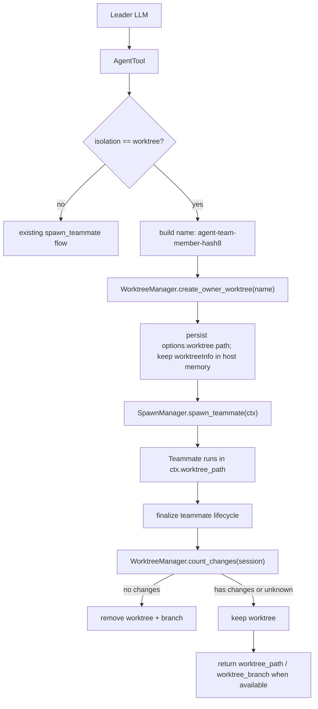

# Team Teammate Worktree Isolation 设计文档

## 1. 元信息

| 项 | 值 |
|---|---|
| 类型 | design |
| 状态 | draft |
| 最近一次修订日期 | 2026-06-12 |
| 关联模块 | `openjiuwen/agent_teams/`、`openjiuwen/harness/tools/worktree/`、`jiuwenswarm/agents/swarm/` |
| 关联场景 | team / code.team / team.plan |

## 2. 背景

当前 team 模式已经具备两类能力：

- `agent-core` 的 `harness.tools.worktree.WorktreeManager` 已经提供通用 git worktree 能力。
- `agent_teams` 已经通过 `TeamAgentSpec.worktree` 描述 team worktree 配置，历史实现曾在非 leader 成员上挂载 `enter_worktree` / `exit_worktree` 工具。

那套能力更接近“teammate 自己在运行后手动进入 worktree”。本设计移除 team 场景里的手动兜底，改为对齐 Claude Code 中 `AgentTool(isolation="worktree")` 的语义。

Claude Code 的关键语义是：

1. 发起方工具宿主先创建一个专属 worktree。
2. 子 agent 从启动开始就在这个 worktree cwd 中运行。
3. 子 agent 结束后由宿主检查 worktree 是否产生修改。
4. 无修改则自动清理，有修改则把 `worktreePath` / `worktreeBranch` 返回给上游。

本设计将 team teammate 的隔离方式对齐到这个模型：leader 通过 `AgentTool` 创建 teammate 时传入 `isolation="worktree"`，worktree 由 leader 侧工具宿主创建和收尾，teammate 只在被分配的 cwd 中工作。

## 3. 目标

- team 场景中通过 `AgentTool` 的 `isolation` 字段启用 teammate worktree 隔离。
- worktree 创建必须复用 `WorktreeManager.create_owner_worktree(slug)`，不新增另一套 git worktree 创建逻辑。
- worktree name 使用确定格式：`agent-{teamname}-{membername}-{hash8}`。
- teammate 的 cwd / workspace 从启动起就是该 worktree。
- teammate 完成、失败、停止或 shutdown 后，统一检查 worktree 是否有修改。
- 无修改自动删除 worktree 和临时 branch。
- 有修改或无法确认时保留 worktree，并把 `worktree_path` 以及宿主内存中可用的 `worktree_branch` 返回给 leader。
- 冲突处理由 leader 根据返回的 worktree path / branch 统一完成。

## 4. 非目标

- 不让 teammate 通过 `git push` 提交给 leader。
- 不让 teammate 之间互相 pull / merge / 解冲突。
- 不把 leader 自身切入 teammate worktree。
- 不用大模型生成 worktree name。
- 不新增 parallel 的 worktree backend 或复制一份 `create_owner_worktree`。
- 第一阶段只覆盖普通 LLM teammate；`human_agent`、`bridge_agent`、`external_cli` 可后续按同一契约扩展。

## 5. 总体方案

team 下新增或改造一个 AgentTool 语义入口。leader 调用：

```json
{
  "name": "backend-dev",
  "team_name": "my-team",
  "description": "auth bug fix",
  "prompt": "修复认证模块中的空指针问题",
  "isolation": "worktree"
}
```

当 `isolation == "worktree"` 时：

1. leader 侧 AgentTool 宿主生成 worktree name。
2. leader 侧 AgentTool 宿主调用 `WorktreeManager.create_owner_worktree(slug)`。
3. 把 `worktree.isolation/path` 写入 `TeamMember.options`，并把完整 worktreeInfo 保留在 leader 宿主内存。
4. spawn teammate。
5. teammate 启动时优先使用 `ctx.worktree_path` 作为项目 cwd / workspace。
6. teammate 结束后由宿主或 lifecycle finalizer 检查 worktree 变更。
7. 根据变更结果删除或保留 worktree。



## 6. Worktree Name 规则

统一格式：

```text
agent-{teamname}-{membername}-{hash8}
```

示例：

```text
worktree_name:   agent-my-team-backend-dev-a1b2c3d4
worktree_branch: worktree-agent-my-team-backend-dev-a1b2c3d4
```

### 6.1 slug 规范

- `teamname` 和 `membername` 均做 slug 化。
- 小写。
- 只保留 `a-z0-9._-`。
- 其他字符替换为 `-`。
- 去掉首尾的 `.`, `_`, `-`。
- 空值 fallback：
  - team: `team`
  - member: `member`
- 每段建议最多 24 字符，保证整体不超过 `MAX_SLUG_LENGTH=64`。
- 分隔符使用 `-`，不要使用 `+`。当前 worktree slug validator 不允许 `+`，且内部 flatten nested slug 时使用 `+` 作为保留映射字符。

### 6.2 hash8 生成

`hash8` 不应只由 `teamname + membername` 决定，否则同一 teammate 重开时会撞 worktree。

推荐：

```python
hash8 = sha256(f"{team_slug}:{member_slug}:{nonce}".encode()).hexdigest()[:8]
```

其中 `nonce` 使用随机 agent id 或 `uuid.uuid4().hex`。这样 name 兼具可读性和唯一性。

### 6.3 helper

建议新增：

```text
openjiuwen/agent_teams/worktree/naming.py
```

接口：

```python
def build_teammate_worktree_name(
    *,
    team_name: str,
    member_name: str,
    nonce: str | None = None,
) -> str:
    ...
```

职责仅限生成合法 slug。它不创建 worktree。

## 7. 职责边界

### 7.1 AgentTool 宿主

AgentTool 宿主负责：

- 解析 `isolation`。
- 决定是否启用 worktree。
- 生成 teammate worktree name。
- 调用 `WorktreeManager.create_owner_worktree(slug)`。
- 把 worktree path 记录在 `TeamMember.options.worktree`。
- 只把 `worktree_path` 注入 `TeamRuntimeContext`，用于 teammate cwd override。
- 在 teammate 生命周期结束时触发 worktree finalize。
- 把保留的 worktree 信息返回给 leader。

### 7.2 WorktreeManager

`WorktreeManager` 继续保持通用能力，不理解 team 语义。

必须复用：

```python
await worktree_manager.create_owner_worktree(slug)
```

该方法的语义是：

- 创建或复用 owner-scoped worktree。
- 不修改 ContextVar session。
- 不修改 process cwd。
- 不调用 `set_cwd`。
- 不发布 team 事件。
- 返回 `WorktreeCreateResult`。

### 7.3 Leader

leader 可以在 AgentTool 宿主中创建 owner-scoped worktree，但 leader 自身不进入 worktree。

因此这不违反现有“不让 LEADER 开 worktree session”的约束。更准确地说：

- leader 不挂 `enter_worktree` / `exit_worktree`。
- leader 不切 cwd。
- leader 只作为 teammate worktree 的创建者和集成者。

### 7.4 Teammate

teammate 不负责创建 worktree。

teammate 只接收运行时上下文：

- `worktree_path`

它启动后直接在 `worktree_path` 中执行文件读写和 shell 操作。
`worktree_name` / `worktree_branch` / `worktree_head_commit` 属于 leader 宿主的清理与集成 metadata，不暴露给 teammate runtime context，也不挂在 `TeamMember` 持久模型上。

### 7.5 JiuwenSwarm

`jiuwenswarm` 负责把产品层 team/code.team 配置转换成 spawn 时的 `isolation="worktree"` 请求，并避免重复挂普通 `WorktreeRail`。

## 8. 数据模型

### 8.1 TeamRuntimeContext 扩展

文件：

```text
openjiuwen/agent_teams/schema/team.py
```

新增字段：

```python
worktree_path: str | None = None
```

说明：

- `worktree_path` 是传给 teammate 的 cwd override，对齐 Claude Code 中 `runAgent(..., worktreePath)` 的运行时语义。
- `isolation` 是 AgentTool 输入 / `TeamMember.options.worktree` 状态，不是 child context 字段。
- `worktree_name` / `worktree_branch` / `worktree_head_commit` 是宿主内部 `worktreeInfo`，只存在于 leader 侧 active lifecycle 内存中，供 finalize 和 leader 集成使用。

### 8.2 Spawn payload

文件：

```text
openjiuwen/agent_teams/agent/payload.py
```

`SpawnPayloadBuilder.build_spawn_config()` 已经序列化：

```python
"context": ctx.model_dump(mode="json")
```

因此 `TeamRuntimeContext.worktree_path` 会自然进入 process spawn wire format。branch / head / name 不进 child payload。

### 8.3 Worktree result exposure

第一阶段不新增独立 worktree result event，也不让 `WorktreeManager` 为 team 场景发布 created / removed 事件。

结果暴露走三条已有路径：

- `TeamMember.options.worktree` 只持久化 `isolation/path`，对齐 Claude Code 的 agent metadata sidecar；`isolation/worktree_path` 不作为旧库迁移输入。
- `TeamRuntimeContext` 在启动 teammate 时只携带 `worktree_path`。
- teammate lifecycle finalize 后，由 leader 侧根据宿主内存 `worktreeInfo` 和 change summary 判断保留 / 删除 / 集成。
- 如果进程重启或恢复导致宿主内存 `worktreeInfo` 丢失，只能根据 `worktree_path` 定位目录，finalize 必须 fail-closed 保留 worktree，不做自动删除。

如果后续 monitor/UI 需要实时显示 worktree result，应在 team schema / team event 层新增事件，由 `SpawnManager` 或 lifecycle finalizer 发布；不要把 team 事件语义下沉到 `WorktreeManager`。

## 9. 创建流程

### 9.1 isolation 解析

AgentTool 中解析：

```python
effective_isolation = input.isolation
```

含义：

- 只有显式 `isolation="worktree"` 才启用 team teammate worktree 隔离。
- `TeamAgentSpec.worktree` 只提供创建配置，不作为自动启用隔离的默认策略。
- 未传 `isolation` 时保持当前 spawn 行为，不自动创建 worktree。

### 9.2 创建 worktree

伪代码：

```python
if effective_isolation == "worktree":
    manager = WorktreeManager(config=spec.worktree or WorktreeConfig(enabled=True))
    name = build_teammate_worktree_name(
        team_name=team_name,
        member_name=member_name,
        nonce=agent_id_or_uuid,
    )
    result = await manager.create_owner_worktree(name)
    await member_dao.update_member_worktree(
        member_name,
        team_name,
        isolation="worktree",
        worktree_path=result.worktree_path,
    )
    host_worktree_info[member_name] = WorktreeInfo(
        worktree_path=result.worktree_path,
        worktree_name=name,
        worktree_branch=result.worktree_branch,
        head_commit=result.head_commit,
    )
    ctx = ctx.model_copy(
        update={
            "worktree_path": result.worktree_path,
        }
    )
```

注意：

- `create_owner_worktree()` 当前通过 `get_cwd()` 定位 canonical git root，因此调用时必须保证 leader AgentTool 宿主的 cwd 已经锚定到用户项目目录。
- 不建议为了该场景新增第二个创建函数。
- `create_owner_worktree()` 只返回结果，不发布 team 事件；DB 更新和 leader 可见结果由 `SpawnManager` 负责。
- 如果未来需要显式指定 repo root，应优先扩展 `WorktreeManager` 的通用参数，而不是在 team 里复制 git 创建逻辑。

## 10. Teammate cwd / workspace 注入

文件：

```text
openjiuwen/agent_teams/agent/agent_configurator.py
```

在 `setup_agent()` 中，当 `ctx.worktree_path` 存在时：

```python
if ctx.worktree_path:
    ws_spec = ws_spec.model_copy(update={"root_path": ctx.worktree_path})
```

优先级：

```text
ctx.worktree_path > member workspace > leader workspace > default workspace
```

同时要确保系统操作工具、文件工具、代码工具、LSP 相关 project_dir 读取到的是 worktree path。

## 11. TeamToolRail 与普通 WorktreeRail 的关系

历史上 `TeamToolRail` 在拿到 `worktree_manager` 时会给 teammate 挂：

- `enter_worktree`
- `exit_worktree`

AgentTool isolation 模式下，teammate 已经在 worktree 中运行，不应再鼓励它二次 enter worktree；未使用 isolation 时也不应提供手动 worktree 兜底。

建议规则：

- Team 场景下不向 teammate 暴露 `enter_worktree` / `exit_worktree`。
- `WorktreeManager` 可被 lifecycle finalizer 使用，但不作为 teammate 的手动工具暴露。
- 普通单 agent code 模式仍可保留 `WorktreeRail`。

这样可以避免同一 teammate 同时存在两套 worktree 机制。

## 12. finalize / cleanup 流程

结束路径包括：

- teammate 正常完成。
- teammate 失败。
- teammate 被 shutdown。
- teammate 被 unhealthy recovery 清理。
- leader 清理 team。

所有路径最终进入幂等 finalize：

```python
async def finalize_teammate_worktree(member: TeamMember) -> dict[str, Any]:
    worktree = get_member_worktree(member)
    if worktree is None or worktree.isolation != "worktree" or not worktree.path:
        return {}

    worktree_info = host_worktree_info.get(member.member_name)
    if worktree_info is None:
        return {"kept": True, "worktree_path": worktree.path}

    session = WorktreeSession(
        original_cwd=...,
        worktree_path=worktree_info.worktree_path,
        worktree_name=worktree_info.worktree_name,
        worktree_branch=worktree_info.worktree_branch,
        original_head_commit=worktree_info.head_commit,
        member_name=member.member_name,
        team_name=member.team_name,
    )
    summary = await manager.count_changes(session)

    if summary and summary.changed_files == 0 and summary.commits == 0:
        await manager.remove_worktree(worktree_info.worktree_path, repo_root)
        return {"kept": False}

    return {
        "kept": True,
        "worktree_path": worktree_info.worktree_path,
        "worktree_branch": worktree_info.worktree_branch,
        "changed_files": None if summary is None else summary.changed_files,
        "commits": None if summary is None else summary.commits,
    }
```

说明：

- `summary is None` 时 fail-closed，保留 worktree。
- 有 uncommitted files 时保留。
- 有 commits since base head 时保留。
- 无修改时删除 worktree 和临时 branch。
- finalize 必须幂等，避免 shutdown 和异常路径重复处理。

## 13. Leader 集成与冲突处理

teammate 不 push。

teammate 不互相 pull。

leader 收到 worktree result 后统一集成：

```bash
git diff main...worktree-agent-my-team-backend-dev-a1b2c3d4
git merge worktree-agent-my-team-backend-dev-a1b2c3d4
```

也可以由 leader 选择：

- `git cherry-pick`
- `git diff > patch && git apply`
- 人工读取 `worktree_path` 后选择性搬运文件

冲突只在 leader 集成阶段解决。这样避免多个 teammate 在各自 worktree 中互相感知对方的中间状态。

## 14. jiuwenswarm 侧改造

### 14.1 code.team / team.plan 默认启用

文件：

```text
jiuwenswarm/agents/swarm/assembly.py
```

当 mode 为 `code.team` 或 `team.plan` 时：

```python
if mode in {"code.team", "team.plan"} and spec.worktree is None:
    spec.worktree = WorktreeConfig(enabled=True)
```

显式配置优先。

### 14.2 配置文件支持

支持：

```yaml
team:
  worktree:
    enabled: true
    lifecycle_policy: ephemeral
    cleanup_after_days: 30
```

`config_loader` 需要明确把 `team.worktree` 传入 `TeamAgentSpec.worktree`。

### 14.3 避免重复 WorktreeRail

文件：

```text
jiuwenswarm/agents/swarm/config_specs.py
```

当前 code profile 中包含普通 `CODE_WORKTREE` rail。AgentTool isolation 模式下，team teammate 不应重复挂该 rail。

建议：

- 单 agent code 模式继续保留 `WorktreeRail`。
- team code profile 移除 `CODE_WORKTREE`，或增加条件：当 team worktree isolation 启用时不注册。

## 15. Stale cleanup

文件：

```text
openjiuwen/harness/tools/worktree/cleanup.py
```

新增 ephemeral pattern：

```python
re.compile(r"^agent-[a-z0-9._-]{1,24}-[a-z0-9._-]{1,24}-[0-9a-f]{8}$")
```

这样 `agent-{team}-{member}-{hash8}` 格式的临时 teammate worktree 能被定期清理逻辑识别。

## 16. 测试计划

### 16.1 slug 命名测试

新增测试：

- 正常生成 `agent-my-team-backend-dev-a1b2c3d4` 格式。
- team/member 中空格、中文、斜杠、特殊符号被替换为 `-`。
- 生成结果通过 `validate_slug()`。
- 总长度不超过 64。
- 同 team/member 不同 nonce 产生不同 hash8。

### 16.2 cleanup 测试

更新：

```text
tests/unit_tests/harness/tools/worktree/test_cleanup.py
```

覆盖：

- `agent-my-team-backend-dev-a1b2c3d4` 是 ephemeral。
- 缺少 hash8 不匹配。
- hash 非 hex 不匹配。

### 16.3 AgentTool isolation 测试

覆盖：

- `isolation="worktree"` 时调用 `create_owner_worktree()`。
- 未传 isolation 时即使 `spec.worktree.enabled=True` 也不创建 worktree。
- 非 `worktree` 的 isolation 值应被拒绝，不写入 `TeamMember.options`。
- 创建结果只把 `worktree.isolation/path` 写入 `TeamMember.options`，完整 `worktreeInfo` 留在宿主内存，`TeamRuntimeContext` 只携带 `worktree_path`。

### 16.4 Spawn payload 测试

更新：

```text
tests/unit_tests/agent_teams/test_spawn_payload_contract.py
```

覆盖：

- `worktree_path` 可以序列化进 payload。
- child side `TeamRuntimeContext.model_validate()` 能恢复 `worktree_path`，但不会看到 branch/head/name。

### 16.5 cwd 注入测试

覆盖：

- `ctx.worktree_path` 存在时，teammate workspace root 使用 worktree path。
- `ctx.worktree_path` 不存在时，保持原有 workspace 逻辑。

### 16.6 finalize 测试

覆盖：

- 无 changed files、无 commits：删除 worktree。
- 有 changed files：保留并返回 path/branch。
- 有 commits：保留并返回 path/branch。
- change summary 为 `None`：保留。
- finalize 重复调用不会重复删除或重复清空 DB 元数据。

### 16.7 jiuwenswarm assembly 测试

覆盖：

- `code.team` 默认 `spec.worktree.enabled=True`。
- `team.plan` 默认 `spec.worktree.enabled=True`。
- 显式 `team.worktree.enabled=False` 时尊重用户配置。
- team code profile 不重复注册普通 `CODE_WORKTREE`。

## 17. 迁移策略

第一阶段：

- 保留 `spawn_teammate` 工具名兼容。
- 新增 AgentTool 语义字段 `isolation`。
- `spawn_teammate` 可内部转调同一套 AgentTool launcher。
- 默认仅在 `code.team` / `team.plan` 开启 worktree isolation。

第二阶段：

- leader prompt / tool desc 引导模型使用 `AgentTool(..., isolation="worktree")`。
- `spawn_teammate` 逐步变为 compatibility alias。
- monitor/UI 显示 teammate worktree result。

第三阶段：

- 扩展到 external CLI teammate。
- 支持远程 worktree backend。
- 支持 leader 一键 integrate/cherry-pick 的工具化封装。

## 18. 关键不变量

1. `create_owner_worktree()` 是唯一 worktree 创建入口。
2. worktree name 必须由代码生成，不由模型自由命名。
3. leader 创建 owner-scoped worktree，但不进入 worktree。
4. teammate 不手动 enter 第二个 worktree。
5. teammate 不 push。
6. leader 是唯一集成者和冲突处理者。
7. 有修改或无法确认时必须 fail-closed 保留 worktree。
8. 无修改时才允许自动删除 worktree 和 branch。
9. process / inprocess spawn 都只能通过 `TeamRuntimeContext.worktree_path` 获得 cwd override；完整 worktree metadata 留在 leader 宿主内存，不进入 `TeamMember` DB。
10. `WorktreeManager` 不理解 team/member 语义，也不发布 team worktree result 事件。
11. `jiuwenswarm` 不应让 team teammate 同时拥有 AgentTool isolation 和普通 `CODE_WORKTREE` 两套机制。

## 19. 冗余字段收敛记录

为对齐 Claude Code 的 AgentTool worktree isolation 实现，本方案不再把完整 worktree metadata 挂到 `TeamMember` 或 `TeamRuntimeContext` 上。

Claude Code 的边界是：

- AgentTool 输入只暴露 `isolation="worktree"`。
- 子 agent 运行时只拿到 cwd override，即 `worktreePath`。
- `worktreeBranch` / `headCommit` / `gitRoot` 等字段只存在于 AgentTool 宿主侧 `worktreeInfo` 内存对象中，用于结束后的 cleanup。
- agent metadata sidecar 只持久化 `worktreePath`，用于 resume 时恢复 cwd。

因此 team 场景最终收敛为：

- `TeamRuntimeContext` 只保留 `worktree_path`。
- `TeamMember.options` 统一持久化成员配置；当前包含 `model_ref` 与 `worktree`。
- `TeamMember.options.worktree` 只持久化 `isolation` 和 `path`。
- `TeamMember` 模型不再定义 `model_ref_json`，也不新增独立的 `isolation` / `worktree_path` 字段。
- 旧库物理上若已有 `model_ref_json` 列，DB migration 会读取一次并 backfill 到 `options`，随后删除旧列。
- 运行时 `get_member_model_ref(record)` 只读取 `options.model_ref`；`model_ref_json` 只允许在 DB migration 阶段作为 backfill 输入。
- `TeamMember` DB 不新增、不读写 `worktree_name` / `worktree_branch` / `worktree_head_commit`。
- `TeammateWorktreeLifecycle` 内部用 `MemberWorktreeInfo` 保存 `worktree_name` / `worktree_branch` / `head_commit` / `hook_based`。
- cleanup 时优先使用 `MemberWorktreeInfo` 做 change detection；如果该宿主内存 metadata 丢失，只保留 worktree，不自动删除。

`TeamMember.options` 当前结构：

```json
{
  "model_ref": {
    "model_name": "xxx",
    "model_index": 0
  },
  "worktree": {
    "isolation": "worktree",
    "path": "/path/to/worktree"
  }
}
```

其中 `options.model_ref` 替代旧 `model_ref_json` 主路径，`worktree` 是本方案新增的 options 子结构。运行时只解析 `options`；旧 `model_ref_json` 只允许在迁移阶段作为一次性 backfill 输入。

这次删除的冗余字段包括：

```text
TeamRuntimeContext.isolation
TeamRuntimeContext.worktree_name
TeamRuntimeContext.worktree_branch
TeamRuntimeContext.worktree_head_commit

TeamMember.worktree_name
TeamMember.worktree_branch
TeamMember.worktree_head_commit
TeamMember.model_ref_json
TeamMember.isolation
TeamMember.worktree_path

MemberDao.create_member(model_ref_json, isolation)
MemberDao.create_member(worktree_name, worktree_path, worktree_branch, worktree_head_commit)
MemberDao.update_member_worktree(worktree_name, worktree_branch, worktree_head_commit)
```

保留字段的原因：

- `options.worktree.isolation`：表示成员创建时请求了 worktree isolation，是 roster / DB 状态。
- `options.worktree.path`：对齐 Claude Code metadata sidecar，用于 child cwd override 和恢复时定位目录。

不保留字段的原因：

- `worktree_name` 可由创建时 slug 得到，不需要成为成员持久状态。
- `worktree_branch` 是 cleanup / leader 集成辅助信息，不应进入 child context 或 member DB。
- `worktree_head_commit` 只服务于宿主 cleanup 的 change detection；持久化到成员表会把宿主生命周期状态泄漏成 roster schema。

实现约束：

- 后续不要为了展示或集成便利把 `worktree_name` / `worktree_branch` / `worktree_head_commit` 加回 `TeamMember` 或 `TeamRuntimeContext`。
- 如果 monitor/UI 需要展示 branch，应由 active lifecycle result、事件或单独的 worktree result 模型提供，而不是扩展成员表。
- 如果进程重启后只剩 `options.worktree.path`，自动 cleanup 必须 fail-closed；leader 后续根据路径人工或工具化集成。
