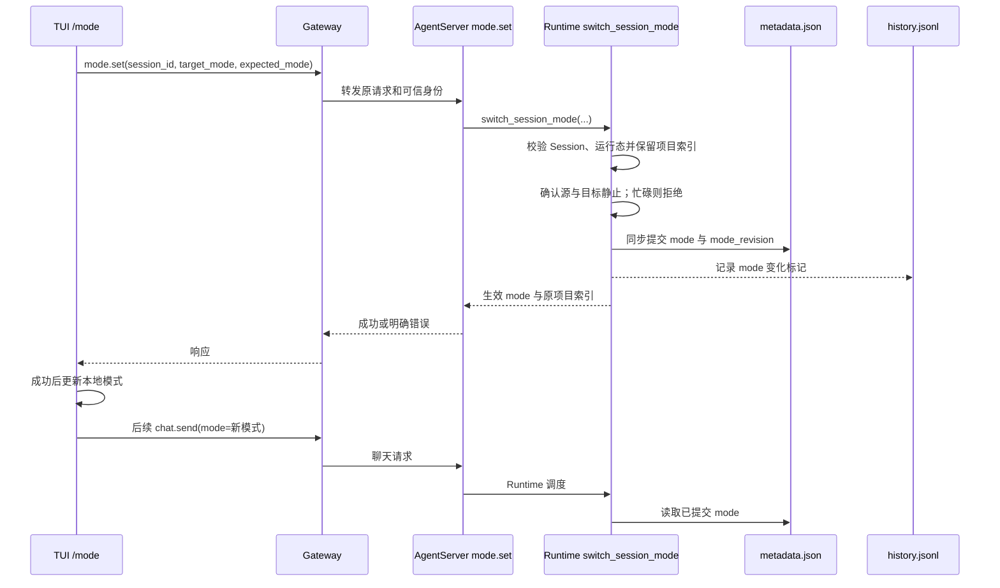

# TUI 会话模式显式切换与运行态一致性

## 1. 定位与证据边界

本文是开发前草案。用户已确认目标为同一 TUI Session 内四种主模式（agent.work、agent.code、team.work、team.code）互切；本次只接入 TUI，Web 和插件保留未来接入设计。用户已选择分阶段交付：本次仅实施第一阶段的模式路由，第二阶段的上下文交接补丁另行接入。第一阶段可以在切到另一执行者时打开新的模型上下文窗口，不能宣称 work Agent/Team 已共享对话窗口。用户已确认同一 Session ID 的记录默认保留在原项目索引，只有用户明确指定重绑时才改变项目归属；见第 8 节。本文不表示实现、评审或测试已完成。

本设计解决“客户端声明了新模式，但 Runtime 仍按旧 Session 类型执行”的问题。[GitHub PR #9804](https://github.com/openJiuwen-ai/jiuwenswarm/pull/9804) 对应本仓 `71dff8527`：`AgentRuntime.normalize_request` 在调度前绕过缓存读取 `metadata.mode`；请求跨 agent/team 类型时，将请求纠正为已存类型。这保留了防止历史会话被误送入另一执行路径的保护，但要求显式模式切换先更新已存事实。

用户提供的 `context-session.patch` 是另一个**尚未应用到当前工作区**的候选改动，包含 `D-20261028-1704-agent-leader-context-handoff` 和跨仓 Agent/Team Leader 对话交接实现。用户报告已在补丁环境验证：同一 work Session 在 Agent 与 Team Leader 间切换时，新执行者继承上一执行者的对话窗口。补丁使用独立的 `metadata.conversation_handoff` owner/journal 与实际 checkpoint，覆盖 work profile 的 agent/team normal/plan；本仓尚未复验该补丁与 PR #9804 后代码的集成。用户确认先保证 work 内 Agent/Team 上下文继承，跨 work/code 的上下文继承不在此补丁范围。

已核对当前工作区状态：PR #9804（`71dff8527`）在仓库历史中，`normalize_request` 位于 `jiuwenswarm/runtime/service.py:3750`；交接补丁尚未应用（`jiuwenswarm/runtime/context_handoff.py` 与配套 Core 的 `core/context_engine/conversation.py` 均不存在）。因此第一阶段必须先于补丁交付，并预留补丁所需的字段与屏障。

交接补丁的**触发条件**依赖请求参数中的 `mode`（`request_kind()` 读取 `params["mode"]`），而 #9804 在适配器之前把跨类型请求的 `mode` 纠正为已存值。二者叠加的直接后果是：**只有先通过 `mode.set` 提交 `metadata.mode`，交接层才能看到切换意图**；未提交的请求级切换在到达交接层之前已被抹平，既不报错也不交接。这不改变补丁“用 owner/journal 而非 UI mode 决定对话归属”的设计，但把“先提交、后发请求”从操作建议升级为硬约束（见第 3 节不变量 8、9）。

## 2. 当前调用链与问题

| 环节 | 当前事实 | 依据 |
| --- | --- | --- |
| TUI `/mode` | 先 `ctx.setMode`，随后尝试 `mode.set`；失败被吞掉，界面仍提示成功 | `mode.ts::switchMode` |
| Gateway | TUI `CLI_FORWARD_REQ_METHODS` 不含 `mode.set`，也没有同名本地 handler；未知方法返回错误 | `tui_connect.py`、`app_gateway.py` |
| AgentServer | `BEFORE_CHAT_REQUEST` 在聊天请求进入 Runtime 前执行；当前没有 `mode.set` 分派 | `agent_ws_server.py` |
| Runtime | `normalize_request` 从磁盘读取 `metadata.mode`；跨 agent/team 时以已存类型覆盖请求 | `runtime/service.py` |
| 交接触发（补丁） | `request_kind()` 读 `params["mode"]` 决定是否进入交接；该值在适配器之前已被 #9804 纠正，交接层看不到被拒绝的切换意图 | `runtime/context_handoff.py`（补丁） |
| Session metadata | `mode` 可由显式聊天轮次覆盖；`work_mode`、`project_id`、`project_dir` 是首次绑定字段 | `session_metadata.py::sync_session_request_metadata` |
| Team | TeamManager 持有 producer、waiter、Runner 等 Session 运行态，已有 `stop_session_runtime` | `team_manager.py` |

例如 `metadata.mode=agent.work.normal` 时，TUI `/mode team.work` 只改本地值，下一条 `chat.send` 虽携带 `team.work.normal`，Runtime 仍将其纠正为 agent。聊天轮次随后可再次把旧 mode 写回 metadata。反向切换同理。

Session ID 决定产品会话和历史文件位置；Agent 与 Team Leader 仍各有自己的执行实例和上下文 checkpoint。用户观察到当前版本跨执行者切换会打开新的对话窗口。即使先修通 `mode.set`，也只能使新类型开始执行；同一个 Session ID 本身不会把旧执行者的模型上下文交给新执行者。work 内的连续对话须由用户提供的交接补丁完成。

`BEFORE_CHAT_REQUEST` 是可用的扩展点，但仅对 `chat.send`、`chat.resume`、`chat.user_answer` 触发。`mode.set` 必须有独立的服务端入口；普通聊天请求携带不同 mode 不应自动获得切换权限。

## 3. 目标、范围与不变量

1. `/mode` 在原 Session ID 中完成受控切换。TUI 收到服务端成功确认后才更新可见模式和提示；失败时显示原因，下一条消息仍按旧模式发送。
2. agent/team 类型、normal/plan 状态、work/code 执行 profile 与持久化 `metadata.mode` 一致。`project_id`、`project_dir`、`work_mode` 表示会话创建时的项目索引，默认不随 `/mode` 改变。已存在的 `/mode plan` 等别名须继续按现有 canonical 规则处理。
3. `mode.set` 成功确认后，随后进入 Runtime 的聊天请求不被 PR #9804 的跨类型纠正逻辑改回旧类型。
4. 不让旧 Team 执行与新类型的聊天轮次同时写入同一 Session。work Agent/Team 的上下文交接要求源和目标静止；有运行任务、工具或待答交互时拒绝切换。用户取消任务属于独立操作，确认彻底收尾后才可重试切换，不在 `mode.set` 内自动停止团队。
5. `metadata.mode` 是路由权威事实；每轮 `history.jsonl` 的 mode 记录保持真实执行类型。切换标记用于回放和诊断，不反向决定路由。
6. 本次不接入 Web 或新的 routing plugin，不改变 PR #9804 对未显式切换请求的保护。后续交接 patch 的对话 owner 与 Session 路由 mode 保持独立。
7. 第二阶段的上下文目标是 `agent.work ↔ team.work` 双向继承：Agent 收到 A，切到 Team 后 Leader 能引用 A 并收到 B，再切回 Agent 后能引用 A/B；保留原 Session ID、历史及 work 项目绑定。第一阶段只验证路由与持久化状态；该端到端结果以交接补丁与本方案集成后验证。
8. `mode.set` 是让切换意图被交接层看见的唯一入口。提交成功后，TUI 下一条 `chat.send` 携带的 mode 必须与已提交 mode 一致；若携带旧值，Runtime 会按已提交的新模式纠正该请求。该约束对 `agent.work ↔ team.work` 尤其关键，因为它是唯一会触发上下文交接的方向。
9. `mode.set` 与交接补丁的归属判定必须共用同一个 Session 级屏障。`ConversationHandoff.lock` 与切换屏障不得各自独立加锁：否则会出现 `metadata.mode` 已提交为 team、`conversation_handoff.owner` 仍为 agent 的中间态，或两把锁在同一 Session 上互相等待。锁序须在实施阶段显式定义并写入代码注释。

## 4. 总体方案

`switch_session_mode` 是 AgentServer 所在进程中的唯一业务入口。Gateway 只负责请求转发和响应关联；TUI 只负责用户意图、确认及界面状态。AgentServer 负责按已有 Session 生命周期与用户隔离规则校验目标 Session，避免 Gateway 在分离部署场景写错数据目录。未来 Web 的显式切换和可信插件意图可调用同一入口，但不在本次接线范围。

## 5. 控制协议草案

`mode.set` 是新增请求方法，不是 `chat.send` 的特殊文本。`ReqMethod` 的权威定义在被 pin 的 `openjiuwen-protocol`；实施时应先核对并更新协议包，若需临时兼容补丁，Gateway 与 AgentServer 必须识别同名同值成员，不能只扩展一侧。

| 字段 | 草案语义 |
| --- | --- |
| `session_id` | 必填；从已认证请求绑定的 Session 解析，不接受跨用户切换 |
| `mode` | 必填；TUI 发送受支持的 canonical agent/team work/code normal/plan 值 |
| `expected_mode` | 推荐携带；与磁盘当前 mode 不同则返回冲突，防止陈旧 TUI 覆盖其他入口的更新 |

成功响应返回 `previous_mode`、`mode`、`work_mode`、`project_id`、`changed`。`changed=false` 表示同目标幂等重试；成功仅在权威 metadata 同步落盘后返回。失败使用清晰的 `BAD_REQUEST`、`NOT_FOUND`、`SESSION_BUSY`、`MODE_CONFLICT`。超时后 TUI 以同目标、同 `expected_mode` 幂等重试，并只依据权威响应更新显示。

TUI 目前 `requestAgentServer` 会自动附带本机 `project_dir`、`cwd` 等参数；`mode.set` 不据此改变项目索引。`/swarmflow on` 也调用 `mode.set`，须使用同一成功/失败语义，不能继续吞掉失败。TUI 现有“中断任务并切换”提示需要改成与服务端静止条件一致的流程；不能只发送事件式 `chat.interrupt` 就宣称切换成功。

## 6. 切换提交、并发与异常

### 6.1 提交顺序

1. AgentServer 验证请求的 Session、当前 mode、目标 canonical mode 和生命周期状态；以 Session 为键建立与聊天准入**以及交接补丁 `ConversationHandoff.lock`** 共同遵守的切换屏障。单独给 `mode.set` 加锁不足以防止同时进入的 `chat.send` 越过切换；若两者各自持锁，必须在实施时固定锁序（建议：切换屏障 → handoff lock），禁止反向持有，并补并发用例覆盖。
2. 检查当前活跃执行、工具及待答交互。work Agent/Team 任一交接端忙碌时返回 `SESSION_BUSY`，保持旧 mode 和实际对话 owner；不在 `mode.set` 内自动取消。若用户另行取消任务，必须等待 TeamManager/Runtime 确认停止并重新满足补丁的静止条件，随后重新发起切换；不能只发一个不等待的 `chat.interrupt` 就提交新 mode。
3. 保持原有项目索引字段不变；即使跨 work/code，也只提交执行模式 `mode`。用户显式执行现有项目重绑操作时，继续由该操作负责项目归属。不得用目标执行 profile 改写 `work_mode` 或创建新的项目索引项。
4. 在现有文件锁和生命周期写保护下同步提交；写入时仅拥有本次字段，保留其他进程最新的 pin/model 等字段，并防止旧异步历史快照回滚切换。`last_message_at` 和消息计数不因纯控制请求改变。**`mode` 必须与 `conversation_handoff` 同等纳入归属保护**：当 `conversation_handoff.pending` 非空或切换屏障持有期间，陈旧 metadata 写入不得回滚 `mode`。补丁目前只在 `_write_metadata_unfenced` 中保护了 `conversation_handoff`，第二阶段必须同步扩展，否则会出现 journal 指向 team、`metadata.mode` 被在途请求写回 agent 的分叉。
5. 提交后释放屏障并返回新状态。追加独立的 `session.mode_changed` 历史标记供诊断；它不得被解释为 user/assistant 聊天轮次，也不得再次修改路由 mode。metadata 与 history 是两个文件，标记失败需记录并可重试，不能把未提交的标记当作切换成功证据。

失败边界：提交前校验、停止或项目解析失败时保持原 mode；提交后响应丢失时，重复请求依 `expected_mode` 和目标 mode 判断是否已经完成，不反向执行旧模式清理。Session 归档、删除或项目重绑并发发生时，以现有生命周期 generation/锁拒绝或重试，不能复活已关闭目录。实施时须核对 `SessionRunAdmission`、Coordinator 和 metadata 写队列的具体锁顺序，避免与 TeamManager 的生命周期锁互等。

### 6.2 缓存与恢复

当前未找到独立的“session-kind cache”；Runtime 的模式纠正使用 `get_session_metadata(cache_bust=True, enable_writeback=False)`。现有 metadata 缓存需要在切换写入后与磁盘一致，但不为不存在的缓存新增清理 API。若实施检索发现其他按 Session 类型持有的缓存，补充失效点与回归用例。进程重启后只从 metadata 和已有运行态恢复，不依赖 TUI 本地 mode。

## 7. 与对话上下文交接 patch 的后续接线

用户提供的 `context-session.patch` 通过 `conversation_handoff.owner/pending` 标识**实际对话执行者**，并在下一个真实聊天请求消费输入之前，将 work Agent 的 context 快照交给 Team Leader，或反向交接。它不从 `metadata.mode` 推断**源身份**；同一实际执行者在 normal/plan 间切换不复制消息。但它的**触发条件**来自请求参数 `mode`（`request_kind()`），因此与 #9804 存在顺序耦合：只有 `mode.set` 先提交 `metadata.mode`，`chat.send` 才不会被纠正回旧类型，交接才会被触发。补丁要求源和目标静止，忙碌、未完成工具或待答交互时立即拒绝，且不自动暂停。

第一阶段的 `mode.set` 提交**路由意图与 Session 模式事实**，可能切换到另一执行者的新模型窗口；第二阶段接入补丁后，在下一条聊天执行前提交**对话 owner 与 checkpoint**，使 work 内的对话连续。四种主模式互切只改变执行者和路由，保持原 `work_mode`、`project_id`、`project_dir`；第 8 节说明此项目索引语义。后续集成必须核对：

- `mode.set` 不覆盖或删除 `conversation_handoff` journal；旧 metadata 队列不得回滚其 owner，也不得回滚 `mode`（见 6.1 第 4 步）。
- 若用户在切换前另行取消 Team 工作，取消流程必须保留可恢复的 Leader checkpoint，且交接仍需检查任务板、工具与交互状态；不能把停止请求已发出等同于满足静止条件或上下文已交接。
- `mode.set` 已提交而下条聊天的 context handoff 失败时，聊天应明确失败且不消费用户输入；会话保持可重试状态，不能静默回退到旧对话。需要设计恢复或显式回切，不让路由 mode 和对话 owner 永久无从收敛。
- 该补丁当前仅覆盖 work profile；work ↔ code 的切换不应误触发其交接。若未来要求跨 profile 共享上下文，须另立设计并核对 Core 的会话与工具语义。

### 7.1 补丁接入前必须先修的四个问题

以下问题在补丁代码中已存在，与 #9804 叠加后会使第二阶段直接不可用或静默降级。这些兼容问题留待第二阶段单独设计和验证。

| 编号 | 问题 | 后果 | 修复方向 |
| --- | --- | --- | --- |
| H-1 | `_check_legacy_owner` 要求“上一条用户历史的 mode 等于**目标**类型”才放行 | 老会话（无 journal）的**首次**跨类型切换必然 `retryable=false` 硬失败；必须先发一条同类型请求建立归属才能切 | 改为校验“上一条历史 mode 与目标不同且可解析出源身份”，或直接以历史 mode 作为源身份导出 |
| H-2 | `_write_metadata_unfenced` 只保护 `conversation_handoff`，不保护 `mode` | `mode.set` 提交 team 后，切换前在途的请求收尾时把 `metadata.mode` 写回 agent，journal 与 mode 长期分叉 | 把 `mode` 纳入同一 `merge_fields` 归属判断 |
| H-3 | `ConversationHandoff.lock` 与 Session 切换屏障是两把独立锁 | 可能同时存在“mode 已切、owner 未切”的中间态，或两锁互等 | 合并为一把 Session 级锁，或固定锁序并补并发用例 |
| H-4 | 切到 `team.*` 时未确认 team binding/entity 存在 | 首次切到 team 可能因缺少 `team_name`/`team_template_id` 走默认团队或直接失败 | `mode.set` 在目标为 team 时复用 `team.bind` 的绑定校验；缺失时明确报错而非静默兜底 |

上述均为对用户提供但尚未应用的 patch 的**第二阶段兼容要求**，不是第一阶段或当前仓库的实现保证。用户报告补丁环境已验证上下文继承；本仓需在补丁接入后重验 PR #9804 后的路由与模型实际看到的消息。第一阶段可先通过模拟 `conversation_handoff` 字段的持久化保护测试，为后续合入留出接口。

## 8. 跨 work/code 的项目索引

用户已确认：除非明确指定项目重绑，同一 Session ID 的所有记录应留在原项目索引下。因此 `/mode` 仅切换执行 profile，保留 `project_id`、`project_dir`、`work_mode`、Session ID 和历史文件。`work_mode` 继续表示项目列表中的初始归属，当前执行 profile 从 canonical `metadata.mode` 读取。恢复会话时按原项目查找该 Session，界面模式以 `metadata.mode` 为准。

这取代先前的 P-1 同目录目标项目映射假设，也不自动创建目标 work/code 项目。现有 `/workspace set` 等用户明确指定的重绑操作仍可改变项目索引；该操作是独立入口。开发时须检查所有将 `work_mode` 当作当前执行 profile 的消费方，并让 TUI 的完整 canonical mode 优先决定执行器，避免跨 profile 后被原项目索引反向纠正。
## 9. 实施影响与验证设计

| 实施项 | 位置 | 预期工作 |
| --- | --- | --- |
| I-01 | 协议包、`common/schema/message.py`、Gateway TUI 转发 | 新增并连通 `mode.set`，覆盖未知方法、身份及响应编码 |
| I-02 | `agent_ws_server.py`、`runtime/service.py` | 新增分派和 `switch_session_mode`，与聊天准入协调、检查源/目标运行态，忙碌时拒绝 |
| I-03 | `session_metadata.py`、`session_history.py` | 仅同步提交 `mode`，保护旧异步写不回滚切换，记录独立模式标记；项目索引字段保持原值 |
| I-04 | TUI `mode.ts`、`swarmflow.ts`、恢复会话路径 | 等待成功响应后更新 UI；失败与状态冲突按权威响应处理 |
| I-05 | 中英文模式/项目文档与相应 spec | 同步新控制协议、跨 profile 项目语义和错误提示 |
| I-06（第二阶段） | `context-session.patch` 涉及的 JiuwenSwarm 与 agent-core 范围 | 在第一阶段路由基础上接入实际对话 owner、checkpoint 交接和失败恢复 |

| 验证 ID | 前置与操作 | 通过条件 |
| --- | --- | --- |
| V-01 | agent.work ↔ team.work，原 Session ID 各发一轮 | metadata、实际执行器、历史每轮 mode 和 TUI 显示一致；PR #9804 不把已确认切换改回去 |
| V-02 | agent.code ↔ team.code，含 normal/plan 回归 | 相同类型一致性；plan 入口标记、退出与恢复不退化 |
| V-03 | work ↔ code，含真实项目、默认项目和进程重启 | `metadata.mode` 与执行 profile 一致；原 `project_id`、`project_dir`、`work_mode` 和 Session ID 保持不变，历史连续且仍在原项目索引下 |
| V-04 | 活跃 Team、待答交互、忙碌单 Agent，以及单独取消后的未收尾状态 | 切换立即拒绝且不自动中断；旧 mode/对话 owner 仍生效，无旧新执行并发写入；静止后重试才成功 |
| V-05 | `mode.set` 成功响应丢失、重复请求、并发聊天、陈旧 `expected_mode` | 幂等或明确冲突；最终磁盘事实、运行态与 UI 收敛，不被旧队列回滚 |
| V-06 | 未发送 `mode.set` 的普通跨类型 `chat.send` | PR #9804 仍纠正请求，不能绕过显式切换入口 |
| V-07 | 用户提供的 context patch 后续集成 | Agent 收到 A → Team Leader 能在模型上下文中引用 A 并收到 B → 切回 Agent 能引用 A/B；新建、缓存与冷恢复目标一致；mode.set 不破坏 handoff journal；code 不误入交接 |
| V-08 | 老会话（无 `conversation_handoff` journal）首次执行 `/mode` 跨类型切换 | 允许切换并正确导出源快照，不返回 `context_handoff_source_unknown`；覆盖 agent→team 与 team→agent 两个方向 |
| V-09 | `mode.set` 提交期间并发在途 `chat.send`、以及切换后陈旧 metadata 写入 | `metadata.mode` 与 `conversation_handoff.owner` 始终一致，不被旧队列回滚；无锁互等、无旧新执行并发写入 |

验证层级包括 mode/project 纯解析单测、metadata 写入竞态测试、AgentServer/Gateway RPC 测试及 TUI 命令测试。第一阶段以 V-01 至 V-06 的路由、绑定和并发行为为验收范围；这些用例不能替代 V-07 的上下文继承验收。V-07 在第二阶段 patch 真正接入并有配套 Core 版本后执行；用户对补丁的测试报告是候选证据，不计作当前仓库集成通过。V-08/V-09 是第二阶段的前置门禁：第 7.1 节的 H-1/H-2/H-3 未修复前，不得宣称第二阶段可用，也不得把 V-07 的通过当作整体验收。

## 10. 待决、风险与交接

1. **项目策略**：用户已确认默认保留原项目索引。需在实施阶段核对按 `work_mode` 筛选的会话列表和各执行器消费者，避免将索引归属误读为当前执行 profile；显式项目重绑继续沿用既有独立入口。
2. **协议包发布方式**：`ReqMethod` 归 `openjiuwen-protocol` 所有；实施前确认可更新的版本及 Gateway/AgentServer 部署兼容窗口。
3. **对话交接衔接**：用户选择第一阶段先交付模式路由，第二阶段再让 work Agent/Team 共享对话窗口。提供的 patch 涉及 JiuwenSwarm 和 agent-core 两仓，用户报告已在补丁环境测试，但尚未应用或验证与 PR #9804 后代码的兼容性。第二阶段单独接入、检视并完成 V-07；本设计记录接口和失败边界。
4. **运行态锁次序**：具体复用现有准入和生命周期机制须在开发阶段核对；若无法覆盖 `mode.set` 与聊天归一化，必须补一条同 Session 屏障并做并发验证。该屏障必须同时覆盖交接补丁的 `ConversationHandoff.lock`，否则第二阶段会出现 mode 与 owner 分叉（第 7.1 节 H-3）。
5. **补丁与 #9804 的顺序耦合**：交接层只能看到已提交的切换意图。若未来希望支持“请求级切换”（不发 `mode.set`、只靠 `chat.send` 带新 mode），必须让 `normalize_request` 保留被纠正前的原始 mode（例如写入 `params["requested_mode"]`）并允许交接层据此主动发起交接；本次不做，且该改动会改变 #9804 的安全边界，需单独评审。
6. **老会话迁移**：现有 Session 没有 `conversation_handoff` journal。H-1 未修复前，这些会话的第一次跨类型切换会硬失败；发布说明中须明确“升级后首次切换可能需先发一条同类型消息”，或随第二阶段一并修复后再发布。

相关既有资料：`SDD-0009` 记录过 TUI `/swarmflow on` 的 best-effort `mode.set` 行为；本文仅修订这一局部假设，不替代其 SwarmFlow 设计。`SDD-0029` 描述 Team Session Runtime 生命周期，仍需以当前代码核对。用户提供的 `D-20261028-1704-agent-leader-context-handoff` 仅存在于候选 patch，不代表本仓已批准或已实施。

评审记录：尚未评审；用户已确认四种主模式与 TUI 本次入口范围，本次只实施第一阶段模式路由，第二阶段再接入 work Agent/Team 的上下文交接补丁。用户已确认同一 Session ID 默认留在原项目索引；补丁与当前仓库的集成尚未验证。
