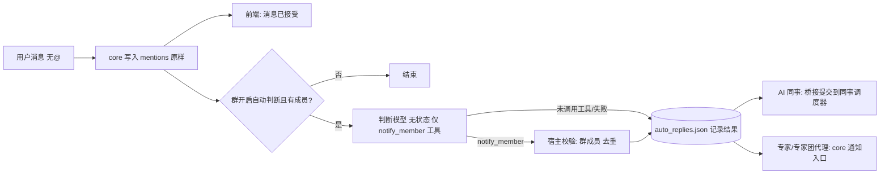

# SwarmChat 群成员自动判断是否回复设计方案

## 1. 设计定位与阅读说明

本文解决“SwarmChat 群里只能靠 @ 下派任务”的问题，参考千问办公 2.0 数字员工的“回复规则”。
方案是：每个群可配置一个无状态的小模型，它阅读群聊记录，通过一个通知工具让相关成员响应；不改写消息的 @。
先读第 2 章的场景与 4.1 的主链路；第 3 章列出需要确认的选择和对 core 的依赖。本文是开发前方案，尚未评审。
2026-11-24 增补“多专家团协作决策”（D-06、5.12），相关条目均标注 5.12；同日已实现，实施与验证情况见关联 F 文档。

## 2. 背景、目标与范围

### 2.1 背景与问题

已核实的当前行为：

- 用户消息的 `mentions` 为空时只归档：`team_helpers.py` 在 `group_input["mentions"]` 为空时发出 `team.group_message.accepted` 后结束处理。
- 专家与专家团代理由 core 唤醒，启动与读取都只认消息 meta 的 `mentions`（agent-core `message_dao.get_unread_group_members`、`get_broadcast_messages`、`GroupMessageHandler.start_mentioned_members`）。
- AI 同事由宿主 `ColleagueGroupBridge` 唤醒，回调、补扫与 `_submit` 都要求 `member_name in message.mentions`（`swarmchat/bridge.py`）。这是宿主代码。
- 群里只有一位人类（群主），其余都是专家、专家团代理或 AI 同事。

因此用户不 @ 时没有任何成员处理，用户必须自己判断该找谁。

### 2.2 目标与关键场景

| 场景 / 触发条件 | 当前行为 | 目标行为 / 可观察变化 |
| --- | --- | --- |
| 群开启自动判断，用户发送未 @ 的消息 | 只归档 | 消息立即被接受；随后判断模型决定通知哪些成员，被通知的成员以自己的身份回复；用户消息下显示“X 正在响应” |
| 同上，发送“你好” | 只归档 | 完全由判断模型决定是否通知以及通知谁，没有针对寒暄的硬规则 |
| 同上，用户要一份需要多个专家团共同完成的成果（5.12） | 只归档 | 判断模型选出 Owner 与参与的专家团；只有 Owner 被唤醒，由它决定直接回答、追问或启动协作；启动后只形成一个 Team Organization，只回一份汇总 |
| 同上，判断模型认为无人需要响应 | 只归档 | 保持归档，消息下显示“无需成员回复” |
| 用户显式 @ 了成员 | 被 @ 成员回复 | 不变，不做判断 |
| 群未单独配置判断模型 | 只归档 | 用群会话模型做判断，其余同上 |
| 群关闭了自动判断，或所有成员都被改为“被 @ 时回复” | 只归档 | 不变，不调用模型 |
| 升级前已存在的群，用户发送未 @ 的消息 | 只归档 | 自动判断默认开启，行为与新群相同（见 9.1） |
| 判断模型超时或出错 | 不适用 | 消息已归档，不通知任何人；界面提示可 @ 成员 |
| 任意场景下的历史记录 | `mentions` 为用户所选 | `mentions` 仍只包含用户真正 @ 的成员，history.jsonl 中的消息不因自动判断而变化 |

### 2.3 本次范围与非目标

- 本次包含：群级自动判断开关与判断模型配置；判断与通知工具；通知的持久化、去重与恢复；三类成员的通知送达；界面展示。
- 2026-11-24 增补：判断模型的多专家团协作决策（5.12）。只覆盖专家团代理；单个专家与 AI 同事不能加入协作。
- 交付不分期：专家、专家团代理与 AI 同事同时支持，因此 core 的通知入口是本次交付的前置。
- 本次不包含：
  - 成员发出的消息触发判断。成员之间继续用结构化 mentions 接力，避免互相唤起。
  - 显式 @ 的消息再追加判断。
  - 判断模型发言、保留会话或拥有除通知以外的工具。
  - 飞书、钉钉、WeLink 群。

### 2.4 术语

- 判断模型：群级配置的小模型，未配置时回退到群会话模型。每次调用只拿到本次输入，不保留任何会话，也不是群成员。
- 自动判断开关：群级设置，对全群成员一起生效，不区分成员。开启时群内所有成员都可被判断模型通知；任何情况下被 @ 都会回复。
- 通知：宿主记录的“请成员 M 响应消息 X”，与消息的 `mentions` 相互独立。
- 协作决策：判断模型对一条消息作出的“由这几个专家团共同完成，其中一个为 Owner”的决定，与逐个通知互斥。
- 组织候选：`organization_routes.json` 中按用户消息 `client_message_id` 记录的待 Owner 决策的多专家团请求，显式多 @ 与协作决策共用。

## 3. 设计约束、假设与待决问题

- 已确认约束：
  - 不改写消息的 `mentions`（用户要求）。
  - core 当前没有 `mentions` 之外的群消息寻址方式；点对点私信对宿主管理成员不可用（`tool_message.py`），对专家是否能启动未运行的成员并使其公开回复未核实，本方案不依赖私信。
  - AI 同事的幂等依靠 `swarmchat_mentions` 表与请求的 `source_ref`（`swarmchat:<群>:<消息>:<同事>`），与触发原因无关，可直接用于通知。
- 依赖：本次需要 core 新增通知入口（5.3 的草案），发布 core 并更新本仓固定版本后才能交付。core 侧的详细设计见 agent-core 仓库的 `D-20261121-0832-group-member-notification`（草稿）。
- 已核实的前提（2026-11-21，读码确认，未运行）：
  - A-01 成立。core `Model.invoke(messages, *, tools=..., timeout=...)` 返回带 `tool_calls` 的 `AssistantMessage`；宿主已有同样用法（`interface_deep.py` 的 recap 调用、`moa_progress.ReferenceProgressModel`）。模型由 `ModelSelectionResolver` 与 `model_compiler_adapter.build_model_from_selection` 从一份模型选择构造；群会话的模型选择由 `common/model_selection_store.get_session_model_selection(session_id)` 读取。小模型是否稳定产生工具调用仍需真实模型验证（V-10）。
- 待决问题（2026-11-24 真实联调后提出，见 5.13）：
  - Q-06 运行中任务的停止入口：判断模型把未 @ 的停止或修改请求转给该任务的 Owner（方案 A），恢复页面上针对组织卡片的停止（方案 B），或两者都做。
  - Q-07 判断超时：维持 30 秒并引导配置小模型，提高到 60 秒，或超时后重试一次。
- 已确认（见第 10 章）：单条消息不设通知数量上限，由判断模型决定；不分期，三类成员同时支持；消息带 @ 时不判断；只设群级总开关，不设按成员的回复规则；判断超时 30 秒；未配置判断模型时回退到群会话模型；升级前已存在的群同样默认开启。

## 4. 总体方案与设计取舍

### 4.1 方案概览

用户消息照常写入，随后宿主在后台调用判断模型。模型看到成员名册和最近群聊记录，通过 `notify_member` 工具指出应响应的成员，可以不调用。宿主校验后保存通知，再按成员类型送达：AI 同事走宿主桥接，专家与专家团代理走 core 的通知入口。

箭头表示调用顺序。判断在消息被接受之后进行，不影响发送。

### 4.2 关键决策

#### D-01 通知与 mentions 分离

- 选择与依据：用户要求不显式 @。消息保持用户发出时的内容，“谁被叫来”是独立事实，历史与界面都能区分用户 @ 与自动判断。
- 代价：专家与专家团代理需要 core 新增入口；界面的等待占位不能再依赖 `message.mentions`。
- 相关候选：R-01。

#### D-02 群级无状态判断模型加单一通知工具

- 选择与依据：一次调用同时看到全部群成员，多人相关时只挑最合适的，成本与成员数无关。工具调用天然表达“零位、一位或多位”，寒暄等场景不需要宿主写规则。无状态使它不产生会话历史，也无需恢复上下文。
- 代价：判断只依据成员简介与最近公开消息，不了解成员私有上下文；小模型的选人质量依赖成员简介质量。
- 相关候选：R-02、R-03。

#### D-03 先写入消息，后判断

- 选择与依据：通知不属于消息内容，无需在写入前得到结果，因此发送没有额外等待。
- 代价：判断完成前的短时间内，界面只能显示“判断中”。

#### D-04 只对未 @ 的用户消息判断，通知数量由模型决定

- 选择与依据：群内只有群主是人类，成员消息不参与判断即可避免自动循环。通知几位成员完全由判断模型决定，宿主不设上限。通知不经过 `mentions`，不会触发多专家团的组织编排。
- 代价：模型可能一次通知多位成员，包括多个专家团代理；它们各自独立响应，开销随通知数增长（见 9.1）。
- 2026-11-24 修订：`notify_member` 的通知仍不形成组织；需要组织协作时，除显式 @ 外，判断模型可作出协作决策（D-06）。
- 确认依据：需求方 2026-11-20 确认不设上限。

#### D-06 协作是独立于通知的显式决策，只唤醒 Owner

- 选择与依据：“请几位成员各自回答”和“请几个专家团交一份联合成果”是两种意图，仅凭通知了几个专家团无法区分，因此新增独立工具 `coordinate_expert_groups`，`notify_member` 的语义不变。协作决策只登记组织候选并通知 Owner，之后完全沿用显式多 @ 的流程：Owner 自行选择普通回复、追问或 `run_team`，确认后由 `group_route.activate` 私信其余专家团加入。是否真正开组织仍由 Owner 把关，判断模型误判的代价是一次 Owner 轮次。
- 代价：组织判定不再只看 `mentions`，群轮次校验要多读一份记录；Owner 由小模型指定，选得不合适时用户只能停止后改用 @。
- 相关候选：R-05、R-06。

#### D-05 失败时不通知

- 选择与依据：判断不可用时保持现状，不随意唤起成员。
- 代价：用户需要看到提示后改用 @。

### 4.3 替代方案与排除理由

| 候选 / 关联决策 | 候选目的与关键差异 | 拒绝或暂缓原因 | 重新评估条件 |
| --- | --- | --- | --- |
| R-01 / D-01 写入前判断并把结果并入 mentions（本文初稿） | 不改 core 即可覆盖三类成员 | 历史中出现用户未写的 @；发送要等待模型；需另存记录区分来源；可能误触发组织编排 | core 通知入口长期无法落地 |
| R-02 / D-02 每个成员各自被唤醒后自行决定是否沉默（OpenClaw、AstrBot 的做法） | 判断可利用成员私有上下文 | 每条消息对每个自动成员跑一轮完整执行，沉默的轮次也进入成员会话历史；多成员可能同时回答 | 上线后漏判明显时，仅对 AI 同事补充 |
| R-03 / D-02 由群 Leader 智能体常驻分派（LobeHub 的做法） | 复用已有智能体 | 改变公开群 Leader 的提示词与轮次模型，影响组织编排 | Leader 承担更多公开协调职责时 |
| R-04 / D-01 宿主给专家发私信要求其回应 | 专家与专家团代理也不改 core | 私信能否启动未运行成员、成员是否公开回复均未核实；私信进入成员私有上下文，语义不清 | 核实可行且 core 入口受阻 |
| R-05 / D-06 协作决策时通知全部被选中的专家团 | 与显式多 @ 时 core 唤醒全部被 @ 成员的行为一致 | 非 Owner 团在 Owner 决策前只会空转一轮；任一通知送达失败会让其余团等待不会到来的成员 | Owner 私信拉人的路径不可用时 |
| R-06 / D-06 通知了两个及以上专家团即视为组织 | 不新增工具 | 改变已交付的“各自独立回复”行为；无法表达只征求多份意见 | 无 |

调研依据：AutoGen `SelectorGroupChat`（集中选人、名称加描述作为依据）、Heartflow（独立的便宜判断模型、失败即跳过）、LobeHub（判断者经工具指派成员）。

## 5. 详细设计

### 5.1 模块责任与关键不变量

- `server/runtime/group_service.py`：保存与校验群的自动判断开关与判断模型配置，对外投影。
- 新模块 `server/runtime/group_auto_reply.py`：触发条件、判断调用、`notify_member` 工具、校验、结果持久化、送达与恢复。
- `server/runtime/agent_adapter/team_helpers.py`：未 @ 的用户消息被接受后，调度一次后台判断。
- `jiuwenmate/swarmchat/bridge.py`：新增按通知提交的入口，复用现有预留、去重与调度。
- agent-core：成员通知入口（改动点见 5.11）。
- `agents/swarm/group_turn.py`：专家与专家团代理的群轮次校验接受“被通知”作为寻址依据（见 5.11）。
- 前端 `features/groupChat`：配置入口与消息上的状态展示。
- `agents/swarm/group_route.py`、`group_org_bootstrap.py`、`group_execution.py`：组织候选、Owner 准入与组织执行。协作决策复用它们，只调整提示词（5.12）。

不变量：

- INV-1 自动判断不修改任何消息的内容与 `mentions`。
- INV-2 每条用户消息至多判断一次；每个（消息, 成员）至多送达一次通知，重启后同样成立。
- INV-3 通知对象只能是当前名册中的成员，且群开关处于开启状态。
- INV-4 判断的成败不影响消息归档。
- INV-5 用户显式 @ 的消息不经过判断。
- INV-6 一条消息的判断结果要么是若干独立通知，要么是一个协作决策，不同时成立。
- INV-7 协作决策的成员全部是当前名册中的专家团代理，至少两个，Owner 在其中且排在首位。
- INV-8 协作决策只通知 Owner；其余专家团只在 Owner 接受任务后经现有组织流程加入。
- INV-9 `notify_member` 产生的通知不形成 Team Organization；组织只来自显式多 @ 或协作决策。

### 5.2 关键函数

| 函数 / 所属模块 | 签名与变更类型 | 职责与调用方 | 约束 |
| --- | --- | --- | --- |
| `group_auto_reply.schedule` | `(session_id: str, message_id: str) -> None`，新增 | `team_helpers` 在未 @ 的用户消息被接受后调用，创建后台任务 | 不满足触发条件时不做任何事；不抛出 |
| `group_auto_reply.judge` | `async (group: dict, message_id: str) -> dict`，新增 | 执行一次判断并保存结果 | 已有非 `pending` 结果时直接返回 |
| `group_auto_reply.deliver` | `async (group: dict, message_id: str) -> None`，新增 | 把未送达的通知按成员类型送达 | 可重复调用 |
| `group_auto_reply.recover` | `async () -> None`，新增 | 服务就绪后处理中断的判断与未送达通知 | 见 5.10 |
| `ColleagueGroupBridge.notify` | `async (group_id: str, member_name: str, message: ConversationMessage) -> bool`，新增 | 提交一条通知给同事调度器 | 与 `submit` 共用在途集合、`reserve` 与 `accept`，不检查 `mentions` |

### 5.3 接口与消息契约

| 入口 / 消息 | 调用方 | 输入与成功结果 | 失败语义 |
| --- | --- | --- | --- |
| `group.update` 新增字段 `auto_reply` | Web 前端 | `{enabled, model_selection}`，两个字段均可单独提交；返回群公开信息 | 模型选择无法解析时 BAD_REQUEST |
| 群公开信息 | Web 前端 | 增加 `auto_reply` | 旧数据缺省为开启、未单独配置模型 |
| 群历史响应 `auto_replies` | Web 前端 | `{message_id: {status, notified: [member_name]}}` | 缺失时不显示 |
| 事件 `group.auto_reply.updated` | 当前群订阅者 | `{message_id, status, notified}`，经 `GroupQuestions.publish` | 尽力而为，以历史接口为准 |
| 判断模型工具 `notify_member` | 判断模型 | `{member_name: string, reason: string}`；可调用多次 | 非群成员与重复的调用被忽略并记录 |
| 判断模型工具 `coordinate_expert_groups`（5.12） | 判断模型 | `{owner: string, members: string[], reason: string}`；`members` 含 `owner` | 不满足 INV-7 的调用被忽略并记录；合法时同一响应中的 `notify_member` 被丢弃，多次调用只取第一个 |
| 群历史响应与事件中的 `organization`（5.12） | Web 前端 | 协作决策时为 `{owner, members}`，否则缺省；此时 `notified` 只含 Owner | 缺失时按独立通知展示 |
| core `TeamBackend.notify_group_member`（见 core 设计） | 宿主 | `(member_name, message_id, *, notification_id)`；持久化通知，成员启动与读取群消息时把被通知的消息视为寻址到自己。`notification_id` 取 `auto-reply:<message_id>:<member_name>` | 未知成员或消息抛 `ValueError`；`notification_id` 重复为无操作 |

判断模型的输入：系统指令（任务、只能用工具、可不调用、群内只有一位人类）、群成员的显示名与类型及简介、最近公开消息、当前消息。不向模型提供是否回复的硬规则，由模型决定。

### 5.4 配置与能力控制

- 开关：群级 `auto_reply.enabled`，缺省为开启；群主可在群设置中关闭。
- 判断模型：群级 `auto_reply.model_selection`，在群设置中选择，修改后对之后的消息生效。未配置时使用群会话当前解析出的模型选择；该模型也无法解析时按判断失败处理。
- 以模块常量实现、暂不开放配置：判断超时 30 秒；上下文为最近 10 条公开消息，每条截断 500 字符；成员简介截断 200 字符。

### 5.5 数据模型与事实归属

| 数据 | 语义与隔离范围 | 权威位置 | 创建、更新与释放 |
| --- | --- | --- | --- |
| `auto_reply: {enabled, model_selection}` | 群的自动判断开关与判断模型；缺省为开启、模型为空（回退群会话模型） | `group.json` 顶层新字段 | `group.update` 在 `group_lock` 内写入 |
| 判断结果与通知 `{message_id: {status, notified: [{member, reason, delivered}], error, decided_at}}` | 一条用户消息的判断与送达状态；`status` 为 `pending` / `notified` / `none` / `failed` | 群会话目录 `auto_replies.json`（与 `organization_routes.json` 并列，同样的原子写与按群锁） | 判断开始前写 `pending`；清空历史时不再返回清空时间点之前的记录；随群删除 |
| 协作决策 `organization: {owner, members}`（5.12） | 判断结果记录上的可选字段；`members` 中 Owner 在首位 | 同一条 `auto_replies.json` 记录 | 与判断结果一并写入，之后不修改 |
| 组织候选 | 待 Owner 决策的多专家团请求 | 现有 `organization_routes.json`，不新增字段 | 协作决策送达时经 `group_route.record_candidate` 写入；后续状态由现有组织流程维护 |
| 同事通知的处理状态 | 幂等与接受状态 | 现有 `swarmchat_mentions`，不新增表 | 现有 `reserve` / `accept` |

自动判断配置不写入 `members[]`，因为成员条目参与建群令牌与加人回执的身份比对。

### 5.7 正常执行流程

1. 用户消息按现有流程写入 core 并被接受，`mentions` 为用户所选。
2. `mentions` 为空时 `team_helpers` 调用 `schedule`。群关闭了自动判断或没有成员时结束。
3. 后台任务在按消息的锁内写入 `pending`，发布事件，调用判断模型。
4. 宿主执行模型的 `notify_member` 调用：校验成员并去重，收集通知名单。
5. 写入结果（`notified` 或 `none`）并发布事件。
6. 逐个送达：AI 同事调用 `ColleagueGroupBridge.notify`；专家与专家团代理调用 core 通知入口。成功后标记 `delivered`。
7. 被通知的成员按各自现有流程执行并公开回复。成员得到的上下文与被 @ 时相同（触发消息加前序公开消息）。

判断模型作出协作决策时，第 4 至 7 步改为 5.12 的流程。

### 5.8 异常、中断与重试处理

- 判断超时、模型报错或输出无法解析：记为 `failed`，不通知，不自动重试。用户可 @ 成员。
- 已决定但送达失败：保留 `delivered=false`，由恢复流程重试；送达接口幂等。
- 同事不可用：沿用现有行为，由同事侧发出不可用提示。
- 用户停止群：取消该群进行中的判断任务；已送达的同事请求按现有停止流程取消；尚未送出的通知标为已丢弃，已交给 core 的通知不撤回，被通知的专家仍可能回复。调用位置在 `agent_ws_server._handle_cancel` 中现有的“AI 同事停止”旁，同样是附加执行、失败只记录、不阻断原有取消。
- 判断期间成员被移出或群开关被关闭：送达前按当前名册与群开关复核，不符合的通知丢弃。
- 用户在判断完成前又发了新消息：两条消息各自判断，互不取消。

### 5.9 并发与一致性

- 同一消息的判断由按（群, 消息）的锁保护；`auto_replies.json` 的读改写由按群锁保护。
- 通知与用户随后的显式 @ 可能指向同一成员的不同消息，各自独立处理。
- 同事通知与同一消息的回调或补扫之间由现有在途集合与 `reserve` 去重。

### 5.10 持久化与恢复

服务就绪后执行一次 `recover`：

- `pending` 且消息时间在 10 分钟内的重新判断；更早的标记为 `failed`。
- `notified` 中 `delivered=false` 的重新送达。

消息已写入但进程在 `schedule` 之前退出时，这条消息不会被判断；接受该窗口，用户可重发或 @。

### 5.11 专项设计

- 界面：
  - 群设置：新增“自动判断回复”开关（默认开）与“判断模型”选择，未选择时显示“跟随群会话模型”，并提示选用小模型可降低开销与延迟。
  - 用户消息下方：`pending` 显示“判断中”，`notified` 显示“X 正在响应”直到该成员回复，`none` 显示“无需成员回复”，`failed` 显示提示文案。等待占位改为同时依据 `mentions` 与 `auto_replies`。
- core 通知入口的改动点（读码梳理，详细设计在 core 仓库确认）：
  - core 中决定“群消息是否寻址到某成员”的位置共三处，都在 `tools/database/message_dao.py`：`get_unread_group_members`（Leader 据此启动未运行或出错的成员）、`get_broadcast_messages`（成员读取寻址到自己的群消息）、未读成员统计（`row.member_name in meta["mentions"]`）。三处都需要在 `mentions` 之外认可通知。
  - 通知不能复用现有的已读水位。已读状态是每成员一个时间戳，时间早于水位的消息视为已读；而通知是在消息写入之后才产生的，成员可能已经处理过更晚的消息，此时对较早消息的通知会被水位判为已读而丢失。因此通知需要独立的记录与逐条消费状态（建议新表：团队、成员、消息、通知标识、是否已消费），成员消费该消息后标记。
  - 通知写入后需要发布一次事件，使 Leader 的 `start_mentioned_members` 与成员的消息处理被触发；可复用对同一消息再次 `publish_broadcast` 的现有做法。
  - 成员得到的上下文沿用 `group_chat/handler.context_for`，以被通知的消息为触发消息，不需要改。
  - 宿主管理成员（AI 同事）不经过该入口，core 对其保持现有排除。
- 宿主群轮次的改动点：`agents/swarm/group_turn.py` 的 `resolve_group_turn` 与 `_verified_public_broadcast` 当前要求成员名在触发消息的 `mentions` 中，否则轮次为 `unknown`。需改为“被 @ 或存在对该成员、该消息的通知”，通知事实从 `auto_replies.json` 读取。被通知产生的轮次固定为 `direct`，不参与组织判定（组织判定仍只看 `mentions`）。
- 2026-11-24 修订：上一条的“组织判定仍只看 `mentions`”由 5.12 扩展为“`mentions` 或协作决策”；被 `notify_member` 通知的轮次仍固定为 `direct`。
- 安全：用户消息与历史作为数据段提供给判断模型；工具只接受群成员（INV-3），因此消息中的指令最多影响“通知谁”，不能唤起其他成员，也不改变成员自身的权限与审批。

### 5.12 多专家团协作决策（2026-11-24 增补）

本节于 2026-11-24 实现；验证范围与未做的联调见关联 F 文档。

已核实的现状（2026-11-24，读码确认，未运行）：

- 组织候选与正式计划的 Owner 都取成员列表首位：`group_route.record_candidate` 写 `owner_member=names[0]`，`group_org_bootstrap._owner_for_organization` 返回 `names[0]`。
- `record_candidate` 不写进程身份。候选的 `owner_process` 由 Owner 代理开始组织轮次时写入（`group_execution.py` 调用 `owner_process_fields`），计划的 `run_owner` 在 Owner 调用 `run_team` 时写入。判断任务与显式多 @ 的候选登记都由 `team_helpers` 发起，归属相同。
- Owner 接受任务后，`group_route.activate` 以 `SWARM_GROUP_TASK_READY` 私信其余成员；`expand_route_notices` 把该私信还原为原始用户消息加准入上下文。
- `record_candidate` 按 `plan_id` 幂等，但同一 `plan_id` 的成员或正文不一致时抛 `ValueError`。
- 候选在 `pending` 状态超过 `PENDING_SECONDS`（900 秒）未决策时视为失败。

判断：

- 工具 `coordinate_expert_groups(owner, members, reason)` 与 `notify_member` 同时提供给判断模型。专家团代理少于两个的群不提供该工具。
- 判断指令增加一条：只有用户要一份需要多个专家团共同完成的成果时才使用协作工具；征求各自意见仍逐个通知。
- 宿主校验按 INV-6、INV-7 执行。合法的协作决策写入记录的 `organization`，`notified` 只含 Owner。

送达（`group_auto_reply.deliver`）：

1. 按当前名册与群开关复核。协作成员中有人已离群或不再是专家团代理时，整条标为已丢弃，不登记候选，也不降级为独立通知。
2. 调用 `record_candidate(group_id, mentions=members, body=<持久化消息正文>, plan_id=<client_message_id>)`。正文取持久化的用户消息，使重试与重启恢复时与首次一致。
3. 候选登记成功后调用 `notify_group_member(owner, message_id, notification_id=...)`，标识沿用 `auto-reply:<message_id>:<owner>`。
4. 第 2、3 步之间不插入其他等待，使候选的 900 秒计时尽量贴近 Owner 被唤醒的时刻。

群轮次（`agents/swarm/group_turn.py`）：

- 成员不在 `mentions` 中时，先看该消息是否有协作决策且存在包含该成员的组织候选；成立则轮次为 `organization`。否则沿用现状：被通知为 `direct`，都不是为 `unknown`。
- `_verified_public_broadcast` 同样接受这类成员。
- 该规则必须覆盖非 Owner 成员：它们由 Owner 的私信唤起后要解析回原始消息，既不在 `mentions` 中也未被通知。
- `group_auto_reply` 新增读取入口，返回一条消息的协作成员；`is_notified` 保持不变。

提示词（`agents/swarm/group_execution.py`）：

- 静态说明中“消息只 @ 了多个专家团时第一个是 Owner”改为同时覆盖被协作决策选中的情况。
- Owner 待决策轮次的提示补充候选的 `members`。未 @ 时 Owner 无法从消息得知参与者。

之后的 Owner 准入、`run_team`、其余专家团加入、组织卡片、汇总回复、失败与恢复都不改。core 不需要新的入口。

界面：

- 候选事件到达后，现有逻辑已按 `client_message_id` 进入组织分支，只显示 Owner 的占位。
- 候选事件到达前，判断记录带 `organization` 时也按组织处理，不为其余专家团显示占位。
- 提示文案区分“已请 Owner 协调”与“已通知成员分别回复”。

异常与恢复：

- 候选登记抛 `ValueError`（成员或正文与已有候选不一致）时该决策标为已丢弃，不重试。
- 候选已登记但通知未送达时，由 5.10 的恢复流程重放；`record_candidate` 与通知都幂等。
- 整群停止沿用 5.8：尚未送出的 Owner 通知标为已丢弃；已登记的候选交由现有组织停止流程处理。

### 5.13 运行中任务的停止与修改（2026-11-24 提出，待确认）

本节由 5.12 的真实联调引出，是待确认的方案，未实现。

已观察到的问题（2026-11-24 联调，详见关联 F 文档）：

- 协作决策拉起的组织运行了约 30 分钟，期间 Owner 专家团只在做自己的分析，另一个专家团没有收到子任务，卡片显示“总任务数 0”。
- 用户在群里发送未 @ 的“先停止吧”“组织先停止吧”，判断模型按第 2 条规则判为结束话题，不通知任何成员；组织继续运行，最终只能删除群聊才停下。
- 群聊页面没有停止入口（2026-11-23 移除，原因是按钮停不了专家团与组织任务，未排查）。

这个缺口在显式多 @ 时同样存在；自动判断让用户不 @ 也会拉起重量级的组织执行，使问题更容易出现。

方案 A：判断模型把停止与修改请求转给任务的 Owner。

- 判断模型的输入增加本群未结束的执行：`execution_id`、类型（单人、专家团、组织）、负责成员（组织取 `owner_member`）、标题与状态。只提供摘要，不提供任务内容。
- 判断规则增加一条，排在第 1 条之后：消息要求停止、暂停、修改或继续某个未结束的任务时，通知该任务的负责成员；无法确定是哪个任务时通知最近一个。
- 负责成员按现有能力处理：`run_team` 的 `action=cancel` 或 `update` 作用于该 `execution_id`。被通知的轮次仍为 `direct`。
- 前提 A-02（未核实）：组织 Owner 在 `direct` 轮次中能否用 `run_team action=cancel` 停止组织执行，以及其余专家团是否随之停止。实施前需先读码并实测。

方案 B：组织卡片上的停止。

- 在组织卡片上提供停止，调用现有的组织停止路径，不经过判断模型。
- 需要先查清 2026-11-23 移除的整群停止按钮为何停不了专家团与组织任务，避免重复同样的问题。

取舍：A 符合“用户说话、模型分派”的交互，但依赖判断模型与 Owner 两次理解，且停止有延迟；B 确定、即时，但只覆盖组织卡片，且需要先解决已知的停止失效。两者可以同时做。

## 6. 影响面与实施设计

### 6.1 修改点与实施顺序

| 实施项 | 模块 / 文件或符号 | 修改内容 | 前置 / 验证 |
| --- | --- | --- | --- |
| I-01 | `server/runtime/group_service.py`、群 RPC 分发 | `auto_reply`（经 `group.update`）、公开投影、历史响应附带 `auto_replies` | V-06 |
| I-02 | 新增 `server/runtime/group_auto_reply.py` | 判断、工具、校验、持久化、送达、恢复 | V-01 至 V-05、V-07 |
| I-03 | `server/runtime/agent_adapter/team_helpers.py` | 接受未 @ 的用户消息后调用 `schedule` | V-01、V-05 |
| I-04 | `jiuwenmate/swarmchat/bridge.py` | `notify` 入口 | V-01、V-04 |
| I-08 | `server/agent_ws_server.py` 的 `_handle_cancel` | 群取消时取消进行中的判断、丢弃尚未送出的通知 | V-13 |
| I-07 | `agents/swarm/group_turn.py` | 群轮次校验接受通知，轮次为 `direct` | V-09、V-12 |
| I-05 | 前端 `features/groupChat` 与中英文文案 | 配置入口、状态展示、事件处理 | V-08 |
| I-00 | agent-core `agent_teams`（`message_dao.py` 三处寻址、通知表、`TeamBackend` 入口）；本仓固定版本 | 通知入口；发布并更新固定版本 | core 设计确认；是 I-02 中专家送达的前置；V-09 |
| I-09 | `server/runtime/group_auto_reply.py` | 协作工具、校验、`organization` 记录与公开投影、送达前登记候选、协作成员读取入口（5.12） | V-14 至 V-16、V-19 |
| I-10 | `agents/swarm/group_turn.py` | 候选成员在协作决策下得到 `organization` 轮次（5.12） | V-17 |
| I-11 | `agents/swarm/group_execution.py` | 静态说明与 Owner 待决策提示（5.12） | V-15、V-20 |
| I-12 | 前端 `features/groupChat` 与中英文文案 | `organization` 字段、候选到达前的展示、文案（5.12） | V-18 |
| I-13 | `server/runtime/group_auto_reply.py`、群聊前端（视 Q-06 结论） | 运行中任务的停止与修改（5.13） | Q-06 确认、A-02 核实后补充验证项 |

I-09 至 I-12 为 2026-11-24 增补，不依赖 core 新改动；I-13 待 Q-06 确认后再定范围。

升级后已有群的未 @ 用户消息也会触发判断（已确认）；旧消息不补判断，`group.json` 无需迁移，缺省值在读取时补齐，因此不设单独的兼容与迁移章节。升级 core 固定版本的方式与 HOST_MANAGED 相同。

### 6.2 文档同步

- spec：修订 `S_02_colleague-swarmchat`，说明同事可由通知触发、通知与 mentions 的关系、判断结果的归属。
- 使用说明：`docs/zh`、`docs/en` 的 SwarmChat 文档补充自动判断开关与判断模型。
- 实施记录：开发时新建 F 文档并关联本设计。
- 5.12：`S_02_colleague-swarmchat` 中“组织判定只看 `mentions`，通知不会形成 Team Organization”改为 INV-9 的表述；中英文使用说明补充协作决策；实施记录并入 `F_20261121_0906_swarmchat-auto-reply`。

## 8. 验证设计与通过条件

| 验证 ID | 场景 | 操作或入口 | 通过条件 | 层级 |
| --- | --- | --- | --- | --- |
| V-01 | 群有判断模型与一位自动同事，替身模型调用 `notify_member` | 处理未 @ 的用户消息 | 写入 core 的消息 `mentions` 为空；同事调度器收到一条请求；结果为 `notified` 且已送达 | 单测 + 真实 core SQLite |
| V-02 | 模型通知非群成员、重复成员、同时通知多位成员（含两个专家团代理） | 执行工具调用 | 非群成员与重复的被忽略；合法通知全部保留，不截断 | 单测 |
| V-03 | 模型超时、抛错、不调用工具 | 注入故障 | 前两者为 `failed`，后者为 `none`；均无请求产生；消息已归档 | 单测 |
| V-04 | 同一消息重复触发判断与送达，并与补扫并发 | 重复调用 | 模型只调用一次，同事只收到一条请求 | 单测 |
| V-05 | 群关闭自动判断；群内无成员；用户显式 @；成员发出的消息 | 处理消息 | 不调用模型，行为与改动前一致 | 单测 |
| V-11 | 未单独配置判断模型；旧 `group.json` 无 `auto_reply` 字段 | 处理未 @ 的用户消息 | 使用群会话模型完成判断；群会话模型也不可解析时结果为 `failed` | 单测 |
| V-06 | 配置 | `group.update` 的 `auto_reply` | 群主可改开关与判断模型并持久化；非法取值、无法解析的模型、非群主被拒；旧 `group.json` 读出开启、未单独配置模型；旧数据中的 `reply_rules` 被忽略 | 单测 |
| V-07 | 重启恢复 | 构造 `pending` 与未送达记录后调用 `recover` | 近期 `pending` 被重新判断，过期的记为 `failed`，未送达的被送达且不重复 | 单测 |
| V-08 | 前端状态 | group-chat 前端测试 | 四种状态显示正确；被通知成员进入等待占位 | 前端测试 |
| V-09 | 自动专家与专家团代理被通知 | 真实 core SQLite | 未运行的专家被启动并读到该消息，公开回复；消息 `mentions` 不变 | 单测 + core 测试 |
| V-12 | 专家被通知响应一条较早的消息，此前已处理过更晚的 @ 消息 | 真实 core SQLite | 通知未被已读水位吞掉，专家读到该消息并回复；轮次为 `direct`，未产生组织路由 | 单测 + core 测试 |
| V-13 | 判断进行中或通知尚未送出时用户停止群；停止过程出错 | 群取消 | 判断任务被取消且不再产生通知；尚未送出的通知不再送出；出错时原有取消照常完成 | 单测 |
| V-14 | 替身模型调用 `coordinate_expert_groups` 选中两个专家团（5.12） | 处理未 @ 的用户消息 | 消息 `mentions` 为空；组织候选已登记且 Owner 为所选成员；只有 Owner 收到通知；记录带 `organization` | 单测 |
| V-15 | Owner 追问后用户回答，再调用 `run_team`（5.12） | 真实 core SQLite | 追问期间其余专家团未启动；确认后只创建一个组织，只发布一份汇总 | 单测 + core 测试 |
| V-16 | 协作调用不合法：成员不足两个、含单个专家或 AI 同事、Owner 不在名单；协作与通知并存；多次协作调用（5.12） | 执行工具调用 | 不合法的被忽略且其余通知照常；并存时只保留协作；多次只取第一个 | 单测 |
| V-17 | 非 Owner 专家团经 `SWARM_GROUP_TASK_READY` 唤起（5.12） | 解析群轮次 | 轮次为 `organization`；无协作决策时同样的成员仍为 `unknown`；被 `notify_member` 通知的成员仍为 `direct` | 单测 |
| V-18 | 前端协作状态（5.12） | group-chat 前端测试 | 候选到达前后都只显示 Owner 占位；文案区分协调与分别回复 | 前端测试 |
| V-19 | 送达重放；送达前协作成员离群；候选登记被拒（5.12） | 重复调用 `deliver` 与注入故障 | 候选只登记一次、Owner 只收到一次通知；后两者标为已丢弃且无任何成员被唤醒 | 单测 |
| V-20 | 真实模型端到端（5.12） | Web 群内两个专家团，发送需联合交付的请求与只征求意见的请求 | 前者只形成一个组织并回一份汇总，后者各自回复；记录各自的决策 | 真实联调 |
| V-10 | 真实模型端到端 | Web 群配置小模型，发送职责内问题、“你好”、“谢谢” | 记录各自的通知结果与从发送到通知的耗时；history.jsonl 中用户消息无自动产生的 @ | 真实联调 |

## 9. 设计风险与已知限制

### 9.1 设计风险

| 风险 / 触发条件 | 影响 | 应对 | 核实方式 |
| --- | --- | --- | --- |
| 小模型选人不稳定或不调用工具 | 漏通知或错通知 | 成员简介作为主要依据并放宽到 200 字符；界面显示被通知的成员，用户可停止或改用 @ | V-10 的样例 |
| core 通知入口延期 | 整个功能无法交付（不分期） | 先在 core 仓库确认入口设计；宿主侧可并行开发并以替身入口测试 | core 设计评审 |
| 模型一次通知多位成员，尤其多个专家团代理 | 多个回复同时出现，专家团代理各自启动团队执行，开销大 | 界面显示全部被通知成员，用户可停止；判断指令说明应只通知确有必要的成员 | V-10 记录每条消息的通知数 |
| 小模型不稳定产生工具调用 | 漏通知 | 输出无工具调用且正文含名单时不做猜测，记为 `none`；必要时退化为 JSON 名单输出 | V-10 |
| 回退到群会话模型且默认开启 | 未配置小模型的群（含全部已有群）每条未 @ 的用户消息都用主模型多调用一次，费用与延迟高于小模型；已有群升级后成员会开始主动响应 | 群设置提供关闭开关与小模型选择并给出提示；发布说明中写明该变化 | V-10 记录回退场景的耗时 |
| 判断模型误把征求意见当作协作，或反之（5.12） | 用户得到一份汇总而非多份回答，或多个专家团各自执行 | Owner 可选择普通回复而不开组织；界面显示决策类型，用户可停止后改用 @ | V-20 |
| 协作候选登记后 Owner 通知延后送达（5.12） | 候选 900 秒计时从登记开始，通知积压过久时 Owner 被唤醒前候选已超时失败 | 登记紧邻通知之前执行；超时后用户重发或改用 @ | V-19 |
| 判断模型指定的 Owner 不合适（5.12） | 汇总由不合适的专家团发出 | 判断指令要求选择职责最贴近请求的专家团；用户可显式 @ 指定顺序 | V-20 |
| 判断模型响应慢（2026-11-24 实测） | DeepSeek-V4-Pro 单次判断 4 至 69 秒，页面上三次发送中两次在 30 秒超时；超时后协作请求无任何成员处理 | 见 Q-07；界面提示可 @ 成员 | F 文档 2026-11-24 联调记录 |
| 组织执行耗时长且进度不可见（2026-11-24 实测） | Owner 专家团单次模型调用 5 至 6 分钟，约 24 分钟后才建出私有任务；其余专家团闲置，卡片显示 0 个子任务 | 属现有组织流程与模型时延，不由 5.12 引入；显式多 @ 同样受影响。需要停止时见 5.13 | 未与当日显式多 @ 对照 |

### 9.2 已知设计限制

- 成员消息不触发判断；成员之间仍需 @。
- 判断模型不读取成员私有上下文与文件内容。
- 多个专家团代理被 `notify_member` 同时通知时各自独立响应，不形成组织编排；组织协作来自显式 @ 或协作决策（5.12）。
- 协作决策不包含单个专家与 AI 同事；用户不能在不 @ 的情况下指定 Owner。
- 群聊页面没有停止入口，未 @ 的停止请求也不会被转给任何成员；运行中的组织只能经其他入口取消或删除群聊（5.13 待确认）。
- 进程在消息写入后、判断调度前退出时，该消息不会被判断。
- 关联的 `D-20261116-1201-colleague-swarmchat-membership` 在 `designs/active/` 下目录存在但 `design.md` 缺失，本文的现状依据来自代码与 `S_02_colleague-swarmchat`。

## 10. 按日期记录的评审与设计修订

| 日期 | 评审人 / 确认方 | 评审或修订主题 | 结论 | 修改与依据 |
| --- | --- | --- | --- | --- |
| 2026-11-20 | 尚未评审 | 初稿：写入前判断并补全 mentions | 被下一行替代 | — |
| 2026-11-20 | weichenhao（需求方意见，非评审批准） | 改为群级无状态小模型加通知工具，不走 @ 路径；寒暄等场景由模型决定 | 按此重写；Q-01 至 Q-04 待确认 | 全文重写；原方案列为 R-01；新增对 core 的依赖与分期 |
| 2026-11-20 | weichenhao（需求方确认） | 消息带 @ 时是否仍做判断 | 不做判断，走原有 @ 链路 | 与 2.2、2.3、INV-5、V-05 一致，正文无需修改；只要 `mentions` 非空即跳过，包括同时与其他自动成员相关的消息 |
| 2026-11-20 | weichenhao（需求方确认） | 通知上限与分期 | 不设通知数量上限，由模型判断；不分期，专家、专家团代理、AI 同事同时支持 | 删除 Q-03、Q-04 与上限常量；core 通知入口改为交付前置（I-00）；9.1 新增多成员通知的风险 |
| 2026-11-20 | weichenhao（需求方确认） | 成员默认回复规则 | 默认 `auto`，新老成员无区别；被 @ 与自动判断都可触发回复 | 删除 Q-02；`reply_rules` 改为只保存 `mention` 例外；保留逐成员改为 `mention` 的开关（需求方同日确认保留） |
| 2026-11-20 | weichenhao（需求方确认） | 未配置判断模型时的行为 | 回退到群会话模型 | 删除 Q-01；`auto_reply` 增加 `enabled`（缺省开启）以便关闭；新增 Q-05、V-11 与 9.1 的开销风险 |
| 2026-11-20 | weichenhao（需求方确认） | 已有群是否默认开启 | 开启，与新群一致 | 关闭 Q-05；待决问题清空，剩余未核实项为 A-01 与 core 通知入口设计 |
| 2026-11-21 | 设计方读码核实，非评审 | A-01 与 core 通知入口改动点 | A-01 成立；core 需改三处寻址并新增独立的通知消费状态；宿主 `group_turn.py` 也需接受通知 | 第 3 章改为已核实；5.1、5.11、6.1 补充改动点；新增 I-07、V-12 |
| 2026-11-21 | 设计方，非评审 | 关联 core 设计 | core 通知入口已在 agent-core 起草为 `D-20261121-0832-group-member-notification` | 5.3 对齐入口名称与通知标识；5.8 补充停止时撤回通知 |
| 2026-11-23 | weichenhao（需求方确认） | 判断超时 | 由 15 秒调为 30 秒 | 5.4；依据为当日慢端点下三次 15 秒超时 |
| 2026-11-23 | weichenhao（需求方确认） | 按成员的回复规则 | 取消，一个群只保留一个总开关；替代 2026-11-20“保留逐成员开关”的确认 | 2.2、2.4、3、4.1、4.2、5.1 至 5.8、5.11、6.1、6.2、第 8 章；删除 `reply_rules`、`members[].reply_mode`、`group.member.update` 与成员详情中的规则卡片 |

| 2026-11-23 | weichenhao（需求方确认） | core 撤回入口 | 删除；整群停止只取消判断、丢弃尚未送出的通知 | 5.3、5.8、6.1、第 8 章；core 侧同日修订 |
| 2026-11-24 | weichenhao（需求方提出），设计方读码核实，非评审 | 判断模型能否让多个专家团组成组织 | 增补协作决策：独立工具、只通知 Owner、复用现有组织流程；方案待确认，尚未实现 | 新增 D-06、R-05、R-06、INV-6 至 INV-9、5.12、I-09 至 I-12、V-14 至 V-20；修订 D-04、5.11、9.1、9.2；Owner 取首位与进程身份写入点已读码核实 |
| 2026-11-24 | weichenhao（需求方要求开始实现，非评审批准） | 5.12 实施 | 按 5.12 实现 I-09 至 I-12；V-15、V-20 未执行 | 第 1、2、5.12、6 章去掉“待实现”标注；验证与偏差记入 F 文档 |
| 2026-11-24 | 设计方真实联调，非评审 | 5.12 真实联调 | 协作决策到两个专家团加入同一组织的链路走通；未等到汇总，需求方中止。发现判断超时与运行中组织无法停止 | 新增 5.13、Q-06、Q-07、I-13；9.1、9.2 补充实测风险与限制；联调记录在 F 文档 |

## 11. 参考与交接

- 关联 spec：`.agents/agent-docs/specs/jiuwenswarm/server/runtime/S_02_colleague-swarmchat.md`。
- 开源参考：AutoGen `SelectorGroupChat`、Astrbot_plugin_Heartflow、LobeHub 群聊编排、OpenClaw 群激活模式。
- 开发交接：方案确认后交 `jw-dev`；开发前先在 core 仓库确认通知入口的设计（改动点见 5.11）。
- 关联实施归档：尚无。
