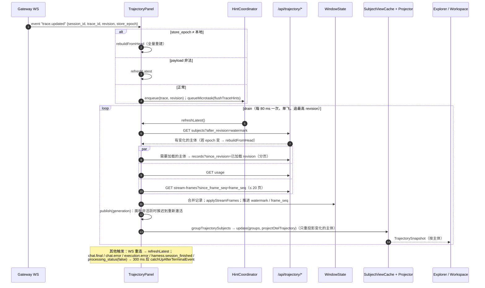

# 轨迹观测前端：单 Agent、Subagent 与 Team 多 Agent 轨迹 UI

> 本文是轨迹观测特性组的最终呈现层：浏览器如何把 SDD-0025 提供的原始 span 记录、寻址内容和流式帧，**投影**为用户可读的回合、行、时间线与泳道。
> 这里的"投影"指前端投影器，与另外两种"投影"的区别见 SDD-0022 §3。
> 由 jiuwenswarm `dev/swarm/room@43e796e1d` 逆向整理（前端特性目录最后一次提交为 `4957a90c7`）。

## 1. 背景与问题 (Why)

### 1.1 用户想回答的问题

用户在 JiuwenSwarm Web 里用单 agent 或 Team 完成一个复杂任务（写代码、做调研、生成 PPT），过程往往几分钟到几十分钟。执行期间和执行之后，用户与开发者经常要回答这些问题：

1. **"它现在在干什么？"** 正在调哪个工具？模型在想什么？回答写到哪儿了？
2. **"它为什么这么做？"** 第 12 步模型看到的上下文是什么？相比第 11 步多了哪些消息？system prompt 有没有变？
3. **"哪里出错了？"** 哪个工具失败、原因是什么？模型调用超时、被限流还是被中断？
4. **"上下文是怎么变化的？"** 什么时候发生了压缩、压缩了几次、每次重试了几轮？压缩后窗口变成什么样？
5. **"时间和 token 花在哪了？"** 首字延迟、解码速度、cache 命中比例、reasoning 占比分别是多少？
6. **"sub-agent 与 Team 成员各自做了什么？"** 某个 sub-agent 的完整轨迹是什么？Team 里谁在忙、谁卡住了、谁报错了？

聊天界面只能展示最终消息流。Langfuse 等三方平台（SDD-0023）要额外部署，看不到进行中的 span，也不理解 openjiuwen 的回合、Step、执行主体、上下文窗口链等语义。

### 1.2 前端面临的数据难点

SDD-0025 提供的是**原始 OTLP 单 span 记录**，外加三类附件：

- 寻址内容：复述型属性是 `@oj-seq` 引用，另附链与 blob；
- 流式帧：增量文本，只追加；
- 用量：会话累计 usage。

要把它们变成用户能看懂的视图，需要解决以下问题：

- **消息去重**：每次模型调用都复述完整上下文。直接渲染会让第 N 步重复显示前 N−1 步的全部消息，必须只显示"新增了什么"。
- **上下文窗口重建**：v2 `context.window.commit` 只在基线携带全量窗口，之后都是 delta（SDD-0022 §4.3.5）。前端必须按主体、按序号重放，并识别缺窗与序号缺口。
- **实时与最终合一**：进行中的 span 只有快照加帧；结束后是 final。两者要平滑衔接，不能回退，也不能闪烁。
- **归属与层级**：工具调用要归到发起它的推理下；sub-agent 与 Team 成员要按执行主体分开；子工具（MCP 生命周期子 span）要折叠。
- **兼容多代数据**：GenAI 标准键、openjiuwen 扩展、历史 DSH 键同时存在时，标准键优先。
- **规模**：长会话可达上万条 span、数十 MB 内容，UI 必须保持可交互。

## 2. 目标与非目标

**目标**

- G1 **按主体呈现**：
  - 单 agent 模式展示 Main Agent 与每个 sub-agent 调用的独立轨迹（标签页）；
  - Team 模式展示 leader 与每个成员的独立轨迹，以**成员泳道**呈现，可折叠为概览或展开为完整视图。
- G2 **账本（Ledger）视图**：按回合、请求（Request #N）组织行。行类型为 SYSTEM / USER / CONTEXT / COMPACTED / ASSISTANT / TOOL / SUBTOOL，只展示每次推理**新增**的输入。system prompt 变化以 diff 呈现。
- G3 **时间线视图**：多种度量（顺序 / 时长 / token），支持缩放、平移、区间聚焦，与账本联动选中。
- G4 **详情面板**：按行类型提供 Summary / Preview / Raw / Source / OTel 等标签；请求级展示配置、事实、用量与计时。
- G5 **实时**：
  - 收到 `trace.updated` 提示后增量拉取；
  - 进行中的推理实时显示流式文本与 reasoning、工具参数；
  - 运行中的行显示实时计时；
  - 账本默认跟随尾部。
- G6 **上下文语义**：
  - 重放 v2 窗口链；
  - 标注压缩（`Compaction #n`，每次尝试一格）；
  - ask_user 请求与答复；
  - 数据完整性问题以诊断横幅提示，并保持最后一次有效视图。
- G7 **错误原因可见**：按 状态消息 → 异常事件 → `error.type` → 强制关闭原因 的顺序回退，区分"模型没有输出"与"内容已过期不再存储"。
- G8 **归档导出与离线回放**：导出会话归档 JSON；导入后在同一投影器上回放，与实时视图一致。
- G9 **原始数据可查**：Raw OTel 检查器可以查看每条记录的原始 OTLP，超大记录按需加载。
- G10 **开关与隔离**：实验特性开关；懒加载；与聊天面板共存切换时互不重挂载。

**非目标**

- 不定义存储与 API，见 SDD-0025。
- 不做服务端投影或读模型（§5.1）。
- 不做跨会话检索与聚合分析（例如按工具统计失败率）。
- 不做轨迹编辑、标注或打分（演进与 RL 的数据回写属于 SDD-0024 的范畴）。
- 暂不支持 sub-agent 嵌套到父工具调用下的树状展示（当前是平铺标签，见 §10 Q2）。
- 暂不支持团队成员派生的 sub-agent（§9 R5）。
- 暂不做暗色主题（样式已经存在，但宿主固定为 light）和轨迹 UI 内部的完整 i18n（§9 R10）。

## 3. 术语与上下文

| 术语 | 含义 |
|---|---|
| **Subject（主体）** | 一条独立轨迹的所有者：`main_agent` / `subagent` / `team_leader` / `team_member` / `unassigned`，来源于 `openjiuwen.execution.subject.*` 或 v2 事件的 `subject_id` |
| **Chain bucket（链桶）** | 一个主体已加载记录的内存集合：`revision`、`records`（记录 ID 到 OTLP）、`rawRecords`、`versions`（lifecycle 与修订号） |
| **Window state（窗口状态）** | 面板持有的全部已加载数据：各主体的链桶、`storeEpoch`、`watermark`、帧状态 |
| **TrajectoryCell（单元）** | 账本中的一行，由投影器生成 |
| **TrajectoryRequest** | 一次推理（请求）的元信息：序号、状态、模型、用量、计时、目的（assistant / compaction） |
| **TrajectorySnapshot** | 投影器对一个主体的输出：`turns`（回合，含分组与单元）、`requests`、`diagnostics` |
| **Behaviour session（行为会话）** | 投影器做输入 diff 时的分组键：会话 + 主体 + 工具祖先链。同一行为会话内相邻两次推理的输入才互相比较 |
| **v2 reducer** | 按主体重放 v2 事件（窗口 commit、compaction、ask_user）的状态机 |
| **DSH** | DeepSeek Harness。本特性的表格、时间线、工具栏与基础组件改编自其 MIT 开源 UI（§5.3），部分历史属性键以 `dsh.*` 命名 |

## 4. 方案设计 (What / How)

### 4.1 总体架构

```
App.tsx
 ├─ config.get → config.trajectory_ui_enabled → setTrajectoryUiEnabled()   (featureConfig.ts)
 └─ SingleAgentSurface  [Chat | Trajectory] 标签（仅 agent/team 模式、非新会话）
      ├─ ChatPanel（始终挂载，CSS 隐藏）
      └─ <Suspense> LazyTrajectoryPanel(active, mode, sessionId)   首次切到轨迹页才挂载，之后 CSS 隐藏
            │
┌──────────── TrajectoryPanel（会话级状态宿主）──────────────────────────────────────────┐
│ 传输      trajectoryClient.ts      7 个 GET 接口，严格响应校验                             │
│ 窗口      trajectoryWindow.ts      链分页暂存 · 合并规则 · epoch/水位 · hint 协调器 · 代次失效│
│ 寻址      trajectorySequences.ts   SequenceCache(blobs, chains) · rebuildRecord · 按哈希补缺│
│ 帧        trajectoryFrames.ts      StreamFrameState · withStreamFrames 叠加                 │
│ 归档      trajectoryArchive.ts     导入解析 · 回放视图                                      │
│ 主体      trajectorySubjects.ts    groupTrajectorySubjects · 主体视图缓存                    │
│ 投影      projector/               otel-trajectory-projector · trajectory-v2-reducer ·      │
│                                    attribute-resolver · semconv/（生成 + 手写常量）         │
└──────────────┬───────────────────────────────────────────────────────────────────────────┘
               │ per subject: TrajectorySnapshot
     ┌─────────┴───────────────────────────────┐
     ▼ 单 agent                                  ▼ team
 [主体标签栏] → TrajectoryExplorer ×N          TeamTrajectoryWorkspace
                                                 ├ 共享 TrajectoryToolbar
                                                 └ 成员泳道 ×N → TrajectoryExplorer(overview | full)
┌──────────── TrajectoryExplorer ─────────────────────────────────────────────────────────┐
│ TrajectoryToolbar（模式开关、折叠、搜索）                                                  │
│ TrajectoryTimeline（trajectory/timeline.ts 模型）                                         │
│ TrajectoryTable（账本，@tanstack/react-virtual）  +  Details 侧栏（可调宽）               │
│ Raw OTel 检查器（JsonTree，可调高）                                                        │
│ primitives/：Tooltip · Menu · JsonTree · MarkdownText(GFM + KaTeX + Shiki) · icons        │
│ theme/：.jiuwenTrajectoryTheme 作用域 CSS 令牌                                            │
└─────────────────────────────────────────────────────────────────────────────────────────┘
```

**模块规模**：83 个文件，约 2.45 万行。最大的几个：`TrajectoryTable.tsx`（3212 行）、`otel-trajectory-projector.ts`（1996）、`TrajectoryPanel.tsx`（1511）、`trajectory-v2-reducer.ts`（1377）、`TrajectoryTimeline.tsx`（1017）。

**来源划分**：

| 来源 | 模块 |
|---|---|
| 华为原创 | 投影器、reducer、属性解析、传输、窗口、主体、帧、寻址、归档、Panel、Team 宿主 |
| 改编自 DeepSeek Harness（MIT，commit `99f6f02f…`） | 表格、时间线、工具栏、Explorer 布局、timeline / search-index / virtual-rows / preview / record 模型、theme CSS、primitives |

### 4.2 数据流与时序

#### 4.2.1 首次加载

```
mount / sessionId 变化
 └ rebuildFromHead
     listTrajectorySubjects(after_revision=0) → summaries, watermark, storeEpoch
     loadSummaries：每批并发 6 个主体
       └ loadChain(subject)：stageTrajectoryChainPages 每页执行
            getTrajectorySubjectRecords(since_revision, limit=1000)
            absorbSequencePage(cache, page)        # 吸收页内 sequences + blobs
            rebuildRecord(每条)                    # 引用 → 数组字符串
              └ 仍缺元素：getTrajectorySequences(hashes ≤ 200/批, since_revision=0)，再次 rebuild
            applyTrajectoryDetailRecords           # 合并规则（§4.4.1）
            publishPage → buckets.set → publish(generation)   # 逐页渐进呈现
     refreshSessionUsage
     （首次加载不拉帧：§9 R1）
```

#### 4.2.2 实时更新



**推送后拉取，没有定时轮询。** 仅有的两个定时器是 80 ms 的 hint 节流和终态事件后的 300 ms 静默等待。

**并发保护**：
- 代次计数器（generation）让过期的异步结果作废；
- `refreshPromiseRef`、`rebuildPromiseRef`、`terminalCatchUpPromiseRef` 单飞合并；
- 每个会话一个 `AbortController`。

#### 4.2.3 投影管线（每个主体）

```
records（该主体全部当前记录，已叠加帧）
 ├─ v2 记录（span 或 event 带 openjiuwen.trajectory.schema_version=2）
 │     → v2Reducer.apply：按主体、按 (epoch, sequence) 排序重放
 │         context.window.commit：基线 / delta 应用到 base window，校验 complete checkpoint
 │         compaction.completed · ask_user.requested/resolved
 │       → 单元 + diagnostics；handledInferenceIds（这些推理不再走旧式输入 diff）
 └─ 普通 span
       → normalizeTrajectoryAttributes（约 80 个字段，附 sources，标准键优先）
       → turnFactByTrace（turn.id 为身份，turn.number 为标签；缺失时每 trace 一回合）
       → 排序（dsh.session.source_sequence；否则按 start time）
       → assignSubjectRequestNumbers（主体内请求序号）
       → assignRequestOwnership（tool → inference：按 inference.id / 父链 / 同 step 且更早开始）
       → projectInferenceInputs（同一行为会话内相邻推理的输入做 LCS diff，只保留新增）
       → 单元：system / user / context + message(assistant) + tool / subtool
 合并 v2 单元到同一回合轴（以 physicalInferenceId 锚定）
 → 分组按 order/step 排序，单元按 compareTrajectoryCells 排序；compaction 分组的 turn 为 null
 → TrajectorySnapshot { turns, requests, diagnostics }
```

#### 4.2.4 归档回放

- **导入**：上限 128 MB。`parseTrajectoryArchive` 校验每条记录与 base64 字段，拒绝重复 ID；`content_addressed:true` 时用归档自带的 `sequences` / `blobs` 还原。
- **视图**：`trajectoryArchiveView` 以 trace 为桶，经 `applyTrajectoryDetailRecords` 重放。
- **与实时的差异**：
  - 不订阅 WS；
  - v2 使用无状态的一次性归约（不复用 `v2Reducer`）；
  - 累计用量为空；
  - raw 来自 `raw_json_base64`。
- **导出**：`GET …/archive`（当前没有请求 `format=addressed`），保存为 `trajectory-<session>.archive.json`。
- **退出回放**：触发一次实时追赶。

### 4.3 接口与数据模型

#### 4.3.1 输入：服务端记录（`trajectoryClient.ts`）

```ts
interface TrajectorySubjectSummary {
  subject_id: string; display_name: string; kind: string; parent_id: string | null
  record_count: number; trace_count: number
  first_start_time_unix_nano: string; last_observed_time_unix_nano: string
  first_revision: number; revision: number; has_error: boolean; running: boolean
}
interface TrajectoryDetailRecord {
  ingest_seq: number; record_id?: `${string}:${string}`   // 必须等于 `${trace_id}:${span_id}`
  record_revision?: number
  lifecycle?: 'provisional' | 'running' | 'completed' | 'final' | 'abandoned' | 'error'
  operation?: 'upsert' | 'delete'; change_seq?: number; observed_time_unix_nano?: string
  otlp: OtlpExportTraceServiceRequest | null               // 恰好一个 span
  raw_valid: boolean | null; trace_id?: string; span_id?: string; raw_size_bytes?: number
  sequences?: Record<string, { hash: string; depth: number }>
  incomplete_sequences?: string[]                           // 客户端 rebuildRecord 添加
  projection_omitted?: 'record_too_large'
}
interface TrajectoryStreamFrame {
  frame_seq: number; trace_id: string; span_id: string; subject_id: string; sequence: number
  kind: 'text-delta' | 'reasoning-delta' | 'tool-call-delta' | 'usage'
  timestamp_unix_nano: string; text?: string; tool_call_id?: string; tool_name?: string; arguments_delta?: string
}
```

**严格校验**：
- 所有响应必须 `schema_version===1`，且 `session_id` / `subject_id` 与请求一致；
- `store_epoch` 非空，且不超过 512 字符；
- `record_id` 与 trace/span 不一致时抛 `INVALID_RESPONSE`；
- 帧 `text` 原样保留，不做 trim。

**记录示例**（节选自 `fixtures/standard-records.json`）：

```json
{"resourceSpans":[{"scopeSpans":[{"spans":[{
  "traceId":"11111111111111111111111111111111","spanId":"2222222222222222","parentSpanId":"1111111111111111",
  "name":"tool.lookup","startTimeUnixNano":"2100000000","endTimeUnixNano":"2300000000",
  "attributes":[
    {"key":"gen_ai.operation.name","value":{"stringValue":"execute_tool"}},
    {"key":"gen_ai.tool.name","value":{"stringValue":"lookup"}},
    {"key":"gen_ai.tool.call.id","value":{"stringValue":"call-standard"}},
    {"key":"gen_ai.tool.call.arguments","value":{"stringValue":"{\"query\":\"x\"}"}},
    {"key":"gen_ai.tool.call.result","value":{"stringValue":"{\"result\":\"y\"}"}},
    {"key":"openjiuwen.turn.number","value":{"intValue":"1"}},
    {"key":"openjiuwen.step.number","value":{"intValue":"1"}},
    {"key":"openjiuwen.trajectory.record.kind","value":{"stringValue":"tool"}}],
  "status":{"code":1}}]}]}]}
```

fixture 中刻意混入了冲突的旧键（`gen_ai.tool.id`、`gen_ai.prompt.0.*`、`gen_ai.usage.prompt_tokens`、`dsh.turn.number=9`），用来固定"标准键优先"的规则。

#### 4.3.2 内部状态

```ts
interface TrajectoryChainBucket {
  revision: number
  records: Map<string, OtlpExportTraceServiceRequest>
  rawRecords: Map<string, TrajectoryDetailRecord>
  versions?: Map<string, { lifecycle: string; recordRevision: number }>
}
interface TrajectoryWindowState {
  buckets: Map<string /* subjectId */, TrajectoryChainBucket>
  storeEpoch: string | null; watermark: number
  frames: StreamFrameState; listWindowInitialized: boolean; rawSelection: …
}
interface StreamingSpanText { text: string; reasoning: string; toolArguments: Map<string, string>; lastSequence: number; frameCount: number }
interface StreamFrameState { bySpan: Map<string, StreamingSpanText>; frameSeq: number }
interface SequenceCache { blobs: Map<string, string>; chains: Map<string, string[]> }

type TrajectorySubjectKind = 'main_agent' | 'team_leader' | 'team_member' | 'subagent' | 'unassigned'
interface TrajectorySubject { id: string; displayName: string; kind: TrajectorySubjectKind; parentId: string | null; sessionId: string | null }
interface TrajectorySubjectGroup {
  subject: TrajectorySubject; records: OtlpExportTraceServiceRequest[]; rawRecords: …
  lifecycleByRecordId: Map<string, string>; traceCount: number; firstObservedTimeUnixNano: bigint; label: string
}
interface TeamMemberLaneModel {
  subjectId: string; label: string; kind: TrajectorySubjectKind
  status: 'running' | 'completed' | 'error' | 'idle'; traceCount: number; recordCount: number
}
```

#### 4.3.3 输出：UI 模型（`trajectory/model.ts`、`record.ts`）

```ts
interface TrajectorySnapshot { turns: TrajectoryTurnModel[]; requests?: TrajectoryRequest[]; streamingCells?: …; diagnostics?: TrajectoryDiagnostic[] }
interface TrajectoryTurnModel { turn: number | null; groups: … }          // compaction 分组 turn=null
interface TrajectoryRequest {
  recordId: string; seq: number; group: string /* "Step N" | "Compaction" */; number: number
  status: …; startedAt; completedAt; error; retry; maxRetries; retryDelayMs; resultSeq
  provider; model; requestConfig; recordedFacts: { correlation; agent; response; cost; trace }
  usage; cumulativeUsage; purpose: 'assistant' | 'compaction'; turn; step
}
interface TrajectoryCell {
  index: number /* FNV(recordId) */; recordId; requestRecordId; physicalInferenceId; sourceSeq; behaviorOrder
  kind: 'system' | 'user' | 'context' | 'compacted' | 'message' | 'tool' | 'subtool'
  status: 'complete' | 'running' | 'error'; isError: boolean
  text; previewMarkdown; inputDetail; previousInputDetail; outputDetail; thinkingDetail; result
  promptDetail; previousPromptDetail; promptSystemMessageIndex; sourceBlocks; outputBlocks
  schemaDetail; compactionDetail; messageSource
  traceDetail /* 原始 OTLP */; assistantMetrics /* TTFT 等 */; timeSeconds; startedAt
  input; cacheRead; cacheWrite; output; think; total                         // token
  callId; requestOnly; requestless
}
interface TrajectoryDiagnostic { code: string; message: string; … }
// code 包括 v2.sequence_gap / v2.partial_window / v2.delta_checkpoint_mismatch /
//          v2.missing_base_window / v2.invalid_compaction_correlation …
```

#### 4.3.4 语义常量

- **标准键**：`semconv/gen-ai-semconv.generated.ts`（72 个属性、operation 枚举、schema URL）。由 `scripts/genai_semconv/generate.py` 按 `versions.json` 固定的 revision `fee465db…` 使用 OTel Weaver v0.26.1 生成，与 agent-core 的 `gen_ai_semconv.py` 同一次运行产出（SDD-0022 §4.3.1）。测试断言完整、唯一。
- **扩展键**：`semconv/constants.ts` 中的 `OPENJIUWEN_ATTRIBUTES`（53 个键）**手写维护**，对应 agent-core 的 `semconv.py`。另有 DSH 回退键、`OTEL_SEMCONV_VERSION 1.44.0` 等版本字面量。
- **用量**：只读取 `gen_ai.usage.*` 标准键，避免重复扣减 cache token。

#### 4.3.5 契约要点

> **Requirement:** 终态记录（final / completed / abandoned / error）SHALL 不被任何更高修订号的 running/provisional 记录覆盖。
> **Scenario:** WHEN 网络乱序先到 final、后到 revision 更高的快照 THEN 保留 final（`trajectoryWindow.test.mjs` terminal absorption）。

> **Requirement:** 寻址元素缺失时，投影器 SHALL 保留该属性的引用并在单元上区分"内容已过期"与"模型无输出"。
> **Scenario:** WHEN 某个 `gen_ai.output.messages` 的元素 blob 按哈希补缺后仍不存在 THEN 单元显示 "Output content is no longer stored"，而非 "No output content"（`9d42acb6a`）。

> **Requirement:** v2 窗口链出现缺口或 checkpoint 不一致时，UI SHALL 显示诊断横幅（每种 code 一条），并保持最后一次有效视图，而非清空或崩溃。

### 4.4 关键流程

#### 4.4.1 记录合并规则（`applyTrajectoryDetailRecords`）

| 输入 | 行为 |
|---|---|
| lifecycle 映射 | provisional/running → running；abandoned/error → error；其余 → completed |
| 已终态记录收到 running | 忽略（终态不回退） |
| 已终态记录收到修订号更高的 provisional | 忽略（终态吸收） |
| `operation:'delete'` | 删除记录 |
| `raw_valid=false` | 只放进 `rawRecords` 并标记为无效（raw 检查器可见，不参与投影） |
| 页 `reset=true` | 清空该主体桶后再应用 |

**publish**：把各桶记录展平，用 `withStreamFrames` 叠加帧，从 `versions` 构建 `lifecycleByRecordId`，然后调用 `setPublishedWindow`。面板非活跃（用户在聊天标签）时推迟，重新激活后重放。

#### 4.4.2 寻址内容还原

1. 每页先把 `sequences`（链头到元素哈希列表）与 `blobs` 吸收进会话级 `SequenceCache`。
2. `rebuildRecord` 找到值为 `@oj-seq:1:<hash>:<depth>` 的属性，按链取出元素，拼成 `"[" + elements.join(",") + "]"`。结果**恒为 JSON 数组**，与 agent-core 只寻址数组的约定一致。
3. 有元素缺失时保留引用，把属性键记入 `incomplete_sequences`，记录的其余部分照常使用。
4. `unresolvedHeadsOf` 收集缺失链头，以 `since_revision=0` 按哈希补缺（每批 ≤ 200），然后重试还原。
5. 补缺后仍缺失的，视为已从存储中过期（保留期），投影器按 §4.3.5 区分展示。

`SequenceCache` 是面板级 `useRef`，**不淘汰**，会话切换时也不清空（§9 R8）。内容寻址保证了正确性，但内存会持续增长。

#### 4.4.3 流式帧叠加

- **累积**：`applyStreamFrames` 按 span 追加。`sequence <= lastSequence` 视为重复并丢弃；text、reasoning、每个 call 的工具参数分别累积；页 `reset` 时清空。
- **叠加**：`withStreamFrames` 只处理**未结束**的 span（`endTimeUnixNano` 为空或 `'0'`），在其 OTLP 上追加合成的 `openjiuwen.stream.chunk` 事件，陈述累积文本（reasoning 序号 0、text 序号 1、tool-call-delta 序号 2 起）。没有帧的记录保持对象引用不变，以便投影缓存命中。
- **读取**：投影器通过 `normalizeTrajectoryStreamEvents` 读取这些事件，按优先级对 openjiuwen / dsh / `llm.chunk` 来源去重，`streamParts` 拼接增量。
- **收尾**：span 结束后，final 的 `gen_ai.output.messages` 按 part 类型覆盖流式回放的 part。

#### 4.4.4 消息重建与输入 diff（非 v2 推理）

- **行为会话**：会话 + 主体 + 工具祖先链。同一行为会话内，相邻两次推理的 `gen_ai.input.messages` 做 LCS 比较，只有**新插入**的消息成为行。
- **消费上一次输出**：如果某条 assistant 消息只是在复述上一次推理的输出（模型自己说过的话回灌到输入），不再重复展示。
- **system prompt**：变化时生成 SYSTEM 行。详情提供 Diff（`diff.structuredPatch`）、System Message、Full Prompt、Tools 标签。
- **prompt attachment**：注入的 system 历史（快照或增量）以 CONTEXT 行展示。目前另有一个按硬编码中英文前缀识别内容的启发式（§9 R9）。

对于已被 v2 reducer 处理过的推理（`handledInferenceIds`），不再走 LCS 路径，窗口语义以 v2 链为准（`c293392e0`）。

#### 4.4.5 工具配对与折叠

- **结果来源**，依次尝试：
  1. `gen_ai.tool.call.result`；
  2. 后续推理中 `tool_call_response` part 按 `trace + call id` 匹配；
  3. trace 内按工具名与顺序匹配。
- **去重与折叠**：
  - 非权威 span 与权威 span 的 call id 重复时，丢弃非权威 span；
  - 与权威父 span resource id 相同的 MCP 生命周期子 span，折叠进父 span；
  - 找不到归属请求的权威工具 span 被丢弃，但路由过来的 `ask_user` 结果例外；
  - 父 span 是工具的工具 span 显示为 SUBTOOL。
- **交叉链接**：assistant 的工具调用可以跳到对应 TOOL 行；SUBTOOL 可以跳到父 TOOL 与所属 message。

#### 4.4.6 错误原因

`statusError` 的回退链：

1. span 状态消息；
2. `exception` 事件的 message，其次异常类型；
3. `error.type`；
4. `openjiuwen.span.forced_close.reason`；
5. 通用文本。

与 agent-core 的 `record_span_error` 优先级链（SDD-0022 §4.4.7）互相呼应：agent-core 保证状态消息已经是最优原因，前端负责兜底。

#### 4.4.7 compaction 与 ask_user

- **compaction**：`request.purpose=compaction` 的每次推理尝试成为 `Compaction #n` 分组下的一个 "Attempt N" 单元（`b3bb93816`）。v2 `compaction.completed` 事件同样生成压缩单元，并与之后第一个上下文窗口的 `caused_by_operation_id` 关联；关联失败时产生 `v2.invalid_compaction_correlation` 诊断。
- **ask_user**：`ask_user.requested` / `resolved` 事件生成请求与答复单元。HITL 恢复跨 trace 时，同一 `turn.id` 保证落在同一回合。

#### 4.4.8 主体分组与 sub-agent

`groupTrajectorySubjects(records, raw, lifecycle, ownerSessionId, {teamMode})` 的规则：

- **主体判定**：
  - v2 记录：主体取自 `openjiuwen.trajectory.subject_id`，kind 取自 `execution.subject.kind`；
  - 普通记录：取自 `openjiuwen.execution.subject.*`；没有任何主体属性的归入 Main，属性格式错误的归入 Unassigned。
- **过滤**：sub-agent 的 `session_id` 不以 `${owner}_sub_` 开头时排除（外来会话）。
- **排序**：main_agent → team_leader → 其余按首次出现时间 → unassigned。同名 sub-agent 追加序号（"researcher 1"、"researcher 2"）。
- **Team 模式**：跳过合成的 Main 组，只保留 `team_leader` / `team_member`。
- **缓存**：`createTrajectorySubjectViewCache` 按主体缓存；只有记录数组或 lifecycle 映射变化的主体才重新投影。

**单 agent 呈现**：
- 多于一组时显示标签栏；
- sub-agent 标签附带文字 "Parent `<id>`" 与 "Execution session `<id>`"；
- 每个主体一个 `TrajectoryExplorer`，未选中的保持挂载，用 `display:none` 隐藏（切换时保留滚动与折叠状态）。

#### 4.4.9 Team 泳道

```
┌ 共享 Toolbar：(Duration)(Tokens)(Turns)(Calls)            （无搜索）                ┐
├ 泳道：[● Team Leader ▸] [🔍]  时间线（overview：toolbar + timeline）                  │
├ 泳道：[● Engineer ▾]    [🔍]  时间线                                                   │ ← 展开：填满高度
│        账本 + 详情 + Raw 检查器（full）                                                │
├ 泳道：[○ Reviewer ▸]    [🔍]  …                                                        │
```

- **泳道状态**：有任何 running 记录为 running；否则有 error 为 error；没有记录为 idle；其余为 completed。
- **展开与折叠**：默认全部折叠（`selectedSubjectId=null`）。点击折叠泳道时间线上的块会展开该泳道（`onOverviewActivate`）。选中泳道后滚动到顶部。已展开的主体消失时，回退到第一个有记录的泳道。
- **共享视图**：Toolbar 的视图状态（度量模式、折叠）由所有泳道共享；搜索按泳道独立。

#### 4.4.10 时间线

- **度量模式**：
  - `sequence`：等宽；
  - `duration`：按记录时长，压缩空闲；
  - `tokens`：优先于其他开关；
  - `actual` / `time`：实现已存在，但 "Actual time" 开关被隐藏。
- **token 模式**：
  - Input 块按未命中 cache 的输入计宽，cache 写入部分双色显示；
  - Output 块按 reasoning 占比分色；
  - Input 块覆盖该请求消费的记录区间。
- **交互**：
  - 滚轮以指针为中心缩放，视口直接写 CSS 变量，140 ms 后提交 React 状态；
  - Shift+滚轮水平平移；
  - 未缩放时左键拖拽（或 Shift+拖拽）选择聚焦区间；缩放后左键、中键、右键拖拽平移；右键单击清除区间；
  - 点击块选中记录，点击 Input 块聚焦其覆盖区间，点击空白处聚焦最近记录；
  - Esc 或双击清除区间；拖拽时贴边自动平移。
- **悬浮提示**：延迟 500 ms，展示 TTFT、解码速度或 token 明细。
- **实时刷新**：存在运行中记录时，每 250 ms 刷新一次时钟并重新推导时间线。

#### 4.4.11 账本与详情

```
┌ header："N traces · M OTel spans [· some raw records could not be projected]"  [Import][Export][Exit replay] ┐
│ [Loading trajectory 120 / 900 ▓▓▓░░]                                                          │
│ [Main Agent][researcher 1][researcher 2]    Parent main · Execution session s_sub_x          │
├ Toolbar：(⏱ Duration)(≡ Tokens)(⊟ Turns)(⊟ Calls)                              [🔍 Search]   │
├ Timeline：泳道 Input | Model | Tools（token 模式为 Input | Output）；回合边界刻度             │
├──────────────────────────────────────────────┬────────────────────────────────────────────────┤
│ Ledger                                        │ Details（320–720 px 可调）                     │
│ Turn 1 ● Request #1                           │ [ASSISTANT] Turn 1 · Step 1                [×] │
│  SYSTEM    You are…                           │ Summary | Preview | Raw | Source | OTel        │
│  USER      find x                             │ （tool：Summary | Payload | Result | Schema |  │
│  ASSISTANT Tool call only                     │   Timing | OTel；system：Diff | System Message │
│  TOOL      lookup · {"query":"x"} → {…}  ● 1.2s│   | Full Prompt | Tools；request：Summary |    │
│  … 3 tool calls · lookup, grep（折叠）         │   Options | Facts | Usage | Timing）           │
├──────────────────────────────────────────────┴────────────────────────────────────────────────┤
│ Raw OTel records (k) ▾  [选择记录]  [按需加载 raw]  JsonTree        （可拖拽调高 120 px–60%）  │
├ footer：DeepSeek Harness (MIT) 归属声明                                                      ┤
```

- **行**：`flattenRecords` 生成。请求边界按钮打开请求检查器。支持折叠全部回合或全部调用，双击单行折叠。搜索只保留匹配行。
- **运行中与跟随**：运行中的行显示实时计时。距底部 ≤ 2 px 时跟随尾部；Explorer 变为可见时跳到尾部。
- **可访问性**：行可通过 Enter / Space 选中；类型标签带图标与 tooltip。
- **超大记录**：`projection_omitted` 的记录在 Raw 检查器中按需调用 `/raw` 加载。

### 4.5 配置与开关

| 项 | 默认 | 位置 |
|---|---|---|
| `trajectory_ui.enabled`（服务端 yaml，同时启用存储与 provider 需求） | `false` | `resources/config.yaml`；以字符串 `"true"/"false"` 下发给 Web |
| 设置入口 | Settings → Experimental → "Trajectory UI" | `ExperimentalSettings.tsx`、`definition.ts`、`settingsContract.ts`（`yamlField: trajectory_ui.enabled`） |
| 客户端初始值（配置到达前） | `false` | `featureConfig.ts` |
| 可见条件 | 开关打开 **且** 模式为 `agent`/`team` **且** 不是新会话 | `SingleAgentSurface.tsx`、`App.tsx` |
| `DETAIL_LIMIT` / `DETAIL_CONCURRENCY` | 1000 / 6 | `TrajectoryPanel.tsx` |
| `LIVE_HINT_PULL_INTERVAL_MS` / `MAX_FRAME_CATCH_UP_PAGES` | 80 / 20 | 同上 |
| `MAX_ARCHIVE_BYTES` / 归档最大记录数 | 128 MB / 200,000 | `TrajectoryPanel.tsx`、`trajectoryArchive.ts` |
| 帧页大小 / 单次补缺哈希上限 | 500 / 200 | `trajectoryClient.ts` |
| 虚拟化阈值 / overscan | 100 行 / 12 | `TrajectoryTable.tsx` |
| 详情宽度 / Raw 检查器高度 | 320–720 px / 默认 220（120 至 60%，键盘步长 16） | `TrajectoryTable.tsx`、`trajectoryLayout.ts` |
| 时间线最小缩放 / tooltip 延迟 / 滚轮提交 | 4 ops、256 tokens、20 ms / 500 ms / 140 ms | `TrajectoryTimeline.tsx` |
| 颜色模式 | `light`（硬编码） | `TrajectoryPanel.tsx`、`TeamTrajectoryWorkspace.tsx` |

打开开关后，设置页立即调用 `setTrajectoryUiEnabled`，标签即时出现；关闭后标签消失，服务端 API 返回 503。

## 5. 关键决策与权衡 (ADR)

### 5.1 在浏览器投影，服务端只提供原始记录

- **决策**：从 GenAI 记录到回合、行的全部语义投影（回合与 Step 身份、LCS 输入 diff、v2 窗口重建、compaction 关联、工具配对、错误原因）都在 TypeScript 中完成。服务端只提供存储、主体链、帧、寻址内容、用量、归档（SDD-0025 §5.7）。
- **理由**（本文评估，结合提交历史）：
  1. **迭代速度**：09-03 到 09-11 期间投影语义几乎每天修正一次（错误原因回退、回合锚定、窗口 delta、压缩尝试、过期与无输出区分、恢复回合不重述旧消息）。改前端不需要迁移服务端存储，也不需要考虑读模型的回填。
  2. **离线与在线同一实现**：归档导入回放复用同一个投影器，行为天然一致（`trajectorySubjects.test.mjs` 固定了 archive 与 live 分组一致）。
  3. **服务端保持通用**：原始 OTLP 加游标的形态也能服务将来的 CLI、脚本读者。
  4. **按需计算**：只投影用户正在看的会话与主体，服务端不必为所有会话物化读模型。
- **否决的备选**：
  - *服务端物化读模型（回合与单元表）*：投影语义每次变更都要迁移或重算历史数据；实时与归档要维护两套一致性。
  - *服务端投影、每次请求实时计算*：Python 侧重复实现 v2 reducer 与 LCS，而前端仍需要做叠加帧等实时合成，形成两处实现。
- **代价**：
  - 主线程 CPU 与内存压力：没有 Worker（§9 R6、R7）；
  - v2 schema 的完整性校验只在前端；
  - agent-core、服务端、前端三处重复定义 `@oj-seq` 格式（§6.3）。

### 5.2 v2 事件优先，旧式 LCS 作为回退

- **决策**：对带 v2 `context.window.commit` 的推理，以 reducer 重放的窗口为准，并把这些推理从 LCS 路径中排除；没有 v2 事件的推理（旧数据、Team 路径、外部 CLI 成员）继续用行为会话内的 LCS。
- **理由**：
  - v2 以 `message_id` 出现身份计算 delta，能正确表达 move、replace 与压缩造成的窗口替换；
  - LCS 只能按内容相等匹配，无法区分同内容的不同消息；
  - 两者并存让旧会话和新会话都能展示。
- **代价**：两套算法要保持一致的呈现（CONTEXT、COMPACTED 行），测试矩阵变大。

### 5.3 改编 DeepSeek Harness 的 UI 组件

- **决策**：表格、时间线、工具栏、基础组件、主题样式改编自 DeepSeek Harness（MIT，commit `99f6f02f…`）。样式重新限定在 `.jiuwenTrajectoryTheme` / `.jiuwenTrajectoryPortal` 作用域内，与宿主样式隔离。附 `LICENSE.deepseek-harness`、`NOTICE.md`、各目录 `PROVENANCE.md`，并在面板页脚署名（`c032ca2d1`）。
- **理由**：成熟的轨迹账本与时间线交互（虚拟化、缩放平移、区间聚焦、tooltip）可以直接复用；投影、传输、主体、Team 宿主等与 openjiuwen 语义相关的部分全部自研，运行时与构建时均不依赖 DSH 包。
- **代价**：
  - 保留了若干 DSH 属性回退键和兼容别名（`TrajectoryCellProps`）；
  - 改编组件内部文案为硬编码英文（§9 R10）；
  - 上游更新需要人工同步。

### 5.4 推送提示、按需拉取，逐页渐进呈现

- **决策**：WS 只接收游标提示，数据经 HTTP 拉取（SDD-0025 §5.3）。前端做单飞合并与 80 ms 节流，每加载一页就发布一次。
- **理由**：
  - 流式期间提示非常密集，合并后每 80 ms 最多一轮拉取；
  - 渐进发布让长会话的首屏更快出现；
  - 代次失效保证会话切换、epoch 变化时不会串数据。

### 5.5 主体平铺标签，而非嵌套树

- **决策**：sub-agent 以独立标签呈现，只以文字显示 parent；Team 以泳道呈现。
- **理由**：
  - 主体是独立的轨迹链（SDD-0022 §4.2.2），各自有回合、请求编号与上下文窗口，嵌入父账本会打乱父轨迹的请求编号与折叠；
  - 泳道让团队成员的并行一目了然。
- **代价**：无法从父 agent 的 `task_tool` 行直接跳到 sub-agent 轨迹（§10 Q2）；Team 成员派生的 sub-agent 被过滤掉（§9 R5）。

### 5.6 标准键优先，保留有限的回退

- **决策**：属性解析始终优先读取 GenAI 标准键与 openjiuwen 键；DSH 等旧键只作为兜底，并在 `sources` 中记录值来自哪个键。
- **理由**：与 SDD-0022 §5.1 的"单一载体"一致。fixture 刻意混入冲突旧键，以测试固定优先级。
- **代价**：常量表中残留若干 agent-core 已不再写入的键（§9 R4），需要定期清理。

## 6. 影响面与兼容性

### 6.1 BREAKING

| commit | 变更 | 配套 |
|---|---|---|
| `5156bc395`、`ba7ecd153` refactor! | 客户端改用 subjects 路由，面板按主体链逐条加载 | SDD-0025 `d8cddd4fd` |
| `cdb88ad34` refactor! | 与 agent-core 同步收敛 semconv 键 | SDD-0022 `544ea2838` |

### 6.2 受影响模块

- **jiuwenswarm 前端**：`features/trajectory/**`；`App.tsx`（懒加载挂载、视图记忆、配置读取）；`components/ChatPanel/index.tsx`（memo 化以便共存）；`features/settings/modules/experimental/*`、`services/settingsContract.ts`；`i18n/locales/{zh,en}.json`。
- **jiuwenswarm 脚本**：`scripts/genai_semconv/generate.py`、`versions.json`。
- **依赖**：`@tanstack/react-virtual`、`diff`、mdast/micromark、KaTeX、Shiki（JS regex engine）。

### 6.3 跨仓重复定义与漂移风险

| 契约 | 定义处 | 同步机制 |
|---|---|---|
| GenAI 标准键 | agent-core `gen_ai_semconv.py` 与前端 `gen-ai-semconv.generated.ts` | **同一生成器**，同步有保障 |
| openjiuwen 扩展键 | agent-core `semconv.py` 与前端 `constants.ts`（53 个） | 手写，其中 51 个在 agent-core 中找到；`openjiuwen.request.retry_count` / `max_retries` 在 agent-core 不存在 |
| `@oj-seq:1` 引用格式 | agent-core `content_addressing.py`、服务端 `store.py`、前端 `trajectorySequences.ts` | 三处手写 |
| v2 事件 payload | agent-core 发射，前端 reducer 校验 | 服务端不校验 |
| Archive v1 | 服务端导出、前端导入 | 两侧各自校验 |
| record kind 词表 | agent-core 写 `turn/step/inference/reasoning/tool/agent/event`；前端闭集 `turn/step/inference/reasoning/tool/compaction` | **不一致**：`event` 被丢弃；前端要求 `compaction` kind 的旧路径永远不会被 agent-core 数据触发（§9 R3） |

### 6.4 兼容性

- **旧会话**：没有 v2 事件、没有执行主体属性的旧数据走 LCS 路径并归入 Main 组，可以展示。
- **外部 CLI 成员**（Claude/Codex）：span 没有执行主体属性（SDD-0022 R6），在 Team 模式下无法形成独立泳道。

## 7. 测试与验证

测试脚本见 `frontend/package.json`：先 esbuild 打包，再 `node --test`。

| 测试 | 固化的不变量 |
|---|---|
| `tests/trajectoryProjector.test.mjs`（2731 行） | 生成的 semconv 完整；强制关闭与 MCP 折叠；ask_user 路由；v2 上下文、prompt diff、epoch 基线、compaction 关联、序号缺口、checkpoint 恢复；主体内请求编号；LCS 输入 diff 与输出回放；错误原因回退链；HITL 跨 trace 回合；只有 delta 的 commit；压缩尝试编号；过期与无输出区分；恢复运行的基线 |
| `trajectoryWindow.test.mjs` | hint 协调器；epoch 重置；分页暂存与中止；终态吸收；归档 wire 解析 |
| `trajectorySubjects.test.mjs`、`teamGroupingCheck.test.mjs`、`teamTrajectoryLanes.test.mjs` | 同名 sub-agent；缓存复用；外来会话排除；归档与实时分组一致（`tests/fixtures/trajectory-archive-subjects.json`）；Team 泳道状态优先级 |
| `trajectoryFrames.test.mjs`、`trajectorySequences.test.mjs` | 帧去重与叠加；链还原为数组；缺失元素保留引用 |
| `trajectoryTimeline.test.mjs`、`trajectoryLayout.test.mjs`、`trajectoryPreview.test.mjs` | token 模式、缩放平移；布局约束；预览 |
| `singleAgentSurface.test.mjs` | 宿主挂载门禁（模式、开关、首次请求） |

**缺口**：没有 `TrajectoryTable`、`TrajectoryTimeline` 组件和 `TrajectoryPanel` 的 DOM 或交互测试。

**验收（端到端）**：
1. 单 agent 含 sub-agent 的回合：实时看到流式文本、工具行、sub-agent 标签；结束后与刷新后的视图一致。
2. 触发一次压缩（含限流重试）：出现 `Compaction #1` 下多个 Attempt，压缩后第一个窗口正确关联。
3. Team 三成员并发：泳道状态正确，展开或折叠不丢失选中与滚动。
4. 导出归档后导入回放，与实时视图一致。
5. 断线 30 秒后重连，自动追平，没有重复行。

## 8. 可观测性

| 信号 | 位置 |
|---|---|
| 诊断横幅（按 code 计数：`v2.sequence_gap`、`v2.partial_window`、`v2.delta_checkpoint_mismatch`、`v2.missing_base_window`、`v2.invalid_compaction_correlation`） | 面板顶部，按主体显示 |
| 头部提示 "some raw records could not be projected" | `raw_valid=false` 或投影失败 |
| 加载进度 "Loading trajectory N / M" | 初次加载 |
| 内容状态：new / loading / blocking-error（带 Retry）/ empty / raw-only | 面板 |
| 客户端校验错误 `INVALID_RESPONSE` | `trajectoryClient.ts` |

**建议埋点**：首屏可交互时间、单次投影耗时（按主体记录数分桶）、`SequenceCache` 大小、诊断出现率。

## 9. 风险与回滚

| # | 问题 | 性质 | 建议 |
|---|---|---|---|
| R1 | **首次加载不拉帧**：`rebuildFromHead` 没有 `catchUpStreamFrames`，打开页面时已在流式输出的推理显示 "Waiting for model response…"，直到下一次 hint 或刷新 | 已知缺陷 | 在 `rebuildFromHead` 末尾追加一次帧追赶 |
| R2 | 每批 hint **重复拉 usage**：`flushTraceHints` 调用的 `refreshLatest()` 已包含 usage，之后又单独调用一次；hint 中的 `frame_seq` 与 `lifecycle` 被客户端忽略 | 效率 | 去重；利用 `frame_seq` 跳过无新帧的追赶 |
| R3 | **record kind 词表漂移**：agent-core v2 事件写 `record.kind="event"`，前端闭集中没有，分类回落到 operation 或 span 名；要求 `kind=compaction` 的旧路径永远不会被 agent-core 数据触发 | 契约漂移 | 对齐词表，删除死路径（未跟踪文件 `docs/zh/Trajectory-DSH-Semconv-Audit.md` 已记录清理计划） |
| R4 | **DSH 回退键残留**：`dsh.*`、`llm.chunk`、`openjiuwen.session_id`、`langfuse.observation.type` 仍被读取，但 agent-core 已不写入；唯一的会话级稳定排序键 `dsh.session.source_sequence` 在新数据中不存在，排序回落到 start time | 技术债 | 清理；如需稳定排序，由 agent-core 提供标准或扩展键 |
| R5 | **Team 模式丢弃成员派生的 sub-agent**；所有泳道折叠时头部显示 "0 traces · 0 spans"（计数取自选中主体） | 功能缺口 | §10 Q3 |
| R6 | **全部在主线程执行**：没有 Worker、`startTransition`、`useDeferredValue`。热点包括每次推理的 LCS 矩阵、每个 span 两次属性归一化、`rebuildRecord` 的 `JSON.parse(JSON.stringify())` 深拷贝 | 性能 | §10 Q4 |
| R7 | **重投影放大**：帧追赶与用量变化会 `subjectViewCacheRef.current.clear()`，导致**所有**主体重投影；v2 reducer 的 `apply()` 每次都从全部事件重建（非增量）；搜索索引在无查询时也每次更新；时间线不虚拟化，运行中每 250 ms 重算，每条泳道各有一个时钟 | 性能 | 帧与用量变化只失效受影响的主体；reducer 增量化 |
| R8 | **内存无界**：`SequenceCache` 不淘汰且跨会话不清空；帧状态保留整个会话的全部流式文本（`forgetStreamFrames` 已实现但未调用） | 性能 | 会话切换时清空；span 结束后释放帧 |
| R9 | `promptAttachmentHistoryModeFromContent` 按硬编码中英文 prompt 前缀识别 | 脆弱 | 改为读取 `gen_ai.input.messages` 中消息级的 `openjiuwen:{kind:"prompt_attachment_history", mode}` 标记（agent-core 已写入，SDD-0022 §4.3.4） |
| R10 | **i18n 与主题**：Table、Timeline、Projector 内部文案为硬编码英文；`client/i18n.ts` 导出的 zh 字典未使用；暗色样式存在但宿主固定 light；Tooltip 带有 "interaction is a placeholder" TODO | 体验 | 迁移到 locale JSON；接入宿主主题 |
| R11 | **已实现但未接线**：Load earlier history（面板始终加载完整链）、`streamingCells`、`inspectCallId`；`retryDelayMs` / `resultSeq` 从不赋值；`retry` / `maxRetries` 读取 agent-core 并不写入的键；`errorMessage` 字段声明了但从不赋值；"Actual time" 开关隐藏；导出从不请求 `format=addressed` | 死代码 / 占位 | 接线或删除 |
| R12 | **可能的闭包过期（未实测）**：`clearPublishedWindow`、`importArchive`、`exitReplay` 读取 `teamMode` 但没有列入依赖；面板实例不以 mode 为 key，同一会话内切换模式时可能错误重置选中 | 潜在缺陷 | 补依赖，或以 mode 作为 key |
| R13 | sub-agent 与派生它的父工具调用之间没有链接 | 体验 | §10 Q2 |

**回滚**：
- 在 Settings → Experimental 关闭 Trajectory UI，或设置服务端 `trajectory_ui.enabled: false`：轨迹标签消失，聊天不受影响。
- 轨迹模块是懒加载 chunk，未开启时不下载。

## 10. 开放问题 (Open Questions)

- [ ] Q1 投影器是否迁到 Web Worker？候选范围包括 rebuild、窗口合并、v2 reduce、LCS、属性归一化，主线程只做布局渲染。需要评估 OTLP 对象跨线程传输的成本（结构化克隆或传递 JSON 字符串）。
- [ ] Q2 父 agent 的 `task_tool` 行能否直接跳到对应 sub-agent 标签？sub-agent 主体的 `parent_id` 与派发工具 span 的关联需要 agent-core 显式写入，例如在 sub-agent 主体上记录 `dispatch_tool_call_id`。
- [ ] Q3 Team 模式下，成员派生的 sub-agent 如何呈现：泳道内嵌标签，还是独立的子泳道？
- [ ] Q4 是否启用"Load earlier history"分页（面板目前总是加载整条链），以控制超长会话的首屏与内存？
- [ ] Q5 record kind 词表与 openjiuwen 扩展键能否也进入生成器（由 agent-core `semconv.py` 生成 TS 常量），消除手写漂移？
- [ ] Q6 与 SDD-0024 对齐：演进与 RL 投影是否复用本文的 v2 窗口重建语义（可以抽出一份跨语言规范加测试向量）？
- [ ] Q7 外部 CLI 成员（Claude/Codex）补齐执行主体后，泳道如何呈现"外部"标识？
- [ ] Q8 轨迹 UI 转正（离开 Experimental）的门槛：R1、R3、R6、R8 修复？i18n 完成？

## 11. 评审记录 (Iteration Log)

| 轮次 | 日期 | 版本 | 评审人 | 结论 | 主要修改/讨论 |
|---|---|---|---|---|---|
| 1 | 2026-09-15 | 1 | @alan_cheng | draft | 初稿：由 jiuwenswarm `43e796e1d` 逆向整理；记录浏览器侧投影方案、单 agent / sub-agent / Team 呈现，以及 13 项已知问题 |

## 12. 实现记录与偏差

### 实际实现

前端特性目录共 27 个提交（2026-08-21 至 2026-09-11）：

| 时间 | commit | 内容 |
|---|---|---|
| 08-21 | `e2b76a3ec` | 实时轨迹归档与回放（首版） |
| 08-25 至 31 | `efe23c8d3`、`13c3f5ed1`、`c4dbc8b93`、`6b81c8b49`、`884dcd564`、`65f12c0b8`、`1dcefaee3` | sub-agent 实时稳定；token 成本时间线；Team 成员泳道；标准 usage；时间线导航；ask-user 恢复；避免重放上下文移动 |
| 09-03/04 | `a7cc2978d`、`3201cf027`、`cdb88ad34`、`c5b25bd0d`、`1002c84fb` | 对齐 GenAI semconv；投影器还原真实错误原因；收敛键（BREAKING）；回合锚定到 ReAct 循环；从 span 读回合与 Step 身份 |
| 09-08 | `c032ca2d1` | DeepSeek Harness 归属声明 |
| 09-09 | `5156bc395`、`ba7ecd153`、`ae440da99`、`c293392e0`、`8206622b5` | 主体路由与逐链加载（BREAKING）；由 delta 链重建上下文窗口；由帧链渲染实时输出 |
| 09-11 | `b3bb93816`、`2bc576c3d`、`dcd2bd5f6`、`c94364d3b`、`90b7fdd93`、`9d42acb6a`、`ca8a1c0b5`、`4957a90c7` | 编号压缩的全部尝试；哈希寻址缓存；寻址导出；链还原为数组；按哈希补缺；过期与无输出区分；恢复运行不重述旧用户消息；详情、用量、帧一轮往返 |

### 与设计的偏差

代码与文档或注释不一致之处（以代码为准）：

1. `channels/web/AGENTS.md` 称轨迹面板"归档导入/导出"，导入实际是纯前端回放，服务端不支持导入（SDD-0025 §12）。
2. `zh.json` 中 `trajectory.team.members`、`trajectory.layout.*` 等键未被使用。
3. `semconv/constants.ts` 中的 `OPENJIUWEN_EVENTS.retry*`、`DSH_TURN_END_REASONS`，以及 `forgetStreamFrames`、`streamingTextFor`、`sequenceHeadsOf`、`missingSequenceContent`、`defaultTeamMemberSubjectId` 等辅助函数已定义但未使用（§9 R11）。
4. 类封装 `OtelGenAiTrajectoryProjector` 已导出，但面板使用的是函数 `projectOtelTrajectory`。

### 链接

- jiuwenswarm：`jiuwenswarm/channels/web/frontend/src/features/trajectory/`、`src/App.tsx`、`src/features/settings/modules/experimental/`、`tests/*trajectory*.test.mjs`、`scripts/genai_semconv/`
- 第三方来源：`features/trajectory/NOTICE.md`、`LICENSE.deepseek-harness`、`primitives/PROVENANCE.md`、`theme/PROVENANCE.md`、`trajectory/PROVENANCE.md`

### 遗留与后续

- 优先处理 §9 R1、R3、R6、R7、R8。
- §10 Q1、Q2、Q5。
- 为 Table、Timeline、Panel 补组件级交互测试。

## 13. 参考与关联设计

- **SDD-0022**：轨迹观测框架。规范 span、执行主体、v2 事件、寻址序列、流式帧的来源定义。
- **SDD-0025**：轨迹数据面。本文唯一的数据来源（HTTP API 与 `trace.updated` 推送）。
- **SDD-0024**：轨迹投影（演进与 RL）。与本文的上下文窗口重建语义有对齐需求（§10 Q6）。
- DeepSeek Harness（MIT）：`ui-trajectory`、`ui-theme`、`ui-primitives` 包，commit `99f6f02fecdb7dff40c3fbc9470f5907c29f74ca`。
