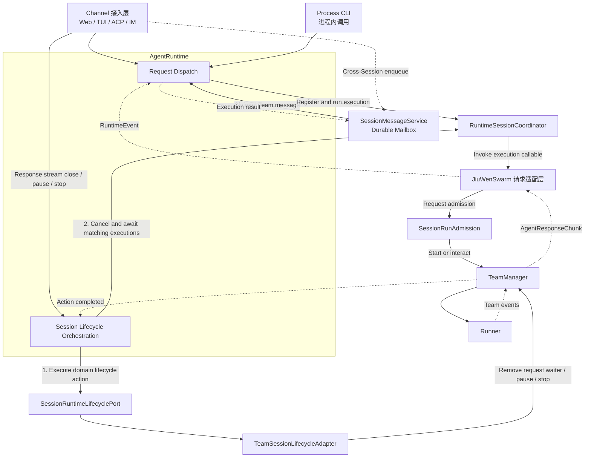
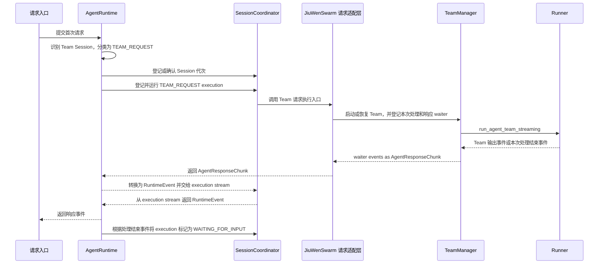
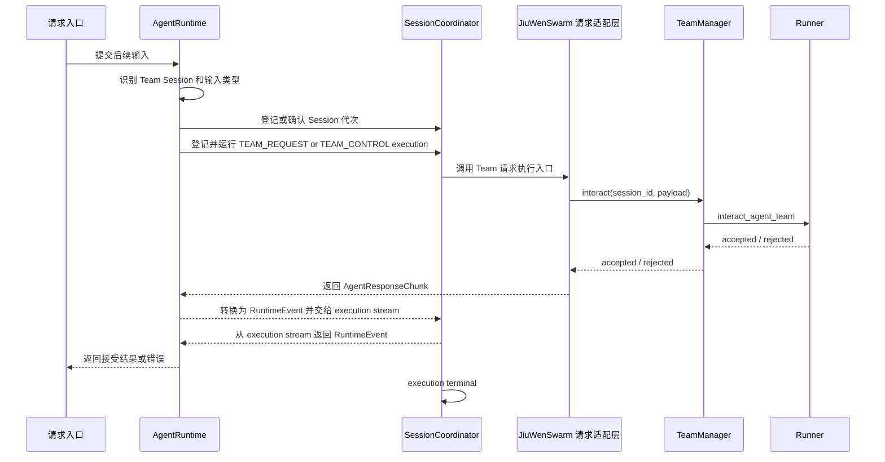
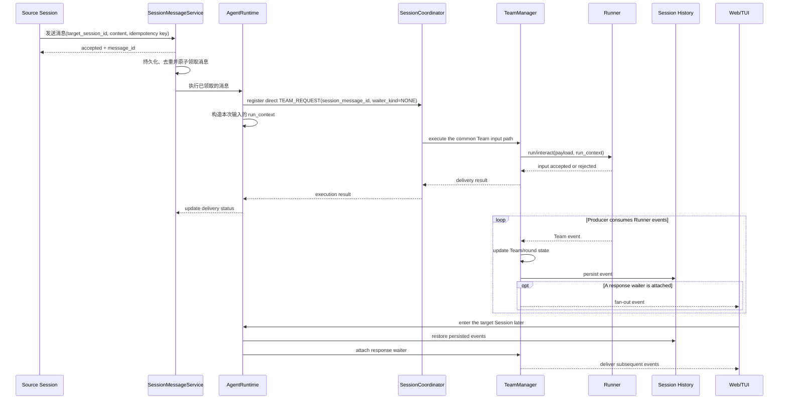
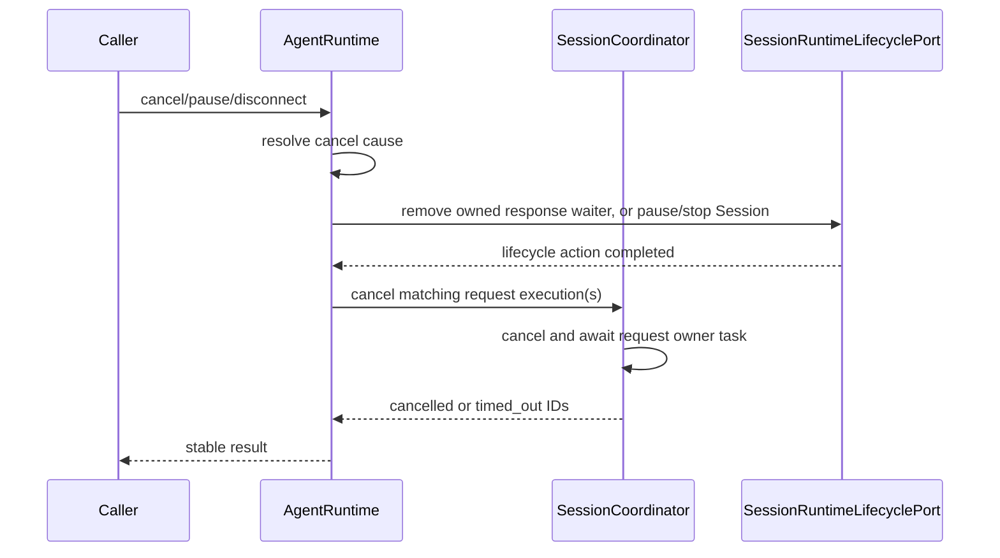

# Team 模式接入统一 Session Runtime

## 1. 背景与问题 (Why)

JiuwenSwarm 已建立与传输通道无关的 `AgentRuntime` 和进程内 `RuntimeSessionCoordinator`。单 Agent Work/Code Normal、Goal 与按中断关联 ID（`control_id`）匹配的结构化答复已经在这里获得统一的 Session 运行代次（generation）、execution 记录和状态、取消、关闭和有界等待语义。[PR 6532](https://gitcode.com/openJiuwen/jiuwenswarm/pull/6532) 进一步收窄了 Runtime 公共面：产品调用方只依赖 `AgentRuntime`，Coordinator、调度器和执行注册表保持为内部实现。

Team 请求虽然也从 `AgentRuntime` 进入，但当前不会在 `RuntimeSessionCoordinator` 中创建对应的 `SessionExecutionHandle`；其任务和运行状态仍分散在多个层次：`AgentServer` 使用 `_session_stream_tasks` 跟踪 Team 请求任务，并在 shutdown 时通过 `AgentRuntime.cancel_all_team_stream_tasks()` 执行全局清理；`JiuWenSwarm` 适配层内的旧 `SessionManager` 仍参与部分取消与清理；`TeamManager` 保存按请求登记的 waiter 集合和读取 Runner stream 的 producer task；`SessionRunAdmission` 保存用户请求、Heartbeat、Cron bounded round、交互中断和跨 Session 消息的并发准入标记。结果是：

1. **请求 execution 未统一登记。** Team 首次请求、follow-up、结构化控制输入和 Cron 后台触发目前不会登记为 `RuntimeSessionCoordinator` execution。Heartbeat 已由外层 `run_heartbeat()` 登记为通用 `HEARTBEAT` execution，但没有按 Team 后台执行语义分类，也没有把其 waiter 关联到 execution。因此 Runtime snapshot 无法完整列出进行中的 Team 请求，也不能按 `execution_id` 对每个请求进行观察、取消和等待。
2. **Team 中断与资源收敛缺少统一编排入口。** 用户发起 pause 或 cancel 时，`AgentServer`、`JiuWenSwarm` 适配层内的旧 `SessionManager` 和 `TeamManager` 分别处理请求 task、Team stream、Runner 调用及本地资源；Session 永久删除和 Runtime shutdown 也需要停止并等待相关 Team 任务。当前没有单一 Runtime 入口负责协调这些动作，并将请求 execution 的最终状态统一登记到 Coordinator。
3. **运行状态存在多处事实源。** `AgentServer`、`JiuWenSwarm` 适配层内的旧 `SessionManager`、`SessionRunAdmission`、`TeamManager` 和 Runner 分别记录请求 task、准入标记、Session task、producer、waiter 集合以及 Team 执行状态，目前没有单一状态能够判断一个 Team Session 是否已经完全停止。清理过程依赖跨模块调用顺序，发生并发或部分失败时，可能遗留仍在运行的 producer、无人唤醒的 waiter，或者由旧 Session 代次产生的迟到事件。
4. **Session 代次隔离不足。** `TeamManager` 的请求状态、producer task、waiter 以及 active round 等异步 handle 主要以 `session_id` 为键，没有携带 Coordinator 的 Session 代次。Session 关闭后以相同 ID 重新登记时，旧任务或迟到回调可能访问并修改新代次的状态；同时，`_initialized_sessions` 等有意跨请求流存续的 Session 状态也尚未与代次级 handle 明确分层。
5. **Team Session 不能参与跨 Session 消息。** 现有工具侧跨 Session 消息通过 durable mailbox 持久化、去重并异步执行，但 source 和 target 都仅支持 Work/Code Normal；Team Session 会被明确拒绝。

另一方面，Team 与单 Agent 的执行模型不同。首个输入可能建立跨多次输入持续存在的 Runner stream 和 producer；来自 Web/TUI 的交互式请求还会挂接响应 waiter。后续普通输入、跨 Session 消息、Human-in-the-Team/member 消息以及 plan approval 等结构化答复不能等待首个请求结束，而要各自登记 execution，并在该 stream 活跃期间调用 `TeamManager.interact()`。跨 Session 消息与用户消息复用同一条 Team 输入路径，只通过 `session_message_id` 标识消息来源且不创建响应 waiter。Heartbeat 和 Cron 独立登记后台 execution，并观察本次处理结束、进入交互等待或超过等待时限。pause、stop 和 delete 作为 Session 生命周期操作单独编排。如果把这些输入作为 scheduled work 提交到 `SessionWorkScheduler` 的 Session 级串行队列，仍在从 persistent waiter 读取事件并向当前客户端返回响应流，或者正在等待交互答复的首个请求会挡住后续输入，形成相互等待或不可接受的延迟。

因此，本设计按以下边界统一执行生命周期所有权：

- `RuntimeSessionCoordinator` 统一拥有 Session 运行代次和请求 execution 生命周期；
- TeamManager 继续负责 Runner 调用、事件消费、waiter 集合和事件 fan-out；
- `AgentRuntime` 负责协调 Coordinator 中的 execution 状态与 TeamManager 的领域操作：通过 Coordinator API 登记、取消和等待 execution，通过 `SessionRuntimeLifecyclePort` 移除当前请求的响应 waiter，或者执行 pause 和 stop。各 Channel 接入层和 `JiuWenSwarm` 适配层只负责请求转发与事件转换，不再保存或取消请求级 execution task。

## 2. 目标与非目标

**目标**

- `team.work.normal`、`team.work.plan`、`team.code.normal` 和 `team.code.plan` 均由 `RuntimeSessionCoordinator` 管理。每个 Session 独立维护运行代次，每个 Team 请求登记为该代次下的 execution。
- Team 的首次请求、后续普通输入、结构化交互答复以及 Heartbeat/Cron 后台请求，都能按 execution ID 观察、取消和有界关闭。
- 明确区分移除当前请求的响应 waiter、Channel 连接断开、Team pause/cancel、Session 归档或删除，以及 Runtime close 的处理语义。
- TeamManager 中的 producer task、waiter、active round 和 inflight request 等进程内异步对象必须绑定 Session 运行代次，旧代次的任务或回调不能修改新代次的对象。同一 Session 在前一个响应流结束后继续交互所需的初始化标记和 Team 绑定等状态，继续按 `session_id` 保留。
- 请求 execution 和 Team round 各自只有一个生命周期管理者，避免重复登记、调度和终态判断。
- 完成迁移后，AgentServer 不再持有 Team 请求 task，Runtime 删除仅用于旧 shutdown 流程的 `AgentRuntime.cancel_all_team_stream_tasks()`。
- 支持 Team Session 发送和接收跨 Session 消息。消息先写入现有持久化消息队列；同一幂等键的重复发送只创建一条消息记录，调用方可通过 `message_id` 查询排队、投递中、已送达、失败或结果未知等状态。
- 本次只调整 Team 请求的生命周期管理，不改变对外事件、历史记录、A2UI 交互、Team 任务图和 Runner 持久化数据的现有格式；除新增跨 Session 消息外，现有 Team 使用方式保持不变。

**非目标**

- 不把 Runner round 事件、任务图调度或 Runner 调用搬入 `RuntimeSessionCoordinator`。
- 不使用 `SessionWorkScheduler` 串行执行 Team 的首次请求和后续输入。
- 不重写 TeamManager 现有的 waiter 集合和事件分发机制；Runner stream 作为 Session 级资源可跨多个请求持续存在，不登记为某一个请求的 execution。
- 不改变 SDD-0015 定义的 AgentTeam 任务图调度模式。
- 不重新定义 SDD-0013、SDD-0018 中 Swarmflow 的 pause/stop/recovery 语义。
- 不重写现有跨 Session 消息队列及状态机；Work/Code Normal Session 仍以 `SESSION_MESSAGE` WorkKind 进入 `SessionWorkScheduler`。
- 不新增跨进程共享的 execution 注册表；Coordinator 只管理当前进程中的 execution，进程重启后的 Session 恢复仍使用现有 Session metadata、history 和 Runner 持久化数据。

## 3. 术语与上下文

| 术语 | 本文含义 |
|---|---|
| Session | 用户可见的持久会话，由 `session_id` 标识；同一 Session 在运行期间可以产生多个代次 |
| Session 运行代次（generation） | 同一 `session_id` 在当前进程内每次关闭后重新登记形成的新一代运行实例；代码字段名为 `generation` |
| Execution | 一次具有独立 ID、可查询状态、可取消并最终进入结束状态的请求记录 |
| Runner round | Runner 接收一次 Team 输入后产生事件、直到本轮完成的处理阶段；它没有独立的 execution ID，也不由 Coordinator 单独登记 |
| Team input | 提交给 Team 的一次输入，包括首次请求、后续普通输入、成员定向消息、结构化交互答复和后台消息 |
| Team interaction answer | 以 `InteractiveInput.user_inputs` 的 key 作为 `control_id`，匹配 pending interrupt 的结构化答复 |
| Control ID | openJiuwen Runner 持久状态中待处理交互的关联标识；本系统只负责传递和记录该标识，它不同于 Coordinator 生成的 `execution_id` |
| Producer | `TeamManager._stream_tasks` 中消费 Runner 事件的后台任务，每个 Session 至多一个，可承载多个输入 |
| Waiter（总称） | TeamManager 按 `session_id` 管理、按 `request_id` 区分的事件读取方；具体分为 persistent waiter、request waiter 和 exclusive waiter，用于把事件返回给响应流或后台调用方 |
| Persistent waiter | 交互式响应流长期登记的 request waiter，可跨多个输入 execution 和 Team round 存续 |
| Request waiter | 为一次 Cron 等需要观察输出的后台 execution 临时登记的 waiter，execution 结束后移除 |
| Exclusive waiter | Heartbeat 临时独占事件投递的 request waiter；存在时 TeamManager 只向它投递本次事件 |
| 空闲响应流（代码中称 parked response stream） | 当前 Team round 已释放，但 persistent Runner stream、响应流任务和 waiter 仍保留，等待后续输入；目标态在 Coordinator 中记录为 `WAITING_FOR_INPUT` |
| 无前台订阅的活跃 Team Session | Runner stream 和 producer 正在运行，但当前没有 Web/TUI 响应 waiter；事件仍写入目标 Session 的 history，用户进入该 Session 后可恢复已有输出并订阅后续事件 |
| Team 取消顺序 | 根据操作类型，先移除对应 waiter 或执行 Team pause/stop，再取消并等待 Coordinator 中的请求 task |
| Session runtime lifecycle port | Runtime 内部的 Session 生命周期扩展接口；本设计由 Team adapter 实现响应 waiter 移除、pause、stop |

`Execution`、`Runner round`、`Producer` 和 `Waiter` 是四个不同生命周期：首次请求建立 Session 级 Runner stream 和 producer，来自 Web/TUI 的交互式请求再挂接 persistent waiter；后续多个 execution 通过 `interact()` 向同一 Runner stream 提交输入。普通后续输入可复用 persistent waiter，Heartbeat 使用 exclusive waiter，Cron 使用本次请求的 request waiter，跨 Session 消息以 Runner 是否接受输入作为结果而不登记 waiter。Coordinator 只为请求登记 execution；Runner round、producer 和 waiter 由 TeamManager 管理，不单独登记 execution。producer 不依赖 waiter 存活，没有前台订阅者时仍持续消费 Runner 事件并写入目标 Session 的 history。

## 4. 方案设计 (What / How)

### 4.1 总体架构



| 事实或资源 | 权威 Owner |
|---|---|
| Session 代次、READY/ACTIVE/QUIESCING/CLOSED | RuntimeSessionCoordinator |
| execution ID、request 索引、状态、父子关系 | RuntimeSessionCoordinator |
| Runner 调用与 Runner round 事件处理 | TeamManager |
| Team producer、waiter 集合、事件持久化编排和 fan-out | TeamManager |
| 请求分类、取消原因解析、关闭顺序 | AgentRuntime |
| 用户请求、Heartbeat、Cron、交互中断和跨 Session 消息的并发准入标记与条件等待 | SessionRunAdmission |
| 当前请求响应 waiter 的移除及 pause/stop 的领域实现 | `TeamSessionLifecycleAdapter` |
| 跨 Session 消息持久化、幂等和消息状态 | SessionMessageService |
| durable metadata/history/checkpoint | 现有存储组件 |
| WebSocket connection 和 wire encoding | AgentServer |

Team 请求只有一条执行链路：`AgentRuntime` 通过 Coordinator 登记并运行 execution，Coordinator 再调用既有 `JiuWenSwarm` 适配路径进入 TeamManager 和 Runner。图中的 `SessionRuntimeLifecyclePort` 是 AgentRuntime 调用 Team 生命周期操作的内部接口，用于将响应 waiter 移除、pause 和 stop 委托给 `TeamSessionLifecycleAdapter`。所有 Team 请求仍由 Coordinator 登记并运行。

跨 Session 消息仍先进入 `SessionMessageService` 的 durable mailbox。mailbox worker 原子领取一条待处理的 Team 目标消息并将其标记为 `running` 后，通过 `AgentRuntime` 进入同一条 Coordinator 执行链路；执行结果再更新 mailbox 状态。mailbox 是可靠投递与消息状态的权威，Coordinator 是本次 Team 执行状态的权威，两者不形成第二套 Team execution owner。

Coordinator 负责登记和管理 Team 请求 execution；Team task、成员、Runner round 和 workflow 的领域状态继续由 TeamManager 和 Runner 管理。TeamManager 继续负责 Runner 调用和事件投递，其中保存的 producer task、waiter、当前处理轮次和未完成请求必须记录所属的 Session 代次。Runner stream 与 producer 的建立、响应 waiter 的挂接是两个独立动作：producer 是 Session 级资源，没有 waiter 时仍按“更新 Team/round 状态、持久化 history、向当前 waiter 或 Channel 分发”的顺序处理事件。由于多个 Team execution 共用 Session 级 Runner stream 和 producer，并按输入类型使用不同 waiter，`AgentRuntime` 通过 `SessionRuntimeLifecyclePort` 统一编排响应 waiter 移除、pause 和 stop，再由 Coordinator 完成相关 task 取消和有界等待。`TeamSessionLifecycleAdapter` 通过 Runner 接口处理跨 execution 存续的 Team 执行资源。

`SessionRunAdmission` 是现有的并发准入组件，已经协调用户请求、Heartbeat、Cron bounded round、pending interaction 和跨 Session 消息的互斥、等待与抢占。Team 用户消息与跨 Session 消息复用同一套输入提交协调，Heartbeat 和 Cron 继续使用各自现有的跳过、抢占或等待规则。`SessionRunAdmission` 不分配 execution ID，也不保存 execution 终态。其准入标记必须随 Coordinator execution 开始建立，在 execution 进入等待或结束时释放。Session 进入关闭流程时，`quiesce_session()` 先禁止新的 Team 请求进入。已有请求是否仍在运行、取消是否完成以及 Session 是否忙，分别根据 Coordinator 中的 execution 状态和 TeamManager 的实际运行状态判断，不能只看 `SessionRunAdmission` 的准入标记。

Team 请求需要取消，或者 Session 执行 pause/stop 时，`AgentRuntime` 按以下顺序处理：

1. `AgentRuntime` 先通过当前模式 adapter 移除当前请求的响应 waiter，或者完成 pause、stop 领域动作。
2. 领域动作成功后，`AgentRuntime` 再调用 Coordinator 取消并有界等待匹配的 execution。

响应 waiter 移除只匹配持有 persistent waiter 的 execution；Session pause/stop 匹配同一 `(session_id, generation)` 下的全部活跃 execution。pause/stop 成功返回时，活跃 execution 数量必须为零。若领域动作或 execution 在期限内未结束，操作返回 timeout，并保留对应 execution ID 和状态供观测，不能报告成功。

### 4.2 数据流与时序

以下时序图中的“请求入口”包括经 AgentServer 接入的 Web、TUI、ACP、IM，以及直接调用 AgentRuntime 的 Process CLI。图中实线表示调用，虚线表示返回结果或流式事件。

#### 首次 Team 请求



来自 Web/TUI 的首次请求所登记的 execution 持有当前客户端的长期响应流，并通过 persistent waiter 持续读取 Team 输出。当前一轮处理结束且 Team 没有实际运行工作时，该 execution 转为 `WAITING_FOR_INPUT`，响应流和 persistent waiter 继续保留；后续输入到达后再恢复为 `RUNNING`。Runner 的每轮处理状态由 TeamManager 管理，不在 Coordinator 中另行登记 execution。跨 Session 消息触发的首次输入不创建该长期响应 execution，只建立 Session 级 Runner stream 和 producer。

#### 后续输入



`TEAM_REQUEST` 的短请求成功只表示输入已被 Runner 接受，不表示 Runner round 已完成。模型输出由 Session 级 producer 持久化；存在 persistent waiter 时再实时投递给当前响应流读取方。普通 follow-up execution 不创建 waiter，在 `interact()` 接受或拒绝输入后结束。Coordinator 不把后续 Team 输出归属到最近一次 follow-up execution。

#### 跨 Session Team 消息



发送调用返回 `accepted=true` 只表示消息已持久化并进入目标队列，不表示 Team 已处理完成。该请求 execution 归属于消息的目标 Session；Coordinator 和 TeamManager 均使用 `target_session_id` 和目标 Session 的当前代次，源 Session 只保留消息发送关系。mailbox 继续按目标 Session 串行领取消息，并复用现有 `message_id`、idempotency key、hop limit、owner 校验和 queued/running/delivered/failed/unknown 状态。目标 Team 尚未启动时，`AgentRuntime` 先按目标 metadata 登记 Session 代次，再调用与用户首次请求相同的输入 helper，在 startup lock 内建立或恢复唯一的 Runner stream 和 producer，但不挂接响应 waiter；目标 Team 已启动时，同一 helper 通过 `TeamManager.interact()` 投递输入。两条路径均返回明确的输入接受结果。

跨 Session Team 消息登记为 direct `TEAM_REQUEST` execution，通过非空 `session_message_id` 标识消息来源，`waiter_kind` 为 `NONE`。用户消息与跨 Session 消息复用同一条 Team 输入提交路径；差异仅在响应处理：跨 Session 消息不创建或接管响应 waiter，mailbox worker 只等待 Runner 接受或拒绝本次输入。首次输入建立的 Runner stream 和 producer 作为 `(session_id, generation)` 对应的 Session 资源继续存活，不归属于该次投递 execution。producer 在没有前台 waiter 时仍消费全部 Runner 事件，先更新 Team/round 状态并持久化目标 Session history，再向当前存在的 waiter 或 Channel 分发。Heartbeat 或 Cron 正在通过临时 waiter 观察输出时，跨 Session 消息等待该观察窗口释放，避免新输入的输出被计入后台任务结果。Session 正在等待必须由 `control_id` 匹配的结构化答复时，普通跨 Session 消息继续排队；Session 进入 `QUIESCING` 后停止领取新消息。

跨 Session Team 消息的 `TEAM_REQUEST` execution 只表示一次输入提交操作。Runner 接受输入后，execution 进入成功终态，mailbox 消息更新为 `delivered`；`delivered` 表示消息已经送达 Team，不表示 Team 已完成处理。Runner 明确拒绝输入时，execution 和 mailbox 消息均记为失败。共享 mailbox 中的 `succeeded` 继续用于能够确认目标任务已经完成的单 Agent 消息，本阶段的 Team 目标消息不进入 `succeeded`。

消息被领取后进入 `running`。执行任务被取消或超时时，当前进程将无法确认投递结果的消息更新为 `unknown`；进程崩溃、被强制结束或主机重启时，消息暂时保持 `running`，并在 `SessionMessageService` 下次启动时恢复为 `unknown`。由于持久化记录无法判断中断发生在 Runner 接受输入之前还是之后，系统不自动重新投递。

Team 后续输出继续写入目标 Session 的历史记录；存在前台订阅时再通过 persistent waiter 实时投递，不改变原消息的 `delivered` 状态。用户之后在 Web/TUI 进入该 Session 时，沿用现有 Session 切换语义恢复历史记录并挂接 persistent waiter，只接收后续实时事件，不重启 Runner stream 或 producer。目标 Team 需要回复时，由 Team leader 调用现有 `session_send_message` 工具，将入站消息的 `source_session_id` 作为 `target_session_id`，并传入回复文本。JiuwenSwarm 将本次输入的 `SessionMessagingRoute` 写入与单 Agent 相同的 `run.context.extra`；openJiuwen Team 输入链将该通用 `run_context` 保留到 leader 实际执行本次模型和工具调用。`SessionMessagingRouteRail` 从当前调用的 `run_context` 读取 `chain_id`、`parent_message_id` 和 `hop_count`，工具使用当前 Team Session 作为新消息的 source，再通过 `SessionMessageService` 持久化入队。

| mailbox 状态 | Team 目标消息含义 |
|---|---|
| `running` | 消息已领取，正在投递 |
| `delivered` | Runner 已接受输入 |
| `failed` | Runner 明确拒绝或投递前失败 |
| `unknown` | 无法确认是否已经送达 |
| `succeeded` | 本阶段 Team 目标消息不使用 |

#### 请求取消、连接断开与 Session pause/stop

该流程用于响应流提前关闭、Channel 连接断开、用户 pause 或用户 cancel，按顺序完成 Team 领域操作和 execution 收敛。



`AgentRuntime` 根据操作原因和 `waiter_kind`，先通过 `SessionRuntimeLifecyclePort` 移除对应 waiter，或者执行 Session pause/stop；随后请求 Coordinator 取消并等待匹配的 execution。Coordinator 负责 execution task 的取消、等待和状态更新，TeamManager 操作由 `TeamSessionLifecycleAdapter` 完成。普通 follow-up execution 结束不触碰 persistent waiter。用户 cancel 时调用 Runner stop 接口停止当前 Team 执行。

### 4.3 接口与数据模型

#### WorkKind

```python
class SessionWorkKind(str, Enum):
    TEAM_REQUEST = "team_request"
    TEAM_CONTROL = "team_control"
    TEAM_BACKGROUND = "team_background"


class SessionExecutionState(str, Enum):
    WAITING_FOR_INPUT = "waiting_for_input"
```

| WorkKind | 场景 | 完成条件 | `scheduled` |
|---|---|---|---|
| `TEAM_REQUEST` | 用户首轮、后续输入、steer、跨 Session 消息 | 不持有 persistent waiter 的输入在 Runner 接受或拒绝后结束；persistent waiter owner 在当前轮次释放后进入 `WAITING_FOR_INPUT`，响应流最终关闭时结束 | false |
| `TEAM_CONTROL` | `ask_user`、plan approval、permission/evolution approval 等结构化交互答复 | Runner `interact()` 投递调用返回后结束 | false |
| `TEAM_BACKGROUND` | Heartbeat/Cron 触发的后台执行 | 等待本次处理结束、进入 `waiting_user` 或观察超时 | false |

`WAITING_FOR_INPUT` 表示 persistent waiter 及其响应流仍然存在，但当前 Team round 已释放且没有实际运行工作。它是非终态，但不计入 `is_session_running()` 的 busy 判定。Session 关闭时，AgentRuntime 先移除该 execution 的 persistent waiter，再由 Coordinator 取消并等待对应的响应流任务结束。新输入被 TeamManager 接受并开始产生事件时，持有 persistent waiter 的 execution 回到 `RUNNING`；响应流最终关闭时进入终态。Heartbeat/Cron 的输出观察超时不改变对应 execution 状态；该 execution 和临时 waiter 继续保留，直到 Team 执行实际结束、被显式取消，或者 AgentRuntime 在服务或进程关闭时统一停止并清理它们。

> **Requirement:** 系统 SHALL 将 `TEAM_*` 登记为 `scheduled=false` 的 direct execution，使 Team 输入可在 persistent stream 活跃期间执行，而不进入 `SessionWorkScheduler` 的 Session 级串行队列。
>
> **Scenario:** WHEN `waiter_kind=PERSISTENT` 的 `TEAM_REQUEST` 保持响应流且收到 follow-up THEN follow-up SHALL 通过现有 Team 输入协调路径直接调用 `TeamManager.interact()`，并获得独立 `TEAM_REQUEST` execution ID。

#### 代次感知上下文

```python
@dataclass(frozen=True, slots=True, kw_only=True)
class SessionLifecycleContext:
    session_id: str
    generation: int


@dataclass(frozen=True, slots=True, kw_only=True)
class ExecutionLifecycleContext:
    session: SessionLifecycleContext
    execution_id: str
    request_id: str
    work_kind: SessionWorkKind
    channel_id: str


class TeamWaiterKind(str, Enum):
    NONE = "none"
    PERSISTENT = "persistent"
    REQUEST = "request"
    EXCLUSIVE = "exclusive"


@dataclass(frozen=True, slots=True, kw_only=True)
class TeamExecutionContext(ExecutionLifecycleContext):
    control_id: str | None = None
    background_trigger: str | None = None
    session_message_id: str | None = None
    waiter_kind: TeamWaiterKind = TeamWaiterKind.NONE
```

TeamManager 是进程级单例，`get_team_manager(channel_id)` 的 `channel_id` 参数不参与实例选择；Team 执行资源的进程内身份为 `(session_id, generation)`。同一 Session 可由 Web、TUI 或 IM 等不同 Channel 继续交互，并共享 producer、Team 状态和已登记的 waiter。`channel_id` 只记录本次 execution 的来源和响应路由，不参与 pause、stop 或 Session close 的匹配。

> **Requirement:** TeamManager SHALL identify active Team resources by `(session_id, generation)` and SHALL NOT partition them by `channel_id`.
>
> **Scenario:** WHEN an IM follow-up targets a Team Session whose persistent stream was created by Web THEN it SHALL reuse the existing producer and call `TeamManager.interact()` instead of starting a second Team runtime.

`control_id` 只用于 `TEAM_CONTROL`，取构造完成后的 `InteractiveInput.user_inputs` 的唯一 key；当前输入适配层将 `ask_user`、plan approval 和 evolution approval 的 `request_id` 写入该 key，permission card 场景则使用实际写入 `InteractiveInput` 的 card ID。普通 Team 请求的 `control_id` 为 `None`。

`waiter_kind` 描述本次 execution 对 waiter 的关系：建立或接管交互式长期响应流的请求为 `PERSISTENT`；不新建 waiter 的普通后续输入、control 和跨 Session 消息为 `NONE`；Cron 为 `REQUEST`；Heartbeat 为 `EXCLUSIVE`。`REQUEST` 和 `EXCLUSIVE` waiter 在对应 execution 结束时，仅移除本次 `request_id` 对应的 waiter，并保留交互式响应流的 persistent waiter。`TEAM_BACKGROUND` 根据 `background_trigger` 选择 waiter 类型：Heartbeat 使用 `EXCLUSIVE`，Cron 使用 `REQUEST`；新增后台触发类型时必须明确指定 `waiter_kind`。

> **Requirement:** TeamManager SHALL keep persistent, request and exclusive waiter ownership distinguishable by request ID.
>
> **Scenario:** WHEN a Heartbeat execution owns an exclusive waiter THEN events for that execution SHALL NOT be delivered to the still-registered persistent waiter; WHEN a Cron execution ends THEN only its request waiter SHALL be removed.

`background_trigger` 只用于 `TEAM_BACKGROUND`，取值限定为 `heartbeat` 或 `cron`。跨 Session Team 消息属于 `TEAM_REQUEST`，其非空 `session_message_id` 用于标识消息来源并关联 durable mailbox record；`TEAM_CONTROL` 表示交互答复 execution，不表示 pause、cancel、stop 等 Session 生命周期动作；后者仍由取消原因和 `SessionRuntimeLifecyclePort` 表达。

TeamManager 保存的 producer task、waiter、当前处理记录和未完成请求必须携带 Session 代次；这些对象完成后触发的回调在修改 TeamManager 状态前也必须校验代次。`_initialized_sessions`、Team 名称绑定等用于同一 Session 跨请求继续交互的进程状态仍以 `session_id` 为键，只在 pause、cancel、delete 等既有流程要求时清理；Runner checkpoint 等可恢复状态继续由持久化存储管理。代次相关对象可以使用 `(session_id, generation)` 复合键，或者在对象中保存 generation，旧代次回调不能清理新代次资源。

> **Requirement:** 系统 SHALL 在 TeamManager 修改 generation 级异步 handle 前验证 Session 代次。
>
> **Scenario:** WHEN 代次 N 的 Runner stream 在代次 N+1 建立后迟到退出 THEN 该回调 SHALL NOT 删除、终止或覆盖代次 N+1 的 waiter、producer task 或 pending/active 状态。

#### Team 输入与响应订阅

Team 请求适配层将输入提交和响应订阅拆成两个内部动作：

```python
@dataclass(frozen=True, slots=True)
class TeamInputReceipt:
    accepted: bool
    reason: str | None = None
    stream_started: bool = False


async def submit_team_input(
    context: TeamExecutionContext,
    payload: object,
    run_context: dict[str, object] | None,
) -> TeamInputReceipt:
    """Start or reuse the Team stream and submit one input."""
    ...


def attach_response_waiter(
    context: TeamExecutionContext,
) -> asyncio.Queue:
    """Attach a response waiter without starting another Team stream."""
    ...
```

`submit_team_input()` 在 startup lock 内判断当前代次是否已有 producer：没有时创建并登记唯一 producer，再把首次输入及其 `run_context` 交给 Runner；已有时调用 `TeamManager.interact()` 传递同一组数据。冷启动的 `accepted=true` 表示 producer 已成功进入 Runner streaming 调用且首次输入未在进入前被拒绝；已启动路径直接采用 `interact()` 的接受结果。进入该边界前失败返回 `accepted=false`，进入后进程中断但 mailbox 尚未记录结果时按 `unknown` 处理。

#### Team 工具与逐输入上下文

Team leader 通过现有 Team provider 组装机制装配 `SessionMessagingToolkit` 和 `SessionMessagingRouteRail`，Team 成员不装配跨 Session 消息工具。工具实例随 leader 生命周期创建和恢复，调用时从当前 AgentRuntime 取得 `SessionMessageService`；请求身份不保存在工具实例、TeamManager 或 Session 级可变字段中。

JiuwenSwarm 对每次 Team 输入复用单 Agent 的 `with_session_messaging_route()`，将不可变的 `SessionMessagingRoute` 写入 `run.context.extra`。普通用户输入使用当前 `session_id`、`request_id` 和 `user_id` 构造 route；跨 Session 入站消息还继承 `chain_id`、`parent_message_id` 和 `hop_count`。`execution_id` 仍由 Coordinator 记录，不代替工具幂等所需的 `request_id`。

openJiuwen 只提供通用 `run_context` 透传：首次输入和 `interact_agent_team()` 后续输入都将正文与 `run_context` 作为同一个队列项保存；Team 输入调度器（NativeHarness supervisor）创建 `ActiveRound` 时保留该上下文，并写入既有 `InvokeInputs.run_context`。openJiuwen 不解析 `SessionMessagingRoute`，跨 Session 字段的构造、校验和消费均由 JiuwenSwarm 完成。

Team 输入调度器不得把具有不同 `run_context` 的输入合并成一次无法区分来源的模型调用。运行中的即时输入（steer）在下一次模型调用边界切换到该输入的 `run_context`；已经开始的模型或工具调用继续使用原上下文。普通排队输入按 FIFO 分别建立 round，确保 `SessionMessagingRouteRail` 在 `before_model_call` 和 `before_tool_call` 读取到触发本次处理的 route。每次工具调用结束后 Rail 清除调用级绑定，不能使用 Session 的“最新 route”推断当前请求。

模型只接收 Team 输入正文以及必要的来源提示，并决定是否调用 `session_send_message`。当前 Team Session、request ID、消息链路和工具调用 ID 由 Rail 与 Toolkit 从可信 `run_context` 取得，不由模型参数提供。

> **Requirement:** Team input SHALL preserve its immutable `run_context` through the Runner supervisor and bind it to the matching leader model and tool calls.
>
> **Scenario:** WHEN two queued Team inputs carry different Session messaging routes THEN each input SHALL execute with its own route and a tool call caused by one input SHALL NOT use the other input's request or message-chain identity.

Web/TUI 的交互式请求先调用 `attach_response_waiter()`，再提交输入，确保首个实时事件已有接收方；跨 Session 消息只调用 `submit_team_input()`。Web/TUI 后续进入一个无前台订阅但仍在运行的 Team Session 时，先按现有切换流程恢复 history，再挂接 waiter；挂接动作只建立响应订阅，不创建 producer 或 Runner stream。producer 对每个 Runner 事件执行以下固定顺序：

```text
更新 Team/round 状态
  -> 持久化目标 Session history
  -> 向当前 waiter 或 Channel fan-out
```

没有 waiter 时仍执行前两步。history 持久化失败必须记录错误并进入现有事件处理失败路径，不能因无人订阅而静默丢弃事件。

> **Requirement:** Team producer SHALL continue consuming and persisting Runner events when no response waiter is attached.
>
> **Scenario:** WHEN a cross-Session message cold-starts a Team and no Web/TUI request is attached THEN the Team SHALL continue running, its output SHALL be persisted to the target Session, and a later Web/TUI attachment SHALL NOT start a second producer.

#### 取消原因与关闭策略

```python
class ExecutionCancelCause(str, Enum):
    CONSUMER_CLOSED = "consumer_closed"
    CLIENT_DISCONNECTED = "client_disconnected"
    USER_PAUSE = "user_pause"
    USER_CANCEL = "user_cancel"
    SESSION_DELETED = "session_deleted"
    RUNTIME_CLOSED = "runtime_closed"
```

| 场景 | `ExecutionCancelCause` | 处理 |
|---|---|---|
| 响应流读取方关闭 + `waiter_kind=NONE` | `CONSUMER_CLOSED` | 只结束该 execution；不修改 persistent waiter、producer 或 Team runtime |
| 响应流读取方关闭 + `waiter_kind=PERSISTENT` | `CONSUMER_CLOSED` | 调用 `remove_response_waiter()`，按 `session_id` 和 `request_id` 移除该请求的 persistent waiter；不默认停止当前 Team 执行 |
| Channel 连接断开 | `CLIENT_DISCONNECTED` | 仅当断开方持有 `PERSISTENT` waiter 时，移除该请求的 waiter |
| user pause | `USER_PAUSE` | 调用 Runner pause 接口，保存 Team 和 Swarmflow 的可恢复状态 |
| user cancel | `USER_CANCEL` | 调用 Runner stop 接口，停止当前 Session 的 Team 执行并清理进程内运行资源 |
| delete | `SESSION_DELETED` | Session 删除流程先阻止新请求和 mailbox 消息进入，调用 Team stop 并等待 TeamManager 和 Runner 停止；再关闭并等待 Coordinator 中该 Session 的 execution；最后释放资源、删除 Session 数据并记录删除完成 |
| Runtime close | `RUNTIME_CLOSED` | AgentRuntime 停止接收新请求，停止并等待该 Runtime 已登记 Team Session 的 execution 和 producer；随后释放其持有的进程级 Runner 和 persistent checkpointer 引用 |

#### 统一 Session runtime 生命周期端口

在 Runtime 内部定义 `SessionRuntimeLifecyclePort`，由 `TeamSessionLifecycleAdapter` 实现。AgentRuntime 通过该端口移除 Team waiter，以及执行 Team pause/stop；Coordinator 继续负责通用的 execution 生命周期。Team 请求仍通过现有 `JiuWenSwarm` 请求适配层执行：

```python
class SessionRuntimeLifecyclePort(Protocol):
    async def remove_response_waiter(
        self,
        context: ExecutionLifecycleContext,
        *,
        reason: str,
    ) -> None:
        """Remove the response waiter owned by the current request."""
        ...

    async def pause_session(
        self,
        context: SessionLifecycleContext,
        *,
        reason: str,
    ) -> None:
        """Pause one Team Session generation."""
        ...

    async def stop_session(
        self,
        context: SessionLifecycleContext,
        *,
        reason: str,
    ) -> None:
        """Stop one Team Session generation."""
        ...

    def is_running(self, context: SessionLifecycleContext) -> bool:
        """Return whether this Team generation owns active work."""
        ...
```

`AgentRuntime` 负责调用此端口，并在生命周期动作完成后调用 Coordinator 的 cancel/close API。`remove_response_waiter()` 只在 `waiter_kind=PERSISTENT` 的 execution 所对应响应流读取方结束时调用；普通 follow-up 和交互答复结束时不得移除 persistent waiter，`REQUEST`/`EXCLUSIVE` waiter 则由本次 execution 的 finally 精确移除。Team adapter 将响应 waiter 移除、pause 和 stop 映射到 TeamManager 的 Session 级资源。单 Agent 继续走现有 AgentRuntime/Coordinator 路径，不实现该端口。`ExecutionCancelCause` 到 TeamManager 操作的映射由 AgentRuntime 和 `TeamSessionLifecycleAdapter` 完成；Coordinator 只负责取消、等待并记录 execution 状态。生命周期动作失败或超时不能伪装成已完成清理。

> **Requirement:** Coordinator SHALL remain independent of Team domain classes.
>
> **Scenario:** WHEN the Team response stream reader closes THEN AgentRuntime SHALL remove that request's response waiter before cancelling and awaiting its Coordinator owner task, without stopping the Session's Runner stream or active Team work.
>
> **Scenario:** WHEN a follow-up execution ends THEN AgentRuntime SHALL leave the persistent waiter intact.

生命周期端口与现有 TeamManager API 的映射如下：

| `SessionRuntimeLifecyclePort` 方法 | 触发场景 | TeamManager 调用 |
|---|---|---|
| `remove_response_waiter()` | 持有 `PERSISTENT` waiter 的响应流关闭或连接断开 | `remove_waiter(session_id, request_id)` |
| `pause_session()` | `USER_PAUSE` | `pause_session_runtime(session_id, reason)` |
| `stop_session()` | `USER_CANCEL` | `cancel_session_runtime(session_id, reason, workflow_disposition="stop")` |
| `stop_session()` | `RUNTIME_CLOSED` | `stop_session_runtime(session_id, reason)` |
| `is_running()` | archive、delete 和 Runtime snapshot 的 busy 判断 | `is_team_session_running(session_id)`，并校验 Session 代次 |

#### Team interaction control

Team 输入按 payload 类型明确分为两类：

- `InteractiveInput` 是结构化交互答复，登记为 `TEAM_CONTROL`。其 `user_inputs` key 是 pending interrupt 的关联 ID，进入 `TeamManager.interact()` 后由 Runner 与当前 pending interrupt IDs 匹配；匹配成功才恢复 leader interrupt，过期或错误 ID 不触发恢复。
- 普通文本、`GodViewMessage`、`OperatorMessage` 和 `HumanAgentMessage` 登记为 `TEAM_REQUEST`。其中 `$<name>` Human-in-the-Team、`#` operator 以及 `@member` 定向消息属于 Team 消息路由，不是 control。

`TEAM_CONTROL` 不复用单 Agent 的 Session 级 `control_ready` 门禁，也不要求原始提问对应的 request execution 仍存活。`TEAM_CONTROL` 通过 `control_id` 指向 Runner 当前等待的结构化交互。TeamManager 将答复传给 Runner，由 Runner 使用持久化的待处理交互匹配 `control_id`；匹配成功时恢复对应交互，ID 不存在或已过期时拒绝答复。Coordinator 为本次答复登记独立的 `TEAM_CONTROL` execution，并记录 `control_id`、Session 代次和执行状态；答复与待处理交互的关联由 `control_id` 确定。

> **Requirement:** `TEAM_CONTROL` SHALL carry exactly one non-empty `control_id` derived from the `InteractiveInput.user_inputs` key.
>
> **Scenario:** WHEN a plan approval or ask-user answer targets resumable Team execution state THEN AgentRuntime SHALL register an independent `TEAM_CONTROL` execution and preserve the correlation key through `TeamManager.interact()`.
>
> **Scenario:** WHEN a Human-in-the-Team or member-directed message is submitted THEN AgentRuntime SHALL register `TEAM_REQUEST`, leaving member routing to the existing Runner path.

### 4.4 关键流程

#### Session 登记与请求分类

Team create/switch 成功提交后，AgentRuntime 将对应 Session 登记到 Coordinator。对于已经持久化但尚未在当前进程登记的 Team Session，首次请求到达时，AgentRuntime 读取并校验 Session metadata，构造 Session descriptor，再登记到 Coordinator。以下四种 Team mode 均由 Runtime 管理：

- `team.work.normal`
- `team.work.plan`
- `team.code.normal`
- `team.code.plan`

AgentRuntime 优先读取请求中的 mode。后续输入可能不携带 mode，此时 AgentRuntime 根据 `session_id` 跳过进程内缓存读取一次最新的 Session metadata（`cache_bust=True`），据此判断目标是否为 Team 并构造 Session descriptor。请求分类、Session 登记和后续执行复用该 descriptor，避免同一请求多次读取持久化数据产生不一致结果。输入适配使用与 `JiuWenSwarm` 适配层相同的标准化 helper，在登记 execution 前识别 `InteractiveInput.user_inputs`：恰好一个非空 key 时分类为 `TEAM_CONTROL`，其它 Team 消息分类为 `TEAM_REQUEST`；从 mailbox 领取的 Team 消息也分类为 `TEAM_REQUEST`，并填写 `session_message_id`；Heartbeat/Cron 根据 trigger 分类为 `TEAM_BACKGROUND`。分类不判断“首次请求还是后续输入”，首次或恢复判断继续由 TeamManager 在 startup lock 下结合 Runner 返回状态完成。

Heartbeat 和 Cron 的 trigger 与 mode 来源不同：Heartbeat 通过 `metadata.automation.kind=heartbeat` 识别 trigger，请求不携带 `params.mode`，必须读取 Session metadata 取得锁定 mode；Cron 通过 cron metadata/source 识别 trigger，并使用 Gateway 请求携带的 Team mode。两条入口都先形成同一 Session descriptor，再选择 WorkKind。Heartbeat 目标为 Team 时，AgentRuntime 将本次触发登记为唯一的 `TEAM_BACKGROUND(background_trigger=heartbeat)` execution；单 Agent Heartbeat 继续登记为 `HEARTBEAT`。Cron 目标为 Team 时，Gateway 通过后台派发进入 AgentRuntime，由 AgentRuntime 登记唯一的 `TEAM_BACKGROUND(background_trigger=cron)` execution。

Coordinator 登记 execution 后，AgentRuntime 通过 `SessionRunAdmission` 取得本次请求进入 TeamManager 的执行许可。Heartbeat 仅在 Session 空闲时启动，Session 正忙时跳过；用户请求可以停止正在运行的 Heartbeat 后进入。Cron 等待当前用户请求和 Heartbeat 结束后进入。用户消息和跨 Session 消息复用同一套 Team 输入提交协调；mailbox 仍保证同一目标 Session 的消息按领取顺序提交，Heartbeat/Cron 的临时 waiter 观察窗口和待答复的结构化交互会暂停跨 Session 消息提交。Session 开始关闭并进入 `QUIESCING` 后，`SessionRunAdmission` 拒绝新的用户请求、Heartbeat、Cron 和跨 Session 消息。execution 结束、取消或进入等待状态时，AgentRuntime 同步释放或更新对应的准入标记，避免 Session 被持续误判为忙碌。

#### 无前台订阅的冷启动与后续进入

跨 Session 消息冷启动目标 Team 时，startup lock 保证同一 `(session_id, generation)` 只创建一个 Runner stream 和 producer。该 producer 登记为 Session 级资源并独立于 mailbox execution、Web/TUI 请求及其 waiter 存活；mailbox execution 在收到输入接受结果后即可结束。目标 Session 没有前台订阅者不会触发 producer 取消、暂停或降级。

用户之后进入该 Session 时，接入层先按现有 Session 切换流程读取已经持久化的 history，再为本次响应流挂接 persistent waiter。TeamManager 已有同代次 producer 时只建立订阅；用户随后发送消息时走后续输入路径调用 `TeamManager.interact()`。用户离开或连接断开时只移除其 waiter，目标 Team、其它 Team Session 以及各自 producer 继续独立运行。

#### Session close 与 Runtime shutdown

```text
AgentRuntime 调用 Coordinator.quiesce_session()，将 Session 标记 QUIESCING 并拒绝新 execution
  -> AgentRuntime 通过 SessionRuntimeLifecyclePort 调用 Runner stop，并让 TeamManager 释放 waiter / producer / Runner binding
  -> AgentRuntime 调用 Coordinator.close_session()，取消并有界等待剩余请求级 execution
  -> Session CLOSED
```

`quiesce_session()` 只执行代次校验和 admission fence，不取消 task；`close_session()` 负责后续取消、等待和 CLOSED 状态切换。该两阶段 API 使 Runner 领域动作能够稳定发生在 task cancellation 之前，且无需向 Coordinator 注入 Team handler。响应流读取方提前关闭时，AgentRuntime 的外层 stream wrapper 先执行 `remove_response_waiter()`，再关闭内部 Coordinator iterator；禁止 Channel 接入层直接持有或关闭 Coordinator iterator。

Runtime close 先停止接收新请求，枚举 AgentRuntime 已登记的 `(session_id, generation)` Team lifecycle context，逐个执行 `stop_session()`，随后调用 Coordinator close 并释放共享依赖。该流程不要求 `SessionRuntimeLifecyclePort` 提供进程级批量方法，也不再依赖 AgentServer 的全局 Team 清理入口。

Session lifecycle 的 busy 判定采用统一公式：Coordinator 中存在 `RUNNING` execution，或者 `TeamSessionLifecycleAdapter.is_running()` 返回 true 时，Session 为 busy。`TeamSessionLifecycleAdapter.is_running()` 先校验 Session 代次，再调用现有 `is_team_session_running(session_id)`；当 Team leader 正在运行或暂停中、其他成员为 busy，或者 Swarmflow 中有 Agent 正在运行时，返回 true。`WAITING_FOR_INPUT`、`WAITING_FOR_CONTROL`、persistent waiter、parked response task 和仅缓存的 Team 状态均不单独构成 busy。Heartbeat 的忽略规则继续沿用现有 archive/delete 预处理语义。该公式用于 archive、delete precheck 和 Runtime snapshot 派生状态，不能直接以“存在非终态 execution”判断 busy。

> **Requirement:** A parked response stream with a persistent waiter SHALL remain observable as `WAITING_FOR_INPUT` and SHALL NOT make archive or delete return `SESSION_BUSY` by itself.

archive 保持现有产品契约：运行中返回 `SESSION_BUSY`，不为了归档主动停止 Team。永久删除继续采用现有 prepare/commit/abort 边界：先停止接收新的 Team 输入，停止并等待相关 Team 任务退出，再关闭并等待对应 Coordinator 代次，之后继续既有资源释放和 durable delete。本设计不修改、替代或复用删除事务内部的 Team 控制接口，也不通过 `SessionRuntimeLifecyclePort.stop_session()` 重复停止 Team。

#### AgentServer 收口

`SessionRuntimeLifecyclePort` 实现、Team execution 接入 Coordinator 并通过测试后，在同一交付中将 Team 请求任务的管理职责从 AgentServer 移交给 AgentRuntime。具体包括：

- Team 请求不再登记 AgentServer `_session_stream_tasks`；
- AgentServer shutdown 不再调用全局 `cancel_all_team_stream_tasks()`；
- cancel、disconnect、cleanup 和 shutdown 只调用 AgentRuntime 公共 API；
- TeamManager `_stream_tasks` 保持只表示 Runner producer，不承担 Channel request ownership。

切换必须是同一交付单元：不能先删除 AgentServer fallback，再补 Runtime 的 Team 取消与关闭编排。

#### 跨 Session 消息

`SessionMessageService` 继续作为工具侧跨 Session 消息的唯一持久化接收入口：消息先写入 mailbox 并获得 `message_id`，再由 worker 异步执行；不新增 Team 专用 mailbox。`SessionMessageService` 将 source/target 能力判断拆开：Team leader 通过 Team provider 装配现有 `session_send_message` 工具和 `SessionMessagingRouteRail`，并复用 owner、hop limit 和幂等校验；Team 成员将需要对外发送的内容交给 leader，避免多个成员分别代表同一 Session 发送。处理入站消息时，JiuwenSwarm 将来源和消息链路写入本次输入的 `run.context.extra`，openJiuwen 将该通用上下文透传到 leader 调用。现有 mailbox worker 继续通过 `execute_internal_session_message()` 构造带稳定 request ID 和 `message_id` 的内部 `AgentRequest`，再调用 `AgentRuntime.stream(background=True)`；Work/Code Normal 保持现有 `SESSION_MESSAGE` 调度，Team 目标登记 direct `TEAM_REQUEST` execution，并在 `TeamExecutionContext.session_message_id` 中记录 `message_id`。`AgentRuntime.send_session_message()` 是独立的非 durable Runtime API，不作为 mailbox worker 的执行入口；若直接调用方需要 Team 目标，它通过同一内部 Team 分类与执行 helper 返回 `SessionExecutionSnapshot`，但不提供工具侧 `accepted/message_id` 语义。

本设计只把 Team mode 加入 `SessionMessageService._supported()` 的 mode 判断，保留现有 `web`/`tui` channel 白名单和 cron Session 禁止规则；ACP/IM 的 durable mailbox 能力不在本设计中扩大。其它 Channel 仍可执行普通 Team 请求，但不能因此自动获得跨 Session durable messaging 能力。

目标 Team 消息必须满足现有 owner、hop limit、channel、持久 Session 和幂等校验。消息进入 Runner 前失败记为 `failed`；Runner 接受输入后，Runtime 投递 execution 进入成功终态，mailbox 消息记为 `delivered`。可控取消或超时时，当前进程将无法确认结果的消息记为 `unknown`；不可控进程中断留下的 `running` 消息在 `SessionMessageService` 下次启动时恢复为 `unknown`。`unknown` 消息不得自动重新投递。目标 Session 有待答复的结构化交互时，普通跨 Session 消息保持排队状态。Session 永久删除沿用 mailbox 的 target delete fence：停止领取新消息，将尚未执行的消息转为 cancelled，并等待或中断该 Session 当前消息 execution 后再继续删除事务。

> **Requirement:** Team target SHALL reuse the existing durable Session-message mailbox and status model.
>
> **Scenario:** WHEN a deduplicated Team message is accepted THEN the caller SHALL receive the existing `message_id` without starting a second Team execution.
>
> **Scenario:** WHEN Runner accepts a Team message THEN the Runtime delivery execution SHALL succeed and the mailbox SHALL record `delivered` without waiting for Team processing to finish.
>
> **Scenario:** WHEN a process stops with a Team message still in `running` THEN the next `SessionMessageService` start SHALL recover it as `unknown` and SHALL NOT replay it automatically.

### 4.5 迁移策略

本设计采用单次原子切换，不增加运行时开关或用户可见迁移模式。Coordinator Team execution、Team 正常运行期控制端口、AgentServer task ownership 收口、Team 跨 Session 消息和对应测试必须在同一交付单元生效。禁止同一 Session 同时由 `_session_stream_tasks` 与 Coordinator 决定 execution 终态。回滚以整个交付单元回退为边界，不保留长期双路径。

## 5. 关键决策与权衡 (ADR)

### 5.1 Coordinator 管 execution，TeamManager 管 Runner 调用与事件投递

- **决策：** 将产品请求 execution 统一登记到 Coordinator，同时保留 TeamManager 对 Runner 调用、Runner 事件消费、waiter 集合和 producer 的管理职责。
- **背景：** execution 和 Runner round 事件并不一一对应。follow-up execution 可在输入被接受后完成，Runner 仍继续产生本轮输出；persistent Runner stream 还能跨多个请求存在。
- **备选与理由：** 把 Runner 调用、事件消费和 waiter 投递搬入 Coordinator 被否决。这样会让通用 Runtime 理解 Team 任务域，并与 Runner 建立反向耦合。

### 5.2 Team execution 不进入 Session 级串行调度队列

- **决策：** `TEAM_*` WorkKind 均设置为 `scheduled=false`，作为 direct execution 登记；Team 的启动、恢复和 `interact()` 投递仍由 TeamManager 处理。
- **背景：** Team 活跃 stream 必须接受 follow-up。`SessionWorkScheduler` 对同一 Session 一次只执行一个 scheduled operation，无法承载这种输入模型。
- **备选与理由：** 为 Team 复用 `SessionWorkScheduler` 被否决，因为长生命周期首轮会阻塞后续输入；给 scheduler 增加 Team-specific merge 规则也被否决，因为这会把 Team 领域语义泄漏到通用队列。

### 5.3 领域动作先于请求 task cancellation

- **决策：** AgentRuntime 先通过统一 `SessionRuntimeLifecyclePort` 移除当前请求的响应 waiter，或者执行 pause、stop，再让 Coordinator 取消并等待相关 request task。只有 `waiter_kind=PERSISTENT` 的 execution 结束才移除其 waiter；`REQUEST`/`EXCLUSIVE` execution 只释放自己的 waiter；普通 follow-up 结束不触碰 persistent waiter。Session close 使用 `quiesce_session()` 与 `close_session()` 两阶段 API，响应流 early-close 由 AgentRuntime 外层 wrapper 在关闭 Coordinator iterator 前移除 waiter。Coordinator 不注入模式 handler。
- **背景：** 多个输入 execution 共用 Runner stream 和 producer，并可能使用不同 waiter；Runner 需要领域 API 才能正确移除指定请求的 waiter、持久化 pause/stop 并清理 pool。裸 `task.cancel()` 既可能留下 ghost work，也可能误清理后续输入仍在使用的共享输出链路。
- **备选与理由：** 继续让 AgentServer 和 `JiuWenSwarm` 适配层分别清理被否决，因为调用顺序不可由一个 owner 证明，且 Process CLI、ACP、IM 很难获得一致语义。

### 5.4 TeamManager 状态按生命周期分层

- **决策：** producer、waiter、active round、inflight request 等代次级异步 handle 和回调显式携带 Session 代次，并在写状态前比较；`_initialized_sessions`、team name 绑定等跨请求流的 Session 级进程状态继续以 `session_id` 为键；checkpoint 等可恢复状态继续由 durable store 管理。
- **背景：** bounded close 允许报告 timeout；超时任务之后仍可能退出。仅以 `session_id` 清理会误伤新一代。
- **备选与理由：** 给 TeamManager 全部状态统一改成 generation 复合键被否决，因为会破坏 same-session online play 和 pause 后续接；假设 close 永不超时同样被否决，因为无法覆盖 Runner teardown 延迟。

### 5.5 Team interaction 不使用 Session 级全局门禁

- **决策：** 结构化 `InteractiveInput` 登记为独立 `TEAM_CONTROL` execution，以 `user_inputs` key 作为 `control_id`，由 Team pending-interrupt 状态执行精确匹配；普通 Human-in-the-Team/member 消息登记为 `TEAM_REQUEST`。两类输入均保留 Team 现有输入协调与 `interact()` 投递路径，不接入单 Agent 使用的 Session 级 `control_ready` 门禁，也不构造父 execution。
- **背景：** Team 内可同时存在等待人工的成员和仍在运行的成员；单 Agent 的 `control_ready` 语义过强。
- **备选与理由：** 任一 Team interaction 挂起就阻塞所有前台 Team 输入被否决，会破坏多成员并行与 Human-in-the-Team 场景。

### 5.6 Team 跨 Session 消息复用 durable mailbox

- **决策：** Team 目标复用 `SessionMessageService` 的持久化、幂等、owner/hop 校验和消息状态机；消息被原子领取后，通过 AgentRuntime 登记带 `session_message_id` 的 direct `TEAM_REQUEST` execution，并复用用户消息的 Team 输入路径。输入提交与响应 waiter 挂接相互独立：Team 尚未启动时创建 Session 级 producer，已启动时调用 `TeamManager.interact()`，跨 Session 消息不登记响应 waiter。producer 在无前台订阅时继续按状态更新、history 持久化、事件 fan-out 的顺序消费 Runner 输出。Runner 接受输入后，execution 成功结束且 mailbox 记为 `delivered`；Runner 明确拒绝时记为失败。用户之后进入目标 Session 时恢复 history 并挂接 waiter，不创建第二个 producer。
- **背景：** mailbox 解决的是可靠接收、去重和结果状态，Coordinator 解决的是当前进程中的执行观察与取消，TeamManager 解决的是 Runner 输入和事件处理；三者职责互补。
- **备选与理由：** 新建 Team 专用 mailbox 被否决，因为会复制幂等与恢复状态；把 Team 消息继续当作 scheduled `SESSION_MESSAGE` 被否决，因为 `SessionWorkScheduler` 的 Session 级串行队列会被 persistent Team stream 阻塞。

### 5.7 Team 复用单 Agent 的 RunContext 与 Rail

- **决策：** JiuwenSwarm 复用现有 `SessionMessagingRoute`、`with_session_messaging_route()`、`SessionMessagingRouteRail` 和 `SessionMessagingToolkit`。Team leader 通过 provider 装配工具与 Rail；openJiuwen Team 输入链只负责把每条输入的通用 `run_context` 透传到 `InvokeInputs.run_context`。
- **背景：** 单 Agent 已通过 `run.context.extra` 将请求路由带到模型和工具回调。Team 的首次输入和后续输入当前只保留正文，长期运行的输入调度器会切断调用方的 `ContextVar`，Rail 无法恢复已经丢失的请求身份。
- **备选与理由：** 把 route 保存为 Session 级“最新上下文”会在排队输入和并发 Session 间串线；把 route 编码进模型正文会暴露可信字段并污染 history；让 openJiuwen 解析 JiuwenSwarm 的跨 Session 字段会造成反向依赖，因此均不采用。

### 5.8 被否决的备选与取舍理由

- **只给 Team 加 execution ID，不收口取消。** 会产生“看起来已纳管、实际仍由 AgentServer task map 清理”的双 owner，拒绝采用。
- **把每个 Runner round 登记为 execution。** 当前请求、Runner round 和 waiter 并非一一对应，强行映射会产生第二个 Runner 事件生命周期 owner，拒绝采用。持有 persistent waiter 的请求 execution 可在 `RUNNING` 与 `WAITING_FOR_INPUT` 之间切换，并跨多个 Runner round 存续。
- **删除 TeamManager waiter，完全使用 Coordinator queue。** waiter 集合仍是 Runner producer 到响应流读取方或后台结果调用方的领域输出链路，并承载主动 push；本次迁移不重写该投递层。

## 6. 影响面与兼容性

| 模块 | 变更 |
|---|---|
| `runtime/session/model.py` | 新增 Team WorkKind、`WAITING_FOR_INPUT`、取消原因、waiter 类型和 execution 上下文模型 |
| `runtime/session/coordinator.py` | 增加 `quiesce_session()` 两阶段关闭入口和 direct stream 的 parked 状态切换；复用登记、取消、有界等待能力 |
| `runtime/service.py` | Team 分类、登记、取消、close、正常运行期领域动作及跨 Session Team 消息编排 |
| `runtime/session_provisioner.py` | 保持 `session.delete` 事务 owner；在既有 Team 停止与任务收敛后关闭并等待 Coordinator execution |
| `agents/harness/code/rails/heartbeat/execution.py` | 扩展现有 `SessionRunAdmission`：Heartbeat 根据 Session descriptor 选择通用 `HEARTBEAT` 或 Team `TEAM_BACKGROUND`；Team 用户消息与跨 Session 消息复用同一套输入提交协调 |
| `agents/harness/code/rails/heartbeat/scheduler.py` | 保留 Heartbeat automation metadata，并让无 `params.mode` 的请求通过 Session metadata 完成 Team 分类 |
| `gateway/cron/scheduler.py` | 将 Team Cron 从未纳管的前台 streaming 请求改为带 cron trigger 的后台派发，由 AgentRuntime 登记 `TEAM_BACKGROUND` |
| `server/runtime/session/session_message_service.py` | 允许 Team source/target 通过既有 owner、hop、幂等和 durable mailbox 校验 |
| `agents/harness/common/tools/session_messaging_toolkit.py` | Team leader 复用现有 `SessionMessagingToolkit`、`SessionMessagingRouteRail` 和 `with_session_messaging_route()`，从逐输入 `run_context` 取得请求与消息链路身份 |
| `agents/swarm/providers/runtime_tools.py`、`member_rails.py`、`config_specs.py`、`registry.py` | 增加 leader-only 的 Session messaging tool 与 Rail provider，并使冷启动和恢复使用相同装配声明 |
| openJiuwen `agent_teams` interaction/runtime/harness | 为首次输入、后续输入和 steer 透传既有 `RunContext`；supervisor、`InboxMessage` 和 `ActiveRound` 保留逐输入上下文并写入 `InvokeInputs.run_context`，不同上下文的输入不合并为一次模型调用 |
| 现有 `runtime/session_lifecycle.py` | 扩展 Runtime 内部 lifecycle 协议，定义 `SessionRuntimeLifecyclePort` |
| 新 `runtime/team_session_lifecycle.py` | 实现 `TeamSessionLifecycleAdapter` |
| `agents/harness/team/team_manager.py` | 将代次级异步 handle 与 Session 级续接状态分层；使 producer 生命周期独立于 waiter；保留并完善 waiter 挂接、移除及 pause/cancel/stop 领域操作 |
| `server/runtime/agent_adapter/team_helpers.py` | 传递 execution context、逐输入 `run_context` 并标记 waiter 类型；拆分输入提交与响应 waiter 挂接；提取用户消息与跨 Session 消息共用的启动/后续输入 helper；保证冷启动只建立一个 producer，并在 fan-out 前更新状态和持久化 history |
| `server/runtime/agent_adapter/interface.py` | Coordinator 纳管后绕过旧 task ownership，保留 history/A2UI 流水线 |
| `server/agent_ws_server.py` | Team 请求不再进入 `_session_stream_tasks`；移除全局 Team shutdown 分支；现有 mailbox worker 继续通过 `AgentRuntime.stream(background=True)` 执行 Team 目标 |

兼容性要求：

- 外部 wire payload、Team event type、history 记录和 UI 行为不变。
- 跨 Session mailbox schema、`accepted` 返回语义和消息状态值不变；现有单 Agent 目标行为不变。
- `session_send_message` 的工具名称和入参不变；工具装配范围扩展到通过既有 Web/TUI 校验的 Team leader。
- 单 Agent 的 `run.context.extra` 输入格式和 `SessionMessagingRouteRail` 行为不变；Team 复用同一格式。
- TeamManager/Runner 的 durable 数据格式原则上不变；新增 generation 仅为 process-local handle 字段。
- `jiuwenswarm.runtime` 根包继续只公开 `AgentRuntime` 和 `RuntimeStateError`；新端口属于内部模块。
- `AgentRuntime.cancel_all_team_stream_tasks()` 在 AgentServer 完成迁移后删除，属于内部公共面收口；外部 SDK 不得依赖该接口。
- 迁移期间必须保证一个 Session 只有一个 execution owner，禁止按异常自动回退到旧路径。

## 7. 测试与验证

### 单元测试

- 四种 Team mode 均分类为正确的 `TEAM_*` WorkKind。
- follow-up 缺少 mode 时只读取一次最新 Session metadata，并正确分类 Team；标准化后的单 key `InteractiveInput.user_inputs` 分类为 `TEAM_CONTROL`。
- Team WorkKind 不进入 `SessionWorkScheduler`。
- `TEAM_*` 不触发 `CHAT_*`、`GOAL_*` 的 supersede 规则，follow-up 不取消 persistent waiter owner。
- execution 注册、终态、错误、幂等 request ID 和 bounded retention 正确。
- AgentRuntime 仅在持有 `PERSISTENT` waiter 的响应流结束时移除该 waiter；`REQUEST`/`EXCLUSIVE` execution 只移除自己的 waiter，`NONE` execution 不修改 waiter 集合。
- Heartbeat 使用 exclusive waiter，Cron 使用 request waiter，跨 Session 消息使用 `waiter_kind=NONE`；独占投递期间 persistent waiter 保持登记但不接收本次事件。
- 无 `params.mode` 的 Heartbeat 根据 Session metadata 正确区分单 Agent 与 Team；前者登记 `HEARTBEAT`，后者只登记一个 `TEAM_BACKGROUND(background_trigger=heartbeat)` execution。
- 带 Team mode 的 Gateway Cron 请求登记为 `TEAM_BACKGROUND(background_trigger=cron)`，不进入未纳管的前台 Team stream；Heartbeat 与 Cron 分别沿用现有跳过/抢占和条件等待准入规则。
- `quiesce_session()` 后用户请求、Heartbeat、Cron 和跨 Session 消息均不能取得新的 `SessionRunAdmission` 许可；execution 终态、取消及等待状态转换会释放对应准入标记，不留下 admission-only busy 状态。
- persistent waiter owner 在当前 round 释放后进入 `WAITING_FOR_INPUT`，新输入开始时恢复 `RUNNING`，最终响应流关闭时进入终态。
- `is_session_running()` 忽略 `WAITING_FOR_INPUT`、`WAITING_FOR_CONTROL` 和仅缓存的 Team 状态，同时仍将 Coordinator `RUNNING` execution、运行中成员及 workflow 判为 busy。
- AgentRuntime 的 stream wrapper 在调用 Coordinator iterator `aclose()` 前移除当前请求的响应 waiter；Session close 在 `quiesce_session()` 后完成领域 stop，再由 `close_session()` 取消 task。
- Session pause/stop 在领域动作成功后取消并等待同 generation 的全部活跃 execution；成功返回时活跃数为零。
- 领域动作或 owner task 超时时 execution 保持可观察，并返回 `timed_out`。
- `InteractiveInput.user_inputs` 的唯一 key 被登记为 `TEAM_CONTROL.control_id`，并原样传入 Team runtime。
- 普通 follow-up、Human-in-the-Team 和 member-directed message 均登记为 `TEAM_REQUEST`，不被误判为 control。
- 缺少 `control_id`、包含多个 key 或没有可恢复 Team 执行状态的结构化答复被稳定拒绝，且不启动新一轮。
- 过期或错误 `control_id` 即使已投递给 Runner，也不会通过 pending-interrupt 校验，不恢复 leader。
- 代次 N 的迟到回调不能修改代次 N+1 的异步 handle；同一 Session 的 `_initialized_sessions` 等 Session 级续接状态不会因普通响应流关闭被误删。
- Team target 的跨 Session 消息登记为带 `session_message_id` 的 direct `TEAM_REQUEST`，且 `waiter_kind=NONE`、`background_trigger=None`。
- 输入提交与响应 waiter 挂接可以独立调用；没有 waiter 时提交冷启动输入不会创建占位 waiter，挂接 waiter 时不会创建 Runner stream 或 producer。
- 跨 Session 消息冷启动目标 Team 时复用用户首次请求的输入 helper，只建立一个 Runner stream 和 producer；producer 在无 waiter 时仍按状态更新、history 持久化、事件 fan-out 的顺序处理输出。目标 Team 已启动时复用用户后续输入的 helper 调用 `TeamManager.interact()`，不建立第二个 producer。
- 冷启动路径在 producer 成功进入 Runner streaming 调用且首次输入未被前置拒绝后返回 accepted；边界前失败返回 rejected，边界后无法确认 mailbox 写回结果时记为 unknown。
- 跨 Session 消息在 Team 正常工作期间仍可投递；同一 Session 的多次投递按进入 Team 输入 helper 的顺序串行，在 Runner 返回接受或拒绝后结束本次 execution。
- Runner 接受输入后 Runtime 投递 execution 进入成功终态，mailbox 消息进入 `delivered`；Runner 明确拒绝时两者均失败。
- 可控取消或超时将无法确认投递结果的 Team 消息记为 `unknown`；模拟进程崩溃后，下次 `SessionMessageService` 启动将遗留的 `running` 恢复为 `unknown`，且不自动重新投递。
- 相同 idempotency key 的 Team 消息只产生一个 mailbox record 和一个 Runtime execution。
- Team source 通过既有 owner/hop 校验入队，不为 source Session 创建额外 execution。
- Team leader 通过 provider 装配 Session messaging toolkit 和 Rail，Team 成员不装配；leader 冷启动和恢复后的工具集合一致。
- 首轮和后续输入的 `run.context.extra` 均进入 `InvokeInputs.run_context`；openJiuwen 不解析其中的 Session messaging 字段。
- 两条携带不同 route 的排队输入分别进入模型调用，工具调用读取各自的 `request_id`、`chain_id`、`parent_message_id` 和 `hop_count`，不读取 Session 级“最新 route”。
- steer 在模型调用边界切换到对应 route，已经开始的模型或工具调用继续使用原 route，工具回调结束后清除调用级绑定。

### 集成测试

- 首轮只创建一个 Runner persistent stream。
- 首轮活跃时多个 follow-up 可提交，不被 `SessionWorkScheduler` 的 Session 级串行队列阻塞。
- 不同 Team Session 并行且 waiter 不串流。
- 响应流读取方提前关闭时仅移除当前请求的响应 waiter，不默认调用 Runner stop。
- follow-up 的响应流提前关闭时不修改 persistent waiter。
- 同一 Session 从 Web、TUI 或 IM 提交 follow-up 时复用同一 TeamManager 状态和 `(session_id, generation)`；任一 Channel 断连只移除该 request 持有的 waiter，不停止 Session。
- pause 后下一条消息可恢复；cancel 后下一条消息走冷启动。
- Team plan approval 与 ask-user 答复按 pending interrupt ID 恢复；过期或错误 ID 不恢复 leader interrupt。
- Human-in-the-Team 保持现有 member 路由，不被 Session 全局门禁阻塞。
- Heartbeat/Cron 后台 execution 取消后没有遗留的结果等待任务。
- 挂起响应流对应的 execution 为 `WAITING_FOR_INPUT`，空闲 Team 可 archive/delete；成员、workflow 或 request execution 仍为 `RUNNING` 时返回 `SESSION_BUSY`。
- delete/runtime close 后无 producer、waiter、round 或 Runner binding 残留。
- AgentServer 不再为受管 Team 请求登记 `_session_stream_tasks`。
- Team target 跨 Session 消息可冷启动或恢复目标 Team；已有 persistent stream 时不创建第二个 producer，Team 正在处理普通工作时仍可接受消息。
- 跨 Session 消息冷启动后即使没有 Web/TUI waiter，Team 仍继续运行且输出写入目标 Session history；用户随后进入该 Session 时可恢复已有输出并接收后续实时事件。
- 多个 Team Session 可同时处于无前台订阅的运行状态；Web/TUI 在它们之间切换不会停止、合并或串流各 Session 的 producer 和 waiter。
- 单 Agent→Team、Team→单 Agent 和 Team→Team 均复用同一 mailbox，且 self-send、跨 owner、cron 目标仍被拒绝。
- Team 消息分别覆盖 delivered、failed 和 unknown，并验证本阶段的 Team 目标消息不进入 succeeded；有待答复结构化交互时消息保持排队，unknown 消息不会自动重新投递。
- Team leader 可调用 `session_send_message(target_session_id=source_session_id, message=...)` 回复源 Session；新消息的 source 是当前 Team Session，且 `chain_id`、`parent_message_id` 和 `hop_count` 从入站消息上下文继承。
- Team 成员不单独装配 `session_send_message`；成员的对外回复由 leader 统一发送，不从目标 Session 的共享输出流推测回复归属。
- 同一 Team Session 连续收到两条来源不同的跨 Session 消息时，leader 对每条消息触发的工具调用使用对应的逐输入 route，不发生 source、parent 或幂等身份串线。
- Team mailbox 目标在 Web/TUI Channel 可执行，ACP/IM 和 cron Session 仍按现有白名单稳定拒绝。
- Session 删除阻止 mailbox 领取新消息，并收敛目标 Session 当前消息 execution。

### 回归与 E2E

- Work/Code Normal、Goal、单 Agent control 的调度和取消行为不变。
- Web、TUI、ACP、Process CLI 和至少一个 IM 通道使用同一 Team execution 语义。
- Team 首轮、follow-up、pause/resume、cancel、断连重连、切换 Session 和永久删除完成真实模型验证。
- 单 Agent Session 向 Team Session 发送消息完成真实模型验证，发送返回与最终执行状态可分别查询。
- SDD-0015 scheduled dispatch 和 SDD-0018 Swarmflow lifecycle 的重点场景通过。

验收硬指标：

- 一个 Team 产品请求只有一个 Runtime execution record。
- AgentServer 的 Team request task ownership 数量为零。
- Runtime close 后活跃 Team execution、waiter 和 producer 数量均为零，或以 timeout ID 明确报告。
- Runtime close 对每个已登记 Team Session 完成领域 stop 后才关闭 Coordinator，不依赖 AgentServer 全局 Team 清理入口。
- 任意旧代次迟到退出不会改变新代次 snapshot。
- Team 跨 Session 消息入队后返回稳定 `message_id`；Runtime 投递 execution 成功时 mailbox 状态为 `delivered`，明确拒绝时为 `failed`，无法确认时为 `unknown`。

## 8. 可观测性

日志统一携带：`session_id`、`generation`、`execution_id`、`request_id`、`work_kind`、`team_name`、`channel_id`、`waiter_kind`、`control_id`、`background_trigger`、`session_message_id` 和 `cancel_cause`。

| 指标 | 含义 |
|---|---|
| `runtime_team_executions_active` | 按 work kind 统计活跃 Team execution |
| `runtime_team_execution_duration_seconds` | execution 时长分布 |
| `runtime_team_cancel_total` | 按 cancel cause/result 统计取消 |
| `runtime_team_cancel_timeout_total` | Team 领域动作或 owner task 超时 |
| `runtime_team_generation_mismatch_total` | 被拒绝的旧代次回调 |
| `runtime_team_waiters` | 按 `PERSISTENT`、`REQUEST`、`EXCLUSIVE` 统计 Team waiter 数量 |
| `runtime_team_producers` | Runner producer 数量 |
| `runtime_team_input_total` | Team input accepted/rejected/recovered |
| `runtime_team_session_message_total` | 按 mailbox 最终状态统计 Team 跨 Session 消息 |

trace 中以 execution span 为父级，Runner round、Runner interact 和 waiter 事件读取为子 span。persistent producer 不伪装成单个永久 request span，应以 Team runtime/resource span 或独立链接表示。

## 9. 风险与回滚

| 风险 | 缓解 |
|---|---|
| Coordinator 与 AgentServer 双重取消 | Runtime ownership 与 AgentServer 旧 task owner 同阶段原子切换；测试断言只有一个 owner |
| follow-up 结束误删 persistent waiter | execution 显式记录 `waiter_kind`；仅 `PERSISTENT` owner 可调用 `remove_response_waiter()` |
| Heartbeat/Cron waiter 语义被错误合并 | Heartbeat 使用 `EXCLUSIVE`，Cron 使用 `REQUEST`；分别验证 fan-out 与清理 |
| 响应流读取方关闭时意外停止当前 Team 执行 | waiter 移除与 Runner stop 使用不同 lifecycle 方法 |
| Team 等待控制时错误阻塞全部输入 | Team control 不接入单 Agent 使用的 Session 级 `control_ready` 门禁 |
| parked 响应流导致 archive 永久 busy | round 释放后标记 `WAITING_FOR_INPUT`；busy 判定只计算实际 `RUNNING` 工作和 TeamManager 活跃执行 |
| 旧 stream 清理新代次 | generation 级 Team handle 携 `generation`，状态修改前比较；Session 级续接状态单独管理 |
| Team stop 卡住 shutdown | bounded wait；保留 timeout execution ID；共享依赖不得提前释放 |
| follow-up 完成状态与 Runner round 完成混淆 | 短请求以输入接受结果为终态；persistent waiter owner 按实际工作在 `RUNNING` 与 `WAITING_FOR_INPUT` 间切换 |
| 迁移形成双 execution owner | Coordinator 接入与 AgentServer task ownership 收口在同一交付单元原子切换 |
| Team 消息重复执行 | 复用 mailbox idempotency key，并用 `message_id` 派生稳定 request ID |
| 无前台 waiter 时 Team 输出丢失 | producer 生命周期与 waiter 解耦；每个事件先更新状态并持久化 history，再执行可选 fan-out；覆盖冷启动后再进入 Session 的集成测试 |
| Web/TUI 后续进入时误建第二个 producer | startup lock 和 `(session_id, generation)` producer 注册表共同保证唯一性；挂接 waiter 只建立响应订阅 |
| 跨 Session 消息等待 Team 后续输出而长期不完成 | 投递 execution 以 Runner 接受或拒绝输入为结果；后续输出归入目标 Session，回复通过反向消息表达 |
| 进程中断时 Team 消息仍为 `running` | 下次 `SessionMessageService` 启动时恢复为 `unknown`，禁止自动重新投递，由既有消息状态查询与处置流程处理 |

回滚原则：在 durable schema 和 wire protocol 未变化的前提下，整体回退 Runtime ownership 交付单元；不得只恢复 AgentServer task map 而保留 Coordinator Team execution，否则重新形成双 owner。跨 Session mailbox schema 不回滚；若整体回退后旧版本无法执行已入队的 Team 目标消息，必须将其明确置为 failed 或 unknown，不能静默丢弃或自动重放。

## 10. 明确约束

- WebSocket 或其它 Channel 连接短暂断开，仅在断开方持有 `PERSISTENT` waiter 时移除对应 request waiter，不自动 pause 当前 Team 执行；Channel 需要暂停时显式提交 `USER_PAUSE`。
- 第一阶段保留 TeamManager 现有 waiter 集合：交互式响应使用 persistent waiter，Heartbeat 使用 exclusive waiter，Cron 使用 request waiter，跨 Session 消息不登记 waiter；不得将其简化成单一共享 queue，临时 waiter 清理时不得移除其它 request 的 waiter。
- Runner stream 和 producer 的创建不得依赖响应 waiter；无前台订阅时仍须持久化目标 Session 输出，后续 waiter 挂接不得重启或替换同代次 producer。
- 结构化 `InteractiveInput` 使用其 `user_inputs` key 作为 `control_id`；Human-in-the-Team 和普通 member message 不属于 control。
- Heartbeat/Cron 登记为 `TEAM_BACKGROUND`，分别在 `TeamExecutionContext.background_trigger` 中标记 `heartbeat` 或 `cron`；跨 Session Team 消息登记为带 `session_message_id` 的 `TEAM_REQUEST`。Team Heartbeat 不构造到通用 `HEARTBEAT` execution 的父子关系。
- 迁移采用单次原子切换，不增加临时运行时开关。
- 工具侧 Team target 跨 Session 消息必须先由 durable mailbox 原子领取，再进入 AgentRuntime；任何入口都禁止绕过 AgentRuntime 直接调用 Runner。
- durable mailbox 的 Channel 支持范围保持 Web/TUI；本设计不把 ACP/IM 加入 `SessionMessageService._supported()` 白名单。

## 11. 评审记录 (Iteration Log)

| 轮次 | 日期 | 版本 | 评审人 | 结论 | 主要修改/讨论 |
|---|---|---|---|---|---|
| 1 | 2026-09-17 | 1 | @zhanglongmin | draft | 初稿：定义 Runtime execution 与 Team domain runtime 的所有权边界、generation 隔离、semantic cancellation 和收口方案 |

## 12. 实现记录与偏差

### 实际实现

尚未开始。本设计处于 draft，不能作为已实现能力使用。

### 与设计的偏差

无。尚未进入实现阶段。

### 链接

- 暂无实现 PR、commit 或 tracking issue。

### 遗留与后续

- 本文约束通过评审后进入开发。

## 13. 参考与关联设计

- SDD-0013：Swarmflow 运行态控制意图，定义 pause、stop、resume 与 durable state 语义。
- SDD-0015：AgentTeam scheduled dispatch，定义 Team 内任务图调度；本文不改变其领域调度模型。
- SDD-0018：Swarmflow 与 Team runtime 生命周期联动，约束 Team pause、stop、recovery 时嵌入式 workflow 的行为。
- [JiuwenSwarm PR 6532：refactor(runtime): narrow session runtime public surface](https://gitcode.com/openJiuwen/jiuwenswarm/pull/6532)。
