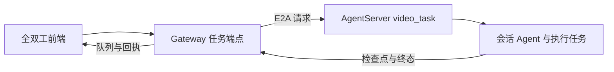

# 全双工修复移植到 develop

2026-10-29，目标 PR：[10013](https://github.com/openJiuwen-ai/jiuwenswarm/pull/10013)。
比较基线为官方 develop 的 `8407baaee`，原工作区保存提交为 `41236646d`。
原分支混有大量 0.2.8 历史，直接作为 PR 来源会夹带无关变更。因此在 develop 上逐项移植用户和 zuiho-kai 的相关修复，保留提交作者及来源。完整提交清单以 PR 描述为准。

## 适配决策

沿用 develop 的进程边界及移动后的模块，不恢复旧目录：

- Gateway 端使用根目录 `gateway/`；执行绑定、回调和服务端适配使用 `server/runtime/video_task/`。
- 通过既有协议兼容入口补齐 receipts 与 pending_interrupt 方法，保留 develop 的枚举组织。
- 媒体入口使用 Gateway 的异步 normalizer。没有上传传输时保留原始图像交给 AgentServer，不要求 Gateway 本地落盘。
- 恢复确认卡片拦截：从磁盘恢复的待处理卡片不能把新委派任务当作卡片答案。已有回归验证在执行绑定前拒绝任务。
- 历史持久化屏障测试单独隔离 lifecycle admission，防止人为暂停的写入锁阻止测试进入其目标屏障；真实文件写入和最终附件读取仍参与测试。
- 前端保留 develop 的模型选择与 Design 停止控件，补齐共享状态、历史事件重试和子代理事件消费者。

本次为版本移植，不替代原修复的产品决策。源版本中英文使用说明随对应修复保留。

## 验证证据

候选为 `c5d50166a` 加本次执行拦截与测试适配。使用独立 worktree 环境，安装 develop 锁定的 Core `b2a0a248`、protocol `10a03dd2` 和 Windows 文件锁依赖 pywin32，原工作区依赖未改动。

| 范围 | 命令 | 结果 |
| --- | --- | --- |
| 全双工后端 | `python -m pytest jiuwenswarm/extensions/video_duplex/tests/backend --no-cov -q --tb=short` | 639 passed，72.96 秒 |
| Qwen 前端 | `npm run test:qwen-barge-in` | 133 passed |
| 全双工生命周期和 Design | `npm run test:task-full-duplex` | 62 passed |
| 图像编码 | `npm run test:video-frame-encoding` | 10 passed |
| 设置校验 | `node --test tests/videoDuplexSettings.test.mjs` | 3 passed |
| 子代理事件 | `npm run test:duplex-subagent-panel` | 3 passed |
| Electron 共享选择器 | `node --test tests/electron/display_media_picker.test.cjs` | 4 passed |
| 前端生产构建 | `npx vite build` | 通过 |

后端覆盖任务数据库状态、取消结算、队列操作、回执、工具委派、错误诊断和附件交付。前端验证发生在上述候选之前，之后仅改动后端执行绑定和后端测试，前端构建产物未受影响。未运行格式化或静态检查。

未完成真实供应商端到端测试及 macOS/Electron 实机联调，PR 保持草稿；这些限制不等同于自动化用例失败。后续修改协议、执行装配或媒体接口时须重跑对应回归。

## 2026-10-29 权限卡语音输入完善与 develop 合并

按用户要求，提取本地 `duplex-local-5570-5597-028` 工作树中权限卡相关未提交分块，未带入同一工作树的模型认证及错误提示等其他修改。
工具权限申请 `permission_interrupt` 只接受界面点击，包括允许、拒绝及记住权限。执行确认 `confirm_interrupt` 保留语音回答，新增“按计划执行”等明确表达与实际选项映射。前端清理同任务的旧确认状态；服务端拒绝权限卡语音答案，语音队列摘要不暴露可提交的权限卡选项。手动点击路径保持可用，中英文说明同步。

合入官方 develop `b1301d04a`。协议文件冲突保留官方向 `openjiuwen_protocol.message` 的类型迁移，只额外注册全双工 receipts 和 pending_interrupt 方法。测试环境协议依赖同步到官方锁定的 `2a0457e5`。

合并候选验证：全双工后端、协议契约、Gateway 图片归一化及中断状态回归共 654 passed（87.34 秒）；Qwen 前端 136 passed，全双工生命周期 62 passed，JoyAI 工作流 27 passed。新增用例验证权限卡语音拒绝后仍能手动完成、旧卡状态不会串用、执行确认使用真实选项。真实供应商和跨平台实机测试未执行。
