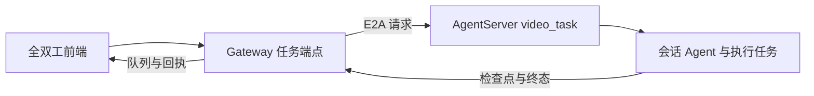
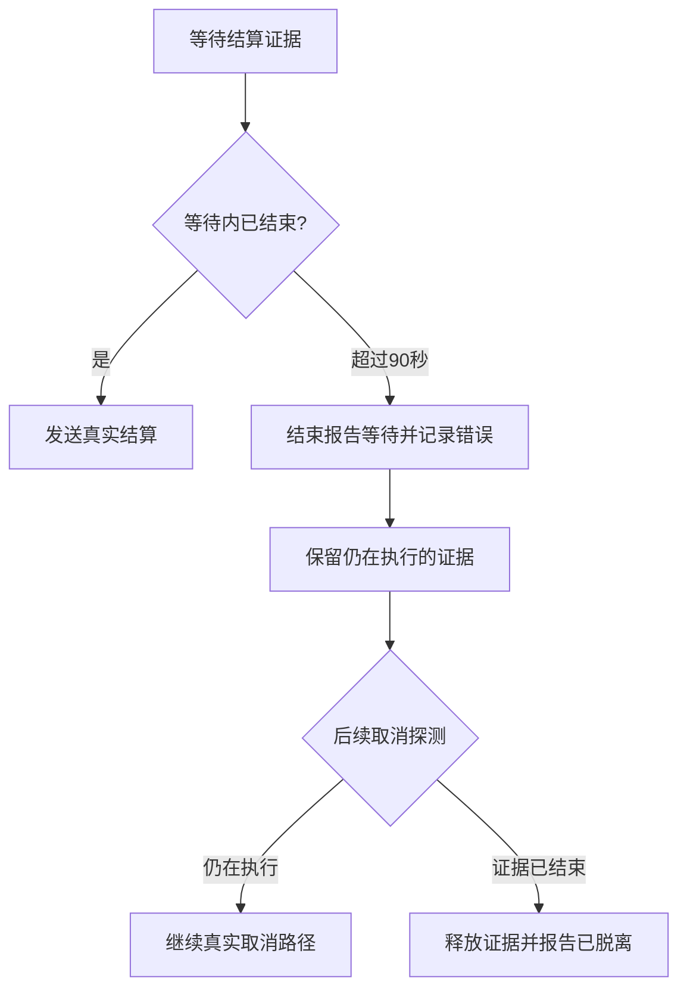

# 全双工修复移植到 develop

2026-10-29，目标 PR：[10013](https://github.com/openJiuwen-ai/jiuwenswarm/pull/10013)。
比较基线为官方 develop 的 `8407baaee`，原工作区保存提交为 `41236646d`。
原分支混有大量 0.2.8 历史，直接作为 PR 来源会夹带无关变更。因此在 develop 上逐项移植用户和 zuiho-kai 的相关修复，保留提交作者及来源。完整提交清单以 PR 描述为准。

## 适配决策

沿用 develop 的进程边界及移动后的模块，不恢复旧目录：

- Gateway 端使用根目录 `gateway/`；执行绑定、回调和服务端适配使用 `server/runtime/video_task/`。
- 通过既有协议兼容入口补齐 receipts 与 pending_interrupt 方法，保留 develop 的枚举组织。
- 媒体入口使用 Gateway 的异步 normalizer。没有上传传输时保留原始图像交给 AgentServer，不要求 Gateway 本地落盘。
- 恢复确认卡片拦截：从磁盘恢复的待处理卡片不能把新委派任务当作卡片答案。已有回归验证在执行绑定前拒绝任务。
- 历史持久化屏障测试单独隔离 lifecycle admission，防止人为暂停的写入锁阻止测试进入其目标屏障；真实文件写入和最终附件读取仍参与测试。
- 前端保留 develop 的模型选择与 Design 停止控件，补齐共享状态、历史事件重试和子代理事件消费者。

本次为版本移植，不替代原修复的产品决策。源版本中英文使用说明随对应修复保留。

## 验证证据

候选为 `c5d50166a` 加本次执行拦截与测试适配。使用独立 worktree 环境，安装 develop 锁定的 Core `b2a0a248`、protocol `10a03dd2` 和 Windows 文件锁依赖 pywin32，原工作区依赖未改动。

| 范围 | 命令 | 结果 |
| --- | --- | --- |
| 全双工后端 | `python -m pytest jiuwenswarm/extensions/video_duplex/tests/backend --no-cov -q --tb=short` | 639 passed，72.96 秒 |
| Qwen 前端 | `npm run test:qwen-barge-in` | 133 passed |
| 全双工生命周期和 Design | `npm run test:task-full-duplex` | 62 passed |
| 图像编码 | `npm run test:video-frame-encoding` | 10 passed |
| 设置校验 | `node --test tests/videoDuplexSettings.test.mjs` | 3 passed |
| 子代理事件 | `npm run test:duplex-subagent-panel` | 3 passed |
| Electron 共享选择器 | `node --test tests/electron/display_media_picker.test.cjs` | 4 passed |
| 前端生产构建 | `npx vite build` | 通过 |

后端覆盖任务数据库状态、取消结算、队列操作、回执、工具委派、错误诊断和附件交付。前端验证发生在上述候选之前，之后仅改动后端执行绑定和后端测试，前端构建产物未受影响。未运行格式化或静态检查。

未完成真实供应商端到端测试及 macOS/Electron 实机联调，PR 保持草稿；这些限制不等同于自动化用例失败。后续修改协议、执行装配或媒体接口时须重跑对应回归。

## 2026-10-29 权限卡语音输入完善与 develop 合并

按用户要求，提取本地 `duplex-local-5570-5597-028` 工作树中权限卡相关未提交分块，未带入同一工作树的模型认证及错误提示等其他修改。
工具权限申请 `permission_interrupt` 只接受界面点击，包括允许、拒绝及记住权限。执行确认 `confirm_interrupt` 保留语音回答，新增“按计划执行”等明确表达与实际选项映射。前端清理同任务的旧确认状态；服务端拒绝权限卡语音答案，语音队列摘要不暴露可提交的权限卡选项。手动点击路径保持可用，中英文说明同步。

合入官方 develop `b1301d04a`。协议文件冲突保留官方向 `openjiuwen_protocol.message` 的类型迁移，只额外注册全双工 receipts 和 pending_interrupt 方法。测试环境协议依赖同步到官方锁定的 `2a0457e5`。

合并候选验证：全双工后端、协议契约、Gateway 图片归一化及中断状态回归共 654 passed（87.34 秒）；Qwen 前端 136 passed，全双工生命周期 62 passed，JoyAI 工作流 27 passed。新增用例验证权限卡语音拒绝后仍能手动完成、旧卡状态不会串用、执行确认使用真实选项。真实供应商和跨平台实机测试未执行。

## 2026-11-03 再次同步 develop 并解决 PR 冲突

合入官方 develop `b825ac938`，在现有 PR 提交上普通合并，不新建分支、不改写历史。

- 续接请求合并官方 `interrupt_id` 与全双工 execution_target，保留 Design 模式及项目定位；回归同时检查中断标识、卡片标识和执行目标。
- Runtime 沿用官方租户 scoped_manager 与 interaction_ids 协议；全双工回执清理在该作用域的 finally 内执行。
- ChatPanel 保留企业版心跳入口限制，全双工仍由 App 的 ApplicationConversationRuntimes 承载，删除局部重复运行组件与无调用的旧回调。
- Electron 打包同时保留官方 cdp_port 与全双工 display_media_picker；不恢复官方已删除的 update_shutdown。
- 修复自动合并后的语义冲突：permission_continuation 清理函数引用了重构前的局部 state_signature，异常被捕获后导致旧中断状态恢复。改为从当前已校验的 state.ai_message.tool_calls 获取名称，并验证真实 Core 中断清理、取消及语音任务不消费权限卡的行为。
- 测试使用迁移后的 server/runtime/video_task 路径；前端夹具同步浏览器传输初始化、路由负责选择 Design 会话及历史写入屏障。

测试环境使用独立 worktree 依赖：Core `c8c621b2`、protocol `5201ca86`；前端按官方 package-lock 安装独立 node_modules，未改动 Desktop 主工作区依赖。官方 uv.lock 保持原样。
前端 Qwen 136、全双工生命周期 62、JoyAI 27、Design 入口 20、Electron 共享选择器 4 项通过，共 249 项；Vite 生产构建通过（1m07s，仅有 chunk 体积警告）。
后端最终回归 1145 passed（162.34 秒），包括全双工完整后端、协议与 Gateway、Runtime 及租户作用域、交互续接、真实 Core 权限卡取消/恢复、桌面打包契约。后端与前端本轮共 1394 项自动化测试通过。未执行真实供应商及跨平台实机音视频测试。

## 2026-11-03 审批卡片清理检视修复

核对 PR 评论 `6595376062`（候选 `673e95d8c`）。`question:${jobId}:` 在空 jobId 时实际为 `question::`，不会匹配非空任务 ID，但会匹配全部聊天卡片；任意聊天卡片结束都会误清理其余聊天卡片，Qwen 尚未播报的问题队列也有相同清理范围问题。

Qwen 与 JoyAI 对聊天卡片按 `interaction.id || request_id` 精确清理，缺少标识时不清理其他卡片；非空任务通过保存的 job_id 精确匹配清理，避免任务 ID 的冒号前缀碰撞。Qwen 的权限卡替换与待播报问题队列使用相同聊天卡片边界。任务结束仍可清理该任务的全部确认卡，其他任务及聊天卡保留。权限申请只允许手动点击的规则不变。

本轮回归通过：Qwen 138、JoyAI 27、全双工入口及生命周期 62，共 227 项。新增用例检查关闭一张聊天卡后，其他聊天卡及托管任务卡仍在下一轮模型提示中；检查 Qwen 排队问题、权限卡替换、未知关闭事件及含冒号的不同任务 ID。Vite 生产构建通过（1m13s，第三方注释和 chunk 体积提示）。本轮只改前端卡片生命周期，未重跑后端或真实供应商音视频联调。

## 2026-11-03 GitCode !9191 新增检视意见修复

候选基线为 `dcfc8aa96`。核对评论 197861437/197871090、197861438、197861439、197871062、197871076、197871105、197871127。

- 核对结果及已核对请求集合仅保留非终态执行，在调度和后台扫描时清理，关闭时清空。不使用 LRU 淘汰未结束执行，避免旧请求再次查询 Core；终态记录在缓存检查前返回。
- 后台核对扫描遇到数据库读取或事务异常时记录异常并在下一次扫描重试，不捕获 CancelledError。kick 可重新创建已经退出的监控任务。回归使用真实 SQLite，注入一次 database is locked，再验证监控继续、Core 只核对一次、关闭可停止监控。
- 正常与取消结算报告统一使用 90 秒等待上限。超时不取消被 shield 的原生执行，不发送 settle；清理 reporter 集合，日志包含请求 ID 和异常类型。另保留尚在运行的原生句柄或未退出轮次证据，防止超时后探测错误宣称任务已结束；原生执行完成时释放证据，无句柄轮次在后续报告入场或该请求探测时清理。
- 错误诊断除完整密钥外，也脱敏长密钥至少八字符的已知前缀/后缀及其所在截断 token。更短、无法可靠辨识的任意子串不做全局匹配，以免抹去普通诊断文本；不是对任意形式密钥片段的完全识别。
- Runtime unary 请求即使 finish_request 异常也在独立 finally 中恢复 ContextVar，并继续暴露原异常。流式路径原有外层 finally 已覆盖，无需重复修改。
- 评论 197871127 不成立：parseQwenOmniFunctionCall 在 try/catch 内解析并验证 JSON 对象，成功后才调用 onFunctionCall；语音答案路径使用 JSON.stringify。未添加重复解析保护或自动重放工具副作用。评论 197861440 的聊天卡清理问题已由 `dcfc8aa96` 修复，不重复变更。

本轮定向回归 241 passed；最终在完整改动上运行全双工完整后端、Runtime 及租户作用域回归，共 816 passed（68.74 秒），Qwen 前端 138 passed，最终合计 954 项通过。不重复累计首轮定向测试。本轮未改前端代码，未重复生产构建；未执行真实供应商端到端或跨平台实机音视频测试。GitCode CLA 检查指出他人合并提交 `673e95d8` 邮箱未签署；代码修复不改写该提交或代签。

## 2026-11-03 GitCode !9191 后续检视复核

基线 `3d0f51b0e`。新评论 197875100、197875103 的两项缓存清理与 197875107 的结算超时已在该基线修复，评论描述仍引用旧行号及旧实现。197875102 的 JSON.parse 意见与前轮相同，上游 JSON 校验路径不变，无需重复修复。

197875101 有效：扩展 safe_error_detail 对环境变量名后缀 TOKEN（包括 ACCESS_TOKEN）、PASSWORD、SECRET、PRIVATE_KEY 的脱敏，继续复用完整值及已知长前后缀的匹配规则。回归覆盖各类完整及截断凭据，同时验证普通 MODEL_NAME 环境值不被误当作秘密。

197875108 有效：bound_context 删除完历史、任务和近期对话后，若元数据仍超限，原代码对空 recent_turns 执行 pop 导致 IndexError。改为检查近期对话是否非空；无法继续缩减时明确抛出 ValueError，保持上下文大小上限，不静默返回超限包，也不截断会话身份字段。回归覆盖元数据单独超限和最后一条对话被删除后正常返回。

本轮全双工后端完整回归 668 passed（81.25 秒），新增 15 项用例。无前端或 Runtime 执行生命周期变更，未进行真实供应商端到端测试。
