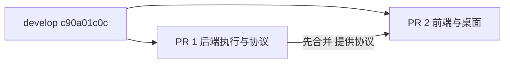
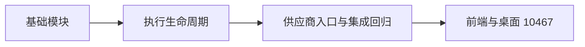

# 全双工后端修复拆分交付

原集成 PR 为 GitHub #10013、GitCode !9191。完整候选 `13be0bd53` 先普通合并最新 develop `c90a01c0c`，得到 `f92fb0c46`；不把 develop 后续更新回退到旧版本。

按文件职责拆分，后端 PR 和前端/桌面 PR 均基于同一 develop 提交。先合并后端，再合并前端；后者依赖前者提供的实时上下文、队列管理和回执协议。两份 PR 不重复携带对方代码，因此每份流水线只处理本份差异。

本份包含 Gateway ASR 公共客户端与任务桥、任务状态/取消结算/CUA 执行、专用文本模型队列操作、定时任务控制、历史上下文恢复、权限卡手动授权、供应商兼容、错误诊断和对应后端测试。保留全部最近检视修复：核对缓存清理、监控恢复、结算等待上限、不误报执行停止、ContextVar 清理、凭据脱敏和上下文超限处理。

不纳入前端、桌面、打包脚本及用户界面说明；完整用户中英文说明随前端 PR 交付。前端仍须在后端合入后更新，避免旧界面无法消费完整新协议。没有重新设计执行流程或加入额外业务行为。

原始修改来自 yzdnh123 / yzdnh123-a11y 与 zuiho / zuiho-kai。拆分提交以 Co-authored-by 保留贡献归属；原 PR、原分支及原提交完整保留作为来源依据。源提交包括 1fdc0825d、e03299e17、663882f90、8f00d60c9、5d2a9c98f、e73911d0f、ff2083060、4f91f4f2c、58e16d7e2、e787a7627、b6adeae2e、0533b5c98、41236646d，以及原 PR 的后续适配和检视修复。拆分采用最终文件内容而非重新 cherry-pick 未适配旧路径的历史提交。

后端独立候选验证：全双工完整后端、Runtime/租户、权限中断续接、DeepAdapter、Team、Design 事件桥、ASR 与任务工具事件转发共 1163 passed（126.03 秒）。未执行真实供应商及跨平台实机音视频测试。最终还会比较两份代码文件的并集与完整候选，检查无遗漏、无代码重叠；文档与自动索引因拆分说明允许额外变化。

## 后端 #10465 再次拆分

用户指出 #10465 仍过大，要求进一步缩小。原 76 文件、约 1.09 万行差异不再作为单个 PR 提交。先将该候选普通合并 develop `17625e5dd`，再拆为三份均面向 develop 的差异。

1. 基础模块：公共 ASR、错误脱敏、工具 JSON/schema、文本队列/定时任务辅助模块和历史上下文恢复。这里增加基础能力，不提前接入新的供应商执行入口。
2. 执行生命周期：TaskService、Core/Gateway 桥、状态核对、取消结算、CUA、权限中断和 Design 路由。依赖第一份基础模块，须在其合入后合并。
3. 供应商入口和集成回归：Qwen/JoyAI 接入、video_live/video_voice、连接检查及依赖完整执行链的回归。依赖前两份，最后再合并前端 #10467。

每个 PR 的分支只携带本份差异，避免把依赖提交一并带进后续流水线。后两份在前置未合入前标为 draft；其验证基于前置已组合的候选，不能宣称在无前置的 develop 上可独立运行。第一份定向验证和后续组合回归分别记录。

仅调整三项测试的物理位置，不删除测试或改变断言：工具解析测试中的 TaskService 标题校验随第二份交付；队列测试中的 Gateway 去重和真实队列排序随第三份交付。其余代码文件与原后端候选逐文件比对，另用 AST 核对移动测试的函数和装饰器，确保覆盖无遗漏。

首次基础候选完整后端回归出现旧入口用例失败。移除本份已有文件修改复跑相关用例，官方基线同样有 5 项失败；同时确认部分新工具用例依赖后续代码，已按上述方式移动。本份不为通过拆分阶段测试而修改旧入口业务。最终完整组合候选仍须验证全部后端与 Runtime 路径，不用定向结果掩盖组合失败。

本轮基础候选定向验证 140 passed（14.84 秒）；基础与执行组合候选 767 passed（78.92 秒）；三份完整组合候选 1163 passed（99.13 秒），覆盖完整全双工后端、Runtime/租户、DeepAdapter、Team、Design、ASR 与任务工具事件。不同阶段结果不重复累计。产品代码保持原候选内容，另核对两处原测试文件与三项移动测试的 AST。原 #10465 与分支保留来源，替代 PR 完成后关闭旧 PR。未执行真实供应商或跨平台实机联调。

## 2026-11-03 基础模块静态检查修复

核对 GitCode !9505 的 CodeCheck 报告（39 项）：长行 27、复杂条件 5、lambda 赋值 2、复杂推导式 2、嵌套定义空行 2、海象表达式 1。按报告位置手工拆行，提取规范十进制队列版本判断，保持原校验顺序与接受范围；拆分标题和来源文本校验，ASR 事件循环先读取再判断结束，不改变事件处理规则。测试中的动态任务快照改为闭包函数，保留状态更新后的实时读取。没有运行本地格式化或静态检查工具，最终静态门禁以官方复跑结果为准。

本轮工具解析、动作辅助、上下文、队列管理及任务 ASR 定向回归 92 passed（20.52 秒）。pytest 退出清理旧临时目录时有 Windows 权限提示，不影响测试断言与退出码；后续使用仓库外指定 basetemp。

供应商入口 GitCode !9507 的 74 项报告同步修复：拆分协议/图片校验与复杂嵌套推导式，手工换行，移除测试海象表达式和 lambda 赋值，补齐测试响应/通道/健康探测夹具的实例字段。对仅测试使用的 protected-access 按现有测试约定记录 white-box 原因并限定在相应测试模块；生产模块不屏蔽规则、不扩大内部接口可见性。测试替身的可选 dispatch 方法通过 monkeypatch 注入，默认健康状态仍跟随缓存值，显式 runtime_ready 继续可单独控制。

完整后端依赖组合候选 `853f7b9c2`：全双工全部后端回归与任务 ASR 共 678 passed（331.50 秒），包含 WebSocket ASR、供应商协议、任务队列、确认卡、Design 路由、上下文恢复与未知状态核对。另核对 Qwen 两种路由的工具 schema 完全一致，拆行前后长提示词的实际值不变。不重复累计前述 92 项定向测试。未运行本地静态检查，未执行真实供应商或跨平台实机联调；官方 CodeCheck 需由推送后的流水线复跑确认。

## 2026-11-04 其余 PR 复查

基础 PR 的工具 schema 已允许省略 queue_version，但原 task_adapter 仍直接下标读取，
存在基础 PR 单独合入后的兼容窗口。本份前移最小兼容逻辑：缺省时读取当前队列版本；
显式旧版本仍拒绝，保留服务端事务中的并发核对。补充共享工具契约和真实持久化队列测试，
断言实际排序及旧版本拒绝，而不只验证解析。

JoyAI 动作辅助复用文本队列管理器的 JSON 规整规则，接受 fenced JSON，空内容、
非对象及非 JSON 均报告 ValueError，让已有调用方降级路径可用。解析器在调用时延迟
导入，避免 queue_manager 与 action helper 的模块初始化循环。保留此前用户要求的
模型等待行为，不因检视建议新增模型超时；pytest 使用 auto 模式，未标记的 async
用例实际已执行，不能视为被跳过。OpenAI SDK 默认保留重定向，未增加重复配置。

工具解析、真实任务队列、动作辅助及队列管理定向回归：144 passed。
供应商 PR 的缺失模块/符号意见需要前置 #10476、#10477，继续保持 Draft 和明确合并顺序，
不将前置大差异重复放入供应商 PR。macOS Electron 的麦克风用途声明需在桌面 PR 补齐。

五份分支分别普通合并官方 develop `a2abceccf` 后重新核对；基础、执行和桌面 PR 的冲突
仅在自动生成的文档索引，保留上游和本系列全部来源文档重新生成，没有采用单侧覆盖代码。
2026-11-04 组合产品候选 `55674f29f`（本地验证引用 `refs/codex/duplex-other-pr-audit-tested`）
覆盖五份最新代码，临时组合后已恢复各分支原文件，不把前置提交重复塞入后续 PR。

本轮组合回归：后端全部双工测试、ASR、Runtime 服务、模型身份、DeepAdapter 中断、
任务工具事件、Team、Design 与会话消息共 **1347 passed（170.16 秒）**；
前端 Qwen 139、JoyAI 27、任务/Design 生命周期 62、图片编码 10、子代理面板 3、
Design 入口 20、设置校验 3，加 Electron 选择器 6，共 **270 passed**；
Vite 生产构建通过（1m39s），沿用本机内存限制，未改产品构建配置。
这些是组合候选证据，不能替代缺少前置代码时的独立运行或官方 Linux 门禁。
五份 GitHub PR 均重新核实为 mergeable；官方新流水线已开始，尚无全绿结论。
未运行本地静态检查，未执行真实供应商、macOS TCC 或跨平台实机音视频验证。
