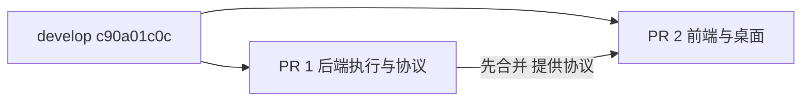

# 全双工后端修复拆分交付

原集成 PR 为 GitHub #10013、GitCode !9191。完整候选 `13be0bd53` 先普通合并最新 develop `c90a01c0c`，得到 `f92fb0c46`；不把 develop 后续更新回退到旧版本。

按文件职责拆分，后端 PR 和前端/桌面 PR 均基于同一 develop 提交。先合并后端，再合并前端；后者依赖前者提供的实时上下文、队列管理和回执协议。两份 PR 不重复携带对方代码，因此每份流水线只处理本份差异。

本份包含 Gateway ASR 公共客户端与任务桥、任务状态/取消结算/CUA 执行、专用文本模型队列操作、定时任务控制、历史上下文恢复、权限卡手动授权、供应商兼容、错误诊断和对应后端测试。保留全部最近检视修复：核对缓存清理、监控恢复、结算等待上限、不误报执行停止、ContextVar 清理、凭据脱敏和上下文超限处理。

不纳入前端、桌面、打包脚本及用户界面说明；完整用户中英文说明随前端 PR 交付。前端仍须在后端合入后更新，避免旧界面无法消费完整新协议。没有重新设计执行流程或加入额外业务行为。

原始修改来自 yzdnh123 / yzdnh123-a11y 与 zuiho / zuiho-kai。拆分提交以 Co-authored-by 保留贡献归属；原 PR、原分支及原提交完整保留作为来源依据。源提交包括 1fdc0825d、e03299e17、663882f90、8f00d60c9、5d2a9c98f、e73911d0f、ff2083060、4f91f4f2c、58e16d7e2、e787a7627、b6adeae2e、0533b5c98、41236646d，以及原 PR 的后续适配和检视修复。拆分采用最终文件内容而非重新 cherry-pick 未适配旧路径的历史提交。

后端独立候选验证：全双工完整后端、Runtime/租户、权限中断续接、DeepAdapter、Team、Design 事件桥、ASR 与任务工具事件转发共 1163 passed（126.03 秒）。未执行真实供应商及跨平台实机音视频测试。最终还会比较两份代码文件的并集与完整候选，检查无遗漏、无代码重叠；文档与自动索引因拆分说明允许额外变化。
