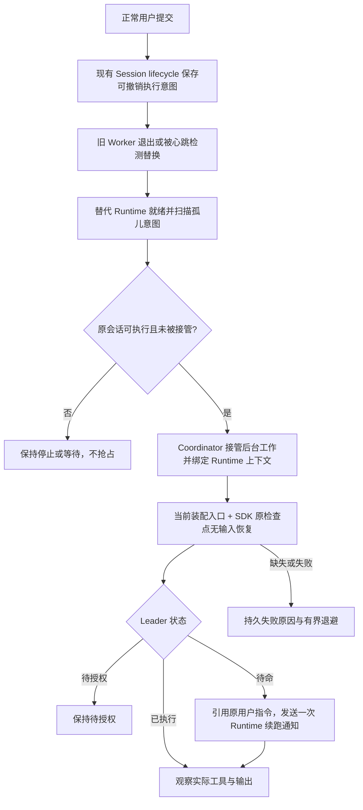

# Worker 自动续跑与故障取证

## 问题与已核实的原因

长程 Team 运行中旧 Worker 退出，新 Worker 就绪之后，原团队可能只剩配置和数据库记录。用户看到旧任务仍在进行，实际没有实时团队，需要人工发送继续。

上游已具备 Worker 替换、同 Worker 断线重订阅以及 SDK 冷恢复；不足在应用没有持久、可撤销的“这个 Team 仍应执行”意图，也没有在替代 Runtime 就绪后自动走原 Team 恢复入口。直接调用 SDK start 又可能只恢复成待命，不能把成员出现算作任务续跑。

额外故障注入发现：首次原生轮次未结束时被杀，SDK 的 Team manifest 已持久化，但该轮模型上下文还没到检查点边界。最早的测试虽然出现第二次工具调用，恢复后的模型请求却没有原任务文本。这个测试判为失败；后续补上既有会话用户指令引用，不能以“工具又调用了”掩盖丢失目标。

## 基线与决策归属

本变更从已验证的实现选取两笔后端提交：取证 `a871d7263830be279a663963f64e56704d02d6ae`（`fix(worker): 补足心跳失联与原生异常取证并限制日志保留`）与恢复 `39257a903f911f852fb636b2a741140b953f191f`（`fix(runtime): 在 Worker 换代后自动恢复原团队并继续未完成任务`）。当前目标基底为 官方 `develop` 的 `3f4a9a81345281d1a4802803a9fb562f22ad6778`。

现有同进程 IPC 续订约定继续有效；本次新增的是换代后的应用恢复决策，不修改 SDK，不将特定任务的业务覆盖或完成判定写进平台。契约由 `S_02_team-automatic-recovery` 维护，只提供可选的恢复协议字段，不包含前端代码。

## 实际调用链

为什么不重发原 Query：可能重复派工、忽略后续范围变更，也无法解决已完成外部操作的重复执行风险。为什么不按旧 busy 恢复：旧任务记录可能属于主动停止或已结束的 Team。为什么不新建一套任务状态库：SDK 与既有会话历史已经分别负责检查点、任务和原始用户输入。

恢复意图与停止、重试、所有权不变量见 spec。失败错误对外采用受控原因，任意异常正文留服务日志，不进入公共恢复快照。恢复扫描并发上限为二，每个准入有 120 秒边界，实际团队执行没有这个时限。

## 取证的实际增强与边界

Supervisor 快照增加时间、Worker 实例、可得退出码、内存、线程数和系统可用内存，保留最近十二份。真实 Worker 的 faulthandler 把循环阻塞/致命错误的 Python 线程栈单独落盘，保留最近八份，健康心跳截断超过 5 MiB 的当前阻塞栈文件；stderr 路由不改。

没有引入操作系统 minidump。已有 Windows `0xc0000005` 事故仍未定位到原生模块；Python 栈与资源快照改善下次定位，不能证明访问冲突或所有心跳失联已经根治。

## 行为验证

原实施验证的隔离环境为 Windows、Python 3.11.17、锁文件依赖 openjiuwen 0.1.21；未覆盖原事故 Python 3.12 环境。独立数据根、IPC 地址、本地受控 OpenAI SSE 服务，无外部付费模型、无真实迁移团队写入。替换使用真实 Supervisor、Worker 子进程、IPC、SDK SQLite 检查点与 Team 协作内核；模型回答及平台配置装配由测试替代。目标分支使用其各自锁文件重验，结果见下方独立记录。

| 范围 | 实际证据 | 结论与限制 |
|---|---|---|
| 首批真实两成员 scheduled Team | 旧 Worker 完成步骤 1 后退出或被 watchdog 替换，新 Worker 自动执行步骤 2；独立副作用文件为 `[1,2]`，只有一次前端提交 | 已通过最初两条进程测试；随后新增原任务输入断言暴露上下文缺口，不能沿用这一结果宣布完整恢复 |
| 修订后的 autonomous Team | 用 Leader 实际 build_team，再在步骤间替换 Worker；断言原任务引用、Runtime 通知、PID 换代与独立副作用 | 两项均通过，145.73 秒；恢复后的模型请求含原任务，独立工件为 `[1,2]`，没有第二次用户请求 |
| 生命周期与负向边界 | 最终 23 项通过：防重、代次、停止、缺检查点、退避、稳定重置、Coordinator 所有权、原指令引用、敏感异常不外露、准入并发、无 waiter 推送和多次进程死亡后的失败通知 | 单元场景不替代真实多小时故障或审批跨进程测试 |
| 原生异常取证 | 测试子进程 `os.abort()` 后独立 fault.log 含 Fatal Python error；另验保留数量 | 已通过；不是复现原事故访问冲突 |
| 最终取证失败路径 | 取证四项连同既有 Worker liveness/entrypoint 共 35 项通过，13.30 秒；检查 OS 计数失败、写盘失败、Worker 八份/Supervisor 十二份保留及真实 abort 落盘 | 保留界限和诊断错误不会阻断心跳已验证；不保证断电或磁盘已坏仍能取证 |
| 相关既有回归 | Team helper、Worker liveness/entrypoint、Runtime service 与 Coordinator 连同新增恢复/取证测试合计 566 项通过，94.46 秒；随后针对失败通知与诊断错误路径再验受影响范围 | 非全仓测试，不将追加小范围验证与 566 项重复相加 |
| 上游对照 | 两个 `test_real_worker_exit_before_ipc_recovers_without_config_reload` 在候选和未修改的官方 fdaec9d18 均因 1.5 秒冷启动预算失败 | 如实保留，未提高阈值或改成跳过；不能报告为全部通过 |

主要命令：隔离环境执行 `python -m pytest tests/unit_tests/agentserver/test_team_recovery_process.py tests/unit_tests/agentserver/test_team_automatic_recovery.py tests/unit_tests/agentserver/test_team_recovery_diagnostics.py -q --no-cov -o addopts='' -o asyncio_mode=auto`，其余定向回归按记录范围运行。未执行格式化、静态检查、tsc 或全量迁移。

## 本次自检与交付组织

按 `jw-review` 对未提交候选和官方基线核对执行所有权、状态来源、恢复与停止对称路径、SDK 消费入口以及前后端新增字段。修正了原目标在首次轮次中可能丢失、恢复上下文未绑定 Runtime、无 waiter 时恢复事件不可见，以及失败计数耗尽却不通知页面的缺口。取证读取/写入失败不能破坏健康处理。此为开发者自检，不冒充独立检视或整仓审计。

有限 SDK stream 未发终态就正常关闭时，撤销尚在 running/restored 的续跑意图，避免下一次启动把已经自然结束的旧工作复活；显式失败、审批等待及用户停止不被这个收尾覆盖。正常 idle 与静默关闭两项 helper 回归通过（21.36 秒）。

取证与自动恢复分别保留为后端提交，生成索引按当前目标分支的文档重建；没有迁入前端文件。上表记录原实施候选的证据，本次目标分支的兼容性与重验结果单独记录，不能直接沿用其他分支的通过数。

## 目标分支验证与遗留

### 2026-11-23：官方 develop 基底上的适配与独立重验

目标基底为 `3f4a9a81345281d1a4802803a9fb562f22ad6778`。冲突解决保留上游的 Session run-end 任务、会话锁、启动时会话清理、请求 ContextVar 与 NPC 输出归属；新增恢复在启动清理结束后再准入。真实进程 fixture 同步初始化新 Runtime 必需的会话锁与 run-end 容器，不放宽生产预算。

在独立 Windows / Python 3.11.17 环境按 develop 锁文件安装 SDK openjiuwen 0.1.20，提交 `0b1aa2102104a2eeadd960d92e332fb9eeb861b1`；没有修改依赖或锁文件。620 项测试全部通过，265.23 秒，覆盖两个真实进程恢复场景、恢复状态/取证、Team helper、Worker liveness/entrypoint、Runtime service、Coordinator、应用 NPC 团队、必需启动准备及能力边界。测试代码从本目标 worktree 导入，数据与受控模型隔离。

另补范围保护：只为普通持久 Team 登记恢复意图，明确排除临时 Team 与应用 NPC Team。新增三种准入场景后，恢复状态测试文件共 26 项通过（7.83 秒）；与上述 620 项存在重叠，不合并计数。此为 SDK/Runtime 目标分支适配，不将旧实现环境的通过数当作 develop 的测试结果。

### 2026-11-24：代码检视与静态检测修正

针对当前分支工作区修订，补齐三个异常边界：

- 流结束时恢复快照不可读只记 warning，不能打断终态广播、历史收尾和 stream 注册释放；覆盖损坏 JSON 与 lifecycle 异常。
- Coordinator 未产出首个准入事件就结束时，以 RuntimeStateError 结算等待者；不能悬挂，也不能按建议直接标成功。已有 120 秒外层准入时限保留，取消仍传播并等待 consumer 清理。
- stop 增加运行属主与可选 token 检查。使用 lifecycle.write_guard 而非新执行的 guard：归档/删除排空期间仍需撤销意图，完成写隔离后不再改记录。覆盖新属主拒绝旧进程、旧 token 拒绝、新用户停止孤儿、排空写入及隔离拒绝。

附件静态项逐项收敛：恢复服务在构造器中声明；快照改为简单循环；按语义拆分复合条件与长行；删除只重抛 CancelledError 的冗余分支，Exception 捕获仍不会吞掉取消。故障文件用 ExitStack 管理，启用失败自动释放，重复启用不重复开文件；正常 Worker 退出与 atexit 先取消定时器、停用 faulthandler，再关闭文件。原生崩溃仍由操作系统回收句柄，不能提前关闭取证文件。

本轮隔离回归 **592 项全部通过，208.70 秒**，包含真实 Worker 子进程退出/心跳过期替换、恢复准入和停止负向场景、诊断取证、Team helper、Worker entrypoint/liveness、Runtime service 与 Coordinator。使用本分支对应的既有隔离依赖环境，不接管真实团队。测试与前一天的统计重叠，不相加；未运行格式化、静态检查或全仓测试。

develop 另验应用 NPC、Worker required preparation 和 startup capability boundaries 三个文件，48 项全部通过，13.35 秒；确认构造器声明与准入条件整理不改变既有启动和应用团队边界。

### 2026-11-24：更新官方基线与 SDK 后的重验

将检视修正折回原有两笔后端提交，再 rebase 到官方 develop 的 `98907aa638de2b5e84d68bdda543de5bfabccfab`。隔离测试环境按该基线锁文件执行 uv sync --locked：Python 3.11.17，openjiuwen 0.1.21，SDK Git 提交 `02b2ce4538b60cc4fd6085db36021b48ee5a1d99`。上方八个回归文件及 develop 启动/NPC 三个文件重新执行，**640 项通过，169.37 秒**。此为本次 rebase 后的证据，不沿用旧 SDK 的测试结论；没有更改锁文件，也没有迁入本地前端优化。

### 2026-11-26：跟进 develop 冲突与 CI 失败

目标基底更新到官方 develop `92a4ef2b0d44a3d1fa2a040e7d3132fb3ef07d84`。在本分支独立环境执行 uv sync --locked，实际 SDK 为 openjiuwen 0.1.21，提交 `1b066729e6159aa149fe9bdc2c31ec1778e2a681`，不修改锁文件或运行实验的环境。

冲突解决保留上游 PauseSessionResult、代次与 request-id round fence，以及新日志轮转策略。暂停先核对回合，再撤销恢复意图；迟到暂停不能影响下一回合。client_disconnect 沿用 workflow pause 语义，不等同于用户永久取消。恢复状态继续通过既有 server-push 通道送达没有聊天等待者的页面。

本轮发现的问题分别处理，不把所有失败归到自动恢复：

- REA 开关三项和 Symphony timeout 的测试修正已在上游，随 rebase 保留，不重复覆盖。
- IPC 故障注入测试仍从 stderr 读原生栈，与独立 fault.log 的取证契约不符；改按真实 Worker PID 找专属文件，保留超时栈和业务函数栈断言。诊断目录使用新路径门面的 get_agent_logs_dir，与应用日志桶一致。30 秒心跳、60 秒阻塞及替换条件没有放宽。
- 新基线 agent_observability 模块使用 threading.Lock 却未导入 threading，导致测试收集失败；单独补齐依赖，不改观测行为。
- 上游路径实现迁入 common.paths、数据迁入 profile 后，真实进程测试的隔离缓存和记录入口同步使用新门面。
- 实际 Worker 换代还暴露布局迁移经同一目录别名删除持久数据，临时 unlink 栈跟踪锁定调用链后移除。修复与独立的上游负向对照见 B_20261126_1725_profile-migration-self-alias；不通过 mock 跳过持久化来让恢复测试通过。

resident IPC 用例曾在 10 秒启动窗口间歇性超时，未修改的上游也出现同一现象；单独重跑通过。尚未完整定位这个启动抖动，不宣称已根治，也没有扩大启动时限。

最终候选在隔离 Windows / Python 3.11.17 环境中：16 个相关文件 **967 项全部通过，228.57 秒**，包含真实 Worker 被杀/心跳过期替换后同一任务自动完成第二步、独立副作用 `[1,2]` 且只有一次用户提交，及 REA、Symphony、暂停/取消、恢复/取证、Runtime/Coordinator 与 NPC/启动边界。IPC 两种传输的失联和排队阻塞四项另验，**4 项全部通过，207.52 秒**，与前组没有重叠。合计 971 项本地通过；不是全仓测试，也不代替 PR 远端 CI。中间失败和上游对照保留在隔离验证记录，没有删除失败断言或关闭恢复预算。

交付前官方又推进到 `05331b3ebb1838f45ca1c478f75584fe4267a9b8`，再次 rebase 无冲突；依赖声明和锁文件未变化。以上范围连同新的 Gateway/路径回归重验：**975 项通过，1 项失败，203.90 秒**；IPC 四项再次全部通过，207.18 秒。真实退出与心跳过期两个恢复场景均再次完成 `[1,2]`，用户列出的七个独立失败项已全部通过。

额外失败为上游新加入的 `test_startup_keeps_saved_design_asset_paths_readable`：期望旧路径的兼容软链接存在，但本机不具备 symlink 权限，独立能力探针报 Windows 1314。未修改的官方 `05331b3eb` 在自己的 worktree 同样失败（9.61 秒），候选没有修改此用例。故最终扩展结果为 979 项通过、1 项既有环境相关失败，不能写成全绿；没有为过 CI 放宽软链接断言或扩大本 PR 至 Designer 路径兼容机制。

### 仍待验证

- 原长程迁移 Team、真实外部工具、物理网络断开、真实业务循环持续阻塞，以及连续多小时再故障尚未实跑。watchdog 测试注入过期心跳后调用真实分类与替换路径，不冒充物理断网试验。
- 原事故的 native crash 根因未知。任意未知副作用、审批恢复或模型行为不能从受控两步任务推广为全部安全。
- 默认 Manager 装配适用于个人模式；跨租户无身份的后台恢复不扩展为多租户授权恢复承诺。
- 原运行服务与原 `.venv` 未重启或替换，前端资源只在隔离目录构建。源码通过验证不等于原实验已恢复。
- 选取后端修复不等于已合入官方目标分支或已在原长程任务部署。
