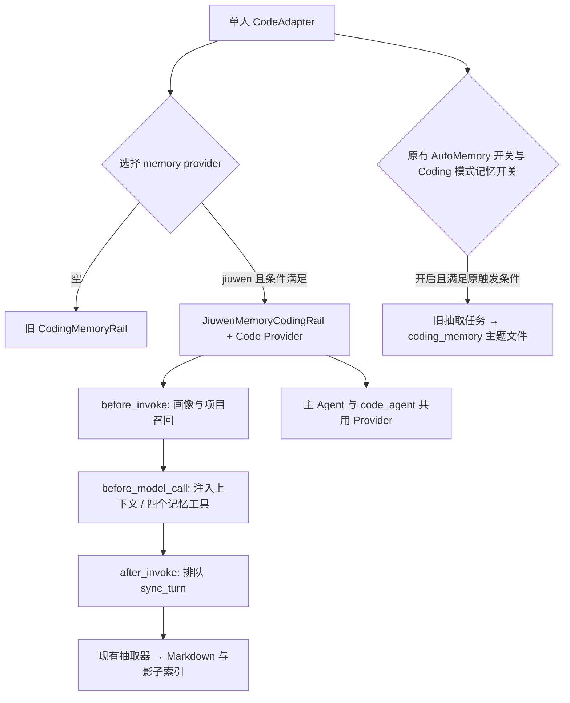

# Coding 文档记忆接入

最近一次修订日期：2026-11-26。

## 单人 Coding 配置与选择

| 配置 | 作用 |
|---|---|
| `modes.code.memory.enabled` | Coding 记忆与 ProjectMemoryRail 总开关 |
| `memory.builtin.provider` | 模板默认 `jiuwen`，选择文档记忆；空值或旧配置缺少该字段时保留旧 CodingMemoryRail |
| `memory.builtin.jiuwen.portal.enabled` | 仅控制管理页面，不影响 Coding Rail 的装配、召回或写入 |
| `memory.engine` | 新路线需要 `builtin` 或 `both` |
| `memory.mode` | 新路线需要 `local`，与下方 SDK/HTTP 连接方式不同 |
| `memory.builtin.jiuwen.mode` | 模板缺省 `sdk`；`http` 连接服务；配置和环境变量均空时回落 `http` |
| `memory.builtin.jiuwen.sdk` | SDK 内核配置；模板使用本地 hashing 向量、64 维，LLM 沿用 Swarm 默认模型；可覆盖 embedder、模型、根目录及看门狗配置 |
| `memory.builtin.jiuwen.user_id/scope_id/space/session_id` | 沿用已有身份配置；session 默认空字符串，不自动绑定聊天会话 ID |
| `memory.builtin.jiuwen.agent_id` | 单人 Work/Code 的记忆身份，默认 `main_agent`；也用于登记对应的项目访问 |

永恒会话不挂新 Rail。选中 jiuwen 后，条件不满足或初始化失败均不回退旧 CodingMemoryRail；ProjectMemoryRail 独立遵循 `modes.code.memory.enabled`。Code 不挂工作模式 MemoryRail/JiuwenMemoryRail/ExternalMemoryRail。

冷启动、模式变化、Spec 热重载都使用 `_build_coding_memory_rail` 的选择，项目或身份等输入改变时替换；替换同时更新未来 code_agent 的配置。AutoMemory 保持原设计：`agent.code.*` 读全局 `auto_memory_enabled`，历史 `code.*` 读 `modes.code.memory.auto_coding_memory`，同时受原有模式级记忆开关控制；不因选择 jiuwen 跳过。抽取子任务继续用旧工具和 `coding_memory/{项目键}/`，不继承 Jiuwen 编码 Rail 或其工具，避免对子任务再次触发 `sync_turn`；因此 Jiuwen 场景的模型前缀缓存复用可能减少。`sync_turn` 不受 AutoMemory 开关控制，两者分别抽取、分别落盘，不自动合并或迁移。Dreaming 不变；Team Jiuwen 路线见下节。

在现有工作模式 jiuwen 配置上启用 Coding 的最小示例（模型配置沿用现有 sdk / Swarm 配置）：

```yaml
modes:
  code:
    memory:
      enabled: true
memory:
  mode: local
  engine: builtin
  builtin:
    provider: jiuwen
    jiuwen:
      mode: sdk
      user_id: my-user
      scope_id: my-org
      agent_id: main_agent  # 三种模式统一使用此记忆身份
      sdk:
        markdown_store:
          default:
            target: local
            params:
              root: /absolute/path/to/shared-memory
```

## 身份和存储

单人 Work/Code 以 memory.builtin.jiuwen.agent_id 绑定记忆，未配置或空值时使用 main_agent。配置身份改变会重建记忆 Rail，仅运行名称变化不会。session_id 如实传入，默认空字符串。公共 builder 的 agent_name 参数保留调用兼容。Team 按下文的稳定成员归属绑定。

单人 Work/Code 共用 markdown 根，缺省由 `get_agent_workspace_dir()` 解析（个人版为数据根下 `profile/agent/workspace`），显式 root 优先。画像文档按同一 org、space、user 和会话坐标共享，忽略 Agent 轴。项目记忆按宿主绑定的项目与成员权跨模式检索。普通聊天的新建、刷新和成员替换沿用配置身份。现有影子索引搜索跨 session。

既有数据保留写入时的 Scope，不自动迁移或跨 Agent 兜底搜索。默认 main_agent 与原默认写入身份对齐；其他维度不变时可继续访问原默认身份数据。已有配置若显式设置其他 agent_id，则仍使用该值；需访问旧 main_agent 数据时应调整为 main_agent。配置统一作用于三种模式，不合并多个旧身份。

Work/Code 项目键统一使用 `resolve_coding_memory_project_name`：规范绝对路径的目录名 + 12 位摘要，同名不同目录隔离；未指定项目为 default。Code 工具不能覆盖该键；Work 自动回调及工具默认值取当前所选项目，未选项目归入 default，显式项目坐标仍可访问既有记忆。相同文档根或服务、相同允许访问的身份下，两种模式选择同一项目路径即可共享项目记忆；不同路径保持隔离。共享画像为 USER.md，项目内容在 memory/{项目键}/；详见 agent-memory 的 S11。

## 调用链



普通调用搜索项目 top_k=5 并读画像；无命中或搜索超时用项目 MEMORY.md。heartbeat/cron 仅读已有文档，不自动抽取。显式工具支持 read/write/edit/search；write/edit 纳入既有 MemoryForbiddenRail 的内容限制（须开启原过滤配置），不增加对工作模式工具的规则，也不将自动 sync_turn 宣称为该工具过滤器覆盖的范围。

## 发布依赖

Swarm、core 与 agent-memory 须使用包含本特性的配套版本。正式发布时更新 Swarm 对 core、JiuwenMemory 的依赖及 lock；仅合并源码不代表已发布的依赖包包含本特性。

## HTTP 装配与热更新

`memory.builtin.jiuwen.mode=http` 使用共用服务地址、api_key、identity_org/identity_user
和绑定身份。Code 只创建 HTTP Provider，不传 sdk 配置，不创建进程内 Runtime 或看门狗；
ProjectMemoryRail 仍只读取本地项目说明书。

HTTP Coding Rail 的重建依据是服务配置、绑定身份和项目路径。sdk 文档根、Swarm 本地
models/embed 和 agent_workspace_dir 变化不影响 HTTP 记忆客户端；SDK 和原生模式仍按
原规则响应各自有效配置。模式级记忆开关、provider 切换与无回退规则不变。

HTTP 身份映射沿用 agent-memory 现有契约，不能套用本节之前的 SDK 五维直映射说明。
服务端独立配置模型、文档根、索引与认证；参考 agent-memory 适配 README 的 HTTP 部分。
本地 SDK 记忆不随连接方式切换自动上传。服务端抽取失败或超时不以“已经记住”交付。

完整 Spec 重载复用同一 JiuwenMemoryCodingRail 时，保留已初始化的 Provider；卸载后在进入异步初始化前重新绑定工具和提示词，避免最后一个 owner 暂时离开导致连接被关闭。回调注册仍由 DeepAgent 完成。实际身份、项目或连接配置改变则按原逻辑关闭旧 Provider，再使用新轨。Code 冷启动、完整 Spec 重载和 Rail 协调均检查项目成员登记，按绑定成功后复用，失败可在后续请求重试。Work 的内置 Jiuwen Rail 随有效项目键变更更新绑定和登记。


SDK 文档存储配置的 `markdown_store`、`default`、`params` 允许 YAML 空值，按缺省字典补齐；`default` 的字符串 target 简写继续支持。其他错误类型明确记录配置错误，不静默丢弃后使用默认存储。

Jiuwen 编码 Rail 创建或重建失败时清空编码槽位，不保留旧实例、不回退原生 CodingMemoryRail。热更新会卸载并关闭旧 Rail，同时移除后续 code_agent 配置中的旧 Rail；ProjectMemoryRail 独立保留。修复配置后可在后续重建/重载时恢复。这里指构造阶段失败；已创建 Provider 的运行时请求超时或服务端抽取失败仍走原有错误处理。

原生 Coding 路线不变：仅相同绑定的重建失败可保留旧实例；绑定变化或主动关闭开关时停用旧实例。原生配置指纹使用实际构造目录，不随仅用于 jiuwen 的运行时项目目录产生无意义重建。


## 场景装配扩展

`build_jiuwen_memory_rail` 是 Jiuwen 记忆专用装配入口，不负责其他功能 Rail。既有参数和默认值保持不变，追加可选 team_binding；通过场景工厂获得 Rail 类型、Provider 参数及 Rail 参数，再执行公共身份解析和 SDK/HTTP 装配。

内置 `agent` 工厂延迟导入 Work Rail，并选择上游增强版 `SwarmJiuwenMemoryRail`，保留按实际项目路径解析与 `session_end_extract`；`code` 工厂仅导入 Coding Rail，并传递绑定的 `scene/project`。工厂每次返回独立参数，不缓存 Provider 或 Rail。未注册场景、依赖缺失或创建失败返回 None，由现有调用方执行停用策略。

扩展接入时新增场景工厂并注册；若记忆行为不同，同时在 agent-memory 注册对应场景策略。新 Rail 沿用现有 Provider 协议，调用时机仍由 Core Rail 定义。该注册机制不增加用户配置键，也不改变原生记忆、项目身份、热更新或 AutoMemory 规则。


SDK 装配保留视频/音频模型与获准媒体目录的透传；首次装配在配置允许时绑定当前用户／租户的稳定 sessions 父目录，Work/Code/Team 的创建顺序不影响后续会话视频导入。Work 重建指纹包含配置中的记忆身份和媒体配置，目录授权绑定同一身份；部署者显式配置的目录授权保留。创建新会话不新增授权配置，共享 Runtime 仍采用首份配置；权限与模型变化不因此获得热更新能力。媒体授权范围及门禁见同目录 S_01_multimodal-tool-loading。启动看门狗前，仅归档受管文档根中未修改的默认 MEMORY.md 模板，保留用户编辑内容与自定义根目录文件。

## Team 扩展

`memory.builtin.jiuwen.portal.enabled` 仅控制管理页面与新链接签发，不控制 Team Rail 的装配、预取、回写或工具调用；不存在由 Portal 新增的顶层 `memory.enabled` 总开关。页面开关及实例生命周期见 [S_03_memory-portal](../S_03_memory-portal.md)。

`attach_only` 是被动事件订阅，不调整宿主的记忆 Rail；真实输入仍按原规则移除入口的普通记忆 Rail。同一 DeepAdapter 的内置记忆配置协调必须串行覆盖判断、注册、清理和注销，避免请求与配置刷新重复释放同一对象；不同 Adapter 独立协调。回归与故障依据见 [Team 记忆 Rail 并发卸载修复](../../../../../bugfix/jiuwenswarm/server/runtime/agent_adapter/B_20261126_1052_team-memory-rail-race.md)。

team.work、team.code 仅按 memory.builtin.provider=jiuwen 选择并启用新团队记忆，不受 modes.team.*.memory.enabled、modes.agent/code.memory.enabled 或 memory.mode/engine 控制；旧开关关闭或未配置时仍挂载 Team Rail。SDK/HTTP 参数及宿主团队坐标仍须有效；缺少团队坐标时记录告警并跳过 Rail，初始化失败不回退旧记忆。team.design 和 provider 为空时保持原生路线；单人 Work/Code 的开关和门禁不变。

团队入口通过 SwarmBuildContext 绑定账号、项目与团队，在 Swarm 内部保留专家团标识用于派生稳定团队键与解析成员模板身份（包括 role="leader" 对应的 {专家团}:leader），但向 Memory 仅绑定和登记项目与团队维度，不向 Memory 传递或登记 group 维度。常规集群使用主 Agent 身份，专家团的稳定专家（含配置了 leader 模板的团长）使用模板身份，临时成员使用 main_agent。每位回答者各持 Rail、Provider 和缓存。SDK 按规范文档根共享 Runtime，首份配置生效，后续差异告警。入口只装配 Rail，答复者负责预取和回写。恢复时按当前配置解析记忆身份。SDK 始终提供共享文档根，每次请求解析调用身份。HTTP 通过现有可信连接调用服务端 Runtime。

团队键按归属账号和专家团派生。项目使用宿主确定的项目键，无项目时为 default。Swarm 在装配时经专用管理身份登记成员，普通 Work/Code 登记自己的项目成员权。成员管理失败时记录错误，团队执行继续。登记失败同步到成员恢复使用的 seed，恢复成员与 Leader 一样跳过 Team 记忆 Rail。显式加人可初始化成员库。

Team 的四个工具为 team_memory_search/read/write/edit。每次搜索使用请求的总条数预算及前置成员和分享校验。自动提炼由真人成功回合或子任务验收触发，单次抽取决定条目的合适落点。敏感内容过滤沿用原开关，覆盖显式写改及自动回写。

租约构造成功才计入引用；首次绑定失败清理无人持有的实例，已有实例的借用失败不增加引用、不影响原持有者。成员退出归还租约；最后一个引用退出前等待已接受操作结束。正常关闭期间的新申请等待完成后重新查找或创建实例，等待不阻塞其他根目录；关闭失败继续隔离，不新建覆盖旧实例。进程退出清理资源。独立 Provider 未使用宿主持有者时保持原生命周期；SDK continuity 池的配置和主体冲突规则不变。

Jiuwen Team 入口不挂 ProjectMemoryRail，冷启动、模式切换和重建都遵循这一限制；切回单人 Code 后按原开关恢复。此限制不移除编码回答者上的 ProjectMemoryRail；provider 为空的原生路线不变。
