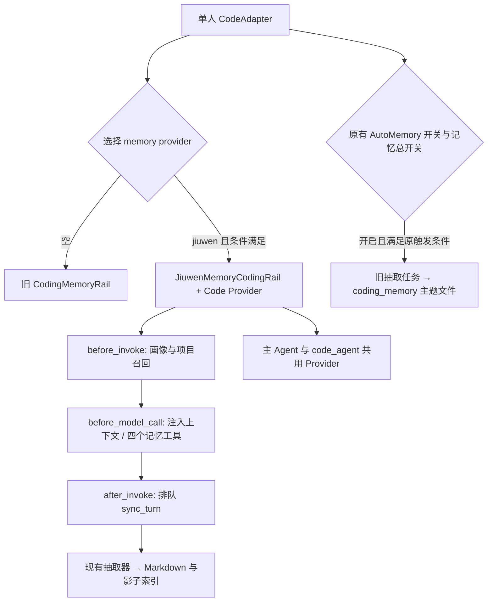

# Coding 文档记忆接入

最近一次修订日期：2026-11-11。

## 配置与选择

| 配置 | 作用 |
|---|---|
| `modes.code.memory.enabled` | Coding 记忆与 ProjectMemoryRail 总开关 |
| `memory.builtin.provider` | 空值保留旧 CodingMemoryRail；`jiuwen` 选择文档记忆 |
| `memory.engine` | 新路线需要 `builtin` 或 `both` |
| `memory.mode` | 新路线需要 `local`，与下方 SDK/HTTP 连接方式不同 |
| `memory.builtin.jiuwen.mode` | 模板缺省 `sdk`；`http` 连接服务；配置和环境变量均空时回落 `http` |
| `memory.builtin.jiuwen.sdk` | SDK 内核配置；支持模型、根目录、看门狗等原配置 |
| `memory.builtin.jiuwen.user_id/scope_id/space/session_id` | 沿用已有身份配置；session 默认空字符串，不自动绑定聊天会话 ID |
| `memory.builtin.jiuwen.agent_id` | 无运行 Agent 名称时的兜底值，最终默认 `jiuwenswarm` |

永恒会话不挂新 Rail。选中 jiuwen 后，条件不满足或初始化失败均不回退旧 CodingMemoryRail；ProjectMemoryRail 独立遵循总开关。Code 不挂工作模式 MemoryRail/JiuwenMemoryRail/ExternalMemoryRail。

冷启动、模式变化、Spec 热重载都使用 `_build_coding_memory_rail` 的选择，项目或身份等输入改变时替换；替换同时更新未来 code_agent 的配置。AutoMemory 保持原设计：`agent.code.*` 读全局 `auto_memory_enabled`，历史 `code.*` 读 `modes.code.memory.auto_coding_memory`，同时受记忆总开关控制；不因选择 jiuwen 跳过。抽取子任务继续用旧工具和 `coding_memory/{项目键}/`，不继承 Jiuwen 编码 Rail 或其工具，避免对子任务再次触发 `sync_turn`；因此 Jiuwen 场景的模型前缀缓存复用可能减少。`sync_turn` 不受 AutoMemory 开关控制，两者分别抽取、分别落盘，不自动合并或迁移。Dreaming 不变，Team Code 保持原路径。

在现有工作模式 jiuwen 配置上启用 Coding 的最小示例（模型配置沿用现有 sdk / Swarm 配置）：

```yaml
modes:
  code:
    memory:
      enabled: true
memory:
  mode: local
  engine: builtin
  builtin:
    provider: jiuwen
    jiuwen:
      mode: sdk
      user_id: my-user
      scope_id: my-org
      agent_id: jiuwenswarm  # 仅在无运行 Agent 名称时兜底
      sdk:
        markdown_store:
          default:
            target: local
            params:
              root: /absolute/path/to/shared-memory
```

## 身份和存储

Work/Code 都优先以运行 Agent 名称绑定记忆；没有名称时才回落配置 agent_id，再回落 jiuwenswarm。普通创建按实例 agent_name、react.agent_name、main_agent 依次解析；SDK Agent 定义的 name 优先。Code 继续支持调用方 Spec 中的名称。初始化和热更新保持有效名称一致，实际名称改变会重建记忆 Rail。session_id 如实传入，默认空字符串，不强制清空显式配置。Team 保持既有路径。

单人 Work/Code 共用 markdown 根（默认用户工作区下 agent/workspace），显式 root 优先。共用根目录与身份解析独立。在 SDK 路径，org/user/space 相同、Agent 同名时可跨模式共享画像；不同 Agent 名称按 Scope 查询隔离，包括画像。普通聊天的新建和刷新不生成新的记忆 Agent 名称。文档读取仍匹配 session；现有影子索引搜索跨 session，不能把显式 session 视为所有查询的隔离开关。

既有数据保留写入时的 Scope；变更 Agent 身份不会自动迁移记忆。

项目键使用已有 `resolve_coding_memory_project_name`：规范绝对路径的目录名 + 12 位摘要，同名不同目录隔离；未指定项目为 default。Code 工具不能覆盖该键。共享画像为 USER.md，项目内容在 memory/{项目键}/；详见 agent-memory 的 S11。

## 调用链



普通调用搜索项目 top_k=5 并读画像；无命中或搜索超时用项目 MEMORY.md。heartbeat/cron 仅读已有文档，不自动抽取。显式工具支持 read/write/edit/search；write/edit 纳入既有 MemoryForbiddenRail 的内容限制（须开启原过滤配置），不增加对工作模式工具的规则，也不将自动 sync_turn 宣称为该工具过滤器覆盖的范围。

## 发布依赖

Swarm、core 与 agent-memory 须使用包含本特性的配套版本。正式发布时更新 Swarm 对 core、JiuwenMemory 的依赖及 lock；仅合并源码不代表已发布的依赖包包含本特性。

## HTTP 装配与热更新

`memory.builtin.jiuwen.mode=http` 使用共用服务地址、api_key、identity_org/identity_user
和绑定身份。Code 只创建 HTTP Provider，不传 sdk 配置，不创建进程内 Runtime 或看门狗；
ProjectMemoryRail 仍只读取本地项目说明书。

HTTP Coding Rail 的重建依据是服务配置、绑定身份和项目路径。sdk 文档根、Swarm 本地
models/embed 和 agent_workspace_dir 变化不影响 HTTP 记忆客户端；SDK 和原生模式仍按
原规则响应各自有效配置。总开关、provider 切换与无回退规则不变。

HTTP 身份映射沿用 agent-memory 现有契约，不能套用本节之前的 SDK 五维直映射说明。
服务端独立配置模型、文档根、索引与认证；参考 agent-memory 适配 README 的 HTTP 部分。
本地 SDK 记忆不随连接方式切换自动上传。服务端抽取失败或超时不以“已经记住”交付。

完整 Spec 重载复用同一 JiuwenMemoryCodingRail 时，保留已初始化的 Provider；卸载后在进入异步初始化前重新绑定工具和提示词，避免最后一个 owner 暂时离开导致连接被关闭。回调注册仍由 DeepAgent 完成。实际身份、项目或连接配置改变则按原逻辑关闭旧 Provider，再使用新轨。


SDK 文档存储配置的 `markdown_store`、`default`、`params` 允许 YAML 空值，按缺省字典补齐；`default` 的字符串 target 简写继续支持。其他错误类型明确记录配置错误，不静默丢弃后使用默认存储。

Jiuwen 编码 Rail 创建或重建失败时清空编码槽位，不保留旧实例、不回退原生 CodingMemoryRail。热更新会卸载并关闭旧 Rail，同时移除后续 code_agent 配置中的旧 Rail；ProjectMemoryRail 独立保留。修复配置后可在后续重建/重载时恢复。这里指构造阶段失败；已创建 Provider 的运行时请求超时或服务端抽取失败仍走原有错误处理。

原生 Coding 路线不变：仅相同绑定的重建失败可保留旧实例；绑定变化或主动关闭开关时停用旧实例。原生配置指纹使用实际构造目录，不随仅用于 jiuwen 的运行时项目目录产生无意义重建。
