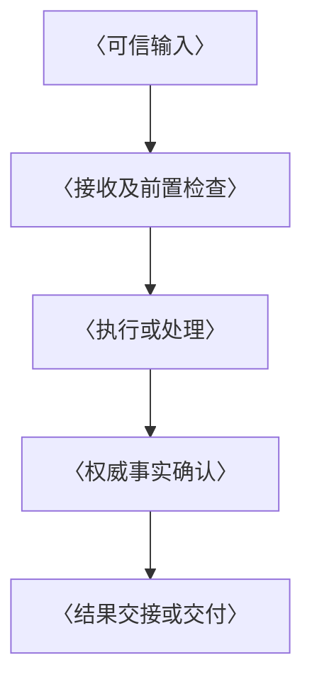

# Overview 文档模板与维护规范

## 1. 文档作用说明

### 1.1 Overview 的作用

Overview（设计概览）是模块或产品设计的整体说明，也是读者进入详细设计的起点。它围绕典型场景，把目标、范围、参与方职责、核心对象、关键流程和能力边界连成一条清楚的主线，使读者在了解实现细节之前，先形成对系统如何工作的共同认识。

读者应能通过概览回答：为谁建设、解决什么问题；本模块负责什么、与哪些参与方协作；核心对象如何关联、关键事实由谁保存和确认；一次工作如何从输入推进到结果、何时可以认为完成；失败或条件变化后由谁处置；哪些能力已具备、哪些仍受假设和建设条件限制。概览应说明这些设计要素之间的因果关系，形成可以复述的工作链路。

概览集中维护整体设计结论，并链接其详细依据。架构文档展开系统边界与跨模块约束，spec 维护已确认契约，feature 维护具体方案及验证记录，开发计划维护特性拆分、验收要求和执行进展；概览引用这些内容，避免形成第二份接口定义、实施方案或进度台账。

### 1.2 阅读对象与使用场景

- **首次了解系统及负责产品范围的读者：** 快速了解服务对象、典型场景、核心目标和当前边界，找到下一步需要阅读的设计主题。
- **参与设计评审和跨模块协作的人员：** 核对职责分工、对象与状态归属、交接关系及关键假设，识别责任遗漏、语义冲突和依赖缺口。
- **开发、测试和维护人员：** 在实现、验证或调整能力前，理解需保持的原则、完成口径和失败边界，判断变更影响哪些流程及协作方，再进入对应详细文档开展工作。

概览用于方案讨论、设计评审、开发前理解、后续交接和变更影响分析。随着范围、职责或关键语义变化，应同步相关正文、图表和链接，让读者看到一致的当前设计；常规认领、排期和测试进展由开发计划维护。

### 1.3 本文的使用目的

本文为编写和维护 Overview 提供结构骨架、填写提示与检查方法。第 2 节说明使用方法、结构选择并提供可复制模板，第 3 节规定事实表达、图表链接、同步维护和交付检查要求；章节可按模块复杂度裁剪或拆分，适用目录的文档约定优先。

使用本模板形成的概览，应让读者能够复述主要工作链路、解释关键职责与约束，并定位进一步查阅的文档。目标方案、已确认设计与实际实现分别表达；未验证假设和待决策问题说明归属及影响。模板中的占位表和示意图只展示组织方式，不代表已确认架构、协议或能力保证。

## 2. 模板

### 2.1 使用方法

使用时复制第 2.3 节代码块中的 Markdown，替换 `〈占位内容〉`，删除填写说明和不适用的示例。实际文档标题使用“〈模块或产品名称〉设计概览”，文件名建议为 `<slug>-overview.md`，不带日期；已有命名规则及概览位置优先。不将本文第 1、3 节复制为概览正文。

文档必须做到**内容合理、逻辑层次清晰、图文并茂、易于人类理解**。

先确认文档性质、依据与范围，再围绕典型场景写清职责和核心对象，随后串联流程、确认点及约束，最后补充现有基础和落地条件。已有设计以权威文档为准；尚未确认的关系保留待定状态，不为填满章节补造对象、协议或恢复保证。

复制后的正文使用 `#` 文档标题、`##` 主体章节、`###` 子主题，无需手工调整标题层级。模板内“第 1～5 节”指实际概览的主体章节；拆分、合并或删除后同步编号及阅读导航。相对链接以实际概览所在目录为基准，示意节点替换为真实名称，未形成的文档说明归属而不预建空链接。

### 2.2 结构选择

章节数量按模块复杂度调整，应覆盖下面的阅读问题，并按“目标与范围 → 职责与模型 → 流程与确认 → 状态与约束 → 基础与落地”的顺序组织。结构可以裁剪，适用的责任、完成语义和能力限制仍须有明确说明。

| 内容 | 要回答的问题 | 组织建议 |
| --- | --- | --- |
| 文档状态与阅读说明 | 描述目标方案还是已确认设计？与实现的关系是什么？依据和详细说明在哪里？ | 固定放在正文之前，不计入主体章节编号；注明重要假设及待确认项 |
| 目标与范围 | 为谁解决什么问题？什么结果体现价值？包含什么、排除什么？ | 主体首章，以典型场景贯穿目标，写清本期与后续范围 |
| 核心模型与职责 | 参与方各自负责什么？对象如何关联？谁保存、修改和确认关键事实？ | 小模块可合并；复杂系统可拆成架构职责、核心对象两章 |
| 关键流程与完成语义 | 输入如何推进到结果？交接和完成依靠什么确认？失败后谁处置？ | 简单模块一章；管理与运行链路具有不同入口及责任时分别展开 |
| 持续状态与关键约束 | 状态如何保留和使用？恢复、授权、并发及资源限制如何影响推进？ | 按实际主题展开；无长期状态时改为资源生命周期或适用约束 |
| 现有基础与落地边界 | 什么已具备、什么待建设？缺口影响哪些能力？开放依赖什么保证？ | 主体末章，引用实现依据、详细设计及唯一开发计划 |

跨模块协作、可见性、预算、管理查询等主题，确有独立责任和阅读需要时才单列。简单同步模块可以合并模型与职责说明、精简流程确认点；有异步处理、外部副作用或恢复责任时，分别说明相关事实及处置边界。无持续状态或恢复能力时说明实际限制，不套用完整恢复链路。

层级通常使用 `#` 文档标题、`##` 主体章节、`###` 子主题。内容较少时，可在章内用加粗主题代替三级标题；标题应描述内容，而不是使用“其他”“补充说明”等宽泛名称。

### 2.3 可复制的模板

以下骨架采用五个主体章节。复杂系统可依第 2.2 节拆分章节并连续编号；图表按实际关系和阅读需要增删，图中箭头须与正文含义一致。填写提示只用于组织内容，替换后应形成完整叙述；架构图、流程图及阶段表只保留适用项。

````markdown
# 〈模块或产品名称〉设计概览

## 文档状态与阅读说明

| 项 | 说明 |
| --- | --- |
| 类型 | 〈目标设计草案 / 已确认设计；设计确认不等于实现完成，现状见第 5 节〉 |
| 最近一次修订日期 | 〈YYYY-MM-DD〉 |
| 责任人 | 〈维护责任人〉 |
| 所属模块 | 〈仓库与模块路径〉 |
| 详细设计 | 〈相对链接〉 |
| 开发安排 | 〈已有计划的相对链接；无则删除此行〉 |
| 关联文档 | 〈需求依据、对端设计、规约或目录约定的链接〉 |
| 关键假设与待确认项 | 〈问题、归属文档或责任方，以及对范围、流程或开放能力的影响；无则写“无”〉 |

本文说明〈模块定位、职责边界、核心模型和主要工作链路〉，适用于〈阅读对象与使用场景〉。〈明确哪些是目标方案，哪些已有实现；指出详细设计、契约及实施记录的归属〉。

输入依据为〈需求、技术方案及相关设计链接〉。〈说明设计成立所依赖的契约、环境或关键假设，以及未确认项影响哪些结论；有图时交代箭头是调用、数据交接还是状态推进，不暗示额外事务或部署保证〉。

〈文档较长时保留下表；较短时用一段阅读说明替代。〉

| 阅读目的 | 阅读位置 |
| --- | --- |
| 了解目标与范围 | 本文第 1 节 |
| 确认职责与核心对象 | 本文第 2 节 |
| 理解关键流程与完成口径 | 本文第 3 节 |
| 理解持续状态及关键约束 | 本文第 4 节 |
| 查找实施依据与落地条件 | 本文第 5 节及〈详细设计链接〉 |

## 1. 目标与范围

### 1.1 定位与目标

〈说明服务对象、当前问题、工作单元及可观察结果。列出少量核心目标，用“谁在什么情况下，通过哪个入口发起什么工作，最终得到什么结果”的典型场景串联；概括后文需要保持的关键约束。〉

### 1.2 职责与范围边界

〈说明本模块接收什么输入、承担什么处理和产出什么结果，以及宿主、对端或外部平台分别承担哪些相邻责任。明确不负责的事项及其承接方，区分核心能力与应用呈现，避免跨模块重复承担同一责任。〉

### 1.3 当前范围与后续扩展

〈说明本期支持的入口、场景、能力和限制；后续候选或暂缓项单独标明。当前规划范围与已实现范围分别表达，实现依据见第 5 节；引用唯一范围维护位置，不把候选能力列为当前交付条件。〉

## 2. 核心模型与职责

### 2.1 总体关系

〈说明参与方如何围绕第 1 节场景协作、主链路跨越哪些边界及依赖方向。以下仅为逻辑关系骨架，按实际职责替换；说明调用方、交接内容及依赖前提。〉


| 参与方 | 负责的行为 | 责任边界 |
| --- | --- | --- |
| 〈本模块〉 | 〈接收、处理及产出的行为〉 | 〈本模块确认到哪一步，后续由谁承接〉 |
| 〈宿主或对端〉 | 〈调用、适配或外部执行责任〉 | 〈协作契约、结果交接及失败归属〉 |

〈说明这些是逻辑职责还是实际部署单元，以及不可反向依赖或其他关键依赖约束。〉

### 2.2 对象及事实权威

〈定义理解主链路所需的少量核心术语，说明对象的归属、关联和生命周期。重点解释哪些对象代表业务身份、工作状态或结果，避免将不同事实合并为一个“完成”；按实际模型填写，不罗列完整字段。〉

| 对象或事实 | 含义 | 权威来源 | 不能据此推断的事实 |
| --- | --- | --- | --- |
| 〈核心对象〉 | 〈回答哪个业务问题，与其他对象如何关联〉 | 〈负责保存的模块或记录，谁可创建及修改〉 | 〈需独立确认的相邻事实〉 |
| 〈关键状态或产物〉 | 〈状态含义或产物用途〉 | 〈谁确认、依据什么记录或回执〉 | 〈该事实不能替代哪些处理或交付结果〉 |

### 2.3 贯穿设计的原则

〈列出影响整体正确性的少量原则，例如状态推进权、配置固定与动态条件、权限隔离、提交确认和副作用核对。每项说明为何需要、适用范围、责任方及对后续流程的约束，引用已确认依据；不复制实现算法。〉

## 3. 关键流程与完成语义

### 3.1 入口与正常链路

〈沿用第 1 节典型场景，依次说明触发入口、必要前置、接收、选定工作单元、执行、事实提交及结果交接。每步交代责任方、输入和产出，标明同步返回与异步推进的分界；有多条链路时分别说明触发条件和责任，不强行套用一个流程。〉



### 3.2 完成与交付的确认点

〈逐一说明适用的接收、处理、提交和交付确认点：由谁确认，凭什么权威记录或回执，允许推进什么后续动作，哪些相邻结果仍未确认。区分“本模块处理结束”和“调用方或用户已获得结果”；无独立投递链路时按本模块实际结果语义填写，不额外增加阶段。〉

### 3.3 控制、失败与重试

〈按适用场景说明补充输入、审批、取消、暂停、超时、重试及未知结果处置。每类情况说明触发条件、保留的事实、当前状态、处置方以及继续或终止条件；涉及外部副作用时说明先核对什么、哪些行为禁止盲目重复。详细协议链接到相应文档，不在此展开全部错误码或重试算法。〉

## 4. 持续状态与关键约束

### 4.1 状态与资源生命周期

〈说明哪些状态只在运行时存在、哪些需要持久保存，以及创建、读取、更新、结束和清理分别由谁负责。明确保留边界、共享或复用范围；涉及配置、上下文、文件或知识时，分别说明权威来源、版本选定及更新时机。无持久状态时说明请求或资源的实际生命周期。〉

### 4.2 恢复与一致性

〈确有恢复责任时，说明可恢复的工作与故障范围、恢复依据、核对顺序、执行责任及继续或暂停条件。结果不明时先核对权威事实和外部副作用；说明原工作继续、重新执行及重新发起的边界。不以缓存、展示文本或文件时间替代权威事实。无恢复能力时明确哪些故障会中断工作及如何处置。〉

### 4.3 授权、隔离与资源约束

〈按适用范围说明主体授权、可见性、租户或工作隔离、并发、预算及容量约束；谁检查、何时检查、采用什么权威依据。说明撤权、资源耗尽或竞争冲突后哪些动作须暂停或拒绝，以及已发生结果的处置责任。复杂主题可拆成独立章节，具体阈值及协议引用归属文档。〉

## 5. 现有基础与落地边界

### 5.1 可复用基础与待建设能力

〈按目标链路说明可复用基础、需适配行为及新建能力。现有基础提供可追溯的代码、契约或验证记录链接，并注明已支持的边界；能力缺口说明影响哪个步骤、由哪个模块补齐及补齐前的限制。未经验证的复用判断标为假设，不列完整源码改造清单。〉

### 5.2 能力开放条件

〈说明每项能力依赖哪些设计保证、真实对端或运行条件，缺少保证时限制哪个入口或行为。开放门槛应能关联到权威验收依据；需要分阶段开放时保留以下表，不需要时改为简短段落。〉

| 阶段或能力范围 | 目标 | 开放条件与验收依据 |
| --- | --- | --- |
| 〈阶段或范围〉 | 〈用户或调用方可观察的结果〉 | 〈必要保证、真实依赖及权威验收文档链接；缺失时的能力限制〉 |

〈这里描述设计门槛，不登记负责人、排期、完成百分比或测试结果。〉

### 5.3 详细设计与实施文档索引

〈按“整体架构、接口契约、特性方案与验证、开发安排”等实际主题，链接详细设计章节、已存在的 spec、feature 和开发计划。说明各文档维护什么及读者何时查阅；尚未形成的契约标明待定、归属和影响，不预建空文档，也不链接不存在的文件。〉
````

## 3. 维护规范

### 3.1 事实与语义

1. **区分目标与实现。** 元信息标明文档性质；涉及现状的段落分别说明已实现基础、待实现能力和未经验证的假设。目标设计不能写成已生效 API，依赖已有类似功能不能证明完整闭环已具备。
2. **先写责任，再写过程。** 明确本模块、宿主、对端及外部平台的责任。逻辑模块不自动意味着独立部署，调用箭头不自动意味着跨存储事务。
3. **说明事实权威。** 对影响正确性的对象说明谁保存权威状态、谁能推进或修改、什么证据才能确认。采用本模块实际术语及对象关系，按需区分业务身份、工作单元、执行尝试、上下文容器、产物与交付结果。
4. **区分不同确认点。** 如果接收、处理、提交、允许交付及实际交付是独立事实，应分别说明。函数返回、事件提出、文件存在或界面展示不能自动替代权威确认；同步且简单的模块不必凭空引入额外阶段。
5. **明确失败边界。** 按实际行为说明超时、暂停、取消、重试和未知结果如何影响原工作及后续工作。涉及外部副作用时，说明核对与重复执行边界，不承诺系统无法证明的“恰好一次”。
6. **写清权限与隔离。** 有多主体、共享资源或并发工作时，说明授权来源、访问范围、状态隔离及撤权影响。身份关联、可见消息或资源路径不能自动扩大权限。
7. **用有限示例解释原则。** 示例只展示必要输入、关键状态和可观察结果，不引入正文未确认的新协议。术语首现时解释，后续保持同义和一致。

### 3.2 图表与链接

- 架构图表达职责和依赖，流程图表达步骤及确认点，恢复图表达证据来源和继续条件；按阅读需要选择，不固定图的数量。
- 使用内嵌 Mermaid 保留可编辑源码。节点和箭头必须与正文一致，注明箭头含义；图中若出现分支，应在正文解释对应结果及责任方。
- 表格适合元信息、职责、事实归属和文档索引。叙述因果及约束时优先使用段落，不把所有内容拆成碎片表格。
- 文档间优先使用相对链接。跨仓引用标明仓库或模块，链接直接指向对应文件或章节，不用同名模块替代定位。
- 章节导航只列实际阅读需要。显式锚点沿用目标文档既有规则；章节重排时同步链接和“第几节”的文字引用。

### 3.3 更新触发与同步范围

| 发生的变化 | Overview 应更新什么 | 关联维护位置 |
| --- | --- | --- |
| 产品目标、本期范围或支持入口变化 | 目标、边界、暂缓项及阅读导航 | 需求依据、详细设计与开发计划 |
| 模块职责、依赖或对象权威变化 | 职责文字、关系图、事实归属表及关键原则 | 详细架构、对端设计及适用契约 |
| 完成口径、控制或故障语义变化 | 流程、确认点、失败与重试边界 | 详细设计、spec 和 feature |
| 授权、共享、持续状态或恢复保证变化 | 对应约束、证据来源和能力限制 | 归属模块的规约、方案及验证设计 |
| 现有实现形成或发现能力缺口 | 现状说明、可复用边界及开放条件 | 代码、feature 验证记录与计划证据 |
| 文档移动、章节重排或术语调整 | 相对链接、章节号、导航和图表标签 | 被引用文档及受影响的引用方 |
| 常规认领、排期、PR 或测试进展变化 | 通常无需修改；仅影响整体事实或开放边界时更新摘要 | 开发计划及具体验证记录 |

更新以语义变化为单位，不将每次代码提交都转成概览修订。图、表和正文描述同一事实时必须同步；修订日期反映实际内容更新日期，不自动刷新未改动文档。

### 3.4 维护步骤

1. **确定变化来源。** 查明是需求、已确认契约、实现事实还是待验证方案；核对来源文档、代码或验证记录。仅有设计草案时保留目标状态。
2. **确定内容归属。** 按适用目录的文档分工约定找到权威文档；JiuwenSwarm 内使用时见 [仓库 AGENTS.md](../../../../AGENTS.md)。概览只维护读者理解整体设计所必需的结论，实施细节和进度留在其归属文件。
3. **遵守设计确认要求。** 模板不授权改变架构。目标目录若要求架构调整先取得开发者确认，应按该规则说明内容、原因和影响并完成确认；一般文字修正不额外引入审批门槛。
4. **同步相关表达。** 更新受影响的范围、术语、原则、流程、图表及导航；跨模块交接变化同时核对双方文档，不能让一侧依赖另一侧尚未承诺的保证。
5. **保留状态和依据。** 契约定稿同步适用 spec，决策与验证记录归入 feature，进度及证据更新计划；概览保留链接和必要的现状说明。完整修订历史由版本控制或归属文档保留。
6. **完成检查。** 核对第 3.6 节清单，更新责任人或修订日期等受影响元信息。仍未确定的问题注明归属和影响，避免以确定性表述掩盖缺口。

### 3.5 避免重复与膨胀

新增段落前判断其是否改变目标、边界、整体模型或关键约束；如果只是 Schema、工具参数、数据库字段、源码清单或具体测试步骤，应放到归属文档并引用。

不要把最新讨论不断追加在章末。修改后呈现当前设计，移除已被替代的正文，历史取舍放入 feature 或版本历史。保留稳定文件名，章节重排时检查外部引用；没有实际主题时不预建空白 spec 或 feature。

### 3.6 交付前检查清单

- [ ] 文档性质、责任人、模块和修订日期明确，目标设计与已实现行为分开表达。
- [ ] 开头说明用途和阅读路径；目标、职责、本期范围及后续候选均可定位。
- [ ] 核心对象和关键事实有明确权威来源，逻辑职责与部署方式没有混淆。
- [ ] 关键流程写清输入、责任、结果与确认点，完成语义和失败边界一致。
- [ ] 适用的授权、共享、并发、资源和恢复约束完整；不适用主题已删除或说明限制。
- [ ] Mermaid 图、表格与正文一致，箭头语义明确，占位图没有被当作确认方案。
- [ ] 现有基础与目标能力有可追溯依据，未实施或未验证内容未写成已具备、已通过。
- [ ] 概览没有复制完整接口、实现步骤、验收矩阵或开发进度台账，相关内容有唯一归属。
- [ ] 相对链接、跨仓路径、章节导航及引用的术语已核对，无不存在文件的链接。
- [ ] 新文档的占位符和填写说明已清理；关键结论能引导读者进入相应详细设计。
