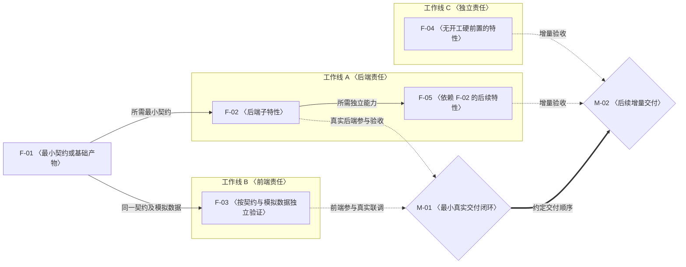

# 特性开发计划模板与维护规范

## 1. 文档作用说明

### 1.1 特性开发计划的作用

特性开发计划将已明确的目标和设计边界转化为可认领、可独立验证、可持续追踪的开发单元。它把特性定义、开工条件、并行分工、交付节点与实际进展连接起来，为开发安排和交付判断提供共同依据。

读者应能通过计划回答：本期要交付什么、哪些行为不在范围内；每项特性由哪个模块承担、如何证明完成；开工需要什么最小产物、哪些工作可以并行；由谁推进、当前卡在哪里；哪些特性必须汇合才能形成可演示和可开放的能力。计划中的依赖、状态和完成结论都应能追溯到明确范围及实际证据。

Overview 说明整体目标与工作方式，架构说明系统边界与跨模块约束，feature 和 spec 承载具体方案及契约；开发计划引用这些依据，集中维护特性拆分、验收要求和执行进展。计划中的安排不替代设计确认，代码完成或 PR 合并也不自动代表验收通过。

### 1.2 阅读对象与使用场景

- **负责范围和交付的人员：** 确认本期目标、优先级、交付顺序和开放条件，依据实际进展调整安排，识别范围变化及交付风险。
- **开发及跨模块协作人员：** 查明可认领的特性、责任边界、最小硬前置和并行机会，区分独立开发条件与真实联调条件。
- **测试、验收和维护人员：** 找到验收场景、验证入口及实现证据，核对特性和交付节点是否达到各自完成条件，并在阻塞或回归时定位影响范围。

计划用于初次拆分、认领开工、持续更新、联合验收和后续交接。新增范围、契约变化或验证结论变化时，应同步受影响的定义、关系和进展，让读者看到同一份当前计划。

### 1.3 本文的使用目的

本文提供特性开发计划的结构骨架、填写提示与维护口径。第 2 节说明使用方法并提供可复制模板，第 3 节规定拆分、依赖、状态、证据和一致性检查要求；适用目录的文档约定优先。

实际计划保留四个主体章节：阅读与维护说明、特性定义、依赖与并行开发、开发计划与进展；需要保留迁移安排或历史交付记录时，可增加附录。使用本模板形成的计划，应做到特性 ID 在定义、图和表中一致，验收要求与执行结果各有唯一维护位置，特性完成与联合交付分别确认。本文中的示意编号、关系和表格行仅展示写法，不代表已确认业务、排期或验证结果。

## 2. 模板

### 2.1 使用方法

使用时复制第 2.3 节代码块中的 Markdown，替换 `〈占位内容〉`，删除填写说明和不适用的示例。实际文档标题使用“〈模块或产品名称〉特性开发计划”，文件名建议为 `<slug>-development-plan.md`，不带日期；已有命名规则及唯一计划位置优先。不将本文第 1、3 节复制为计划正文。

文档必须做到**内容合理、逻辑层次清晰、易于人类理解**。

先依据已明确的范围填写特性定义，再绘制开工依赖及交付节点，最后登记计划表并生成进度摘要。复制后的正文使用 `#` 文档标题、`##` 四个主体章节、`###` 单个特性，无需手工调整标题层级。文中“第 1～4 节”均指实际计划的四节。

示意编号 `F-01`～`F-05`、`M-01`～`M-02` 可以按模块既有规则替换。新增条目分配唯一 ID；已有 ID 保持稳定，移出或暂缓后不重新分配。验收编号建议使用 `F-01-V-01` 等带特性前缀的形式，便于表中结果引用到具体场景。

待确认内容写明问题、归属和对开工或交付的影响；未排期填“未排期”，未执行的验证填“未执行”。相对链接以实际计划所在目录为基准，不直接沿用模板目录的路径，也不链接尚不存在的文件。

### 2.2 结构选择

计划统一使用以下四个主体章节，按“范围与口径 → 特性与验收 → 依赖与并行 → 安排与进展”的顺序组织。特性数量、工作线和交付节点按实际范围增删，定义、图和表同步调整。

| 内容 | 要回答的问题 | 组织建议 |
| --- | --- | --- |
| 阅读与维护说明 | 计划覆盖什么？依据、维护人和统计口径是什么？ | 主体首章，说明交付分类、本轮安排、阅读路径及简要维护规则；按需补充术语和全局约束 |
| 特性定义 | 要完成什么行为？由哪个模块承担？怎样独立验证？ | 每个特性使用稳定 ID，统一填写目标、契约、前置和验收要求 |
| 依赖与并行开发 | 开工必需哪些产物？哪些工作可以并行？在哪里联合交付？ | 一张 Mermaid 完整关系图覆盖全部特性，按需增加本轮分工或外部协作视图，区分硬前置、联合验收和交付顺序 |
| 开发计划与进展 | 优先做什么？谁在推进？当前结果及剩余工作是什么？ | 一张表维护全部特性和交付节点，分别记录状态、负责人及证据 |

前后端具有独立行为及验收边界时分别列为特性，在交付节点汇合；无需前端的能力填写“不适用”。小范围计划可以减少节点和工作线，但仍保留四节及各自内容归属。详细方案和完整测试日志通过链接引用；迁移安排、阶段产物与详细历史可外链，也可保留在可选附录中，不另建当前进度台账。

### 2.3 可复制的模板

以下骨架采用四个主体章节。特性条目按骨架内第 2 节格式逐项复制；图和表中的五个特性、两个节点仅为关系示例，须替换为实际条目。已有模块提供基础契约时直接引用，不为套用示例新增无独立交付价值的特性。

````markdown
# 〈模块或产品名称〉特性开发计划

## 1. 这份计划怎么读和维护

- 计划范围：〈本模块负责的行为、产品入口及交付边界〉。
- 范围之外：〈由其他模块负责的能力、暂不支持的入口〉。
- 所属模块：〈仓库与模块路径；涉及跨模块协作时明确本计划主责范围〉。
- 交付分类：〈本期、后续、独立扩展；按实际需要细分并列明特性范围〉。
- 本轮安排：〈本轮纳入、暂缓及未排期的特性范围；暂缓原因与恢复安排见第 4 节〉。
- 维护人：〈负责保持特性、依赖图和进展表一致的人〉。
- 更新日期：〈YYYY-MM-DD〉。
- 设计依据：〈架构、spec 和相关模块计划的链接〉。
- 关键假设与待确认项：〈问题、责任方及对开工或交付的影响；无则写“无”〉。
- 术语与全局约束（如适用）：〈理解本计划必需的术语、跨特性不变量及架构适用范围；详细契约引用设计依据〉。
- 进度摘要：〈从第 4 节推导的本期完成数/总数；其他分类分别统计〉。

先读本节确认范围和完成口径，再到第 2 节了解特性与验收要求；第 3 节判断开工条件和并行机会；第 4 节确认实际优先级、认领、排期和进度。

- 特性是有明确责任和验收边界的开发单元；开工硬前置只列独立实现必需的基础；交付节点表示若干特性与真实依赖汇合后的可演示结果。
- 新增或调整特性时，同步第 2 节定义、第 3 节图和第 4 节表；认领、开发、验证或阻塞变化时，及时更新表中负责人、状态、关联 PR、进展说明和日期。
- 状态统一使用“待开始、进行中、阻塞、待验收、完成”。完成须覆盖约定验收范围并有实际证据；子范围或模拟验证通过不自动代表整项或产品完成。
- 本期、后续及扩展按交付分类分别统计，本轮安排单独记录。本轮暂缓或未排期不改变交付分类、进度分母、硬前置和验收门槛；确认移出本期后才调整分类及分母，节点不计为特性。代码开发前维护对应 feature 方案，契约变化同步 spec，并遵循所属目录的 `AGENTS.md`。
- 具体维护规范：〈所采用的维护规范文档链接〉。

## 2. 要开发的特性

每个特性按以下格式填写，并与第 3 节节点、第 4 节行一一对应。验收标准写预期，实际执行结果统一写第 4 节“进展说明”。

架构验证点或共享场景须关联到明确的验收 ID，并指定一个主责特性、协同特性和交付节点。完整要求只维护在主责特性或其 feature 文档中，其他参与方引用同一来源；实际结论在第 4 节主责行维护，协同方和节点引用该结论。

### 〈F-ID〉 〈可观察的特性名称〉

- **目标与范围：**〈在哪种输入或用户操作下产生什么结果；明确本项包含和不包含的行为〉。
- **责任与契约：**〈负责的模块或前端入口、协作方及交接边界；调用接口、输出或持久事实、失败语义；引用 feature/spec，不在这里展开全部 Schema〉。
- **开工硬前置：**〈无，或 F-ID + 所需产物/子范围 + 原因；外部契约或环境如不可替代也须注明〉。
- **独立验证入口：**〈可执行的测试、接口、命令或页面路径；验证步骤及配置详见哪个记录〉。
- **独立验证条件：**〈需要的真实组件、可替代的模拟组件、数据、授权和契约版本；验收边界是否包含真实对端适配〉。
- **验收标准：**
  1. 〈F-ID-V-01：给定前置状态与输入，执行操作，核对可观察输出及权威事实；写明通过条件〉。
  2. 〈F-ID-V-02：执行适用的异常或边界操作，核对失败反馈、状态及副作用；写明应保持的不变量〉。
  3. 〈F-ID-V-03：执行适用的隔离、重传、并发或既有行为回归，核对约定结果；按实际行为增删场景〉。
- **来源验证点与共享场景（如适用）：**〈架构/spec 章节及验证点编号 → 验收 ID → 主责 F-ID、协同 F-ID → M-ID；完整要求的唯一维护位置。不适用写“无”〉。
- **前端独立验证（如适用）：**〈入口与交互；使用哪个接口契约及模拟数据；核对适用的加载、空、成功、失败、无权和重复操作状态。无前端时写“不适用”〉。
- **联合交付与开放条件：**〈关联 M-ID、参与的整项或子范围、协同特性及真实对端；需要演示的链路、共享场景的主责位置及放行门槛。关联只表达汇合条件，不增加开工硬前置；无联合节点时写明独立交付条件〉。
- **设计索引：**〈对应 feature 设计、spec 和架构章节的链接〉。

## 3. 特性依赖关系与并行开发

使用下面的 Mermaid 图作为完整关系图的填写骨架，替换和增删节点，覆盖第 2 节全部特性，包括本轮暂缓和未排期项。每条硬前置边须与对应特性的“开工硬前置”一致，并注明所需最小产物；真实外部条件按需增加标明“外部”的节点。保留可编辑的 Mermaid 源码，不导出为图片，也不另建一套依赖表。



**图例：** 矩形为特性，菱形为交付节点，分组为工作线；细实线表示开工硬前置，虚线表示联合验收参与，粗实线表示约定交付顺序。

按需增加本轮分工视图或外部协作视图，明确视图用途、覆盖范围及省略项。辅助视图可筛选本轮特性，引用第 4 节的责任人；使用与完整关系图相同的特性 ID 和依赖定义。外部协作视图中的虚线须标注接口对接或联合验证，并说明不构成开工硬前置。图中不维护当前状态或日期，执行结果统一见第 4 节。

- **可并行开发与分工：**〈哪些特性具备开工条件后可同时推进；明确所需最小产物及跨责任人的等待点。责任人见第 4 节，共同负责时说明协作边界〉。
- **联合交付：**〈各 M-ID 的可观察结果、参与特性及子范围、真实依赖、联合验收入口与放行条件；共同场景引用唯一维护位置〉。
- **范围与顺序限制：**〈后续、扩展、本轮暂缓或未排期范围；已约定的交付顺序及业务开工限制。暂缓参与项仍保留节点的完整验收门槛〉。

## 4. 开发计划与进展

本节以下面这一张表作为当前进度的唯一台账。每个特性一行，每个交付节点一行；节点用于追踪联合交付，不计入特性数量。前端与后端若已拆成独立特性，分别认领和更新，在同一节点汇合。历史记录和阶段交付记录按需保留在附录中，不承担当前状态维护。

表中编号沿用第 3 节的示意骨架，所有安排、状态、关联 PR 及进展说明均为占位内容。实际计划须与第 2 节的特性和第 3 节的图同步替换，不将示例行直接登记成业务计划。

“进展说明”列承载本行验收证据，统一填写“已完成范围/场景 → 验证方式与环境 → 实际结果及记录链接 → 剩余项或阻塞”，并引用对应验收 ID。阻塞时补充责任方、影响范围和解除条件；没有 PR 时补充可追溯的提交或实现链接。验证记录包含版本、执行日期及命令或复现步骤，明确区分模拟验证和真实联调；未执行或待核对的项目照实标注。

来源验证点或共享场景按“来源验证点 / 验收 ID → 主责与协同特性 / 节点 → 当前结论 → 已验证范围及证据 → 剩余验证”追踪。当前结论使用“未验证、部分验证、通过、失败”；结论未知时写“待核对”。主责行保留完整结论，协同方和节点引用；部分验证不代表整项验收通过，也不自动改变特性或节点状态。

| ID / 名称 | 类型 / 交付分类 | 本轮安排 | 当前实现或交付范围 | 优先级 / 开发批次 | 工作线 / 关联节点 | 计划时间 | 状态 | 负责人 | 关联 PR | 进展说明 | 最近更新 |
| --- | --- | --- | --- | --- | --- | --- | --- | --- | --- | --- | --- |
| F-01 〈名称〉 | 特性 / 〈分类〉 | 〈纳入 / 暂缓 / 未排期〉 | 〈对应第 2 节边界〉 | 〈优先级 / 批次〉 | 〈工作线 / M-ID；无则填 —〉 | 〈起止日期或未排期〉 | 〈状态〉 | 〈责任人〉 | 〈PR 链接；未创建填 —〉 | 〈范围/验收 ID → 验证方式与环境 → 结果及记录链接 → 剩余项或阻塞〉 | 〈YYYY-MM-DD；变化〉 |
| F-02 〈名称〉 | 特性 / 〈分类〉 | 〈纳入 / 暂缓 / 未排期〉 | 〈对应第 2 节边界〉 | 〈优先级 / 批次〉 | A / M-01 | 〈起止日期或未排期〉 | 〈状态〉 | 〈责任人〉 | 〈PR 链接；未创建填 —〉 | 〈范围/验收 ID → 验证方式与环境 → 结果及记录链接 → 剩余项或阻塞〉 | 〈YYYY-MM-DD；变化〉 |
| F-03 〈名称〉 | 特性 / 〈分类〉 | 〈纳入 / 暂缓 / 未排期〉 | 〈前端交互验收边界〉 | 〈优先级 / 批次〉 | B / M-01 | 〈起止日期或未排期〉 | 〈状态〉 | 〈责任人〉 | 〈前端 PR 链接；未创建填 —〉 | 〈范围/验收 ID → 契约及模拟或真实环境 → 结果及记录链接 → 剩余项或阻塞〉 | 〈YYYY-MM-DD；变化〉 |
| F-04 〈名称〉 | 特性 / 〈分类〉 | 〈纳入 / 暂缓 / 未排期〉 | 〈对应第 2 节边界〉 | 〈优先级 / 批次〉 | C / M-02 | 〈起止日期或未排期〉 | 〈状态〉 | 〈责任人〉 | 〈PR 链接；未创建填 —〉 | 〈范围/验收 ID → 验证方式与环境 → 结果及记录链接 → 剩余项或阻塞〉 | 〈YYYY-MM-DD；变化〉 |
| F-05 〈名称〉 | 特性 / 〈分类〉 | 〈纳入 / 暂缓 / 未排期〉 | 〈对应第 2 节边界〉 | 〈优先级 / 批次〉 | A / M-02 | 〈起止日期或未排期〉 | 〈状态〉 | 〈责任人〉 | 〈PR 链接；未创建填 —〉 | 〈范围/验收 ID → 验证方式与环境 → 结果及记录链接 → 剩余项或阻塞〉 | 〈YYYY-MM-DD；变化〉 |
| M-01 〈名称〉 | 节点 / 〈分类〉 | 〈纳入 / 暂缓 / 未排期〉 | 〈F-02、F-03 的约定子范围及真实闭环〉 | 〈交付顺序〉 | A、B / — | 〈交付日期或未排期〉 | 〈状态〉 | 〈验收组织人〉 | 〈集成 PR 链接；无则填 —〉 | 〈联合范围/场景 → 真实组件与环境 → 结果及记录链接 → 外部缺口或未满足门槛〉 | 〈YYYY-MM-DD；变化〉 |
| M-02 〈名称〉 | 节点 / 〈分类〉 | 〈纳入 / 暂缓 / 未排期〉 | 〈F-04、F-05 的约定范围及必要回归〉 | 〈交付顺序〉 | A、C / — | 〈交付日期或未排期〉 | 〈状态〉 | 〈验收组织人〉 | 〈集成 PR 链接；无则填 —〉 | 〈联合范围/场景 → 真实组件与环境 → 结果及记录链接 → 外部缺口或未满足门槛〉 | 〈YYYY-MM-DD；变化〉 |

本轮暂缓项在“进展说明”记录原因、恢复条件及受影响的节点；未排期不等于阻塞。本轮安排变化不覆盖原负责人和已取得的验收证据。

特性状态按第 2 节约定的整项验收边界判断，节点状态按真实联合交付边界判断。汇总本期进度时，只统计交付分类为“本期”且类型为“特性”的行，完成数除以该分类特性总数；本期中的本轮暂缓或未排期项仍计入分母，节点、后续和独立扩展不计入本期。确认移出本期时调整分类并记录依据，不删除已有 ID 或计为完成。范围增减同步第 1 节摘要并说明原因；如统计本轮进度，另行标明所含 ID，不能替代本期进度。

## 附录 A. 迁移与接入安排（可选）

〈列明来源仓库与模块、复用或保留的能力、职责交接、接入顺序及关联 F-ID / M-ID；详细分析外链。涉及实际开工依赖或交付限制时同步第 2、3 节，当前安排及结果仍在第 4 节维护〉。

## 附录 B. 历史变更与阶段交付记录（可选）

需要在同一文档保留历史时使用下表，否则链接已有记录。阶段交付记录可补充具体产物、评审检查点、实现及验证链接、当时遗留；不以历史结论覆盖第 4 节当前状态。

| 日期 | 条目 / 当时编号 | 变更或阶段产物 | 适用架构 / 验证范围 | 证据、当时遗留及当前替代关系 |
| --- | --- | --- | --- | --- |
| 〈YYYY-MM-DD〉 | 〈F-ID / M-ID；历史编号须注明〉 | 〈范围、安排、契约变化或具体产物〉 | 〈当时依据及验收边界〉 | 〈记录链接；旧编号到当前编号的映射、已废止要求或当前归属〉 |

已有历史记录保留当时编号与结论，明确适用架构及当前替代关系；历史未实现项和旧门槛不自动成为当前待办。迁移计划时保留原记录或提供可追溯链接，不将历史改写成当前事实。
````

## 3. 维护规范

本部分规定模板的填写和后续维护方式。以下“计划第 1～4 节”均指第 2 部分提供的四节计划结构，不指本文的三大部分。

### 3.1 内容归属与编号

- **计划第 1 节说明范围和使用方式。** 维护范围、交付分类、本轮安排摘要、维护人、更新日期、统计摘要及简要阅读与维护规则；按需补充术语、全局约束和待确认项。
- **计划第 2 节定义特性。** 维护目标、责任边界、最小硬前置、验收标准及设计索引，不记录当前状态、负责人或测试结果，不添加需求索引。
- **计划第 3 节展示关系。** 用一张 Mermaid 完整关系图表达所有特性、开工依赖和交付汇合点，按需增加本轮分工或外部协作视图；图中不维护当前状态或日期。
- **计划第 4 节维护执行。** 通过一张表统一维护安排、状态、负责人、关联 PR、进展说明及变更摘要，不重复抄写验收标准。工作线和交付节点不额外计为特性。

架构负责系统边界与跨模块约束，`features/` 负责具体方案及验证设计，`specs/` 负责可核验契约。详细迁移分析、源码清单和完整测试日志放在对应设计或验证记录中，在计划内保留链接。特性与验收编号保持稳定；移出或暂缓的编号不复用。

迁移与接入安排、历史变更及阶段交付记录也可保留在可选附录中；附录记录背景、过程和当时结论，当前安排与结果仍以计划第 4 节为准。继承已有编号调整记录时保留旧编号到当前编号的映射及适用时间，不为套用模板重新编号或改写历史。

### 3.2 特性拆分与独立验证

每个特性应回答：**做什么、由谁的模块负责、怎样独立证明做成、开工真正缺什么**。名称使用可观察行为，避免以“数据库层”“前端开发”“完成架构”等大范围工程活动代替特性。

- **按行为及责任拆分。** 一个特性应有清楚的输入、输出和失败边界。只读与写入、普通保存与故障恢复、资料读取与学习更新等可以分别验证的行为，优先拆成不同特性。
- **依赖契约，减少实现绑定。** 使用明确的接口、端口及存储抽象，允许调用方、数据来源或外部服务由模拟实现替代。模拟实现应遵守相同契约，覆盖该特性必要的失败语义。
- **只列最小硬前置。** 说明依赖上游的哪项产物、契约版本或子范围以及使用原因。最终联调参与方和能力开放条件单独写明，不全部塞入硬前置。
- **每个特性都能单独执行验收。** 写出验证入口、准备条件、操作和可观察结果，覆盖正常行为及适用的异常、边界和回归。根据行为选择接口测试、组件测试、模拟端口、命令或页面；不为无页面的基础能力强行新建页面。
- **前端可以独立开发和验证。** 若前端具备独立交互及责任边界，可以单列前端特性，依赖接口契约与模拟数据，不默认依赖整个后端特性完成。涉及产品可用性的交付节点必须再验证真实前后端链路。
- **优先拆开跨阶段的大特性。** 若一个条目包含可独立认领和验收的阶段，拆成稳定的特性 ID。确需保留一个跨节点特性时，明确子范围和各自验收边界；全部约定范围通过前不标整项完成。
- **共享场景只维护一份。** 场景指定主责特性和协同特性，其完整要求放在主责特性或对应 feature 文档中，其他特性引用。共同参与场景不产生隐含硬前置。
- **来源验证点可追踪。** 架构或 spec 列出的验证点须关联到验收 ID、主责与协同特性及交付节点；一个验证点拆成多个场景时，列齐所需验收 ID。结论和证据在计划第 4 节主责行维护，协同方及节点引用，全部必要场景通过后才能关闭该验证点。

涉及外部写入、授权、并发或异步确认的特性，按实际契约补充重传、冲突、撤权、超时及结果未知等验证。仅正常请求可用的特性不必承担跨进程恢复；也不能将读取历史、页面刷新或请求结束后继续对话当作原任务恢复的证据。

模拟验证可证明接口消费、算法或页面交互等约定边界；若特性本身承诺真实适配或端到端行为，就必须提供相应真实验证。独立前端特性可以按其交互边界完成，但这不代表产品节点已通过。

### 3.3 依赖图与并行安排

- 矩形为特性，菱形为交付节点，工作线分组表示责任分工。工作线之间可以存在依赖，同一工作线内部也可以并行。
- 细实线 `A --> B` 表示 B 开工必需的 A 产物，箭头从前置指向后继；线上注明最小产物或子范围。计划第 2 节的硬前置与这些边必须一致。
- 虚线 `F -.-> M` 表示特性参与节点的联合验收，不表示其他参与特性须等待它才能开工。节点必须列齐实际参与范围，包括跨节点复用的特性。
- 粗实线 `M ==> M` 表示产品约定的交付顺序。若某个特性还有“上一节点通过后才能开工”的业务限制，明确画到该特性并在其硬前置说明中标为开工限制，不将其误写为技术依赖。
- 外部必需条件用单独标注“外部”的节点表达：不可模拟的开工条件连向特性，真实联调条件连向交付节点。外部节点只引用对端计划，不纳入本模块特性计数。
- 完整关系图覆盖全部特性，后续和扩展可用节点文字或分组标明交付分类。本轮暂缓或未排期不解除依赖，也不因技术依赖满足自动转为本轮纳入。
- 辅助视图注明用途、覆盖范围和省略项，可只展示本轮特性或外部对接；与完整关系图使用同一组 ID、硬前置及关系含义，不生成另一套依赖定义。人员分工引用计划第 4 节，图中不登记当前状态或日期。
- 外部协作视图可用虚线表示接口对接或联合验证，须标注关系并声明不是开工硬前置；实际不可替代的开工条件仍在完整关系图及特性定义中维护。
- 图只画直接依赖，避免重复传递边。出现循环时检查是否把联合验收、最终环境或双向接口调用误当作开工前置，必要时提取最小契约或重新拆分特性。

在范围已允许开工、必要产物已具备的前提下，没有未满足硬前置的特性都可以独立推进。模板示例中 F-01 的最小契约就绪后，F-02 和 F-03 可并行；F-04 无硬前置可单独启动；F-05 等待 F-02 所需能力即可，不必等待 F-03。M-01 汇合真实前后端，M-02 按约定顺序交付；交付顺序不自动阻止后续独立准备。

可并行表示依赖允许，不等于已经排定同时开工。人员安排、共享文件冲突和资源优先级在计划第 4 节处理；优先完成当前增量的可运行闭环及适用前端，再扩大开放范围。

### 3.4 更新流程与进度统计

1. **新增或调整范围时**，先确认责任边界，填写计划第 2 节特性，随后同步第 3 节完整关系图及相关辅助视图、第 4 节行和进度分母。按所属目录的 `AGENTS.md` 执行设计与契约同步要求；模板本身不授权改变架构。本轮暂缓或未排期仅调整安排，记录原因及恢复条件；确认移出本期时才调整交付分类和本期分母，保留条目及变更依据。
2. **认领与开工时**，在计划第 4 节登记负责人、当前实现范围和安排；代码开发前建立或更新对应 feature 方案。硬前置只需达到当前特性明确要求的能力范围，不要求上游所有未来子范围全部完成。
3. **实现、验证或阻塞变化时**，及时更新同一行的状态、关联 PR、进展说明、最近更新；同时更新受影响的交付节点。常规进展无需改动特性定义或依赖图。
4. **契约或依赖变化时**，同步计划第 2、3、4 节及对应 spec、方案和模拟数据。不得仅改图而留下旧硬前置，也不得仅改排期而忽略交付顺序限制。
5. **完成时**，逐项核对约定验收边界并登记可追溯证据。文档建立、代码写完、对端已有类似能力或一次模拟演示，均不能直接证明整项完成。
6. **保留变更依据。** 表中“最近更新”写日期和本次变化；完整历史由版本控制、链接的记录或历史附录保留。若所属目录要求追加变更记录，在既有记录或历史附录中追加日期、条目、变更和依据，并在对应行保留可追溯引用。历史附录可使用表格，但不另建当前进度台账。

进度分母只统计相应交付分类中“类型”为特性的行；节点和外部系统内部特性不计入。本期、后续和扩展分别统计，本轮暂缓或未排期仍计入其所属分类。例如本期 20 项、完成 6 项，其中 3 项本轮暂缓，本期进度仍为 6/20；只有确认将这 3 项移出本期后，分母才调整为 17，并记录范围变更。移出范围不能视为完成；某个节点通过也不自动使所有参与特性变成完成。本轮进度可另行统计，但须明确所含 ID 和统计时点，不替代交付分类的进度。

### 3.5 排期与状态口径

优先级表示先做哪项，开发批次表示准备同时推进的范围，工作线表示分工，交付节点表示验收汇合点；四者不互相替代。未评估的日期填“未排期”，不得用依赖顺序推测工期。排期变化更新表中安排和原因，技术依赖不因此改变。

交付分类回答“承诺在哪个交付范围内”，本轮安排回答“这一轮是否推进”。本轮安排独立记录“纳入、暂缓、未排期”，暂缓补充原因及恢复条件，保留原负责人和实际状态；本期特性暂缓时，其完整验收仍是相关节点的门槛，节点不得因本轮省略该项而宣告完整通过。

状态只使用以下五种；状态、负责人、关联 PR 和进展说明分别保留独立列：

- **待开始：** 尚未启动，包括未到阶段、未认领或硬前置未满足。暂缓和未排期属于本轮安排，不因此标阻塞，也不把已启动的特性重置为待开始。
- **进行中：** 已启动设计、实现或验证，登记已完成范围及剩余项。
- **阻塞：** 已启动的当前范围因明确缺口无法继续，登记阻塞项、责任方、影响范围和解除条件。仅真实联调受阻时保留独立验证结果，说明具体受阻边界。
- **待验收：** 实现已就绪，尚缺约定的测试、评审或真实联调；列明通过、失败与未执行的项目。目录没有评审要求时不额外新增审批门槛。
- **完成：** 计划第 2 节约定的整项范围已经实现并通过适用验收；有可追溯的实现与验证证据。节点完成还须真实依赖、适用页面、联合异常场景及回归均满足放行条件。

状态允许按事实回退。完成后新增范围、契约发生不兼容变化或发现原验收无效时，写明原因，保留旧范围证据，按尚未完成的工作更新状态；不覆盖或伪称旧证据能证明新范围。

### 3.6 关联 PR 与进展说明

“关联 PR”只填写与本行范围相关的 PR 链接，可标注草稿、评审中、已合并等实际状态；多个 PR 分别列出，尚未创建或无 PR 时填“—”。节点可填写集成 PR，参与特性的 PR 在各自特性行维护。PR 创建或合并不自动代表特性完成。

“进展说明”采用统一格式：**已完成范围/场景 → 验证方式与环境 → 实际结果及验证记录链接 → 剩余项或阻塞**。链接的记录应包含版本或提交、执行日期、测试命令或复现步骤；前端记录补充页面入口和所用契约，真实联合验证补充对端版本与必要环境。实现通过“关联 PR”追溯；没有 PR 时，在进展说明中补充可追溯的提交或实现链接。

证据明确区分模拟端口、前端模拟数据、真实后端和真实外部平台；根据特性承诺选择所需层级，不将独立验证扩大解释为完整产品交付。未执行写“未执行”，未知写“待核对”，不填写通过。

来源验证点和共享场景的结论使用“未验证、部分验证、通过、失败”，不替代开发状态。部分验证须写明已验证子范围、证据及未验证边界；协同方和节点引用主责行的结论，需要验证追踪表时可作为主责行链接的验证记录，不重复维护当前结论。某项组件通过不能证明其他场景、真实对端或整个交付节点通过。

### 3.7 维护后的一致性检查

1. 计划第 2 节全部特性均出现在第 3 节完整关系图和第 4 节表，ID 不重复，验收标准有唯一来源；辅助视图注明覆盖范围及省略项，使用相同 ID 和依赖定义。
2. 硬前置与实线一致，联合参与与虚线一致，外部协作视图中的接口对接关系另有明确标注，业务开工限制明确；并行安排满足真实依赖及资源条件。
3. 特性状态对应其完整边界，节点状态对应其联合边界；子范围通过、前端模拟通过和对端完成没有被计作整项或产品完成。
4. 已开放入口均有适用验证；涉及页面的节点可通过页面触发、观察和处置真实业务；未开放能力及缺口明确。
5. 状态、负责人、关联 PR、进展说明及日期已更新；交付分类、本轮安排分别记录，暂缓和未排期未改变分类分母或节点验收门槛，分类统计和进度摘要与表一致；范围变化及阻塞原因可追溯。
6. 来源验证点均关联到验收 ID、主责及协同特性和节点；结论在主责行维护，部分验证明确剩余边界，协同方及节点引用相同证据。
7. 迁移安排中的实际依赖及限制已同步正文；历史和阶段记录标明适用架构、当时编号及当前替代关系，不以旧结论覆盖当前状态。
