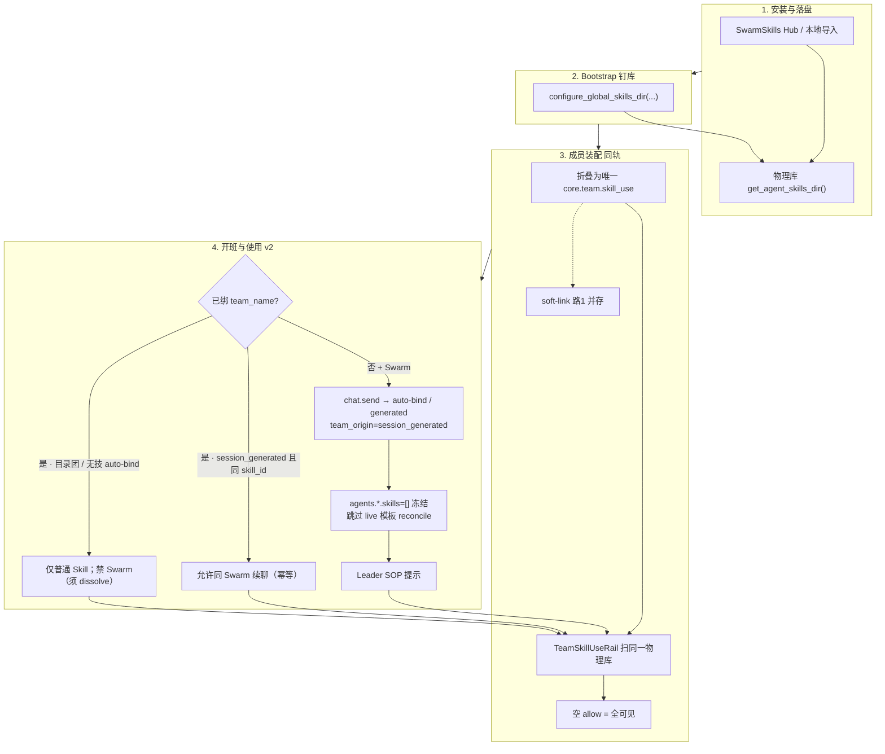

# Swarm Skill · 运行时流程（v2）

> 取代 M1/M2 中 `entry=dynamic_skill` / Cold A 叙事。产品真相源：
> `创意实现/需求/swarm-skill需求设计文档-v2.md`。

## 路径速查

| 角色 | 路径 |
|------|------|
| 物理库 | `get_agent_skills_dir()` |
| 可见性 | `skills-visibility.json`；无团 Swarm：**空 allow**，不写 `allow=[swarm]` |
| 选团 | `team.session.bind` **只认** `team_name`（无 dynamic entry） |
| 解绑 | `team.runtime.dissolve`；先无技 auto-bind 后再选 Swarm 须先解绑 |

## 与 develop / 旧 M1 的差异

- **有意不**采用 develop「选技写入 allow 收窄」。
- **已废** `entry=dynamic_*`、`TEAM_COLD_REOPEN_REQUIRED` sticky Cold A。
- Session-generated 团：**跳过** live preset skills 漂移恢复，避免空 allow 被写回。
