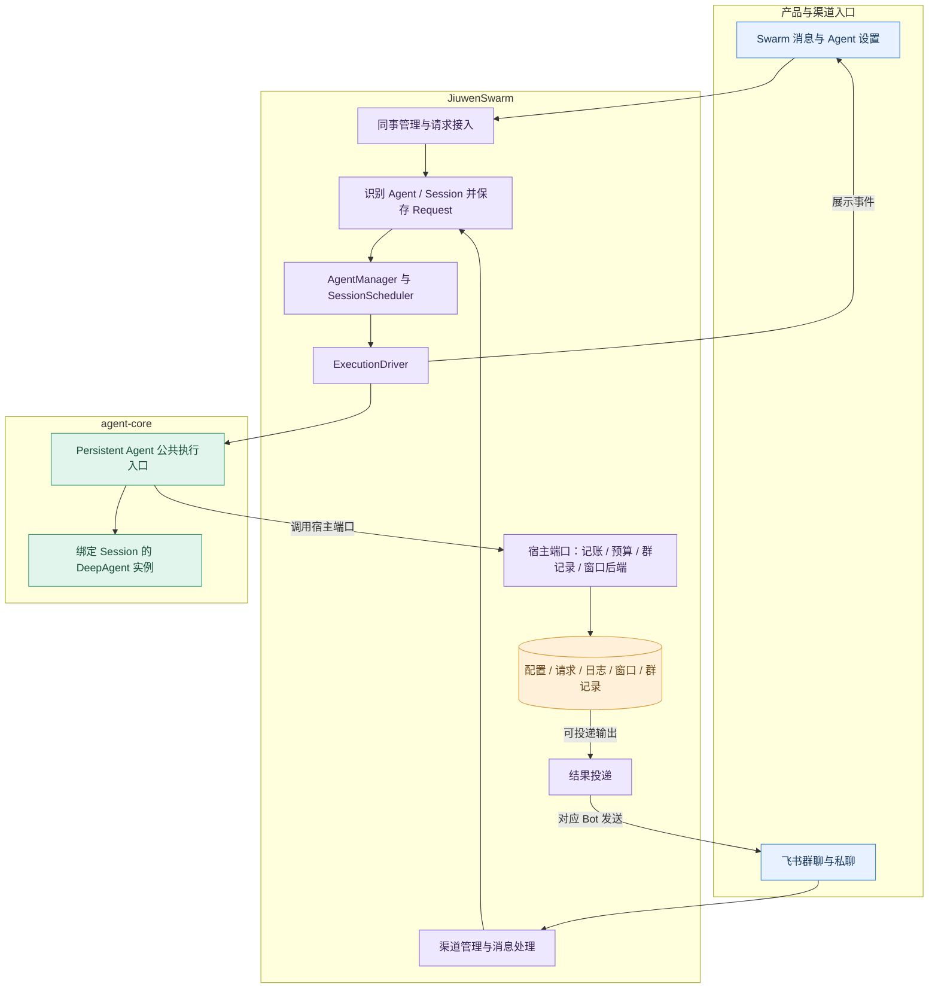

# JiuwenMate 开发计划

| 项 | 内容 |
| --- | --- |
| 用途 | 结合 agent-core 的 Persistent Agent 能力，在 JiuwenSwarm 独立开发新版 AI 同事；Swarm 负责产品管理、渠道接入、执行调度、数据存储与结果投递 |
| 架构 | Swarm AgentServer 在进程内调用 agent-core 的 Persistent Agent 公共入口，通过宿主端口提供存储和业务能力；Gateway 负责渠道收发，前端订阅服务端执行状态 |
| 设计依据 | [agent-core 开发计划](https://gitcode.com/huenrui_/agent-core/blob/jiuwenmate/openjiuwen/harness/persistent_agent/docs/designs/persistent-agent-development-plan.md)、[详细架构设计](https://gitcode.com/huenrui_/agent-core/blob/jiuwenmate/openjiuwen/harness/persistent_agent/docs/designs/persistent-agent-architecture.md) |
| 参考版本 | agent-core `jiuwenmate`，commit `d016f8d7dafe741281f360a84a60e6aa4aeb9061`，2026-10-08 版本的 PA 编号与契约 |
| Swarm 接入基线 | 本地 `jiuwenmate`，commit `f0a69728c`；新版业务模块从空数据开始开发，已有个人版与旧版数据不作为初始化来源 |
| 现有实现参考 | 可参考现有个人版飞书适配器、Template 和资源管理接口；新版 AI 同事独立开发、独立保存数据 |
| 范围 | Swarm 侧本轮开发及跨仓依赖：同事管理、执行调度、飞书群聊协作、会话存储、结果投递与续做；确认恢复、知识版本与来源失效、主动学习和扩展执行模式暂不纳入 |
| 更新日期 | 2026-10-09 |
| 当前进度 | 新版主链路 0/17 项；扩展 0/1 项。现有通用能力可供参考，不计作新版任务完成 |

## 1. 怎么读这份计划

用户仍可创建和配置 AI 同事，在 Swarm 私聊，绑定飞书 Bot 后参与群聊和私聊，并通过飞书消息与其他同事协作。拆分后，Swarm 保存“这个同事是谁、使用什么配置、接入哪个 Bot、正在处理什么任务”；agent-core 在指定 Session 内执行任务、管理模型上下文、产生过程事件与候选结果。

本计划以链接中的新版 core 契约为目标，以下关系决定 Swarm 的实现方式：

| 事项 | 本次接入目标 | 对 Swarm 的影响 |
| --- | --- | --- |
| 实例生命周期 | 业务 Agent 持久存在；每次活动 Execution 使用绑定指定 Session 的原生 DeepAgent 实例，结束后清理；并行 Session 使用不同实例 | AgentManager 管理业务 Agent、排队和执行任务，不再缓存一个供所有 Session 共用的 DeepAgent。飞书连接由渠道管理器维持，不依赖模型实例常驻 |
| 主动响应 | PA-07 在 core 内做独立轻量模型判断，人类与 Agent 消息走同一流程；被 @ 也可忽略，未被 @ 也可参与 | Swarm 提供原始消息、职责配置和可查询群记录，不自行调用另一套响应判断模型，也不把 @ 直接等同于必须执行 |
| 跨群查询 | 当前 `GroupChatPort` 只查询当前 Session 所属群；私有窗口检索只查询当前 Session | 不能把旧跨群查询直接挂到这个端口。跨群读取保留为 SW-21 扩展，需要另行明确调用授权和查询契约 |

执行与存储约束：

- 新版 AI 同事使用独立数据和运行入口；保留个人版单 Agent、集群模式及个人飞书入口的默认行为。可调用通用接口，但不读取或转换旧版 AI 同事数据。
- 使用 core 公共导出类型和执行入口，不从其内部 `execution/`、`schema/` 私有实现拼装第二条执行链。
- 同一 Session 同时只有一个活动 Execution；停止或取消只作用于目标 Execution。暂不接入需要用户确认的工具调用，也不提供确认恢复。
- 一个 Request 的续做固定使用原 Spec；新配置只影响新 Request。本轮不向上下文装配授权知识版本或需要跨来源版本失效管理的资料。
- `record` 是事件唯一持久化入口；执行流用于展示。Swarm 持续消费到流结束，前端断线不取消执行。
- 会话窗口由 core 的 WindowStore 管理格式，Swarm 提供持久化 `BaseKVStore`，不直接修改窗口内容。
- 本轮按所需 PA 能力逐项联调，不把 core 的整个 M1 / M2a / M2b 节点作为硬前置；定时任务纳入主线，跨群查询单独列出。

重点验收五类问题：多 Bot 收到同一消息却遗漏某个同事或重复执行；前端断线导致后台任务退出；停止 / 取消误伤其他 Session；日志缺失被误判为工具未执行；结果投递失败导致业务任务重跑。分别由 SW-08、SW-10、SW-12、SW-13、SW-09 的测试覆盖。

本文沿用 agent-core 计划的组织方式：每项列出“做什么、怎样证明做成、开工前需要什么”，并单独登记状态、负责人和证据。SW 编号表示 Swarm 的工作，PA 编号表示 agent-core 的工作。表中的开工硬前置只表示本仓开发依赖，真实联调还须满足第 3 节的对端条件。

| 名称 | 含义 |
| --- | --- |
| Agent | 持久保存的 AI 同事身份、Template 关联和配置 |
| Session | 某个同事的一段独立对话；同一群中的不同同事有各自的 Session |
| Request | 一次任务；续做仍关联原任务 |
| Execution | 一次实际执行尝试；恢复时分配新的 execution_id |
| 宿主端口 | Swarm 向 core 提供的记账、预算、群记录和窗口存储接口；core 契约中的可选知识端口本轮不接入 |
| 开工硬前置 | 缺少这些能力就无法独立实现当前任务；不等同于全部联调条件 |

## 2. 要开发的特性

以下登记的是新版 Swarm 开发进度。现有通用接口可供参考；完成新版代码和验证后，才登记完成。保留原 SW 编号，按能力分组展示，编号不代表必须逐项串行开发。

### A. 创建同事与执行基础

| ID | 特性：要做什么 | 怎样证明做成 | 开工硬前置 | 状态 | 负责人 | 证据与对端条件 |
| --- | --- | --- | --- | --- | --- | --- |
| SW-01 | 固定 SDK 版本、建立公开协议适配与契约测试；新增 `spec_provider.py`、`execution_models.py`；核对既有依赖声明位置 | 能构造合法 Spec / Context / RequestInput；字段错配明确拒绝；识别未开放能力，不能绕过 core 校验执行；测试替身与真实 SDK 类型一致 | 无 | 待验收 | 待分配 | 宿主组件通过，联合验收待完成。SDK 固定为 huenrui_agent-core `12cf92bd71dedb3c39309b72fd8519b5ad9134e6`（`pyproject.toml` 主依赖、harmony 依赖与 `tool.uv.sources` 三处）；宿主仅开放 `construction`，`workspace_read` 待 SW-14。`.venv/bin/python -m pytest tests/unit_tests/server/runtime/persistent_agents/test_core_contract.py -o addopts="--asyncio-mode=auto"`：32 passed。core 正式执行仍停在 PA-10（哨兵测试覆盖），续做停在 PA-18；对端 PA-01～PA-05 |
| SW-02 | 新建 AI 同事定义、存储和管理服务；调用现有 Template、模型和能力管理接口 | 自定义创建、首次使用自动创建默认小九且不重复创建、设置读取 / 发布、删除可用；同事与 Template 一对一；新版数据独立保存；Request 固定配置快照，新请求用新配置 | SW-01 | 待开始 | 待分配 | 验收证据待补充 |
| SW-03 | 新建 Session / Request / Execution 关联仓库及新版群会话映射 | 同一 Agent 同一群稳定复用 Session；跨 Agent、跨群、Web 与 IM 私聊隔离；补充消息是新 Request；重启能查回队列和已派发任务；不会因字符串截断造成 Session 碰撞 | SW-01 | 待开始 | 待分配 | SW-02 联调 |
| SW-04 | 实现 `ports/commit.py` 与事件、候选输出存储；队列由 AgentServer 生命周期持有 | 重交 event_id 不重复；普通日志保存失败不阻断后续关键事件；关键事件落盘失败抛异常；final 缺少候选内容时失败；候选和 final 重交后保持原 ID；读日志校验归属并按序返回 | SW-03 | 待开始 | 待分配 | PA-04、PA-08、PA-15、PA-17 |
| SW-05 | 实现 `ports/window_backend.py`，配置持久化后端、Session 隔离、保留期和删除清理 | 服务重启数据仍在；Agent 文件工具读不到窗口；A Session 不能读写 B；core 能加载 / 保存状态和归档；禁止内存后端被误当生产持久化 | SW-01 | 待开始 | 待分配 | PA-10～PA-12 |
| SW-06 | 实现 `ports/budget.py`，模型准入、额度预留、用量结算和查询 | 同一群多个 Agent 同时申请不会超卖；重复 report 不重复计费；拒绝时不调用模型；未知用量不当作零；额度恢复有可验证依据供续做使用 | SW-03 | 待开始 | 待分配 | PA-05、PA-07、PA-11 |
| SW-07 | 新建 AI 同事管理器、Session 排队器和执行驱动 | 同一 Session 串行，不同 Session 可在容量内并发并使用不同实例；控制只作用于目标 Execution；流结束和清理完成后才释放占用；新 Request 与非确认续做走同一调度入口；设置全局 / Agent 并发和排队上限 | SW-01、SW-03 | 待开始 | 待分配 | 正式执行联调依赖 SW-04～SW-06 和 PA-05、PA-06、PA-10；续做再联调 PA-17、PA-18 |
| SW-10 | 在 `agent_ws_server.py` 接入独立后台消费；适配前端 `features/persistentAgents/` 和消息组件 | 创建、设置、发消息、查历史和状态可用；Web 断开后任务继续，重连能查询结果；final / paused 后仍消费到流结束；不将模型中间文本误报成最终结果；个人版事件不改义 | SW-02、SW-04、SW-07 | 待开始 | 待分配 | 群展示随 SW-08、SW-09 验收 |

### B. 飞书接入、群消息与同事协作

| ID | 特性：要做什么 | 怎样证明做成 | 开工硬前置 | 状态 | 负责人 | 证据与对端条件 |
| --- | --- | --- | --- | --- | --- | --- |
| SW-08 | 为新版 AI 同事接入现有飞书连接能力，新建其消息标准化和群内分发逻辑 | 绑定 app_id 后正确定位新版 Agent；群 / 私聊来源及 @、回复、发送者和附件完整传入；重复事件不重复派发，多个目标 Agent 不互相去重；仅向有群访问依据的同事派发；人类与 Agent 消息都可进入 core 判断 | SW-02、SW-03 | 待开始 | 待分配 | PA-07 就绪后放行群执行；个人版飞书路由保持独立 |
| SW-09 | 新建结果投递服务，调用现有飞书发送接口实现新版 Bot 回复和协作发送 | 使用当前 Agent 对应 Bot 向正确群发送，保留真实 @ / 回复关系；A @ B 后由 B 的入站链路继续处理，无内部代执行；群里不泄露判断或工具过程；文件上传和发消息分别记录；发送失败不重跑任务；重复交接不重复发起正常发送 | SW-04 | 待开始 | 待分配 | Web 投递可独立开发；飞书投递依赖 SW-08；PA-08；中途协作发送接入 PA-15 并记录投递事实 |
| SW-11 | 为新版群聊建立公共记录及搜索服务，实现 `ports/group_chat.py` | 同一群维护一份逻辑公共记录；多 Bot 重复接收不重复写入；最近消息按游标读取、排除触发消息，检索结果带来源与完整性；撤回消息不返回正文；权限未知不读取；读取失败不伪装成空记录；不读取旧版群记录 | SW-03、SW-08 | 待开始 | 待分配 | PA-23，联合 PA-07、PA-11、PA-12；跨来源失效管理不在本轮验收范围 |

### C. 控制、续做、资源与管理

| ID | 特性：要做什么 | 怎样证明做成 | 开工硬前置 | 状态 | 负责人 | 证据与对端条件 |
| --- | --- | --- | --- | --- | --- | --- |
| SW-12 | 新增 `execution_control_service.py`，接入 Web / 飞书停止与取消入口 | 只有发起人或被授权的管理者可以控制目标 Execution；重复请求不重复执行；停止 / 取消只影响当前 Session；收尾异常仍保留控制事实，不误触发自动续做 | SW-03、SW-07 | 待开始 | 待分配 | PA-05；不接入确认卡片和 `resume_persistent_request` |
| SW-13 | 新增 `recovery_service.py`；实现重启扫描、执行异常核对、停止后继续和条件恢复重排队 | 只核对本次 Execution 的 final / paused；无结束记录且未主动停止 / 取消时，在旧执行退出后续做；沿用 Request / Spec，recovery_ref 指向正确执行；预算等条件未改变不反复续做；缺工具结果先查证，不推断未执行；已保存 final 后清理异常不重跑 | SW-04、SW-05、SW-07、SW-12 | 待开始 | 待分配 | 自动续做放行依赖 PA-11、PA-15、PA-17、PA-18 |
| SW-14 | 为新版同事建立资源选择与隔离能力，调用现有 Skill、MCP、插件管理接口 | 每个同事独立选择 Skill / MCP / 插件；不同执行不覆盖全局环境和凭据；Session 私有草稿不串读；共享文件冲突可识别；只开放无需人工确认且已接入意图记账的写操作；清理一个实例不卸载其他实例的工具 | SW-02、SW-07 | 待开始 | 待分配 | 读 PA-14，写 PA-15、PA-16；需要用户确认或来源失效管理的操作暂不开放 |
| SW-16 | 从同事定义、执行事件与投递状态提供管理查询；复用前端记录 / 看板入口 | 区分排队、执行中、暂停、结束和发送失败；统计调用 / Token 用量与渠道，不把 ignored 当作回复或失败；能从 Request 查多次 Execution，权限过滤一致 | SW-02、SW-04、SW-06、SW-09 | 待开始 | 待分配 | 验收证据待补充 |
| SW-19 | 接入现有定时任务管理能力，为新版同事保存计划、启停状态和触发记录 | 同一次触发只创建一个 `RequestInput(kind="scheduled")`；到点后由指定同事执行，使用同一套预算与结果投递链路；服务重启后不会漏触发或重复执行；定时计划与旧版数据隔离 | SW-02、SW-03、SW-07、SW-09 | 待开始 | 待分配 | 使用 PA-05 的普通任务执行入口；计划创建与触发由 Swarm 负责 |

### D. 联合验收

| ID | 特性：要做什么 | 怎样证明做成 | 开工硬前置 | 状态 | 负责人 | 证据与对端条件 |
| --- | --- | --- | --- | --- | --- | --- |
| SW-18 | 串联两仓集成测试、个人版回归和新版功能开放；核对所有共享入口差异 | Web 私聊、飞书私聊、群主动响应、A @ B 协作、定时触发、停止 / 取消、断线、重启续做均有证据；个人版和集群模式不回归；新版与旧版各自读取自己的数据，不存在重复监听或重复执行 | 对应能力任务通过 | 待开始 | 待分配 | 全量验收要求 SW-01～SW-14、SW-16、SW-18、SW-19 及对应已接入 PA 能力 |

### E. 扩展能力

以下能力单独跟踪，尚未安排具体发布批次。

| ID | 特性：要做什么 | 怎样证明做成及依赖 | 状态 | 负责人 | 证据 |
| --- | --- | --- | --- | --- | --- |
| SW-21 | 保留跨群搜索和后续 IM 扩展设计；分别补充授权查询契约与平台适配 | 跨群只读授权的公开群记录，不读取其他 Session 私有窗口；新增平台沿用绑定 / Request / 投递模型。当前 GroupChatPort 不能直接承载跨群查询；需先完成接口设计再开发 | 待开始 | 待分配 | — |

## 3. 开发计划

### 3.1 开发工作线

先完成接口与持久化基线，再贯通私聊单次执行，随后接入群消息、长上下文和协作。办公空间与续做可在各自前置完成后并行开发。core 计划中“PA-05 已完成”目前只代表组件验收：正式执行入口在 PA-10 的会话状态记录接入前仍会拒绝执行；确认恢复入口还依赖本轮暂不接入的确认转换能力。Swarm 可以先用端口替身验证调度，真实私聊须待相关执行能力接通。

| 工作线 | 可先开展的任务 | 后续任务 | 交付节点 |
| --- | --- | --- | --- |
| A：管理与执行 | SW-01、SW-02、SW-03 | SW-07、SW-10、SW-12 | S1 |
| B：持久化与额度 | SW-05；SW-03 后开展 SW-04、SW-06 | 配合 SW-13 续做验证 | S0、S1、S2c |
| C：飞书与群协作 | SW-02 / SW-03 后开展 SW-08；SW-04 后开展 SW-09 通用投递 | SW-11、SW-09 飞书投递与 @ 协作 | S2a |
| D：资源、定时任务与管理 | SW-02 后准备 SW-14 资源装配和 SW-19 计划管理 | 执行接通后验证 SW-14、SW-19，完成 SW-16 查询 | S2b |
| E：续做与联调 | 按 SW-13 的前置准备恢复能力 | SW-18 验证新版与现有模式相互隔离 | S2c、S3 |

各工作线可以使用模拟端口独立开发；依赖真实 core 的能力必须通过对应联合验收才开放。

### 3.2 按可交付结果汇合

| 节点 | Swarm 任务 | core 汇合要求 | 必须演示的结果 |
| --- | --- | --- | --- |
| S0：契约与宿主基线 | SW-01～SW-06 | PA-04 当前契约 | 配置、身份、事件、窗口后端和预算各自测试通过，明确哪些是替身 |
| S1：私聊闭环 | SW-07、SW-09 的 Web 投递、SW-10、SW-12；使用 SW-14 最小只读配置 | PA-05、PA-06、PA-08、PA-10 的实际执行能力 | 指定同事收消息、回复、停止、取消；前端断线不影响执行；两个 Session 不串状态 |
| S2a：飞书群协作 | SW-08、SW-09、SW-11，完善 SW-10 的 IM 记录展示 | PA-07、PA-23；长上下文另需 PA-11、PA-12 | 有 @ / 无 @ 均能判断；A 真实 @ B 后 B 处理；同一群记录共享、各 Agent 私有窗口隔离；换窗后可继续工作 |
| S2b：资源、定时任务与管理 | SW-14、SW-16、SW-19 | 定时触发使用普通任务入口；只读文件 PA-14；安全写入另需 PA-15、PA-16 | 同事资源配置互不干扰；定时任务按计划执行且重启后不重复触发；用量和执行状态可查 |
| S2c：续做 | SW-13 | core M2c | 进程中断、关键记账失败、停止后继续均关联原任务；结果已保存而清理失败不重跑；无结果的写操作先查证 |
| S3：新版交付 | SW-18 | 对应 core 能力已联合验收 | 从空数据创建同事并完成飞书真机协作、重启验证；个人版和集群模式回归；新旧数据与路由隔离 |

### 3.3 验证与能力开放

每个任务按以下顺序验证：

- [ ] 根据第 2 节验收场景，先补宿主单元测试与真实 core 类型的契约测试，记录新场景在接入前失败的原因。
- [ ] 按第 6 节文件落点实现该任务，保留旧入口中与本任务无关的行为。
- [ ] 运行本任务测试，再运行受影响的共享入口回归；接入 core 功能时记录双方 commit 和启用能力。
- [ ] 完成该任务所对应节点的联调后，将状态改为“完成”，登记测试命令、结果及演示证据；只过替身测试时标明“宿主组件通过，联合验收待完成”。

建议新增测试落点均在 `tests/unit_tests/server/runtime/persistent_agents/`：`test_core_contract.py`（SW-01）、`test_persistent_agent_service.py`（SW-02）、`test_request_routing.py`（SW-03）、`test_commit_port.py`（SW-04）、`test_window_backend.py`（SW-05）、`test_budget_port.py`（SW-06）、`test_session_scheduler.py` 和 `test_execution_driver.py`（SW-07）、`test_delivery_service.py`（SW-09）、`test_group_chat_port.py`（SW-11）、`test_execution_control_service.py`（SW-12）、`test_recovery_service.py`（SW-13）、`test_resource_scope.py`（SW-14）、`test_management_query.py`（SW-16）、`test_scheduled_requests.py`（SW-19）。另需测试新版从空数据启动、旧版数据不可见和飞书消息不串路由。

Gateway 补充 `tests/unit_tests/gateway/test_persistent_group_fanout.py`，覆盖 SW-08 的目标去重与权限范围。SW-10 / SW-18 增加 Web 断开、状态重查与个人模式回归；联合测试建议放 `tests/integration_tests/persistent_agents/`，覆盖 S1～S3。

在项目已配置好的 Python 环境中，从 `jiuwenswarm/` 执行：

```bash
python -m pytest tests/unit_tests/server/runtime/persistent_agents/test_core_contract.py -q
python -m pytest tests/unit_tests/server/runtime/persistent_agents -q
python -m pytest tests/unit_tests/gateway/test_persistent_group_fanout.py -q
python -m pytest tests/integration_tests/persistent_agents -q
```

以上为实施时的计划命令，新增测试文件当前尚未建立，本文未执行或宣称测试通过。正式飞书验收使用测试应用和测试群，至少覆盖两个 Bot、两个群、一次私聊、重复事件、发送失败、停止 / 取消和服务重启；在验收记录中写明飞书应用接收权限与真实观察结果。

## 4. 进度怎么更新

完成开发或联调后，更新第 2 节对应条目的“状态、负责人、证据”，并同步下方交付节点。状态使用“待开始、进行中、待验收、阻塞、完成”；仅通过模拟端口测试时，在证据列写明“组件验证通过，真实联调待完成”。本次文档编制不计为开发完成。

| 交付节点 | 状态 | 负责人 | 验收证据或待办 |
| --- | --- | --- | --- |
| S0：契约与宿主基线 | 进行中 | 待分配 | SW-01 宿主组件通过；存储和预算验证待 SW-02～SW-06 |
| S1：私聊闭环 | 待开始 | 待分配 | 等待 PA-05、PA-06、PA-08、PA-10 的正式执行链路接通后联合验收 |
| S2a：飞书群协作 | 待开始 | 待分配 | 群消息、主动响应、真实 @ 与隔离验证 |
| S2b：资源、定时任务与管理 | 待开始 | 待分配 | Agent 资源隔离、定时触发和管理查询 |
| S2c：续做 | 待开始 | 待分配 | 异常、重启、停止后继续及配置保持 |
| S3：新版交付 | 待开始 | 待分配 | 从空数据启动、独立存储、个人版回归与飞书联调 |

| 日期 | 变更 | 证据 |
| --- | --- | --- |
| 2026-10-08 | 建立 Swarm 跨仓开发计划 | 静态核对 core 计划和公开接口；未实施开发 |
| 2026-10-08 | 按 core 开发计划重整为特性清单、工作线、交付节点和进度跟踪，保留 SW 编号 | 文档结构调整；开发完成数不变 |
| 2026-10-09 | 收窄本轮范围，移出确认恢复、授权知识版本、跨来源失效、主动学习和扩展执行模式；保留停止 / 取消 | SW-12 改为控制服务；SW-15、SW-20 不纳入本轮；主链路 17 项、扩展 2 项，完成数仍为 0 |
| 2026-10-09 | 新版独立开发、独立存储 | 删除 SW-17 数据迁移任务；SW-18 改为新旧版隔离验收；主链路 16 项、扩展 2 项，完成数仍为 0 |
| 2026-10-09 | 将定时任务纳入主线 | SW-19 从扩展项移入资源与管理工作线；主链路 17 项、扩展 1 项，完成数仍为 0 |
| 2026-10-12 | SW-01：固定 agent-core 版本，新增 `persistent_agents/spec_provider.py`、`execution_models.py` 与契约测试 | 32 项契约测试通过；仅使用替身端口，状态为待验收，完成数仍为 0 |

## 5. 新旧版本隔离与公共能力复用

新版 AI 同事从空数据创建自己的 Agent、渠道绑定、Session、任务、群记录和窗口存储。不读取、转换或覆盖旧版数据；不需要数据迁移脚本。旧版实现可以帮助理解飞书事件格式及现有产品接口，但新版业务逻辑按本计划独立开发。

| 现有公共能力 | 新版使用方式 |
| --- | --- |
| AgentTemplate、模型、Skill、MCP 和插件管理接口 | 调用公共接口创建和装配新版同事；资源选择及工作空间归属由新版服务独立记录 |
| 飞书连接、消息解析和发送接口 | 复用平台适配能力；用新版绑定定位新版 Agent，接收事件时保留 @、回复及发送者信息，旧版路由保持原状 |
| Web 消息组件 | 复用通用展示组件；新版会话与个人版会话分别查询和保存 |

新版接入时重点验证：一个飞书事件不会同时误入个人版和新版执行链；同机多个 Bot 不会因全局去重而遗漏目标 Agent；Agent Bot 的普通消息不会使自己循环回复；两个 Bot 通过飞书真实 @ 协作。中途协作发送接入 PA-15 意图记账，文件保存与飞书发送分别记录状态。需要用户确认的写操作暂不启用。

SW-09 的发送“只执行一次”不能仅靠本地标记承诺：平台已接收但本地未保存回执时，优先按平台支持的幂等标识或消息查询核对；无法确认时保留待核实状态，不盲目重发。core 的记账没有“结果未知”状态，不代表外部飞书发送不存在网络不确定性。

## 6. 模块落点与接口参考

### 6.1 模块职责与架构

以下目录相对 `jiuwenswarm/`。表中 AI 同事业务模块是新版拟定落点；现有飞书、Template 和前端公共组件可通过接口复用。文件名仅表示模块职责，不要求复制旧版同事实现。

| 代码模块 / 目录 | Swarm 承担的职责 | 与 agent-core 的边界 |
| --- | --- | --- |
| 新版 `server/runtime/persistent_agents/service.py`、`models.py`、`repository.py` | AI 同事创建、Template 关联、配置发布、默认小九、渠道绑定和管理查询 | 输出业务定义和固定版本的 Spec，不包含模型执行循环 |
| 新版 `capabilities.py`、`resource_scope.py`、`resource_bootstrap.py`、`agent_workspace.py` | 装配模型、Skill、MCP、插件及办公空间授权，维护每个同事的资源范围 | core 使用已经装配的工具和 Workspace；安装、选择和凭据管理仍属 Swarm |
| 新增 `spec_provider.py`、`execution_models.py` | 配置快照与 core DTO 转换；保存 Request、Execution、来源与回复路由的关联 | 直接复用 `PersistentAgentSpec`、`ExecutionContext`、`RequestInput`，不复制其协议定义 |
| 新版 `agent_manager.py`、`session_scheduler.py`、`execution_driver.py` | Session 排队、容量控制、执行任务生命周期、调用 core 的执行 / 停止 / 取消入口；续做阶段重新调用执行入口 | 实例绑定、模型运行和实例内部清理由 core 完成；Swarm 等待清理结束再释放 Session |
| 新增 `ports/commit.py`、`ports/budget.py`、`ports/group_chat.py`、`ports/window_backend.py` | 实现本轮所需宿主端口；提供真实数据、授权和持久化保证 | 端口协议由 core 定义，后端和账户由 Swarm 实现；可选知识端口暂不接入 |
| 新增 `execution_repository.py`、`execution_control_service.py`、`recovery_service.py` | 任务状态、事件、候选输出、停止 / 取消事实及续做安排 | core 负责窗口恢复与续做推理，Swarm 选择哪个 Request 在何时再次执行 |
| 新版 `scheduled_requests.py`，接入现有定时任务调度器 | 保存同事的定时计划、触发记录和投递目标，将到期触发转换成普通 Request | core 只执行 `scheduled` 请求，计划的创建、启停和去重由 Swarm 负责 |
| 新版 `group_chat_repository.py`、`conversation_archive.py`、`conversation_search.py`、`conversation_resources.py` | 群与 Session 映射、公开聊天记录、最近消息和搜索、附件引用及权限过滤 | 群消息不是私有执行窗口；core 经 GroupChatPort 读取，不直接访问归档路径 |
| `feishu_sync.py`、`lark_cli_provisioner.py`；`gateway/channel_manager/` | Bot 配置同步、连接生命周期、飞书身份与收发 | 飞书 SDK、app_id、凭据和 Bot 发送逻辑保留 Swarm |
| 新版 `gateway/message_handler/persistent_group_fanout.py`，接入公共 `message_handler.py` | 入站标准化、消息归档、按授权目标形成请求及逐 Agent 去重 | 保留 @ / 回复等事实，不在 Gateway 判断消息业务价值；个人版仍走原路由 |
| 新版 `execution_result_handler.py`、`delivery_service.py` | 候选输出可靠交接、Bot 身份选择、文本 / 文件投递、发送状态与重试 | core 产出候选；Swarm 负责送达，不把生成成功当成发送成功 |
| `server/agent_ws_server.py`、`channels/web/frontend/src/features/persistentAgents/` | 接入既有管理接口、聊天展示、停止 / 取消操作、断线重连查询 | 转换产品协议，不向前端暴露 core 运行对象 |
| agent-core `openjiuwen/harness/persistent_agent/` | Spec、原生 DeepAgent 构造、执行入口、参与判断、上下文装配、窗口保存 / 换窗、工具记账适配与续做 | Swarm 不保留同等职责的第二套 ContextAssembler、窗口控制器或参与判断器 |



图中的“识别 Agent / Session 并保存 Request”是接入阶段的职责，由 service、渠道绑定和会话仓库共同完成，不额外引入 ExecutionRouter。每个活动 Execution 对应独立构造上下文；图中只画一个执行框表示调用关系，不表示全局只有一个实例。

### 6.2 跨仓接口与数据关系

**身份和会话。** `agent_id` 对应持久化同事定义及其独立 Template 目录；`group_chat_id` 标识 Swarm 中的一个群，关联平台原始 `chat_id`。在同一业务数据空间内，`(agent_id, group_chat_id)` 对应一个稳定 `session_id`，不同同事在同一群中拥有不同 Session，共用该群的公开聊天记录。Swarm 私聊、飞书私聊和不同群的 Session 分开创建。`namespace_id` 是 core 要求的宿主数据空间标识，由 Swarm 映射既有用户 / 工作空间边界，不等同于飞书 tenant_id，也不新增一个假定存在的飞书字段。

**任务和执行。** 一条被接纳的输入创建一个 `request_id`；每次执行或续做创建新的 `execution_id`。续做沿用原 Request、原 Spec 和原始输入，通过 `recovery_ref` 指向该 Request 待接续的 Execution。请求原文、发起人、接收时间、附件引用、回复目标和配置版本须在派发前持久化。

**渠道识别。** 使用接收事件的渠道实例及其 `app_id` 查新版渠道绑定，得到 `agent_id`；@ 列表中的身份用于说明消息指向谁，不通过 @ 反查接收连接。新版绑定保存自己的 `binding_id`、`platform`、`app_id`、凭据和 `agent_id`，公开响应须脱敏。多个应用接收同一消息时，新版公共记录按平台与消息身份归档一次，各 Agent 的请求分别去重，不能一次全局去重后只剩一个 Agent。

**跨仓直接调用。** Swarm 传入 `PersistentAgentSpec`、单次使用的 `PersistentBuildContext`，调用 `execute_persistent_request(spec, context, inputs)`；停止或取消时调用 `abort_persistent_request(context, reason="stop" / "cancel")`。续做沿用原 Request 并提供 `recovery_ref`，待 PA-18 接入后开放；本轮不调用 `resume_persistent_request`。每次提供相同业务 session_id 的新空 Session，并显式注入 `NoopCheckpointer`。Swarm 不额外调用 Session 的 `pre_run / post_run`。构造上下文和执行控制对象只存内存，不序列化；配置快照、身份关联和任务状态持久保存。

| core 接口 | Swarm 实现要求 | 对端任务 |
| --- | --- | --- |
| `CommitPort.record(execution, event)` | 校验事件归属，按 event_id 去重；普通事件入队返回，允许日志缺口；tool.intent、execution.paused、execution.final 等关键事件等待自身落盘；final 的 output_refs 所引用候选也必须可靠保存 | PA-04、PA-05、PA-08、PA-15 |
| `CommitPort.read_execution_log(execution, execution_id)` | 只允许读取同一 Session、同一 Request 的目标执行日志，按 local_seq 排序；不把非空结果声明为完整 | PA-17、PA-18 |
| `BudgetPort.admit(execution, model_call_id)` / `report(execution, model_call_id, usage)` | 群额度共享计算并原子准入；按模型调用身份防重复结算；保留 usage 未知状态，不记为零消耗 | PA-05、PA-07、PA-11 |
| `PersistentPorts.window_backend: BaseKVStore` | 提供持久化且与 Agent 文件工具隔离的后端，按 namespace / Session 隔离；core 负责存储内容结构 | PA-10、PA-11、PA-12 |
| `GroupChatPort.recent_messages(execution, cursor, limit)` / `search_messages(execution, query)` | 从执行关联的 Session 定位群，过滤授权范围、入群时间、撤回和附件访问状态；返回完整性状态 | PA-07、PA-23 |

业务状态、事件和投递记录拟采用新版独立持久化仓库，支持请求唯一约束、原子状态更新与重启恢复；单机实现可使用 SQLite。新版群历史独立归档，窗口使用符合 `BaseKVStore` 的持久化实现。这里的存储选择属于 Swarm 实现方案，不是 core 已提供的数据库。所有路径从既有用户数据根目录下的新版专用目录派生，不放进源码目录，也不指向旧版数据目录。
