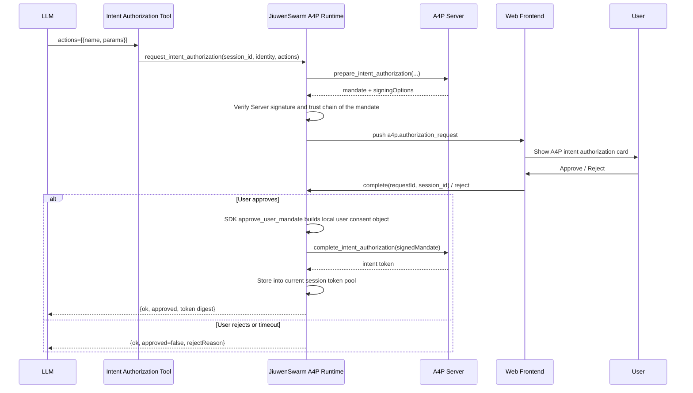
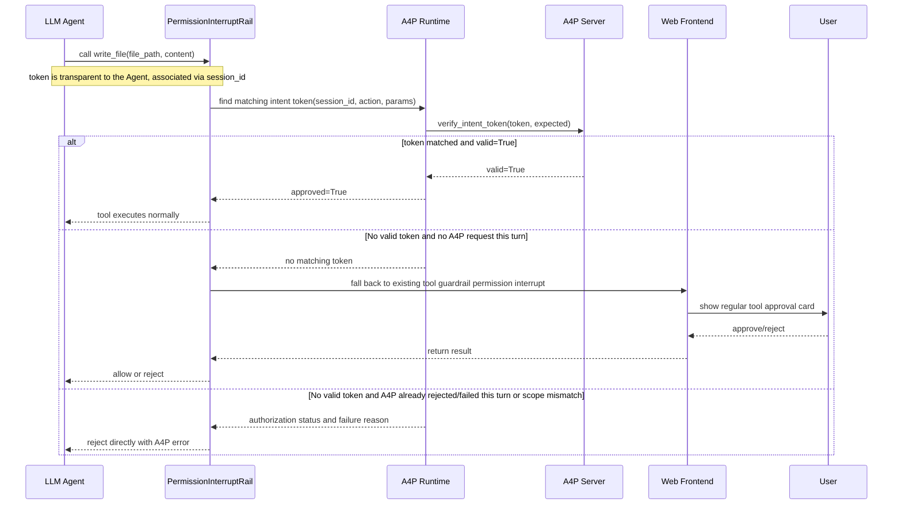
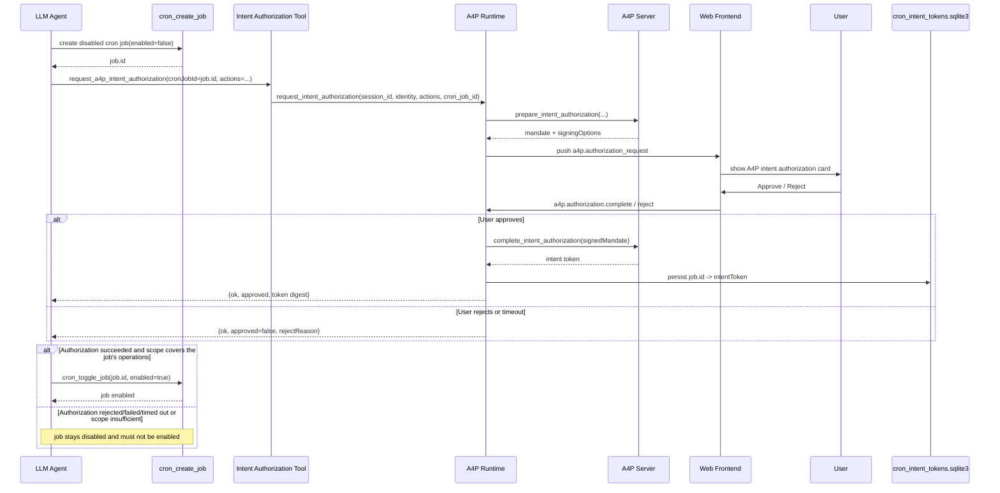
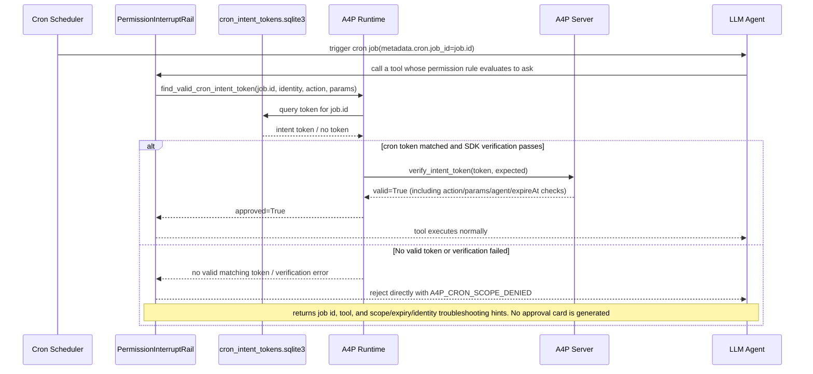

# A4P Preauthorization

A4P preauthorization lets users approve a group of operations and their parameter scopes in one step before the Agent executes. Once the user approves, the system issues an authorization credential, and subsequent tool calls that match the approved scope pass verification automatically, reducing repeated approval prompts.

JiuwenSwarm provides this capability on top of the A4P SDK from the openJiuwen Agent Protocol. It currently supports **Web interactive sessions and cron jobs**.

## When to Use

- **Multi-step tasks**: When the Agent executes a complex task spanning multiple tools, it can request an A4P intent authorization. After the user approves the clearly specified tool calls once, subsequent matching calls are automatically allowed via the intent token, avoiding consecutive repeated approvals. If uncovered operations appear later, additional authorization can be requested.
- **Cron jobs**: When the Agent runs scheduled tasks unattended, it can request A4P intent authorization in advance. During execution, matching tool calls are automatically allowed without persistently setting the tool to `allow`, which would introduce security risks.

## Enabling and Using

Enable it under **Settings → Experimental features → A4P Preauthorization**. It is off by default and only takes effect in the "default permission" mode. Smart Approval and Full Access do not inject A4P authorization guidance, expose the preauthorization tool, or use A4P tokens to approve calls. **once enabled, cron job runs also go through the permission guardrail.** You can also configure it in `config.yaml`:

```yaml
a4p:
  enabled: true
```

Session task workflow:

1. Describe the task to the Agent, specifying the files, directories, or operation targets involved.
2. After planning, the Agent requests authorization. The card shows the authorization reason, tools, and parameter scopes.
3. The user can approve all or selected operations, or reject the request; unselected operations do not gain authorization from this confirmation.
4. After approval, the Agent continues execution, and subsequent matching calls are verified automatically.

Cron job workflow:

1. Describe the task to the Agent, specifying the schedule, recurrence, duration, and operation targets.
2. The Agent creates a disabled cron job and requests authorization covering the scope needed for future runs. The card shows the job information, authorization reason, tools, and parameter scopes.
3. The user confirms the authorization scope, approving all or selected operations or rejecting the request; the Agent enables the job only after obtaining authorization that covers the operations the job requires.
4. When the cron job runs, the permission rules are evaluated first: `allow` passes directly, `deny` is rejected directly, and `ask` automatically looks up the authorization bound to the job and verifies the tool call, without popping up an interactive approval card.

## Authorization Flow

In the following flows, tool-call sequencing assumes the permission rule evaluates to `ask` and the call enters the A4P confirmation stage; the earlier `allow` pass-through and `deny` rejection decisions are omitted.

### Session Preauthorization

#### Stage 1: Request and confirm authorization

The Agent requests authorization for the currently known operation scope. After the user confirms in the Web card, the A4P Server issues a credential, which the Runtime saves into the current session; rejection or timeout returns a failure reason. Session requests first preflight concrete actions against the installed session permission rail. Actions allowed by current policy or covered by valid session tokens do not require a new approval card. Explicitly denied actions return `A4P_ACTION_POLICY_DENIED` without opening a card, so the Agent must revise its plan. Pattern scopes, unavailable rails, and failed preflight remain in the approval request; authorization patterns are never checked as literal invocations.

The Agent-facing response contains three action lists:

- `permittedActions`: the union of policy-allowed, existing-token-covered, and newly approved actions.
- `unapprovedActions`: actions still lacking authorization, including unselected, rejected, failed, or not-yet-requested actions when policy denial blocks the request.
- `deniedActions`: actions explicitly prohibited by current policy, which A4P approval cannot override.

The Agent may only attempt actions in `permittedActions`; cron jobs must stay disabled while any planned action is unapproved or denied. When all actions already satisfy permissions, the result is `ok=true`, `authorizationRequired=false`, and `approved=false`, without issuing a new token. Preflight reflects the state at check time; execution always rechecks policy and token coverage using actual arguments. Cron requests retain their complete future scope and are not filtered using interactive session permissions or tokens. SDK, Runtime, and Web card authorization protocol fields remain unchanged.




#### Stage 2: Verification at tool-call time

The system automatically looks up the current session's credentials and verifies identity, validity period, and operation parameters. When new operations exceed the approved scope, additional authorization is required.



### Cron Job Preauthorization

#### Stage 1: Create the job and authorize in advance

Create a disabled job first, and request the complete future operation scope while the user is online. The credential is bound to the job and persisted; once the required authorization is obtained, the job is enabled.



#### Stage 2: Verification at scheduled execution

When A4P is enabled and the permission guardrail is active, both single-Agent and team cron jobs go through permission rule evaluation: `allow` passes directly, `deny` is rejected directly, and only `ask` calls look up the credential bound to the job ID. Valid and matching calls continue execution; when the job ID is missing, the credential is missing, expired, mismatched, or verification fails, the call is rejected directly — no interactive approval is awaited, and session credentials are not used as a fallback.



## Supported Operations

Authorization is bounded by the specific tool and security-critical parameters; reading and modifying the same file are authorized separately.

| Capability | Tool | Authorization constraint |
|---|---|---|
| Read a file | `read_file` | file path `file_path` |
| Create or write a file | `write_file` | file path `file_path` |
| Modify a file | `edit_file` | file path `file_path` |
| Browse a directory | `list_files` | directory `path` |
| Search file names | `glob` | search root `path`, recursive |
| Search file contents | `grep` | file or directory `path`, recursive, returns content snippets |
| Run a command | `bash`, `mcp_exec_command` | command `command` |
| Create a terminal | `create_terminal` | command `cmd` |
| Call another Agent | `acp_chat` | target `agent` |

File scopes can be a specific file or a file-name pattern under a fixed directory. File-name patterns for `read_file` do not cover subdirectories. Directory browsing and searching use explicit paths without directory wildcards; approving browsing or file-name search does not imply approving reading file contents.

`read_file`, `list_files`, `glob`, and `grep` require explicit absolute paths both when requesting and when executing; omitted paths, relative paths, `~`, or `..` path segments are not accepted. Ordinary parameters not listed as authorization constraints, such as search keywords and result limits, may vary within the approved scope.

## Validity and Storage

| Authorization type | Default validity | Storage |
|---|---|---|
| Session authorization | 1 hour | Kept in the current service process; not retained after service restart or disabling A4P |
| Cron job authorization | 30 days | Bound to the specific job and persisted |

A validity period can be specified when requesting; cron jobs should cover the planned execution duration. The user confirmation wait time is 3 minutes.

### Continuing After a Page Refresh

If you refresh while authorization is pending, return to the original session to approve or reject it. Once the background task finishes, the page automatically reloads its execution results and final reply from history; you do not need to submit the task again. If a newer task is running in the same session, history reconciliation waits until that execution finishes to preserve its live reply.

## Design Trade-offs

- **Intent authorization only**: Per-operation authorization in the A4P SDK is already covered by the regular tool approval flow, so no duplicate interaction is added.
- **System-managed credentials**: The user confirms in the Web card; the A4P SDK issues and verifies credentials, and the Agent does not need to carry credentials manually when calling tools.
- **Sessions vs. cron jobs**: Sessions allow the scope to grow as the task progresses; cron jobs require the complete scope prepared in advance for unattended execution.

## Usage Boundaries

- A4P cooperates with the existing permission guardrail: `allow` passes without verifying an A4P token, `deny` is rejected and cannot be overridden by a token, and only `ask` calls go through A4P verification. When A4P is disabled, cron jobs keep the existing behavior of skipping that permission guardrail; when the permission guardrail is disabled, A4P does not enable it on its own. ACP, TUI, and CLI permission behavior is unchanged.
- In a Web session, if no A4P request was made this turn and no matching credential exists, the regular approval flow still applies; if a request was made but no usable authorization is available, the regular approval flow does not automatically bypass the failure.
