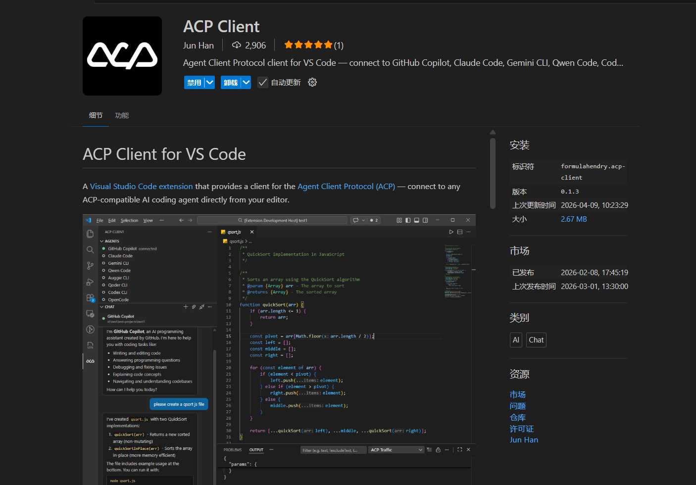
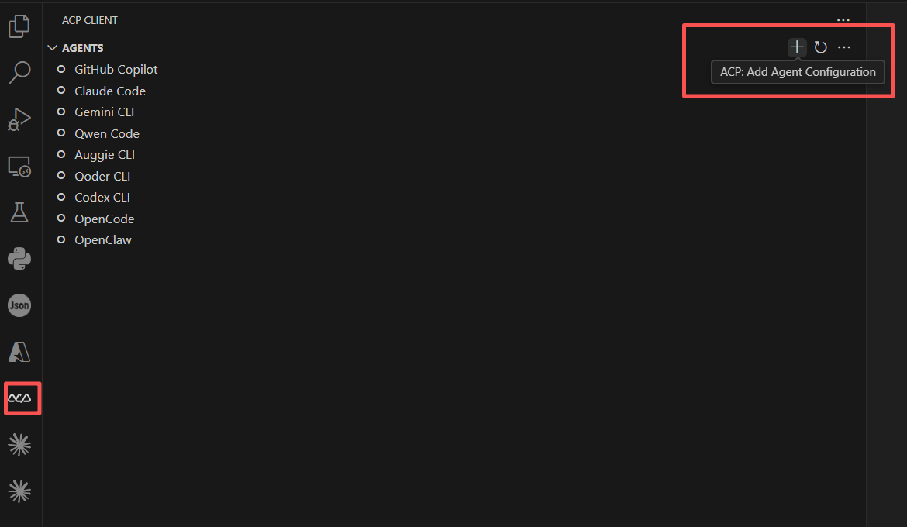

# Quick Start

JiuwenSwarm supports connecting to the ACP client in VS Code.
Pre-installation Preparation
- Environment Dependencies:
  - Complete the installation of JiuwenSwarm
  - Configure the model in the web UI: Settings → Configuration → Model Configuration

**Note: Users may complete installation and configuration based on their actual needs using the following methods.**

# VS Code ACP Client Setup (Source Code)

For users who cloned the repository.

1. Install the ACP Client extension from the marketplace. Search for `formulahendry.acp-client` and install it.

2. In the extension, click the `+` button (`ACP: Add Agent Configuration`).

3. For `Name`, enter: `jiuwenswarm`.
4. For `Command`:
   - Windows: enter the absolute path to `<repo>/scripts/run_gateway_acp.cmd`
   - Linux / macOS: enter the absolute path to `<repo>/scripts/run_gateway_acp.sh`
5. Leave `Config / Arguments` empty.
6. Start the main process in the terminal first: `python -m jiuwenswarm.app`
7. Connect to `jiuwenswarm` in the extension, then chat in the window.

> Note: The scripts use the `.venv` under the project root by default.

# VS Code ACP Client Setup (pip install / Wheel)

For users who installed JiuwenSwarm via `pip install workswarm`.

1. Install the ACP Client extension from the marketplace. Search for `formulahendry.acp-client` and install it.
2. In the extension, click the `+` button (`ACP: Add Agent Configuration`).
3. For `Name`, enter: `jiuwenswarm`.
4. For `Command`, enter: `jiuwenswarm-acp`
5. Leave `Config / Arguments` empty.
6. Start the main process in the terminal first: `python -m jiuwenswarm.app`
7. Connect to `jiuwenswarm` in the extension, then chat in the window.

> Note: `jiuwenswarm-acp` is a command-line entry point auto-generated by pip install, just like `jiuwenswarm-init` and `jiuwenswarm-start`. Make sure VS Code is running in the same virtual environment where workswarm is installed. If not, provide the full path instead, e.g. `C:\path\to\venv\Scripts\jiuwenswarm-acp.exe` on Windows, or `/path/to/venv/bin/jiuwenswarm-acp` on Linux/macOS.

## Install the native JiuwenSwarm provider in Multica

1. Install `workswarm` with the native ACP entry point in the environment used by the Multica daemon. Run `jiuwenswarm-acp --version` to verify the installation.
2. Start the JiuwenSwarm Gateway and configure a working model. Set `GATEWAY_URL` in the daemon's environment if the Gateway uses a custom address. The default is `ws://127.0.0.1:19001/acp`.
3. Use a Multica build that supports the `jiuwenswarm` provider. Put `jiuwenswarm-acp` on the daemon's PATH or set `MULTICA_JIUWENSWARM_PATH` to its absolute path, then restart the daemon.
4. Select the discovered JiuwenSwarm runtime when binding the Multica agent. Assign a test issue with a checkout and confirm that the agent can edit a file in it.

The native provider advertises the selected model’s thinking levels through `configOptions`. The selection applies to subsequent prompts on that ACP connection. Choosing **Default** restores the model’s configured behavior. Updating the available levels requires the AgentServer to run the matching version of JiuwenSwarm.

Multica MCP entries with `type: "http"` use Streamable HTTP. Entries with `type: "sse"` use SSE. Include the server URL and optional headers in the Multica MCP configuration. The local ACP process opens these connections for the session and reconnects using the MCP configuration supplied when the session is loaded.
