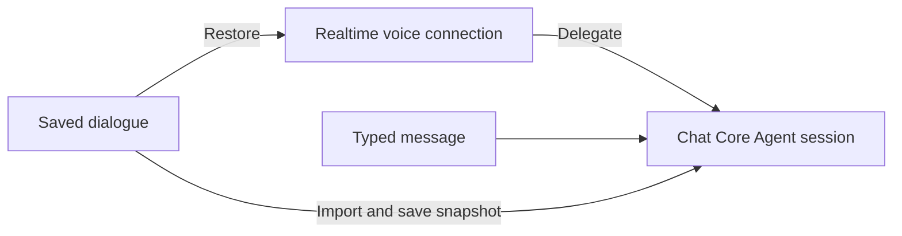

# Full-duplex conversation continuity

Enable Full-duplex in the experimental settings and start it from a saved Agent chat.
The blue controller stays available when you switch chats or open Settings. Voice and
Core Agent results remain attached to the chat where you started the session. Starting
Full-duplex in another chat replaces the previous media session. Use Exit to stop it.

Drag the blue ball with a mouse or touch to move the controller. It stays within the
window. The sharing indicator and Close button move with it. Close stops video sharing
while voice continues. Microphone mute and speaker mute remain separate controls.

The realtime voice model has a separate connection. Delegated Core Agent work and
typed messages use the saved chat's Core Agent session. Saved voice dialogue is imported
into that context before a typed turn and written to the live session snapshot so that
ReAct does not overwrite it with older context. Active Core Agent work must finish
before another typed request can use the same execution session.

On restart, recent turns and bounded, source-backed excerpts of older history restore
references and user constraints. Task status is read separately from current task state.
Qwen receives this background during session initialization; JoyAI receives it on real
user turns, with refreshed task status. Restoration does not repeat historical requests
or task acceptances. Text and audio accompanying a Qwen tool call are withheld; the
actual acceptance receipt supplies the acknowledgement.

Qwen may close a connection with `response_idle_timeout` after 300 seconds without a
generated response. Full-duplex automatically renews that connection, restores context,
and retains sharing and mute settings. Renewal does not generate a keepalive answer or
replay an old tool call. A running task's later result can be announced once on the new
connection. Exit or a replacement session cancels pending renewal. Authentication,
quota and ordinary network errors still use the normal error path.
