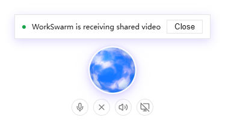
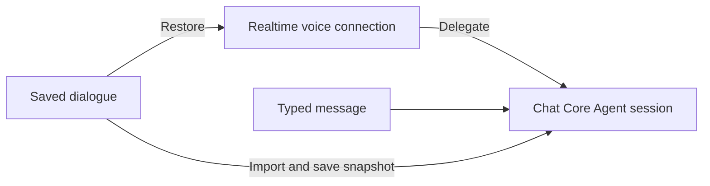
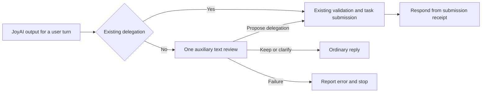
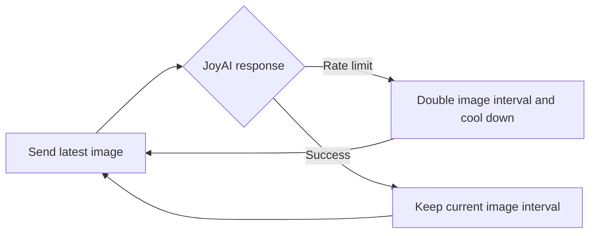
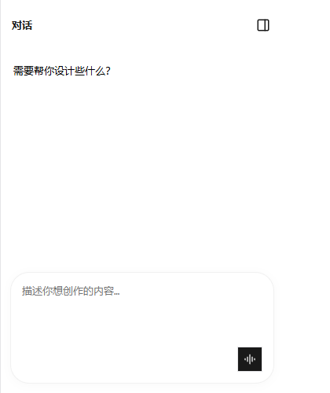
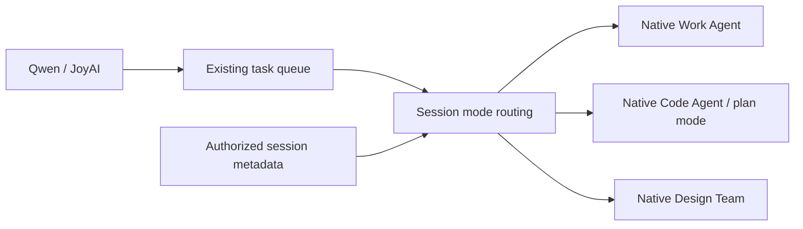
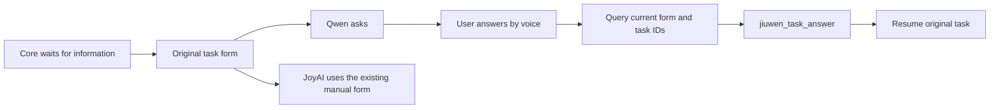

# Full-duplex conversation continuity

Enable Full-duplex in the experimental settings and start it from a saved Work or Code chat, or a Design project.
The blue controller stays available when you switch chats or open Settings. Voice and
Core Agent results remain attached to the chat where you started the session. Starting
Full-duplex in another chat replaces the previous media session. Use Exit to stop it.

With screen sharing enabled, starting Full-duplex opens the system screen or window picker directly.
This entry point supports screen sharing only.

Drag the blue ball with a mouse or touch to move the controller. It stays within the
window. The sharing indicator and Close button move with it. Close stops video sharing
while voice continues. Microphone mute and speaker mute remain separate controls.

With a mouse, hover over the controller to show the sharing indicator and controls.
They remain visible on touch screens. For a file created by a delegated voice task,
Core Agent verifies the file and delivers it with `send_file_to_user`. A delivered
file appears in the original conversation's artifacts. Follow-up questions about its
location use the path from the file receipt; mentioning a path alone does not deliver it.

The realtime voice model has a separate connection. Delegated Core Agent work and
typed messages use the saved chat's Core Agent session. Saved voice dialogue is imported
into that context before a typed turn and written to the live session snapshot so that
ReAct does not overwrite it with older context. Active Core Agent work must finish
before another typed request can use the same execution session.

While Full-duplex is active, final root Core replies in the same conversation, including
text requests and background replies, enter the voice result queue. Core writes the spoken
summary; reasoning deltas, tool progress and member output are not announced individually.
Summaries use fixed delimiters rather than task IDs written by the model. Transport-level
conversation, request and media-session identities still route and deduplicate results.
Delegated tasks retain their existing delivery path. Exit or replacement stops the old
subscription; Qwen renewal temporarily holds new receipts.
If a new spoken turn begins while a tool runs, the earlier receipt is announced as
a separate notice without referencing an expired Qwen function call ID.

On restart, recent turns and bounded, source-backed excerpts of older history restore
references and user constraints. Task status is read separately from current task state.
Qwen receives this background during session initialization; JoyAI receives it on real
user turns, with refreshed task status. Restoration does not repeat historical requests
or task acceptances. As a temporary latency policy, both text and audio stream once
`response.output_item.added` identifies a `message`
item. A `function_call` item suppresses only output not yet identified as a message;
message text and audio continue in the same response or another response for the same input.
Execution still waits for complete, validated arguments. Both the initial message and
the acknowledgement based on the actual acceptance receipt may be spoken.
Text updates share one stream and finalize once; interruption, failure and stopping
media also close any visible partial text.
When item types are missing, text and audio retain the response-completion buffering fallback.

Qwen may close a connection with `response_idle_timeout` after 300 seconds without a
generated response. Full-duplex automatically renews that connection, restores context,
and retains sharing and mute settings. Renewal does not generate a keepalive answer or
replay an old tool call. A running task's later result can be announced once on the new
connection, including results received while replacement configuration is loading.
Exit or a replacement session cancels pending renewal and its queued notifications. Authentication,
quota and ordinary network errors still use the normal error path.

After Qwen reports that speech has stopped, image sending pauses and any buffered frame
is discarded. Images resume when the next speech turn starts. A rejected image frame
remains in diagnostics while the voice session continues.

If saving voice history fails, a restart or typed turn reports the error and stops before
sending the new request. Failed events stay in memory in their original order and use
the same event IDs on retry. Retry after storage recovers; pending writes do not survive
a page reload. Distinct turns with identical text remain separate in restored history.

JoyAI refreshes an expired context token in the same authorized chat and retries the
unexecuted user request once. Cancellation or session replacement stops that retry.
Authorization failures and errors after inference begins are not replayed.

JoyAI tool JSON must follow `</delegation>`. A real user turn without a delegation is
reviewed once by an auxiliary text model before speech. This includes unsupported action
promises, tool JSON in spoken text and empty delegations. Using the original request,
restored context and current task state, the reviewer keeps the answer, asks a clarification
or proposes a new `jiuwen_delegate`. Passive image polling and existing delegations skip
review. Task management and approvals must not become new tasks through this helper.
The reviewer receives no audio or images and executes no tools.

By default, it reuses the first usable configured text model. Set `JOYAI_ACTION_HELPER_MODEL`
in `.env` to an existing model's stable ID, alias or unique model name to select another
connection, then restart. Credentials are reused from that connection. Review has an
8-second timeout and no automatic retry. Timeout or validation failure returns
`JOYAI_ACTION_HELPER_ERROR`, withholds the original action promise and does not reduce
JoyAI's image transmission rate.

The helper proposes a tool and replacement utterance. Submission preserves the complete
original request and uses its command ID for deduplication through existing validation
and the task queue. Only an actual submission receipt releases an acknowledgement that
the result is pending; premature success claims from the reviewer are discarded. The
Core receipt supplies the actual outcome of creating an alarm or other requested effect.

JoyAI's connection test sends a text request with at most 8 output tokens using the
saved model, the actual completion endpoint and its request headers. It does not
require a `/models` endpoint. Each test uses a separate session without uploading
audio or images or changing the active conversation. Provider charges and rate limits
may apply to the test request.

When JoyAI reports a rate limit, the client waits 60–300 seconds before retrying with
the latest image. Each rate limit doubles the image interval from 1 second, up to
300 seconds. Success keeps the reduced rate; restarting Full-duplex restores the default.
Pending user instructions are retained during cooldown without queuing old images.
After sharing stops, voice-only turns still respect quota cooldown but do not wait for
the image interval. Ordinary network failures do not reduce the rate. Slower transmission
reduces request pressure; it cannot resolve exhausted credit or insufficient account quota.

## Work, Code and Design modes

Work and Code use the Full-duplex button in the chat input. Code tasks retain the chat's
project directory and execution mode, including plan mode. In Design, start from the
conversation panel of an existing project with a bound canvas. Starting waits for the
canvas to save. The Design landing page also supports direct Full-duplex startup: it
creates and binds an empty saved canvas and Design session, opens the Design page, then
starts media. No typed message or invented creative request is needed. Creation failure
does not start media; retry after correcting the error.

The server selects execution from session metadata owned by the current user. Realtime
tool arguments cannot change the mode or project. Acceptance saves the execution target;
execution checks it again. If the mode or project changes while queued, the task fails
and must be submitted again. Answers and cancellation retain the original task's session,
mode and project.

The existing queue, controller and media connections are reused. The Design assistant
uses native design tools in the current project. Voice and text share the Design session;
later typed turns also receive recent saved voice context. Native question cards remain
answerable. Voice answers and cancellation use the current task binding, so a stale
cancellation cannot stop a later turn.
Approval cards (permission approvals, cua desktop confirmations and similar) must be
clicked on screen (Allow or Reject); voice cannot approve or reject them. While a task
waits on one, the assistant explains what the card is for and asks you to click it,
without claiming it was allowed. While the card is open, voice stops listening and the
microphone button is disabled, the same way the text input is locked; once you click the
card, the microphone returns to the state you had chosen.
Voice tasks retain their own per-round result subscription even when the Design page
already has a subscription. Canvas, node, run and assistant activity updates use the
saved Design session's Web channel, so the page does not need a refresh.

Completion or cancellation of a voice Design task refers to the assistant's current turn.
Independent canvas generation stays under the native Design workflow. Finishing a reply
does not prove rendering has finished; cancelling the assistant does not cancel all canvas
generation. Tests cover routing, bindings, answers, cancellation and the UI entry. They
use test substitutes; live Agent canvas operations are checked separately on the local
service. These checks do not establish the reliability of external image or video generation.

All three modes share the summary protocol, answer parser and receipt contract in
`core_receipts.py`. Active Full-duplex sessions receive the summary policy through the
runtime system prompt, without adding it separately to text and delegated requests.
For standalone video tools without an active subscription, the server request entry
adds the compatibility prompt once. Native replies and managed tasks retain their
event channels but share receipt conversion. The frontend consumes the backend brief
without building another fallback from the answer body. Durable voice history loading
and filtering are shared; Agent and Design Team retain native context insertion.
If a summary is missing, the backend preserves Core's actual answer instead of replacing
it with a generic success claim.
Long-lived Design text streams observe later managed tasks without publishing a second
voice receipt for those tasks.
Final replies that omit the closing summary marker use the same length and format
validation, so the marker does not enter speech output.

## Task names, artifacts and control receipts

Without an image, JoyAI sends the user's speech transcript or typed instruction directly
without waiting for another frame. It does not poll with empty images while idle.
Stopping sharing does not resend old screenshots; the model is told there is no current
image. Sharing again resumes the existing video flow.
JoyAI user turns begin with an explicit action protocol: external facts and actions
require Core delegation, while direct replies need a `response` marker. Unmarked output
is withheld from display and speech, corrected at most once, then reported as an error
if still invalid. Newlines do not split response and delegation actions within one output.
Core summaries are written to the conversation and queued for speech once per task;
JoyAI does not generate another summary.
While Qwen Full-duplex is active, it asks pending information-form questions
about time, content and parameters aloud. They collect the user's spoken answers,
ask for missing fields and query the current interaction before submitting through
`jiuwen_task_answer`. Answers resume the original task without another delegation.
Duplicate notices do not repeat questions; other sessions and replay notices do not
trigger speech. Native forms remain available for manual input. Permission and
operation approvals keep their existing UI.
JoyAI does not ask or answer information forms by voice. Users complete the existing
on-screen forms, and the server rejects JoyAI `jiuwen_task_answer` requests. Ordinary
voice conversation, task management and Core summaries in text and speech remain available.
Completion notices retain the Core invocation's `job_id`. Resource IDs inside result
text belong in follow-up instructions and cannot replace the invocation ID. If a
target is absent from the current conversation, the backend returns a tool rejection
without performing an action. The realtime model should query the current conversation
to identify the target. It must not infer deletion, recreate resources or access another
conversation from that rejection.

Full-duplex Work tasks use the normal conversation tool event parser, preserving
actual skill arguments, skill trees, and tool status. Artifacts consume both streamed
file events and final receipt files, deduplicate by file identity, and persist in
conversation history. Artifacts with local paths are registered as generated assets
in their owning conversation, including after navigation or media stop. References
use the normal recorded skills; paths mentioned only in answer text are not artifacts.

Completed tasks can still be revised through a linked Core follow-up carrying the
original result and context. Further actions on existing results may also be delegated
to Core; completion alone is not grounds to refuse. Qwen and JoyAI share this general
rule. Only confirmed Core results prove that a requested change is complete.

The task board prefers a short action-and-object title submitted with the delegation.
Complete requirements are stored separately. Goal changes may supply an updated title;
completed-task revisions name only the successor. Queries match both title and original
requirements. Older or untitled tasks retain their original requirement as the label.
Titles are display metadata and never replace execution instructions.
For continuous Qwen speech, the server rejects a delegation that clearly diverges
from a complete current utterance and asks the model to retry. Short follow-up answers
can still use prior context. If only the title diverges, the board shows the original
request. Interruption waits for a response ID before sending cancellation.
Qwen may emit text and audio before a tool item within the same response. The response
start has no tool-call flag. The client no longer holds messages based on action keywords
or discards their audio after a tool call. Initial replies and tool receipts may both stream.
This change releases model-generated audio; it does not synthesize speech for text-only output.

Stopping execution differs from undoing its effects. A completed execution does not
prevent a user-requested follow-up on its results. Tool-receipt responses may send
the full action to Core through modification or delegation; completed effects are
never rolled back automatically.

Voice cancellation of a completed invocation, when accompanied by the original user
utterance, reuses the modification flow to create a linked Core follow-up retaining
the original result and full cancellation intent. The receipt reports `state=followup`
and `converted_to=modify`, confirming acceptance only. Repeated requests reuse the
same successor. Unfinished invocations retain normal cancellation; legacy or UI
requests without a user utterance never create follow-up actions automatically.

CUA cancellation waits for the exact execution to finish cleanup before reporting
`cancelled`. A delayed invocation cancelled before admission must not start Core.
If cleanup cannot be confirmed within 90 seconds after the stop response, the task
becomes `unknown`; this does not confirm that execution stopped.
Voice queue changes publish the same authoritative snapshot as interface controls.
Queue versions increase across scheduling changes and restarts, so delayed snapshots
cannot restore an older order. A query reports state without changing the queue.
Voice reordering first resolves exact waiting task IDs. The model may omit the queue
version; the server reads the current value and checks it when applying the move.
An invalid model version is ignored, while a valid stale version still conflicts.
Control diagnostics are saved in `~/.jiuwenswarm/logs/duplex-task-trace.jsonl` to
correlate requests, cancellation settlement, queue versions and interface updates.
