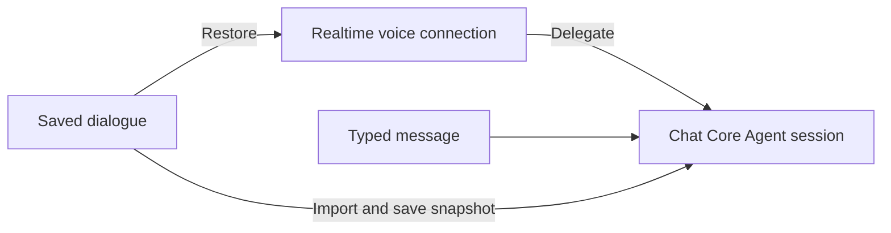
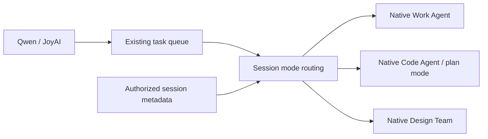

# Full-duplex conversation continuity

Enable Full-duplex in the experimental settings and start it from a saved Work or Code chat, or a Design project.
The blue controller stays available when you switch chats or open Settings. Voice and
Core Agent results remain attached to the chat where you started the session. Starting
Full-duplex in another chat replaces the previous media session. Use Exit to stop it.

Drag the blue ball with a mouse or touch to move the controller. It stays within the
window. The sharing indicator and Close button move with it. Close stops video sharing
while voice continues. Microphone mute and speaker mute remain separate controls.

The realtime voice model has a separate connection. Delegated Core Agent work and
typed messages use the saved chat's Core Agent session. Saved voice dialogue is imported
into that context before a typed turn and written to the live session snapshot so that
ReAct does not overwrite it with older context. Active Core Agent work must finish
before another typed request can use the same execution session.

On restart, recent turns and bounded, source-backed excerpts of older history restore
references and user constraints. Task status is read separately from current task state.
Qwen receives this background during session initialization; JoyAI receives it on real
user turns, with refreshed task status. Restoration does not repeat historical requests
or task acceptances. As a temporary latency policy, both text and audio stream once
`response.output_item.added` identifies a `message`
item. A `function_call` item suppresses subsequent output; execution still waits for
complete, validated arguments and acknowledgement follows the actual acceptance receipt.
If a message is followed by a tool call, text already shown and speech already played
cannot be retracted. Text updates share one stream and finalize once; tool calls,
interruption, failure and stopping media also close any visible partial text.
When item types are missing, text and audio retain the response-completion buffering fallback.

Qwen may close a connection with `response_idle_timeout` after 300 seconds without a
generated response. Full-duplex automatically renews that connection, restores context,
and retains sharing and mute settings. Renewal does not generate a keepalive answer or
replay an old tool call. A running task's later result can be announced once on the new
connection, including results received while replacement configuration is loading.
Exit or a replacement session cancels pending renewal and its queued notifications. Authentication,
quota and ordinary network errors still use the normal error path.

If saving voice history fails, a restart or typed turn reports the error and stops before
sending the new request. Failed events stay in memory in their original order and use
the same event IDs on retry. Retry after storage recovers; pending writes do not survive
a page reload. Distinct turns with identical text remain separate in restored history.

JoyAI refreshes an expired context token in the same authorized chat and retries the
unexecuted user request once. Cancellation or session replacement stops that retry.
Authorization failures and errors after inference begins are not replayed.

## Work, Code and Design modes

Work and Code use the Full-duplex button in the chat input. Code tasks retain the chat's
project directory and execution mode, including plan mode. In Design, start from the
conversation panel of an existing project with a bound canvas. Starting waits for the
canvas to save. A blank Design landing page needs a project and conversation first.

The server selects execution from session metadata owned by the current user. Realtime
tool arguments cannot change the mode or project. Acceptance saves the execution target;
execution checks it again. If the mode or project changes while queued, the task fails
and must be submitted again. Answers and cancellation retain the original task's session,
mode and project.

The existing queue, controller and media connections are reused. The Design assistant
uses native design tools in the current project. Voice and text share the Design session;
later typed turns also receive recent saved voice context. Native question cards remain
answerable. Voice answers and cancellation use the current task binding, so a stale
cancellation cannot stop a later turn.

Completion or cancellation of a voice Design task refers to the assistant's current turn.
Independent canvas generation stays under the native Design workflow. Finishing a reply
does not prove rendering has finished; cancelling the assistant does not cancel all canvas
generation. Tests cover routing, bindings, answers, cancellation and the UI entry. They
do not call a live model or an external canvas generation service.
