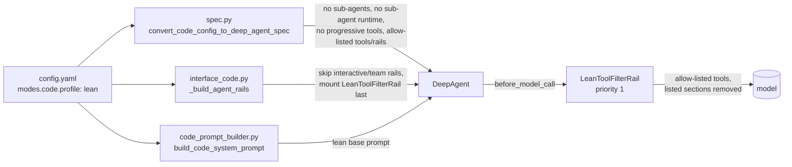

# Lean coding profile

`modes.code.profile: lean` is a Code-mode profile for **headless coding**: the
implement driver, benchmark harnesses and CI jobs. It shows the model only the
tools a coding task needs and removes prompt text about interactive, team and
delegation features. The default profile is unchanged; desktop, TUI and Web
users see no difference unless they opt in.

中文版：[精简编码模式](../zh/精简编码模式.md)

## 1. Why

Every model call in Code mode carries a fixed part (system prompt plus tool
schemas) and a growing part (history and tool results). Measured on this branch
with one headless turn (`scripts/measure_code_prompt.py`, tiktoken
`cl100k_base`):

| Profile | System prompt | of which skills catalogue | Tool schemas | Tools shown | Fixed tokens per call |
|---|---|---|---|---|---|
| default | 36,648 chars / 7,862 tokens | 130 chars | 46,779 chars / 13,313 tokens | 21 | **21,175** |
| lean | 22,255 chars / 4,798 tokens | 0 | 15,757 chars / 4,457 tokens | 6 | **9,255** (−56%) |

Default tools: `fetch_webpage, read_file, write_file, edit_file, glob, grep,
bash, subagent_spawn, subagent_wait, subagent_list, subagent_send_input,
subagent_close, subagent_resume, task_tool, skill_tool, tool_search, tool_call,
todo_create, todo_list, todo_get, todo_modify`.
Lean tools: `read_file, write_file, edit_file, glob, grep, bash` (plus
`run_tests`, `code_search`, `find_symbol`, `symbol_outline` when a build has them).

The default figure depends on the installed skills catalogue: this measurement
had a 130-character catalogue; a review run on a data dir with a 6,099-character
catalogue measured 23,385 → 9,263 fixed tokens (−60%). The lean figure does not
change, because lean drops the catalogue.

In the SWE-bench Pro pilot and the wave-1 A/B runs the agent used essentially
only `bash`, `read_file`, `edit_file`, `grep`, `write_file` and `glob`
(one `code_search` and one `symbol_outline` call in ~860). A task makes about
40 model calls, so the fixed part is paid about 40 times: at ~12k fewer tokens
per call this is roughly 0.5M tokens per task.

## 2. How it works

Nothing in agent-core is modified. The profile uses three jiuwenswarm-owned
places and one public rail hook.



1. **Spec conversion** (`jiuwenswarm/agents/harness/code/spec.py`): builds no
   sub-agent bundle and turns the sub-agent runtime off (removes `task_tool`
   and `subagent_*`), turns progressive tool disclosure off (removes
   `tool_search`, `tool_call` and the deferred-tool catalogue prompt), and keeps
   only allow-listed entries of `modes.code.tools` and `modes.code.rails`
   (drops web tools, `skill_toolkit`, `SkillUseRail`, `WorktreeRail`).
2. **Rail assembly** (`JiuwenSwarmCodeAdapter._build_agent_rails`): fixed rails
   listed in `skip_rails` are not built; their adapter attributes are set to
   `None`, exactly as when a builder fails, because other adapter code reads
   them. `LeanToolFilterRail` is appended last.
3. **LeanToolFilterRail** (`jiuwenswarm/agents/harness/code/lean_profile.py`)
   runs at priority 1, after every other rail, in the public `before_model_call`
   hook. It keeps only allow-listed tools in `ctx.inputs.tools` and removes the
   listed `PromptSection`s from the agent's system prompt builder. Tools stay
   registered; the model just does not see them. This also covers tools other
   code registers later: in the measurement it hid 16 of them (`cron*`,
   `coding_memory_*`, `get_current_goal`, `submit_goal_report`, `list_files`,
   `switch_mode`, `user_todos`) that would otherwise surface once progressive
   disclosure is off. Any exception is logged and the turn continues unchanged.
4. **Base prompt** (`code_prompt_builder.build_code_system_prompt("lean")`):
   the same sections without the sub-agent routing paragraph, the todo
   sub-section, the `list_files` mention and the `ask_user` escalation sentence.
   `build_code_system_prompt()` (default) is byte-identical to before.

Kept in the lean profile: runtime/response prompts, security, heartbeat,
permission interrupts, filesystem (`SysOperationRail`), **project memory**
(`AGENTS.md`/`CLAUDE.md` project instructions), agent-mode handling, context
processing and offload recovery, and the three completion rails of this branch
(`CodeExecutionDisciplineRail`, `ImplementCompletenessRail`,
`CodeCompletionGateRail`).

### Tool-by-tool map

| Tool(s) | Registered by (jiuwenswarm side) | Lean profile |
|---|---|---|
| `read_file`, `write_file`, `edit_file`, `glob`, `grep`, `bash` | `SysOperationRail` via `_build_filesystem_rail` | kept |
| `list_files` | same rail (deferred under progressive disclosure) | hidden by filter |
| `fetch_webpage` (and other web tools) | `modes.code.tools` → `_TOOL_BUILD_NAMES` | dropped from spec |
| `skill_tool` + skills catalogue | `SkillUseRail` in `modes.code.rails` | dropped from spec (`rails_allow`) |
| `skill_retrieval` tools / prompt | `modes.code.tools`, `_skill_retrieval_prompt_rail` | dropped / rail skipped |
| `task_tool`, `subagent_*` | code sub-agent bundle + `_subagent_rail` | no sub-agents, runtime off, rail skipped |
| `tool_search`, `tool_call` | progressive disclosure (`ProgressiveToolSpec`) | disabled in spec |
| `todo_create/list/get/modify` | `_code_task_planning_rail` | rail skipped |
| `ask_user` | `_code_ask_user_rail` | rail skipped |
| plan approval interrupt | `_code_plan_approval_rail` | rail skipped |
| `coding_memory_*` | `_coding_memory_rail` (and memory config) | rail skipped, hidden by filter |
| `lsp` | `_lsp_rail` | rail skipped |
| `cron*`, goal tools, `switch_mode`, `user_todos` | adapter-level registration, `AgentModeRail`, confirm-interrupt rail | hidden by filter |

## 3. Configuration

All keys live under `modes.code` in `config.yaml` (and the two distributed team
templates).

| Key | Default | Meaning |
|---|---|---|
| `profile` | `default` | `default` = current behaviour; `lean` = this profile. Unknown values fall back to `default` with a warning. |
| `lean.tools_allow` | `[read_file, write_file, edit_file, bash, grep, glob, run_tests, code_search, find_symbol, symbol_outline]` | Tools the model may see. Names that are not registered are ignored (one WARNING lists them on the first call). If no name matches any registered tool, the unfiltered list is kept and a WARNING is logged, so a typo cannot leave the model without tools. `run_tests` comes from the verification-loop MR. |
| `lean.rails_allow` | `[]` | Dynamic rails from `modes.code.rails` that stay mounted. |
| `lean.skip_rails` | code default (see `DEFAULT_SKIP_RAILS`) | Fixed rails (their `_RailBuildInfo` attribute names) that are not built. |
| `lean.drop_prompt_sections` | code default (see `DEFAULT_DROP_PROMPT_SECTIONS`) | Prompt sections removed before every model call. |
| `lean.disable_subagents` | `true` | No sub-agents and no sub-agent runtime. |
| `lean.disable_progressive_tool` | `true` | No `tool_search` / `tool_call` progressive disclosure. |
| `lean.log_sections` | `true` | On the first model call, log kept/dropped tools and remaining prompt sections with their sizes. |

Turning it off: set `profile: default` (or remove the key). Each `lean.*`
switch can also be relaxed individually, e.g. `disable_subagents: false` keeps
sub-agents while still hiding the other tools.

### Selecting it for headless runs

The process CLI reads the same `config.yaml` as every other entry point, so a
headless run only needs the key in its data dir:

```yaml
modes:
  code:
    profile: lean
```

For a headless process run, pass it as an override:

```bash
jiuwenswarm-process --implement ... --set modes.code.profile=lean
```

## 4. How to confirm it is working

Agent-server log (`<data dir>/agent/.logs/agent_server.log` / `full.log`) at
session start and first model call:

```text
[JiuwenSwarmCodeAdapter] lean coding profile: skipped rails=['_skill_retrieval_prompt_rail', '_symphony_orchestration_rail', '_session_messaging_route_rail', '_lsp_rail', '_coding_memory_rail', '_code_ask_user_rail', '_code_task_planning_rail', '_code_agent_rail', '_code_plan_approval_rail', '_subagent_rail']
[LeanToolFilterRail] tools kept=['bash', 'edit_file', 'glob', 'grep', 'read_file', 'write_file'] dropped=['coding_memory_edit', ..., 'switch_mode', 'user_todos']
[LeanToolFilterRail] prompt sections removed=['memory', 'memory_forbidden'] remaining(chars)={'identity': 13968, 'safety': 770, 'offload': 776, 'env': 922, 'directory_boundaries': 2614, 'input': 546, 'output': 2647}
```

With `react.context_engine_config.enable_context_debug: true` the exact request
is dumped to `<workspace>/context/<session>_context/context_debug/llm_request.jsonl`;
`scripts/measure_code_prompt.py --data-dir <initialised data dir>` automates
this for both profiles and prints the table in section 1 (one short model call
per profile, about $0.01 with deepseek-flash).

## 5. Limitations

- The per-call saving is on the **fixed** part only. History and tool results
  are unchanged (see the context-diet work for that part).
- Tool **descriptions** that agent-core owns (for example `bash` at ~7.7k
  characters) keep their length; the profile only decides which tools are shown.
- The swarm/team assembly path (`agents/swarm/providers`) is not switched by this
  profile; it applies to the Code adapter used by the process CLI, TUI, Web and
  desktop.
- The filter controls what the model is shown; it does not block execution.
  Hidden tools remain registered, so a call to one by name would still be
  dispatched. Models call the tools they are given, but this is visibility, not
  a permission boundary (use tool permissions for that).
- Sections are removed by name. A rail that renames its section needs the new
  name added to `drop_prompt_sections`.
- Two shared jiuwenswarm sections are **pruned, not dropped**: the "Installed
  Extension Assets" block of `directory_boundaries` and the "System Messages"
  (cron/notify) block of `input` are removed in lean mode, while the rest stays —
  `directory_boundaries` also carries the "do not write into Agent internal data"
  rules (including the `todo/` line), and `input` describes the user-message
  format. Pruning is marker-based (`LEAN_PRUNE_BLOCKS`); if a marker changes, the
  block is simply kept.
- The lean prompt generators edit the default Code sections by marker; if a
  heading or sentence changes upstream they log a WARNING and keep the text
  instead of failing agent creation.
