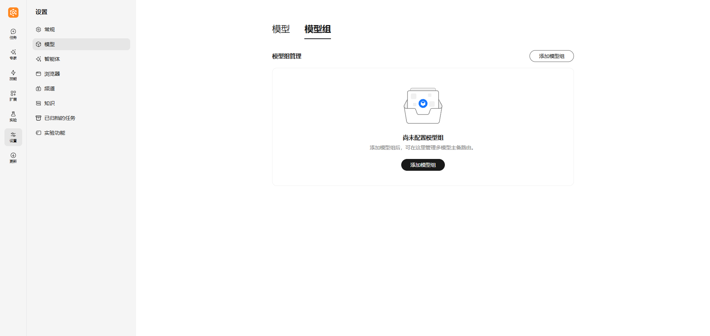
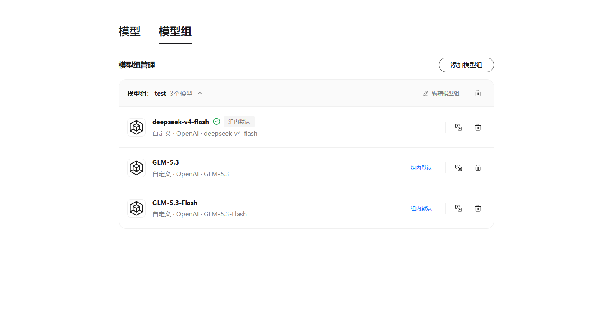
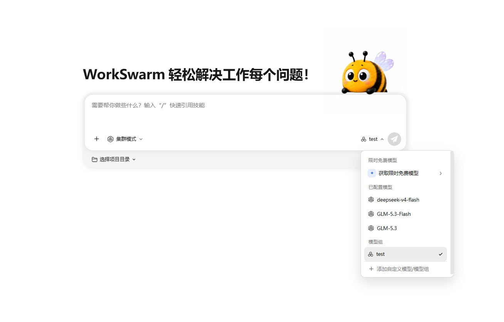
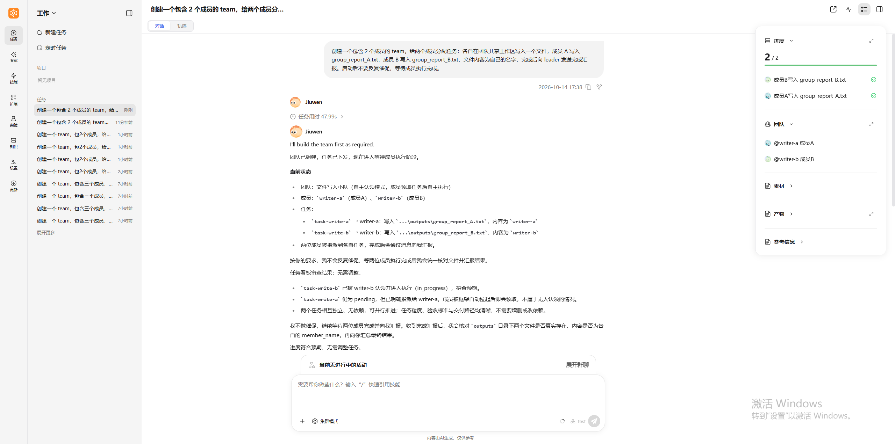
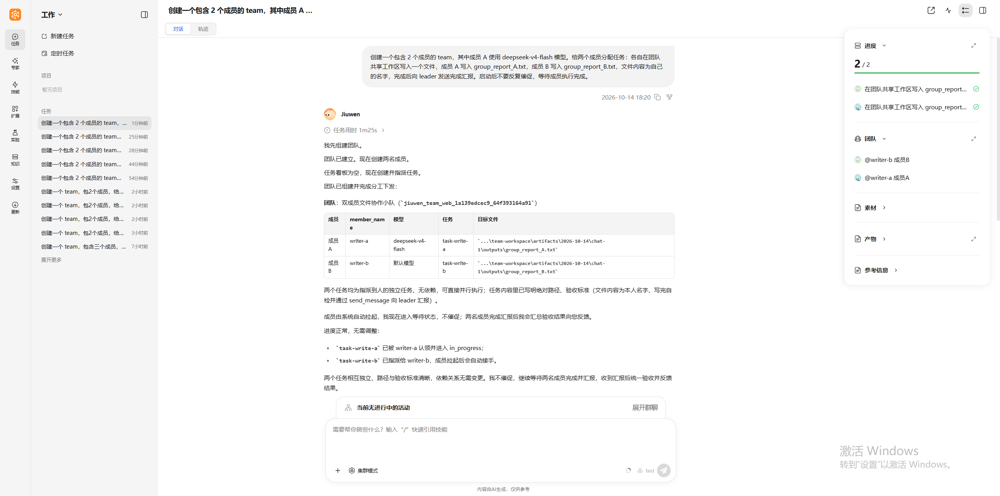

# Model Groups

> **Goal**: Help readers understand the model group feature of JiuwenSwarm, learn how to create, edit, and delete model groups, and how to use model groups in Cluster Mode along with their failover rules.
>
> **Chinese version:** [模型组](../zh/模型组.md)

---

## 1. Overview

A model group combines multiple configured models into a single unit for management and invocation. It currently serves Cluster Mode only. You can add multiple models to the same model group and decide the order in which they are called. When a team runs a task and the current model call fails, the system automatically switches to the next model in the group, so the task is not interrupted by a single model failure.

### 1.1 Key Concepts

| Concept | Description |
|------|------|
| **Model group** | A set of one or more configured models that can be selected as a whole in Cluster Mode |
| **Member model** | A single model in a model group. It must be a custom model configured in the **Models** tab |
| **Group default** | The first model in the model group. The team uses this model first |
| **Call order** | The order of member models in the group. The higher a model is ranked, the higher its call priority |
| **Failover** | When the current model call fails, the system automatically switches to the next model in call order |

### 1.2 Use Cases

- **Primary/backup redundancy**: Add the same model from different providers to one model group. If the primary model fails, the team automatically switches to the backup model and continues the task
- **Rate limit handling**: Team members calling models at the same time can easily trigger rate limits. A model group automatically switches to another model when one is rate limited
- **Unified management**: Manage frequently used models in one model group and use them all with a single selection in Cluster Mode

---

## 2. Configuration and Usage

### 2.1 Add and Manage Model Groups

> ⚠️ **Prerequisite**: Add at least one custom model in the **Models** tab first (see [Configuration](./Configuration.md)). Limited-time free models cannot be added to model groups.

1. Open **Settings** → **Models**, switch to the **Model groups** tab, and click **Add model group**
2. Enter a **Model group name**, then click **Add model** and select member models from the drop-down list (plan-based models are selected from the "Provider–Plan" submenu). You can add multiple models
3. Drag rows to adjust the order, or click **Make group default** on a row to move it to the top, then confirm to save



> 💡 **Tip**: The order is the call order, and the first model is the group default. We recommend placing the most stable and frequently used model first.

After saving, the model group is displayed as a card. Click the card title to expand the member list, where you can run **Make group default**, **Test connection**, or **Remove from group** on each member. A model group must keep at least one model.



### 2.2 Edit and Delete Model Groups

In the upper-right corner of the model group card:

- **Edit**: Click **Edit model group** to rename the group, add, remove, or replace member models, and adjust the call order
- **Delete**: Click the delete icon and confirm. If the model group is being used by a Team task, switch that task to another model or model group first before deleting

> ⚠️ **Note**: If a member model shows **Model unavailable**, the model it references has been deleted or is no longer valid in the **Models** tab. Edit the model group to replace or remove it.

### 2.3 Use Model Groups in Cluster Mode

1. Switch to Cluster Mode. For details, see [Modes](./Modes.md)
2. Click the model selector near the chat input box and select the target model group under the **Model groups** category
3. Send a task



If no models are available in the model selector, click **Add Custom Model/Model Group** to go to the settings page.

By default, all team members use the group default model. If that model call fails, the system automatically switches to the next model in order. To have a specific member use another model in the group, simply state it in the task. Only models in the current model group can be specified. If the specified model is not in the group, the Leader will ask you to confirm first instead of substituting one on its own.

**Example**

After selecting a model group, send:

```text
Create a team with 2 members and assign them tasks: each member writes a file in the team shared workspace. Member A writes group_report_A.txt and member B writes group_report_B.txt, with their own name as the file content. When done, report completion to the leader. After starting, do not keep urging; wait for the members to finish.
```



You can also specify that a member uses a particular model in the group. For example, to have member A use deepseek-v4-flash:

```text
Create a team with 2 members, where member A uses the deepseek-v4-flash model, and assign them tasks: each member writes a file in the team shared workspace. Member A writes group_report_A.txt and member B writes group_report_B.txt, with their own name as the file content. When done, report completion to the leader. After starting, do not keep urging; wait for the members to finish.
```



### 2.4 Failover and Errors

When the team calls a model, it uses the group default model first. If a model in the group fails, the system temporarily skips it and automatically switches to the next model in order, with no manual action needed:

```text
Model A (group default) -> Model B -> Model C
```

- **Automatic switching**: The team switches to the next model and continues when the model service has a temporary problem (such as a network connection failure, response timeout, rate limiting, or server error) or when the model is misconfigured (such as a wrong API key or model name)
- **Temporary skipping**: A failed model is temporarily disabled, and the system tries it again after a while. If it keeps failing, the disabled period gets longer each time
- **Error mid-response**: If an error occurs after the model has started outputting a reply, the system does not switch. The output already produced is kept, and the reply ends with an error
- **All models fail**: If no model in the group is available, the call returns an error

> 💡 **Tip**: A misconfigured model keeps being skipped, but the interface may not show an error. After saving a model group, we recommend running **Test connection** on each model in the group to make sure they all work.

---

## Navigation

- [Back to documentation home](../README_EN.md)
- [Back to project home](../../README.md)
