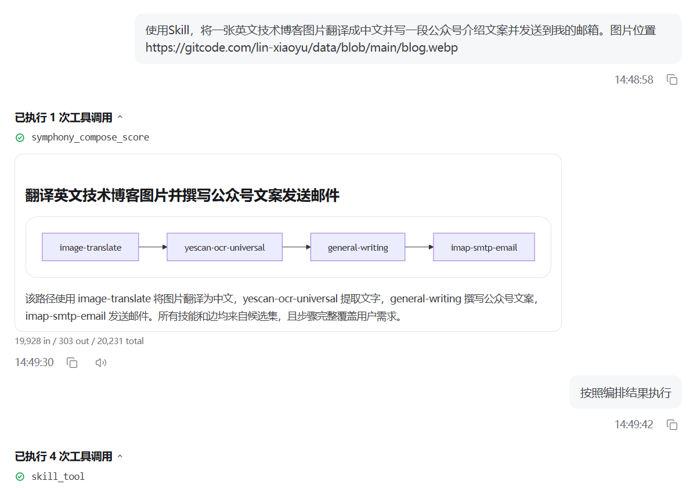

# Symphony: Skill Retrieval, Orchestration, and Dispatch
---

## Concepts

### What is Symphony?

Symphony is JiuwenSwarm's mechanism for skill retrieval, orchestration, and dispatch across a large set of installed skills. It answers two questions: **how to find the right skills**, and **how to use them together**.

- **Skill Retrieval** answers "how to find": it organizes a flat skill list into a browsable skill tree so the agent can explore likely branches and find candidate skills.
- **Skill Orchestration** answers "how to use": it uses candidate skills, input/output structures, and skill dependencies to produce a confirmable, executable skill chain.

You can think of Symphony as a two-part design: **a tree for retrieval, a graph for orchestration**. If a task only needs one clearly named skill, use the normal skill workflow. Symphony is meant for tasks that need the agent to find skills, check whether they can connect, and then form an execution route. In Team / Cluster Mode, that route can also guide how the Leader dispatches follow-up work.

#### Find candidate skills with Skill Retrieval

Skill Retrieval is JiuwenSwarm's skill-directory retrieval feature for environments with a **large number of installed skills**.

When only a few skills are installed, the agent can often inspect the skill list directly. When dozens or hundreds of skills are installed, injecting every skill into the prompt causes two common problems:

| Problem | Impact |
|---------|--------|
| High context usage | User tasks, files, and conversation history have less room |
| Attention dilution | The model may focus on irrelevant skills and miss the right one |

Skill Retrieval builds a local **installed-skill tree index** and exposes directory-browsing tools at runtime. The agent can inspect likely branches step by step, then decide which `SKILL.md` files to read.

#### Build an execution route with Skill Orchestration

If Skill Retrieval answers "which skills should participate", Skill Orchestration answers "how should they work together". For example, a task such as "recognize text from an image, translate it, write copy, and send an email" usually cannot be completed by one skill alone. Candidate skills need to be arranged into a stable route based on input/output dependencies.

Skill Orchestration builds an executable route from the task goal, current inputs, candidate skills, and connectable relationships in the skill graph. When an input is missing, the system can look backward through the graph for an upstream skill that may provide it. After the route is confirmed, JiuwenSwarm continues with the actual skill execution.

The important part is not listing skills in order. Skill Orchestration checks whether upstream results can actually feed downstream skills. Connectable relationships, input/output structures, and task semantics all affect the final route. The result is not just a set of "related" skills, but a skill chain whose dependencies can be explained, confirmed, and executed.

The skill graph is the relationship graph used by orchestration. Each node represents a skill. Each edge means one skill's output can be used as another skill's input, in other words, a connectable relationship. It helps users understand possible skill combinations and gives orchestration candidate relationships to work from.

#### Improve orchestration from actual usage

When **Dynamic Graph** is enabled, Core Symphony Observation collects execution evidence and produces runtime graph snapshots. Flow distills successful skill combinations that meet its thresholds into candidate skill packages. JiuwenSwarm reviews and installs a candidate after user confirmation. Turning the switch off returns orchestration to the static graph without deleting accumulated data.

#### What problem does it solve?

- **Too many skills to inspect directly**: Skill Retrieval avoids putting every skill description into context and lets the agent find candidates step by step.
- **Knowing which skills are relevant is not enough**: orchestration checks whether upstream outputs can actually feed downstream inputs.
- **Multi-skill workflows need stable chaining**: the skill graph's connectable relationships help form confirmable, executable skill chains instead of ad hoc runtime stitching.
- **Complex tasks need explanation and dispatch**: users or Leaders can see why each skill was selected, how results flow, and how follow-up work can be dispatched.

### End-to-end workflow

```text
Install skills
  v
Build the local skill tree index in the background when needed
  v
Build or read the skill graph
  v
User sends a task
  v
The agent reads the session skill inventory
  v
capability_search with type=["skill"] lists categories or finds relevant skills
  v
Candidate skills are found
  v
Skill Orchestration builds a skill chain from the task goal, candidate skills, and skill graph
  v
User confirms
  v
JiuwenSwarm continues with concrete skill execution
  v
Use actual outcomes to improve later orchestration (dynamic graph only)
```

Skill Retrieval mainly finds skills. Skill Orchestration organizes candidate skills into a task-oriented execution route. The skill graph records and displays whether skills can connect, giving orchestration the relationships it needs. Skill Retrieval and Skill Orchestration are Symphony's two core capabilities.

### Runtime tools

Discovery exposes `capability_search`. Skill Retrieval controls whether the taxonomy is built and used. When Skill Symphony is enabled, the agent also receives graph and orchestration tools. The system chooses tools based on the task.

#### Capability retrieval

| Tool | What it does | When to use |
|------|--------------|-------------|
| `capability_search` | Omit `type` to search Skills, experts and MCP services together. Pass `"type": ["expert", "mcp"]` to select a subset. The selected catalogs share up to eight queries, a category scope, one `top_k` limit per page and one cursor. Use `operation=list` to browse. MCP groups session-visible tools and bundled Skills by service. | Find a capability or its service. To look up installed experts for an independent review or specialist assignment, pass `"type": ["expert"]`. |

In automatic permission mode, a search that explicitly selects `"type": ["skill"]` can use the read-only fast path. Omitting `type` or selecting experts or MCP services invokes host-provided catalogs and requires manual approval.

After Skill Retrieval finds relevant skills, the agent narrows the candidate set by skill name and description. If orchestration is needed later, those candidates help guide skill-chain generation.

#### Skill Orchestration tools

| Tool | What it does | When to use |
|------|--------------|-------------|
| `symphony_read_graph` | Checks whether the Skill relationship graph is available and up to date | When the graph's current state needs to be known |
| `symphony_refresh_graph` | Refreshes the Skill relationship graph | When the graph is missing, stale, or installed Skills have changed |
| `symphony_compose_graph` | Plans how to complete the task with available capabilities. `type=auto` is the default; `candidate_ids` supplies shortlisted candidates. | When orchestration is requested or complex work needs planning |

The agent can call `symphony_compose_graph` directly when progressive tool loading is enabled.

The main agent calls `symphony_compose_graph` when planning is needed and normally omits `type`. Automatic planning selects a suitable execution strategy for that invocation. Use explicit `skill` or `expert` only when the user requests a Skill workflow or expert task assignments. Ordinary conversation does not trigger planning ahead of every new task, and automatic plans are not cached.

| strategy | Execution | Graph |
| --- | --- | --- |
| `direct_answer` | Answer from known context | None |
| `single_capability` | One Skill or existing tool | None |
| `capability_workflow` | Main agent coordinates Skills/tools | Skill graph for pure Skill workflows; main-agent execution for tool or mixed workflows |
| `single_expert` | One installed expert or temporary role | One expert task node |
| `multi_expert` | Complementary, dependent, isolated or parallel expert work | Expert task DAG |

Automatic planning selects the simplest strategy sufficient to complete the task. Multiple steps alone do not require multiple experts, and one Skill may use several tools. When the tool returns a `planned_graph`, the main agent follows its nodes and dependencies. On success without a graph, the main agent continues the task directly using the available capabilities.

With automatic planning, supplied `candidate_ids` restrict selection to those candidates that are currently visible and available. Omit the field to select from visible capabilities. Empty or invalid IDs do not fall back to the full catalog. Candidates are optional choices, not mandatory assignments, and may identify Skills, installed experts or existing tools. Expert strategies can still use temporary roles.

Planning uses the current session model, the original task and material supplied through `inputs`. The host supplies capability scope and necessary requirements without copying conversation history or the full system prompt. Code controls expert availability; disabling experts excludes both installed experts and temporary roles. Skill workflows use a Skill graph; expert plans need neither a Skill graph nor installed experts. Results appear in tool messages and flowcharts. Plan mode does not dispatch expert nodes, and existing permissions still apply.

Both planners return `ready` for a valid DAG and `no_plan` when they cannot form a plan. The host agent checks the nodes' declared inputs, outputs, dependencies and `missing_inputs` against the material available in the session. It can run independent branches, obtain missing material or ask the user when their input is necessary.

With a Core version that supports named planning inputs, the optional `inputs` list passes material already available to either planner. Each entry has a unique `name`, a `kind` of `text` or `file`, a string `value`, and an optional `description`. A file value is a readable workspace path. The main agent can pass a fact sheet by reference so a delegated node can read it using its workspace tools.

Skill Orchestration builds a skill chain from the original task, retrieved candidate skills, and their connectable relationships. If the result says no suitable skill is available, install the required skill from the **Skills** page, refresh the skill graph, and compose again.

Core can select expert assignments when specialist working rules, context isolation, complementary roles or independent verification provide a clear benefit. With `type=expert`, one task plan can assign work to installed experts from the published expert layer and to temporary inline roles. Prior retrieval and a matching installed expert are optional: the plan may consist entirely of inline roles. The planner follows the session's mode. Each node represents a task, and the tool result records each deliverable and its destination input. The Web flowchart draws one arrow per directed dependency, which can carry multiple deliverables.

To give the host examples of work suited to specialists, set `SYMPHONY_EXPERT_DOMAIN_HINTS` in your instance’s `.env` to a comma-separated list of domains. The host prompt keeps complete entries in order up to 160 Unicode characters, including spaces and separators. Leave it empty to omit the examples. The host can also plan work in other domains.

The main agent uses retrieval tools when requested and calls composition on demand, omitting type by default. If the user requires a particular installed expert that is unavailable, the agent reports that limitation instead of silently replacing it with an inline role.

An expert plan can include a valid DAG and notes about missing material. The `ready` status means the graph passed structural validation. In a single-agent work session, a request to complete the task requires the main agent to dispatch applicable plan nodes through `task_tool` with the plan ID and node ID, then dispatch downstream nodes as their dependencies complete. The main agent must not treat the plan as a reference and take over its assignments. Planning-only requests and Plan mode show the plan without executing it. Missing material is advisory: the agent obtains genuine prerequisites, continues unaffected branches, and reports concrete blockers. If plan dispatch is unavailable, it explains the limitation.

The main agent trusts completed expert and inline-role outputs by default and uses them for downstream tasks and final delivery. It coordinates the work, checks acceptance criteria, and integrates the results. Independent verification follows the plan's review node. A concrete error, missing deliverable, conflicting evidence, or failed acceptance criterion calls for a targeted check or correction that preserves valid results. Speculation about quality, consistency, or execution time does not justify redoing the experts' work.

Inline roles run as temporary general-purpose agents. Installed native experts run with their template's persona, skills, and tools. Up to five independent nodes can run in parallel. Swarm passes completed outputs to dependent tasks and reports failed or blocked nodes to the main agent.

Each subagent card shows its node's `task` text. A running node receives the original request, its task, the supplied material it references, and upstream outputs.

Cards for installed experts show the package's display name and avatar. The name follows the interface language and falls back to the package name. An unavailable avatar falls back to the default illustration. History for new runs shows the name and avatar captured at dispatch.

---

## Operation Guide

### 1. Prepare installed skills

Symphony only uses installed skills. Install the skills you need from the left sidebar **Skills** page first.

See [Skills](Skills.md) for installation methods.

### 2. Enable Skill Retrieval

Open:

```text
Left sidebar -> Configuration -> Skill Retrieval
```

Enable **Skill Retrieval** and save the configuration.

When the switch is disabled, JiuwenSwarm does not register retrieval tools or inject skill-tree guidance. The system returns to the original skill workflow.

### 3. Build the skill index

Open:

```text
Left sidebar -> Skills -> Skill Index -> Build Index
```

The build scans installed skills, reads names, descriptions, and `SKILL.md`, then writes a local skill-tree index. After a successful build, the same index is reused; it does not need to be rebuilt on every startup.

Rebuild when:

- Skills were installed, uninstalled, or heavily modified.
- The UI reports that the index is missing, stale, or failed.
- Build settings such as root categories or max tree depth changed.

### 4. Build the skill graph

Open:

```text
Left sidebar -> Skills -> Skill Graph
```

#### How to read the skill graph

| Element | Description |
|---------|-------------|
| **Node** | An installed skill. The node label usually matches the skill name or skill ID |
| **Edge** | A connectable relationship between two skills, meaning the upstream skill output can be used by the downstream skill |
| **Direction** | `A -> B` means skill A can feed its output into skill B |
| **Link strength** | The percentage indicating how strongly two skills can connect; higher link strength makes an edge a stronger orchestration candidate |
| **In-degree** | How many upstream skills can feed into this skill under the current filters |
| **Out-degree** | How many downstream skills this skill can feed under the current filters |

#### Page areas

| Area | Purpose |
|------|---------|
| **Left panel** | Shows visible skill/link counts, graph build controls, minimum link strength, search, and the skill list. Build progress and logs appear here while a build is running |
| **Canvas** | Shows the relationship graph. Drag to pan, scroll to zoom, or use the top-right zoom-out, zoom percentage, and zoom-in controls; click a node to inspect it |
| **Right details** | Shows the selected skill's ID, in-degree, out-degree, description, tasks, and linked skills. On narrower pages, it opens as a right-side overlay drawer without shrinking the canvas |

In **Linked skills**:

- `->` means the selected skill can provide output to the target skill.
- `<-` means the selected skill can receive output from an upstream skill.
- `Link strength 85%` shows how strongly the selected skill can connect with the linked skill.

#### Common actions

| Action | Description |
|--------|-------------|
| **Search skills** | Enter keywords in the left search box to filter both the list and graph while keeping linked nodes for matches |
| **Adjust minimum link strength** | Hide edges below the current link-strength threshold; higher values show fewer links |
| **Incremental build** | Update the graph after adding, removing, or changing skills |
| **Cancel build** | Cancel a long-running graph build while keeping completed work so the build can continue later |
| **Full build** | Recompute everything when the graph looks stale or incorrect |
| **Adjust view** | Re-center and scale the visible graph |

#### Minimum link strength

The minimum link strength slider only changes which relationships are currently shown; it does not recompute skill relationships. To regenerate candidate relationships, run an incremental build or full build.

### 5. Use Skill Retrieval in chat

Users usually do not call the tools directly. Send a normal task, for example:

```text
Please prioritize currently installed skills for this task. If relevant skills are found, use their contents in your answer.

I have a PDF contract and an Excel spreadsheet. Extract key clauses, verify amount fields, and generate a Chinese review report.
```

With Skill Retrieval enabled, the model can browse the skill tree, discover PDF, Excel, document review, or report-generation skills, and then decide which `SKILL.md` files to read.

### 6. Inspect the retrieval process

In the chat message, expand the skill retrieval tree to see:

- Which top-level categories the model inspected.
- Which branches were peeked.
- Which branches were explored.
- Which candidate skills appeared.

When a skill looks relevant, the agent may read its `SKILL.md` before executing the task.

### 7. Use Skill Orchestration

#### Before you use it

1. Open left sidebar -> **Skills** -> **Skill Graph**.
2. Turn on **Enable skill orchestration** at the top of the page. The setting is saved and takes effect as soon as you toggle it.
3. Confirm the required skills are installed. If you recently added, removed, or changed skills, open **Skills** -> **Skill Graph** and run **Incremental build**. The page reads the current graph automatically when opened.

**Enable skill orchestration** is the Symphony master switch. Skill Retrieval is still controlled by the separate **Skill Retrieval** switch on the configuration page.

#### Recommended prompt style

In chat, say that you want to use skills, and provide the goal, input material, expected output, and follow-up action in one request.

**Template:**

```text
Use Skill to complete <final goal>.
The input is <file, link, text, or account information>.
I need <output format or deliverable>, then <whether to continue with the next action>.
```

**Example:**

```text
Use Skill to translate an English technical blog image into Chinese,
write a WeChat public-account intro copy, and send it to my email.
Image URL: XXX
```

Prompts that trigger Skill Orchestration more reliably:

- Explicitly say "Use Skill" or "use skills".
- Describe the complete goal instead of only one step.
- If you want the system to continue after planning, reply with "execute according to the orchestration result" or "confirm and continue".

#### Understand the orchestration result

After Skill Symphony is enabled, the system first returns a skill orchestration graph and a short explanation. Each box is a skill, and each arrow shows execution order and result handoff. In the example below, the route is `image-translate -> yescan-ocr-universal -> general-writing -> imap-smtp-email`: translate the image, extract text, write copy, then send the email.



After seeing the route, you can respond in one of these ways:

- **Route looks right**: reply "execute according to the orchestration result".
- **Missing information**: provide the missing file, link, email address, account, or parameter.
- **Plan only**: stop after the orchestration result and use it as a skill-combination suggestion.

> **Tip:** Skill Orchestration only uses currently installed skills and available configuration. If the result says no suitable skill is available, install the required skill first, then refresh or rebuild the skill graph and try again.

#### Inspect expert assignments

In expert orchestration, open the subagent details to see the task, requirements, deliverables, and acceptance criteria for that node. Each deliverable uses the name and format declared in the task graph. The subagent checks its work against the acceptance criteria before submitting it.

---

## Configuration

The user configuration is `~/.jiuwenswarm/config/config.yaml`. The `symphony` node is validated directly as Core `SymphonyConfig`. Swarm resolves host directories, environment variables, product defaults and session model context. Explicit values win; unknown fields report their complete path.

### Switches, models and sessions

- `retrieval.enabled` controls tree retrieval. Discover SkillPack enables experience collection and supplies its required orchestration setting at runtime. Swarm defaults these switches to `false`, and `null` inherits the default.
- The Discover SkillPack switch saves `orchestration.experience.enabled`. Set `orchestration.plan.dynamic_graph_enabled` independently to use existing dynamic observations in planning.
- Tree and graph builds use the host default model. Online planning uses the current session model. There is no retrieval-specific `llm` configuration. Fingerprint `max_output_tokens: null` inherits the host model output budget.
- Discovery derives `retrieval.prompt.context_window_tokens` from the actual session model unless explicitly configured. Saved settings affect new sessions; existing sessions retain their frozen budget and index version. The tool and prompt Rail share the same capability view bound to the agent's Runtime.
- `capability.sources` lists directories by `type` and `root`. Skills and standalone experts share one taxonomy. Skill discovery uses session visibility and disabled filters. In single-agent and team sessions, discovery uses the host's installed expert catalog. For explicit expert sources, expert discovery and planning match the installed catalog by manifest path. Without expert sources, discovery also includes non-leader members of installed expert groups. The graph requires one Skill source and can also include configured expert sources.

### Directories and rebuilding

If `capability.sources` is omitted, Swarm uses the workspace `skills` directory. An explicit list replaces that default. An empty `storage.artifact_root` resolves to workspace `symphony/runtime`. The template supports `SYMPHONY_ARTIFACT_ROOT`. Collections with multiple directories or expert sources build their taxonomy under `taxonomy_collections/<scope_id>`. Refresh the taxonomy and the orchestration graph after adding an expert source. The graph panel displays Skills as circles and experts as diamonds. A link shows a possible handoff between capabilities of the same type. Expert plans describe those handoffs for the team scheduler.

Old top-level `paths`, `fingerprint`, `build`, `skill_retrieval`, `evolution` and model-backend nodes are rejected. Old signatures and layouts are not reused. Rebuild with the new configuration; old directories are neither migrated nor deleted automatically. Failed refreshes preserve the last published version; cancellation prevents publication.

For the flattened retrieval configuration, fetch the updated YAML template. Current Runtime indexes and v2 Discovery session snapshots can be reused.

### Build and discovery settings

Paths below are relative to `symphony`. Main-template values are explicit settings, distinct from omitted-field defaults.

| Setting | Default / template | Purpose |
|---|---|---|
| `capability.fingerprint.extraction.max_concurrency` / `batch_size` | omitted `1/1`, template `4/2` | Extraction; effective concurrency is capped by graph build concurrency |
| `orchestration.build.max_concurrency` / `matching.batch_size` | omitted `1/12`, template `4/16` | Relation matching concurrency and batch size |
| `orchestration.min_edge_confidence` | `0.5` | Shared graph build and planning threshold |
| `orchestration.build.matching.require_consensus` | `false` | Require relation consensus |
| `orchestration.plan.mode` | `fast` | Supports `fast` and `beam`; `top_k` only affects beam search |
| `retrieval.index_build.structure.branching_factor` / `max_depth` | `128/6` | Split-threshold base and depth; Yuanrong explicitly uses branching `12` |
| `retrieval.index_build.structure.max_capabilities_per_node_multiplier` | `1.5` | Recursive leaf capacity multiplier; not a one-shot splitting rule |
| `retrieval.index_build.structure.root_categories` | `null` | Root category list or file; optional `children` preset lower levels |
| `retrieval.index_build.request.max_concurrency` / `timeout_seconds` | `2/420` | Tree request concurrency and timeout in seconds |
| `retrieval.index_build.request.classification_batch_limit` | `32` | Recursive classification batch size |
| `retrieval.index_build.task.total_timeout_seconds` | `0` | Total build timeout; zero means unlimited |
| `retrieval.output.max_chars` | `12000` | Directory operation output character limit |
| `orchestration.experience.acceptance.min_successes` | `3` | Successful evidence count required for Flow acceptance |

Root categories stabilize the directory skeleton: provide `id`, `name`, `description` and optional `select_when`, `dont_select_when`, `children`. This example explicitly enables the features; the product template keeps them off. Rebuild after changing build policy. Planning, Flow acceptance and display settings do not invalidate the tree cache unnecessarily.

```yaml
symphony:
  capability:
    sources:
      - type: skill
        root: /path/to/skills
      - type: expert
        root: /path/to/agent_templates/local
    fingerprint:
      extraction:
        max_concurrency: 4
        batch_size: 2
        max_output_tokens: null
  storage:
    artifact_root: ""
  retrieval:
    enabled: true
    index_build:
      structure:
        branching_factor: 128
        max_depth: 6
        max_capabilities_per_node_multiplier: 1.5
        root_categories:
          - id: office-docs
            name: Office documents
            description: Read, edit and generate office files.
      request:
        max_concurrency: 2
        max_retries: 2
        timeout_seconds: 420.0
        classification_batch_limit: 32
      task:
        total_timeout_seconds: 0.0
        preserve_previous_index_on_failure: true
    use_existing_index: true
    output:
      max_chars: 12000
  orchestration:
    enabled: true
    min_edge_confidence: 0.5
    build:
      max_concurrency: 4
      matching:
        batch_size: 16
        require_consensus: false
    plan:
      mode: fast
      max_depth: 4
      dynamic_graph_enabled: true
    experience:
      enabled: true
      acceptance:
        min_successes: 3
        min_pack_success_rate: 0.8
```

---

## FAQ

### Why did the model not call retrieval tools?

Possible reasons:

- The task already named a specific skill.
- The task does not need installed skills.
- The index is missing and retrieval has not been triggered yet.
- The Skill Retrieval switch is disabled.

You can make the intent explicit: "Please prioritize currently installed skills for this task."

### Why does the tool say the index is missing?

Open:

```text
Skills -> Skill Index -> Build Index
```

Retry the task after the build finishes.

### Why does the skill index build take time?

The build reads all installed skills and calls the model to generate branches and classifications. More skills and deeper trees take longer. After the index is built, it is reused and does not need to be rebuilt for every conversation.

### Why does the skill graph build take time?

The build reads installed skills and analyzes input/output and semantic handoff relationships between them. More skills and more possible connections take longer. After the graph is built, you can read it directly instead of rebuilding it for every conversation.

### What is the difference between Skill Retrieval and the skill graph?

Skill Retrieval finds candidate skills from a large installed-skill set. The skill graph describes whether those skills can connect. The former is like browsing a directory; the latter is like inspecting a connection map.

### What is the relationship between Skill Retrieval and Skill Orchestration?

Both are part of Symphony. Skill Retrieval narrows the candidate skill set; Skill Orchestration builds an execution route from the task goal, candidate skills, and the skill graph.

### Does it install new skills automatically?

No. Symphony only uses installed skills. Install new skills from the **Skills** page.

### Does it replace Team / Cluster Mode dispatch?

No. Symphony helps the Leader or agent find relevant skills and form a skill chain. Task decomposition, skill reading, tool execution, and team coordination still use JiuwenSwarm's existing runtime.

### Is building the skill graph the same as composing an execution graph?

This is an easy distinction to miss: building the skill graph is not composing an execution graph. Building the skill graph usually happens before a task arrives and focuses on which skills in the whole installed skill set may have stable connectable relationships. Composing an execution graph happens after a task arrives and focuses on this specific request: which skills should be selected from the skill graph, in what order they should run, and where additional inputs are needed.

---

## Related docs

- [Skills](Skills.md)
- [Configuration](Configuration.md)
- [Agent Team](AgentTeam.md)
- [Chinese: Symphony](../zh/Symphony-技能编排与分发.md)

## SkillPack: compatible Hub publication

Use a WorkSwarm version that supports SkillPack and enable the existing Discover SkillPack setting under Settings → Experimental Features. Publish an existing thin SkillPack from its detail page. Its members must be independent ordinary Skills, not SwarmSkills or nested Packs.

New publications always use the ordinary Skill channel. `SKILLPACK_HUB_TRANSPORT_PROFILE` and `SKILLPACK_HUB_DEPLOYMENT_SCOPE` are no longer required or used to control new publications. Historical operations retain their recorded protocol. Enabling the feature does not publish anything automatically; user confirmation and Hub review still apply.

One preflight lists each member as reuse, publish first, or blocked. User confirmation starts independent member uploads and review waiting, followed by Pack publication. A failed Pack does not delete successfully published members. Reopening the panel resumes status queries; changed local content requires a new preflight and confirmation.

The thin ZIP contains the existing `plugin.yaml` wrapper, root instructions and `skillpack.lock.json`, not member sources. The ordered lock records exact Hub asset IDs, versions and original ZIP SHA-256 digests. Consumers must support this lock and independently download members from the same Hub; an ordinary single-Skill installer is not sufficient. The publisher/installer contract test checks the generated archive with the shared installer, without enabling the marketplace installation entry point by itself.

Three consecutive Hub check failures stop automatic polling. After connectivity recovers, explicitly retry the confirmed operation with the same upload IDs. Normal moderation waiting does not count as a network failure. Polling backs off to 30 seconds without repeatedly querying approved members; the full member closure is checked before uploading the Pack and before completion. Expired authorization or an unconfirmed upload outcome stops automatic progress until the user addresses the cause and retries the same operation.

Local simulated tests do not establish real Hub moderation, model or desktop acceptance. Record those separately. Disabling discovery stops new Pack publication; it does not unpublish existing assets or interrupt an already-confirmed publication.

### Development boundaries

`openjiuwen.symphony` owns retrieval, fingerprint extraction, graph orchestration, and evolution algorithms. JiuwenSwarm owns model configuration and usage, build status, Web/RPC, runtime tools, and skill-package installation. Configuration parsing lives in `jiuwenswarm/common/symphony_config.py`. Deployments require an openjiuwen version with the corresponding public interfaces. Runtime owns scanning, fingerprint extraction, artifact signatures and lifecycle; the host owns UI scheduling, user isolation and installation approval.

## SkillPack: distillation, reuse and installation

A SkillPack is a composite Skill executed by one Agent. Its root `SKILL.md` describes an ordered workflow over independent ordinary Skills. SwarmSkills and nested SkillPacks are not supported members.

### Enable

The existing Discover SkillPack setting under Settings → Experimental Features controls distillation, confirmed reuse, installation and publication. Its persisted key is `symphony.orchestration.experience.enabled`; no separate Symphony switch is required. Legacy `SKILLPACK_PRODUCTIZATION_ENABLED`, `SKILLPACK_DIRECT_ROUTE_MODE` and `skillpack.direct_route_mode` no longer override this setting.

Disabling discovery stops new automatic work, distillation, installation and publication. Installed Packs remain manageable and can still be selected explicitly for safe execution. Already-confirmed execution, installation and publication continue. Per-Pack enablement, member reference protection and existing permissions still apply.

### Use

Ask the Agent to distill a completed multi-Skill workflow. `skillpack_distill` reads persisted real execution evidence and produces a candidate. Installation requires confirmation after inspecting the members and instructions.

Automatic discovery checks currently installed Packs. A Pack with the same complete members and directed execution chain suppresses duplicate creation offers across sessions and restarts, even when disabled. A different execution order remains a different combination. Explicit distillation requests, installation confirmation and execution validation are unchanged.

If a Skill or SkillPack with the same name already exists when creating a Pack, the UI reports the failure and keeps the confirmation card. Existing content is not overwritten. Choose not to create it now, or resolve the name conflict and retry; retries still validate current members and execution evidence. WebSocket and HTTP confirmation both wait for the final result; an acceptance ACK alone does not complete creation. HTTP uses the Gateway’s opt-in final-answer response. Timeouts or a connection loss leave the card available and prompt you to check My Skills before retrying.

Installed Packs appear in My Skills and the existing task Skill picker with a SkillPack label. Member changes affect Pack availability. A complete query match offers a confirmation or a choice of Packs before bypassing Symphony composition. Partial or uncertain matches continue through the existing path. Explicitly picking one Pack confirms the selection; mixed selections require a choice. Existing side-effect permissions remain in force. Failure after member execution does not automatically restart composition.

Choosing normal composition, skipping or cancelling the reuse question declines the Pack for the current request and continues normal task handling without repeatedly asking. A new message in the same conversation is assessed independently; it does not inherit the previous task's confirmation or blocked state.

Automatic matching has a 60-second total deadline. A timeout means no decision was obtained, not a negative match. Ordinary task handling continues, but the ordinary `skill_tool` entry returns only a read-only summary for an unconfirmed Pack, not its execution instructions. Timeout details are logged by the backend and are not separately shown in the conversation UI.

Unconfirmed reads identify the actual target directory in `skill_tool`'s current session view, including external Skills and restored sessions. They read only the target root document, without blocking ordinary Skills on unrelated inventory scans or locks, or granting access from stale type caches. An unreadable or unclassifiable target is rejected conservatively; confirmed Pack execution retains live inventory and member validation.

If a confirmed Pack's state changes or validation fails during execution, the request returns a deterministic stop message. It does not ask the model to continue with an empty tool list or automatically restart composition.

### Install and manage

The thin ZIP contains the existing `plugin.yaml` wrapper, root instructions and `skillpack.lock.json`. It does not contain member sources. The lock records ordered Hub asset IDs, exact versions and original ZIP SHA-256 digests. Missing members are downloaded independently from the same Hub.

Installation first displays a plan. Reuse requires matching provenance, version, archive digest and unchanged local content. Name conflicts and local edits block installation. All packages are validated before committing the inventory and `.archive` snapshots. Failures restore directories and registration state; startup recovers interrupted commits before loading Skills.

If the plan expires or the local inventory changes before confirmation, the latest plan is shown once more and requires a fresh confirmation. Integrity failures are not retried automatically. Inventory contention asks the user to retry later without exposing internal lock paths.

Uninstalling a Pack keeps its members. Uninstalling a Skill referenced by an installed Pack is blocked and lists its referring Packs.

### Operations

Corrupt journals, changed directory ownership or missing backups stop inventory loading with the retained transaction path. Recovery evidence is not deleted to force startup. Preserve the affected files and reconcile directory markers and state backups before retrying recovery; do not expose a partially installed inventory.

Plans and transaction journals live in the current skills directory under `.skillpack/`. Per-Skill Hub provenance is stored in `.archive/hub-provenance.json`; neither is published. Disabling the product switch stops new distillation and Pack installation. Direct routing has a separate switch.

Deploy the matching agent-core and JiuwenSwarm changes together. The dependency and lockfile must pin the same Core commit containing the Runtime interface. Local simulated tests do not establish real Hub review, real model or desktop platform acceptance; record those separately.
