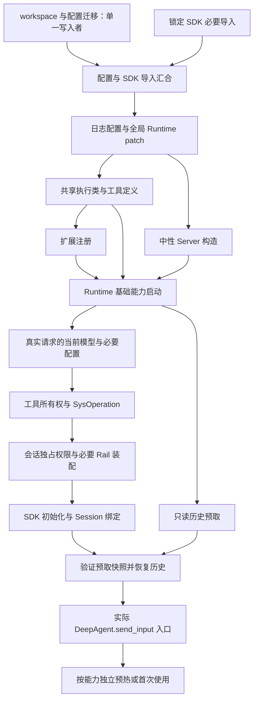

# Swarm 执行就绪链继续拆分与验收

用户要求继续完成 Swarm 分支内的执行就绪链优化。此前将 SDK 导入与配置迁移重叠，不能等同于完整执行就绪链已经拆完；锁定 SDK 的耗时也不能作为停止 Swarm 内剩余工作的理由。本轮基于产品提交 `f002002d` 继续修改原分支 `fix/pr7984-7986-review-20261013`。OpenJiuwen 和 gateway-protocol 版本及源码保持，2.5 秒阈值保持。

## 本轮拆分

1. 权限 Rail 包和认证包的公共入口按实际符号使用加载。导入权限上下文或请求凭据记账不再顺带准备 Team、Symphony 和 Account Kit。公开类和函数仍返回原模块的真实对象。
2. 图像工具卡不再创建独立 FastMCP 服务或导入 Gemini 客户端。工具卡和配置判断保留；实际使用 Gemini 时加载 provider，显式获取旧 `mcp` 导出时才创建服务。
3. 配置与 SDK 导入完成后，共享执行类和工具定义与中性 Server 构造重叠。SDK 兼容补丁完成后才允许扩展注册；全部必要分支完成后才启动消费者。任何必要分支失败都保留已构造 Server 的清理 owner。
4. 首次会话根据真实请求、会话已存模型、稳定模型 ID 或模型组路由构造所需模型。默认客户端和默认模型组在需要回退时再构造，避免先构造未选中的单模型。原始请求传递到模型选择逻辑，保留访问检查；不伪造缺少调用者信息的 bootstrap 请求。
5. Web 根适配器的 MCP 预热复用运行中 AgentServer 的 PreparationRegistry，不再另起绕过前台暂停的预热任务。适配器只等待屏蔽取消的共享任务；自身清理不取消服务器拥有的任务。没有 AgentServer owner 的独立 Process CLI/SDK 适配器保留独立准备行为。

## 依赖与仍须等待的步骤

并行的对象是可独立准备的代码定义、配置工作与历史读取，不是任意共享可变对象。SDK Model 构造会注册全局回调；会话权限 Rail 依赖 SysOperation、工具所有权及会话上下文；历史恢复依赖已经绑定的 SDK Session。保留这些真实依赖，不能通过后台移走、提前标记 ready 或降低权限要求减少验收时间。

正式冷入口仍以实际 `DeepAgent.send_input` 为终点，不使用 Runtime started、ACK 或预备 hook 代替。初步诊断和少量冒烟样本单独保存，不作为 P95 达标证据。

## 验收证据

本轮证据目录：`D:\work_space\jiuwenswarm-execution-ready-reports-20261014`。正式采样与补测结果见下文。旧报告和旧四版本 UX 页面对应 `f002002d`，继续作为历史实验保存，不将其数值冒充本轮结果。

- 产品提交：`6d902e851b3629e59d465ba55bd20ab7cc0a37c8`，本轮未推送。
- 相关最终回归：[114 项测试](/D:/work_space/jiuwenswarm-execution-ready-reports-20261014/final-targeted.xml)通过；最后的请求上下文释放修正另有[13 项模型用例](/D:/work_space/jiuwenswarm-execution-ready-reports-20261014/final-model-context.xml)通过。
- 扩展回归不能宣称全绿。按唯一测试 ID 合并广回归与后续定向结果，6197 项中 6153 通过、10 跳过、34 失败；34 项均在 `f002002d` 对照中复现，新增失败 0。合并结果不代表一次不中断的整套测试。[完整状态与合并口径](/D:/work_space/jiuwenswarm-execution-ready-reports-20261014/regression-consolidated.json)。另有原有时间相同的执行记录排序用例，在旧、新树均出现过失败，原始失败记录保留。
- Frozen 使用官方 spec 和新构建目录。首次构建期间最后一处修正未进入模块缓存，增量构建仍保留旧 PYZ；这些包未用于正式验收。全新构建完成后，比较 8 个修改模块的嵌套代码属性和常量值，包括字节码、函数参数及行号/异常表，全部一致；比较忽略文件名和 marshal 的字符串驻留/引用布局。[包内代码核对](/D:/work_space/jiuwenswarm-execution-ready-reports-20261014/frozen-code-audit.json)。
- 验收 EXE：`frozen-verified-dist/workswarm/workswarm.exe`，107204091 字节，SHA256 `15a7938ea9dd021542e9bb9dc85043629fe185234a359f19dff109c0c3aadd9a`。产品、前端、SDK 与 protocol 模块源码与冻结记录保持。[构建完整性](/D:/work_space/jiuwenswarm-execution-ready-reports-20261014/build-integrity.json)。模块源码清单不包含嵌套第三方虚拟环境。
- 修改文件没有新增 Ruff 问题；`interface_deep.py` 原有 73 个 E402 和 `image_tools.py` 原有未使用导入/无占位 f-string 保留。`git diff --check` 通过。远端 CI 未核实。

正式矩阵使用源码、Frozen × agent、code.normal，冷场景各 30 次，常驻同会话、新会话各 100 次；首次 identity、新 checkout 与 fresh 检查 P95 和每个最大值。改造前 `f002002d` 与本轮源码按样本交替对照新 checkout。测试关闭 trace/importtime/coverage，终点仍为真实 SDK 入口，验证终态、Worker 身份和清理。模型服务是本地 OpenAI 协议 fixture，不包含商业模型网络耗时；没有清除 Windows 页缓存。

## 正式结果

六组正式采样共 1640 条原始记录，功能失败 0，不完整统计组 0，所属 Worker 残留 0。四组候选版本和两组源码配对均以退出码 1 正常报告性能超限，未将超限作为理由丢弃记录。[最终审计](/D:/work_space/jiuwenswarm-execution-ready-reports-20261014/final-matrix-audit.json)、[完整指标与门禁](/D:/work_space/jiuwenswarm-execution-ready-reports-20261014/formal-aggregate.json)。

新 checkout 的冷 Worker，单位秒，终点为首次实际 SDK 入口：

| 形态 / 模式 | n | P50 | P95 | max | ≤2.5秒 |
| --- | ---: | ---: | ---: | ---: | --- |
| source / agent | 30 | 6.259 | 10.097 | 11.201 | 未达标 |
| source / code.normal | 30 | 5.893 | 6.231 | 6.986 | 未达标 |
| frozen / agent | 30 | 4.887 | 5.276 | 5.342 | 未达标 |
| frozen / code.normal | 30 | 4.789 | 5.518 | 5.696 | 未达标 |

其他场景 P95，单位秒，常驻每组 100 次、其他冷场景每组 30 次：

| 形态 / 模式 | 缓存checkout冷 | 同会话常驻 | 新会话常驻 | 首次部署冷 | 可选能力全开冷 |
| --- | ---: | ---: | ---: | ---: | ---: |
| source / agent | 11.506 | 0.116 | 0.392 | 8.334 | 7.225 |
| source / code.normal | 6.005 | 0.103 | 0.393 | 7.025 | 6.475 |
| frozen / agent | 5.720 | 0.113 | 0.352 | 11.021 | 5.870 |
| frozen / code.normal | 5.521 | 0.110 | 0.710 | 6.206 | 9.772 |

完整矩阵仍失败。下列原始门禁保留，补测不替换这些结果：

- source-agent: front.listen, project.list, config.get, history.get, worker.cold_new_checkout, worker.cold_cached_checkout, fresh.cold, optional_all.cold。
- source-code.normal: source_identity.first_build, front.listen, config.get, history.get, worker.cold_new_checkout, worker.cold_cached_checkout, fresh.cold, optional_all.cold。
- frozen-agent: front.listen, session.list, project.list, config.get, history.get, worker.cold_new_checkout, worker.cold_cached_checkout, fresh.cold, optional_all.cold。
- frozen-code.normal: front.listen, session.list, project.list, config.get, history.get, worker.cold_new_checkout, worker.cold_cached_checkout, chat.warm_new, fresh.cold, optional_all.cold。

## 源码同批交替对照

各版本、模式各 30 个新 checkout 冷进程。与上面的候选完整矩阵属于不同采样批次，不能将两张表拼接计算加速比。

| 模式 | f002 P50 | 本轮 P50 | f002 P95 | 本轮 P95 | P50降低 | P95降低 |
| --- | ---: | ---: | ---: | ---: | ---: | ---: |
| agent | 7.689s | 7.136s | 14.854s | 12.113s | 7.20% | 18.45% |
| code.normal | 7.026s | 6.017s | 8.255s | 7.185s | 14.36% | 12.97% |

该对照支持本机这批样本中的有限改善，不能证明所有环境都加速，也不能证明冷 Worker 2.5 秒目标完成。

## 新checkout分段

| 形态 / 模式 | SDK导入P95 ms | 共享执行代码P95 ms | Runtime started累计P95 ms |
| --- | ---: | ---: | ---: |
| source / agent | 4047 | 2016 | 6800 |
| source / code.normal | 3657 | 844 | 4730 |
| frozen / agent | 2922 | 859 | 3920 |
| frozen / code.normal | 3187 | 797 | 4170 |

前两列是阶段耗时，最后一列是 Worker 内部起点的累计时间，与请求入口计时起点不同；各列 P95 不能相加或相减。[原始日志统计](/D:/work_space/jiuwenswarm-execution-ready-reports-20261014/formal-phases.json)。共享执行代码仍存在导入成本，模型、工具所有权、权限 Rail、SDK Session 绑定和历史恢复仍有真实依赖。本轮完成的是上述 Swarm 阻塞点的进一步拆分，不能表述为完整性能目标已经完成。

Frozen/agent 首次部署 P95 11.021 秒的慢样本中，workspace 准备约 2.125 秒，SDK 导入约 6.047 秒，共享执行代码约 2.125 秒，实际 SDK 入口约 11.809 秒。workspace 与 SDK 并行，不能将这些阶段简单相加。日志描述耗时位置，不据此推断磁盘、杀毒软件或某个 SDK 子模块就是唯一原因。

## Frozen新会话超限补测

正式 Frozen/code.normal 新会话常驻 P95 710.064ms 超过 500ms。对此在正式矩阵结束后，分别用旧、新真实 EXE 各补测同会话 100 次、新会话 100 次；部署源码记录分别是 f002 和 6d902，两个启动用冷样本不作为冷启动验收。补测共 402 条记录，功能失败 0。

| 部署 | 同会话 P95 ms | 新会话 P50 ms | 新会话 P95 ms | 新会话 max ms |
| --- | ---: | ---: | ---: | ---: |
| baseline | 102.698 | 249.572 | 356.524 | 631.947 |
| candidate | 111.889 | 247.257 | 331.684 | 522.795 |

补测没有稳定复现 710ms 的超限；它不能确定波动原因，也不替换正式矩阵中该项的失败结果。[补测来源、参数和原始统计](/D:/work_space/jiuwenswarm-execution-ready-reports-20261014/warm-recheck.json)。

**冷启动目标及完整性能验收仍未通过。SDK 的必要导入阶段本身在本轮新 checkout 样本中的 P95 已超过 2.5 秒；当前锁定 SDK 范围限制保持。不得以 Runtime started、常驻快响应或补测较快的结果关闭该目标。**
