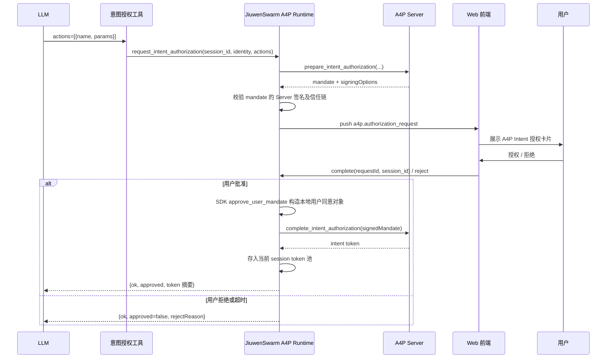
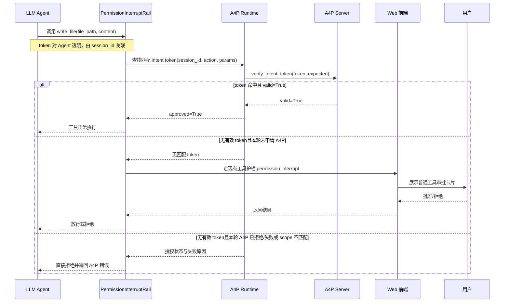
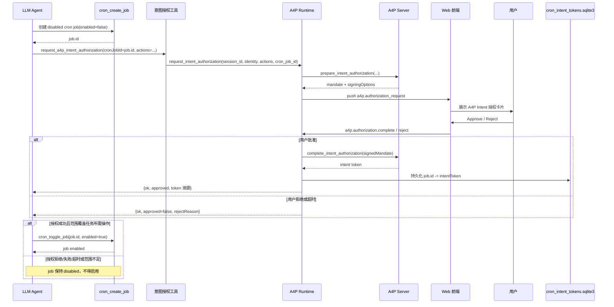
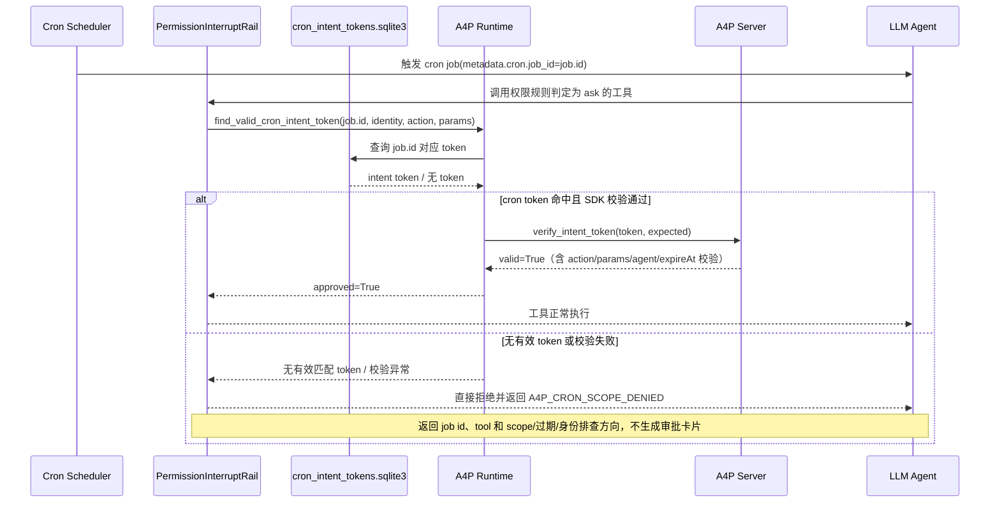

# A4P 预授权

A4P 预授权功能让用户在 Agent 执行前，集中授权一组操作及其参数范围。用户同意授权后系统签发授权凭证，后续符合范围的工具调用可直接通过校验，减少用户反复审批。

JiuwenSwarm 基于 openJiuwen Agent Protocol 的 A4P SDK 提供该能力，目前支持 **Web 交互会话和定时任务**。

## 适用场景

- **多步骤任务**：当 Agent 执行跨多个工具的复杂任务时，可以申请 A4P 意图授权，用户一次性批准明确的工具调用后，后续匹配的工具调用可通过 intent token 自动放行，避免连续重复审批影响用户体验。若后续出现未覆盖的操作时，再补充授权。
- **定时任务**：当用户不在场 Agent 执行定时任务时，可以预先申请 A4P 意图授权，在定时任务执行过程中可自动放行匹配的工具调用，而无需将该工具持久化设为 allow，引入安全风险。


## 开启与使用

在 **设置 → 实验功能 → A4P 预授权** 中开启。默认关闭，仅在“默认权限”模式下生效；**开启后，定时任务运行时也接入权限护栏。**也可在 `config.yaml` 中配置：

```yaml
a4p:
  enabled: true
```

会话任务使用流程：

1. 向 Agent 描述任务，明确涉及的文件、目录或操作目标。
2. Agent 规划任务后发起授权申请，卡片展示授权原因、工具和参数范围。
3. 用户可以批准全部或部分操作，也可以拒绝；未选操作不会因本次确认获得授权。
4. 授权通过后，Agent 继续执行，后续自动校验匹配的调用。

定时任务使用流程：

1. 向 Agent 描述任务，明确执行时间、周期、持续时间及操作目标。
2. Agent 创建未启用的定时任务，并申请覆盖未来执行所需范围的授权，卡片展示任务信息、授权原因、工具和参数范围。
3. 用户确认授权范围，可以批准全部或部分操作，也可以拒绝；只有取得覆盖任务所需操作的授权后，Agent 才启用任务。
4. 定时任务执行时，先按权限规则判断：`allow` 直接放行，`deny` 直接拒绝，`ask` 自动查找该任务绑定的授权并校验工具调用，不弹出交互审批卡片。

## 授权流程

以下流程中，工具调用时序以权限规则判定为 `ask`、进入 A4P 权限确认环节为前提，省略此前 `allow` 直接放行、`deny` 直接拒绝的权限规则决策。

### 会话预授权

#### 阶段一：申请并确认授权

Agent 集中申请当前已明确的操作范围。用户在 Web 卡片中确认后，A4P Server 签发凭证，由 Runtime 保存到当前会话；拒绝或超时则返回失败原因。主动申请与执行时的权限判断是两个环节：当前提示词及申请接口不会按权限规则排除 `allow` 工具，因此这类工具仍可能被 Agent 纳入授权申请，但实际执行时无需 A4P token 即可放行。



#### 阶段二：工具调用时校验

系统自动查找当前会话的凭证，校验身份、有效期及操作参数。新增操作超出已批准范围时，需要补充授权。



### 定时任务预授权

#### 阶段一：创建任务并提前授权

先创建未启用的任务，在用户在线时申请完整的未来操作范围。授权凭证与任务绑定并持久化，取得所需授权后启用任务。



#### 阶段二：定时执行时校验

开启 A4P 且权限护栏启用时，单 Agent 和团队定时任务均接入权限规则判断：`allow` 直接放行，`deny` 直接拒绝，只有 `ask` 调用按任务 ID 查找绑定凭证。有效且匹配的调用继续执行；任务 ID 缺失、凭证缺失、过期、不匹配或校验异常时直接拒绝，不再等待交互审批，也不回退使用会话凭证。



## 支持的操作

授权以具体工具和安全关键参数为边界，同一文件的读取、修改等操作分别授权。

| 能力 | 工具 | 授权约束 |
|---|---|---|
| 读取文件 | `read_file` | 文件路径 `file_path` |
| 新建或写入文件 | `write_file` | 文件路径 `file_path` |
| 修改文件 | `edit_file` | 文件路径 `file_path` |
| 浏览目录 | `list_files` | 目录 `path` |
| 搜索文件名 | `glob` | 搜索根目录 `path`，可递归 |
| 搜索文件内容 | `grep` | 文件或目录 `path`，可递归并返回正文片段 |
| 执行命令 | `bash`、`mcp_exec_command` | 命令 `command` |
| 创建终端 | `create_terminal` | 命令 `cmd` |
| 调用其他 Agent | `acp_chat` | 目标 `agent` |

文件范围可使用具体文件或固定目录下的文件名模式。`read_file` 的文件名模式不覆盖子目录。目录浏览和搜索使用明确的路径，不使用目录通配；批准浏览或文件名搜索不等于批准读取正文。

`read_file`、`list_files`、`glob`、`grep` 在申请和执行时都要求显式绝对路径，不接受省略路径、相对路径、`~` 或 `..` 路径段。搜索关键词、结果数量等未列入授权约束的普通参数可以在获批范围内变化。

## 有效期与保存方式

| 授权类型 | 默认有效期 | 保存方式 |
|---|---|---|
| 会话授权 | 1 小时 | 当前服务进程内保存；重启服务或关闭 A4P 后不保留 |
| 定时任务授权 | 30 天 | 与具体任务绑定并持久化保存 |

申请时可指定有效期，定时任务应覆盖计划执行的持续时间。用户确认等待时间为 3 分钟。

## 设计取舍

- **仅采用意图授权**：A4P SDK 的逐次操作授权已有普通工具审批承接，不重复增加一套交互。
- **由系统管理凭证**：用户在 Web 卡片中确认，A4P SDK 负责签发和验证凭证，Agent 调用工具时无需手动携带凭证。
- **区分会话与定时任务**：会话允许随任务推进补充范围；定时任务需要提前准备完整范围，以适应无人值守执行。

## 使用边界

- A4P 与现有权限护栏协作：`allow` 直接放行且不校验 A4P token，`deny` 直接拒绝且不能被 token 覆盖，只有 `ask` 调用进入 A4P 校验。关闭 A4P 时，定时任务保持原有跳过该权限护栏的行为；关闭权限护栏时，A4P 不会单独启用该护栏。ACP、TUI、CLI 的权限行为不变。
- Web 会话本轮未申请 A4P 且无匹配凭证时，仍可走普通审批；已申请但没有可用授权时，不会靠普通审批自动绕过失败。
