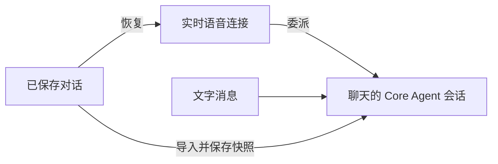
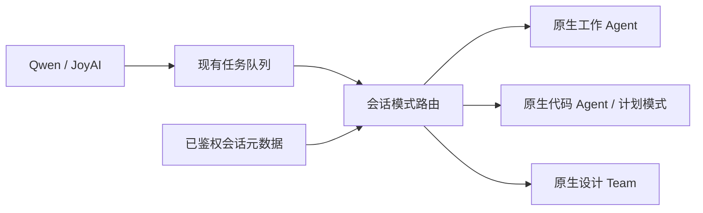

# 全双工对话连续性

在实验性设置中启用全双工，然后从已保存的工作、代码聊天或设计项目中启动。
切换聊天或进入设置页后，蓝色控制球仍可使用。语音内容和 Core Agent 结果始终归属
启动全双工时的聊天。在另一聊天中启动全双工会替换原有媒体会话，点击退出即可停止。

可用鼠标或触摸拖动蓝色球，控制器会保持在窗口范围内。共享状态和关闭按钮随控制球
一起移动。关闭共享仅停止画面共享，语音继续运行。麦克风静音和模型音频静音分别控制。

实时语音模型使用独立连接；委派的 Core Agent 任务与文字消息使用该聊天的 Core Agent
会话。发送文字前，已保存的语音对话会导入核心上下文并写入实时会话快照，避免 ReAct
加载旧快照时覆盖新增内容。正在执行的 Core Agent 任务须结束后，新的文字请求才能使用
同一执行会话。

全双工开启期间，同一会话的主模型最终回复（包括文字请求和后台回复）会作为结果回执
进入语音队列。Core 负责生成语音摘要；推理增量、工具过程和子智能体输出不逐条播报。
摘要使用固定格式，不再用模型正文中的任务 ID 匹配；传输层仍按会话、请求和媒体会话
标识路由与去重。已有语音委托复用原结果通道，不会被会话监听重复播报。
关闭全双工或开启替代会话后，原会话停止回传。Qwen 自动续接期间暂存新回执。

重新启动时，系统恢复最近对话及经过长度限制、可追溯到原文的历史片段，用于理解指代
和用户约束。任务状态单独读取当前值。Qwen 在连接初始化时接收历史背景；JoyAI 在真实
用户轮次中接收背景，并更新任务状态。恢复过程不重放旧请求或接受确认。临时采用低延迟
输出策略：`response.output_item.added` 标记为 `message` 时，文字与音频都流式输出；
标记为 `function_call` 时屏蔽后续输出。工具仍须等参数完整且校验通过后执行，并根据
实际接受回执确认。如果先输出了 message，随后才出现工具调用，已显示的文字和已播放的
语音无法撤回。文字增量更新同一条消息，最终只收尾一次；工具调用、打断、失败或停止媒体
也会收尾已显示的部分文字。服务端缺少输出项类型时，文字和音频仍等整轮结束后放行。

Qwen 可能在 300 秒未生成回答后，以 `response_idle_timeout` 关闭连接。全双工会自动续接、
恢复上下文，并保留共享画面和静音设置，不会通过生成保活回答或重放旧工具调用维持连接。
已在运行的任务完成后，可在新连接中播报一次结果；加载新配置期间收到的结果会暂存。
退出或启动替代会话会取消待执行的续接及暂存通知。
鉴权、配额和普通网络错误仍按正常错误流程处理。

语音历史保存失败时，重启或文字发送会显示错误，并在发送新请求前停止。失败事件按原顺序
保留在内存中，重试时沿用原事件 ID。存储恢复后可重试；刷新页面会丢失尚未保存的事件。
恢复历史时，不同轮次的相同文字会分别保留。

JoyAI 上下文令牌过期时，会在同一个已授权聊天中刷新令牌，并重试一次尚未执行的用户请求。
取消或替换会话会停止这次重试。权限错误及推理开始后的错误不会触发请求重放。

## 工作、代码与设计模式

工作与代码模式使用聊天输入区的全双工按钮。代码任务沿用该聊天的项目目录和执行模式，
包括计划模式。设计模式从已绑定画布的设计项目对话区启动；启动前会先保存画布。
设计首页也可直接点击全双工按钮。系统先创建并绑定空画布和设计会话，再打开设计页并启动
媒体连接，无需先发送文字；不会代替用户发出创作请求。创建失败时不会启动全双工，可重试。

服务端根据当前用户拥有的会话元数据选择执行入口，实时模型不能通过工具参数更改模式或
项目。任务接受时保存执行目标，开始执行时再次核对；排队期间项目或模式发生变化会使该
任务失败，需要重新提交。问答续接与取消使用原任务绑定的会话、模式和项目。

队列、蓝球和媒体连接使用原有实现。设计助手通过原生设计工具操作当前项目，语音与文字
使用同一设计会话；后续文字轮次也会获得近期已保存的语音背景。原生问题卡片可继续回答，
语音问答和取消按当前任务身份路由，旧任务的取消请求不能取消后续轮次。
审批卡片（权限审批、cua 桌面操作确认等）只能在界面上点击“允许”或“拒绝”；语音不能批准
或拒绝。任务等待审批时，助手会说明卡片用途并请你点击，不会声称已经允许。
设计页已有订阅时，语音任务仍保留独立的本轮结果订阅，避免只提交请求后就丢失结果。
画布、节点、运行状态及设计助手活动事件通过该设计会话的 Web 通道更新，无需刷新页面。

设计语音任务的结束或取消只对应设计助手当前轮次。独立运行的画布生成任务仍由原生设计
流程管理，不能将助手回答结束当作画布生成完成，也不能将取消助手当作取消全部画布生成。
自动测试覆盖路由、任务绑定、问答、取消和界面入口；真实 Agent 的画布操作另作本地验证，
不代表外部图片、视频生成服务的稳定性已得到验证。

三种模式共用 `core_receipts.py` 中的摘要协议、正文解析和回执结构。全双工开启时，
摘要要求由运行时系统提示词统一注入，文字和语音委托不再各自追加；未建立会话订阅的
独立视频工具调用，由服务端请求入口追加一次兼容提示词。普通回复与托管任务保留各自的
事件通道，共用回执转换；前端直接消费后端摘要，不再另行构造正文兜底。
语音历史的落盘等待、读取和筛选也使用公共入口；Agent 与 Design Team 保留原生上下文
写入方式。摘要缺失时，后端仍保留 Core 实际正文，不能将其改写为通用成功结论。
设计文字请求留下的长期订阅，在后续托管任务执行时只观察界面事件，不重复投递语音回执。
最终回复若省略摘要结束标记，仍按同一长度和格式规则验证摘要，不将标记送入播报。
