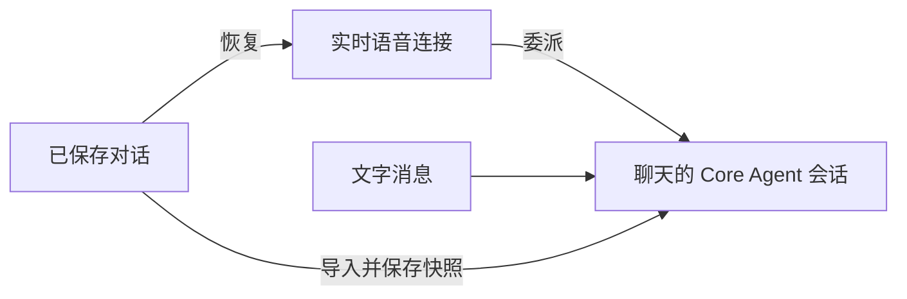
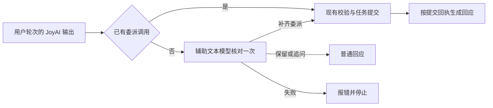
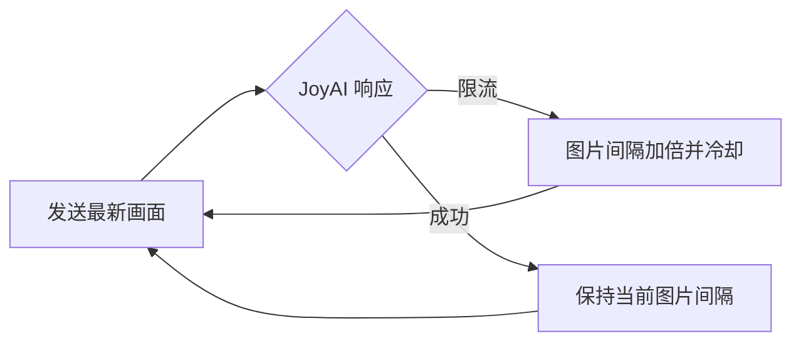
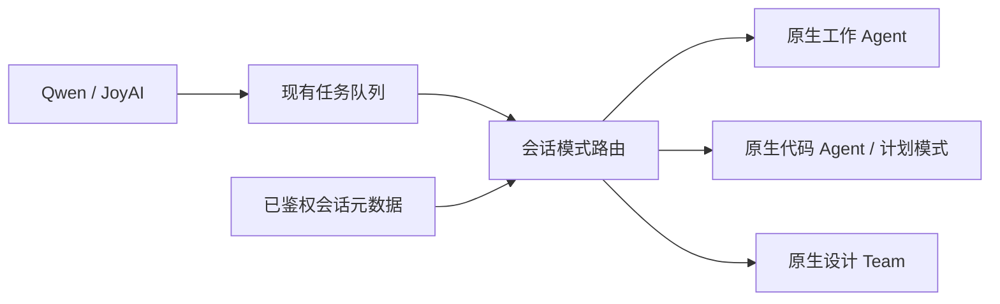
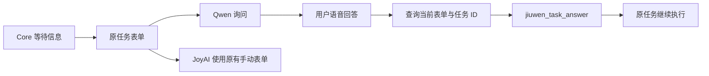

# 全双工对话连续性

在实验性设置中启用全双工，然后从已保存的工作、代码聊天或设计项目中启动。
切换聊天或进入设置页后，蓝色控制球仍可使用。语音内容和 Core Agent 结果始终归属
启动全双工时的聊天。在另一聊天中启动全双工会替换原有媒体会话，点击退出即可停止。

启用屏幕共享后，启动全双工会直接打开系统屏幕或窗口选择器。此入口仅支持屏幕共享。

可用鼠标或触摸拖动蓝色球，控制器会保持在窗口范围内。共享状态和关闭按钮随控制球
一起移动。使用鼠标时，将指针移到控制球上才显示共享状态及控制按钮；触摸屏上始终显示。
关闭共享仅停止画面共享，语音继续运行。麦克风静音和模型音频静音分别控制。

语音委派任务生成文件后，Core Agent 会核实文件并使用 `send_file_to_user` 交付；成功交付的
文件出现在原对话的“产物”中。后续询问文件位置时，以文件回执中的路径为准；仅在回复中
提到文件路径，不代表文件已交付。

实时语音模型使用独立连接；委派的 Core Agent 任务与文字消息使用该聊天的 Core Agent
会话。发送文字前，已保存的语音对话会导入核心上下文并写入实时会话快照，避免 ReAct
加载旧快照时覆盖新增内容。正在执行的 Core Agent 任务须结束后，新的文字请求才能使用
同一执行会话。

全双工开启期间，同一会话的主模型最终回复（包括文字请求和后台回复）会作为结果回执
进入语音队列。Core 负责生成语音摘要；推理增量、工具过程和子智能体输出不逐条播报。
摘要使用固定格式，不再用模型正文中的任务 ID 匹配；传输层仍按会话、请求和媒体会话
标识路由与去重。已有语音委托复用原结果通道，不会被会话监听重复播报。
关闭全双工或开启替代会话后，原会话停止回传。Qwen 自动续接期间暂存新回执。
若用户在工具执行期间开始新一轮语音，旧轮次的回执会作为独立通知播报，
不再引用已经失效的 Qwen 工具调用标识。

重新启动时，系统恢复最近对话及经过长度限制、可追溯到原文的历史片段，用于理解指代
和用户约束。任务状态单独读取当前值。Qwen 在连接初始化时接收历史背景；JoyAI 在真实
用户轮次中接收背景，并更新任务状态。恢复过程不重放旧请求或接受确认。临时采用低延迟
输出策略：`response.output_item.added` 标记为 `message` 时，文字与音频都流式输出；
标记为 `function_call` 时只屏蔽尚未确认为 message 的输出，保留同轮及同一输入下其他 message
的后续音频和文字。工具仍须等参数完整且校验通过后执行，并根据实际接受回执确认。
第一句确认语与后续工具回执都允许播报。文字增量更新同一条消息，最终只收尾一次；打断、失败或停止媒体
也会收尾已显示的部分文字。服务端缺少输出项类型时，文字和音频仍等整轮结束后放行。

Qwen 可能在 300 秒未生成回答后，以 `response_idle_timeout` 关闭连接。全双工会自动续接、
恢复上下文，并保留共享画面和静音设置，不会通过生成保活回答或重放旧工具调用维持连接。
已在运行的任务完成后，可在新连接中播报一次结果；加载新配置期间收到的结果会暂存。
退出或启动替代会话会取消待执行的续接及暂存通知。
鉴权、配额和普通网络错误仍按正常错误流程处理。

Qwen 收到语音结束事件后会暂停送图并丢弃暂存画面；下一轮语音开始后恢复送图。
若模型只拒绝一帧画面的音画顺序，诊断日志仍记录原错误，语音会话继续运行。

语音历史保存失败时，重启或文字发送会显示错误，并在发送新请求前停止。失败事件按原顺序
保留在内存中，重试时沿用原事件 ID。存储恢复后可重试；刷新页面会丢失尚未保存的事件。
恢复历史时，不同轮次的相同文字会分别保留。

Qwen 和 JoyAI 的已有任务查询、排序、取消、修改，通过 `jiuwen_queue_manage` 主动交给
同一个专用文本模型。文本模型先查询当前会话的真实任务，再调用现有队列工具。
Qwen 根据实际操作回执播报；JoyAI 将管理模型根据回执生成的回应同时用于文字和语音，
不播报其原先未经确认的操作承诺，也不再次生成管理操作。JoyAI 的信息表单仍需在界面上完成；两种模型均保留通过 `jiuwen_task_answer` 处理明确语音审批的能力。
Qwen 的信息补充通过队列管理器处理。新任务仍通过 `jiuwen_delegate` 提交。
此方案依赖实时模型发起管理调用，
不会自动补执行没有工具调用的口头承诺。

定时任务也交给同一个文本模型，而不是固定转成一次“查询定时任务”的委托。管理模型用
`jiuwen_cron_query` 读取当前用户真实的定时任务、下次执行时间和时区，用
`jiuwen_cron_update` 修改名称、cron 表达式、时区、描述、启停、推送频道、模式或超时，
用 `jiuwen_cron_delete` 删除。任何写操作前必须先查询并复制回执中的 `job_id`，
模型不能猜 ID；由设置开关驱动的任务（`proactive.tick`）不能通过语音修改或删除。
旧版匿名连接保留只读查询能力；修改和删除必须有用户身份，且任务属于该用户。
更新未返回有效任务记录或控制器异常时，返回“任务未成功”回执。此时最终状态尚未确认，
不能声称变更未发生或已回滚；重试前须重新查询任务。
新建定时任务仍属于新工作，由 `jiuwen_delegate` 交给 Core，由 Core 按当前项目用
cron 工具创建，因此项目归属和凭据解析保持不变。

文本模型默认复用第一个已配置的文本模型；`.env` 的 `DUPLEX_QUEUE_MANAGER_MODEL` 可指定
已有模型的 ID、别名或唯一名称，无需复制密钥，重启后生效。管理模型不接收音视频，
只接收用户指令和任务记录。一次管理最多进行 6 轮模型决策，总计最多等待 40 秒。
超时或失败会保留已完成步骤的回执，不把未完成的操作描述为成功；重复请求 ID 在当前
进程缓存内共用一次执行。审批继续支持明确的语音同意或拒绝，也可点击屏幕上的按钮。

JoyAI 上下文令牌过期时，会在同一个已授权聊天中刷新令牌，并重试一次尚未执行的用户请求。
取消或替换会话会停止这次重试。权限错误及推理开始后的错误不会触发请求重放。

JoyAI 的工具 JSON 必须位于 `</delegation>` 后。真实用户轮次中没有委派调用时，包括
只说“我来执行”、工具 JSON 混在播报文字中或委派内容为空，系统会在播报前调用一次辅助
文本模型。它根据用户原话、已恢复的上下文和当前任务状态，选择保留原回答、追问或补齐
新任务的 `jiuwen_delegate`。后台图片轮询和已有委派不调用辅助模型；任务管理和审批不
通过辅助模型变成新的任务。辅助模型不接收音视频，也不执行工具。

默认复用当前配置的第一个可用文本模型。可在 `.env` 中用 `JOYAI_ACTION_HELPER_MODEL`
指定已有模型的稳定 ID、别名或唯一模型名，重启后生效，不需要复制密钥。辅助调用最长
等待 8 秒，不自动重试；超时或校验失败时返回 `JOYAI_ACTION_HELPER_ERROR`，不放行原来的
执行承诺，也不会触发 JoyAI 图片降频。

辅助模型只建议工具和替代回应；提交时完整保留用户原话，并沿用原请求 ID 去重。新调用
仍须经过现有工具校验和任务队列。只有拿到提交回执后才播报“已提交，尚未确认执行结果”，
不会采用辅助模型提前声称成功的文字。闹钟等目标的实际结果仍以 Core 回执为准。

JoyAI 的“测试连接”使用保存的模型配置发送一条最多输出 8 个 token 的文本请求，
复用实际对话的接口和请求头，不依赖 `/models` 接口。测试使用独立会话，不上传音视频，
也不改变当前对话上下文；服务商可能对这条测试请求计费或限流。

JoyAI 返回限流错误时，客户端先等待 60～300 秒，再用最新画面重试。
每次限流都会将图片发送间隔加倍：从 1 秒逐步增加到最多 300 秒。成功后保持降低后的
频率，避免立即再次限流；重新开启全双工时恢复默认频率。等待期间保留尚未接受的用户
指令，不积压旧画面。停止共享后，纯语音请求仍须等待限流冷却结束，但不受图片间隔限制。
普通网络错误不会触发降频。降频可以减少请求压力，不能解决余额耗尽或账号配额不足。

## 工作、代码与设计模式

工作与代码模式使用聊天输入区的全双工按钮。代码任务沿用该聊天的项目目录和执行模式，
包括计划模式。设计模式从已绑定画布的设计项目对话区启动；启动前会先保存画布。
设计首页也可直接点击全双工按钮。系统先创建并绑定空画布和设计会话，再打开设计页并启动
媒体连接，无需先发送文字；不会代替用户发出创作请求。创建失败时不会启动全双工，可重试。

服务端根据当前用户拥有的会话元数据选择执行入口，实时模型不能通过工具参数更改模式或
项目。任务接受时保存执行目标，开始执行时再次核对；排队期间项目或模式发生变化会使该
任务失败，需要重新提交。问答续接与取消使用原任务绑定的会话、模式和项目。

队列、蓝球和媒体连接使用原有实现。设计助手通过原生设计工具操作当前项目，语音与文字
使用同一设计会话；后续文字轮次也会获得近期已保存的语音背景。原生问题卡片可继续回答，
语音问答和取消按当前任务身份路由，旧任务的取消请求不能取消后续轮次。
审批卡片（权限审批、cua 桌面操作确认等）可以直接用语音回答，也可以在界面上点击。
明确说“同意”“允许”“可以”“批准”即允许；说“拒绝”“不要”“取消这个操作”即拒绝；
语音可以答：同意、拒绝、本会话保持同意（选“会话内记住”，本会话不再弹同类卡）、永久同意（选“永久记住”，需明确说出）。意思含糊时助手会先问一句，不会提交；
同时有多张卡片时会先确认是哪一张。等待审批时说出的新任务（如“打开微信”）按新任务派发，
排队到审批处理完再执行，不会被当作审批回答。文字对话留下的审批卡片也能用语音回答。
助手确认任务已恢复后才会说“已批准”。卡片出现前说完的话不会被当作它的回答。
设计页已有订阅时，语音任务仍保留独立的本轮结果订阅，避免只提交请求后就丢失结果。
画布、节点、运行状态及设计助手活动事件通过该设计会话的 Web 通道更新，无需刷新页面。

设计语音任务的结束或取消只对应设计助手当前轮次。独立运行的画布生成任务仍由原生设计
流程管理，不能将助手回答结束当作画布生成完成，也不能将取消助手当作取消全部画布生成。
自动测试覆盖路由、任务绑定、问答、取消和界面入口；真实 Agent 的画布操作另作本地验证，
不代表外部图片、视频生成服务的稳定性已得到验证。

三种模式共用 `core_receipts.py` 中的摘要协议、正文解析和回执结构。全双工开启时，
摘要要求由运行时系统提示词统一注入，文字和语音委托不再各自追加；未建立会话订阅的
独立视频工具调用，由服务端请求入口追加一次兼容提示词。普通回复与托管任务保留各自的
事件通道，共用回执转换；前端直接消费后端摘要，不再另行构造正文兜底。
语音历史的落盘等待、读取和筛选也使用公共入口；Agent 与 Design Team 保留原生上下文
写入方式。摘要缺失时，后端仍保留 Core 实际正文，不能将其改写为通用成功结论。
设计文字请求留下的长期订阅，在后续托管任务执行时只观察界面事件，不重复投递语音回执。
最终回复若省略摘要结束标记，仍按同一长度和格式规则验证摘要，不将标记送入播报。

## 任务名称、产物与控制回执

JoyAI 无画面时直接发送用户的语音转写或文字指令，不等待下一帧；空闲时不发送空画面请求。
关闭共享后不重发旧截图，并告知模型当前没有画面；重新共享后恢复原有画面流程。
JoyAI 用户请求前置明确的动作协议：外部事实和操作必须委派 Core，普通回答须包含
`response` 标记。不合协议的文字不进入显示或播报，最多纠正一次，仍失败则返回错误。
同一次输出中的换行不会拆断 `response` 与 `delegation` 动作。Core 结果摘要同时写入
文字消息和语音队列，按任务去重，不让 JoyAI 再生成一份摘要。
使用 Qwen 全双工时，任务要求填写的时间、内容和参数等信息表单会交给实时模型语音询问。
实时模型收集答案，缺少的字段继续询问；交给 `jiuwen_queue_manage` 查询当前问题状态，再通过 `jiuwen_task_answer`
把答案交回原任务，不另建任务。重复通知不重复提问，旧会话和回放通知不触发播报。
原生表单仍可手动填写；权限与操作授权支持明确的语音回答，也保留原有界面。
JoyAI 不接入信息表单的语音提问和回答，仍通过原有界面手动填写；服务端拒绝 JoyAI 的信息表单
`jiuwen_task_answer` 请求，但保留审批卡片的语音回答。普通语音对话、任务管理和 Core 摘要的文字与语音显示保持可用。
完成通知保留 Core 委托的 `job_id`。结果正文中的资源 ID 仅作为后续操作的目标信息，
不能替代委托 ID。目标不存在于当前会话时，后端返回未执行的工具回执，实时模型应重新
查询当前会话并确认目标；不能据此声称资源已删除，也不能自动重建资源或操作其他会话。

全双工工作任务使用普通对话的工具事件解析器，保留实际技能调用参数、技能树和工具状态。
产物接收实时文件事件及最终回执中的文件列表，按文件身份去重并保存到会话历史。
带本地路径的产物会登记为原会话的生成素材，切换页面或关闭语音后仍可更新。
“参考信息”沿用普通对话的实际技能记录；回答文字中的文件路径不作为产物凭证。

已完成的任务仍可修改：修改工具会创建携带原结果与上下文的 Core 关联后续任务。
对既有结果的进一步操作也可委托 Core 执行，不能仅因原执行已完成就拒绝。
Qwen 与 JoyAI 使用相同通用规则；只有实际 Core 结果才能证明修改完成。

任务看板优先显示实时模型随委托提交的简短任务名称，完整用户要求单独保存。名称通常采用
“动作＋对象＋必要区别”，不写完成状态。修改目标时可提交新名称，完成后的修订只命名后续任务；
查询同时匹配名称与原始要求。旧任务或未提供名称的委托仍显示原始要求，名称不参与执行指令。
Qwen 连续语音时若委托内容与本轮较完整的用户原话明显无关，服务端拒绝建任务并让模型重试；
短句补充仍可沿用上文。若仅任务名称偏离原话，界面回退显示原始要求。
打断尚未创建的模型响应时，客户端等到收到响应 ID 后才发送取消，避免重复取消报错。
Qwen 可以在同一次响应里先输出文字和语音，再输出工具调用；响应开始时尚无工具调用标识。
客户端不再根据操作关键词暂存 message，也不因后续工具调用丢弃其音频；第一句回应和工具
回执均可流式播放。此调整放行模型返回的音频，不为仅有文字的输出额外合成语音。

停止执行与撤销其结果是不同请求。执行已完成时，不能据此拒绝用户对既有结果的后续操作；
工具回执阶段同样允许把完整请求交给 Core 修改工具或新委托。系统不会自动回滚已完成的操作。

语音取消请求若指向已完成的执行且携带用户原话，后端复用修改流程创建关联的 Core 后续任务，
保留原结果与完整取消意图，并返回 `state=followup`、`converted_to=modify`。该回执仅确认受理，
不表示已取消实际效果。重复请求复用同一后续任务；未完成任务仍按原取消流程处理，
没有用户原话的旧接口或界面取消不会自动生成后续操作。

CUA 取消会等待对应执行完成清理，再报告 `cancelled`。执行在接入前被取消时，延迟到达的请求
不能启动 Core。停止回执后 90 秒内仍无法确认清理完成时，任务标记为 `unknown`，不表示已停止。
语音调整队列后会推送与界面操作相同的权威快照。队列版本随调度变化递增并持久化，延迟快照
不能覆盖较新的顺序。查询仅返回状态，不改变队列。
语音调整顺序先查询准确的待执行任务 ID；模型可省略队列版本，由服务端读取当前值并在提交时校验。
模型给出无效版本时同样由服务端读取；给出有效但已过期的版本仍按冲突处理。
控制诊断记录保存在 `~/.jiuwenswarm/logs/duplex-task-trace.jsonl`，用于关联请求、取消清理、
队列版本及界面更新。
