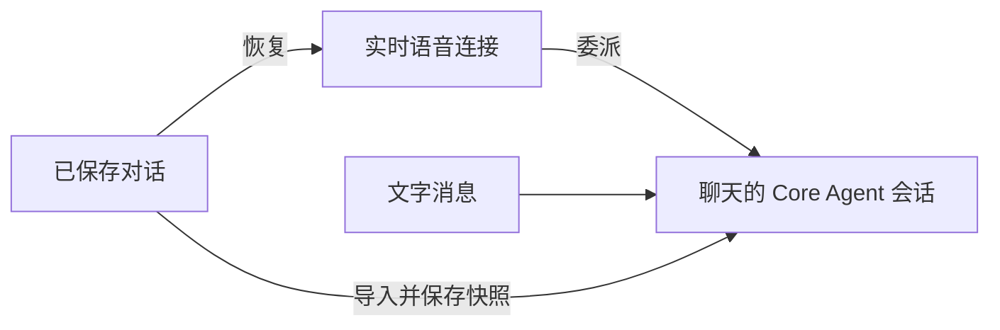

# 全双工对话连续性

在实验性设置中启用全双工，然后从已保存的单 Agent 聊天中启动。
切换聊天或进入设置页后，蓝色控制球仍可使用。语音内容和 Core Agent 结果始终归属
启动全双工时的聊天。在另一聊天中启动全双工会替换原有媒体会话，点击退出即可停止。

可用鼠标或触摸拖动蓝色球，控制器会保持在窗口范围内。共享状态和关闭按钮随控制球
一起移动。关闭共享仅停止画面共享，语音继续运行。麦克风静音和模型音频静音分别控制。

实时语音模型使用独立连接；委派的 Core Agent 任务与文字消息使用该聊天的 Core Agent
会话。发送文字前，已保存的语音对话会导入核心上下文并写入实时会话快照，避免 ReAct
加载旧快照时覆盖新增内容。正在执行的 Core Agent 任务须结束后，新的文字请求才能使用
同一执行会话。

重新启动时，系统恢复最近对话及经过长度限制、可追溯到原文的历史片段，用于理解指代
和用户约束。任务状态单独读取当前值。Qwen 在连接初始化时接收历史背景；JoyAI 在真实
用户轮次中接收背景，并更新任务状态。恢复过程不重放旧请求或接受确认。Qwen 文字仍等
整轮结束后显示。临时采用低延迟音频策略：`response.output_item.added` 标记为 `message`
时开始流式播放；标记为 `function_call` 时屏蔽后续输出。工具仍须等参数完整且校验通过后
执行，并根据实际接受回执确认。如果先播放了 message，随后才出现工具调用，已播放的
语音无法撤回。服务端缺少输出项类型时，音频仍等整轮结束后放行。

Qwen 可能在 300 秒未生成回答后，以 `response_idle_timeout` 关闭连接。全双工会自动续接、
恢复上下文，并保留共享画面和静音设置，不会通过生成保活回答或重放旧工具调用维持连接。
已在运行的任务完成后，可在新连接中播报一次结果；加载新配置期间收到的结果会暂存。
退出或启动替代会话会取消待执行的续接及暂存通知。
鉴权、配额和普通网络错误仍按正常错误流程处理。

语音历史保存失败时，重启或文字发送会显示错误，并在发送新请求前停止。失败事件按原顺序
保留在内存中，重试时沿用原事件 ID。存储恢复后可重试；刷新页面会丢失尚未保存的事件。
恢复历史时，不同轮次的相同文字会分别保留。

JoyAI 上下文令牌过期时，会在同一个已授权聊天中刷新令牌，并重试一次尚未执行的用户请求。
取消或替换会话会停止这次重试。权限错误及推理开始后的错误不会触发请求重放。
