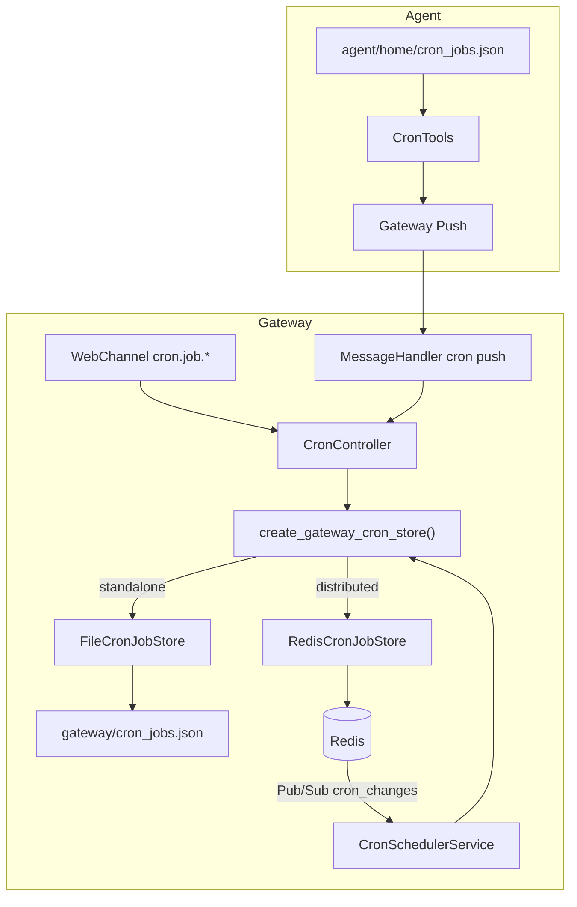

# Gateway Cron 分布式存储设计

| 项目 | 说明 |
|------|------|
| 状态 | 已实现（分支 `feat/cron-redis-store`） |
| 前置依赖 | [MR 1329](https://gitcode.com/openJiuwen/jiuwenclaw/pull/1329) — Redis 运行时、`gateway.deployment_mode` |
| 范围 | Gateway Cron 持久化；不含 Leader 选主、Session Redis |
| 相关文档 | [定时任务](./定时任务.md) |

---

## 1. 背景与目标

### 1.1 背景

- Gateway 侧 Cron 原先固定写入 `gateway/cron_jobs.json`，仅适合单实例。
- Agent 侧另有 `agent/home/cron_jobs.json`，通过 **push** 同步到 Gateway。
- MR 1329 已提供 Redis 客户端、`deployment_mode`（`standalone` / `distributed`），但 Cron 业务尚未接入。

### 1.2 目标

- `standalone`：行为与现网一致，本地 JSON + Gateway 调度。
- `distributed`：Cron 存 Redis，多 Gateway 共享同一份任务列表；由 Gateway 统一调度。
- Agent **保留** 本地 JSON + push，**不**直连 Redis。
- `distributed` 且 Redis 不可用时 **启动失败**（fail-fast），不回退文件。

### 1.3 非目标

- Gateway Leader 选主 / 多实例调度互斥
- Session Map Redis 化
- 删除 Agent → Gateway push
- Agent 内置调度器在 distributed 下继续运行（明确禁用）

---

## 2. 总体架构



### 2.1 角色分工

| 组件 | standalone | distributed |
|------|------------|-------------|
| Gateway 存储 | `gateway/cron_jobs.json` | Redis Hash |
| Gateway 调度 | `CronSchedulerService` 启用 | 同上 |
| Agent 存储 | `agent/home/cron_jobs.json` | 同上 |
| Agent 调度 | `CronTools.ensure_scheduler()` 启用 | **禁用**（仅 push） |
| 变更通知 | revision = 文件 mtime 轮询 | Pub/Sub + revision 轮询 |

---

## 3. 配置与选型

### 3.1 配置项

```yaml
gateway:
  deployment_mode: standalone   # standalone | distributed

redis:
  host: 127.0.0.1
  port: 6379
  key_prefix: "jiuwenclaw:"
```

### 3.2 Store 工厂逻辑

`create_gateway_cron_store()`（`jiuwenclaw/gateway/cron/factory.py`）：

```
deployment_mode == standalone
  → FileCronJobStore(path = workspace/gateway/cron_jobs.json)

deployment_mode == distributed
  → 若 Redis 不可用 / degraded → RuntimeError（fail-fast）
  → RedisCronJobStore(client)
  → 若 Redis Hash 为空 → 从 gateway/cron_jobs.json 一次性迁移
```

依赖 MR 1329 API：

- `get_declared_deployment_mode()`
- `get_effective_distributed_redis_active()`
- `get_gateway_redis_client()`

### 3.3 Gateway 启动顺序

```
get_config()
  → init_gateway_redis_from_config()
  → create_gateway_cron_store()
  → CronSchedulerService + CronController
  → register_cron_reload_callback(scheduler.reload)
  → … 其他组件 …
  → cron_scheduler.start()
```

关闭时：`unregister_cron_reload_callback` → `cron_scheduler.stop()` → `shutdown_gateway_redis()`。

---

## 4. 存储模型

### 4.1 抽象接口

`CronJobStoreBackend`（`store_base.py`）统一以下操作：

| 方法 | 说明 |
|------|------|
| `list_jobs` | 列出全部任务 |
| `get_job` | 按 id 查询 |
| `create_job` | 创建 |
| `update_job` | 部分更新 |
| `delete_job` | 删除 |
| `get_revision` | 返回存储版本号（用于变更检测） |

`CronController`、`CronSchedulerService` 仅依赖该协议，不感知文件或 Redis。

### 4.2 Standalone：文件存储

**路径**：`{workspace}/gateway/cron_jobs.json`

**格式**：`{ "version": 1, "jobs": [ {...}, ... ] }`

**revision**：无独立字段，`get_revision()` 返回 `int(st_mtime * 1_000_000)`。任何写入（Web、push、外部改文件）都会更新 mtime，调度器据此判断是否需要 `reload()`。

### 4.3 Distributed：Redis 存储

配置 `key_prefix: "jiuwenclaw:"` 时，以下为**逻辑名**；实际 key 由 `RedisClient.effective_key()` 加前缀。

| 逻辑 Key / Channel | 类型 | 用途 |
|--------------------|------|------|
| `gateway:cron_jobs` | Hash | field = `job_id`，value = job JSON |
| `gateway:cron_jobs:rev` | String (int) | 全局 revision，每次写后 `INCR` |
| `gateway:cron_changes` | Pub/Sub | 写后通知，`payload: {"rev": n}` |

**单次写操作流程**：

```
1. HSET gateway:cron_jobs <job_id> <json>
2. INCR gateway:cron_jobs:rev
3. PUBLISH gateway:cron_changes {"rev": n}
```

**读操作**：

- 列表：`HGETALL` → 解析 JSON
- 单条：`HGET` field

进程内使用 `asyncio.Lock` 串行化同一 Gateway 实例的写操作。

#### Hash / rev / Pub/Sub 分工

| 机制 | 作用 |
|------|------|
| **Hash** | 持久化所有任务，按 `job_id` 读写，避免整文件重写 |
| **rev** | 轻量版本号，scheduler 轮询判断「是否有变更」 |
| **Pub/Sub** | 写后即时通知各 Gateway `reload()`，不必等轮询间隔 |

---

## 5. Revision 机制

### 5.1 定义

**revision** 是存储层的「版本信号」整数，供 `CronSchedulerService` 判断：**自上次 `reload()` 以来，持久化数据是否被他人改过**。

- 不是 CronJob 业务字段
- 不是「任务执行次数」
- scheduler 维护 `_last_store_revision`，与 `get_revision()` 对比

### 5.2 谁修改 revision

| 模式 | revision 来源 | 修改者 |
|------|---------------|--------|
| standalone | 文件 mtime（微秒 int） | 任何写入 `cron_jobs.json` 的路径：Controller、push、外部编辑 |
| distributed | `INCR gateway:cron_jobs:rev` | `RedisCronJobStore` 的 create/update/delete |

scheduler **只读** revision，在 `reload()` 结束时 `_sync_store_revision()` 更新本地快照。

### 5.3 与 mtime 的关系

- **standalone**：revision **等价于** mtime，无单独计数器。
- **distributed**：revision 与磁盘 mtime **无关**；Agent 本地 `cron_jobs.json` 的 mtime 不影响 Gateway Redis revision。

### 5.4 调度器如何使用

```text
循环中（约每 5s）:
  rev = await store.get_revision()
  if rev != _last_store_revision and _last_store_revision != 0:
      reload()   # HGETALL / 读文件，重建事件队列

reload() 结束时:
  _last_store_revision = await store.get_revision()
```

**distributed 额外路径**：订阅 `gateway:cron_changes` → 直接 `reload()`，降低延迟；revision 轮询作兜底（Pub/Sub 丢失、外部改 Redis 等）。

---

## 6. 数据流

### 6.1 Web 创建 / 修改任务

```
WebChannel → CronController → store.create/update/delete
  → [Redis] INCR rev + PUBLISH
  → scheduler.reload()（本进程写后由逻辑触发，或 Pub/Sub）
```

### 6.2 Agent push

```
Agent CronTools 写 agent/home/cron_jobs.json
  → GatewayPush → MessageHandler._handle_cron_push_payload
  → CronController（写 Gateway store：文件或 Redis）
  → [distributed] Pub/Sub → 各 Gateway scheduler.reload()
```

distributed 下 Agent **不**启动本地 scheduler，避免双调度。

### 6.3 首次迁移（仅 distributed）

条件：Redis Hash 无任务 **且** 存在 `gateway/cron_jobs.json`。

`factory.migrate_file_to_redis_if_needed()` 逐条 `create_job` 导入；每条 create 会 INCR rev 并 publish。

---

## 7. 模块说明

| 文件 | 职责 |
|------|------|
| `gateway/cron/store_base.py` | `CronJobStoreBackend` 协议 |
| `gateway/cron/store.py` | `FileCronJobStore` + mtime revision |
| `gateway/cron/redis_store.py` | `RedisCronJobStore` + Hash/rev/Pub/Sub |
| `gateway/cron/factory.py` | 按 `deployment_mode` 选型、迁移、fail-fast |
| `gateway/cron/scheduler.py` | 调度循环；`get_revision()` 变更检测 |
| `gateway/cron/controller.py` | Web / API 层 CRUD |
| `extensions/redis/redis_client.py` | 新增 `incr` |
| `extensions/redis/redis_runtime.py` | cron reload 回调；`cron_changes` 订阅 |
| `app_gateway.py` | 启动/关闭接线 |
| `agentserver/tools/cron_tools.py` | Agent 本地文件 + distributed 禁调度 |

---

## 8. 失败与边界

| 场景 | 行为 |
|------|------|
| `distributed` + Redis 连不上 | Gateway 启动 `RuntimeError` |
| `standalone` | 不连 Redis |
| 同秒多次写文件 | mtime revision 可能相同，少触发一次轮询 reload |
| 多 Gateway 实例 | 共享 Redis 数据；**本期不**做 leader，多实例可能重复调度 |
| Redis degraded（1329 健康检查） | 视为不可用，factory fail-fast |

---

## 9. 测试

```bash
uv run pytest tests/unit/gateway/test_cron_redis_store.py -q
```

---

## 10. 后续演进（可选）

- `CronLeaderLock`：多 Gateway 仅 leader 跑 scheduler
- Redis Lua：job 级原子 upsert
- Agent 与 Gateway 任务冲突解决策略
- 与 `redis_keys.py` 统一 key 常量命名
