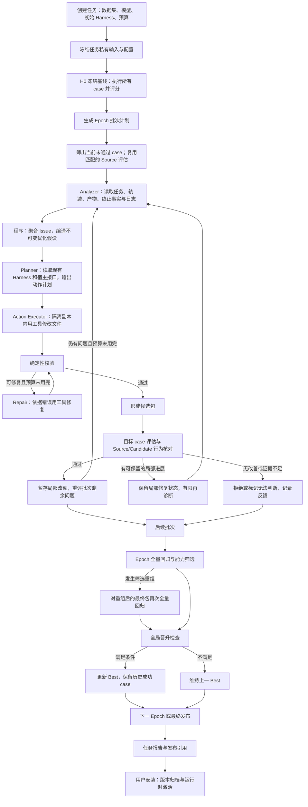

# Harness RSI 优化全流程与信息流详解

> **目标**：说明当前 Harness 优化如何运行、每个组件和 Agent 读取什么、生成什么、保存到哪里，以及这些信息后续如何参与诊断、修改、验证、发布和问题排查。
>
> **代码基准**：2026-10-22 当前本地工作树。JiuwenSwarm 位于 `/Users/jiuwen/orca/workspaces/jiuwenswarm/0.2.8-2`；agent-core 位于 `/Users/jiuwen/orca/workspaces/agent-core/release-v0.1.20`。包含本次会话已经修改但尚未提交的代码，不能直接等同于同名远程版本。
>
> **适用范围**：Web/AgentServer 的 HARNESS 场景，实际运行 `SingleHarnessIterativeOptimizationOrchestrator` 的单 Harness 优化主链路。历史实验用于解释产物；新加的日志和纠错能力不会自动补写到历史实验。

---

**阅读导航**

- 总体结构：[流程图](#2-完整流程图)、[Agent 职责表](#3-所有-agent-与程序组件的职责)。
- 执行与判分：[任务冻结](#4-创建任务输入怎样变成可复现的实验)、[case 执行](#6-每个-case-内部究竟怎样运行)、[Judge](#7-judge如何从执行结果得到分数)。
- 分析与修改：[Analyzer](#9-analyzer从失败证据到可修改的问题)、[Planner](#11-planner决定怎样修改现有-harness)、[Executor](#12-action-executor真正修改-harness-的步骤)、[Repair](#13-确定性-verifier-与-repair)。
- 验证与交付：[Candidate Gate](#14-candidate-gate修改后到底有没有改善)、[全量回归](#16-epoch-全量回归能力筛选和全局晋升)、[发布与激活](#17-最终发布与-swarm-安装激活)。
- 查询与排查：[预算配置](#18-所有预算停止条件和重试的关系)、[目录与文件](#19-任务目录总览与文件流转索引)、[状态与恢复](#20-状态恢复与前端为什么可能看起来停住)、[实际案例](#21-用最近两次真实实验串起信息流)、[源码索引](#23-源码阅读索引)。

## 1. 先建立整体认识

一次 Harness 优化包含三种不同工作：测试 Agent 执行数据集任务；优化 Agent 根据失败证据修改 Harness 包；控制程序比较修改前后的效果并决定是否保留和发布。

在这条链路中，**Solver 负责做题，Judge 负责判分，Analyzer 负责诊断，Planner 负责制定修改计划，Action Executor 负责落实修改，Repair 负责修正包的工程校验问题**。调度、文件归档、预算限制、候选选择、全量回归和最终发布由程序负责。

因此，模型请求记录里先出现若干个 case 的执行，接着出现诊断和修改请求，是正常的阶段切换。是否完成优化，要继续看候选评估、整轮检查点和最终发布状态。

### 1.1 三个层次

| 层次 | 具体内容 | 本次优化怎样影响它 |
| --- | --- | --- |
| 宿主运行框架 | DeepAgent、ReAct、工具执行、Rail 生命周期、会话、日志、评估控制器 | 由 agent-core 提供；候选不能任意改写框架 |
| 被优化的 Harness 包 | Prompt Section、Skill、Tool、Rail、白名单运行配置 | 优化 Agent 在隔离副本中修改，然后加载到测试 Agent |
| RSI 优化流程 | 数据集、诊断、计划、执行、验证、回归、发布 | 控制如何产生和筛选 Harness；并不是被测任务本身 |

通用 Harness 框架还支持 Task Loop、子 Agent、记忆等能力。本实验的 Solver 显式使用 `enable_task_loop=False`，执行单轮 ReAct 循环，不能把通用框架所有能力都当成当前实验已经启用的能力。

### 1.2 四种经常被混淆的成功

| 状态 | 能证明什么 | 还需要什么 |
| --- | --- | --- |
| 模型调用成功 | 收到了模型响应 | 响应可能仍不符合 JSON 或业务约束 |
| Harness 候选生成成功 | 文件已经修改并通过相应工程校验 | 需要重新运行 case，确认效果 |
| 候选局部通过 | 对它负责的目标 case 有改善，相关行为证据满足要求 | 需要整轮全量回归，保护历史成功 case |
| Harness 最终发布 | 最终选定的包通过全局晋升条件，形成稳定发布副本 | 在 Swarm 中使用还需要安装/激活 |

`COMPLETED` 表示优化流程执行结束；流程可以完成但没有可发布的新版本。`publication_status` 才说明有没有最终发布产物。

## 2. 完整流程图



其中，一个 Epoch 遍历数据集的批次；一个 Batch 聚焦一组当前未通过的 case；一个候选尝试针对一个选定问题生成修改。一个 Agent 的 ReAct step 是更内层的模型推理/行动轮次。

## 3. 所有 Agent 与程序组件的职责

### 3.1 当前主链路的 Agent

| Agent/模型环节 | 模型来源 | 获取的信息 | 工具与执行方式 | 当前默认内部轮次 | 输出 |
| --- | --- | --- | --- | --- | --- |
| Solver / 测试 DeepAgent | `models/evaluation.yaml`，来自 tester | 原始任务、公开附件、执行工作区、加载后的 Harness 能力 | 文件与 Shell 等运行工具，加上包实际注册的能力；ReAct | 300，受宿主硬上限约束 | 回答、工作区产物、工具轨迹、终止信息 |
| 任务开始时 Skill 选择 | 使用 Solver 模型 | 当前任务文本、Skill 元数据 | 有界选择调用；选中后由运行适配层加载 Skill | 独立于主 ReAct 轨迹理解 | 选择/加载记录，参与能力触发证据 |
| LLM Judge | 当前 Swarm profile 显式绑定 `models/analysis.yaml`，来自 optimizer | 任务、参考与 rubric、Solver 回答、冻结的轨迹和产物 | 小证据可完整内联直接判分；较大证据使用只读 DeepAgent | 工具模式 20 | 结构化 assessment、连续分数、逐要求结果 |
| Analyzer / Diagnosis Agent | `models/analysis.yaml` | 失败 case、原任务条款、Harness 上下文、运行与验证证据、历史候选反馈 | 隔离证据工作区中的只读文件/搜索；受限 Shell 用于证据检索 | 20，最后一轮在现有预算内要求输出诊断 | 每 case 最多 3 条诊断 |
| Action Planner | `models/member_optimization.yaml` | 已选问题、不可变假设、现有 Harness、动作定义、宿主接口、历史经验 | 只读文件检索，无 Shell；可多轮调查 | 15 | 修改计划及依赖关系 |
| Action Executor | 同上 | 单个动作、计划约束、现有包副本、允许写入路径、运行配置硬上限 | 6 个基本文件工具，多轮 ReAct，无 Shell | 8 | 实际文件修改、动作结果 |
| Verification Repair | 同上 | 集成后的包、确定性校验错误、修复边界和前次反馈 | 6 个基本文件工具，多轮 ReAct，无 Shell | 8 | 修复后的文件和修复结果 |
| Candidate Behavior Check | analysis 模型 | Source/Candidate 的冻结行为证据、目标行为检查、遗漏说明 | 有界证据组装到请求中，直接调用，无工具 | 受输出纠错次数限制 | 行为是否发生变化及逐侧引用 |

“内部轮次”与“结构化输出纠错次数”是两个预算。例如 Executor 一次执行最多 8 轮工具交互，输出或文件不合规后，外层是否再给反馈由纠错预算决定。不能把表里的 8 理解为整个任务只发 8 个模型请求。

### 3.2 主链路里由程序完成的部分

| 组件 | 是否调用模型 | 作用 |
| --- | --- | --- |
| TaskService / Materializer / Worker | 否 | 校验输入、冻结配置、排队、管理任务状态 |
| DataLoader / DatasetProfiler / BatchPlanner | 否 | 标准化 case、统计分布、生成可追踪的批次计划 |
| TeamEvaluator / CaseRunner | 自身负责调度；内部调用 Solver/Judge | 执行、归档、评分、汇总和有限瞬态重试 |
| 诊断聚合 | 当前主路径为确定性聚合 | 合并有效诊断，形成 Issue |
| 优化假设编译 | 否 | 固定失败事实、目标行为、范围、可用修改面和内容哈希 |
| 单 Harness 角色/机制输入编译 | 否 | 唯一角色归属明确，直接从 Issue 和假设产生规划输入 |
| MemberSelector | 否 | 根据严重度、置信度和可执行机制选择目标 |
| WorktreeCoordinator / 合并控制 | 否 | 复制隔离副本、检查写入边界、按动作波次合并 |
| HarnessChangeVerifier | 否 | 检查语法、包结构、引用、接口、可执行策略和白名单配置 |
| Candidate Gate / Epoch Checkpoint | 包含 Behavior Check 等明确模型子步骤 | 依据实际评分和证据判定是否接纳、回归和晋升 |
| 发布/安装控制器 | 否 | 复制最终包、记录引用、校验安装条件、更新激活状态 |

通用多成员优化代码仍包含 Role Attribution 和 Mechanism Attribution 模型 Agent。**当前单 Harness 主流程绕过了这两次语义重写调用**，但为了审计兼容仍会生成 `role_attribution.yaml`、`mechanism_attribution.yaml`。看到文件存在，不能据此断言运行过对应 LLM。

## 4. 创建任务：输入怎样变成可复现的实验

### 4.1 用户/API 提供的信息

HARNESS 任务至少需要名称、数据集路径、optimizer 模型、tester 模型。服务还解析初始 Harness 来源、优化 Epoch 数和训练选项。数据集可使用 `input_file` 或兼容的 `dataset_path` 字段。

当前单 Harness 模式要求每次只生成一个候选，`sibling_candidate_count=1`，不接受 improver evolution policy。服务侧执行模式是 `local`。评估方法支持 `script_based`、`exact_match`、`llm_as_judge`；并不是所有 Harness 实验都一定启用 LLM Judge。

顶层 `max_iterations` 在任务服务中表示优化轮次，最终映射到 `max_epochs`。它与 `solver_max_iterations` 的单 case 步数是不同参数。

### 4.2 冻结的数据与配置

服务把外部路径对应的材料拷贝到任务目录，再把任务私有路径传给引擎。后续运行不应继续依赖原始文件被随意修改后的内容。

默认任务目录记为：

```text
T = /Users/jiuwen/.jiuwenswarm/rsi/tasks/<task_id>
```

本文后续目录均以 `T/` 为相对根；`R = T/run`，`M = T/run/member_optimizations/member_optimization_NNN`，`E` 代表某次评估目录，`C = E/cases/cNNN_<hash>`。

| 冻结内容 | 保存位置 | 后续使用者 |
| --- | --- | --- |
| 标准化数据集与需要复制的关联文件 | `T/input/` | DataLoader、Solver 工作区准备、Judge 参考证据准备 |
| 初始 Harness 包 | `T/harness/versions/baseline-<digest>/...` | H0、Source 评估、优化器读取初始能力 |
| 角色到初始包的引用 | `T/harness/harness_refs.yaml` | Provider 和单 Harness 编排器 |
| tester 对应的模型配置 | `T/models/evaluation.yaml` | Solver |
| optimizer 对应的分析配置 | `T/models/analysis.yaml` | Analyzer、Behavior Check；LLM Judge profile 也显式绑定此文件 |
| optimizer 对应的修改配置 | `T/models/member_optimization.yaml` | Planner、Executor、Repair |
| 完整有效训练配置 | `T/config/harness_orchestrator.yaml` | Provider 构造 agent-core 配置对象 |
| 任务信息、材料路径和摘要 | `T/task.json` | 状态查询、启动、恢复、前端显示 |

材料校验还记录内容摘要。恢复任务时要核对冻结材料，避免更换模型、数据、评分协议或初始包后继续使用旧评估结果。

### 4.3 当前原生基线包是什么

最近实验的基线包使用 `rsi-native-agent-baseline`，清单描述为原生 Agent 的无新增能力基线。包可以只有 `harness_config.yaml`，没有额外 Skill 或 Prompt Section。

“包内没有新增能力”仍然会有宿主 DeepAgent 的原生 Prompt、基础工具和运行 Rails。后续优化从这个基线包新增可物化能力，比较的是在相同宿主上加载不同包后的效果。

## 5. 启动和冻结基线 H0

Worker 从 TaskStore 读取任务，通过 `HarnessEngineAdapter.build_request()` 生成请求。请求包含 task_id、数据集文件、Harness 引用、输出目录、模型信息和任务私有 profile 路径。

`HarnessProvider` 校验材料并创建 `IterativeSingleHarnessRequest`，调用单 Harness 迭代编排器。生产 profile 中已经冻结模型文件路径，因此 Provider 不再用界面上的模型 ID 覆盖它们。

新任务会先跑一次 **全部 case 的冻结基线**。假设数据集有 5 个 case，模型轨迹最先看到 5 个任务执行，就可能是这次 H0 评估，而不是已经完成了第一轮优化。

| 项目 | 说明 |
| --- | --- |
| 输入 | 全部 case、初始 Harness 引用、固定的 Solver/Judge 配置 |
| 操作 | 每 case 准备工作区，运行 Solver，评分，收集轨迹和产物 |
| 输出 | 各 case 结果、基线均分、通过集合、评估引用 |
| 保存 | `T/run/evaluations/frozen_baseline/` |
| 后续用途 | H0 展示、初始 Best、Source 证据复用、历史成功保护、最终改善比较 |

引擎在 `single_harness_state.yaml` 保存 baseline 引用和分数。发生基础设施错误而未形成可信完整基线时，可能在优化尚未开始前就失败。

## 6. 每个 case 内部究竟怎样运行

### 6.1 Solver 获取的信息

CaseRunner 将一个 case 交给 backend。backend 解析唯一角色与包路径，读取包内 `runtime.yaml`，没有覆盖项时采用 evaluator 默认值；随后先把实际生效配置写到 `runtime_config.json`。

工作区有几种来源：普通任务建立独立目录；配置了 `workspace_source_dir` 的 case 会复制源码；SWE-bench 路径会准备容器和 `/testbed`。公开任务附件会放入工作区。实际路径以 `result.json` 的 `workspace_dir` 为准，不能一律猜成 `/workspace`。

Solver 得到任务本身、公开附件和必要环境说明。参考答案、Judge 的内部评分职责和优化器的 Issue 不是普通解题指令的一部分。

### 6.2 Harness 的加载与生效

backend 创建 DeepAgent，装配系统操作适配、可靠性 Rail、Harness 输入适配和 Skill 使用适配，然后通过 `agent.load_plugin(harness_path)` 加载包。

| 修改面 | 运行时如何产生作用 | 需要检查的地方 |
| --- | --- | --- |
| Prompt Section | 通过包的声明参与系统上下文组装 | 内容文件、注册关系、实际作用阶段 |
| Skill | 发现元数据，任务开始时选择相关 Skill，或执行中通过 Skill 工具加载 | 是否被选中/加载，触发时间是否足够早，内容是否被实际采用 |
| Tool | 根据包声明注册工具 | 工具名称、参数 Schema、实现可加载性、实际调用证据 |
| Rail | 注册到模型/工具/调用生命周期 | Hook 类型、接口和宿主支持模式，实际触发效果 |
| Config | evaluator 读取 `runtime.yaml` 后配置 DeepAgent | `runtime_config.json` 是否反映覆盖值 |

Source、Candidate、回放和发布评估使用一致的任务开始 Skill 选择协议，选择器只依据任务文本和 Skill 元数据。优化器自己的 `candidate_manifest.yaml` 不作为隐含解题提示注入 Solver。

“能力文件存在”“插件加载成功”“Skill 被调用”“目标行为已经改变”分别是不同证据层次，后面 Candidate Gate 会继续区分。

### 6.3 ReAct 循环

模型读取当前上下文后，可以返回工具调用；宿主执行工具，把结果作为观察再交给模型；模型继续，直到返回最终回答、触发限制或出现异常。

这里的 step 是 ReAct 迭代预算，不能与输出 token 数画等号。一轮可能有工具动作，Skill 选择等辅助调用也可能额外出现在模型请求统计中。

当前新任务的 Solver 默认实际预算和宿主硬上限均为 300。包可以在硬上限内改变实际预算。达到预算后的 RSI 策略只允许 `error` 或 `return_observations`，没有追加一次无工具收尾的 Solver 请求。

### 6.4 Solver 的输出与归档

| 信息 | 保存位置 | 后续用途 |
| --- | --- | --- |
| 实际步数与终止策略 | `C/runtime_config.json` | 判断是否真用了候选配置；诊断预算问题 |
| 终止原因、已用步数、是否截断 | `C/termination.json` | 区分正常回答、预算耗尽和异常 |
| 当前 case 的执行目录 | `C/workspace/` 或结果中记录的实际路径 | Solver 操作、产物采集、必要源码证据 |
| 被采集的交付产物 | `C/artifacts/` | Judge、Analyzer、Behavior Check |
| 单次调用运行摘要日志 | `C/logs/invocation-<uuid>.jsonl` | 检索异常、预算耗尽、调用生命周期 |
| 原生执行轨迹及投影 | `C/tr/`、按配置生成的观测数据 | 还原模型/工具操作及先后关系 |
| 规范化轨迹 | `C/judge/normalized_trace.json` | Judge、Analyzer、能力激活检查 |
| 执行与评分总结果 | `C/result.json` | 汇总分数、诊断、候选比较和缓存复用 |
| 面向分析的完整 case trace | `C/trace.json` | CaseReader、证据投影和排查 |

产物采集有边界：Solver 把文件写到未被采集的外部临时目录，并不保证能进入 `artifacts/`。回答里声称“已经生成某文件”也不能替代落盘证据。

`result.json` 在评分完成后才能形成完整结果。只有 `termination.json` 而没有 `result.json`，可能是 Solver 已完成、Judge 尚未完成或已经失败。

## 7. Judge：如何从执行结果得到分数

### 7.1 三种评估方法

`script_based` 使用对应脚本/验证器的结果；`exact_match` 按匹配规则比较；`llm_as_judge` 使用独立判分模型。具体任务可能带有其自己的评分方法或 grading contract，需结合有效 profile 与标准化 case 看最终路径。

以下详细说明最近实验使用的 LLM Judge。

当 backend 交出的 `execution_status` 不是 `passed` 时，该 Judge 直接返回执行失败对应的失败结果，不再调用判分模型。这与“Solver 正常结束，但 Judge 自己没有完成判分”有不同的文件表现。

### 7.2 冻结判分证据

Judge 为每次判分创建独立目录：

```text
C/judge/evaluation_<uuid>/
```

其中 `evidence/request.json` 记录任务、Solver 回答、参考答案、参考用途、rubric、要求项、禁止行为和证据清单。相关执行轨迹、已采集产物、公开附件和参考文件会复制到这个只读快照里；过长回答可以分页保存，并保留原始回答。

这个快照的作用是让判分和后续纠错面对同一份证据。Judge 不应把轨迹或 Agent 自己写的检查当成独立的最终评分。

### 7.3 为什么有时只有一次模型调用，有时是 Judge Agent

如果证据能够完整放入有界请求，程序会将证据内联，直接请求结构化判分；如果无法完整内联，则启动只读 Judge DeepAgent 自己读取冻结证据。

工具模式提供 `read_file`、`list_files`、`glob`、结构化证据读取和专用搜索工具；没有 Shell、写文件、执行 Skill 或委派子 Agent。专用 Judge 搜索按**字面子串**匹配，不能把它当成正则 grep。

工具模式默认最多 20 轮。到最后一轮会提示完成评分；如果仍然耗尽并未形成可用判定，外层把它作为有类型的判分执行失败处理。

### 7.4 判分输出怎样校验和计算

Judge 输出结构化 assessment。控制程序负责解析、检查要求 ID、数值和完整性，并按评分协议计算分数。原始文本不能直接当作已验证分数。

当前 LLM Judge 同时保留两层信号：

| 信号 | 用途 |
| --- | --- |
| 连续分数、dimensions、逐要求 `requirement_results` | 展示质量差异，分析具体缺口，识别部分进展 |
| case 对外 `score` 与 `passed` | 以 `judge_success_score` 阈值决定通过，当前 profile 阈值为 0.8，case score 为 0 或 1 |

例如连续分数为 0.71 时，case score 可以是 0；这是未到通过阈值，不是没有判出分数。完全没有可信 assessment、判分异常和正常判成 0 分需要分别看待。

### 7.5 格式错误和判分失败怎样反馈

当前主评估循环先保存原始输出，再解析。有限纠错包含三个模式：

1. `agent`：按完整证据直接评分，或由工具 Judge 调查后评分。
2. `format`：给出上一份原始输出和明确解析错误，只修序列化格式，不补造分数或证据。
3. `closeout`：从完整冻结证据重新判分，不继续依赖失败的工具会话。

格式修复仍失败可转完整重评；输出截断、字段/要求 ID 错误、不可用判定、读取预算耗尽等可进入适当的完整重评路径。无法纠正的执行错误可以直接终止。它们共享有限 assessment 尝试预算，默认总共最多 3 次，且受旧 `judge_max_retries + 1` 进一步限制。

这里 Judge 的完整证据重评与 Solver 达到 300 步后的策略属于不同环节；Solver 没有追加无工具收尾。

### 7.6 判分文件逐个说明

| 文件 | 内容 | 谁使用 |
| --- | --- | --- |
| `evidence/request.json` 及快照文件 | 判分原始输入与完整证据入口 | Judge、判分纠错、人工排查 |
| `response_N.json` | 第 N 次 assessment 原始输出与恢复模式 | 解析、纠错、追查实际返回 |
| `format_repair_N.json` | 格式修复响应 | 检查是否只修了格式 |
| `diagnostics_N.json` | 模型调用诊断、finish_reason、usage、停止原因 | 判断 token 截断和纠错次数 |
| `validation_error_N.json` | 解析/语义错误、失败类别、原始输出位置 | 下一次反馈与人工定位 |
| `tool_events.jsonl` | Judge 使用证据工具的过程 | 判断是否真的读过相关证据 |
| `runtime_logs/invocation-*.jsonl` | 工具 Judge 的调用运行摘要 | 判断 Agent 调用本身是否异常 |
| `grading_events.jsonl` | 收到输出、校验失败、模式切换、成功或致命错误 | 判断完整判分工作流是否成功 |
| `assessment.json` | 通过协议校验的最终 assessment | CaseRunner、Analyzer 和优化信号提取 |
| `error.json` | 判分阶段对外异常摘要 | Task 失败定位 |

最后两类日志解释了一个实际情况：Judge Agent 可以正常返回文本，调用日志显示成功，但文本随后在外层解析失败。Agent 调用结束不代表判分工作流完成。

## 8. Epoch、Batch 和 Source 评估

### 8.1 数据加载与批次计划

DataLoader 读取冻结的数据集，标准化 case，补充 `case_path`、`case_index` 等来源信息。支持单 case、case 数组、`cases` 数组包装以及支持的 validation/evaluation suite。

DatasetProfiler 统计数据分布，BatchPlanner 形成确定性批次。默认平衡字段包含 `difficulty`、`dimension`、`source`、`task_type`，当前 Swarm 创建接口的默认 batch_size 是 1。

产物写入 `T/input/dataset_profile.yaml` 和 `T/input/batch_plan.yaml`。计划含 Epoch、批次、case ID 和分布信息；同名计划文件后续 Epoch 可能更新，状态中也记录计划路径。

编排器验证计划没有重复或遗漏请求的 case。当前 Harness 已有匹配证据证明通过的 case 会从主动修复批次中过滤；历史成功仍会在后续整轮回归中保护。

### 8.2 Source 是否每次都会重跑

不一定。Source 是当前修改前 Harness 的可信评估证据，可能复用 H0 或之前匹配的评估。

匹配上下文包含任务、数据文件、Harness 包内容、Evaluator/模型配置和评分协议等身份。`runtime.yaml` 也属于包内容，修改预算后不能继续把旧预算下的结果当作相同候选结果复用。

如果部分 case 有匹配结果，程序复用它们，只对缺失部分运行 fresh 评估，再物化为本批次 Source。复用关系保存在评估引用的 provenance 中。因此日志里看不到 Source 再跑全部 case，并不意味着跳过了比较基准。

| 项目 | 保存位置 |
| --- | --- |
| 本批次 Source | `T/run/evaluations/eNNN/bNNN/source/` |
| 部分缺失结果的补跑 | Source 下的 `fresh/`，需要时生成 |
| 评估上下文 | 相应评估目录的 `evaluation_context.yaml` |
| 评估入口与汇总 | `eval_ref.yaml`、`summary.json` |

已有完整结果与当前上下文不一致时，会要求新建运行；部分结果缺少可靠来源信息也不能随意复用。

## 9. Analyzer：从失败证据到可修改的问题

### 9.1 诊断的目的

Analyzer 解释失败发生在什么层，找出可由 Harness 改善的决策或能力缺口，形成可以交给优化器的目标。它的结论还需要候选实验验证，不能把诊断建议直接当成因果证明。

例如，Solver 终止于第 300 步，是确定的执行事实。原因可能是重复检索、错误修复循环、任务过大、工具失败，或预算与任务不匹配。Analyzer 应引用区别这些解释的证据，再建议 Skill、Prompt、Tool、Rail 或运行配置的干预。

### 9.2 输入怎样组装

每个待诊断 case 建立隔离的临时证据工作区。模型同时得到有界内联摘要和可以继续读取的证据入口。

| 输入 | 信息来源 | 诊断作用 |
| --- | --- | --- |
| 原始任务和稳定条款 | case.input、`task_clauses.json` | 明确输入保证、必须满足的要求和不能破坏的边界 |
| 执行与判分摘要 | result、Judge assessment、规范化轨迹 | 确定失败项及实际操作 |
| 执行历史 | `execution_history.json`、`evidence_summary.md` | 追溯关键模型/工具行为；摘要不保证包含全部历史 |
| 实际运行配置 | `runtime_evidence/runtime_config.json` | 看生效预算和策略 |
| 确定终止事实 | `runtime_evidence/termination.json` | 先确认何时、为何结束 |
| 日志目录清单与检索结果 | `evidence_manifest.json`、`runtime_log_search.json` | 定位异常、超时、预算耗尽或证据缺口 |
| 当前 Harness 上下文 | 当前被评估包的声明和相关内容 | 判断已有能力为何没有避免失败 |
| 产物、可提供的仓库证据 | 隔离复制的实际评估材料 | 检查回答与实际实现是否一致 |
| 历史候选反馈 | 之前 Gate 结果、逐要求变化、能力触发情况 | 避免重复无效方案，保留已有进展 |

原始 evaluator 目录不会直接整体暴露给诊断 Agent。模型在准备好的证据工作区内调查，不能把 gold/solution patch 或 evaluator 实现当作修复答案。

### 9.3 怎样读日志

当前 Prompt 明确将日志列为根因分析证据：先读配置、终止事实和 manifest；再搜索 manifest 列出的 case/角色/invocation 日志。

推荐顺序是先搜 `WARNING`、`ERROR`、`CRITICAL`，再针对 `exception`、`timeout`、`max_iterations` 等词查询。相关命中附近读取少量上下文，确有需要再分页。

证据准备和初始搜索有容量限制，并记录裁剪、遗漏或读取问题。没命中、日志被裁剪、缺少历史文件，都只能保持 unknown，不能推出“没有发生异常”。

### 9.4 输出诊断包含什么

每 case 输出 1–3 条结构化诊断，关键字段如下。

| 字段 | 含义 | 下游用途 |
| --- | --- | --- |
| `issue_category`、`target_ref` | 问题归属及具体角色修改面 | 筛选可修改 Issue |
| `failure_layer` | runtime / harness / evidence / unknown | 区分运行配置问题、行为缺口和诊断基础设施问题 |
| `observed_failure` | 已确定的失败事实 | 避免把猜测写成事实 |
| `candidate_explanations`、`discriminating_evidence` | 竞争解释与区分它们的证据 | 约束后续修改和再诊断 |
| `summary`、`root_cause`、`critical_mistake` | 问题概括、机制解释、最早关键错误 | 规划修改方向 |
| `evidence_refs` | trace、角色、消息序号、step 指针 | 程序校验与追溯 |
| `task_contract_checks` | 相关任务条款及建议是否保持其约束 | 防止以误读任务为基础优化 |
| `decision_contract` | 错误决策、必要行为、可观察验收条件、作用阶段和边界 | 编译优化假设、计划与行为验证 |
| `validation_observations`、`verifier_observations` | 本地测试与权威验证的观测 | 避免把自写 probe 当成最终通过 |
| `recommendation`、`confidence`、`severity` | 建议、证据强度与严重度 | Issue 排序与选择 |

稳定条款 ID 由程序依据原始任务生成。模型选择 `clause_id`，程序回填原文和行范围；兼容的旧原文引用需要唯一精确匹配。模糊改写不能当成合法引用。

运行配置类问题可以指向 `member_harness.validation_harness.config`。缺失轨迹、坏证据或框架链路错误应该保持 unassigned/证据层归属，不能伪装成“需要新增 Skill”的问题。

### 9.5 校验、纠错与保存

程序检查字段、引用、任务约束与语义冲突。有效诊断会保留，具体错误连同原输入反馈给模型。默认最多 3 次，连续无进展达到 2 次会提前停止；Analyzer 的进展依据未解决字段与已接受诊断状态判断，换一段措辞不算进展。

| 产物 | 位置 | 下游用途 |
| --- | --- | --- |
| 单 case 全部最终诊断 | `analysis/per_case_diagnoses.json` | 审计、Issue 编译、复查 |
| 聚合问题 | `analysis/issues.yaml` | Hypothesis 编译和 MemberOptimizer |
| 分析入口与状态 | `analysis/analysis_ref.yaml` | 编排器判断是否可继续 |
| 每次原始输出、错误、接受数量、停止原因 | `analysis/diagnosis_attempts/<case-uuid>/attempt_NN.json` | 排查格式、引用、真实语义错误 |
| 归档运行证据 | 上述目录的 `evidence/` | 保留运行日志、配置、终止、条款和清单证据 |
| 诊断 Agent 日志 | 上述尝试目录相关 `logs/` | 排查 Agent 自身失败 |

第一次分析通常位于 `T/run/evaluations/eNNN/bNNN/analysis/`。剩余问题再分析使用 `residual_analyses/rNNN/`。恢复时失败分析可写入 `retry_NNN/`，保留先前失败证据。

没有待修复问题和分析失败是不同状态。失败 case 全部无法得到可用诊断时，`require_usable()` 会阻止继续，不能把它当成“没有问题，优化完成”。

## 10. 从 Issue 到不可变优化假设

诊断输出经过确定性聚合形成 Issue，随后 `compile_optimization_hypotheses()` 编译 `optimization_hypotheses.yaml`。

这一步固定的是本次干预的依据和验收方向。后续模型不能为了让自己生成的实现显得正确，随意重写原任务要求或把失败事实换掉。

| 假设中的信息 | 含义 | 后续读取者 |
| --- | --- | --- |
| hypothesis ID、source issue ID、内容 SHA-256 | 唯一身份、来源和内容绑定 | Planner、候选 manifest、审计 |
| 公开任务触发条件 | 未来哪类任务应触发这一能力 | Planner、Executor 生成可复用能力 |
| 权威观测与失败事实 | 当前实验已观察到的结果 | 计划校验、候选再分析 |
| 必要行为与禁止行为 | 需要改变什么、不能破坏什么 | Planner、Executor、Behavior Check |
| 决策契约与边界 | 关键决策差异、可观察验收方式、适用范围 | 行为验证和后续反馈 |
| Lever/修改面策略 | 本次允许使用哪些能力面 | 计划校验和执行控制 |

单 Harness 的角色归属已经明确，程序直接把这些输入编译成角色、机制和选择报告，避免再次用模型重写诊断。MemberSelector 是确定性选择器；通用实现结合严重度、置信度、问题数量排序，当前 profile 每次最多选择一个角色。

产物位于 `M/role_attribution.yaml`、`M/mechanism_attribution.yaml`、`M/member_selection.yaml`。它们提供规划入口，保留选择和未选择原因；不可变假设原件仍在对应 analysis 目录。

`candidate_manifest.yaml` 保存候选与原假设、Issue、动作的来源绑定。它属于优化审计信息，不能靠把当前 case 答案写进 manifest 让 Solver 通过。

## 11. Planner：决定怎样修改现有 Harness

### 11.1 输入

Planner 读取选中的角色与包路径、当前包结构摘要、角色/机制报告、动作定义、不可变优化假设、拒绝过的能力和历史优化经验。它还有只读证据工具，可查看原包文件和支持的宿主接口。

包结构摘要包含清单和 prompt_sections、skills、tools、rails 等目录信息。对于“modify”动作，程序会校验目标是否存在；不能仅凭模型猜一个现有文件名就开始改。

因此当前设计要求规划阶段与执行阶段都能检查原 Harness。包已有能力、缺失能力、宿主可支持接口共同约束计划。

### 11.2 允许的动作面

| action_group | 允许操作 | 常见目标 | 边界 |
| --- | --- | --- | --- |
| `prompt` | add / modify / remove | `prompt_sections/files/*.md` 与 `prompt_sections/sections.yaml` | 当前单 Harness profile 只允许 prompt_section，identity/soul 不开放 |
| `skill` | add / modify / remove | `skills/<name>/SKILL.md`、支持文件、Skill 注册 | 必须是可复用过程，满足包与安全策略 |
| `tool` | add / modify / remove | Tool 实现与 `tools/tools.yaml` | 必须符合宿主 Tool Schema、接口和加载方式 |
| `rail` | add / modify / remove | Rail 实现与 `rails/rails.yaml` | Hook 与运行模式必须受支持 |
| `config` | add / modify / remove | 包根目录 `runtime.yaml` | 只允许步数和耗尽策略两个白名单字段 |

当前路径不允许通过动作定义任意扩展新的可执行修改面。模型、鉴权、服务地址、Judge 标准和宿主硬上限不属于候选可写配置。

### 11.3 计划包含什么

计划写入 `M/plan.yaml`。核心对象是 targets、actions 和 action_waves。

| 动作字段/信息 | 用途 |
| --- | --- |
| action ID、角色、action_group、operation | 标识谁做哪类修改 |
| target_path | 主要目标文件或目录 |
| declared_write_paths | 本动作允许实际写入的路径边界 |
| attributed_issue_ids、假设绑定 | 说明修改在解决哪个已诊断问题 |
| rationale、约束和验收意图 | 解释选择此干预的依据 |
| depends_on | 指定必须先完成的动作 |
| run_if | 依据前序结果决定是否执行 |
| wave 分组 | 确定依赖、执行与合并顺序 |

例如增加 Prompt Section，通常同时需要内容文件和注册项。只写内容而不注册，后续包加载或行为检查可能无法证明它生效。

### 11.4 反馈和失败

Planner 默认最多 15 轮调查。格式输出、结构和计划语义会被校验，错误反馈到有限纠错循环。某些恢复路径会把原任务、已收集工具证据和前稿完整组装后，直接请求最终计划；这类无工具请求有明确的已收集证据输入。

解析恢复与语义校验共享 Planner 的外层输出尝试预算，不能每嵌套一层就重新给 3 次。没有足够证据支持修改时，不能靠编造接口或猜测文件路径凑出计划。

规划失败记录在 `M/action_planning_error.json` 等审计产物中，不会产生一个假装有效的候选进入正常比较。

## 12. Action Executor：真正修改 Harness 的步骤

### 12.1 工作副本的准备

控制程序先从当前包复制集成副本，再按依赖关系为动作复制独立副本。这里的 worktree 是优化器管理的隔离文件副本；当前这部分代码使用复制目录，并不意味着为每个动作执行了 Git worktree 命令。

短路径布局如下：

```text
T/mh/
  roles.yaml
  initial/r<role_hash>/
  current/r<role_hash>/
  runs/mNNN/
    plan.yaml
    execution_results.json
    wt/<role_hash>/i/                       # 集成副本
    wt/<role_hash>/a/<wave_hex>/<action_hash>/ # 单动作副本
    candidate/r<role_hash>/                 # 本次候选包
    tmp/r<role_hash>/                       # 发布准备副本
```

短目录名用于避免深层复制导致的路径长度问题。`roles.yaml` 记录角色与短路径映射。以实际文件里的引用为准，不要手动拼接哈希目录名。

### 12.2 Executor 实际拿到什么

Executor 输入是**单个动作**：目标、操作、角色、必要的计划/行为约束、允许写入路径、当前包的相关文件上下文、宿主接口说明、运行步数硬上限，以及必要的历史错误反馈。

它能读取原 Harness 的相关内容和受支持宿主代码入口，再修改自己动作的副本。声明写入范围之外的包文件可以按读取权限查看，不代表可以修改。

固定基本工具是：

```text
read_file
list_files
glob
grep
write_file
edit_file
```

Executor 是原生 DeepAgent，默认 8 轮，可以形成“读取 → 修改 → 查看工具反馈 → 继续修正”的 ReAct 过程。没有 Shell，也没有依靠隐式技能发现来扩大写入能力。

### 12.3 控制程序如何判断动作完成

程序对动作副本做前后文件快照，检查真实变更。以下情况不会因模型声称成功就直接放行：

- 返回 success，但声明路径没有实际变化。
- 修改了 `declared_write_paths` 之外的文件。
- 文件结构、Skill 内容或注册关系不符合动作契约。
- runtime.yaml 含未知字段或超出宿主步数硬上限。

兼容路径仍可解析结构化 `file_writes`，但当前主要执行方式已经是工具实际写文件。注册同步、确定性删除等支持操作由程序配合完成；删除动作可以由确定性代码执行，不必每次都调用模型。

### 12.4 错误怎样反馈

可修复的错误会把具体失败项、当前文件状态和原动作返回给 Agent。每阶段默认最多 3 次输出尝试；同样错误和文件状态重复达到无进展阈值时停止，不能无限空转。

Agent 自报 failed 也要结合错误是否可修复判断。越界写入等不可继续的情况会直接失败，不能通过继续生成掩盖。

### 12.5 合并和产物

动作按角色、依赖 Wave/Subwave 执行。控制程序把合法动作的真实修改合并到集成副本，后续依赖动作读取已经合并后的版本。当前 Swarm profile 的相关执行并发均为 1，通用组件还保留并发能力。

| 输出 | 位置 | 后续用途 |
| --- | --- | --- |
| 每动作执行详情 | `M/` 下短动作目录中的 `execution.json` | 记录状态、变化文件、错误和实际副本 |
| Wave/Subwave 合并记录 | `M/m/<role_hash>/wave_NNN_subwave_NNN.json` | 检查合并顺序和最终变更来源 |
| 汇总动作结果 | `M/execution_results.json` | Verifier 判断动作是否按契约完成 |
| 实际修改文件 | `T/mh/runs/mNNN/wt/...` | 后续校验、Repair、候选物化 |
| Agent 运行日志 | 工厂依据 workspace 分配的相邻 `agent_logs/<workspace_name>/` | 排查模型和工具执行；不写入待发布包 |

## 13. 确定性 Verifier 与 Repair

### 13.1 Verifier 检查的内容

Verifier 读取计划、执行结果和集成包，执行工程层面的检查。

| 检查 | 举例 |
| --- | --- |
| 执行契约 | 应执行动作有无结果，真实写入是否满足声明 |
| 文档/数据语法 | YAML、JSON 能否解析 |
| Python 源码 | 语法、AST 及相应禁止行为检查 |
| 包加载 | Manifest 能否加载，声明是否能解析 |
| Prompt 引用 | 注册项是否指向存在且合法的文件 |
| Skill | 引用、内容安全、运行挂载是否正确 |
| Tool | 实现文件、参数 Schema、注册激活是否成立 |
| Rail | 文件引用、Hook 签名、运行接口与模式是否支持 |
| 运行配置 | runtime.yaml 是否只有白名单字段且在宿主硬上限内 |
| 修改策略 | 动作类型和修改范围是否符合当前 profile |

它不会通过阅读 Prompt 就给任务评分，也不替代后面的真实 case 重跑。包能加载只是行为评估的前提。

检查写入 `M/verification.json`。需要修复的项目有明确错误名与信息；计划 Schema、执行结果缺失等错误不一定属于包内 Repair 能解决的问题。

### 13.2 Repair 和 Executor 的区别

| 对比 | Action Executor | Repair |
| --- | --- | --- |
| 起因 | 已批准进入执行的动作计划 | 已执行包的确定性检查失败 |
| 目标 | 把计划描述变成实际文件 | 让现有修改满足工程契约 |
| 输入重心 | 动作、原包、目标行为、声明写入路径 | 当前集成包、失败 checks、修复范围、前次反馈 |
| 工具 | 相同的 6 个基本文件工具 | 相同的 6 个基本文件工具 |
| 是否多轮 Agent | 是，默认 8 轮 | 是，默认 8 轮 |
| 是否决定候选通过 | 由后续 Gate 决定 | 由重校验和后续 Gate 决定 |

Repair 可以读取已有实现和宿主支持接口，修改允许的包内容。它不能改评分规则、优化器审计文件或最终发布引用来伪造通过。

每次 Repair 后程序重新运行检查，把仍失败的项目继续反馈。修复次数受 stage retry 与 output_repair 的较小预算约束；错误和包状态持续不变时提前停止。

### 13.3 候选形成

校验和有限修复完成后，MemberOptimizer 写出：

| 文件 | 内容 |
| --- | --- |
| `M/fix_result.json` | 修复尝试、停止原因、剩余错误和最终角色状态 |
| `M/candidate_harness_refs.yaml` | 本次候选角色指向的包路径 |
| `M/candidate_manifest.yaml` | 候选动作与原假设、Issue 的来源关系 |
| `M/member_optimization_ref.yaml` | 优化总入口，串联计划、执行、校验、修复、候选状态 |

编排器使用 `defer_publish=True` 调用优化器。因此这里形成的是供评估的候选包；最终正式发布由整个单 Harness 编排器完成。

## 14. Candidate Gate：修改后到底有没有改善

### 14.1 局部 Gate 的输入

局部 Gate 读取修改前 Source 评估、分析引用、当前/候选 Harness 引用、MemberOptimizer 状态、能力列表与目标 case 归属。

如果 Source 本身有执行错误、优化器没有成功形成候选，或候选引用没有变化，会分别标记无法判断或拒绝，不进入一个假装有效的改善比较。

候选首先评估自己负责的目标 case，跨 case 的历史成功保护推迟到 Epoch 全量检查点。这样局部归因不会直接绑定到无关任务的新一次随机采样结果。

### 14.2 候选运行看见什么

候选 Solver 仍然拿原始任务，加载候选 Harness。不会为了证明 Skill 有用而偷偷改成“请务必使用这个新 Skill”的测试题。

候选评估使用短路径：

```text
T/ce/eNNN/bNNN/aNNN/c001/
```

这里的 `c001` 是候选编号，里面还会有标准 `cases/cNNN_<hash>/`。`ce/` 与 `run/` 平级，是为控制路径长度；不要只在 `run/evaluations/` 下找候选执行记录。

### 14.3 Gate 检查什么

| 检查面 | 主要问题 |
| --- | --- |
| 结果有效性 | 候选是否有基础设施错误、skip 或无法判定的评分 |
| 目标改善 | 原来失败的目标 case 是否达到配置要求的分数改善，是否有目标回退 |
| Tool/Skill 使用 | 声明需调用的能力是否真的在相关目标 case 上调用 |
| 使用时机 | 能力是否发生在需要影响决策的窗口内，而非关键编辑之后才补用 |
| 机器证据 | 权威验证、执行事实、时间序列是否有失败或缺口 |
| 行为改变 | 任务要求的具体动作是否由 Source 的不足变成 Candidate 的满足 |
| 部分进展 | 连续分数、逐要求、fail-to-pass/原子检查是否改善，有没有新回退 |

例如，一个“编辑前检查约束”的 Skill 即使最终出现在工具调用中，如果它是在关键编辑后才加载，也不能证明该 Skill 纠正了编辑决策。

执行证据不完整时，未知调用数和缺失时间信息保持 unknown。不能把“轨迹没记录”自动解释为“模型没有调用”。

### 14.4 Behavior Check 为何没有工具

Behavior Check 的程序先把 Source/Candidate 的任务、回答、规范化轨迹、运行配置、终止信息、可采集产物和相关 patch 组装成有界请求，附带遗漏/裁剪清单，再请求比较。

它输出：

```json
{
  "source_check": "yes | no | unknown",
  "candidate_check": "yes | no | unknown",
  "behavior_changed": "yes | no | unknown",
  "evidence": [
    {"side": "source | candidate", "file": "supplied_file_key", "quote": "verbatim evidence"}
  ]
}
```

每个已知判断必须有该侧证据的原文引用。程序校验引用来自本次提供的文件，不能引用并未提供的路径。

这符合“无工具环节必须把所需信息组装给模型”的设计边界。其证据存在容量上限；信息不足时输出 unknown，不能假定它等同于无限制 Agent 已完整调查过所有文件。

产物位于候选评估目录的 `behavior_check/`，包括输入、原始输出、逐次校验记录和最终观察。格式/引用错误可以有限反馈；证据真的不足时，继续换措辞不会产生新的证据。

### 14.5 Gate 的几种结果

| 结果 | 后续逻辑 |
| --- | --- |
| 局部通过 | 记录为 `provisional`，更新本 Epoch 工作版本，等待全量检查点 |
| 有部分进展但尚未通过 | 满足可继续条件时保留局部候选作为下一次修复起点，重新分析剩余差距 |
| 能力存在但未应用/时机不对 | 把触发、使用和行为反馈给诊断，考虑更合适的干预面 |
| 有效执行但无改善 | 记录拒绝原因，受预算约束决定是否尝试下一个问题 |
| 基础设施或证据无法判定 | 标记 inconclusive，不能当作已经证明的 Harness 根因 |
| 有明确回退 | 阻止把该结果当作可保留的局部进展 |

部分进展的保留发生在本地有限修复链。它没有取消最终通过阈值、历史成功保护或全局发布检查。

## 15. 剩余问题修复与历史经验

局部候选通过后，编排器用新的工作 Harness 重新评估本 Batch，计算哪些任务已经完成，哪些仍然未通过。新的结果成为下一次剩余问题分析的 Source。

尚未通过但确有可保留进展的候选，也可以按条件作为后续局部修复起点。重新诊断会看到 Source/Candidate 差异、已经通过的要求、剩余失败、能力调用与 Gate 拒绝原因。

同一个 Batch 的候选修复链受 `max_repair_rounds_per_batch` 控制，当前 profile 默认 3。问题队列还会去重，避免相同 Issue/机制不停重复尝试；`max_issue_attempts_per_batch` 是另一个问题尝试配置，当前 profile 写为 8，但不能据此推断主循环一定会生成 8 个候选，实际循环仍受更小的修复轮数和提前停止条件限制。

| 保存信息 | 位置 | 后续使用 |
| --- | --- | --- |
| 每次候选 Gate、动作、分数和反馈 | `single_harness_state.yaml` 中相关列表 | 当前修复链、恢复、前端投影 |
| 残余 Source 评估 | `run/evaluations/eNNN/bNNN/attempts/aNNN/residual_source/` | 下一轮诊断和完成集合计算 |
| 残余分析 | `residual_analyses/rNNN/` | 下一次优化假设与计划 |
| 优化经历 | `run/optimization_journal.yaml` | Planner/后续候选避免重复错误 |
| 修改面成效统计 | `run/lever_scoreboard.yaml` | 分析哪些修改面有效、哪些反复无效 |

历史经验提供线索，当前任务和实际执行证据仍然是判定依据。

## 16. Epoch 全量回归、能力筛选和全局晋升

### 16.1 为什么需要整轮检查点

一个候选只在自己的目标 case 上通过，不能证明叠加多个候选后整个 Harness 仍然稳定。Epoch 末尾对累计工作版本运行全部 case，结果位于：

```text
T/run/evaluations/eNNN/full/
```

检查包括本轮目标是否仍然通过、之前成功的任务有没有回退、是否有执行错误或机器证据失败，以及整体分数是否下降。

如果没有保留任何 Harness 改动，而且已有可信 Best 分数，可以生成 `unchanged` 检查点而不重复做一次无变化的全量评估。不是每个 Epoch 都一定追加全部 case 的模型请求。

### 16.2 部分能力保留与重组

控制器按候选能力追踪归属。如果有的局部候选在全量回归中仍然有效、有的失效，程序可以从 Epoch 初始版本重组，只保留选中的能力。

重组产生了新的包，原累计版本的分数不能直接转移给它。程序会对重组后的包再跑全部 case：

```text
T/run/evaluations/eNNN/selected_full/
```

这个重放结果才是最终选中包的可信评估。重组后仍不满足保留条件时，整轮可被拒绝，不能继续生成未经评估的新组合直接发布。

### 16.3 晋升 Best 的条件

全局晋升至少要求最终选中包的平均分不低于上一 Best、上一 Best 已通过的 case 继续通过，额外保护的成功 case 不回退，并且选中评估没有不可判断的执行/机器证据问题。

局部候选是否被保留、整个组合是否晋升，是两个字段层次。检查 `epoch_checkpoints[].promotion_applied` 与 `promotion_reason`，才能知道本轮工作版本是否成为全局 Best；只看某个 Gate 的 `accepted` 不够。

通过时更新 `best_harness_refs_path`、`best_eval_ref_path`、`best_score` 和 retained case 集合；不满足时回到 Epoch 开始的可信版本。

## 17. 最终发布与 Swarm 安装/激活

### 17.1 引擎最终发布

正常结束时，引擎从可信 Best 复制独立的最终包，而不是把临时动作副本路径直接当作交付结果。

| 发布信息 | 位置/字段 |
| --- | --- |
| 最终独立包 | `T/run/published/current/r<role_hash>/` |
| 角色映射 | `T/run/published/roles.yaml` |
| 对外发布引用 | `T/run/member_optimizations/current_harness_refs.yaml` |
| 发布状态 | `single_harness_state.yaml` 的 `publication_status` |
| 稳定引用 | `published_harness_refs_path` |
| 运行报告 | `T/run/single_harness_report.yaml` |

没有可发布的新候选时，`publication_status` 可以是 `not_published_no_improvement`，发布引用为空。不能把初始包或某次临时成功候选展示成已经发布的新 Harness。

### 17.2 安装为什么是单独一步

Swarm 的安装服务要求任务属于 HARNESS、已经 `COMPLETED`，并且引擎明确 `published` 且提供合法的发布引用。随后验证包和路径、生成任务归属的版本副本、加载运行时并记录激活信息。

版本归档位于 `T/harness/versions/<installation_id>/`；激活索引由 `RsiHarnessActivationStore` 保存到其 root 下的 `activation.json`，默认 root 为 RSI tasks 根。索引记录当前版本与历史版本，支持按版本信息回退。

安装服务还会约束与当前运行状态冲突的切换，并校验回退目标内容摘要。前端的候选 ZIP 快照和可安装的正式发布包用途不同。

本文的 runtime.yaml 预算应用逻辑明确位于 RSI evaluator；文件会随发布包保留。普通 Swarm 对话的步数是否采用这一 sidecar，需要看其运行适配层，不能仅凭“安装成功”推断普通对话所有运行参数已同步为 RSI 评估参数。

## 18. 所有预算、停止条件和重试的关系

### 18.1 当前新任务默认配置

以下是 Swarm 创建接口实际物化的主要默认值。agent-core 其他模板、旧任务快照或显式 API 参数可以不同，具体实验以 `T/config/harness_orchestrator.yaml` 和每 case `runtime_config.json` 为准。

| 控制项 | 默认值 | 控制什么 | 候选 Harness 能否改 |
| --- | --- | --- | --- |
| `max_epochs` | 1 | 整个优化遍历轮数 | 不能 |
| `batch_size` | 1 | 单批计划 case 数 | 不能 |
| `sibling_candidate_count` | 1 | 同次候选数量 | 当前单 Harness 固定为 1 |
| `solver_max_iterations` | 300 | 初始每 case Solver ReAct 预算 | 能，通过 runtime.yaml 覆盖实际值 |
| `solver_max_iterations_hard_limit` | 300 | 宿主允许的最大 Solver 步数 | 不能 |
| `solver_on_max_iterations` | `error` | Solver 预算耗尽行为 | 能，在允许值中覆盖 |
| `judge_agent_max_iterations` | 20 | 工具 Judge 内部调查轮次 | 不能 |
| `diagnosis_agent_max_iterations` | 20 | Analyzer 内部调查轮次 | 不能 |
| Planner 内部轮次 | 15 | 单次规划调查 | 不能 |
| Executor / Repair 内部轮次 | 各 8 | 单次文件操作 Agent 循环 | 不能 |
| `output_repair.max_attempts` | 3 | 一个适用阶段的输出/修复总尝试，含首次 | 不能 |
| `output_repair.max_stagnant_attempts` | 2 | 无进展提前停止阈值 | 不能 |
| `max_repair_rounds_per_batch` | 3 | 单批候选修复链预算 | 不能 |
| `max_issue_attempts_per_batch` | 8 | 问题尝试上限配置；仍受实际主循环限制 | 不能 |
| `transient_case_retry_limit` | 2 | 可识别瞬态传输问题的额外 case 重试 | 不能 |

API 显式配置初始 Solver 预算高于 300、且没有单独给 hard limit 时，会默认让宿主上限至少覆盖这个初始预算。这是用户/宿主创建任务时的配置权；候选自身仍不能提高已经冻结的硬上限。

### 18.2 Harness 可修改的运行配置

```yaml
# Candidate package: runtime.yaml
max_iterations: 240
on_max_iterations: error
```

允许字段只有 `max_iterations` 和 `on_max_iterations`。后者只接受 `error`、`return_observations`；不接受 `final_answer`。文件需为包内正常文件，不能通过符号链接跳出包，大小限制为 16 KiB。

只覆盖其中一个字段时，另一个继承 evaluator 默认值。remove config 动作删除 sidecar 后，回到宿主 evaluator 默认配置。生效结果会完整写入每个 case 的 `runtime_config.json`，包括 `source` 是 `runtime.yaml` 还是 `evaluator_default`。

默认初始值已经是 300、宿主上限也是 300 时，候选不能把它改成 500。若源包自己把实际步数覆盖为 100，则候选可以在 300 宿主上限内提高它。

### 18.3 token 上限与步数没有换算关系

`max_tokens` / `max_completion_tokens` 属于单次模型输出预算。当前 RSI 保留模型配置里的显式值，包括支持的额外请求字段；缺省或 None 时由底层 provider 规则决定，不强行补一个统一 8192。

所以看到一次输出恰好 8192 tokens，要检查那次请求、冻结模型配置、上游返回的 `finish_reason`，不能仅凭长度断言 RSI 硬编码了 8192。`finish_reason=length/max_tokens` 才是输出截断的重要直接信号。

模型生成长文本、没有按要求输出 JSON，也可能在正常 stop 后被解析拒绝。token 没耗尽并不代表输出可用。

### 18.4 三种不同的重试

| 类型 | 反馈内容 | 是否理解/修改产物 | 停止边界 |
| --- | --- | --- | --- |
| 传输/瞬态重试 | 连接、超时、可重试模型调用异常 | 通常重新尝试相同任务/请求 | 独立小次数、退避 |
| Agent 内部 ReAct | 工具的真实结果 | 模型可继续读取、修改和修正 | max_iterations |
| 外层输出纠错/包 Repair | 上次原始输出、具体校验错误、当前文件或已接受状态 | 有明确反馈后改正 | max_attempts 与 no_progress |

这些预算作用于不同层，不能把它们相加当成总 token 上限，也不能认为所有重试都是“重新完整执行一遍 case”。

## 19. 任务目录总览与文件流转索引

### 19.1 目录总览

以下是可能完整产生的结构，不代表每个任务都一定生成所有文件。任务在哪个阶段失败，往往决定目录只出现到哪里。

```text
T/
├── task.json
├── events.jsonl
├── tree.json
├── snapshots/
│   └── A<node>.zip
├── input/
│   ├── <dataset>.json
│   ├── dataset_profile.yaml
│   └── batch_plan.yaml
├── models/
│   ├── evaluation.yaml
│   ├── analysis.yaml
│   └── member_optimization.yaml
├── config/
│   └── harness_orchestrator.yaml
├── harness/
│   ├── harness_refs.yaml
│   └── versions/<version_id>/...
├── mh/
│   ├── roles.yaml
│   └── runs/mNNN/...
├── ce/
│   └── eNNN/bNNN/aNNN/c001/
│       ├── eval_ref.yaml
│       ├── summary.json
│       ├── cases/...
│       └── behavior_check/...
└── run/
    ├── single_harness_state.yaml
    ├── single_harness_report.yaml
    ├── model_calls.jsonl
    ├── optimization_journal.yaml
    ├── lever_scoreboard.yaml
    ├── evaluations/
    │   ├── frozen_baseline/
    │   │   ├── evaluation_context.yaml
    │   │   ├── eval_ref.yaml
    │   │   ├── summary.json
    │   │   └── cases/cNNN_<hash>/...
    │   └── eNNN/
    │       ├── bNNN/
    │       │   ├── source/...
    │       │   ├── analysis/...
    │       │   ├── attempts/aNNN/residual_source/...
    │       │   └── residual_analyses/rNNN/...
    │       ├── full/...
    │       └── selected_full/...
    ├── member_optimizations/
    │   ├── member_optimization_NNN/...
    │   └── current_harness_refs.yaml
    └── published/
        ├── roles.yaml
        └── current/r<role_hash>/...
```

### 19.2 各类“ref”文件的区别

| 文件 | 生产者 | 指向什么 | 消费者 |
| --- | --- | --- | --- |
| `harness/harness_refs.yaml` | Materializer | 本任务冻结的初始角色包 | Provider、H0、初始化优化器 |
| 某次评估的 `eval_ref.yaml` | Evaluator/评估物化程序 | summary、case 结果、Harness 与评估身份 | Analyzer、Source 复用、Gate、Checkpoint |
| `analysis_ref.yaml` | Analyzer | issues、诊断状态、输入评估和相关元数据 | 编排器、假设编译、MemberOptimizer |
| `member_optimization_ref.yaml` | MemberOptimizer | 当前修改尝试的计划/执行/验证/候选入口 | Candidate Gate、报告、审计 |
| `candidate_harness_refs.yaml` | MemberOptimizer | 本次不可随意混用的候选包 | 候选 Solver、能力验证、局部修复链 |
| 最终 `current_harness_refs.yaml` | 单 Harness 发布程序 | 最终独立发布副本 | Swarm 安装服务 |

ref 文件是索引和来源关系，不是新的模型回答。排查时应沿 ref 中的真实路径追踪，而不是只靠目录名称猜测。

### 19.3 一次评估的标准 case 信息

`result.json` 的主要字段是：

| 字段 | 说明 |
| --- | --- |
| `case_id`、`session_id` | 对应任务和执行会话身份 |
| `status` | case 综合结果 |
| `execution_status` | Solver 执行是否成功，和判分结果分别记录 |
| `score`、`evaluation` | 对外分数、passed、判分方法、原因、评分元数据 |
| `result` | Solver 返回的答案/结果 |
| `error` | 执行错误信息 |
| `workspace_dir` | 本次真正操作的工作区 |
| `trace_path`、`artifacts` | 轨迹和被采集产物索引 |
| `metadata.execution` | runtime config、termination、日志索引、工作区变化、执行证据等 |

`summary.json` 是评估聚合结果，供均分、case 统计和报告使用；`eval_ref.yaml` 是这次评估对下游的入口。不能单独拿某个失败阶段尚未写完的 summary 当成完整实验结论。

### 19.4 不同日志和轨迹为什么都要有

| 信息层 | 文件位置 | 回答的问题 | 限制 |
| --- | --- | --- | --- |
| 公共任务状态 | `T/task.json` | 服务认为任务在排队、运行、失败还是完成？ | 不是每个模型调用的完整轨迹 |
| 原始引擎事件 | `T/events.jsonl` | 哪个节点/阶段什么时候发生了状态变化？ | 事件粒度不等于每个工具步骤 |
| 前端树投影 | `T/tree.json` | UI 节点、分数、阶段和采纳关系 | 是投影，需要与引擎事实核对 |
| 模型 usage 账本 | `T/run/model_calls.jsonl` | 哪个阶段消耗了多少模型调用和 token？ | 不等同于完整 prompt/response 存档 |
| Solver 调用摘要日志 | `C/logs/invocation-*.jsonl` | 某次 DeepAgent 有什么运行异常、终止和截断事实？ | 有限大小并脱敏，不保存全部工具原文 |
| Judge 调用摘要日志 | `judge/evaluation_*/runtime_logs/` | 判分 Agent 本身是否正常运行？ | 不能替代外层判分校验结果 |
| Judge 工作流事件 | `grading_events.jsonl` | 评分输出是否被接受，为什么纠错、转模式或失败？ | 新逻辑只影响新运行 |
| 标准化执行轨迹 | `C/judge/normalized_trace.json` | 模型与工具做了什么，关键行为和引用在哪里？ | 投影完整性与时间信息必须查看对应标记 |
| case 事件序列 | `C/tr/trajectory_events.jsonl` | 事件序列与评分结果怎样串起来？ | 需结合原生轨迹和 evidence quality |
| Harness 轨迹归档 | `C/tr/validation_harness.jsonl` | 测试 Agent 的 step 和模型/工具过程 | 当前此文件虽用 jsonl 扩展名，实际可为单个 JSON 归档对象，不能一律逐行解析 |
| 全局服务/Worker 日志 | 服务 `logs/` 和 worker stderr 文件 | 服务异常、取消传播、进程问题、最终堆栈是什么？ | 多任务可能混在一起，需按 task/session 筛选 |
| 代理请求记录 | 实验目录 `message_log.jsonl` | 实际请求、模型参数和代理捕获的响应是什么？ | 不归 RSI 任务目录自动管理；流式内容完整性取决于代理实现 |

### 19.5 每个 DeepAgent 的日志如何隔离

配置项是 `DeepAgentConfig.invocation_log_dir`。一次调用生成独立 `invocation-<uuid>.jsonl`，记录 agent/session/invocation 身份、父调用关联、级别、生命周期与受限异常摘要。子 Agent 未显式覆盖时可继承日志目录，每次调用仍有自己的 ID 和文件。

日志与全局日志并存。case 目录隔离避免不同 case 混淆；invocation 文件隔离避免同一 Agent 的不同次调用混淆；父子 ID 用于追踪委派关系。并非所有旧任务都有这些文件。

日志是有界摘要，存在裁剪、丢弃/写入失败等可观测信息。写入失败可以降级为警告；没有日志文件不能直接推出 Agent 没执行。完整工具输出应继续看轨迹与实际产物。

## 20. 状态、恢复与前端为什么可能看起来停住

### 20.1 四份不同职责的状态

| 状态载体 | 保存什么 | 作用 |
| --- | --- | --- |
| `task.json` | 公共任务状态、配置、状态历史、服务层错误 | Worker/TaskStore 的公共状态依据 |
| `single_harness_state.yaml` | baseline/current/working/best/published、批次和 Gate、Epoch 检查点、usage | 引擎流程与恢复依据 |
| `events.jsonl` | 收到的引擎原始事件 | 审计和追查 UI 更新来源 |
| `tree.json` | UI 节点与进度投影 | 前端展示与查询 |

服务状态通常经历 `CREATED → QUEUED → RUNNING → COMPLETED/FAILED/TERMINATED`。Provider 的当前能力声明为支持 resume、不支持引擎原生中途 pause/terminate；外层 Worker 的取消管理和引擎自身支持能力需要分别理解，不能只看界面是否存在按钮。

### 20.2 current、working、best、published 各指什么

| 引擎字段 | 解释 |
| --- | --- |
| `source_harness_refs_path` | 本次优化冻结的起点 |
| `baseline_eval_ref_path`、`baseline_score` | 起点的可信全量评估 |
| `working_harness_refs_path` | 当前 Epoch 内正在累加或修复的工作版本 |
| `current_harness_refs_path` | 引擎当前采用的版本引用；检查点后与可信 Best 对齐 |
| `best_harness_refs_path`、`best_eval_ref_path`、`best_score` | 已通过全局规则的最佳版本与它自己的评估 |
| `published_harness_refs_path`、`publication_status` | 最终稳定发布副本与发布结果 |
| `completed_batches` | 各批次的输入、输出、尝试与结束原因 |
| `candidate_gates` | 每次候选的局部结果及后续整轮结论 |
| `epoch_checkpoints` | 全量回归、筛选、重放和晋升结果 |
| `retained_case_ids` | 需要保护的历史成功集合 |

工作版本可能已经包含一个局部改善，但 Best 仍然是 H0。若后续分析失败，不能把工作版本的局部成绩当成已发布改善。

### 20.3 Resume 做什么

恢复会核对 task ID、数据集、初始 Harness、模型/评估协议和冻结材料身份。已经有可信完整评估的地方可复用，已有 Epoch 检查点和已完成批次可跳过；未完成阶段继续执行。

失败诊断会在新 retry 子目录中重做，保留旧证据。恢复不是向一个随意改过输入文件的任务强行续跑；改变关键材料应开始新运行。

### 20.4 前端为什么可能长时间没有新分数

前端接收 `rsi.training.progress`、`rsi.training.tree.delta` 等推送。事件消费者先保存原事件，再更新投影、累计 usage 和节点阶段；Epoch 节点及最终分数有相应检查点粒度。

一个 Agent 正在进行多轮工具调查时，UI 未必每个内部 step 都更新分数。H0、Judge、Analyzer、生成修改、回归都可能耗时。在确认卡住前，需要结合最新 case/Agent 文件时间、usage 账本和服务异常看是否仍在推进。

任务最终抛异常时，Worker 会把公共任务标记失败，并记录错误。若只盯着先前节点分数，而不看 TaskStore 状态和最后错误，就可能把已失败看成仍在等待。

## 21. 用最近两次真实实验串起信息流

### 21.1 harness 05：Solver 完成，Judge 无可用结果

任务目录是 `/Users/jiuwen/.jiuwenswarm/rsi/tasks/rsi-f4b2a6b4`。它在 2026-10-22 12:33:09 启动，12:39:27 失败；这些是当次历史运行结果。

其中 `frozen_baseline/cases/c003_fe2e66dc` 对应的 Solver 生效配置与终止信息显示：

```json
{
  "runtime_config": {
    "max_iterations": 300,
    "on_max_iterations": "error",
    "max_iterations_hard_limit": 300,
    "source": "evaluator_default"
  },
  "termination": {
    "termination_reason": "completed",
    "iterations_used": 49,
    "max_iterations": 300,
    "result_type": "answer",
    "truncated_by_max_iterations": false,
    "finalization_attempted": false
  }
}
```

这里已经能排除“这个 Solver 因 300 步不够中断”。随后 Judge 返回判分文本，其中一个数值后多出引号，类似 `"score":0.85"`，导致 JSON 解析失败。当次 Judge 的 Agent 调用正常结束，响应也没有因输出 token 上限截断，但没有形成可用评分。

当次旧代码在 Judge runtime 提前解析，错误没有进入外层有限纠错链。之后已修改为让 runtime 原样交出响应，由外层先保存再解析、有限反馈，并新增判分工作流事件日志。

因此，历史目录可能看到 `termination.json`、规范化轨迹和 Judge `error.json`，却没有最终 `result.json`，也没有新逻辑的 `grading_events.jsonl`。这符合“执行完成，但判分失败后未完成 case 归档”的阶段关系。并行执行的其他 case 也可能因上层异常被取消，只留下部分文件。

### 21.2 harnesss 优化 04：局部改善之后，后续诊断失败

任务目录是 `/Users/jiuwen/.jiuwenswarm/rsi/tasks/rsi-2a790c7d`。当次 H0 共 5 个 case，1 个通过，基线分数 0.2。

第一个 CUDA case 的候选从 0 变为 1，生成了 `pre_submission_mechanism_coverage` Skill，`member_optimization_001` 生成状态成功，局部 Gate 暂时接纳。

后续批次的另一任务在当时配置的 100 步耗尽。Analyzer 又因任务原文引用不精确等输出校验问题耗尽尝试，导致整个运行失败。此时工作候选、全局 Best 和正式发布状态不同：工作版本有改进；Best 仍为基线；没有最终发布。

这个例子说明，应该分别查看：

1. `member_optimization_ref.yaml`：包是否生成成功。
2. `candidate_gates`：局部 case 是否改善。
3. `diagnosis_attempts`：后续是否因输出/引用失败停住。
4. `epoch_checkpoints`：有没有完成全量回归并晋升。
5. `publication_status`：有没有最终可安装产物。

现在的新任务默认预算为 300，任务条款使用稳定 ID；旧实验的 100 步和旧引用失败记录仍按原样保留。

## 22. 实际排查时按什么顺序看

| 现象 | 优先查看 | 进一步判断 |
| --- | --- | --- |
| 只看到 Agent 跑了数据集的几个 case | H0 目录、task 状态、active stage | 是否还在冻结基线，是否卡在 Judge，是否尚未进入优化 |
| Solver 没有最终回答 | runtime_config、termination、Solver logs、最后几步轨迹 | 预算耗尽、异常、反复工具调用或真正未完成 |
| 有最终回答但没有分数 | Judge error、validation_error、diagnostics、response、grading_events | 格式失败、token 截断、判分读取超限或基础设施错误 |
| 已经判了连续分数，case 却是 0 | assessment、pass_threshold、requirement_results | 是否没有达到 0.8 阈值 |
| 分析失败但没有任何修改 | analysis_ref、attempt_NN、归档 evidence | 是证据不足、引用/Schema 错误，还是语义与任务冲突 |
| Planner 反复猜文件或选错修改面 | plan、规划错误、现有包、假设和宿主接口 | 目标是否存在，是否违反允许面或缺证据 |
| Agent 说修改成功但没有候选 | execution_results、真实 changed_files、verification、fix_result | 无实际写入、越界、注册/接口失败或修复预算用完 |
| Skill 文件有了但效果没有变化 | skill_triggers、调用顺序、Gate reason、Behavior Check | 是否选中、是否调用太晚、是否只是表面加载 |
| 候选一个 case 成功但最终没有新 Harness | checkpoint、promotion_reason、published 字段 | 历史成功回退、整体分下降、最终组合无可信回放 |
| UI 没更新但日志还在增长 | events、usage、当前 Agent 文件、服务日志 | 是正常长阶段、投影滞后还是事件链异常 |
| UI 失败而某个 invocation 显示成功 | task 错误与下游阶段文件 | 模型/Agent 调用成功后，是否解析、校验、合并或回归失败 |

日志搜索先按 task、case、session/invocation 缩小范围，再看 WARNING/ERROR/CRITICAL 和具体异常词。只有命中不足时，再沿 manifest/引用继续读上下文，避免把整份模型轨迹当作第一步输入。

## 23. 源码阅读索引

下列路径是本次核对的当前工作区源码。核心类和函数名可用于继续定位。

| 主题 | 源码入口 |
| --- | --- |
| 任务创建、预算和训练选项 | [services.py](/Users/jiuwen/orca/workspaces/jiuwenswarm/0.2.8-2/jiuwenswarm/agents/harness/common/rsi/services.py) |
| 输入/包/模型/profile 冻结 | [materializer.py](/Users/jiuwen/orca/workspaces/jiuwenswarm/0.2.8-2/jiuwenswarm/agents/harness/common/rsi/materializer.py) |
| Worker 请求边界 | [harness_adapter.py](/Users/jiuwen/orca/workspaces/jiuwenswarm/0.2.8-2/jiuwenswarm/agents/harness/common/rsi/harness_adapter.py) |
| 引擎装配、材料校验、报告转换 | [harness_provider.py](/Users/jiuwen/orca/workspaces/jiuwenswarm/0.2.8-2/jiuwenswarm/agents/harness/common/rsi/harness_provider.py) |
| 排队、状态、异常与取消 | [worker.py](/Users/jiuwen/orca/workspaces/jiuwenswarm/0.2.8-2/jiuwenswarm/agents/harness/common/rsi/worker.py) |
| 事件与前端投影 | [event_consumer.py](/Users/jiuwen/orca/workspaces/jiuwenswarm/0.2.8-2/jiuwenswarm/agents/harness/common/rsi/event_consumer.py)、[event_journal.py](/Users/jiuwen/orca/workspaces/jiuwenswarm/0.2.8-2/jiuwenswarm/agents/harness/common/rsi/event_journal.py) |
| 模型选择和冻结 | [model_resolver.py](/Users/jiuwen/orca/workspaces/jiuwenswarm/0.2.8-2/jiuwenswarm/agents/harness/common/rsi/model_resolver.py) |
| 安装、激活和回退 | [harness_activation.py](/Users/jiuwen/orca/workspaces/jiuwenswarm/0.2.8-2/jiuwenswarm/agents/harness/common/rsi/harness_activation.py) |
| 完整主循环、Gate、Checkpoint、发布 | [single_harness/iterative.py](/Users/jiuwen/orca/workspaces/agent-core/release-v0.1.20/openjiuwen/rsi/harness_rsi/single_harness/iterative.py) |
| Source 证据身份与复用 | [single_harness/source_evidence.py](/Users/jiuwen/orca/workspaces/agent-core/release-v0.1.20/openjiuwen/rsi/harness_rsi/single_harness/source_evidence.py) |
| 数据加载与批次落盘 | [data_loader/loader.py](/Users/jiuwen/orca/workspaces/agent-core/release-v0.1.20/openjiuwen/rsi/harness_rsi/data_loader/loader.py)、[plan_store.py](/Users/jiuwen/orca/workspaces/agent-core/release-v0.1.20/openjiuwen/rsi/harness_rsi/data_loader/plan_store.py) |
| 评估调度与缓存身份 | [team_evaluator.py](/Users/jiuwen/orca/workspaces/agent-core/release-v0.1.20/openjiuwen/rsi/harness_rsi/evaluator/team_evaluator.py) |
| Solver 创建、包加载、运行配置和终止 | [case_backend.py](/Users/jiuwen/orca/workspaces/agent-core/release-v0.1.20/openjiuwen/rsi/harness_rsi/evaluator/case_backend.py) |
| case 归档、轨迹、评分串接 | [case_runner.py](/Users/jiuwen/orca/workspaces/agent-core/release-v0.1.20/openjiuwen/rsi/harness_rsi/evaluator/case_runner.py) |
| 文件/Shell 适配与任务开始 Skill 触发 | [runtime_adapters.py](/Users/jiuwen/orca/workspaces/agent-core/release-v0.1.20/openjiuwen/rsi/harness_rsi/evaluator/runtime_adapters.py) |
| Judge 工作流和有界纠错 | [llm_as_judge.py](/Users/jiuwen/orca/workspaces/agent-core/release-v0.1.20/openjiuwen/rsi/harness_rsi/evaluator/judger/llm_as_judge.py) |
| Judge 工具与直接判分分流 | [judge_runtime.py](/Users/jiuwen/orca/workspaces/agent-core/release-v0.1.20/openjiuwen/rsi/harness_rsi/evaluator/judger/judge_runtime.py) |
| Judge 冻结证据和分数计算 | [judge_evidence.py](/Users/jiuwen/orca/workspaces/agent-core/release-v0.1.20/openjiuwen/rsi/harness_rsi/evaluator/judger/judge_evidence.py)、[scoring.py](/Users/jiuwen/orca/workspaces/agent-core/release-v0.1.20/openjiuwen/rsi/harness_rsi/evaluator/judger/scoring.py) |
| 诊断 Prompt、证据组装、校验和聚合 | [evaluation_result_analyzer/analyzer.py](/Users/jiuwen/orca/workspaces/agent-core/release-v0.1.20/openjiuwen/rsi/harness_rsi/evaluation_result_analyzer/analyzer.py) |
| 诊断 Agent 工具与预算 | [agent_runtime.py](/Users/jiuwen/orca/workspaces/agent-core/release-v0.1.20/openjiuwen/rsi/harness_rsi/evaluation_result_analyzer/agent_runtime.py) |
| 日志证据与稳定任务条款 | [runtime_evidence.py](/Users/jiuwen/orca/workspaces/agent-core/release-v0.1.20/openjiuwen/rsi/harness_rsi/evaluation_result_analyzer/runtime_evidence.py)、[task_contract.py](/Users/jiuwen/orca/workspaces/agent-core/release-v0.1.20/openjiuwen/rsi/harness_rsi/evaluation_result_analyzer/task_contract.py) |
| 不可变假设编译 | [member_optimizer/hypothesis.py](/Users/jiuwen/orca/workspaces/agent-core/release-v0.1.20/openjiuwen/rsi/harness_rsi/member_optimizer/hypothesis.py) |
| 优化器整体流程 | [member_optimizer/optimizer.py](/Users/jiuwen/orca/workspaces/agent-core/release-v0.1.20/openjiuwen/rsi/harness_rsi/member_optimizer/optimizer.py) |
| Planner 和计划约束 | [action_planner.py](/Users/jiuwen/orca/workspaces/agent-core/release-v0.1.20/openjiuwen/rsi/harness_rsi/member_optimizer/action_planner.py) |
| Executor、真实写入和合并 | [action_executor.py](/Users/jiuwen/orca/workspaces/agent-core/release-v0.1.20/openjiuwen/rsi/harness_rsi/member_optimizer/action_executor.py) |
| 确定性检查与 Repair | [verification.py](/Users/jiuwen/orca/workspaces/agent-core/release-v0.1.20/openjiuwen/rsi/harness_rsi/member_optimizer/verification.py) |
| Agent 配置、基本工具及路径权限 | [agents/factory.py](/Users/jiuwen/orca/workspaces/agent-core/release-v0.1.20/openjiuwen/rsi/harness_rsi/member_optimizer/agents/factory.py)、[profiles.py](/Users/jiuwen/orca/workspaces/agent-core/release-v0.1.20/openjiuwen/rsi/harness_rsi/member_optimizer/agents/profiles.py) |
| 短路径和隔离副本 | [path_layout.py](/Users/jiuwen/orca/workspaces/agent-core/release-v0.1.20/openjiuwen/rsi/harness_rsi/member_optimizer/path_layout.py)、[worktree_coordinator.py](/Users/jiuwen/orca/workspaces/agent-core/release-v0.1.20/openjiuwen/rsi/harness_rsi/member_optimizer/worktree_coordinator.py) |
| 候选行为核对 | [behavior_check.py](/Users/jiuwen/orca/workspaces/agent-core/release-v0.1.20/openjiuwen/rsi/harness_rsi/single_harness/behavior_check.py) |
| 输出纠错与无进展停止 | [feedback.py](/Users/jiuwen/orca/workspaces/agent-core/release-v0.1.20/openjiuwen/rsi/harness_rsi/feedback.py) |
| 有效参数与运行白名单 | [config.py](/Users/jiuwen/orca/workspaces/agent-core/release-v0.1.20/openjiuwen/rsi/harness_rsi/config/config.py)、[runtime_policy.py](/Users/jiuwen/orca/workspaces/agent-core/release-v0.1.20/openjiuwen/rsi/harness_rsi/runtime_policy.py) |
| 模型输出 token 参数 | [member_optimizer/model_config.py](/Users/jiuwen/orca/workspaces/agent-core/release-v0.1.20/openjiuwen/rsi/harness_rsi/member_optimizer/model_config.py) |
| DeepAgent 配置与日志作用域 | [harness/schema/config.py](/Users/jiuwen/orca/workspaces/agent-core/release-v0.1.20/openjiuwen/harness/schema/config.py)、[harness/deep_agent.py](/Users/jiuwen/orca/workspaces/agent-core/release-v0.1.20/openjiuwen/harness/deep_agent.py) |
| ReAct 步数上限与终止元数据 | [react_agent.py](/Users/jiuwen/orca/workspaces/agent-core/release-v0.1.20/openjiuwen/core/single_agent/agents/react_agent.py) |
| 单次调用隔离日志 | [logging/invocation.py](/Users/jiuwen/orca/workspaces/agent-core/release-v0.1.20/openjiuwen/core/common/logging/invocation.py) |

---

## 返回导航

- [Harness 通用框架介绍](/Users/jiuwen/orca/workspaces/jiuwenswarm/0.2.8-2/docs/zh/Harness.md)
- [文档首页](/Users/jiuwen/orca/workspaces/jiuwenswarm/0.2.8-2/docs/README.md)
