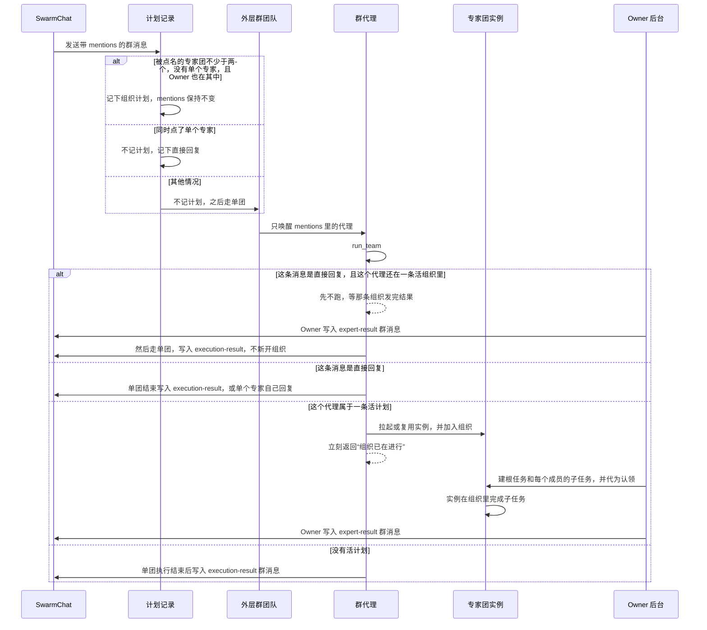

# SwarmChat 群聊 @ 专家团组建 Team Organization

> **目标**：说明 SwarmChat 群聊里 @ 多个专家团时，系统如何把这些群代理收成一个 Team Organization，以及结果如何只由 Owner 发回群面板。读者是要改这条链路或对照线上日志的开发人员。
>
> **英文版：** [English Version](../en/SwarmChatGroupOrganization.md)

---

## 1. 这条链路解决什么

SwarmChat 的群面板在 `/groups` 和 `/groups/{groupId}`，页面组件是 `GroupChatWorkspace`。用户在群里 @ 两个或更多专家团时，这些团要共同完成同一条请求，而不是各自开一份私有任务再各发一条群消息。

实现上保留群消息原有的 mentions，让外层群团队按原路径唤醒被 @ 的代理。每个代理调用一次 `run_team`，拉起自己名下、长期存在的专家团实例。第一个被 @ 的专家团是 Owner。外层群团队本身不加入组织。

面板只显示群消息和单团执行卡片。它不读取 `org.snapshot`，也不挂组织面板。组织的最终文字由 Owner 写入群历史后才会出现。

## 2. 四个角色

| 角色 | 是什么 | 不做什么 |
| --- | --- | --- |
| 群代理 | 外层群团队里的一名成员，`member_name` 形如 `member-…`。被 @ 后由模型调用 `run_team`。 | 不做子任务，不把组织结果发到群里。 |
| 专家团实例 | 代理拉起的常驻 Team，身份是 `org-expert-{摘要}`。真正调用 `org_*` 完成子任务。 | 不直接代表代理在群里说话。 |
| Owner | 计划里的第一个专家团。它的实例创建根任务、验收，并在后台把最终报告写入群消息。 | 外层群团队不是 Owner。 |
| 单团执行 | 没有活组织计划时，`run_team` 走 `GroupExecutions`。完成后由 `finish` 发群消息。 | 多专家团组织进行期间不走这条路径。 |

群成员花名册的当前字段是 `kind`、`id`、`member_name`、`display_name`。单个专家是 `agent_template`，专家团是 `agent_group`，包名在 `id`。读取旧数据时，`expert` 视为 `agent_template`，`expert_team` 视为 `agent_group`，`definition_id` 视为 `id`。组织筛选只认专家团。

## 3. 端到端流程

### 3.1 前端怎样产生 mentions

`selectedMentions` 同时要求两件事：成员在 @ 选择器里被选中，并且正文里有 `@显示名`，后面是结尾、空白或 `，。！？、,:：;；!?` 之一。只在输入框里打出 `@名字`、没有走过选择器时，提交的 `mentions` 是空数组。

空 mentions 的消息仍会入库。`_begin_team_round` 看到空 mentions 就返回，不唤醒任何代理。这不是任务在跑。

### 3.2 什么时候记下组织计划

群消息进入团队回合时，mentions 多于一个才会调用 `record_organization_plan`。计划真正写入还要同时满足：

1. 这个会话是已保存的群。
2. mentions 里至少有两个专家团（`agent_group`），并且没有同时 @ 单个专家（`agent_template`）。只要点名了专家团又点了单个专家，这条消息不记组织计划，并记下直接回复标记。被点名的专家团如果还在一条没出结果的组织里，要等那条组织先把结果发到群里，再走原来的单团路径。这条直接回复不新开组织，也不复用组织实例。不在那条组织里的单个专家可以马上回复。
3. 群上还没有 Owner，或者已有 Owner 也在这次 mentions 里。Owner 不在时，这条消息留在各代理自己的单团路径。

第一次没有 Owner 时，mentions 里的第一个专家团成为 Owner。计划号就是这条消息的 `client_message_id`。mentions 和正文都不改写。

### 3.3 代理怎样被唤醒

消息按原 mentions 交给 agent-core 的 `post_message`。通知对象是 mentions 里非 `user`、角色也不是 `passive_human` 的成员。外层群团队的 Leader 不会因为这条消息被拉进组织。

被唤醒的是群代理上的模型。它调用 `run_team` 之后，组织路径在实例就绪时就返回。返回给模型的内容是：组织已在进行，不要再次调用 `run_team`，不要自己发群消息，最终报告由 Owner 发送。

## 4. run_team 的分叉

`RunTeam.invoke` 先处理 `update` 和 `cancel`。对其余 `start` / `continue`，先看这个代理还欠哪一条消息，按到达顺序处理。欠的是一条还没发结果的组织时，这次调用加入那条组织。欠的是直接回复、而这个代理还在一条活组织里时，这次调用只返回等待，不建单团。组织结果发出之后，这条直接回复才走原来的单团后台执行。否则用这条消息自己的计划；没有时，才用包含这个代理、状态为 `pending` 或 `running` 的最早计划。

找到计划时调用 `run_organization_member`，不创建 `GroupExecutions`。找不到时，已托管的群走原来的单团后台执行：创建执行记录，跑完后 `GroupExecutions.finish` 用 `execution-result-{execution_id}` 发群消息。单专家团和单个专家团的群聊仍走这条路径。直接回复不复用组织实例。组织还在进行时，被点名的专家团代理仍然不能自己发群消息；那条组织的结果发出之后，这条直接回复才可以自己发。不在组织里的单个专家不受这条等待限制。

同一次组织里，同一个代理重叠的 `run_team` 会并到同一次实例准备。Owner 的后台等待每个计划只有一份。

### 4.1 组织路径立刻返回

工具调用默认 300 秒就会被 AbilityManager 掐断，硬上限是 3600 秒。组织完成可能更久，所以 `run_team` 不能在工具调用里等到组织结束。

实例准备完成后：

- 成员代理只返回“已在进行”。
- Owner 代理同样立刻返回，并把等待、发帖放到后台任务 `_owner_runs`。

后台任务还在跑时，计划不会因为创建时间超过 62 分钟被标成 `expired`。后续 `run_team` 仍回到组织路径并立刻返回。没有活的 Owner 后台、且计划年龄超过 62 分钟时，计划标成 `expired`。同一条多 @ 消息之后的 `run_team` 不再开单团，也不发群消息。另一条没有这条计划的消息，仍按单团或追问处理。62 分钟等于成员加入等待 120 秒加上结果等待 3600 秒，只用于这条过期判断。

## 5. 实例和组织任务

实例身份由群会话和 `member_name` 稳定算出：`org-expert-` 加 12 位摘要。同一个代理再次进入组织时复用这个 Team，不随组织号改变。每一轮多 @ 使用自己的组织号，格式是 `gorg-`、清理后的会话号、再加 8 位计划摘要，最长 96 字符。成员集合与此前某轮完全相同时，沿用那一轮的组织号，任务池里的旧任务还在。成员有增减时新建组织，新任务池不包含上一轮的任务。更早的计划如果没有记下组织号，则按当时的规则视为 `gorg-` 加清理后的会话号。实例和群会话共用外层团队的库，删除群时可以按普通私有运行一样收掉这些实例。

Owner 实例额外带有 `complete_team_run`，提示词要求它用 `org_*` 协调，不要把请求改成团内 swarmflow。其他实例只带能力 `group-member:{member_name}`。实例已经存在时，仍按这一轮同步角色：Owner 装上提交工具、Owner 提示词和 `group-coordination`；改回普通成员时去掉这些。实例还在，不等于这一轮的配置已经就绪。

Owner 后台在实例都尝试加入后做这些事，不把机械步骤交给模型：

1. 等计划里的每个代理通过 `run_team` 把固定实例绑定到这个组织。后台不替缺席的代理启动实例。代理还在处理这条多 @ 消息时继续等，不因为 120 秒到了就失败，最长等到结果等待的 3600 秒。代理这一轮已经结束却没有调用 `run_team`，或者读不到它的状态时，仍按 120 秒记为 `failed`。失败时不创建根任务，Owner 也不从模板另建团队。
2. 创建根任务 `groot-{计划摘要}` 并认领它。这个号由计划号决定，恢复同一计划时仍认这一个根，不按本次后台启动时间过滤。后台不选择汇总模式，也不启动根任务。用户原文指定了 `SUMMARY_TEAM` 或 `HIERARCHICAL` 时，Owner 模型按指定执行；没有指定时，由 Owner 模型根据任务自己选择，不默认成 Summary Team。选完后由模型启动根任务。只有这个根自己的汇总执行未完成时，这一轮才继续等。
3. 给每个被提及的专家团注册 `group-member:{member_name}` 能力。子任务由 Owner 实例发布，后台不预建占位子任务。
4. 若 90 秒后根任务下仍没有子任务，向 Owner 实例补一条提醒。提醒要求模型先选定汇总模式（用户没指定时自己选），再启动子任务。`SUMMARY_TEAM` 走汇总执行，`HIERARCHICAL` 由 Owner 完成根任务。

专家工作、验收、汇总和最终提交发生在实例里。Owner 实例最后调用 `complete_team_run`。这个工具和 Owner 后台等待的是同一个结果槽。`SUMMARY_TEAM` 还要等汇总执行完成；`HIERARCHICAL` 由 Owner 完成根任务，没有单独的汇总执行。后台看到这些都完成，才把结果发到群里。群消息只包含用户要的交付内容，不写实例是否暂停、是否从模板重建、是否沿用旧稿。根任务完成后若一直没有提交，会再等 180 秒并尝试使用根任务输出。

## 6. 群面板上的两条消息

| 来源 | 消息号前缀 | 谁发送 | 何时出现 |
| --- | --- | --- | --- |
| 组织完成 | `expert-result-{plan_id}` | Owner 代理 | Owner 后台确认组织完成后 |
| 单团完成 | `execution-result-{execution_id}` | 执行该任务的那个代理 | 单团 `finish` 时，成功就发 |

组织进行中，面板可以一直是空的：组织路径不创建执行卡片。被 @ 到、但不是 Owner 的代理不能发群消息，`group_send_message` 和 `send_file` 会被拒绝。它的专家团实例也会去掉这两个工具，不能自己回群。只有 Owner 后台在组织完成后发 `expert-result-`。看到 `execution-result-` 前缀，说明这条文字来自单团自动发帖，不是 Owner 的组织报告。

完成后，后台先暂停各专家团实例并注销这次组织的成员登记，再把计划标成 `done` 并放行下一轮。下一轮因此不会在注销之前接上同一个组织。任务记录、输出文件和各专家团自己的对话上下文都保留。这里不调用组织解散：那个入口会删掉组织任务和输出，并停掉专家团实例。失败或超时也不解散，成员登记先留着。下一轮若仍是同一个组织，直接重新登记。下一轮要进入另一个组织时，先解除旧组织的成员登记和调度，再创建或邀请；任务、输出和实例上下文仍保留。专家团集合与此前某轮完全相同时，沿用那一轮的组织号；集合不同就新建组织。两种情况都复用各专家团原来的实例。汇总团队只在组织确认完成时一起暂停。群删除仍走完整解散，并停掉这些实例。

之后单独 @ 某一个专家团，是追问，不是新的组织。代理自己判断：一个人能答的简单问题，用 `group_send_message` 直接回；需要专家团一起做的，调用 `run_team`。这次 `run_team` 回到该代理原来的实例，沿用同一团队和同一会话，把上一轮子任务的上下文加载出来。它不会新开一个空白私有团队，也不会重新加入组织。

## 7. 计划状态

计划保存在群的 `group.json` 的 `organization_plans` 里。实例绑定保存在 `organization_teams`。

| 状态 | 含义 |
| --- | --- |
| `pending` | 已记下，Owner 后台尚未把它标成运行中。 |
| `running` | Owner 后台已经开始等待结果。 |
| `done` | Owner 已把最终报告写入群消息。 |
| `failed` | 准备失败，或结果等待结束时组织没有完成。 |
| `expired` | 没有活的 Owner 后台，且计划年龄超过 62 分钟。 |

同一条用户消息的重复 `run_team` 进入那条消息自己的计划。这个代理如果还没加入更早的活计划，这次 `run_team` 先加入那条计划，不会因为历史里已经有更新的 @ 就把它跳过。后一问和仍未结束的计划有共同成员时，记下后一问就为它的 Owner 挂上排队，不依赖成员再接手一次。不在上一问里的成员同样得到“已排队”，不会去绑定还留在上一问里的实例。提前接手失败不会把这一问从队列里去掉。更早的计划已经接过之后，新的多 @ 也返回“已排队”，后台等到更早的计划结束后再由 Owner 启动。单 @ 在组织仍进行时仍留在当前组织路径，不另开私有团队。同一条多 @ 消息的计划已经是 `failed`、`expired` 或 `done` 时，这次 `run_team` 直接停住：不加入组织，不创建单团执行，也不发群消息。另一条没有这条计划的消息，仍按单团、追问或新的多 @ 计划处理。

## 8. 代码位置

| 步骤 | 位置 |
| --- | --- |
| @ 选择和 mentions | `channels/web/frontend/src/features/groupChat/state.ts` |
| 群页面 | `channels/web/frontend/src/features/groupChat/GroupChatWorkspace.tsx` |
| 记录计划 | `server/runtime/agent_adapter/team_helpers.py` 的 `_record_group_organization_plan` |
| 计划、花名册、组织绑定 | `server/runtime/group_service.py` |
| `run_team` 分叉和单团发帖 | `agents/swarm/group_chat.py`、`server/runtime/group_execution.py` |
| 实例、任务拆分、Owner 后台 | `agents/swarm/group_org_bootstrap.py` |
| 按 mentions 通知代理 | agent-core `openjiuwen/agent_teams/group_chat/handler.py` |

对应测试在 `tests/agents/swarm/test_group_org_bootstrap.py`。其中单团用例确认没有活计划时 `run_team` 仍走原来的私有执行。

## 9. 当前边界

- 组织进行中的重复 `run_team` 会停在组织路径。同一条多 @ 消息在计划已经结束后再调用 `run_team`，不再开单团，也不发群消息。另一条单独消息仍走单团或追问。
- Owner 后台最多等 3600 秒。超时后计划成为 `failed`，群里不会出现 `expert-result-` 消息。
- 成员加入：代理这一轮还在处理消息时继续等，最长到结果等待的 3600 秒。这一轮已经结束却没有调用 `run_team`，或读不到代理状态时，仍按 120 秒失败，不在缺人时启动。
- 面板在组织创建成功后显示组织执行卡片，一行对应一个专家团。接法见下一节。

## 10. 组织执行卡片

界面复用单团的 `ExecutionCard`，不新增卡片组件。一次多专家团请求只写一条 `execution_kind: organization` 的执行记录。`ExecutionCard` 的标题用这条记录的 `title`，每一行用 `tasks` 和 `task_details`。单团的创建、`start_group_task`、`finish` 和内部 `team.task` 投影保持原样。

组织记录不调用 `GroupExecutions.finish`。那个方法会再发一条 `execution-result-` 群消息。组织的群消息仍然只由 Owner 后台写入 `expert-result-{plan_id}`。

卡片在组织创建成功之后出现，不在计划刚记下时出现。Owner 代理的 `run_team` 拉起 Owner 实例并完成 `create_organization` 时，写这一条记录，`presentation` 直接是 `card`，于是列表和 `group.execution.created` 会把它推到面板。身份用计划号，同一次请求重复进入组织只更新这一张卡。

标题是父任务，取这次计划的用户正文。根任务 `groot-…` 创建之后把 `root_task_id` 记在卡片上，不另做一行。每一行是 Owner 发布到根任务下的一个组织子任务，行标题用该子任务自己的 `title`，小字是认领它的专家团 `display_name`。子任务还没发布时，这一行先不出现。未认领是 `pending`，已认领或执行中是 `in_progress`，验收通过是 `completed`。专家团实例内部的队友任务不写入 `tasks`。`SUMMARY_TEAM` 会多出最后一行汇总任务，小字是 Summary Team，标题是这条汇总任务自己的 `title`，进行中是 `in_progress`，完成后是 `completed`。这一行在汇总任务创建后才出现，也就是来源子任务都验收通过之后。`HIERARCHICAL` 没有单独的汇总任务，所以在章节还没全部验收通过时不画汇总行。被退回的原任务在卡片上保持失败；它的修复任务验收通过后，这一章算已通过。全部章节通过后才补上最后一行，小字是实际完成根任务的 Owner 专家团，状态跟着根任务走。标题用 Owner 写进根任务输出里的报告标题；输出还没写上标题时，这一行先显示「汇总」。报告正文仍不写在卡片上，等 Owner 发帖后用「查看结果」跳到群消息。子任务都验收完、汇总还在进行时，卡片保持 `running`。

这张卡的 `member_name` 留空，另记 `owner_member`。单团用 `member_name` 查找活动执行，也用它接收 `team.task`。组织卡若占用 Owner 的名字，会和 Owner 的单团执行缠在一起，团内任务也会被写进行里。

异常沿用卡片已有的失败状态，不增加新的错误文案区。某个专家团的子任务失败，该行记为 `failed`。Owner 后台准备失败或等待超时，卡片记为 `failed`，还没完成的行记为 `failed`，这样现有的失败图标和状态文字能显示出来。不因为异常再发一条群消息。

Owner 发帖成功后，卡片改为 `completed`，并保存那条群消息的 `message_id`。「查看结果」仍是现在的页内跳转。对号条件在现有「发送者等于 `member_name`」之外，允许发送者等于 `owner_member` 且消息号等于卡片上的 `message_id`。

进度由 Owner 后台现有的轮询，从组织任务池读取这些子任务后写回同一条执行记录，并推送 `group.execution.updated`。不从各个代理的 `run_team` 返回值写卡片。`project_organization_progress` 不改作这条链路的入口：它要求根团队等于外层群团队，而这里的根团队是 Owner 实例。

---

## 返回导航

- [返回文档首页](../README.md)
- [返回项目首页](../../README_CN.md)
