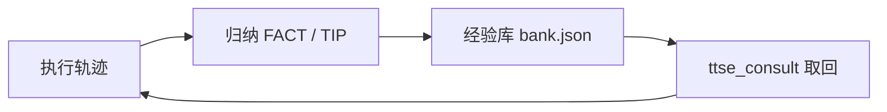
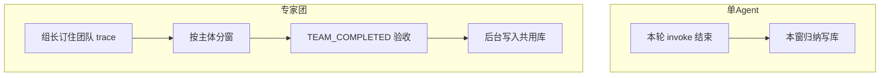
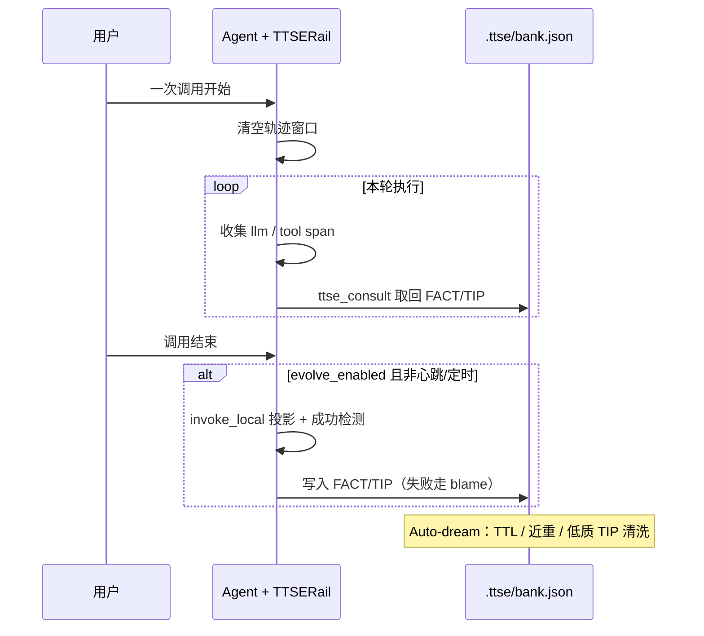
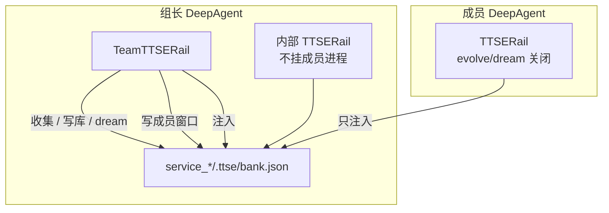
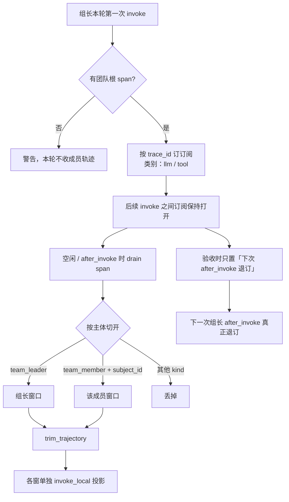
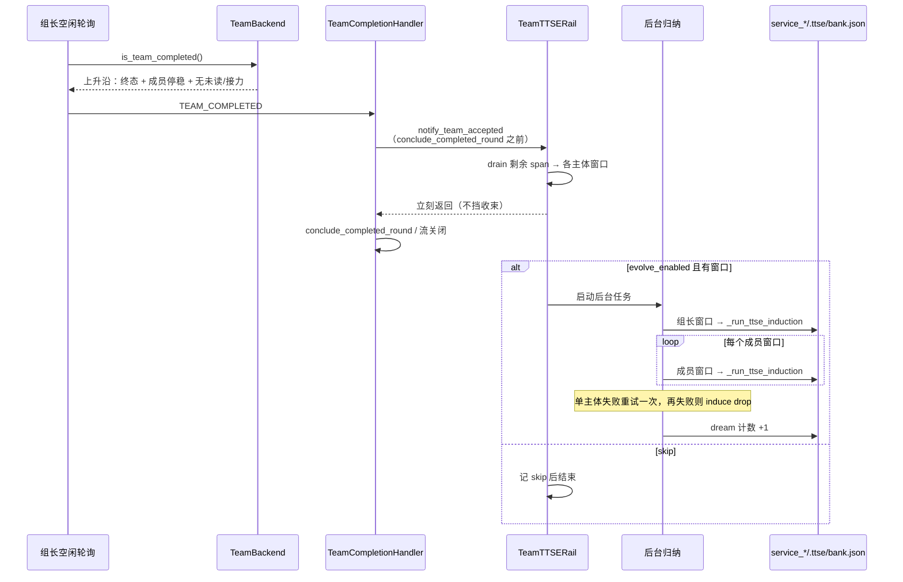
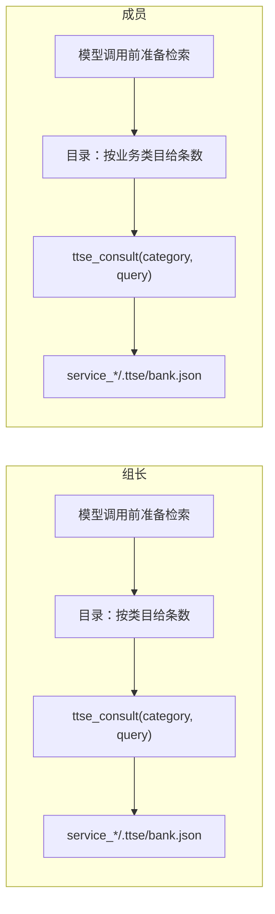
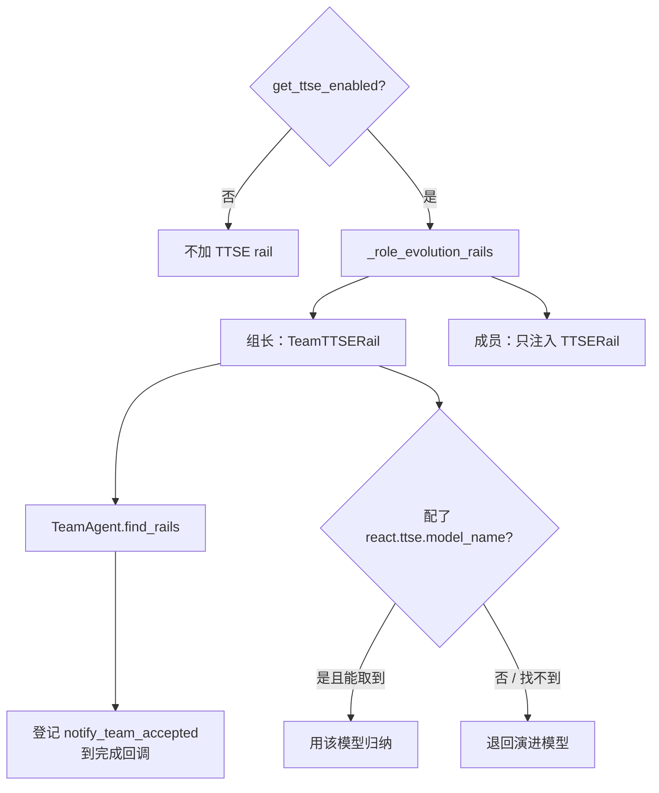

# TTSE 专家团适配方案

TTSE 从一轮执行轨迹里归纳环境事实（FACT）和能力选择提示（TIP），写入经验库，下一轮通过 `ttse_consult` 取回。不改 `SKILL.md`，也没有审批弹窗。

单 Agent 已经按这个闭环在跑。专家团沿用同一套归纳、注入和经验库，收集和写入改到组长侧：一轮里按执行主体把轨迹切开，团队验收之后再写库。



专家团相对单 Agent 的差异，集中在收集与写入时机：



## 1. 单 Agent 现状

开关是 `react.ttse.enabled`。打开时，agent 模式挂载 `TTSERail`，并把 `ttse_consult` 放进首轮工具列表。`enabled: false` 时不挂。

```yaml
react:
  ttse:
    enabled: true
    evolve_enabled: true
    inject_enabled: true
    dream_enabled: true
    dream_interval: 50
    dream_min_hours: 24.0
    dream_ttl_days: 90
    consult_top_k: 8
    consult_retrieve_mode: hybrid
```

经验库固定在该 agent 工作区的 `.ttse/bank.json`。系统提示里只放检索指引，FACT/TIP 正文由模型调用 `ttse_consult(category, query)` 取回。`category` 和 `query` 都要填，查全集用 `category=all`。

一次用户调用对应一扇轨迹窗口。调用开始时清空窗口，调用结束时做成功检测：`evolve_enabled` 打开且不是心跳或定时任务，就从这扇窗口归纳。成功写入 FACT/TIP，失败走 blame。窗口投影使用 `invoke_local`：只保留本轮用户消息之后的模型回复和工具结果。



`inject_enabled` 打开时，每次模型调用前从这份库准备检索。Auto-dream 按非 follow-up 的任务迭代计数，静默做 TTL 剪枝、近重合并和低质量 TIP 清洗，不占用用户回合。embedding 三段齐全时库内检索走 BM25 加向量，否则退回 BM25。

## 2. 专家团怎么接

专家团会话进 swarm 之后，组长和成员各有一个 DeepAgent。轨迹上已经带执行主体：组长的 kind 是 `team_leader`，成员是 `team_member`，`subject_id` 含会话、团名和成员名。并行成员因此各自有一条身份，收集时按这个身份分窗。

开关仍是 `react.ttse.enabled`，和技能自演进开关互不绑定。聊天团和代码团都按角色装配。

### 2.1 谁收集、谁注入

| 角色 | 收集 | 写入 | 注入 |
| --- | --- | --- | --- |
| 组长 | 订住本轮团队 trace，按主体分窗，跨过自己的多次 invoke | 验收后把组长窗口和每个成员窗口写入共用库 | 读共用库，按目录里的相关类目检索 |
| 成员 | 不收集 | 不写、不 dream | 只读共用库，查业务类目 |

组长挂 `TeamTTSERail`。它内部再持有一个不挂到成员进程上的 `TTSERail`，把成员窗口写进同一份库。成员自己挂普通 `TTSERail`，`evolve_enabled` 和 `dream_enabled` 都关掉，`store_path` 也指向这份库。

单 Agent 和专家团共用一份库，放在服务目录，不按角色拆目录：

- `service_*/.ttse/bank.json`

`agent_office` 和 `agent_agentteam` 的工作区都在 `service_*/agent_*/agent/jiuwenclaw_workspace`，所以解析到同一个文件。组长经验和业务经验靠类目分开，不靠目录。不在这套布局里的工作区仍用该工作区下的 `.ttse/bank.json`。



### 2.2 收集

组长在本轮第一次 invoke 时，用当前团队根 span 的 `trace_id` 订一条订阅，类别只要 `llm`、`tool`。这条订阅在组长后续的 invoke 之间保持打开。验收发生在空闲轮询里，当时没有正在结束的 invoke，所以验收只把「下一次 `after_invoke` 再退订」置上，订阅本身留到下一次组长调用结束。已经取出的窗口照常进后台归纳，不等这次退订。组长空闲等成员的间隙里结束的 span 也要能 drain 进窗口。

没有团队根 span 时记一次警告，本轮不收成员轨迹。

每批 drain 到的 span 立刻按主体切开，不保留一整团的混合窗口：

- `team_leader` 进入组长窗口
- `team_member` 且带 `subject_id` 时，进入该成员自己的窗口
- 其他 kind 丢掉

同一成员的增量按时间合并进自己的窗口，窗口长度用现有的 `trim_trajectory` 裁剪。并行成员的 span 只在各自窗口里排序，归纳时每个窗口单独投影成消息。投影仍用单 Agent 的 `invoke_local`。



### 2.3 何时写入

组成员的一次 invoke 结束不写库。`TeamTTSERail` 关掉按 invoke 触发的归纳。

写入点是组长空闲轮询里 `TeamBackend.is_team_completed()` 的上升沿：任务都到终态（空看板在允许无任务完成时也算）、成员都已停稳、没有未读消息、没有挂起的接力。`TeamCompletionHandler` 发出 `TEAM_COMPLETED` 之后、persistent 团调用 `conclude_completed_round` 之前，调用组长 rail 的 `notify_team_accepted`。session budget 强制完成的那条发布路径也走同一个回调。

这个回调和技能自演进用的任务板清空回调分开。任务板清空时成员可能还在收尾，TTSE 不在那里写。

`notify_team_accepted` 先把订阅里还没收完的 span drain 进各窗口，取出组长窗口、全部成员窗口和本轮用户问题，然后立刻返回。归纳放到后台任务里，不挡住组长收束和流关闭。`evolve_enabled` 关闭，或本轮没有任何窗口时，记一条 skip 后结束。

后台里组长窗口和每个成员窗口依次写入同一份库。写入用这份库自己的 `evolution_lock` 串行。本轮用户问题放进 `ttse_task_query`。不另传 `ttse_invoke_tool_calls`，工具次数从该窗口的消息里数。检测和归纳仍走 `TTSERail._run_ttse_induction`，调用时 `ctx` 为空。

组长窗口额外带一段角色说明：组长负责组队、下任务、验收和把结果交给用户；TIP 里的能力必须是组长自己调用过的工具；成员的操作步骤只作为下次写进 `spawn_teammate`、`create_task` 或 `send_message` 的文本。不保存这一轮的城市、数字、文件名这类一次性数据。

一个主体失败时重试一次，仍失败就丢掉该主体并记 `induce drop`，其他主体继续。日志带主体名：`subject=leader` 或 `subject=member:<成员名>`。

组长的一次任务迭代同时推动两个库的 dream 计数。成员侧不 dream。



### 2.4 注入

正文仍走 `ttse_consult`，不写进系统提示。组长、成员和单 Agent 读同一份库。`shared_store` 按 `store_path` 合并，同一路径只有一把锁。组长和成员写同一份库时，dream 计数只加一次。

原有 10 个业务类目保持不变。在它们和 `other` 之间新增一个普通类目 `team-planning-and-acceptance`（拆任务、派工、盯进度、验收、把结果交回去）。它不是组长专属：谁的经验符合这个场景就归到这里。组长和单 Agent 看到完整目录。成员的目录附件不放这一类，其余类目仍按同一份库的条数给出。相关类有条数时用 `ttse_consult` 取回。



### 2.5 装配

`jiuwenswarm` 在 swarm 的角色 rail 列表里加两份规格，聊天团和代码团共用：

- 组长：`TeamTTSERail`。没配 `react.ttse.model_name` 时，归纳模型用现有演进模型。配了的话，到 `models.defaults` 里按这个名字取；找不到就退回演进模型，并打一条警告
- 成员：只注入的 `TTSERail`

`get_ttse_enabled` 为假时两份都不加。relay 的选团、会话绑定和 `team_name` 不改。`TeamAgent` 在 DeepAgent 建好后，用 `find_rails` 找到 `TeamTTSERail`，把它的 `notify_team_accepted` 登记到完成回调。



### 2.6 改动位置

agent-core：

- `openjiuwen/harness/rails/evolution/team_ttse_rail.py`：分窗、保持订阅、验收后后台归纳
- `openjiuwen/agent_evolving/ttse/subject_log.py`：给 `[TTSERail]` 日志加上当前主体
- `EvolutionRail`：允许一条订阅跨过多次 invoke。验收时只置退订标记，真正退订发生在下一次 `after_invoke`
- `TeamCompletionHandler`：在 `TEAM_COMPLETED` 上升沿、收束之前增加验收回调
- `TeamAgent`：登记 `notify_team_accepted`

jiuwenswarm：

- `agents/swarm/providers/evolution_rails.py`：构建组长 rail 和成员只注入 rail
- `agents/swarm/registry.py`、`agents/swarm/config_specs.py`：在 `_role_evolution_rails` 里按开关加入

单 Agent 的 `TTSERail` 和 agent 模式装配保持原样，经验库改为上面这份共用文件。
