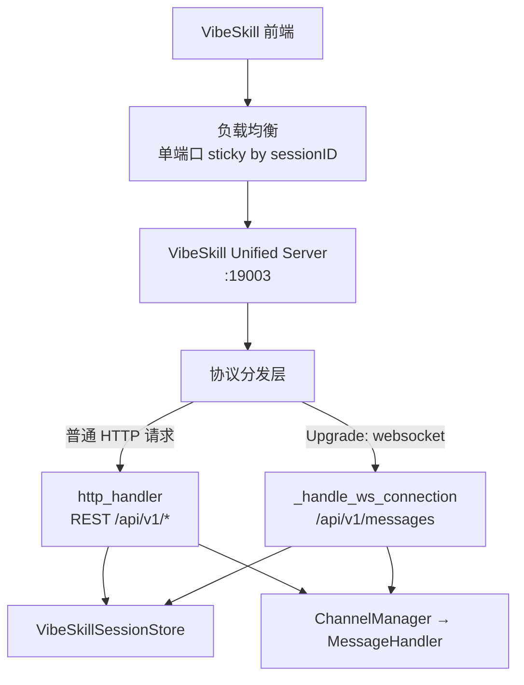
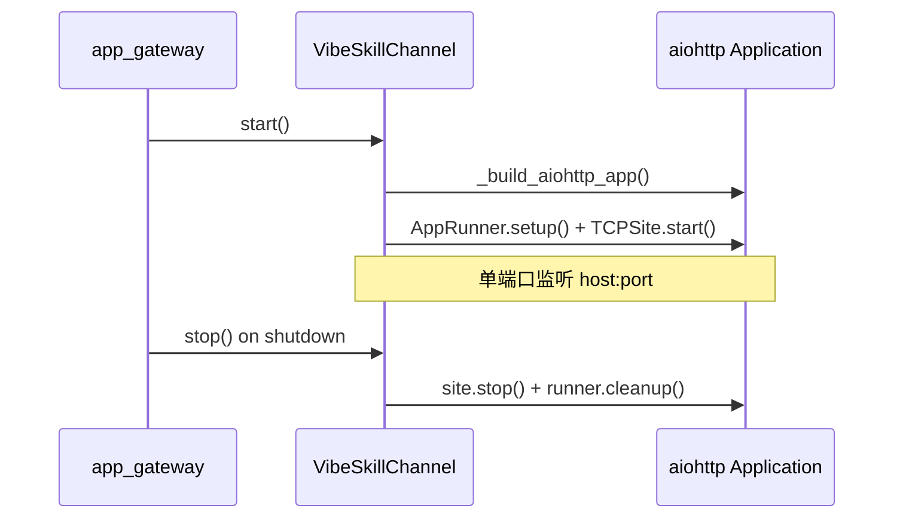

# VibeSkill Channel HTTP / WebSocket 统一端口设计

> 状态：方案 A（aiohttp）已实现，默认启用统一端口 19003，保留双端口兼容回退  
> 关联代码：`jiuwenclaw/channel/vibeskill_channel.py`、`jiuwenclaw/app_gateway.py`  
> 关联文档：[VibeSkill Channel 架构与接口](VibeSkillChannel架构与接口.md)

## 0. 实现状态

已按 **方案 A（aiohttp）** 落地，要点：

- `VibeSkillChannel.start()` 默认走 `_start_unified()`：单一 aiohttp `Application` 监听 `port`（默认 19003），
  `GET /api/v1/messages`（带 `Upgrade: websocket`）走 WebSocket，其余 `/api/v1/*` 走现有 `http_handler`。
- 新增 `_AiohttpWebSocketAdapter`：把 aiohttp `WebSocketResponse` 适配成 websockets 风格连接对象，
  `_handle_ws_connection` 等 WS 业务逻辑零改动。
- `VibeSkillConfig` 新增 `port`；`http_port` / `ws_port` 改为可选，显式设置且不等时回退 `_start_dual_port()`（旧实现）。
- `app_gateway.py` 通过 `VIBESKILL_PORT` / `VIBESKILL_HTTP_PORT` / `VIBESKILL_WS_PORT` 读取端口。
- 已加 `aiohttp>=3.9.0` 到 `pyproject.toml` 依赖。
- 冒烟验证：统一端口下 REST 建会话 / 查会话、`/api/v1/messages` 非升级返回 426、未知路由 404、WS `server.connected` 均通过；双端口兼容模式同样通过。

## 1. 背景与动机

### 1.1 现状

VibeSkill Channel 当前在**同一 Gateway 进程**内启动**两个独立 TCP 监听**：

| 协议 | 默认端口 | 路径前缀 | 实现 |
|------|----------|----------|------|
| HTTP | `19002` | `/api/v1/*` | `asyncio.start_server` + 手写 HTTP/1.1 解析 |
| WebSocket | `19003` | `/api/v1/messages` | `websockets.serve` |

前端需维护两个 base URL，负载均衡需对两个端口分别配置（含 sticky），运维与多 Gateway 场景下更容易出现 HTTP / WS 落到不同实例的问题。

### 1.2 目标

在**不改变对外 API 契约**的前提下，将 HTTP 与 WebSocket 合并到**同一 TCP 端口**监听，由路径与 `Upgrade` 头区分协议。

### 1.3 非目标

- 不修改 REST 路径、请求体、响应体格式。
- 不修改 WebSocket 入站/出站消息 JSON 结构（`message.send`、`server.connected` 等）。
- 不将 VibeSkill 并入 `GatewayServer` 的 `/tui`、`/acp` 等通用路由。
- 不在本阶段引入跨 Gateway 的 WS 事件广播（仍依赖 DCS + sticky）。
- 不替换 `MessageHandler` / `SandboxRouter` 路由逻辑。

---

## 2. 对外接口兼容性

### 2.1 变更前后对比

| 项目 | 变更前 | 变更后 |
|------|--------|--------|
| REST 路径 | `/api/v1/session`、`/api/v1/session/{id}/file` 等 | **不变** |
| WS 路径 | `/api/v1/messages?sessionID={id}` | **不变** |
| 消息格式 | VibeSkill 前端 JSON 协议 | **不变** |
| 默认端口 | HTTP `19002`，WS `19003` | **统一为 `19003`**（可配置） |
| 前端 base URL | 两个 | **一个** |

### 2.2 统一端口后的访问示例

```text
# REST
POST   http://{host}:19003/api/v1/session
GET    http://{host}:19003/api/v1/session/{sessionID}/file
POST   http://{host}:19003/api/v1/session/{sessionID}/export

# WebSocket（同 host、同 port，不同路径）
WS     ws://{host}:19003/api/v1/messages?sessionID={sessionID}
```

### 2.3 前端迁移

仅需将 WebSocket URL 的端口从旧双端口中的 `19003` 改为与 HTTP 相同（默认统一为 `19003`）。路径、query、消息体无需改动。

```diff
- const WS_URL = `ws://${host}:19003/api/v1/messages?sessionID=${sessionID}`;
+ const WS_URL = `ws://${host}:19003/api/v1/messages?sessionID=${sessionID}`;
```

---

## 3. 目标架构

### 3.1 总体结构



### 3.2 请求分发规则

| 条件 | 处理方式 |
|------|----------|
| `path == /api/v1/messages` 且 `Upgrade: websocket` | WebSocket 握手 → `_handle_ws_connection` |
| `path` 以 `/api/v1` 开头，非 WS 升级 | `http_handler(method, path, headers, body)` |
| 其他路径 | `404 {"error":"Not found"}` |
| 非法 JSON / 握手失败 | 保持现有错误语义 |

业务 handler（`http_handler`、`inbound_intercept`、`outbound_intercept`、`send`）**原样复用**，仅替换最外层连接接入方式。

---

## 4. 技术方案

### 4.1 方案选型

| 方案 | 描述 | 优点 | 缺点 | 建议 |
|------|------|------|------|------|
| **A. aiohttp** | `web.Application` + `add_route` + `web.WebSocketResponse` | 成熟、易测、与项目内 `web_channel` 等一致 | 需适配 WS 连接对象接口 | **推荐** |
| B. websockets + `process_request` | 在握手钩子中处理普通 HTTP | 改动面小 | 与 `websockets` 生命周期耦合紧，HTTP 长连接/并发边界需自证 | 备选 |
| C. 保留双端口 + 前置 Nginx 合并 | 网关层 `:443` 统一，后端仍 19002/19003 | 零代码改动 | 后端仍双端口；sticky 仍要配两处 | 仅作过渡 |

**推荐方案 A（aiohttp）**，理由：

1. 仓库内 `web_channel`、`xiaoyi_channel` 等已使用 `aiohttp`。
2. HTTP 路由表清晰，便于后续扩展健康检查、`/ready` 等。
3. WebSocket 与 HTTP 共享同一 `Application` 生命周期，`stop()` 可一次关闭。

### 4.2 aiohttp 接入设计

#### 4.2.1 新增模块结构（逻辑分层，可先内聚于 `vibeskill_channel.py`）

```text
VibeSkillChannel
├── start()                    # 启动 aiohttp App + TCPSite
├── stop()                     # 关闭 runner / site
├── _build_aiohttp_app()       # 注册路由
├── _aiohttp_http_handler()    # 适配：Request → http_handler()
└── _aiohttp_ws_handler()      # 适配：Request → _handle_ws_connection()
```

#### 4.2.2 HTTP 适配

将 aiohttp `Request` 转为现有 `http_handler` 签名：

```python
async def _aiohttp_http_handler(self, request: web.Request) -> web.Response:
    method = request.method
    path = request.path_qs  # 含 query，与现 _handle_http_connection 一致
    headers = {k.lower(): v for k, v in request.headers.items()}
    body = await request.read()
    status, resp_headers, resp_body = await self.http_handler(method, path, headers, body)
    return web.Response(status=status, headers=resp_headers, body=resp_body)
```

路由注册（示例）：

```python
app.router.add_route("*", "/api/v1/{path_info:.*}", self._aiohttp_http_handler)
```

注意：`/api/v1/messages` 的 **GET（非 Upgrade）** 应返回 `426` 或 `400`，提示客户端使用 WebSocket；避免误走 REST handler 产生歧义。

#### 4.2.3 WebSocket 适配

```python
async def _aiohttp_ws_handler(self, request: web.Request) -> web.WebSocketResponse:
    ws = web.WebSocketResponse(heartbeat=10.0)  # 与应用层 server.heartbeat 并存或择一
    await ws.prepare(request)
    # 构造与现 _handle_ws_connection 兼容的 request 视图（path、query_string、headers）
    await self._handle_ws_connection(ws)
    return ws
```

需在 `_handle_ws_connection` 内将 `async for raw in ws` 抽象为**协议无关的收包接口**（aiohttp 为 `ws.receive()` / `ws.send_str()`），或通过薄适配层统一为：

```python
class WsConnectionAdapter(Protocol):
    async def recv(self) -> str: ...
    async def send(self, data: str) -> None: ...
    async def close(self, code: int, reason: str) -> None: ...
    @property
    def request_path(self) -> str: ...
    @property
    def query_string(self) -> str: ...
    @property
    def headers(self) -> Mapping[str, str]: ...
    @property
    def closed(self) -> bool: ...
```

**websockets** 与 **aiohttp WebSocketResponse** 各实现一个 Adapter，业务逻辑只依赖 Adapter，降低迁移风险。

#### 4.2.4 鉴权

保持现有逻辑：

- HTTP：`check_http_auth(self._auth_enabled, headers)`
- WS：`check_ws_auth(self._auth_enabled, headers)`（握手阶段）

在 aiohttp 入口统一提取 headers 后调用，行为与现网一致。

### 4.3 配置模型

#### 4.3.1 `VibeSkillConfig` 变更

```python
@dataclass
class VibeSkillConfig:
    enabled: bool = True
    channel_id: str = VIBESKILL_CHANNEL_ID
    default_session_id: str = "vibeskill_session"

    # 新：统一监听端口（默认 19003）
    port: int = 19003

    # 兼容：显式设置且与 port 不同时，回退双端口模式（废弃，下个大版本移除）
    http_port: int | None = None
    ws_port: int | None = None

    def resolved_http_port(self) -> int:
        return self.http_port if self.http_port is not None else self.port

    def resolved_ws_port(self) -> int:
        return self.ws_port if self.ws_port is not None else self.port

    def unified_port_enabled(self) -> bool:
        return self.http_port is None and self.ws_port is None
```

| 配置 | 行为 |
|------|------|
| 默认（仅 `port=19003`） | 单端口统一模式 |
| `http_port=19002, ws_port=19003` | 旧双端口模式（兼容期） |
| `port=19002, ws_port=19003` | 以显式 `ws_port` 为准，仍双端口（打日志 warning） |

#### 4.3.2 环境变量（可选）

| 变量 | 默认 | 说明 |
|------|------|------|
| `VIBESKILL_PORT` | `19003` | 统一端口 |
| `VIBESKILL_HTTP_PORT` | 无 | 设置则启用旧 HTTP 端口覆盖 |
| `VIBESKILL_WS_PORT` | 无 | 设置则启用旧 WS 端口覆盖 |

`app_gateway.py` 构造 `VibeSkillConfig` 时从环境变量读取。

---

## 5. 生命周期与并发

### 5.1 启动 / 停止



移除（统一模式下）：

- `self._http_server`（`asyncio.start_server`）
- `self._ws_server`（`websockets.serve`）

替换为：

- `self._aiohttp_runner: web.AppRunner | None`
- `self._aiohttp_site: web.TCPSite | None`

### 5.2 心跳策略

当前存在两层心跳：

| 层级 | 机制 | 间隔 |
|------|------|------|
| 应用层 | `server.heartbeat` JSON 事件 | 10s |
| 传输层 | `websockets` ping | 20s / 60s timeout |

统一为 aiohttp 后建议：

- **保留应用层** `server.heartbeat`（前端协议依赖）。
- aiohttp `WebSocketResponse(heartbeat=30)` 作为传输层保活（可配置，与现网 ping 对齐）。
- 在设计评审中确认是否关闭 aiohttp 内置 heartbeat，仅保留应用层（减少双重心跳）。

### 5.3 资源与限流

| 项 | 建议 |
|----|------|
| 最大 WS 连接数 | 与现网一致，默认不硬性限制；可后续加 `VIBESKILL_MAX_WS_CLIENTS` |
| HTTP body 上限 | 与文件写入场景对齐，建议 `client_max_size=32MB`（可配置） |
| 慢客户端 | aiohttp `tcp_keepalive`，避免 silent disconnect |

---

## 6. 多 Gateway 与 Sticky

统一端口**不自动解决**跨 Gateway 状态问题，但显著降低运维复杂度：

| 改进 | 说明 |
|------|------|
| 单端口 sticky | LB 只需对 `:19003` 做 `hash(sessionID)`，HTTP 与 WS 天然同实例 |
| DCS | 仍负责 `vibeskillSession`、`sandboxRouting`、`workspace` 跨机可见 |
| 本机状态 | `_session_to_ws`、`_message_ctx`、`_pending_confirms` 仍本机；abort 仍要求 WS 在同实例 |

Nginx 示例（统一端口后）：

```nginx
upstream vibeskill_backend {
    hash $arg_sessionID consistent;
    server gateway1:19003;
    server gateway2:19003;
}

server {
    listen 443 ssl;
    location /api/v1/messages {
        proxy_pass http://vibeskill_backend;
        proxy_http_version 1.1;
        proxy_set_header Upgrade $http_upgrade;
        proxy_set_header Connection "upgrade";
        proxy_read_timeout 3600s;
    }
    location /api/v1/ {
        proxy_pass http://vibeskill_backend;
    }
}
```

---

## 7. 实现计划

### 7.1 阶段划分

| 阶段 | 内容 | 产出 |
|------|------|------|
| P0 | `WsConnectionAdapter` 抽象 + aiohttp 单端口 MVP | 本地 `test_ws_whole.py` 通过 |
| P1 | 配置兼容（`port` / `http_port` / `ws_port`）+ 环境变量 | 可灰度回退双端口 |
| P2 | 更新脚本、`VibeSkillChannel架构与接口.md`、部署模板 | 文档与运维对齐 |
| P3 | 移除双端口实现（下个大版本） | 删除 `asyncio.start_server` 旧路径 |

### 7.2 代码改动范围（估算）

| 文件 | 改动 |
|------|------|
| `jiuwenclaw/channel/vibeskill_channel.py` | `start/stop`、aiohttp 路由、WS 适配层 |
| `jiuwenclaw/app_gateway.py` | 读取 `VIBESKILL_PORT` 等环境变量 |
| `scripts/vibeskill/test_*.py` | 默认 WS URL 端口改为 19003 |
| `docs/zh/VibeSkillChannel架构与接口.md` | 端口表、架构图更新 |
| `docs/sandbox/Sandbox生命周期管理设计.md` | 图中 19002/19003 合并描述 |

**不改动**：`http_handler`、`inbound_intercept`、`outbound_intercept`、`VibeSkillSessionStore`、`SandboxRouter`。

### 7.3 回滚策略

- 配置显式设置 `VIBESKILL_HTTP_PORT=19002`、`VIBESKILL_WS_PORT=19003` 可立即回到双端口模式。
- 发布说明中标注：前端 WS 端口变更仅影响统一模式默认配置。

---

## 8. 测试计划

### 8.1 单元测试

| 用例 | 验证点 |
|------|--------|
| `test_unified_port_http_session_create` | `POST /api/v1/session` 在 19003 正常 |
| `test_unified_port_ws_connect` | WS 握手 `server.connected` + heartbeat |
| `test_unified_port_same_session` | 同端口先 POST session 再 WS message.send |
| `test_legacy_dual_port_fallback` | 配置 `ws_port=19003` 时行为与现网一致 |
| `test_non_ws_get_messages` | 对 `/api/v1/messages` 发普通 GET 返回明确错误 |

### 8.2 集成 / 回归

复用现有脚本并更新 base URL：

| 脚本 | 场景 |
|------|------|
| `scripts/vibeskill/test_ws_whole.py` | SkillCreate 全流程 |
| `scripts/vibeskill/test_ws_whole_standard.py` | Standard 模式 |
| `scripts/vibeskill/test_ws_multi_tenant_concurrent.py` | 多 session 并发 |

### 8.3 多 Gateway 手工验证

1. 两实例 + DCS + `hash(sessionID)` 单端口 upstream。
2. 验证：建 session → WS 对话 → 同 session HTTP 读文件 → abort。
3. 验证：单实例重启后 DCS adopt 沙箱 + WS 重连。

---

## 9. 风险与缓解

| 风险 | 影响 | 缓解 |
|------|------|------|
| aiohttp WS API 与 websockets 差异 | 断连清理、send 失败处理不一致 | Adapter 层 + 回归脚本全覆盖 |
| 双重心跳 | 多余流量或前端误判 | 评审后固定一种传输层心跳 |
| 部署仍引用 19003 | 前端连不上 | 发布说明 + 兼容期保留双端口配置 |
| HTTP 误打到 `/api/v1/messages` | 歧义响应 | 非 Upgrade 请求返回 426 + 明确 error |
| 性能回退 | 高并发 HTTP 影响 WS | 压测对比；必要时调 aiohttp worker / uvloop |

---

## 10. 验收标准

- [ ] 默认配置下 HTTP 与 WS 均在 **同一端口（19003）** 可正常工作。
- [ ] 所有 REST 路径、WS 消息类型与变更前**字节级兼容**（除端口 URL）。
- [ ] `scripts/vibeskill/test_ws_whole.py` 与 `test_ws_whole_standard.py` 通过。
- [ ] 显式双端口配置下行为与当前 `enterprise_vibeskill_dev` 一致。
- [ ] `VibeSkillChannel架构与接口.md` 与本文档交叉引用已更新。
- [ ] 多 Gateway + sticky 场景下 HTTP / WS 不再因**双端口配置遗漏**而分流到不同 upstream。

---

## 11. 开放问题（评审待定）

1. **默认端口**：统一后默认仍为 `19003`，是否废弃旧双端口 `19002` 占用说明？
2. **监听地址**：当前 `_listen_host` 为本机 IP；是否改为 `0.0.0.0` 以适配容器（独立议题）？
3. **TLS 终止**：统一端口后是否由 Ingress 终结 TLS，后端仅 HTTP/WS 明文（与现网一致）？
4. **移除双端口代码时机**：兼容几个版本后删除 `asyncio.start_server` 路径？

---

## 12. 附录：与现有文档的修正

`http_handler` 现有注释「HTTP 和 WebSocket 共用同一端口 /api/v1」表述不准确——当前仅为**路径命名空间**统一，端口仍分离。本设计实施后，该注释方可按字面含义成立。

统一端口后，`VibeSkillChannel架构与接口.md` 第 1 节端口表建议更新为：

| 服务 | 默认地址 | 用途 |
|------|----------|------|
| HTTP + WebSocket | `http://{local_ip}:19003/api/v1` | REST；`ws://{local_ip}:19003/api/v1/messages` 为 WebSocket |
