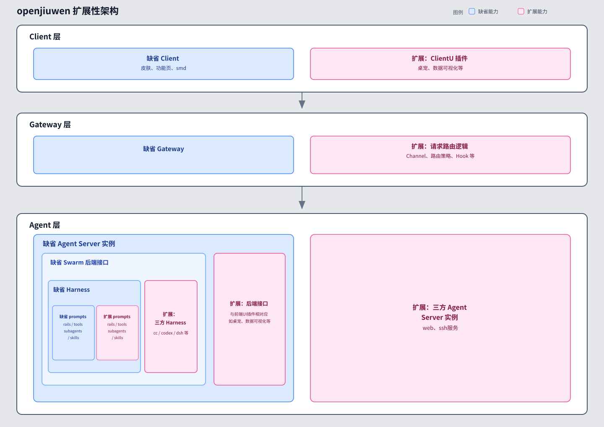
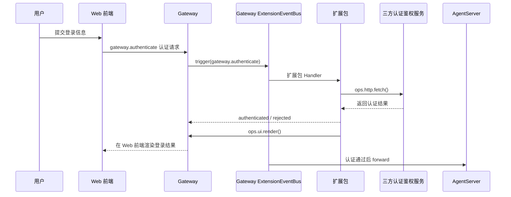
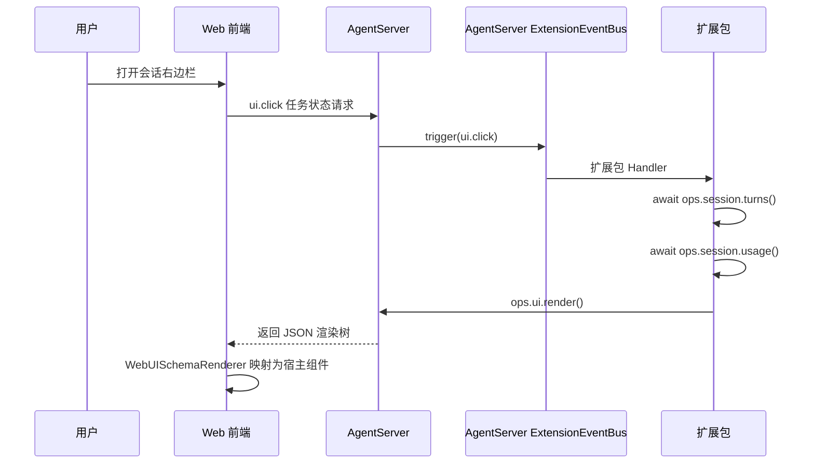
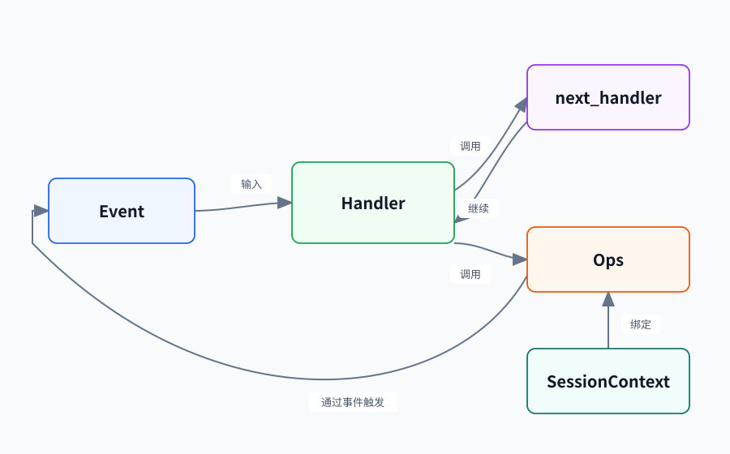

# 1 OpenJiuwen 扩展性概览

这篇文档先建立一张地图，不展开具体事件字段、方法签名、`manifest.json` 完整配置或接入步骤。读完后，你应该能够回答四个问题：OpenJiuwen 为什么需要扩展机制，扩展发生在哪一层，Event、Handler 和 Ops 如何配合，以及一个最小扩展需要哪些部分。

## 扩展性架构设计理念

OpenJiuwen 把扩展看作宿主能力的受控补充，而不是把内部实现直接暴露给外部代码。宿主继续拥有业务状态、权限和关键流程，扩展则通过已经登记的事件、处理器、平台能力和前端槽位加入新的行为。

扩展性设计有三个关键词：

- **分层**：WebClient、Gateway、AgentServer 各自负责自己的业务边界。
- **可插拔**：扩展包通过公开的事件和 Ops 方法接入，不需要修改宿主核心流程。
- **受控**：宿主决定哪些事件、能力和界面位置可以被扩展使用，并负责校验调用结果。



## 从两个场景理解扩展性的分层架构

### 场景一：Gateway 处理第三方登录

| 场景        | 业务归属    | 进入事件                   | 需要的宿主能力     | 前端位置                |
| --------- | ------- | ---------------------- | ----------- | ------------------- |
| 应用入口第三方登录 | Gateway | `gateway.authenticate` | 认证服务调用、结果渲染 | `application.entry` |

用户在页面提交登录信息后，Gateway 接收认证请求并触发事件。扩展 Handler 调用认证服务，Gateway 根据结果放行请求或返回失败信息，页面只负责展示结果。认证决策属于 Gateway，因此扩展应接入 Gateway 的事件和能力。



这个场景中的三个关键词，可以分别落到下面这些环节：

| 关键词 | 具体体现 |
| --- | --- |
| 分层 | Web 前端只收集登录信息并展示结果；Gateway 拥有认证状态和放行决策；认证通过后才把请求交给 AgentServer。 |
| 可插拔 | Gateway 在 `gateway.authenticate` 这个稳定时机触发 EventBus，由扩展包增加认证 Handler，不需要改写 Gateway 的主请求流程。 |
| 受控 | 扩展只能通过宿主登记的认证调用和 UI 渲染能力工作；是否 `authenticated`、是否向 AgentServer 转发，仍由 Gateway 按事件契约决定。 |

### 场景二：AgentServer 渲染会话状态面板

| 场景         | 业务归属        | 进入事件       | 需要的宿主能力     | 前端位置                       |
| ---------- | ----------- | ---------- | ----------- | -------------------------- |
| 会话右侧任务状态面板 | AgentServer | `ui.click` | 会话信息查询、界面渲染 | `conversation.panel.right` |

用户点击面板中的刷新按钮后，AgentServer 接收 `ui.click` 事件。扩展 Handler 通过会话相关 Ops 读取最新数据，再通过 UI 渲染能力返回一棵界面树，WebClient 负责把界面树映射成页面。会话状态属于 AgentServer，因此扩展逻辑应运行在 AgentServer 一侧。



这个场景中的三个关键词，可以分别落到下面这些环节：

| 关键词 | 具体体现 |
| --- | --- |
| 分层 | WebClient 负责点击、渲染和上报交互；AgentServer 拥有会话数据，并决定哪些数据可以返回给页面。 |
| 可插拔 | AgentServer 在 `ui.click` 这个稳定时机匹配扩展 Handler；Handler 组合会话查询和 UI 渲染能力，不需要修改会话核心实现。 |
| 受控 | Handler 只能读取已开放的会话 Ops、向已声明的槽位提交渲染树；事件输入、渲染目标和返回结果由宿主校验。 |

把两个场景放在一起，一次扩展调用可以先抽象成一条短链路：

```text
宿主产生时机
  → Event 描述这次调用
  → Handler 参与处理
  → Ops 提供受控能力
  → 宿主继续执行、采用结果或返回异常
```

## 扩展性的事件机制



上图给出了 ExtensionEventBus 的最小概念模型：宿主接收 Event，Matcher 选出适用的 Handler，Handler 在自己的层级中调用 Ops，最后选择继续事件链、返回结果或让宿主处理异常。

| 概念 | 解决的问题 | 开发者如何理解 |
| --- | --- | --- |
| Event | 宿主现在发生了什么 | 携带事件名、输入和调用上下文 |
| Matcher | 哪些 Handler 参与这次调用 | 按事件内容筛选处理范围 |
| Handler | 这次调用要增加或改变什么行为 | 校验输入、调用 Ops、继续、改写或短路事件链 |
| Ops | Handler 可以调用哪些宿主能力 | 以方法形式提供受约束的平台能力 |
| SessionContext | 这次调用属于谁、处于什么上下文 | 提供会话和宿主补充的只读信息 |

Handler 按 USER → BUILTIN → CORE 形成一条由外向内的处理链：

| 层级 | 主要提供方 | 作用 |
| --- | --- | --- |
| USER | 扩展包 | 增加业务行为、加工输入或结果，必要时按契约短路 |
| BUILTIN | 平台 | 提供平台随版本发布的通用扩展逻辑 |
| CORE | 平台 | 完成事件的默认动作，每个事件只有一个 CORE Handler |

扩展包通常只注册 USER Handler。Handler 可以调用 `next_handler` 把事件交给链路中的后续处理，也可以在事件契约允许时直接返回结果；它不能把 CORE Handler 当作普通函数直接调用，也不能自行定义未登记的事件类型。

## 一个最小扩展包含什么

先看一个“会话右侧任务状态面板”扩展。这个例子只说明最小功能集，不展开 `manifest.json` 字段和 Handler 方法签名，具体写法留给后续章节。

| 项目 | 示例内容 |
| --- | --- |
| 扩展名称 | `task-panel` |
| 运行宿主 | AgentServer |
| 前端槽位 | `conversation.panel.right` |
| 进入事件 | `ui.click` |
| 使用 Ops | `session.turns()`、`session.usage()`、`ui.render()` |
| 最小行为 | 用户点击刷新后读取会话数据，重新渲染面板 |

它的一次最小调用可以表示为：

```text
用户点击 task.refresh
  → AgentServer 触发 ui.click
  → task-panel 的 USER Handler 被匹配
  → Handler 调用 session.turns() 和 session.usage()
  → Handler 调用 ui.render()
  → WebClient 更新 conversation.panel.right
```

一个后端扩展包可以从下面的结构开始：

```text
task-panel/
├── manifest.json       # 声明扩展身份、宿主范围和入口
├── extension.py        # 创建扩展并登记 Handler
├── handlers.py         # 响应事件并调用 Ops
├── views.py            # 可选：组装 WebClient 渲染树
└── tests/              # 验证事件处理和边界行为
```

扩展包中的文件与前面概念的关系如下：

| 文件或概念 | 扩展开发者写什么 | 不负责什么 |
| --- | --- | --- |
| `manifest.json` | 声明包身份、运行宿主、入口和可选的前端槽位贡献。 | 不定义 Event，也不授予扩展额外权限。 |
| `extension.py` | 创建扩展对象，把已有 Event、Matcher 条件和 USER Handler 登记给宿主。 | 不实现 EventBus，也不直接执行宿主核心流程。 |
| `handlers.py` | 接收 Event，校验输入，调用已有 Ops，并决定继续、改写或返回。 | 不直接访问宿主内部对象，不重新实现 Ops。 |
| `views.py`（可选） | 把业务结果组装成 WebClient 可以渲染的界面树。 | 不拥有后端业务状态，也不绕过前端槽位。 |
| `tests/` | 构造事件输入，验证 Handler、Ops 调用和边界结果。 | 不把测试替代成对真实宿主链路的假设。 |
| Event、EventBus、Ops（宿主提供） | 选择已登记的 Event，调用已公开的 Ops。 | 不在扩展包中自行定义 EventType、CORE Handler 或平台 Ops。 |

因此，扩展包的最小闭环不是“自己实现一套事件系统”，而是：**选择一个已有 Event，注册一个 USER Handler，在 Handler 中调用已有 Ops，并按契约返回结果**。

## 扩展性的边界和支持能力

下面这张 SVG 图把主链按自上而下的顺序排布：开发者扩展包、宿主业务层、框架扩展层。前端界面放在右侧并缩窄，表示它只承担展示和交互，不拥有完整的业务状态。


从图中可以这样理解分工：

- **开发者扩展包**只编写 `manifest.json`、USER Handler 和可选的界面构造逻辑，负责组合已有能力完成业务行为。
- **前端界面**只负责已开放槽位中的展示和交互，不成为后端业务状态的第二个来源。
- **宿主业务层**拥有状态、权限和默认动作，决定什么时候触发事件以及是否采用扩展结果。
- **框架扩展层**提供 Event、EventBus 和 Ops，把宿主能力整理成扩展可以使用的稳定入口，并负责匹配、调度和约束。

因此，扩展负责“组合已有能力”，平台负责“提供并约束能力”，业务模块负责“拥有状态和决策”。扩展不应依赖未公开的内部类、未登记的事件或偶然的调用顺序，也不应绕过 Ops 直接操作宿主内部对象。

### 当前可依赖的典型能力

下面只列出当前最适合帮助开发者建立认知的能力类别，完整清单和逐项状态以 [8.【API文档索引快查】OpenJiuwen 扩展 API 索引](<8.【API文档索引快查】OpenJiuwen 扩展 API 索引.md>) 为准。

| 能力方向 | 典型事件或方法 | 可以用来做什么 | 当前状态 |
| --- | --- | --- | --- |
| 会话生命周期与查询 | `session.start`、`session.attach`、`session.detach`、`session.end`；`session.cwd()`、`session.root()`、`session.model()`、`session.repo()` | 感知会话建立、关联和结束，读取当前工作目录、项目根目录、模型和仓库信息。 | 已支持 |
| 会话消息与用量 | `session.send`、`session.receive`、`session.append`、`context.usage.updated`；`session.messages()`、`session.turns()`、`session.usage()` | 处理跨会话消息、追加历史记录、读取消息和回合信息，接收用量快照。 | 已支持 |
| WebClient 扩展 | `ui.render`、`ui.ready`、`ui.select`、`ui.click`、`ui.change`；`ui.render()` | 在已开放槽位渲染界面，并响应选择、点击和值变化等交互。 | 已支持 |
| 工作区与外部工具 | `fs.read`、`fs.write`、`fs.list`、`fs.stat`、`fs.exists`；`mcp.register`、`mcp.connect`、`mcp.call` | 在宿主约束下读写工作区、查询路径信息以及登记、连接和调用 MCP 服务。 | 已支持 |
| Agent 与工具注册 | `agent.register`、`tool.register` | 向宿主登记可用的 Agent 类型和工具。 | 已支持 |
| 会话压缩与工具执行链 | `session.compact`、`tool.call`、`tool.check`、`tool.describe`、`tool.list` | 在会话压缩、工具执行、权限检查和工具发现等更深的运行时节点接入扩展。 | 实现中 |
| Prompt、回合和命令流程 | `prompt.*`、`turn.*`、`command.*`、`config.*` | 参与 Prompt 组装、模型回合、命令和配置生命周期。 | 实现中 |
| 更丰富的前端生命周期 | `ui.resolve`、`ui.press`、`ui.input`、`ui.open`、`ui.close` 等 | 覆盖界面解析、输入、Pane 生命周期和更细的前端交互。 | 实现中 |

### 版本计划

扩展能力按版本计划逐步开放，不把设计中的入口提前当成稳定 API：

1. **当前版本**：优先提供可稳定使用的事件链、会话生命周期与查询、消息与用量、基础 WebClient 渲染与交互、文件和 MCP 能力，以及 Agent/Tool 注册能力。
2. **后续版本**：继续补齐会话压缩主流程、工具执行与权限节点、Prompt 和模型回合、命令与配置生命周期，以及更丰富的前端事件。
3. **每次能力发布前**：先完成真实触发入口、宿主接入、契约和测试，再把 API 索引中的状态从“实现中”更新为“已支持”。

API 索引位于 [8.【API文档索引快查】OpenJiuwen 扩展 API 索引](<8.【API文档索引快查】OpenJiuwen 扩展 API 索引.md>)，统一收录事件、Ops 方法、WebClient 前端槽位、前端组件以及相关宿主接入 API。

## 后续阅读

- [2.【创建扩展】创建第一个 OpenJiuwen 扩展](<2.【创建扩展】创建第一个 OpenJiuwen 扩展.md>)：从扩展包结构和入口开始创建扩展。
- [3.【事件】使用事件响应宿主流程](<3.【事件】使用事件响应宿主流程.md>)：学习事件、Matcher、Handler 和事件链的具体写法。
- [4.【Ops】使用 Ops API](<4.【Ops】使用 Ops API.md>)：查看如何调用会话、界面和其他宿主能力。
- [5. 【前端】前端扩展](<5. 【前端】前端扩展.md>)：了解前端槽位、组件和浏览器客户端扩展。
- [6.【调测与辅助开发】OpenJiuwen 扩展调测与 AI 辅助开发](<6.【调测与辅助开发】OpenJiuwen 扩展调测与 AI 辅助开发.md>)：覆盖扩展调测、问题定位、测试验证和 AI 辅助开发边界。
- [7.【API文档完整版】OpenJiuwen 扩展参考](<7.【API文档完整版】OpenJiuwen 扩展参考.md>)：查阅事件、方法、宿主和扩展边界的参考信息。
- [8.【API文档索引快查】OpenJiuwen 扩展 API 索引](<8.【API文档索引快查】OpenJiuwen 扩展 API 索引.md>)：查看当前已支持和实现中的扩展入口。
