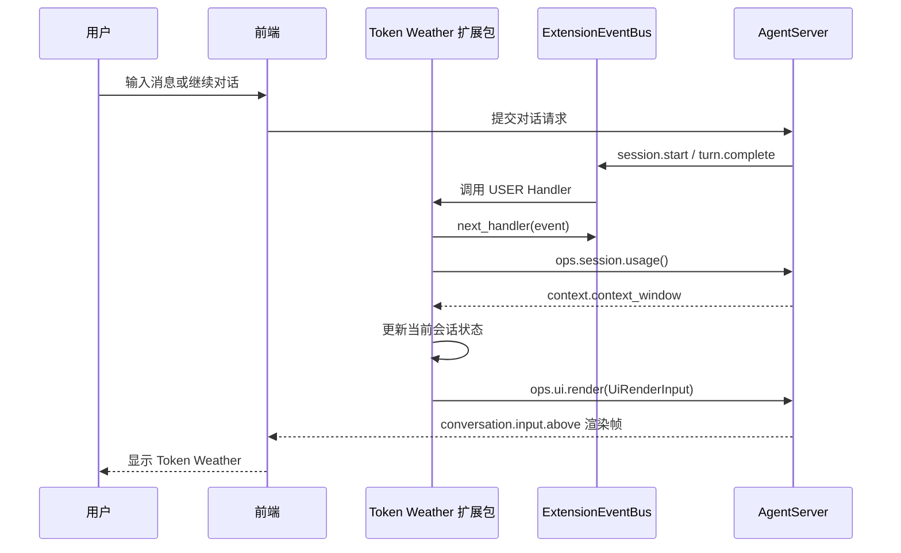

# 2 创建第一个 OpenJiuwen 扩展

本文介绍如何从一个已有宿主事件创建最小扩展：准备扩展包、编写 `manifest.json`、登记事件、实现 User Handler、调用 Ops、让扩展生效，并用验证结果确认接入关系。

## 先看场景：Token Weather

Token Weather 在对话输入框上方显示一条上下文窗口天气带：当前使用率越高，天气从晴朗变为阴天、阵雨和风暴，并显示当前读数的简短趋势。

| 项目     | 设计                                                                                        |
| ------ | ----------------------------------------------------------------------------------------- |
| 要解决的问题 | 让开发者在继续输入前看到当前上下文窗口的使用情况。                                                                 |
| 运行域    | `agentserver`                                                                             |
| 扩展事件   | `session.start` 获取首次可用读数；`turn.complete` 在主 Agent 回合结束后刷新读数。                              |
| Ops能力  | `ops.session.usage()` 读取当前会话的上下文使用量；`ops.ui.render()` 提交 `RenderTarget` 和 `RenderNode` 树。 |
| 前端位置   | `conversation.input.above`，对话框上方。                                                         |

用户在前端发起会话后，AgentServer 在会话开始或一轮对话完成时产生相应事件；ExtensionEventBus 依据事件触发 Token Weather 扩展包中的 Handler，Handler 调用 `ops.session.usage()` 读取上下文窗口快照，更新当前会话状态，再调用 `ops.ui.render()` 提交 JSON 格式的前端渲染树，最后由前端渲染到输入框上方，用户就能看到最新的上下文使用情况。会话开始和每轮对话结束都沿用这条处理链，只是触发事件的时机不同。




## 创建扩展包目录

先创建一个独立目录。`manifest.json` 放在包根目录，Python 模块放在与入口路径对应的子目录中：

```text
token_weather_mod/
├── manifest.json
└── token_weather_mod/
    ├── __init__.py
    ├── extension.py    # 创建扩展并登记 Handler
    ├── handlers.py     # 响应事件、读取用量和发起渲染
    └── state.py        # 保存当前激活实例的会话读数
```

| 文件 | 负责什么 | 不负责什么 |
| --- | --- | --- |
| `manifest.json` | 声明包身份、运行域、入口和 WebUI 槽位。 | 不保存本轮业务数据，也不授予额外权限。 |
| `extension.py` | 创建扩展对象，把 Handler 登记给宿主。 | 不实现 EventBus，也不直接操作 WebSocket 或前端组件。 |
| `handlers.py` | 校验事件、调用 Ops、更新状态并提交渲染。 | 不绕过 Ops 访问 AgentServer 内部服务。 |
| `state.py` | 保存示例需要的会话级读数。 | 不代替宿主的用量采集和持久化服务。 |

## 编写 `manifest.json`

Token Weather 扩展包的 `manifest.json` 声明一个 AgentServer 后端入口和一个输入框上方的槽位：

```json
{
  "schemaVersion": 1,
  "package_type": "extension",
  "package": {
    "id": "webui.token-weather-mod",
    "version": "0.1.0",
    "domain": "agentserver"
  },
  "extensions": [
    {
      "id": "token-weather-mod",
      "runtime": "backend",
      "module": "token_weather_mod/extension.py"
    }
  ],
  "ui": {
    "apiVersion": 1,
    "items": [
      {
        "type": "web.slot.contribution",
        "id": "token-weather-mod.band",
        "slot": "conversation.input.above",
        "order": 10,
        "panel": {
          "title": "Token Weather"
        },
        "renderer": {
          "kind": "webui-tree"
        }
      }
    ]
  }
}
```

创建自己的 `manifest.json` 时，先确认下面这些字段：

- `schemaVersion` 是 `manifest.json` 格式版本。
- `package.id` 是包的稳定身份。代码里用于 `RenderTarget` 的 `package_id` 必须与它一致。
- `package.domain` 决定扩展在哪个进程加载、Handler 登记到哪个事件总线，以及可以使用哪一侧的 Ops。会话用量和会话级 WebUI 属于 AgentServer，所以本例使用 `agentserver`。
- `extensions[].module` 是相对包根目录的入口路径。宿主加载它后，会调用入口模块导出的 `create_extension()`。
- `ui.items` 只声明扩展可以挂载的槽位和渲染器，不携带当前会话的 token 数值。具体内容由 Handler 通过 `ops.ui.render()` 发送。
- `conversation.input.above` 必须是宿主已经登记的槽位。扩展不能靠在 `manifest.json` 中填写新字符串来创建前端挂载点。

## 编写扩展入口

入口模块只做装配，不把业务逻辑塞进 `create_extension()`：

```python
from __future__ import annotations

from .handlers import TokenWeatherHandlers


class TokenWeatherModExtension:
    def __init__(self) -> None:
        self._handlers = TokenWeatherHandlers()

    def register(self, registrar) -> None:
        for event_type, handler, match_pattern in self._handlers.handlers():
            registrar.register_event_handler(event_type, handler, match_pattern, "user")


def create_extension() -> TokenWeatherModExtension:
    return TokenWeatherModExtension()
```

宿主每次激活或重载扩展包时都会创建一个新的扩展实例。因此，`TokenWeatherHandlers` 里的内存状态属于当前包激活实例；如果扩展需要跨重载、跨进程或跨重启保留数据，应在后续设计中使用宿主提供的 `state` 或 `store` 能力，而不是把模块级变量当作持久化存储。

## 登记事件 Handler

Token Weather 使用两个业务事件和一个界面渲染位置：`session.start` 负责首次采样，`turn.complete` 负责回合结束后的采样，`ui.render` 负责把结果送到 `conversation.input.above`。在 OpenJiuwen 中，前两个作为 Handler 的事件入口，渲染通过 `ops.ui.render()` 发起：

```python
SESSION_START_EVENT = "session.start"
TURN_COMPLETE_EVENT = "turn.complete"


class TokenWeatherHandlers:
    def handlers(self):
        return (
            (SESSION_START_EVENT, self.on_session_start, {}),
            (TURN_COMPLETE_EVENT, self.on_turn_complete, {}),
        )
```

Matcher 现在使用空字典，表示这个包观察该事件的所有匹配输入，会话范围由当前 `SessionContext` 绑定。等事件契约提供稳定的输入字段后，再用 Matcher 把 Handler 限制到更窄的范围；不要先根据客户端展示字段或未登记的字段猜测匹配条件。

例如，扩展需要在前端重新挂载天气带时，可以只接收目标槽位为 `conversation.input.above` 的 `ui.ready`：

```python
registrar.register_event_handler(
    "ui.ready",
    self.on_ready,
    {"target.slot_id": "conversation.input.above"},
    "user",
)
```

这个 Matcher 只筛选事件输入中的 `target.slot_id`，不会因为按钮文案、页面文本等展示字段变化而改变匹配结果。

`on_session_start` 和 `on_turn_complete` 都遵循同一条基本顺序：先让原事件链继续，拿到宿主默认结果，再读取当前用量并更新自己的界面状态。`on_turn_complete` 还会跳过带有 `agentId` 或 `agent_id` 的子 Agent 回合，避免子 Agent 的用量重复刷新主会话的天气带。

```python
async def on_turn_complete(self, event, ops, next_handler):
    result = await next_handler(event)
    if _is_subagent_turn(event):
        return result

    session_id = (
        ops.session_context.session_id
        if ops is not None and ops.session_context
        else None
    )
    if session_id is not None:
        await self._take_reading(ops, session_id)
    return result
```

这里的 `next_handler(event)` 会把事件交给当前链路中的下一个 Handler；当没有更高层的 USER 或 BUILTIN Handler 继续处理时，事件会进入宿主为该事件提供的 CORE Handler，由 CORE 完成默认动作并返回事件契约要求的结果。它只推进当前事件链，不代替 `session.usage()` 或 `ui.render()`。Token Weather 需要读取一轮已经完成后的用量，因此把采样放在 `next_handler` 之后。

`_take_reading` 是前面 Handler 调用的辅助函数。它读取宿主整理过的用量快照，更新扩展自己的会话状态，再提交一棵新的渲染树；中间的 `_reading_from_snapshot()` 和 `_band_tree()` 只负责数据转换和组件树组装，这里不展开：

```python
async def _take_reading(self, ops, session_id):
    snapshot = await ops.session.usage(breakdown=False)
    reading = _reading_from_snapshot(snapshot)
    if reading is None:
        return

    state = self._state(session_id)
    state.add(reading)
    target = RenderTarget(
        session_id=session_id,
        slot_id="conversation.input.above",
        package_id="webui.token-weather-mod",
        instance_key="token-weather.band",
    )
    await ops.ui.render(
        UiRenderInput(target=target, root=_band_tree(state))
    )
```

`session.usage()` 返回的快照中，扩展只读取上下文窗口相关字段，不重新计算模型实际消耗。`state.add()` 和 `_band_tree()` 分别完成状态更新和渲染树组装；当读数无效时，函数直接返回，不发送空渲染帧。

## 前端渲染展示效果

前面的 `_take_reading()` 已经在 Handler 调用链中触发 `ops.ui.render()`。`manifest.json` 只声明 `conversation.input.above` 可以挂载，渲染请求中的目标和组件树则由这个辅助函数提交。

## 扩展包生效

把扩展包 ZIP 放到 AgentServer 可读取的绝对路径，ZIP 根目录直接包含 `manifest.json`，然后在 Web 会话中执行：

```text
/extension install "...\extensions\token_weather_mod.zip"
/extension query webui.token-weather-mod
/extension reload webui.token-weather-mod
```

安装后用 `/extension query` 确认包的激活状态、版本和安装路径；修改扩展后重新生成 ZIP 并重新安装，再执行 `/extension reload`。卸载时执行：

```text
/extension uninstall webui.token-weather-mod
```

分享给其他开发者时，提供完整 ZIP，并说明宿主版本、`domain`、依赖的事件和 Ops。浏览器不会上传 ZIP，远程部署时要先把文件放到服务端可读取的路径。

## 调试扩展包

调试时验证以下几类信息，并用日志记录 `package_id`、`generation`、`event_type`、`session_id`、Ops 方法名和 WebUI 目标：

- **包状态**：通过 `/extension query` 确认当前激活的版本和 `generation`，先排除仍在运行旧安装副本的情况。
- **事件与 Matcher**：确认宿主确实触发了事件，并通过日志判断事件输入是否命中 Handler 的 Matcher。
- **Handler 链**：确认 Handler 是否进入、是否调用了 `next_handler(event)`，以及宿主默认结果是否正常返回。
- **Ops 调用**：确认 `ops.session.usage()` 和 `ops.ui.render()` 已登记，调用参数和返回结果符合契约。
- **WebUI 目标**：确认 `session_id`、`slot_id`、`package_id` 和 `instance_key` 与 `manifest.json` 和当前页面一致，再检查渲染结果是否送达前端。

## 相关文档

- [【目录】openjiuwen 扩展性开发指南](<【目录】openjiuwen 扩展性开发指南.md>)
- [1.【概览】OpenJiuwen 扩展性概览](<1.【概览】OpenJiuwen 扩展性概览.md>)
- [3.【事件】使用事件响应宿主流程](<3.【事件】使用事件响应宿主流程.md>)
- [4.【Ops】使用 Ops API](<4.【Ops】使用 Ops API.md>)
- [5. 【前端】前端扩展](<5. 【前端】前端扩展.md>)
- [6.【调测与辅助开发】OpenJiuwen 扩展调测与 AI 辅助开发](<6.【调测与辅助开发】OpenJiuwen 扩展调测与 AI 辅助开发.md>)
- [7.【API文档完整版】OpenJiuwen 扩展参考](<7.【API文档完整版】OpenJiuwen 扩展参考.md>)
- [8.【API文档索引快查】OpenJiuwen 扩展 API 索引](<8.【API文档索引快查】OpenJiuwen 扩展 API 索引.md>)
