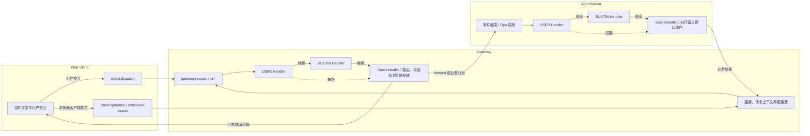

# 7 OpenJiuwen 扩展性 API 文档

本文是 OpenJiuwen 扩展开发指南的参考章节，按 Web Client、Gateway、AgentServer 三个层架构，整理事件、Ops 方法和前端扩展能力。

## 如何阅读本文

### 三层架构

Web Client 关注界面、组件和用户交互；Gateway 负责外部请求、浏览器连接、认证策略和跨边界传输；AgentServer 负责事件链、Handler、Ops 和 Agent 业务执行。

事件属于哪个业务层次，与事件链实际在哪个进程执行不是一回事。Web Client 产生的交互通常经过 Gateway，再由 Gateway 或 AgentServer 触发事件链。

### 每个条目的字段

| 字段           | 说明                                       |
| ------------ | ---------------------------------------- |
| 功能定位         | 这项能力解决什么问题，以及它属于哪条业务链。                   |
| 触发或调用时机      | 宿主什么时候触发事件，或者扩展什么时候主动调用方法。               |
| 输入           | 宿主提供或调用方传入的数据、上下文和限制。                    |
| 输出           | Handler 链或 Core Handler 返回给调用方的结果。               |
| Core Handler | 没有 USER 或 BUILTIN Handler 扩展时，平台如何完成默认动作。 |
| 推荐用法         | 扩展应该在什么场景使用，哪些事情不应交给它。                   |
| 状态           | 当前是已支持、实现中还是仅有设计。                        |

### 通用处理链

公共事件链按 USER Handler → BUILTIN Handler → Core Handler 执行。USER Handler 负责扩展逻辑，BUILTIN Handler 负责平台规则，Core Handler 负责没有扩展接管时的默认动作。

Handler 是否调用 next_handler 决定后续行为：

- 继续：交给后续 Handler，最终由 Core Handler 完成默认动作。
- 改写后继续：使用符合契约的新输入或结果继续处理。
- 短路：直接返回结果，后续 Handler 和 Core Handler 不再执行。

Core Handler 负责默认动作。如果事件代表一个真实业务动作，Core Handler 执行原有平台动作；如果事件只是通知，Core Handler 校验可信上下文并返回真实回执。

### Ops 与事件链的关系

Ops 方法通常从当前 Handler 的 EventHandlerOps 取得 SessionContext，再触发一条新的同名事件链。它不会自动推进当前正在处理的原事件。

事件的 Core Handler 需要执行宿主事实时，应调用不再触发同名事件的内部服务，避免 Ops → 同名事件 → Core Handler → 同名 Ops 的递归。扩展调用 Ops 时，应使用当前 Handler 的上下文，不要自行伪造 session、package 或连接身份。

## Web Client

Web Client 层负责前端渲染、组件生命周期、组件交互、输入框业务交互和前端扩展声明。实际事件链可能由 Gateway 或 AgentServer 承载，本文在条目中区分触发端和处理宿主。

### 组件生命周期与渲染

本小节说明渲染、挂载和卸载事件，以及主动提交渲染树的 Ops。application 目标由 Gateway 按连接寻址，conversation、task 和 message 目标由 AgentServer 按会话寻址。

#### 渲染生命周期事件

| 事件 | 功能定位 | 触发时机 | 输入 | 输出 | Core Handler | 推荐用法 |
| --- | --- | --- | --- | --- | --- | --- |
| ui.render | 提交或清除一棵受控组件树。 | 扩展提交渲染树或宿主启动渲染链时。 | target、root、mode。 | status、revision。 | 校验目标、组件树和预算，登记实例并投递渲染帧。 | 用于更新扩展界面；不要直接发送 WebSocket 帧。 |
| ui.ready | 通知宿主渲染实例已经挂载。 | 前端实例经 webui.dispatch 上行时。 | event_type、target、payload。 | accepted、status、code。 | 校验连接、包、实例和 revision，未被接管时返回通用回执。 | 用于初始化扩展状态或恢复一次性 UI 逻辑。 |
| ui.unmount | 表达前端实例卸载。 | 当前仍是规划中的卸载通知。 | 当前没有稳定公开输入模型。 | 当前没有稳定公开输出模型。 | 当前未找到完整运行时登记。 | 在契约落地前使用连接断开、session.detach 或扩展生命周期清理资源。 |

#### 渲染 Ops

本表说明 Handler 主动提交渲染结果的方法。

| Ops 方法 | 功能定位 | 调用时机 | 输入 | 输出 | Core Handler | 推荐用法 |
| --- | --- | --- | --- | --- | --- | --- |
| ops.ui.render | 主动提交、替换或清除渲染树。 | Handler 需要更新界面时。 | UiRenderInput。 | UiRenderOutput。 | 触发独立 ui.render 事件链，校验树、实例和预算后投递渲染帧。 | 在业务状态变化后调用；不要重复执行已经完成的渲染。 |

### 组件交互

这组事件把前端操作转换为统一的 UiActionInput，再进入对应的事件链。所有交互都必须从当前活动实例读取组件树，并校验 node_key、action_id、args、package、connection、revision 和槽位归属。

| 事件 | 功能定位 | 触发时机 | 输入 | 输出 | Core Handler | 推荐用法 |
| --- | --- | --- | --- | --- | --- | --- |
| ui.click | 处理按钮、菜单或可点击节点的点击。 | 前端节点触发 click 动作后。 | event_type、target、payload。 | accepted、status、code。 | 校验实例和动作；通过后返回通用回执，不替扩展执行业务。 | 扩展在 USER Handler 中处理自己的动作，并在不处理时继续。 |
| ui.change | 处理输入、开关、滑块或选择值变化。 | 组件值发生变化后。 | event_type、target、payload。 | accepted、status、code。 | 校验组件事件和 payload，默认不改变扩展状态。 | 用于增量更新表单或筛选条件。 |
| ui.press_enter | 处理输入组件回车提交。 | 输入组件聚焦时按下回车。 | event_type、target、payload。 | accepted、status、code。 | 校验当前实例和动作，返回通用回执。 | 适合把输入提交动作交给扩展 Handler。 |
| ui.select | 处理 Select、TreeSelect、Tabs 等选项选择。 | 前端选择组件选中选项后。 | event_type、target、payload。 | accepted、status、code。 | 校验选项值和组件树，拒绝过期或不存在的实例。 | 用于切换扩展状态或请求新的渲染树。 |
| ui.search | 处理可搜索选择组件的搜索输入。 | select 组件提交搜索文本后。 | event_type、target、payload。 | accepted、status、code。 | 校验目标和搜索数据，默认返回通用回执。 | 需要远程搜索时使用，不要把完整数据集放入每个渲染帧。 |
| ui.clear | 清除输入或选择组件当前值。 | 前端清除组件内容后。 | event_type、target、payload。 | accepted、status、code。 | 校验动作后返回回执。 | 用于恢复扩展自己的默认筛选状态。 |
| ui.blur | 组件失焦事件。 | 前端组件失去焦点时。 | 当前没有稳定公开的 JiuwenSwarm 输入输出模型。 | 待定义。 | 当前没有稳定 Core Handler 登记。 | 先使用 ui.change 或 ui.click 表达有业务意义的动作。 |
| ui.focus | 组件聚焦事件。 | 前端组件获得焦点时。 | 当前没有稳定公开输入输出模型。 | 待定义。 | 当前没有稳定 Core Handler 登记。 | 不要用它代替有业务语义的交互事件。 |
| ui.scroll | 组件或面板滚动事件。 | 前端滚动位置变化时。 | 当前没有稳定公开输入输出模型。 | 待定义。 | 当前没有稳定 Core Handler 登记。 | 等滚动协议明确后再用于分页或懒加载。 |

### 输入框业务事件

本小节列出输入框相关事件；当前完整输入框组件契约和提交链路仍待收敛。

| 事件 | 功能定位 | 触发时机 | 输入 | 输出 | Core Handler | 推荐用法 |
| --- | --- | --- | --- | --- | --- | --- |
| prompt.submit | 将输入框中的 query 提交到后端。 | 用户提交输入后、进入会话处理前。 | 字段模型尚未锁定。 | 结果模型尚未锁定。 | 待输入框业务组件和提交链路完成后定义。 | 暂以真实会话入口为准，不直接依赖规划中的 prompt.submit。 |
| prompt.suggest | 为输入框提供建议。 | 输入框请求候选建议时。 | 草稿和上下文；待定义。 | 建议列表；待定义。 | 待定义。 | 建议数据应由扩展按需返回，不在前端预置业务规则。 |
| prompt.autocomplete | 提供补全候选。 | 输入框触发补全时。 | 草稿、光标和上下文；待定义。 | 补全列表；待定义。 | 待定义。 | 等输入框组件契约确定后再使用。 |
| prompt.mention | 提供 @ 引用候选，例如文件。 | 用户输入 @ 或同类触发符号时。 | 草稿、光标和上下文；待定义。 | 引用候选；待定义。 | 待定义。 | 候选数据应通过受控 Ops 获取，不直接扫描宿主内部状态。 |
| prompt.edit | 响应用户编辑提示文本。 | 用户输入或编辑草稿时。 | 草稿、光标和编辑上下文；待定义。 | 草稿或回执；待定义。 | 待定义。 | 仅在需要改写草稿的场景使用，避免把每次键入都变成业务事件。 |
| prompt.read | 读取草稿和光标位置。 | 扩展需要读取当前输入状态时。 | 会话或组件上下文；待定义。 | 草稿和光标；待定义。 | 待定义。 | 只在需要上下文的交互中读取，不缓存过期草稿。 |

### 前端槽位、组件和客户端能力

前端扩展不是一个单独的事件，而是由 `manifest.json` 声明、槽位贡献、渲染树、组件 Props 和上行交互共同组成。

本表覆盖槽位、受控组件树和 Web Client 上行交互；application 按连接作用域，conversation、task 和 message 按会话作用域，容量由宿主槽位规约控制。

| 扩展项 | 功能定位 | 输入 | 输出 | Core Handler | 推荐用法 |
| --- | --- | --- | --- | --- | --- |
| `manifest.json` UI 声明 | 声明扩展可以挂载的槽位和 renderer。 | `manifest.json` 中的 `ui`、`slot`、`renderer`、`locale` 声明。 | 激活后的贡献目录。 | 声明非法、槽位不支持或 renderer 不符合协议时拒绝激活或忽略该项。 | 只声明确实需要的槽位；不要把业务状态写进 `manifest.json`。 |
| 槽位目录 | 列出当前 AgentServer 和 Gateway 可挂载的 UI 位置。 | AgentServer：application.entry、application.sidebar.footer、application.menu、application.menu.main、application.settings、conversation.input.above、conversation.input.below、conversation.panel.right、conversation.session.content.after、conversation.turn.footer.actions、conversation.header.title.after、conversation.header.actions、task.function、task.function.main、message.assistant.meta；Gateway：application.entry、application.sidebar.footer。 | 按层和作用域登记的槽位目录。 | 不支持的槽位、作用域或容量声明会被拒绝。 | 先按宿主允许的槽位设计 `manifest.json`。 |
| application 槽位 | 挂载不绑定具体会话的应用级 UI。 | application.entry、application.sidebar.footer 等贡献和渲染目标。 | application 作用域的渲染帧和交互回执。 | Gateway 按连接校验并投递；没有贡献时不渲染任何平台默认视图。 | 用于登录、设置或应用级工具，不用于会话消息内容。 |
| conversation 槽位 | 挂载当前会话的输入区、面板和内容扩展。 | conversation 槽位贡献、session_id 和渲染树。 | 会话作用域渲染帧。 | AgentServer 按 session 和 slot 校验，不匹配时拒绝。 | 用于会话相关功能，保持 session 作用域，不跨会话共享实例。 |
| task 槽位 | 挂载任务操作。 | task.function、task.function.main 等贡献。 | 任务范围的渲染结果。 | 宿主按任务作用域和容量限制实例数量。 | 只展示与当前任务直接相关的操作。 |
| message 槽位 | 挂载助手消息元信息。 | message.assistant.meta 等贡献。 | 消息范围的渲染结果。 | 宿主按消息作用域和容量限制实例数量。 | 只展示与当前消息直接相关的操作。 |
| 受控组件树 | 用白名单组件表达界面。 | component、props、children、events。 | RenderNode 树。 | schema、Props、children、深度、节点数、文本和帧大小不符合规约时拒绝。 | 遵循宿主组件规约，不从适配器另造字段。 |
| Avatar | 提供图片头像或扩展包自定义的文本头像。 | 可选 url、children、alt、gap、size、shape、style.backgroundColor、style.color、style.fontSize。 | 校验通过的 Avatar 节点。 | url 必须是合法非空资源地址；只接受受控样式；不接受 name。 | 由扩展包声明首字母、颜色和字号，不让宿主从账号名推导。 |
| Gateway 表单 | 在 application 槽位收集字段并在浏览器本地校验。 | Form.name、Form.Item.name、rules、Button.form。 | 校验通过后写入 ui.click.data。 | Form、Form.Item 和 Button.form 的关系不合法或校验失败时不发送后端事件。 | 只在 Gateway 使用；AgentServer 不启用这套表单协议。 |
| webui.dispatch | 将前端交互送回宿主。 | event_type、target、payload、当前实例信息。 | UiActionOutput。 | Gateway 或 AgentServer 校验活动实例、revision 和动作；过期动作不产生副作用。 | 通过前端 SDK 或已登记组件事件触发，不直接拼接 WebSocket 消息。 |

### Web Client Ops

Web Client Ops 是扩展主动请求界面或输入框动作的入口；它们的详细契约仍以对应宿主的事件链和组件规约为准。

| Ops 方法 | 功能定位 | 调用时机 | 输入 | 输出 | Core Handler | 推荐用法 |
| --- | --- | --- | --- | --- | --- | --- |
| ops.ui.notice | 显示或移除工具调用下方提示。 | 需要给当前工具过程补充状态时。 | 文本、目标和状态；契约待定义。 | 回执；契约待定义。 | 当前未找到稳定 Core Handler。 | 等公开 UI 通知协议落地后使用。 |
| ops.ui.toast | 显示短时提示。 | 需要向当前用户反馈一次性结果时。 | 文本、持续时间和级别；契约待定义。 | 回执；契约待定义。 | 当前未找到稳定 Core Handler。 | 不用它承载必须持久保存的业务状态。 |
| ops.ui.status | 设置或清除扩展状态行。 | 扩展状态发生变化时。 | 文本或空值；契约待定义。 | 回执；契约待定义。 | 当前未找到稳定 Core Handler。 | 只展示可由扩展解释的状态，不伪造宿主状态。 |
| ops.ui.open | 打开或重命名扩展 Pane。 | 扩展需要打开界面时。 | Pane 标识、标题和布局；契约待定义。 | Pane 状态；待定义。 | 当前未找到稳定 Core Handler。 | 只操作扩展自己的 Pane。 |
| ops.ui.close | 关闭扩展 Pane。 | 扩展需要关闭界面时。 | Pane 标识；契约待定义。 | 回执；待定义。 | 当前未找到稳定 Core Handler。 | 只操作扩展自己的 Pane。 |
| ops.ui.panes | 查询扩展自身 Pane 状态。 | 扩展需要读取界面状态时。 | 无参数。 | Pane 列表；待定义。 | 当前未找到稳定 Core Handler。 | 等宿主 Pane 契约明确后使用。 |
| ops.prompt.submit | 提交输入框中的用户 Prompt。 | 输入框完成提交时。 | query、会话和输入上下文；契约待定义。 | 提交回执；契约待定义。 | 当前要求先完成对话页输入框业务组件接入。 | 不从扩展内部伪造用户输入事件。 |
| ops.prompt.fill | 填充输入框草稿。 | 扩展需要修改草稿时。 | 文本、模式和光标；契约待定义。 | 草稿或回执；契约待定义。 | 当前未找到稳定 Core Handler。 | 只在输入框业务组件契约落地后使用。 |
| ops.prompt.suggest | 获取输入框建议。 | 扩展需要提供候选时。 | 草稿、光标和上下文；契约待定义。 | 建议列表；契约待定义。 | 当前未找到稳定 Core Handler。 | 只在输入框业务组件契约落地后使用。 |
| ops.prompt.read | 读取输入框草稿和光标。 | 扩展需要读取输入状态时。 | 会话或组件上下文；契约待定义。 | 草稿和光标；契约待定义。 | 当前未找到稳定 Core Handler。 | 不缓存过期草稿。 |
| ops.session.files | 查询会话工作区文件。 | 前端需要展示会话文件时。 | expanded_paths；待定义。 | 文件树字典或 unavailable。 | 由宿主 SessionFileService 直接提供。 | 只读展示会话文件。 |
| ops.session.read_file | 读取会话工作区文件。 | 前端需要展示文件内容时。 | path。 | 文件内容字典或 unavailable。 | 由宿主 SessionFileService 直接提供。 | 遵守服务的路径和权限边界。 |

### Web Client 验证路径

本表列出 Web Client 的渲染、失败和生命周期验证重点。

| 验证路径 | 验证重点 |
| --- | --- |
| 正常路径 | 提交合法 RenderNode 树，确认实例登记、revision 单调递增、渲染帧下发，以及已声明动作进入对应事件链。 |
| 失败路径 | 提交未知组件、过深的树、超限文本或过期 revision，确认返回约定错误且不产生副作用。 |
| 生命周期路径 | 验证 ready、连接断开和会话解除关联，确认 application、conversation、task、message 作用域不串用。 |
| 输入框路径 | 等输入框业务组件契约稳定后，再验证提交、建议、补全和草稿读取。 |

## Gateway

Gateway 是外部请求、浏览器连接、渠道身份和跨边界传输的扩展宿主。Gateway 不负责 AgentServer 的业务状态，也不把请求头存在视为认证成功。

### 请求派发与扩展鉴权

本小节说明 Gateway 请求进入扩展链后的策略事件。

| 事件 | 功能定位 | 触发时机 | 输入 | 输出 | Core Handler | 推荐用法 |
| --- | --- | --- | --- | --- | --- | --- |
| gateway.request | 在原生路由前给扩展一次请求策略入口。 | 所有主 WebSocket RPC 和 Gateway HTTP 请求进入原生分发前。 | GatewayRequestInput：method、params、headers、request_context、session_id 等。 | GatewayRequestOutput：forward、local、consume 或 deny；forward 可携带修改后的 params。 | 校验 method；默认 route=forward，把请求交给原生分发；超时或异常 fail-open 为 forward。 | USER Handler 负责鉴权、限流、请求改写或业务消费；不要在 Gateway 内部复制 AgentServer 业务。 |
| gateway.disconnect | 通知扩展连接结束并清理 connection 作用域资源。 | WebSocket 断开或 Gateway 主动清理连接时。 | connection、session_ids 等连接信息。 | 无业务结果。 | 清理连接相关实例和状态，不影响其他连接。 | 用于释放扩展自己的连接资源；不要把它等同于 session.end。 |

### Gateway 浏览器交互与渲染

本小节说明 Gateway application 槽位的渲染和交互事件；Gateway 只开放 application.entry 和 application.sidebar.footer，目标由 Gateway 注入 connection_id。

| 事件 | 功能定位 | 触发时机 | 输入 | 输出 | Core Handler | 推荐用法 |
| --- | --- | --- | --- | --- | --- | --- |
| ui.render | 把 application 作用域的组件树按连接下发到浏览器。 | 扩展提交渲染树或 Gateway 渲染运行时触发时。 | UiRenderInput：target、root、mode；application 目标包含 connection_id。 | delivered、rejected 或 delivery_failed，以及 revision。 | 校验槽位、组件树、实例和预算，成功后向对应 ws_id 投递渲染帧。 | 用于登录、设置和应用级页面；不要渲染 AgentServer 的会话槽位。 |
| ui.ready | 通知 Gateway 应用级实例已经挂载。 | 浏览器挂载 application.entry 或 sidebar.footer 实例后。 | UiActionInput：event_type、target、payload。 | UiActionOutput：accepted、status、code。 | 校验包、连接、slot、instance、revision 和 action，未被接管时返回通用回执。 | 用于初始化前端状态，不直接视为认证成功。 |
| ui.click | 处理 application 组件点击。 | 浏览器通过 webui.dispatch 上行后。 | UiActionInput 和当前活动实例信息。 | UiActionOutput。 | BUILTIN 浏览器分派器检查活动实例和动作，再触发对应事件。 | 扩展只处理自己声明的实例和动作。 |
| ui.select | 处理 application 组件选择。 | 浏览器通过 webui.dispatch 上行后。 | UiActionInput 和当前活动实例信息。 | UiActionOutput。 | BUILTIN 浏览器分派器检查活动实例和动作，再触发对应事件。 | 扩展只处理自己声明的实例和动作。 |
| ui.change | 处理 application 组件值变化。 | 浏览器通过 webui.dispatch 上行后。 | UiActionInput 和当前活动实例信息。 | UiActionOutput。 | BUILTIN 浏览器分派器检查活动实例和动作，再触发对应事件。 | 扩展只处理自己声明的实例和动作。 |
| ui.press_enter | 处理 application 输入组件回车动作。 | 浏览器通过 webui.dispatch 上行后。 | UiActionInput 和当前活动实例信息。 | UiActionOutput。 | BUILTIN 浏览器分派器检查活动实例和动作，再触发对应事件。 | 扩展只处理自己声明的实例和动作。 |
| ui.search | 处理 application 可搜索组件的搜索输入。 | 浏览器通过 webui.dispatch 上行后。 | UiActionInput 和当前活动实例信息。 | UiActionOutput。 | BUILTIN 浏览器分派器检查活动实例和动作，再触发对应事件。 | 扩展只处理自己声明的实例和动作。 |
| ui.clear | 处理 application 输入或选择组件的清除动作。 | 浏览器通过 webui.dispatch 上行后。 | UiActionInput 和当前活动实例信息。 | UiActionOutput。 | BUILTIN 浏览器分派器检查活动实例和动作，再触发对应事件。 | 扩展只处理自己声明的实例和动作。 |

### Gateway 本地登录与浏览器客户端能力

本小节说明 Gateway 登录策略和浏览器客户端能力；登录凭据由 gateway.request 的 USER Handler 处理，浏览器声明、请求绑定和静态素材由客户端协议处理。

| 能力 | 功能定位 | 输入 | 输出 | Core Handler | 推荐用法 |
| --- | --- | --- | --- | --- | --- |
| 登录认证 | 根据请求上下文决定是否允许登录或继续请求。 | headers、request_context、登录业务参数。 | 认证结果、拒绝或继续路由。 | 不把请求头存在视为认证成功；未被接管时按 gateway.request 默认路由。 | 在 USER Handler 中完成认证和会话绑定，不在 AgentServer 重复实现。 |
| client.declarations | 接收 Gateway 下发的浏览器能力声明。 | clientProtocolVersion、gatewayInstanceId、connectionEpoch、packages。 | 当前连接的客户端能力快照。 | 只接受当前 Gateway 连接提供的声明；未知包或激活代次不生效。 | 只根据受信声明使用浏览器能力。 |
| client.requestBindings | 生成当前包的请求绑定。 | type、source、target。 | HTTP header 或 WebSocket request_context 中的绑定值。 | 只绑定声明允许的请求，静态扩展素材不注入请求绑定。 | 只声明扩展需要的请求绑定。 |
| client.operation | 执行浏览器端 localStorage 写删或页面刷新。 | package_id、activation_generation、method、params、deadline。 | 排队的浏览器操作；不提供执行回执。 | 校验包、连接、激活代次和参数；失活操作拒绝且不自动重试。 | 只操作当前扩展包所属浏览器。 |
| extension-assets | 读取活动扩展包的静态素材。 | package_id、generation、相对 path。 | 素材响应或 404。 | 校验 Gateway、包 ID 和激活代次；凭据变化不使同一激活代次的素材失效。 | 只引用当前扩展包的素材，不跟随越界重定向。 |

### Gateway 浏览器能力 Ops

本表说明 Gateway 提供的浏览器 Ops，包括渲染、素材、localStorage 和页面刷新；Ops Build 负责登记，失活包和过期连接不能继续调用。

| Ops 方法 | 功能定位 | 调用时机 | 输入 | 输出 | Core Handler | 推荐用法 |
| --- | --- | --- | --- | --- | --- | --- |
| `ops.ui.render` | 把 application 作用域的组件树按连接下发到浏览器。 | Handler 需要创建、替换或清除应用界面时。 | UiRenderInput：target、root、mode。 | UiRenderOutput。 | 触发 ui.render 事件链，校验槽位、组件树、实例和预算后投递渲染帧。 | 只提交 Gateway application 目标。 |
| `ops.ui.asset_url(path)` | 生成当前活动扩展包静态素材的受保护 URL。 | Handler 需要在 WebUI 树中引用包内素材时。 | `path: str`，相对 `assets` 目录。 | `/extension-assets/{package_id}/{generation}/{path}` URL。 | 校验包、激活代次、路径归属和文件存在性；失活包或越界路径拒绝。 | 只引用包自己的静态素材，不拼接其他包或宿主目录路径。 |
| `ops.client.local_storage_set(key, value)` | 向当前浏览器写入扩展包自己的 localStorage 数据。 | 登录状态或界面状态需要持久化时。 | `key: str`、JSON 值 `value`。 | `accepted=true`、`status=queued` 的投递回执。 | 校验当前包、连接、激活代次、键长度和 JSON 预算；不等待浏览器执行回执。 | 只保存包自己的客户端状态，不把宿主授权事实写入浏览器存储。 |
| `ops.client.local_storage_delete(key)` | 删除当前浏览器中扩展包自己的 localStorage 键。 | 退出登录或清理客户端状态时。 | `key: str`。 | `accepted=true`、`status=queued` 的投递回执。 | 校验当前包、连接、激活代次和键；不重试，也不自动刷新页面。 | 与显式的 `ops.client.page_reload()` 按业务顺序调用。 |
| `ops.client.page_reload()` | 刷新发起调用的当前浏览器页面。 | 凭据或初始化状态已经写入后需要重新启动前端运行时。 | 无参数。 | `accepted=true`、`status=queued` 的投递回执。 | 校验当前包、连接、激活代次、空参数和截止时间，然后投递刷新命令。 | 只在业务确实需要重新初始化时调用；存储变化不会自动触发刷新。 |

### Gateway HTTP 出站能力

本表说明 Gateway 代扩展发起受控 HTTP 请求的方法。

| Ops 方法 | 功能定位 | 调用时机 | 输入 | 输出 | Core Handler | 推荐用法 |
| --- | --- | --- | --- | --- | --- | --- |
| ops.http.fetch | 由 Gateway 进程代扩展发起受控 HTTP 请求。 | 包 Handler 主动调用时。 | HttpFetchInput：url、method、headers、body、timeout_ms、follow_redirects。 | HttpFetchOutput：status、headers、body、elapsed_ms、code。 | 校验 http/https、allowed_hosts、重定向、超时和响应体大小；默认超时 3000ms、上限 5000ms；空白名单拒绝；平台失败返回 code。 | 用于扩展探测或访问受信任的第三方服务；默认不跟随重定向且每次重定向重新校验目标主机。 |

### Gateway 验证路径

本表列出 Gateway 的请求路由、容错、连接和浏览器界面验证重点；认证、请求策略和浏览器状态必须在 Gateway 边界验证。

| 验证路径 | 验证重点 |
| --- | --- |
| 请求策略 | 分别验证 forward、local、consume 和 deny 的路由结果；确认 forward 只携带允许范围内的参数改写。 |
| 容错路径 | 验证 USER Handler 超时或异常时按 fail-open 继续原生派发；验证 HTTP 空白名单、超时、重定向和响应体上限的错误码。 |
| 连接与界面 | 验证连接资源清理，以及过期实例、错误 revision 或旧 activation_generation 请求被拒绝且无业务副作用。 |

## AgentServer

AgentServer 是事件链、Handler、Ops 和 Agent 业务的主要执行宿主。Web Client 和 Gateway 可以触发 AgentServer 事件，但不应直接访问 AgentServer 内部对象。

### 会话生命周期与跨会话消息

本小节列出会话启动、关联、结束和跨会话消息事件。

| 事件 | 功能定位 | 触发时机 | 输入 | 输出 | Core Handler | 推荐用法 |
| --- | --- | --- | --- | --- | --- | --- |
| session.start | 通知扩展一个激活包实例第一次参与原生输入处理。 | 权限、模型和执行目录绑定完成后，首条原生输入前；每个激活实例最多一次。 | cwd、surface、isInteractive。 | cwd。 | 核对可信 SessionContext 和真实 cwd，返回当前会话的 cwd 回执。 | 用于一次性初始化；不要按每个会话或每次输入重复初始化。 |
| session.attach | 通知扩展客户端与主会话建立关联。 | 有效客户端关联提交后，同一稳定关联不重复通知。 | surface、clientId、viewport。 | clientId。 | 核对真实会话和关联身份，返回真实 clientId。 | 用于创建界面关联资源；不要把 attach 当成 session.start。 |
| session.detach | 通知扩展客户端关联解除。 | 客户端关联释放后。 | surface、clientId、reason。 | clientId。 | 清理界面关联资源，必要时继续进入真实 session.end。 | 只清理界面资源，不主动结束会话。 |
| session.end | 通知扩展主会话真正停稳并即将释放资源。 | 主会话资源释放前；单轮完成不触发。 | reason、sessionId、resume。 | sessionId。 | 核验真实结束作用域和输入，返回真实 sessionId，并继续平台释放。 | 用于清理扩展资源；不伪造提前结束，也不承诺撤销外部副作用。 |
| session.send | 在跨会话消息进入目标持久队列前提供策略入口。 | 源会话向目标会话发送消息时。 | target_session_id、text、input_mode。 | 投递回执或 deny。 | 校验目标和权限，完成平台投递或返回拒绝。 | 用于跨会话协作和消息策略；投递受理不代表目标 Agent 已执行。 |
| session.receive | 在目标会话入队前允许扩展观察或消费跨会话消息。 | 平台完成归属校验和源端发送后。 | origin、text、可选 event。 | text 或 consumed。 | 放行消息进入目标队列，或返回合法消费结果。 | 只处理明确属于本事件的持久跨会话消息，不自动覆盖 Web chat、cron 或其他外部回调入口。 |
| session.append | 在一条历史消息提交前校验或改写允许字段。 | 历史记录真正提交前，一次一条记录尝试。 | message、door、origin、uuid。 | status、session_id、message_id，以及可选 message、reason、uuid、history_record。 | 负责去重和最终提交，返回真实存储回执。 | 用于历史写入策略；不在 Handler 中启动 Agent 执行。 |
| session.compact | 在会话上下文压缩前允许调整指令或跳过本次压缩。 | 目前只存在 JiuwenSwarm 事件链和 Ops 接口，主流程尚未接入；agent-core 最新分支另有原生候选与延迟提交边界。 | trigger、messages、agent_id、instructions。 | 压缩后的 messages 和 token 信息，或 skip。 | 未装配压缩服务时拒绝调用；生产主流程接入前不应依赖。 | 仅用于实验或等待主流程接入的扩展设计。 |
| session.authorize | 申请受控的会话授权句柄。 | Handler 请求授权时。 | 空对象。 | 不透明句柄、None 或 deny。 | 由宿主授权服务生成句柄，真实凭据不进入扩展。 | 只保存句柄，不记录或传递明文凭据。 |

### 会话查询与状态读取

本小节先列出会话查询事件，再列出触发这些事件的同名 Ops。查询事件使用当前 Handler 的会话上下文，不从输入中接收会话身份。

#### 会话查询事件

| 事件 | 功能定位 | 触发时机 | 输入 | 输出 | Core Handler | 推荐用法 |
| --- | --- | --- | --- | --- | --- | --- |
| session.cwd | 查询当前会话实际执行目录。 | 对应 Ops 调用时触发独立查询链。 | 空对象。 | 绝对路径或 None。 | 读取绑定 SessionContext.cwd。 | 用于定位扩展输入文件；不使用进程 cwd 代替。 |
| session.root | 查询当前项目根目录。 | 对应 Ops 调用时触发。 | 空对象。 | 绝对路径或 None。 | 读取已确认的 project_root。 | 用于项目范围资源定位；无绑定时接受 None。 |
| session.model | 查询当前会话主模型信息。 | 对应 Ops 调用时触发。 | 空对象。 | 规范化模型对象或 None。 | 读取上下文快照或会话模型服务。 | 用于展示或策略判断，不把模型信息当作授权依据。 |
| session.repo | 查询当前工作区 Git 仓库事实。 | 对应 Ops 调用时触发。 | 空对象。 | root、remote、internal、name 等仓库信息或 None。 | 从 cwd 读取仓库事实。 | 用于生成项目相关展示，不修改仓库状态。 |
| session.messages | 分页读取主会话历史。 | 对应 Ops 调用时触发。 | limit、cursor。 | 消息列表和下一页游标。 | 读取 Transcript，尊重 limit 和 cursor。 | 用于审计、摘要或展示；不要把历史读取当作写入。 |
| session.turns | 统计已提交用户轮次。 | 对应 Ops 调用时触发。 | 空对象。 | 非负整数或 None。 | 读取已提交且仍保留的原生输入统计。 | 用于计数和展示，不把模型步骤或工具调用混入。 |
| session.usage | 读取上下文用量快照。 | 对应 Ops 调用时触发。 | breakdown、columns 可选。 | context、rateLimits，可选 cost、breakdown。 | 读取已经观测的快照，不重新测量。 | 用于状态栏和用量展示，不用它驱动计费。 |
| context.usage.updated | 发布一轮 chat 完成后的用量变化。 | 一轮 chat 完成后异步通知。 | session_id、request_id、token、cache、context window、usage_percent、model 等。 | accepted、request_id。 | 记录或消费快照，不阻塞原始 chat 完成。 | 用于展示上下文占用和轮次统计；当前未统一覆盖所有工具路径。 |

#### 会话查询 Ops

| Ops 方法 | 功能定位 | 调用时机 | 输入 | 输出 | Core Handler | 推荐用法 |
| --- | --- | --- | --- | --- | --- | --- |
| ops.session.cwd() | 查询当前会话实际执行目录。 | Handler 需要读取执行目录时。 | 无参数。 | 绝对路径或 None。 | 读取 SessionContext.cwd，不再次触发同名 Ops。 | 用于定位扩展输入文件。 |
| ops.session.root() | 查询当前项目根目录。 | Handler 需要确定项目范围时。 | 无参数。 | 绝对路径或 None。 | 读取 project_root。 | 用于项目范围资源定位。 |
| ops.session.model() | 查询当前会话模型信息。 | Handler 需要展示或判断模型时。 | 无参数。 | 模型信息对象或 None。 | 读取上下文快照或会话模型服务。 | 不把模型信息当作授权依据。 |
| ops.session.repo() | 查询当前工作区仓库事实。 | Handler 需要展示仓库信息时。 | 无参数。 | 仓库信息对象或 None。 | 从 cwd 读取仓库事实。 | 只读使用，不修改仓库状态。 |
| ops.session.messages(limit=50, cursor=None) | 分页读取主会话历史。 | Handler 需要审计、摘要或展示历史时。 | limit、cursor。 | 消息分页结果。 | 读取 Transcript，不触发模型或写入。 | 遵守分页边界，不把读取当作写入。 |
| ops.session.turns() | 统计已提交用户轮次。 | Handler 需要计数或展示时。 | 无参数。 | 非负整数或 None。 | 读取已提交且仍保留的原生输入统计。 | 不把模型步骤或工具调用混入。 |
| ops.session.usage(breakdown=False, columns=None) | 读取上下文用量快照。 | Handler 需要展示上下文用量时。 | breakdown、columns。 | context、rateLimits，可选 cost、breakdown。 | 读取已有快照，不重新测量。 | 不用它驱动计费。 |

### Agent、Tool 与资源登记

本小节说明 Agent 和 Tool 登记事件及 Ops；agent.offer、agent.spawn、agent.list 尚未形成稳定公开契约。

#### Agent 和 Tool 登记事件

| 事件 | 功能定位 | 触发时机 | 输入 | 输出 | Core Handler | 推荐用法 |
| --- | --- | --- | --- | --- | --- | --- |
| agent.register | 注册可被当前 Agent 使用的子 Agent 类型。 | 直接触发事件或调用对应 Ops 时。 | AgentCard、prompt 和运行时支持的可选字段。 | agent、agent_card，或 deny。 | 核对 DeepAgent 绑定并把声明物化到运行时。 | 注册稳定的 Agent 类型；不在 Handler 中伪造运行时实例。 |
| tool.register | 注册工具、RestfulApiCard 或 callable。 | 直接触发事件或调用对应 Ops 时。 | Tool、RestfulApiCard 或 callable 来源及 ToolCard。 | tool 名称或 deny。 | 核对 Agent 后物化并登记工具。 | 用于扩展提供工具定义；不要把登记事件当成工具执行事件。 |
| agent.offer | 控制 Agent 类型是否展示给模型。 | 设计中的 Agent 展示或分派前。 | 当前没有稳定公开输入模型。 | 待定义。 | 当前没有稳定登记。 | 先使用 agent.register 和宿主既有 Agent 入口。 |
| agent.spawn | 启动子 Agent。 | 设计中的子 Agent 分派前。 | 当前没有稳定公开输入模型。 | 待定义。 | 当前没有稳定 Core Handler。 | 不要通过未登记的内部调用启动子 Agent。 |
| agent.list | 查询当前会话的子 Agent。 | 设计中的查询调用时。 | 当前没有稳定公开输入模型。 | 待定义。 | 当前没有稳定 Core Handler。 | 等契约和调用方落地后再使用。 |

#### Agent 和 Tool Ops

| Ops 方法 | 功能定位 | 调用时机 | 输入 | 输出 | Core Handler | 推荐用法 |
| --- | --- | --- | --- | --- | --- | --- |
| ops.agent.register(data) | 登记当前 Agent 可使用的子 Agent 类型。 | Handler 需要注册 Agent 类型时。 | AgentRegisterInput。 | AgentRegisterValue 或 deny。 | 触发 agent.register，核对 DeepAgent 后物化声明。 | 只登记稳定的 Agent 类型。 |
| ops.tool.register(spec) | 登记工具、RestfulApiCard 或 callable。 | Handler 需要提供工具定义时。 | ToolRegisterSpec。 | ToolRegisterValue 或 deny。 | 触发 tool.register，核对 Agent 后物化工具。 | 不把登记方法当作工具执行方法。 |

### Agent Loop、Tool 和进程执行

本小节区分 Agent Loop、Tool、进程和 Skill 相关事件与已规划的 Ops。

#### Agent Loop 事件

| 事件 | 功能定位 | 当前状态 | Core Handler | 推荐用法 |
| --- | --- | --- | --- | --- |
| turn.start | 开始一轮对话。 | 实现中。 | 当前未找到完整稳定的 AgentServer 事件链。 | 等事件链和流式输出契约完成后再使用。 |
| turn.step | 处理一轮对话中的模型或工具步骤。 | 实现中。 | 当前未找到完整稳定的 AgentServer 事件链。 | 等事件链和流式输出契约完成后再使用。 |
| turn.complete | 完成一轮对话。 | 实现中。 | 当前未找到完整稳定的 AgentServer 事件链。 | 等事件链和流式输出契约完成后再使用。 |
| turn.abort | 中止一轮对话。 | 实现中。 | 当前未找到完整稳定的 AgentServer 事件链。 | 等事件链和流式输出契约完成后再使用。 |
| tool.describe | 提供工具描述。 | 实现中；当前已确认 tool.register。 | 当前没有对应的稳定默认执行链。 | 使用现有工具注册和宿主工具执行入口。 |
| tool.check | 判断工具调用权限。 | 实现中；当前已确认 tool.register。 | 当前没有对应的稳定默认执行链。 | 使用现有工具注册和宿主工具执行入口。 |
| tool.call | 执行工具调用。 | 实现中；当前已确认 tool.register。 | 当前没有对应的稳定默认执行链。 | 使用现有工具注册和宿主工具执行入口。 |
| tool.list | 查询当前可见工具。 | 实现中；当前已确认 tool.register。 | 当前没有对应的稳定默认执行链。 | 使用现有工具注册和宿主工具执行入口。 |
| process.run | 执行一次性进程。 | 实现中。 | 当前缺少稳定公开事件处理链。 | 不通过扩展内部直接启动不受控进程。 |
| process.spawn | 启动长时间进程。 | 实现中。 | 当前缺少稳定公开事件处理链。 | 不通过扩展内部直接启动不受控进程。 |
| skill.prompt | 展开 Skill 提示内容。 | 实现中。 | 当前缺少稳定 Prompt/Skill 事件链。 | 依赖宿主现有 Skill 加载入口。 |

#### Agent Loop Ops

| Ops 方法 | 功能定位 | 当前状态 | Core Handler | 推荐用法 |
| --- | --- | --- | --- | --- |
| ops.tool.check | 执行工具权限判定。 | 实现中。 | 当前缺少稳定的默认执行链。 | 等工具权限、执行和返回值契约稳定后使用。 |
| ops.tool.call | 执行工具调用。 | 实现中。 | 当前缺少稳定的默认执行链。 | 等工具权限、执行和返回值契约稳定后使用。 |
| ops.tool.list | 查询可见工具。 | 实现中。 | 当前缺少稳定的默认执行链。 | 等工具权限、执行和返回值契约稳定后使用。 |
| ops.process.run | 执行一次性进程。 | 实现中。 | 当前缺少稳定的进程执行 Handler。 | 等权限、环境和生命周期契约稳定后使用。 |
| ops.process.spawn | 启动长时间进程。 | 实现中。 | 当前缺少稳定的进程执行 Handler。 | 等权限、环境和生命周期契约稳定后使用。 |

### Prompt 调整

 Prompt 事件用于修改系统提示、上下文和附件；当前完整 AgentServer 入口、输入输出和 Core Handler 仍待收敛。

| 事件 | 功能定位 | 当前状态 | Core Handler | 推荐用法 |
| --- | --- | --- | --- | --- |
| prompt.section | 生成或调整系统提示的某个 section。 | 实现中。 | 当前没有稳定 Core Handler。 | 等 section 数据结构和默认组装链确定后使用。 |
| prompt.compose | 增加、删除、排序或替换多个系统提示 section。 | 实现中。 | 当前没有稳定 Core Handler。 | 只改写明确允许的 section，不拼接整段内部 Prompt。 |
| prompt.context | 生成或调整会话首次上下文。 | 实现中。 | 当前没有稳定 Core Handler。 | 等上下文 blocks 和会话首次输入边界确定后使用。 |
| prompt.attachment | 放行、修改或删除已有 attachment。 | 实现中。 | 当前没有稳定 Core Handler。 | 只处理公开 attachment 模型，不读取内部拼装结果。 |

### 文件系统能力

本小节说明 FS 事件和同名 Ops；Core Handler 根据当前 Agent 的 cwd、project_root 和 workspace 建立路径上下文，默认超时 30 秒、上限 10 分钟。

#### FS 事件

| 事件 | 功能定位 | 触发时机 | 输入 | 输出 | Core Handler | 推荐用法 |
| --- | --- | --- | --- | --- | --- | --- |
| fs.read | 读取文件内容。 | 直接触发事件或由 ops.fs.read 触发时。 | path、mode、head、tail、line_range、encoding、chunk_size、only_read、timeout_ms。 | status、path、content、mode、error。 | 校验路径、模式、编码、读取窗口和超时，再调用 FsService。 | 读取扩展需要的项目文件。 |
| fs.write | 创建、覆盖或追加文件。 | 直接触发事件或由 ops.fs.write 触发时。 | path、content、mode、append、create_if_not_exist、permissions、encoding、timeout_ms。 | status、path、size、mode、error。 | 校验目标和写入策略；失败不返回成功。 | 只写扩展负责的文件。 |
| fs.list | 列举目录。 | 直接触发事件或由 ops.fs.list 触发时。 | path、recursive、max_depth、排序、文件类型、max_entries、timeout_ms。 | root_path、entries、total_count、truncated、error。 | 校验目录和枚举预算，统一排序和截断。 | 不递归扫描无界目录。 |
| fs.stat | 查询路径元数据。 | 直接触发事件或由 ops.fs.stat 触发时。 | path、timeout_ms。 | found、kind、size、modified_time、error。 | 区分不存在、权限失败和读取失败。 | 在读取或写入前确认资源类型和大小。 |
| fs.exists | 检查路径是否存在。 | 直接触发事件或由 ops.fs.exists 触发时。 | path、timeout_ms。 | exists、error。 | 权限或父目录失败不能伪装成不存在。 | 只用于存在性判断，不代替 stat。 |
| fs.ancestors | 从起始目录向上读取指令文件。 | 直接触发事件或由 ops.fs.ancestors 触发时。 | names、start、stop_at、max_files、max_bytes_per_file、encoding、timeout_ms。 | entries、truncated、skipped、error。 | 按根目录到当前目录读取，并执行文件数和字节预算。 | 只读取项目层级指令。 |

#### FS Ops

| Ops 方法 | 功能定位 | 调用时机 | 输入 | 输出 | Core Handler | 推荐用法 |
| --- | --- | --- | --- | --- | --- | --- |
| ops.fs.read(input) | 读取文件内容。 | Handler 需要读取文件时。 | FsReadInput。 | FsReadOutput。 | 触发 fs.read，执行路径和读取窗口校验。 | 遵守只读和大小限制。 |
| ops.fs.write(input) | 创建、覆盖或追加文件。 | Handler 需要写入文件时。 | FsWriteInput。 | FsWriteOutput。 | 触发 fs.write，失败不返回成功。 | 明确覆盖和追加语义。 |
| ops.fs.list(input) | 列举目录。 | Handler 需要发现目录内容时。 | FsListInput。 | FsListOutput。 | 触发 fs.list，执行枚举预算和排序。 | 限制递归深度和条目数。 |
| ops.fs.stat(input) | 查询路径元数据。 | Handler 需要确认资源类型时。 | FsStatInput。 | FsStatOutput。 | 触发 fs.stat，区分不存在和读取失败。 | 读取或写入前使用。 |
| ops.fs.exists(input) | 检查路径是否存在。 | Handler 需要存在性判断时。 | FsExistsInput。 | FsExistsOutput。 | 触发 fs.exists，权限失败不伪装成不存在。 | 不代替 stat。 |
| ops.fs.ancestors(input) | 读取祖先目录中的指令文件。 | Handler 需要读取项目层级指令时。 | FsAncestorsInput。 | FsAncestorsOutput。 | 触发 fs.ancestors，执行文件数和字节预算。 | 不扩大到任意目录扫描。 |

### MCP 能力

本小节说明 MCP 登记、连接和调用事件及同名 Ops；register/connect 默认 60 秒、call 默认 120 秒，上限 10 分钟。

#### MCP 事件

| 事件 | 功能定位 | 触发时机 | 输入 | 输出 | Core Handler | 推荐用法 |
| --- | --- | --- | --- | --- | --- | --- |
| mcp.register | 登记 MCP 服务。 | 直接触发事件或由 ops.mcp.register 触发时。 | name、transport、connection、include_image_content、timeout_ms。 | server_id、server_name，或 deny。 | 构造服务配置，登记 ResourceMgr 和 AbilityManager。 | 在扩展加载或显式配置阶段登记服务。 |
| mcp.connect | 连接服务并读取工具。 | 直接触发事件或由 ops.mcp.connect 触发时。 | server_id，或 package_id 加 server_name，以及 timeout_ms。 | connected、agent_visible、tools、tool_count、error。 | 建立连接并按需把工具发布给 Agent。 | 不把空工具列表当成成功连接。 |
| mcp.call | 调用 MCP 工具。 | 直接触发事件或由 ops.mcp.call 触发时。 | server_id、tool、arguments、timeout_ms。 | status、result、is_error、error。 | 根据工具卡补默认参数和校验，再调用 MCPTool。 | 保留 is_error 与对端结果。 |

#### MCP Ops

| Ops 方法 | 功能定位 | 调用时机 | 输入 | 输出 | Core Handler | 推荐用法 |
| --- | --- | --- | --- | --- | --- | --- |
| ops.mcp.register(spec) | 登记 MCP 服务。 | Handler 需要登记服务时。 | McpRegisterSpec。 | McpRegisterValue；失败为 deny 或 RuntimeError。 | 触发 mcp.register，构造服务配置并登记资源管理器。 | 不在每次业务调用重复登记。 |
| ops.mcp.connect(input) | 连接 MCP 服务并读取工具。 | Handler 需要建立或确认连接时。 | McpConnectInput。 | McpConnectOutput。 | 触发 mcp.connect，建立连接并按需发布工具。 | 连接失败按错误处理。 |
| ops.mcp.call(input) | 调用 MCP 工具。 | Handler 需要执行工具时。 | McpCallInput。 | McpCallOutput。 | 触发 mcp.call，补默认参数并校验后调用 MCPTool。 | 只调用当前扩展可见的服务和工具。 |

### 扩展持久化与运行状态

本小节说明扩展包持久化和运行状态事件及同名 Ops；store 按包隔离并限制单包 JSON 文件为 4 MiB，state 按 application、session 和 auto 作用域保存值与版本。

#### store 和 state 事件

| 事件 | 功能定位 | 触发时机 | 输入 | 输出 | Core Handler | 推荐用法 |
| --- | --- | --- | --- | --- | --- | --- |
| store.get | 读取当前扩展包跨会话、跨重启保留的 JSON 键值。 | 直接触发事件或由 ops.store.get 触发时。 | key、default；package_id 由上下文注入。 | JSON 值或 default。 | 按包隔离读取持久化存储。 | 保存用户偏好和扩展配置。 |
| store.set | 写入当前扩展包持久化键值。 | 直接触发事件或由 ops.store.set 触发时。 | key、value。 | bool。 | 复制并校验 JSON 值后写入。 | 明确数据版本和迁移策略。 |
| store.delete | 删除持久化键值。 | 直接触发事件或由 ops.store.delete 触发时。 | key。 | bool。 | 删除当前包自己的键，不影响其他包。 | 用于清理扩展拥有的数据。 |
| store.keys | 列出当前扩展包的持久化键。 | 直接触发事件或由 ops.store.keys 触发时。 | 无参数。 | 按插入顺序的字符串列表。 | 只返回当前包的键。 | 用于迁移或诊断。 |
| state.get | 读取扩展运行状态并登记构树依赖。 | 直接触发事件或由 ops.state.get 触发时。 | StateAddress。 | exists、value、version。 | 按 application、session 或 auto 作用域解析地址。 | 在构树期间读取状态。 |
| state.set | 按版本条件更新扩展运行状态。 | 直接触发事件或由 ops.state.set 触发时。 | StateAddress、value、expected_version。 | is_set、changed、version、reason。 | 执行 CAS；构树期间禁止写入。 | 在交互回调中写状态。 |

#### store 和 state Ops

| Ops 方法 | 功能定位 | 调用时机 | 输入 | 输出 | Core Handler | 推荐用法 |
| --- | --- | --- | --- | --- | --- | --- |
| ops.store.get(key, default=None) | 读取当前扩展包持久化数据。 | Handler 需要读取配置或偏好时。 | key、default。 | JSON 值或 default。 | 触发 store.get，按包隔离读取。 | 不保存临时会话状态。 |
| ops.store.set(key, value) | 写入当前扩展包持久化数据。 | Handler 需要保存配置或偏好时。 | key、value。 | bool。 | 触发 store.set，校验 JSON 值后写入。 | 明确数据版本和迁移策略。 |
| ops.store.delete(key) | 删除当前扩展包持久化数据。 | Handler 需要清理数据时。 | key。 | bool。 | 触发 store.delete，不影响其他包。 | 只删除扩展自己拥有的数据。 |
| ops.store.keys() | 查询当前扩展包持久化键。 | Handler 需要迁移或诊断时。 | 无参数。 | 字符串列表。 | 触发 store.keys，只返回当前包的键。 | 不把 keys 当作业务查询接口。 |
| ops.state.get(ref) | 读取运行状态并登记构树依赖。 | Handler 需要读取状态时。 | StateRef。 | StateSnapshot。 | 触发 state.get，解析作用域并读取版本。 | 构树期间只读状态。 |
| ops.state.set(ref, value, expected_version=None) | 按版本条件写入运行状态。 | Handler 需要提交状态变化时。 | StateRef、value、expected_version。 | StateSetResult。 | 触发 state.set，执行 CAS；构树期间拒绝写入。 | 在交互或后台业务中写状态。 |

### 团队监控与协作

本小节先列出团队状态事件，再列出只读查询和协作上下文 Ops。

#### 团队事件

| 事件 | 功能定位 | 触发时机 | 输入 | 输出 | Core Handler | 推荐用法 |
| --- | --- | --- | --- | --- | --- | --- |
| team.monitor_event | 把团队状态、成员状态、任务状态和消息事件送入扩展链。 | 团队状态落库和状态机流转完成后，由监控桥接队列非阻塞投递。 | team_name、member_name、monitor_event。 | 完成标记。 | 事件失败不影响原团队状态操作；队列满时丢弃并计数。 | 用于观测、同步和通知，不把它当作团队状态决策入口。 |
| team.build_policy | 参与成员系统 Prompt 的团队协作规则构建。 | 构建成员系统 Prompt 时，每个成员每个准备期一次。 | team_name、role、member_name、workspace_prompt_variant。 | PromptSection 元组。 | 使用宿主默认策略或保留边界，扩展返回值不能绕过规则约束。 | 用于追加或替换明确的协作规则段。 |

#### 团队 Ops

本表列出团队、成员、任务、依赖、消息和协作上下文的只读 Ops；这些方法不触发 team.monitor_event。

| Ops 方法 | 功能定位 | 输入 | 输出 | Core Handler | 推荐用法 |
| --- | --- | --- | --- | --- | --- |
| team.info | 查询团队基本信息。 | team_name=None。 | TeamInfo。 | 读取团队服务，不修改团队状态。 | 展示当前协作范围。 |
| team.list | 查询团队列表。 | 查询条件；待定义。 | TeamInfo 列表。 | 读取当前可见团队，不修改团队状态。 | 展示当前协作范围。 |
| team.members | 查询团队成员列表。 | team_name。 | MemberInfo 列表。 | 由 resolver 校验团队归属。 | 不接受调用方伪造范围。 |
| team.member | 查询单个团队成员。 | member_name、team_name=None。 | MemberInfo。 | 由 resolver 校验团队归属。 | 不接受调用方伪造范围。 |
| team.tasks | 查询团队任务列表。 | team_name=None、session_id=None。 | TaskInfo 列表。 | 由 resolver 校验团队归属。 | 用于任务展示和诊断。 |
| team.task | 查询单个团队任务。 | task_id、team_name=None、session_id=None。 | TaskInfo。 | 由 resolver 校验团队归属。 | 跨团队或不存在时使用约定错误。 |
| team.task_dependencies | 查询任务依赖。 | task_id、team_name=None、session_id=None。 | TaskDependencyInfo 列表。 | 由 resolver 校验团队归属。 | 用于任务展示和诊断。 |
| team.messages | 分页查询团队消息。 | sender、receiver、broadcast、limit、cursor、team_name、session_id。 | MessagePage。 | 只读读取，不标记已读。 | 不改变消息状态。 |
| team.message | 查询单条团队消息。 | message_id、team_name=None、session_id=None。 | MessageInfo。 | 只读读取，不标记已读。 | 不改变消息状态。 |
| team.policy_context | 读取团队协作规则上下文。 | 无业务参数。 | PolicyContext。 | 仅从当前构建作用域读取。 | 只在 team.build_policy 构建作用域内使用。 |
| team.reliability_context | 读取团队可靠性上下文。 | 无业务参数。 | ReliabilityContext。 | 仅从当前构建作用域读取。 | 只在可靠性构建作用域内使用。 |

### 配置、命令、模型和扩展包管理

本小节列出配置、命令、模型、观测和扩展包管理相关的事件与 Ops；未标记为已支持的项不能直接调用，宿主装配保留事件不列入普通开发者索引。

#### 基础上下文、环境和配置 Ops

本表列出当前规划中的 AgentServer 查询和配置 Ops。

| Ops 方法 | 功能定位 | 调用时机 | 输入 | 输出 | Core Handler | 推荐用法 |
| --- | --- | --- | --- | --- | --- | --- |
| ops.env.value | 读取扩展运行进程中的环境变量。 | Handler 需要读取运行配置时。 | 变量名；完整默认值语义待定义。 | 字符串、None 或错误；待定义。 | 读取宿主进程环境，不把调用方自填的环境快照当作可信身份。 | 只读取非敏感配置；不要把密钥写入日志或持久化状态。 |
| ops.config.value | 查询一个配置项的当前值。 | 扩展需要读取配置时。 | 配置键和查询上下文；待定义。 | 配置值；待定义。 | 由配置服务读取合并后的值，并执行权限和作用域校验。 | 只读使用；配置值的保存交给 config.set。 |
| ops.config.items | 查询可见配置项。 | 构建设置页面或配置帮助时。 | 过滤、作用域和查询上下文；待定义。 | 配置项列表；待定义。 | 由配置服务返回当前作用域允许展示的项。 | 不把内部配置项直接暴露到扩展 UI。 |
| ops.config.snapshot | 读取当前配置快照。 | 扩展需要一次性计算配置相关行为时。 | 查询上下文；待定义。 | 配置快照；待定义。 | 返回一致性快照，不允许通过快照绕过 config.set。 | 适合初始化读取，不要长期缓存而忽略配置变更。 |
| ops.session.id | 查询当前会话标识。 | 扩展需要建立会话作用域资源时。 | 无参数；完整契约待定义。 | session_id；待定义。 | 从可信 SessionContext 读取，不接受调用方伪造的 session_id。 | 只用于寻址本会话资源，不把它当作授权凭据。 |
| ops.session.surfaces | 查询当前会话关联的界面集合。 | 扩展需要选择渲染目标时。 | 无参数或过滤条件；待定义。 | surface 列表；待定义。 | 从可信会话关联表读取。 | 只选择当前调用上下文可见的 surface。 |
| ops.session.version | 查询引擎或会话版本。 | 扩展需要执行兼容性判断时。 | 无参数。 | 版本信息；待定义。 | 返回宿主版本快照，不承诺版本字符串可作为能力探测的唯一依据。 | 优先使用能力存在性和特性版本，不硬编码补丁版本。 |

#### 规划中的 AgentServer 事件

本表列出当前规划中的配置、命令、模型、观测和扩展包管理事件。

| 事件 | 功能定位 | 当前状态 | Core Handler | 推荐用法 |
| --- | --- | --- | --- | --- |
| config.describe | 描述可用配置项。 | 实现中。 | 当前缺少完整公开 AgentServer 事件链。 | 等配置规约、权限和默认值统一后使用。 |
| config.set | 校验并应用配置变更。 | 实现中。 | 当前缺少完整公开 AgentServer 事件链。 | 等配置规约、权限和默认值统一后使用。 |
| config.list | 读取配置菜单。 | 实现中。 | 当前缺少完整公开 AgentServer 事件链。 | 等配置规约、权限和默认值统一后使用。 |
| command.run | 执行扩展命令。 | 实现中；server.run_command 是现有的独立服务端命令事件。 | 不用 server.run_command 冒充 command.* 全套能力。 | 使用已支持的 server.run_command，其他命令 API 等待契约。 |
| command.describe | 描述扩展命令。 | 实现中；server.run_command 是现有的独立服务端命令事件。 | 不用 server.run_command 冒充 command.* 全套能力。 | 使用已支持的 server.run_command，其他命令 API 等待契约。 |
| command.list | 查询扩展命令。 | 实现中；server.run_command 是现有的独立服务端命令事件。 | 不用 server.run_command 冒充 command.* 全套能力。 | 使用已支持的 server.run_command，其他命令 API 等待契约。 |
| command.register | 登记扩展命令。 | 实现中；server.run_command 是现有的独立服务端命令事件。 | 不用 server.run_command 冒充 command.* 全套能力。 | 使用已支持的 server.run_command，其他命令 API 等待契约。 |
| model.complete | 发起独立补全。 | 实现中。 | 当前缺少稳定模型调用和取消语义。 | 等模型权限、上下文和费用边界确认后使用。 |
| model.fork | 派生模型请求。 | 实现中。 | 当前缺少稳定模型调用和取消语义。 | 等模型权限、上下文和费用边界确认后使用。 |
| model.classify | 发起分类请求。 | 实现中。 | 当前缺少稳定模型调用和取消语义。 | 等模型权限、上下文和费用边界确认后使用。 |
| telemetry.log | 记录观测信息。 | agent-core 有规划或部分实现，JiuwenSwarm 业务接入未统一。 | 默认不阻塞主业务。 | 只记录必要诊断信息，不记录敏感输入。 |
| telemetry.mark | 记录功能使用标记。 | agent-core 有规划或部分实现，JiuwenSwarm 业务接入未统一。 | 默认不阻塞主业务。 | 只记录必要诊断信息，不记录敏感输入。 |
| plugin.register | 登记扩展包或插件。 | 属于扩展管理控制面。 | 管理门面负责默认动作，不作为普通业务事件订阅。 | 使用扩展管理入口。 |
| package.install | 安装扩展包。 | 属于扩展管理控制面。 | 管理门面负责默认动作，不作为普通业务事件订阅。 | 使用扩展管理入口。 |

#### 规划中的 AgentServer Ops

本表列出与规划事件对应的 AgentServer Ops。

| Ops 方法 | 功能定位 | 当前状态 | Core Handler | 推荐用法 |
| --- | --- | --- | --- | --- |
| ops.config.describe | 描述配置项。 | 实现中。 | 当前缺少稳定配置 Ops。 | 等配置规约、权限和默认值统一后使用。 |
| ops.config.set | 校验并应用配置变更。 | 实现中。 | 当前缺少稳定配置 Ops。 | 等配置规约、权限和默认值统一后使用。 |
| ops.config.list | 读取配置菜单。 | 实现中。 | 当前缺少稳定配置 Ops。 | 等配置规约、权限和默认值统一后使用。 |
| ops.command.run | 执行扩展命令。 | 实现中。 | 当前缺少稳定命令 Ops。 | 使用已支持的 server.run_command 事件，其他方法等待契约。 |
| ops.command.describe | 描述扩展命令。 | 实现中。 | 当前缺少稳定命令 Ops。 | 使用已支持的 server.run_command 事件，其他方法等待契约。 |
| ops.command.list | 查询扩展命令。 | 实现中。 | 当前缺少稳定命令 Ops。 | 使用已支持的 server.run_command 事件，其他方法等待契约。 |
| ops.command.register | 登记扩展命令。 | 实现中。 | 当前缺少稳定命令 Ops。 | 使用已支持的 server.run_command 事件，其他方法等待契约。 |
| ops.model.complete | 发起独立补全。 | 实现中。 | 当前缺少稳定模型调用和取消语义。 | 等权限、上下文和费用边界确认后使用。 |
| ops.model.fork | 派生模型请求。 | 实现中。 | 当前缺少稳定模型调用和取消语义。 | 等权限、上下文和费用边界确认后使用。 |
| ops.model.classify | 发起分类请求。 | 实现中。 | 当前缺少稳定模型调用和取消语义。 | 等权限、上下文和费用边界确认后使用。 |
| ops.telemetry.log | 记录观测信息。 | 实现中。 | 默认不阻塞主业务。 | 只记录必要诊断信息，不记录敏感输入。 |
| ops.telemetry.mark | 记录功能使用标记。 | 实现中。 | 默认不阻塞主业务。 | 只记录必要诊断信息，不记录敏感输入。 |
| ops.plugin.register | 登记扩展包或插件。 | 实现中。 | 管理门面负责默认动作。 | 使用扩展管理入口。 |
| ops.package.install | 安装扩展包。 | 实现中。 | 管理门面负责默认动作。 | 使用扩展管理入口。 |

#### 扩展包终端管理

本小节说明 `jiuwenswarm extension` 对运行中 AgentServer 或 Gateway 的本机扩展包管理；命令使用宿主提供的本机连接信息和访问密钥，不扫描端口，也不读取浏览器登录凭据。

| CLI 操作 | 功能定位 | 输入 | 结果和边界 |
| --- | --- | --- | --- |
| install | 安装扩展包。 | ZIP；默认管理 AgentServer，Gateway 使用 `--domain gateway`。 | 安装后核对包 ID、版本、激活代次和目录；超时不自动重发写操作。 |
| query | 查询扩展包状态。 | 包 ID、目标域。 | 返回当前包状态；不改变运行时。 |
| reload | 重载扩展包。 | 包 ID、目标域。 | 复用既有包管理链；不新增 EventType、Ops 或 Runtime。 |
| uninstall | 卸载扩展包。 | 包 ID、目标域。 | 清理运行中的包；成功通知不等于浏览器业务验收完成。 |

### AgentServer 验证路径

本表列出 AgentServer 的会话、资源、状态和团队验证重点；没有稳定事件登记、输入输出模型或 Core Handler 的规划项只做“未接入”断言。

| 验证路径 | 验证重点 |
| --- | --- |
| 会话路径 | 在绑定和未绑定 SessionContext 下查询 cwd、root、model、repo、messages、turns 和 usage，区分缺失值、真实空值和拒绝结果。 |
| 资源路径 | 验证 FS 路径边界、读取窗口、超时和截断；验证 MCP 登记、连接、工具调用和对端错误不伪装成成功。 |
| 状态路径 | 用两个扩展包验证 store 隔离；用不同版本条件验证 state.set 的 CAS、版本号和依赖登记；确认无 UI 的后端状态也能恢复。 |
| 团队路径 | 验证可见、不可见、跨团队和资源不存在时的查询范围和错误边界；确认 team.monitor_event 不改变原团队状态。 |

## 跨层能力的使用边界

### Web Client、Gateway 和 AgentServer 如何连起来

### 什么时候使用事件

需求依附于宿主已有生命周期时机，或者需要观察、改写、拒绝和继续一条已有处理链时，使用事件。

### 什么时候使用 Ops

需求是一个有明确输入、输出、权限和副作用边界的平台能力，并且可以由多个 Handler 复用时，使用 Ops。

### 什么时候不要扩展

以下情况不要依赖扩展事件或 Ops：

- 只是调用宿主内部类，但没有稳定登记和契约；
- 需要直接修改宿主内部状态或绕过 Core Handler；
- 需要依赖偶然的 Handler 顺序；
- 需要把进程 cwd、客户端字段或调用方自填的 package_id 当作可信身份；
- 需要把设计中的事件名当成当前版本可调用 API。

## 建议阅读顺序

[1.【概览】OpenJiuwen 扩展性概览](<1.【概览】OpenJiuwen 扩展性概览.md>) → [2.【创建扩展】创建第一个 OpenJiuwen 扩展](<2.【创建扩展】创建第一个 OpenJiuwen 扩展.md>) → [3.【事件】使用事件响应宿主流程](<3.【事件】使用事件响应宿主流程.md>) → [4.【Ops】使用 Ops API](<4.【Ops】使用 Ops API.md>) → [5. 【前端】前端扩展](<5. 【前端】前端扩展.md>) → [6.【调测与辅助开发】OpenJiuwen 扩展调测与 AI 辅助开发](<6.【调测与辅助开发】OpenJiuwen 扩展调测与 AI 辅助开发.md>) → 本文 → [8.【API文档索引快查】OpenJiuwen 扩展 API 索引](<8.【API文档索引快查】OpenJiuwen 扩展 API 索引.md>)

## 相关文档

- [【目录】openjiuwen 扩展性开发指南](<【目录】openjiuwen 扩展性开发指南.md>)
- [3.【事件】使用事件响应宿主流程](<3.【事件】使用事件响应宿主流程.md>)
- [4.【Ops】使用 Ops API](<4.【Ops】使用 Ops API.md>)
- [5. 【前端】前端扩展](<5. 【前端】前端扩展.md>)
- [6.【调测与辅助开发】OpenJiuwen 扩展调测与 AI 辅助开发](<6.【调测与辅助开发】OpenJiuwen 扩展调测与 AI 辅助开发.md>)
- [8.【API文档索引快查】OpenJiuwen 扩展 API 索引](<8.【API文档索引快查】OpenJiuwen 扩展 API 索引.md>)
