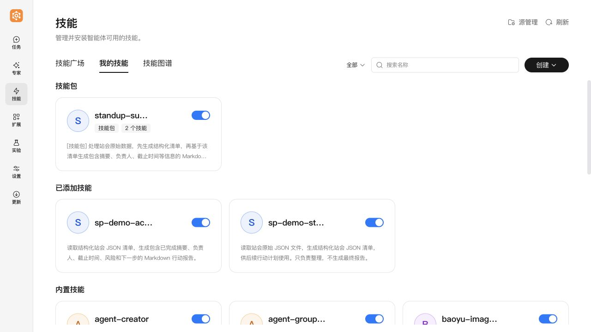
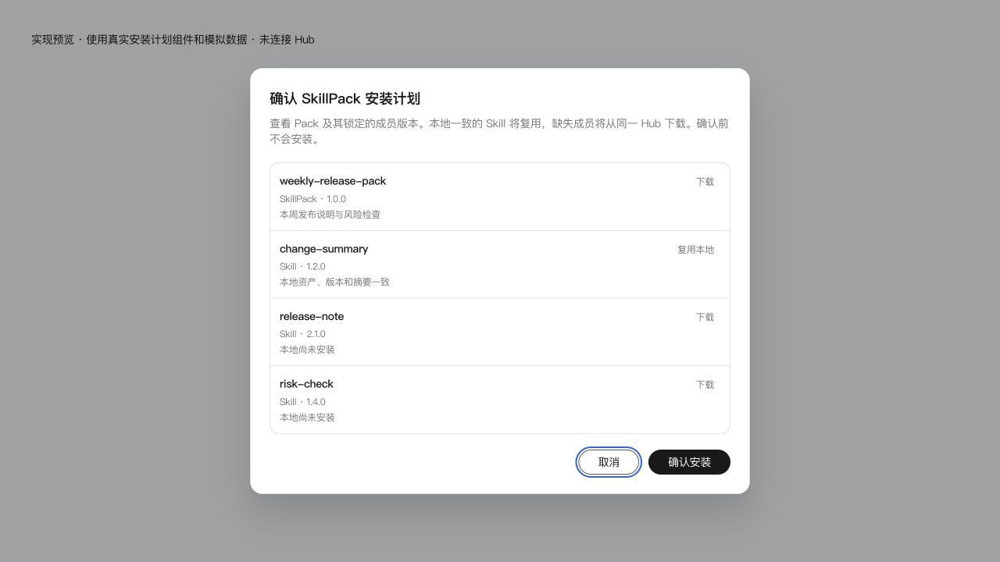

# SkillPack 的生成、复用与分发

SkillPack 是单 Agent 使用的复合 Skill。根 `SKILL.md` 说明成员的执行顺序；成员仍是可以单独使用的普通 Skill，不包含 SwarmSkill 或嵌套 SkillPack。

## 开启

以下功能默认关闭，先在隔离的测试 Hub 验证：

```sh
export SKILLPACK_PRODUCTIZATION_ENABLED=true
export SKILLPACK_DIRECT_ROUTE_MODE=confirm
export SKILLPACK_HUB_DEPLOYMENT_SCOPE=isolated
export SKILLPACK_HUB_TRANSPORT_PROFILE=legacy_skill_v1
```

`SKILLPACK_DIRECT_ROUTE_MODE` 支持 `off`、`shadow`（只判断和记录，不改变执行）和 `confirm`。也可以设置服务配置中的 `skillpack.direct_route_mode`；环境变量优先。

发布的部署范围必须是 `isolated` 或 `version_gated`。后者表示部署方已经限制市场的客户端版本；它本身不会替 Hub 建立版本过滤。当前 Hub 按普通 Skill 审核和展示兼容包，原生 SkillPack Hub 能力仍需后续版本。`native_skillpack_v1` 仅用于已经支持对应协议的 Hub，网络错误不会切换发布方式。

## 使用

- 对话中请求沉淀已完成的多 Skill 流程，Agent 调用 `skillpack_distill`。候选来自持久化的真实执行记录；查看成员和说明并确认后才安装。
- 安装后在“我的技能”与任务“+ → 技能”中使用，卡片显示 SkillPack 类型。成员状态变化会影响整个 Pack 的可用性。
- 新 query 完整匹配本地 Pack 时，先确认使用该 Pack；多个匹配由用户选择。确认后直接加载根说明与成员，跳过 Symphony 编排。部分匹配和不确定情况仍走原有流程。执行成员后失败不会自动再编排，以免重复副作用。
- 显式选择一个 Pack 视为已确认；与普通 Skill 混选时再次选择使用方式。外部写入等权限仍按原有机制确认。

## 发布和安装

从 Pack 详情页点击发布，预检一次列出所有成员的“复用／先发布／阻断”。用户确认后，先发布本地成员并等待审核，再生成精确成员锁并发布 Pack。已成功发布的成员是独立资产，后续 Pack 失败不会删除它们。重新打开发布面板可继续查询原操作；内容变化需重新准备并确认。

Pack ZIP 只包含外层 `plugin.yaml`、根说明和 `skillpack.lock.json`，不复制成员源码。锁定清单按顺序记录每个成员的 Hub asset ID、精确版本和原始 ZIP SHA-256。成员从同一 Hub 单独下载。

技能广场安装 Pack 时，会先展示安装计划。来源、版本、ZIP 摘要和本地内容都一致的成员可复用；缺失成员下载；同名冲突或本地修改会阻断。全部内容校验通过后统一安装，并保存 `.archive` 副本。失败会恢复目录和登记状态；进程中断后在加载技能前恢复未完成事务。

卸载 Pack 只删除 Pack，不删除成员。普通 Skill 仍被已安装 Pack 引用时，卸载会被拒绝并列出引用方。

## 运维边界

安装计划和事务位于当前技能目录的 `.skillpack/`，Hub 来源记录位于各技能 `.archive/hub-provenance.json`。这些文件不随 Pack 发布。关闭产品开关会停止新的沉淀、发布和 Pack 安装；已有普通 Skill 入口保留，直达路由有独立开关。

部署必须同时使用本特性的 agent-core 和 JiuwenSwarm 改动。当前分支的依赖与锁文件暂时使用配套 Core PR 的固定提交；正式合入前须切回官方仓库中的对应提交并更新锁文件。真实 Hub 审核、实际模型和各桌面平台的验收结果应单独记录，不能由本地模拟测试替代。

## 界面示例

下图来自隔离 WorkSwarm 的实际沉淀安装结果，成员使用合成站会数据：



下图使用真实安装组件及模拟安装计划，展示“复用／下载”确认，不是 Hub 线上截图：


